# Data interchange on read-only 120 mm optical data disks (CD-ROM)

## Brief History

In the past years compact disks originally developed by the Philips and Sony Companies for recording music have also been used for recording data as they allow recording of large amounts of information in a reliable and economic manner. As a read-only medium they are particularly suitable for use in applications such as auditing and legal documents. It appeared very quickly that there is an urgent need for public standards for this medium.

In October 1985 a number of industrial and software companies in the USA invited experts to participate in the elaboration of a working paper describing a proposal for the volume and file structure of such disks. The result of this work, in which also expert members of ECMA/TC15 as well as from Japan participated, was a report dated May 1986 and known as the 'High Sierra Group' proposal. This proposal was submitted to ECMA for their consideration. ECMA TC15, in collaboration with experts from user organizations, invested a considerable amount of work into this proposal in order to clarify and complete its technical contents and to re-edit it in a form suitable for an ECMA Standard. This led to the issue in December 1986 of Standard ECMA-119 which has been adopted by ISO as ECMA Standard ISO 9660.

The specification of the disk itself was contain in a document called 'Yellow Book' issued by the Philips and Sony Companies for their licensees only. In Spring 1987 ECMA was asked to produced a standard reflecting the contents of the 'Yellow Book' as the necessary complement to Standard ECMA-119. As a consequence the present ECMA Standard was developed by ECMA TC31. It has been adopted by ISO/IEC JTC 1 under the fast-track procedure, and published as International Standard ISO/IEC 10149.

A minor revision of ISO/IEC 10149 has been published in Summer 1995. This second edition of ECMA-130 has been fully aligned with the new edition of ISO/IEC 10149.

This ECMA Standard has been adopted by the ECMA General Assembly of June 1996

## 1 Scope

This ECMA Standard specifies the characteristics of 120 mm optical disks for information interchange between information processing systems and for information storage, called CD-ROM.

The optical disk specified by this ECMA Standard is of the type in which the information is recorded before delivery to the user and can only be read from the disk. This ECMA Standard specifies

- some definitions, the environments in which the characteristics of the disk shall be tested and the environments in which it shall be used and stored,
- the mechanical, physical and dimensional characteristics of the disk,
- the recording characteristics, the format of the tracks, the error-detecting and the error-correcting characters, and the coding of the information,
- the optical characteristics for reading the information.

These characteristics are specified for tracks recorded with digital data. According to this ECMA Standard, a disk may also contain one or more tracks recorded with digital audio data. Such tracks shall be recorded according to IEC 908.

## 2 Conformance

An optical disk is in conformance with this ECMA Standard if it conforms to all its mandatory requirements.

## 3 References

ECMA-119 Information processing - Volume and file structure of CD-ROM for information interchange, 1987.

IEC 908 Compact disc digital audio system, 1987.

## 4 Definitions

For the purpose of this ECMA Standard the following definitions apply.

### 4.1 Audio Track

An Information Track containing digitally encoded audio information.

### 4.2 concentricity

The diameter of a circular tolerance zone within which the centres of two circular features must lie.

### 4.3 Control byte

An 8-bit byte from a table of 98 bytes, added to an F₂-Frame and containing addressing information.

### 4.4 Digital Data Track

An Information Track organized in sectors and containing digital user data.

### 4.5 F₁-Frame

A group of 24 8-bit bytes, being the output of a scrambler and input to a CIRC encoder.

### 4.6 F₂-Frame

A group of 32 8-bit bytes, being the output of a CIRC encoder.

### 4.7 F₃-Frame

A group of 33 8-bit bytes, being an F₂-Frame with a control byte, and input to a 8-to-14 encoder.

### 4.8 Information Area

An area on the disk with physical tracks, consisting of a Lead-in area, User Data area and a Lead-out area.

### 4.9 Information Track

An area on the disk containing a collection of user information.

### 4.10 Physical Track

A 360° turn of a continuous spiral line on the disk, followed by the optical stylus.

### 4.11 radial acceleration

The radial acceleration of any physical track in the direction perpendicular to that of the axis of rotation of the disk, at a specified rotational speed.

### 4.12 radial runout

The difference between the maximum and the minimum distance of a physical track from the axis of rotation measured over one revolution.

### 4.13 Section

A group of 98 F₃-Frames containing one complete table of Control bytes.

### 4.14 Sector

The smallest addressable part of a Digital Data Track in the information area that can be accessed independently of other addressable parts of the area.

### 4.15 User Data Area

A part of the information area containing User Data.

## 5 Environments

### 5.1 Testing environments

#### 5.1.1 Optical stylus

The optical stylus used for testing measurements shall have the following characteristics.

wavelength λ : 780 nm ± 10 nm

polarization : circular

numerical aperture : 0,45 ± 0,01

intensity at the rim of the pupil of the

objective lens : larger than 50% of the maximum intensity value

The rms wave front error of the beam near the information layer shall be less than 0,07 λ. The contribution of the disk to this error shall be less than 0,05 λ.

#### 5.1.2 Clamping

Where applicable, the disk shall be held between two concentric rings having an inner diameter of at least 29 mm and an outer diameter of at most 31 mm holding the disk with a force in the range 1 N to 2 N.

#### 5.1.3 Normal testing environment

Unless otherwise stated, tests and measurements made on the disk to check the requirements of this ECMA Standard shall be carried out under the following conditions:

temperature : 25 °C ± 10 °C

relative humidity : 45 % to 75 %

atmospheric pressure : 96 kPa ± 10 kPa

conditioning before testing : 24 h min.

No condensation on the disk shall be permitted to occur.

#### 5.1.4 Restricted testing environment

Where specifically stated tests and measurements shall be carried out under the following conditions:

temperature : 23 °C ± 2 °C

relative humidity : 45 % to 55 %

atmospheric pressure : 96 kPa ± 10 kPa
conditioning before testing : 24 h min.

No condensation on the disk shall be permitted to occur.

### 5.2 Operating environment

Disks used for data interchange shall be operated under the following conditions, when mounted in the drive supplied with voltage and measured on the outside surface of the disk.

The disk exposed to storage conditions must be conditioned in the operating environment for at least two hours before operating.

temperature : -25 °C to 70 °C
relative humidity : 10 % to 95 %
absolute humidity : 0,5 g·m⁻³ to 60,0 g·m⁻³
sudden change of temperature : 50 °C max.
sudden change of relative humidity : 30 % max.

There shall be no condensation of moisture on the disk.

### 5.3 Storage environment

Storage environment is the ambient condition to which the disk is exposed when stored. No condensation of moisture on the disk is permitted (see annex F).

temperature : -20 °C to 50 °C
relative humidity : 5 % to 90 %
wet bulb temperature : 29 °C max.
atmospheric pressure : 75 kPa to 105 kPa

## 6 Inflammability

The disk shall be made from materials that, if ignited from a match flame, do not continue to burn in a still carbon dioxide atmosphere.

## 7 Material

This ECMA Standard specifies the material of the disk only in the information area (see 8.6). The remainder of the disk can be made of any material as long as all mandatory requirements of this ECMA Standard are met.

The weight of the disk shall be within 14 g and 33 g.

## 8 Mechanical, physical and dimensional characteristics

Dimensional characteristics are specified for those parameters deemed mandatory for interchange and compatible use of the disk. Where there is freedom of design, only the functional characteristics of the elements described are indicated. The enclosed drawings show the dimensional requirements in summarized form. The different parts of the disk are described from the centre hole to the outside rim.

All diameters are referred to the centre of the centre hole.

Other dimensions are referred to two Reference Planes P and Q.

Figure 1 shows a cross-section of a part of the disk,
Figure 2 shows at a larger scale the edges of the centre hole,
Figure 3 shows at a larger scale a cross-section of the disk in the information area,
Figure 4 shows at a larger scale a cross-section of the rim area.

### 8.1 Reference planes

Reference Plane P is the primary Reference Plane. It is the plane on which the bottom surface of the clamping area (see 8.5) rests.

Reference Plane Q is the plane parallel to Reference Plane P at the height of the top surface of the clamping area.

### 8.2 Centre hole

The centre hole shall have a cylindrical shape. Its diameter shall be

$$d_1 = 15,0 \text{ mm} \begin{matrix} +0,1 \text{ mm} \\ -0,0 \text{ mm} \end{matrix}$$

Diameter $d_1$ shall be measured in the restricted testing environment.

The bottom edge of the centre hole may have a chamfer up to a height

$$h_1 = 0,1 \text{ mm max.}$$

above the bottom surface of the first transition area (see 8.3) at an angle

$$\alpha = 45^\circ$$

Alternatively this edge may be rounded off with a radius of not greater than 0,1 mm.

The top edge of the centre hole may present burrs which are permitted to extend by

$$h_2 = 0,2 \text{ mm max.}$$

above the top surface of the first transition area.

### 8.3 First transition area

The first transition area shall extend between diameter $d_1$ and diameter $d_2$.

$$d_2 = 20 \text{ mm} \begin{matrix} +6 \text{ mm} \\ -0 \text{ mm} \end{matrix}$$

In this whole area the top surface of the disk is permitted to be below Reference Plane Q by

$$h_3 = 0,2 \text{ mm max.}$$

and the bottom surface of the disk is permitted to be above Reference Plane P by

$$h_4 = 0,2 \text{ mm max.}$$

In addition, in the part of the area defined by

$$20 \text{ mm} < d_2 < 26 \text{ mm}$$

the top surface of the disk is permitted to be below Reference Plane Q by

$$h_5 = 0,4 \text{ mm max.}$$

and the bottom surface of the disk is permitted to be above Reference Plane P by

$$h_6 = 0,4 \text{ mm max.}$$

### 8.4 Clamping area

The clamping area shall extend between the maximum value of diameter $d_2$ and diameter $d_3$.

$$d_2 \text{ (max.)} = 26 \text{ mm}$$

$$d_3 = 33 \text{ mm min.}$$

The bottom surface of the clamping area shall be flat within 0,1 mm and shall lie on Reference Plane P.

The top surface of the clamping area shall be parallel to Reference Plane P within 0,2 mm, it defines Reference Plane Q.

The height of the top surface above Reference Plane P shall be

$$h_7 = 1,2 \text{ mm} \begin{matrix} +0,3 \text{ mm} \\ -0,1 \text{ mm} \end{matrix}$$

### 8.5 Second transition area

The second transition area shall extend between diameters $d_3$ and $d_4$.

$$d_4 = 44 \text{ mm max.}$$

In this area the bottom surface of the disk is permitted to be either above Reference Plane P by

$$h_8 = 0,4 \text{ mm max.}$$

or below Reference Plane P by

$$h_9 = 0,4 \text{ mm max.}$$

and the top surface of the disk is permitted to be either above Reference Plane Q by

$$h_{10} = 0,4 \text{ mm max.}$$

or below Reference Plane Q by

$$h_{11} = 0,4 \text{ mm max.}$$

### 8.6 Information area

The Information Area shall extend between diameters $d_4$ and $d_5$.

$$d_5 = 118 \text{ mm max.}$$

The Information Area comprises the following zones.

- An inner buffer zone that extends between diameters $d_4$ and $d_6$.

$$d_4 + 1 \text{ mm} \le d_6 \le 46 \text{ mm max.}$$

This diameter shall be measured in the restricted testing environment.

$$d_7 = 50,0 \text{ mm} \begin{matrix} +0,0 \text{ mm} \\ -0,4 \text{ mm} \end{matrix}$$

This diameter shall be measured in the restricted testing environment.

- A user data zone that extends between diameter $d_7$ and $d_8$.

$$d_8 = 116 \text{ mm max.}$$

This diameter shall be measured in the restricted testing environment.

- A lead-out zone that extends between diameters $d_8$ and $d_9$.

$$d_9 = (d_8 + 1 \text{ mm}) \text{ min.}$$

- An outer buffer zone that extends between diameters $d_9$ and $d_5$, where

$$d_9 + 1 \text{ mm} \le d_5 \le 118 \text{ mm}$$

Between diameters $d_4$ and $d_5$ the disk shall consist of (figure 3):

- a transparent substrate,
- a reflective layer,
- a protective layer,
- an optional label.

The label may extend beyond the so-defined zone.

The height of the label above Reference Plane P shall be

$$h_{12} = 1,2 \text{ mm} \begin{matrix} +0,3 \text{ mm} \\ -0,1 \text{ mm} \end{matrix}$$

The thickness $e$ of the transparent substrate shall be

$$e = 1,2 \text{ mm} \pm 0,1 \text{ mm}$$

The bottom surface of the transparent substrate shall lie on Reference Plane P.

The index of refraction of the transparent substrate shall be

$$1,55 \pm 0,10$$

The birefringence of the transparent substrate expressed as a retardation (parallel beam, circularly polarized, normal incidence, double-pass) shall be

100 nm max.

The reflectance of the transparent substrate and reflective layer measured under normal incidence and parallel beam in an unrecorded part of the information area shall be

70% min.

The relative variation of this reflectance for frequencies below 100 Hz shall be less than 3% for a disk rotating at scanning velocity.

These parameters shall be measured at the wavelength specified in 5.1.1.

### 8.7 Rim area

The rim area shall extend between diameters $d_5$ and $d_{10}$.

$$d_{10} = 120,0 \text{ mm} \pm 0,3 \text{ mm}$$

This diameter shall be measured in the restricted testing environment.

Its concentricity relative to the largest circle inscribed in the centre hole shall be within

0,2 mm.

In the zone extending between diameters $d_5$ and $d_{11}$, where $d_{11}$ shall satisfy both of the following conditions:

$$\begin{array}{l} d_{11} \geq d_5 \\ 117,7 \text{ mm} \leq d_{11} \leq 118,3 \text{ mm}. \end{array}$$

The bottom surface of the disk shall lie on the Reference Plane P and the height of the top surface above Reference Plane P shall be equal to $h_{12}$.

In the zone extending between diameters $d_{11}$ and $d_{10}$ the bottom surface of the disk is permitted to be below Reference Plane P by

$$h_{13} = 0,1 \text{ mm max}.$$

and the top surface of the disk is permitted to be higher than $h_{12}$ by

$$h_{14} = 0,1 \text{ mm max}.$$

The values of $h_{13}$ and $h_{14}$ shall satisfy the condition:

$$(h_{12} + h_{13} + h_{14}) \leq 1,5 \text{ mm}$$

In this zone the thickness of the disk is also permitted to decrease so that

$$h_{16} - h_{15} = 0,6 \text{ mm min}.$$

as shown in figure 4.

### 8.8 General remarks

All heights specified in the preceding clauses and indicated by $h_i$ are independent from each other. This means, for example, that if the top surface of the first transition area is below Reference Plane Q by up to $h_3$ there is no implication that the bottom surface of this area has to be above Reference Plane P by up to $h_4$. Moreover, whilst the height and tolerances for the top surfaces of the clamping area and the information area (i.e. $h_7$ and $h_{12}$) have the same numerical values, this does not imply that the actual values have to be identical.

## 9 Mechanical deflection of the entrance surface

The following requirements apply to both a static disk and a disk clamped according to 5.1.2 and rotating at the scanning velocity.

The bottom surface of the information area (i.e. the entrance surface of the read beam) shall not deviate from Reference Plane P by more than $\pm 0.4$ mm between $d_6$ and $d_{11}$. The rms value over one revolution shall not exceed 0.3 mm.

The angle which the normal to this entrance surface, averaged over an area of 2 mm diameter, makes with the normal to Reference Plane P shall not exceed $0^\circ 36'$. If a beam of light enters the disk along a normal to the Reference Plane P, then the angular deviation of the reflected beam in radial direction from the normal to Reference Plane P shall not exceed $1^\circ 36'$. This figure includes the tolerance on the parallelism of the information layer and the entrance surface.

## 10 Deflection of the reflective layer

With the disk clamped according to 5.1.2, and rotating at the scanning velocity, the deflection of the reflective layer is its axial deviation from its nominal position related to Reference Plane P (see 8.6) as seen by the optical stylus. Thus, it comprises the tolerances on the thickness, on the index of refraction and the deflection of the entrance surface. This deflection shall be measured between diameters $d_4$ and $d_5$.

a) Frequencies below 500 Hz

The deflection on either side of the nominal position of the reflective layer shall not exceed 0.5 mm. The rms value shall not exceed 0.4 mm. The acceleration of the reflective layer along a fixed line normal to the Reference Plane P shall not exceed 10 m/s$^2$.

b) Frequencies above 500 Hz

The deflection on either side of the nominal position shall not exceed 1 $\mu$m.

## 11 Physical Track geometry

### 11.1 Physical Track shape

There shall be Physical Tracks between diameters $d_6$ and $d_9$ each of which forms a 360° turn of a continuous spiral line.

Each Physical Track shall consist of a succession of depressions as seen by the optical stylus, called pits, in the otherwise flat reflective layer. The encoded information is represented by variations of the pit length and by variation of the distance between pits. The depth of the pits shall be such that the requirements of 12.2 are met.

### 11.2 Direction of rotation

The Physical Tracks shall spiral outward when the disk rotates counter-clockwise as seen by the optical stylus.

### 11.3 Physical Track pitch

The spiral shall have a pitch of 1.6 $\mu$m $\pm$ 0.1 $\mu$m.

### 11.4 Scanning velocity

The scanning velocity during recording shall be between 1.20 m/s and 1.40 m/s with a Channel bit rate of 4,321.8 Mbit/s (see clause 20). The velocity variation for a disk when recorded shall be within $\pm$ 0.01 m/s.

### 11.5 Radial runout of tracks

The following requirements shall be met with the disk rotating at scanning velocity.

a) Frequencies below 500 Hz.

The radial runout of any Physical Track, i.e. the variation of the distance between the Physical Track and the centre of the centre hole, shall not exceed 140 μm, peak-to-peak.

The acceleration shall not exceed 0,4 m/s².

b) Frequencies above 500 Hz.

The noise in the radial tracking signal is measured in the closed loop situation of the radial servo in a frequency band from 500 Hz to 10 kHz. (zero dB point of the open-loop transfer function of the servo: 200 Hz; cross-over points of the lead network: 65 Hz and 650 Hz; see figure 5).

The rms value of the noise in the residual error signal shall correspond to a tracking error of less than 0,03 μm, integration time 20 ms.

In addition, to avoid strong single frequency noise contributions, this rms value shall be less than 0,01 μm when measured with a scanning filter with a width of 100 Hz over a range from 500 Hz to 10 kHz.

## 12 Optical read system

For testing the requirements of 12.1 to 12.6 the information in the reflective layer shall be read by the optical beam from an optical stylus according to 5.1.1 and focused on this layer through the transparent substrate. During reading the scanning light spot is diffracted by the pits of the reflective information layer. The optical power that is diffracted back into the objective lens of the optical system is modulated according to the encoded digital information. The modulated photo current is called the high frequency (HF) signal.

### 12.1 HF signal

The HF signal is measured before a.c. coupling (see figure 6). The highest and lowest fundamental frequencies that occur are 720 kHz and 196 kHz, respectively. The peak-to-peak values of the detector current of the highest and lowest fundamental frequencies are denoted by $I_3$ and $I_1$, respectively. The top level of HF signal, which is given by the lowest fundamental frequency, is denoted by $I_{\text{top}}$.

The information contained in the HF signal is extracted in the form of the positions of the crossings of the HF signal with a decision level $I_D$. This decision level $I_D$ is the level in the middle of the extreme values of $I_3$. There are three lozenges of the eye pattern between successive crossings of $I_3$ and $I_D$.

### 12.2 Modulation amplitude

The relationship between $I_3$, $I_{11}$ and $I_{\text{top}}$ shall be

$$0,3 \leq \frac{I_3}{I_{\text{top}}} \leq 0,7$$

$$\frac{I_{11}}{I_{\text{top}}} \geq 0,6$$

### 12.3 Symmetry

The symmetry of the HF signals with respect to the decision level $I_D$ shall be

$$- 20 \% \leq \frac{1}{2} - \frac{I_D}{I_{11}} \quad 100 \% \leq + 20 \%$$

### 12.4 Cross talk

The cross talk is measured as the ratio between the HF signal amplitude with the beam half way between two tracks and with the beam on track. This ratio shall be less than 0,5.

### 12.5 Quality of the HF signal

#### 12.5.1 Position jitter of the Channel bits

Position jitter of the Channel bits (see clause 19) causes a frequency modulation of the Channel bit rate (see 11.4). The maximum jitter allowed, expressed as time error, for a single modulating frequency is given by figure 7. The time error shall be measured at a constant scanning velocity (see 11.4)

#### 12.5.2 Specification of random errors

An 8-bit byte shall be considered erroneous if one or more bits of that byte are erroneous.

A frame error is the occurrence of one or more erroneous bytes in a frame at the input of the C1-decoder, after the 1-byte delay section (see figure C.2). The frame error rate averaged over any 10 s shall be less than 3 x 10⁻².

#### 12.5.3 Specification of burst errors

A frame at the input of the C1-decoder after the 1-byte delay section is called uncorrectable if it contains two or more successive erroneous bytes.

The number of successive uncorrectable frames shall be less than 7.

### 12.6 Radial track-following signal

A radial off-track position of the scanning spot results in a diffraction pattern that is asymmetrical in the radial direction of the disk. Subtraction of the optical powers I₁ and I₂ diffracted into the two halves of the aperture of the objective lens (positioned on opposite sides of the track) yields a servo signal Iₛ for radial track following, Iₛ = I₁ - I₂ measured at far field.

This servo signal Iₛ is low-pass filtered with a time constant of 15 μs. In figure 8 the tracking signal is given as a function of the radial position of the spot. The radial position of the scanning spot is at the centre of the track for each zero crossing of Iₛ with positive slope when the spot is moving radially away from the centre of the disk. This sign of the tracking signal is determined by the geometry of the pits and by the detector arrangement.

#### 12.6.1 Magnitude

The slope of the tracking signal at the positive zero crossing measured with circularly polarized light, is given by

$$0,040 \leq \frac{I_s}{I_{\text{top}}} \leq 0,070$$

at a radial offset of 0,1 μm of the focus of the beam from the centre of the track. I_top is defined in 12.1.

On one disk, the magnitude of the tracking signal shall not deviate from its average value by more than 15%.

#### 12.6.2 Defects

Defects shall be tolerated if their diameter does not exceed the following values.

air bubbles : 100 μm

black spots with an area around : 200 μm

it with increased birefringence

black spots without such an area : 300 μm

In addition, the distance between adjacent defects along a track shall be at least 20 mm.

Black spots may be dirt particles enclosed in the substrate or pin holes in the reflective layer.

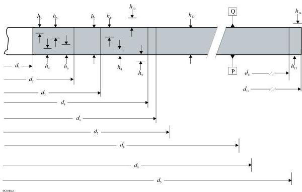

*Figure 1 – General cross-section of the disk*

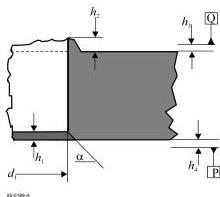

*Figure 2 – Cross-section of a detail of the centre hole*

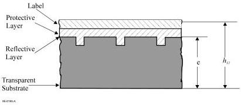

*Figure 3 – Enlarged cross-section of the information area*

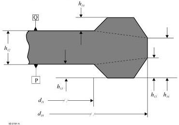

*Figure 4 – Cross-section of a detail of the rim of the disk*

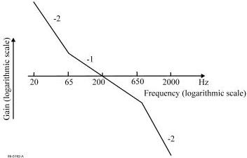

*Figure 5 – Schematic representation of the open-loop transfer function for radial tracking measurements*

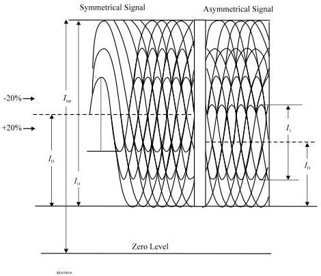

*Figure 6 – HF signal*

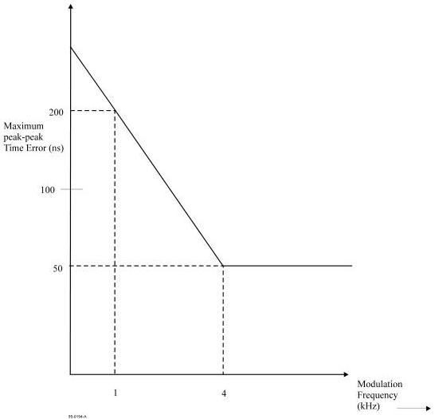

*Figure 7 – Position jitter of the Channel bits versus the modulation frequency*

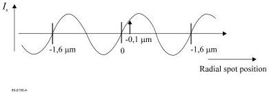

*Figure 8 – Radial tracking signal versus the radial spot displacement away from the centre of the disk*

## 13 General aspects of recording

### 13.1 Information Tracks

In the information area tracks containing information are called Information Tracks. Each Information Track shall consist of a part of a physical track, a complete physical track or more than one physical track.

Information Tracks containing digital data are called Digital Data Tracks. These tracks are described in clauses 14 to 21. Information Tracks containing audio information are called Audio Tracks. These tracks shall be according to IEC 908. A CD-ROM shall contain either Digital Data Tracks only or Digital Data Tracks and Audio Tracks.

### 13.2 Bit coding

When the coding method requires it, the user data field shall be regarded as an ordered sequence of bit positions, each containing a bit.

## 14 Sectors of a Digital Data Track

The digital data to be recorded in an Information Track shall be represented by 8-bit bytes and grouped into Sectors. A Sector is the smallest addressable part of the information area that can be accessed independently. The number of Sectors of an Information Track is variable. It depends on the amount of information to be recorded in the Information Track.

A Sector shall comprise 2 352 bytes and have the following layouts depending on the setting of the Sector Mode byte. In the following figures the byte positions are numbered starting with 0. Position 0 corresponds to the first byte of a Sector. Digits in parentheses denote the contents of bytes expressed in hexadecimal notation.

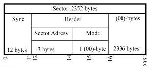

*Figure 10 – Sector Mode (00)*

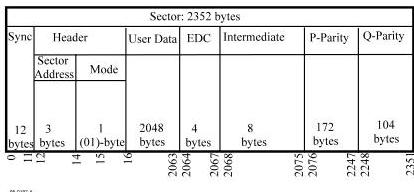

*Figure 11 – Sector Mode (01)*

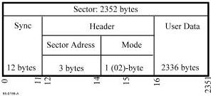

*Figure 12 – Sector Mode (02)*

### 14.1 Sync field

The Sync field shall consist of 12 bytes recorded in byte positions 0 to 11:

- 1 (00) byte
- 10 (FF) bytes
- 1 (00) byte

### 14.2 Header field

The Header field shall consist of 4 bytes:

a) a Sector Address of 3 bytes.

If the Lead-in Area contains a Digital Data Track, the Sector Address of the Headers in this area shall contain the Physical Address of the Sector expressed in terms of the relative time elapsed since the beginning of the Lead-in Area.

- byte 12 shall be set to the contents of the MIN field, to which the value (A0) has been added. For example, (03) becomes (A3),
- byte 13 shall be set to the contents of the SEC field,
- byte 14 shall be set to the contents of the FRAC field.

These three fields are part of the q-channel of a Section in the Lead-in Area (see 22.3.3.3 and 22.3.4.4).

The Sector Addresses in the user Data Area and, if the Lead-out Area contains a Digital Data Track, those in the Lead-out Area, shall contain the Physical Address of the Sector expressed in absolute time elapsed since the beginning of the User Data Area (see clause 21).

- byte 12 shall be set to the contents of the A-MIN field,
- byte 13 shall be set to the contents of the A-SEC field,
- byte 14 shall be set to the contents of the A-FRAC field.

These three fields are part of the q-channel (see 22.3.3.5) of a Section (see clause 18) that comes out of the 8-to-14 encoder at the moment at which the Sync of the Sector enters the scrambler. The time in the Header shall be given with an accuracy of ± 1 s (see clause 21). This tolerance takes care of the delay caused by the CIRC (see annex C) and possibly other storage registers. The length of these delays is of the order of 30 ms, i.e. the recording length of one Sector on the disk.

b) a Sector Mode byte in byte position 15. The setting of this byte shall be as follows:

If set to (00) : This shall mean that all bytes in positions 16 to 2 351 of the Sector are set to (00).

If set to (01) : This shall mean that all bytes in positions 16 to 2 063 are user data bytes and that the bytes in positions 2 064 to 2 351 are set according to 14.3 to 14.6 below. Thus the user data is protected by EDC, ECC and CIRC.

If set to (02) : This shall mean that all bytes in positions 16 to 2 351 are user data bytes. Thus the user data is protected by CIRC only.

### 14.3 EDC field

The EDC field shall consist of 4 bytes recorded in positions 2 064 to 2 067. The error detection code shall be a 32-bit CRC applied on bytes 0 to 2 063. The least significant bit of a data byte is used first. The EDC codeword must be divisible by the check polynomial:

$$\mathrm{P}(x) = (x^{16} + x^{15} + x^2 + 1) \cdot (x^{16} + x^2 + x + 1)$$

The least significant parity bit ($x^0$) is stored in the most significant bit position of byte 2 067.

### 14.4 Intermediate field

The Intermediate field shall consist of 8 (00)-bytes recorded in positions 2 068 to 2 075.

### 14.5 P-Parity field

The P-parity field shall consist of 172 bytes in positions 2 076 to 2 247 computed on bytes 12 to 2 075 as specified in annex A.

### 14.6 Q-Parity field

The Q-parity field shall consist of 104 bytes in positions 2 248 to 2 351 computed on bytes 12 to 2 247 as specified in annex A.

## 15 Scrambling

Bytes 12 to 2 351 of each Sector shall be scrambled according to annex B. The resulting layout of a Scrambled Sector shall be as follows.

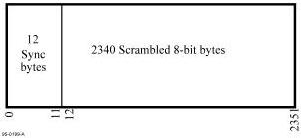

*Figure 13 – Scrambled Sector*

## 16 F₁-Frames

Each Scrambled Sector shall be mapped onto a series of consecutive frames. Each frame consists of 24 8-bit bytes, numbered from 0 to 23. Byte 0 of the Sector shall be placed in byte 4n of a frame, where n is 0, 1, 2, 3, 4 or 5. Consecutive bytes of the Sector are placed in consecutive bytes of the frames. Byte 2 351 of a Sector is immediately followed by byte 0 of the next Sector.

Subsequently, the byte order of each even-odd numbered pair of bytes in the frame is reversed. That is, the byte order 0, 1, 2, 3, 4, 5 is changed to 1, 0, 3, 2, 5, 4. Such a frame with 24 interchanged 8-bit bytes is called an F₁-Frame. The position of byte 0 of a Sector in an F₁-Frame is 4n + 1, where n is 0, 1, 2, 3, 4 or 5.

## 17 CIRC encoding - F₂-Frames

The F₁-Frames shall be fed into a Cross Interleaved Reed-Solomon encoder according to annex C.

The F₁-Frames of 24 bytes each are transformed into F₂-Frames of 32 bytes each. The bit pattern of each of the 24 8-bit bytes of an F₁-Frame remains unchanged but the bytes themselves are displaced and re-distributed over 106 F₂-Frames. Eight additional 8-bit bytes with parity information are added so that each F₂-Frame comprises 32 bytes.

## 18 Control Bytes - F₃-Frames and Sections

A single byte called Control byte is added as first byte to each F₂-Frame of 32 bytes. This yields a new F₃-Frame of 33 bytes.

The Control byte shall be obtained from a table of 98 bytes as defined in clause 22. The information in the Control bytes is mainly used for addressing purposes. The bytes in the table are added to 98 consecutive F₂-Frames, coming out of the CIRC encoder, byte 0 of the table first, byte 97 last. This operation yields groups of 98 F₃-Frames of 33 bytes each, called Sections. These Sections are asynchronous with the Sectors, i.e. there is no prescribed relation between the number of the F₁-Frame in which the first byte of a Sector is placed and the number of the F₃-Frame in which the first Control byte of the table is placed. Each Section has its own table with Control bytes.

Clause 22 specifies how the Control bytes are generated.

## 19 Recording of the F₃-Frames on the disk

In order to record the F₃-Frames on the disk each 8-bit byte shall be represented by 14 so-called Channel bits. Each F₃-Frame is represented by a so-called Channel Frame comprising a Sync Header, Merging bits and 33 14-Channel bit bytes.

### 19.1 8-to-14 Encoding

All 33 bytes of the F₃-Frames of each Section are 8-bit bytes. They shall be converted into 14-bit bytes according to the table of annex D. The bits of these 14-bit bytes are called Channel bits. These bytes of 14 Channel bits are characterized by the fact that between two ONEs there are at least two and at most ten ZEROs.

The first byte of the first two F₃-Frames of each Section, i.e. the Control byte of these frames, is not converted according to this table but is given a specific synchronisation pattern of 14 Channel bits that is not included in the table of annex D. These two patterns shall be:

1st Frame, byte 0, called SYNC 0 : 00100000000001

2nd Frame, byte 0, called SYNC 1 : 00000000010010

The left-most Channel bit is sent first in the data stream.

### 19.2 Sync Header

A Sync Header shall be the following sequence of 24 Channel bits:

1000000000100000000010

The left-most Channel bit is sent first in the data stream.

### 19.3 Merging Channel bits

Merging Channel bits shall be sequences of three Channel bits set according to annex E and inserted between the bytes of 14 Channel bits as well as between the Sync Header and the adjacent bytes of 14 Channel bits.

### 19.4 Channel Frame

Each F₃-Frame is converted to a Channel Frame with the following configuration.

- Sync Header : 24 Channel bits
- Merging bits : 3 Channel bits
- Control byte : 14 Channel bits
- Merging bits : 3 Channel bits

Bytes 1 to 32, each followed by Merging bits : 32 x (14+3) = 544 Channel bits

Thus, each Channel Frame representing a F₃-Frame comprises 588 Channel bits.

These Channel bits shall be recorded on the disk along a Physical Track. A ONE Channel bit shall be represented by a change of pit to land or land to pit in the reflective layer. A ZERO Channel bit shall be represented by no change in the reflective layer.

## 20 Track structure of the Information Area

The Information area shall contain Information Tracks in

- the Lead-in Area;
- the User Data Area;
- the Lead-out Area.

The Lead-in Area shall contain only one Information Track called Lead-in Track. The Lead-out Area contains only one Information Track called Lead-out Track.

The user data shall be recorded in the Information Tracks in the User Data Area. All Information Tracks containing digital data shall be structured in Sectors.

For the purpose of linking Information Tracks in the Information Area, these tracks may have:

a) Pause : A part of an Information Track on which only control information but no user data is recorded.
b) Pre-gap : A first part of a Digital Data Track not containing user data and encoded as a Pause. It is divided into two intervals:
- first interval: at least 75 Sections (at least 1 s) coded as the preceding track, i.e. the Control field (see 22.3.1) of the q-channel (see 22.3) and, in case of a preceding Digital Data Track, the setting of the Sector Mode byte are identical with those of the previous Information Track;
- second interval: at least 150 Sections (at least 2 s) in which the Control field of the q-channel and the setting of the Sector Mode byte are identical with those of the part of the track where user data is recorded. In this interval of the Pre-gap the data is structured in Sectors.
c) Post-gap : A last part of a Digital Data Track, not containing user data, and structured in Sectors. It has the length of at least 150 Sections (at least 2 s). The setting of the Control field of the q-channel and the setting of the Sector Mode byte are identical with those of the part of the track where the user data is recorded.

### 20.1 Lead-in Area

The Lead-in Track is either a Digital Data Track or an Audio Track. If it is a Digital Data Track, it shall be structured in Sectors and end with a Post-gap. If it is an Audio Track, it shall be according to IEC 908.

### 20.2 User Data Area

The Information Tracks in the User Data Area shall be either Digital Data Tracks only or Digital Data Tracks and Audio Tracks. The following rules apply to the tracks in the User Data Area:

- If the first Information Track is a Digital Data Track, it shall start with a Pause of 150 Sections (2 s) and shall be coded as the second interval of a Pre-gap.
- A Digital Data Track, not being the first track in the User Data Area, shall begin with a Pre-gap if the preceding track is a Digital Data Track with a different Sector mode or if it is an Audio Track.
- A Digital Data Track shall end with a Post-gap if the following track is an Audio Track. This rule applies also to the last Digital Data Track in the User Data Area, which is followed by the Lead-out Track.

### 20.3 Lead-out Area

The Lead-out Track is either a Digital Data Track or an Audio Track. If it is a Digital Data Track, it shall be structured in Sectors, without Pre-gap. If the Lead-out Track is an Audio Track, it shall be according to IEC 908.

## 21 Addressing system in the Information Area

The address of a Section of an Information Track on the disk is given as the elapsed time from the start of the User Data Area to that Section. This time is recorded in the Control bytes of each Section, and is called absolute time. It is given with a resolution of 1/75 of a second. The time is given for a data rate from the disk of 4,321 8 x 10⁶ Channel bits per second. This amounts to exactly 75 Sections per second.

The address of a Sector is recorded in the Sector Header, also as an absolute time. It has no prescribed relation to the addresses of the Sections, because the mapping of a Sector on the Sections during recording is implementation-dependent due to the freedom left in clause 16. Therefore, the address of a Sector is filled in just before the Sector enters the CIRC encoder.

The nominal value of the absolute time in the Header of a Sector shall be equal to the absolute time recorded in the Control bytes of that Section which is being processed by the 8-to-14 encoder at the instant that the Sync of the Sector enters the CIRC encoder. This prescription assumes that the CIRC encoder is the only delaying element in the recording electronics.

The tolerance on the nominal time in the address of the Header of a Sector shall be ± 1 s. This tolerance is large compared with the recording time of a Section (1/75 s) and of a Sector, in order to accommodate the freedom this ECMA Standard leaves for the implementation.

Each Sector has a unique address. The address of the first Sector with User Data of an Information Track is written in the table of contents of the disk (see 22.3.4). Thus, the table of contents points to the start of an Information Track on the disk in terms of the absolute time in the Control bytes with an accuracy of ± 1 s.

## 22 Specification of the Control bytes of Digital Data Tracks

As specified above (see clause 18), each F₃-Frame of each Section contains a Control byte as the first byte. For each Section the Control bytes make up the following table. The contents of this table are renewed each 1/75 s, i.e. at the same rate at which the Sections are being processed.

|  Byte No. | b₈ | b₇ | b₆ | b₅ | b₄ | b₃ | b₂ | b₁  |
| --- | --- | --- | --- | --- | --- | --- | --- | --- |
|   |  p | q | r | s | t | u | v | w  |
|  0 | SYNC 0  |   |   |   |   |   |   |   |
|  1 | SYNC 1  |   |   |   |   |   |   |   |
|  2 |  |  |  |  |  |  |  |   |
|  . |  |  |  |  |  |  |  |   |
|  . |  |  |  |  |  |  |  |   |
|  . |  |  |  |  |  |  |  |   |
|  . |  |  |  |  |  |  |  |   |
|  . |  |  |  |  |  |  |  |   |
|  . |  |  |  |  |  |  |  |   |
|  96 |  |  |  |  |  |  |  |   |
|  97 |  |  |  |  |  |  |  |   |

*Figure 14 – Control bytes*

Each byte comprises eight bits numbered b₁ to b₈. Bit b₈ is the most significant bit.

The table of Control bytes of a Section defines eight channels called p-channel, q-channel, v-channel and w-channel of 96 bits each, as byte 0 and byte 1 are treated separately as specified above (see 19.1).

### 22.1 Setting of r-channel to w-channel

These six channels, i.e. bits b₁ to b₆ of the Control bytes of each F₃-Frame are not used and always set to ZERO.

### 22.2 Setting of the p-channel

All p-channels of the consecutive Sections constitute the p-channel of the Information area.

This p-channel is used to set Flags indicating each the beginning of an Information Track. Flags are specified by sequences of bits set to ONE, else the bits of the p-channel are set to ZERO. All bits of the p-channel of a Section shall be set to the same value.

The minimum length of a Flag (i.e. a continuous sequence of ONEs in the p-channel) shall be 2 s (i.e. 150 Sections). The last F₃-Frame with a ONE in the p-channel (i.e. the last F₃-Frame for which bit b₈ of its Control byte is set to ONE) shall be the first Section containing user data.

If the Information Track starts with a Pause longer than 2 s, the Flag shall have the same length as this Pause.

The p-channel bits of the Lead-in Track shall be set to ZERO.

The p-channel of the last Information Track in the User Data area shall end with a Flag of 2 s to 3 s (i.e. 150 to 225 Sections). Its end shall indicate the beginning of the Lead-out Track. In this track the bits of the p-channel are set to ZERO during 2 s to 3 s. Then the bits of the p-channel are alternately a ONE and a ZERO at a rate of 2,00 Hz ± 0,04 Hz and a duty cycle of 50 % ± 5 %.

### 22.3 Setting of the q-channel

All q-channels of the consecutive Sections constitute the q-channel of the information area.

The q-channel contains detailed control information as specified hereafter. The most significant bit of the q-channel of a Section is that of F₃-Frame No. 2, it is sent first in the data stream. Therefore, a bit of the q-channel is numbered according to the number of the frame in which it is recorded.

The layout of the q-channel of a Section shall be as follows.

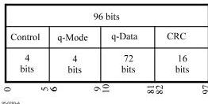

*Figure 15 – q-channel layout*

#### 22.3.1 Control field

The first field in the q-channel, the Control field shall consist of the four bits in positions 2 to 5. It specifies the type of user data recorded on the Information Track and whether this user data may be copied or not.

If set to 0100 :this shall mean that the user data is digital data and that it shall not be copied.

If set to 0110 :this shall mean that the user data is digital data and that it may be copied.

The left-most bit is the most significant bit, it is recorded in position 2.

The bits of the Control field can change only during a Pause of at least 2 s (i.e. when the INDEX field is set to ZERO, see 22.3.3.2) or in the Lead-in area, except the Copy bit, viz. the 3rd bit from the left, which can change between two Sections.

Other settings of the Control field apply to Audio Tracks only (see IEC 908).

#### 22.3.2 q-Mode field

The second field in the q-channel, the q-Mode field, shall consist of the four bits in positions 6 to 9. It specifies the contents of the q-Data field (see 22.3.3, 22.3.4 and 22.3.5).

It shall be set to q-Mode 1, i.e. to 0001 or to q-Mode 2, i.e. to 0010. q-Mode 3 applies to Audio Tracks only (see IEC 908). The information in q-Mode 1 is repeated at least nine times in each succession of ten Sections. If q-Mode 2 is present, it is repeated at least one time in each succession of 100 Sections.

#### 22.3.3 q-Mode 1 - q-Data Field in the User Data Area and in the Lead-out Area

The q-Data field contains time information. The layout of the 72 bits of the q-Data field in positions 10 to 81 shall be as follows in the User Data area and in the Lead-out area. The most significant bit is recorded in position 10.

|  TNO | INDEX | MIN | SEC | FRAC | ZERO | A-MIN | A-SEC | A-FRAC  |
| --- | --- | --- | --- | --- | --- | --- | --- | --- |
|  10 |  |  |  |  |  |  |  | 8  |

*Figure 16 – q-Data field in the User Data Area and the Lead-out Area*

Most of the fields described below contain numbers expressed by two digits recorded each in binary notation by a 4-bit byte. Where the content of a field is not a number but a specific bit pattern, this is indicated in hexadecimal notation.

Each field of the q-Data field consists of 8 bits.

##### 22.3.3.1 TNO field

This field specifies the Track Number of the Information Track to which the Section belongs.

Track Numbers 01 to 99 shall be those of the Information Tracks in the User Data area. Consecutive Information Tracks shall be numbered consecutively. The first Information Track of the user Data area of a disk shall have Track Number 01.

When set to (AA) the TNO field specifies the Lead-out Track.

##### 22.3.3.2 INDEX field

This field contains an Index specifying the subdivisions of an Information Track.

###### Index 00

This value of the Index indicates that the Section is coded as a Pause. The total length of the Pause corresponds to the number of consecutive Sections with Index set to 00.

###### Index 01 to Index 99

These values specify the indexes of the subdivisions of that part of an Information Track that contains User Data. The first subdivision shall have Index 01. Consecutive subdivisions shall have consecutive Index values.

The Index field of the Lead-out Track shall be set to 01.

##### 22.3.3.3 MIN, SEC, FRAC fields

These three fields specify a relative time, viz. the running time within each Information Track in minutes in the MIN field, seconds in the SEC field and 1/75th s in the FRAC field identified by 00 to 74.

At the beginning of a Pause (i.e. Index = 00) the relative time is set to the duration of the Pause. During the Pause this relative time decreases and equals zero in the last Section.

In the first Section of the User Data part of an Information Track in the User Data area (Index = 01) and in the first Section of the Lead-out Track (Index = 01) the relative time is set to zero. It increases until the end of the Information Track.

##### 22.3.3.4 ZERO field

All eight bits of this field shall be set to ZERO.

##### 22.3.3.5 A-MIN, A-SEC and A-FRAC fields

These three fields specify an absolute time, viz. the elapsed time from the start of the User Data area to the Section to which these fields belong (see clause 21). It is recorded in minutes in the A-MIN field, in seconds in the A-SEC field and 75th of a second in the A-FRAC field identified by 00 to 74.

This absolute time is set to zero in the first Section of the first Information Track of the User Data area (at diameter d7, see 8.6). The absolute time increases until the end of the Lead-out Track.

The absolute time specifies the position of each Section on the disk and is used for addressing.

#### 22.3.4 q-Mode 1 - q-Data field in the Lead-in Area

In the Lead-in area, the q-channel contains the table of contents of the disk. Each q-data field contains one item of the table. Each item is repeated thrice in three consecutive Sections. An item indicates the address of the beginning of the user data of an Information Track. It is expressed in absolute time with an accuracy of ± 1 s. An item consists of a track number Pointer and the position P-MIN, P-SEC and P-FRAC of the first Section of that track with INDEX = 01. The Control field of each item is identical with the Control field used in the Information Track to which the Pointer refers. After all subsequent Information Tracks in the User Data area have been listed in the table thrice, three additional items are added three times each to the table, with the Pointer field set to (A0), (A1) and (A2). The entire table is continuously repeated in the Lead-in Track. At the end of the Lead-in Track, the table of contents can be terminated with any value of Pointer.

The q-Data field in the Lead-in Area shall have the following layout. The most significant bit is recorded in position 10.

|  TNO | POINTER | MIN | SEC | FRAC | ZERO | P-MIN | P-SEC | P-FRAC  |
| --- | --- | --- | --- | --- | --- | --- | --- | --- |

10

*Figure 17 – q-Data field in the Lead-in Area*

##### 22.3.4.1 TNO field

The TNO field shall be set to 00, which identifies the Lead-in Track.

##### 22.3.4.2 POINTER, P-MIN, P-SEC and P-FRAC fields

The POINTER field shall be set either to the decimal values 01 to 99 or to hexadecimal values.

When set to 01 to 99 it specifies the Track Number of an Information Track. In this case the P-MIN, P-SEC and P-FRAC fields specify in absolute time the position of the first Section with Index = 01 of this Information Track.

If set to (A0), the P-MIN field specifies the Track Number of the first Information Track in the User Data area and all bits of the P-SEC and P-FRAC fields are set to ZERO.

If set to (A1), the P-MIN field specifies the Track Number of the last Information Track in the User Data area and all bits of the P-SEC and P-FRAC fields are set to ZERO.

If set to (A2) the P-MIN, P-SEC and P-FRAC fields specify the beginning of the Lead-out Track, thus the address of the first Section of the Lead-out Track.

##### 22.3.4.3 ZERO field

All eight bits of this field shall be set to ZERO.

##### 22.3.4.4 MIN, SEC, FRAC fields

The relative time in the Lead-in area specified by these fields (see 21.3.3.3) can be set at an arbitrary value at the beginning of the Lead-in Track. It increases until the end of the track.

#### 22.3.5 q-Mode 2 - q-Data field in the Information Area

The q-Data field contains a Catalog Number of the disk. The layout of the 72 bits of the q-Data field in positions 10 to 81 of the q-Channel shall be as follows:

|  N1 | N2 | N3 | N4 | N5 | N6 | N7 | N8 | N9 | N10 | N11 | N12 | N13 | ZERO | A-FRAC  |
| --- | --- | --- | --- | --- | --- | --- | --- | --- | --- | --- | --- | --- | --- | --- |
|  10 |  |  |  |  |  |  |  |  |  |  |  |  | 6 | 6  |

*Figure 18 – q-Data field in the Information Area*

##### 22.3.5.1 Catalog field

The Catalog Number N1 to N13 of the disk is expressed by 13 digits recorded in binary notation forming an identification number according to the article numbering standard ENA/UPC of the International Article Numbering Association EAN. The Catalog Number does not change on a disk.

In case no Catalog Number is provided, either N1 to N13 shall be set to all ZEROs, or q-Mode 2 deleted from the disk.

##### 22.3.5.2 ZERO field

All twelve bits of this field shall be set to ZERO.

##### 22.3.5.3 A-FRAC field

This field contains absolute time in 75th of a second as a continuation of the time specified in the A-FRAC field of the q-Channel of the preceding Section. These eight bits shall be set to ZERO in the Lead-in Track.

#### 22.3.6 CRC field

This field specifies in positions 82 to 97 a 16-bit Cyclic Redundancy Check character computed over the Control, q-Mode and q-Data fields. This field contains the inverted parity bits. The CRC code word must be divisible by the check polynomial. The most significant bit of the CRC shall be in position 82 of the q-Channel.

The generating polynomial shall be

$$G(x) = x^{16} + x^{12} + x^5 + 1$$

## Annex A – Error correction encoding by RSPC

*(normative)*

### A.1 General

The error correction encoding of the Sector is carried out by a Reed-Solomon Product-like Code (RSPC).

### A.2 Input

Bytes 12 to 2 075 of each Sector (see clause 14) are input to the RSPC encoder. These input bytes and bytes 2 076 to 2 351 in the parity fields are ordered in 1 170 words of two 8-bit bytes each for the RSPC only. Each word S consists of two bytes B, one in the position of the most significant byte (MSB) and one in the position of the least significant byte (LSB). The $n$-th word consists of the following bytes:

$$S(n) = \text{MSB} [B(2n + 13)] + \text{LSB} [B(2n + 12)]$$

with $n = 0$ to 1 169.

The RSPC, operating on bytes, is applied twice, once to the codeword consisting of the MSBs, once to the codeword consisting of the LSBs. The number of a byte in each application of the RSPC is equal to the number of the word of which it is a part.

### A.3 Encoding

The RSPC is a product code over $\text{GF}(2^8)$ producing P- and Q-parity bytes. The $\text{GF}(2^8)$ field is generated by the primitive polynomial

$$P(x) = x^8 + x^4 + x^3 + x^2 + 1$$

The primitive element $\alpha$ of $\text{GF}(2^8)$ is

$$\alpha = (00000010)$$

where the right-most bit is the least significant bit.

The following description is the same for the MSB and for the LSB. Each set of bytes is arranged in the following matrix.

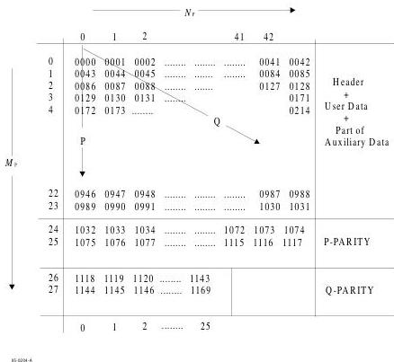

The 43 columns are denoted P-vectors which are (26, 24) Reed-Solomon code words over GF(2⁸). The Nₚ-th vector contains the following bytes.

$$V_{\mathrm{p}} = \left[ \begin{array}{l} S(43 * 0 + N_{\mathrm{p}}) \\ S(43 * 1 + N_{\mathrm{p}}) \\ S(43 * 2 + N_{\mathrm{p}}) \\ S(43 * 3 + N_{\mathrm{p}}) \\ S( \quad ) \\ S( \quad ) \\ S( \quad ) \\ S(43 * M_{\mathrm{p}} + N_{\mathrm{p}}) \\ S( \quad ) \\ S( \quad ) \\ S( \quad ) \\ S(43 * 22 + N_{\mathrm{p}}) \\ S(43 * 23 + N_{\mathrm{p}}) \\ S(43 * 24 + N_{\mathrm{p}}) \\ S(43 * 25 + N_{\mathrm{p}}) \end{array} \right]$$

P-parity byte

P-parity byte

where:

$$N_{\mathrm{p}} = 0, 1, 2, ..., 42$$

$$M_{\mathrm{p}} = 0, 1, 2, ..., 25$$

The two P-parity bytes calculated over the 24 bytes are added at the end of the vector. $V_{\mathrm{p}}$ satisfies the equation

$$H_{\mathrm{p}} \times V_{\mathrm{p}} = 0$$

where the parity check matrix $H_{\mathrm{p}}$ is:

$$H_{\mathrm{p}} = \left[ \begin{array}{cccc} 1 & 1 & \dots & 1 & 1 \\ \alpha^{25} & \alpha^{24} & \alpha^{1} & 1 \end{array} \right]$$

The 26 diagonals of the matrix are the Q-vectors which are (45, 43) Reed-Solomon code words over $\mathrm{GF}(2^8)$. When the Q-vectors are written as rows, the following matrix is obtained for the set of bytes.

|   | M_{0} |   |   |   |   |   | Q0 | Q1  |
| --- | --- | --- | --- | --- | --- | --- | --- | --- |
|   | 0 | 1 | 2 | 40 | 41 | 42 |  |   |
|  0 | 0000 | 0044 | 0088 | 0642 | 0686 | 0730 | 1118 | 1144  |
|  1 | 0043 | 0087 | 0131 | 0685 | 0729 | 0773 | 1119 | 1145  |
|  2 | 0086 | 0130 | 0147 | 0728 | 0772 | 0816 | 1120 | 1146  |
|  3 | 0129 | 0137 | 0217 | 0771 | 0815 | 0859 | 1121 | 1147  |
|  4 | 0172 | 0216 | 0260 | 0814 | 0858 | 0902 | 1122 | 1148  |
|  N_{0} |  |  |  |  |  |  |  |   |
|  22 | 0946 | 0990 | 1034 | 0470 | 0514 | 0558 | 1140 | 1166  |
|  23 | 0989 | 1033 | 1077 | 0513 | 0557 | 0601 | 1141 | 1167  |
|  24 | 1032 | 1076 | 0002 | 0556 | 0600 | 0644 | 1142 | 1168  |
|  25 | 1075 | 0001 | 0045 | 0599 | 0643 | 0687 | 1143 | 1169  |

The $N_Q$-th Q-vector contains the following bytes.

$$V _ { \mathrm { Q } } = \left[ \begin{array} { l } { \mathrm { S } ( 4 4 * 0 + 4 3 * N _ { \mathrm { Q } } ) } \\ { \mathrm { S } ( 4 4 * 1 + 4 3 * N _ { \mathrm { Q } } ) } \\ { \mathrm { S } ( 4 4 * 2 + 4 3 * N _ { \mathrm { Q } } ) } \\ { \mathrm { S } ( \quad ) } \\ { \mathrm { S } ( \quad ) } \\ { \mathrm { S } ( \quad ) } \\ { \mathrm { S } ( 4 4 * M _ { \mathrm { Q } } + 4 3 * N _ { \mathrm { Q } } ) } \\ { \mathrm { S } ( \quad ) } \\ { \mathrm { S } ( \quad ) } \\ { \mathrm { S } ( \quad ) } \\ { \mathrm { S } ( 4 4 * 4 1 + 4 3 * N _ { \mathrm { Q } } ) } \\ { \mathrm { S } ( 4 4 * 4 2 + 4 3 * N _ { \mathrm { Q } } ) } \\ { \mathrm { S } ( 4 3 * 2 6 + \quad N _ { \mathrm { Q } } ) } \\ { \mathrm { S } ( 4 4 * 2 6 + \quad N _ { \mathrm { Q } } ) } \end{array} \right]$$

Q-parity byte

Q-parity byte

where:

$$N _ { \mathrm { Q } } = 0 , 1 , 2 , . . . , 2 5$$

$$M _ { \mathrm { Q } } = 0 , 1 , 2 , . . . , 4 2$$

$( 4 4 * M _ { \mathrm { Q } } + 4 3 * N _ { \mathrm { Q } } )$ shall be calculated modulo 1118. The two Q-parity bytes calculated over the 43 bytes are added at the end of the vector. $V _ { \mathrm { Q } }$ satisfies the equation

$$H _ { \mathrm { Q } } \times V _ { \mathrm { Q } } = 0$$

where the parity check matrix $H _ { \mathrm { Q } }$ is:

$$N _ { \mathrm { Q } } = \left[ \begin{array} { l l l l l } { 1 } & { 1 } & { . . . } & { 1 } & { 1 } \\ { \alpha ^ { 4 4 } } & { \alpha ^ { 4 3 } } & { . . . } & { \alpha ^ { 1 } } & { 1 } \end{array} \right]$$

### A.4 Output

Bytes 0 to 2 075 of the Sector are unaltered at the output of the RSPC. Bytes 2 076 to 2 351 of the Sector are filled with the parity bytes of words 1 032 to 1 169 according to the rule given in A.2. The LSB of word 1 032 is recorded in byte 2 076, the MSB of word 1 169 in byte 2 351 of the Sector.

## Annex B – Scramble

*(normative)*

A regular bit pattern fed into the EFM encoder can cause large values of the digital sum value in case the merging bits cannot reduce this value (see annex E). The scrambler reduces this risk by converting the bits in byte 12 to 2 351 of a Sector in a prescribed way. Each bit in the input stream of the scrambler is added modulo 2 to the least significant bit of a maximum length register. The least significant bit of each byte comes first in the input stream. The 15-bit register is of the parallel block synchronized type, and fed back according to polynomial $x^{15} + x + 1$. After the Sync of the Sector, the register is pre-set with the value 0000 0000 0000 0001, where the ONE is the least significant bit.

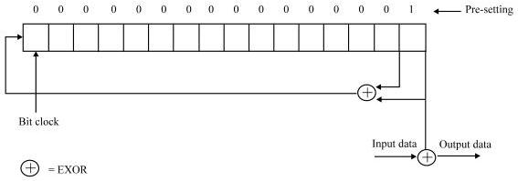

*Figure B.1 – Scrambler*

## Annex C – Error correction encoding by CIRC

*(normative)*

### C.1 General

The error correction encoding of the F1-frames is carried out by a Cross Interleaved Reed-Solomon Code (CIRC) encoder consisting of three delay sections and two encoders C₁ (figure C.1) and C₂ (figure C.2). This CIRC is the same as that described in IEC 908.

### C.2 Input

The input of the encoder consists of the 24 bytes of each F₁-Frame. These bytes are ordered into 12 words of two 8-bit bytes each, denoted A and B. Byte 0 of F₁-Frame No. n is indicated as W12n,A, and byte 23 as W12n+11,B (see figure C.1).

### C.3 First delay section

The interleave scheme of the first delay section (see figure C.2) divides the words into two groups one of which is delayed by two F₁-frame times.

### C.4 Encoder C₂

The error correction encoder C₂ generates a (28,24) Reed-Solomon code. There are four parity bytes Q (see C.7 below) output from 24 bytes of input.

### C.5 Second delay section

The second delay section consists of a series of 28 delays from 0 to 27 D F₁-frame times, where D equals 4.

### C.6 Encoder C₁

The error correction encoder C₁ generates a (32,28) Reed-Solomon code. There are four parity bytes P (see C.7 below) output from 28 bytes of input.

### C.7 Parity Symbols

The eight parity bytes P and Q of the C₁ and C₂ encoders satisfy the equations:

$$H_{\mathrm{P}} \times V_{\mathrm{P}} = 0$$

$$H_{\mathrm{Q}} \times V_{\mathrm{Q}} = 0$$

The vectors $V_{\mathrm{P}}$ and $V_{\mathrm{Q}}$ are shown in figure C.3.

The matrices $H_{\mathrm{P}}$ and $H_{\mathrm{Q}}$ are:

$$H_{\mathrm{P}} = \left[ \begin{array}{cccccc} 1 & 1 & 1 & 1 & 1 & 1 & 1 & 1 \\ \alpha^{31} & \alpha^{30} & \alpha^{29} & \alpha^{28} & \alpha^{3} & \alpha^{2} & \alpha & 1 \\ \alpha^{62} & \alpha^{60} & \alpha^{58} & \alpha^{56} & \alpha^{6} & \alpha^{4} & \alpha^{2} & 1 \\ \alpha^{93} & \alpha^{90} & \alpha^{87} & \alpha^{84} & \alpha^{9} & \alpha^{6} & \alpha^{3} & 1 \end{array} \right]$$

$$H_{\mathrm{Q}} = \left[ \begin{array}{cccccc} 1 & 1 & 1 & 1 & 1 & 1 & 1 & 1 \\ \alpha^{27} & \alpha^{26} & \alpha^{25} & \alpha^{24} & \alpha^{3} & \alpha^{2} & \alpha & 1 \\ \alpha^{54} & \alpha^{52} & \alpha^{50} & \alpha^{48} & \alpha^{6} & \alpha^{4} & \alpha^{2} & 1 \\ \alpha^{81} & \alpha^{78} & \alpha^{75} & \alpha^{72} & \alpha^{9} & \alpha^{6} & \alpha^{3} & 1 \end{array} \right]$$

The calculation is defined on the $\mathrm{GF}(2^8)$ field by the following primitive polynomial

$$\mathrm{P}(x) = x^8 + x^4 + x^3 + x^2 + 1$$

The primitive element of $\mathrm{GF}(2^8)$ is

$$\alpha = (00000010)$$

where the right-most bit is the least significant bit.

### C.8 Third delay section

The third delay section yields a delay of one $\mathrm{F}_1$-Frame time to every alternate byte out of the $\mathrm{C}_1$ encoder.

### C.9 Output

The output of the CIRC encoder is grouped into $\mathrm{F}_2$-Frames as indicated in figure C.4. All parity bits in the P and Q bytes are inverted before they leave the encoder. The longest delay for a byte between input into, and output from, the encoder is $108\ \mathrm{F}_1$-Frame times. The shortest delay for a byte is $3\ \mathrm{F}_1$-Frame times.

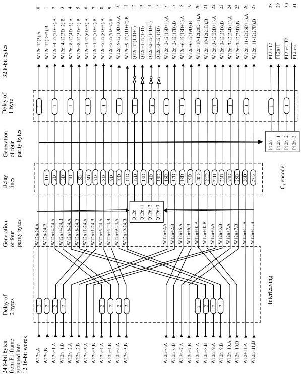

*Figure C.1 – CIRC encoder. The byte numbers are given at one instant in time*

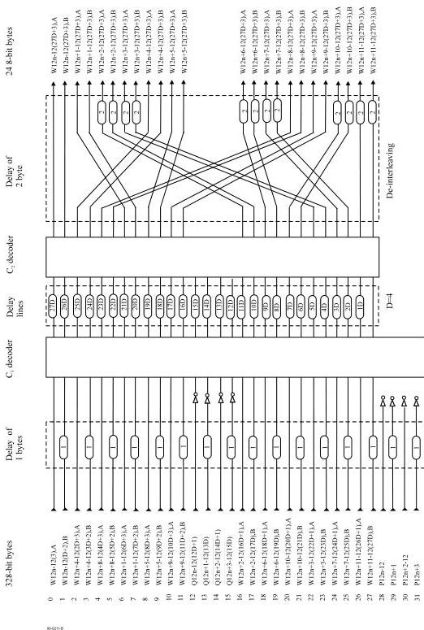

*Figure C.2 – CIRC decoder. The byte numbers are given at one instant in time*

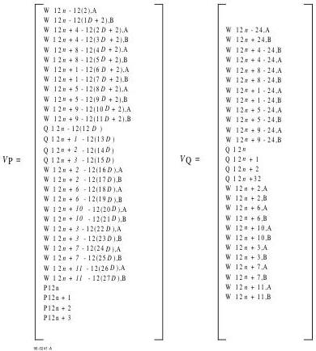

*Figure C.3 – Column vectors of CIRC*

|  Byte number | Byte name | Sequence  |
| --- | --- | --- |
|  0 | WmA | m=12n-12(3)  |
|  1 | WmB | m=12n-12(D+2)  |
|  2 | WmA | m=12n+4-12(2D+3)  |
|  3 | WmB | m=12n+4-12(3D+2)  |
|  4 | WmA | m=12n+8-12(4D+3)  |
|  5 | WmB | m=12n+8-12(5D+2)  |
|  6 | WmA | m=12n+1-12(6D+3)  |
|  7 | WmB | m=12n+1-12(7D+2)  |
|  8 | WmA | m=12n+5-12(8D+3)  |
|  9 | WmB | m=12n+5-12(9D+2)  |
|  10 | WmA | m=12n+9-12(10D+3)  |
|  11 | WmB | m=12n+9-12(11D+2)  |
|  12 | Q_{m} | m=12n-12(12D+1)  |
|  13 | Q_{m} | m=12n+1-12(13D)  |
|  14 | Q_{m} | m=12n+2-12(14D+1)  |
|  15 | Q_{m} | m=12n+3-12(15D)  |
|  16 | WmA | m=12n+2-12(16D+1)  |
|  17 | WmB | m=12n+2-12(17D)  |
|  18 | WmA | m=12n+6-12(18D+1)  |
|  19 | WmB | m=12n+6-12(19D)  |
|  20 | WmA | m=12n+10-12(20D+1)  |
|  21 | WmB | m=12n+10-12(21D)  |
|  22 | WmA | m=12n+3-12(22D+1)  |
|  23 | WmB | m=12n+3-12(23D)  |
|  24 | WmA | m=12n+7-12(24D+1)  |
|  25 | WmB | m=12n+7-12(25D)  |
|  26 | WmA | m=12n+11-12(26D+1)  |
|  27 | WmB | m=12n+11-12(27D)  |
|  28 | P_{m} | m=12n-12  |
|  29 | P_{m} | m=12n+1  |
|  30 | P_{m} | m=12n+2-12  |
|  31 | P_{m} | m=12n+3  |

D=4; n=0, 1, 2, ...

*Figure C.4 – Structure of output of CIRC encoder*

## Annex D – 8-bit to 14-Channel bit conversion

*(normative)*

The left-most bit of an 8-bit byte and the left-most Channel bit of a 14-Channel bit byte are the most significant bits. The most significant Channel bit is sent first in the data stream.

**Table D.1**

|  00000000 | 01001000100000 | 01000000 | 01001000100100  |
| --- | --- | --- | --- |
|  00000001 | 10000100000000 | 01000001 | 10000100100100  |
|  00000010 | 10010000100000 | 01000010 | 10010000100100  |
|  00000011 | 10001000100000 | 01000011 | 10001000100100  |
|  00000100 | 01000100000000 | 01000100 | 01000100100100  |
|  00000101 | 00000100010000 | 01000101 | 00000000100100  |
|  00000110 | 00010000100000 | 01000110 | 00010000100100  |
|  00000111 | 00100100000000 | 01000111 | 00100100100100  |
|  00001000 | 01001001000000 | 01001000 | 01001001000100  |
|  00001001 | 10000001000000 | 01001001 | 10000001000100  |
|  00001010 | 10010001000000 | 01001010 | 10010001000100  |
|  00001011 | 10001001000000 | 01001011 | 10001001000100  |
|  00001100 | 01000001000000 | 01001100 | 01000001000100  |
|  00001101 | 00000001000000 | 01001101 | 00000001000100  |
|  00001110 | 00010001000000 | 01001110 | 00010001000100  |
|  00001111 | 00100001000000 | 01001111 | 00100001000100  |
|  00010000 | 10000000100000 | 01010000 | 10000000100100  |
|  00010001 | 10000010000000 | 01010001 | 10000010000100  |
|  00010010 | 10010010000000 | 01010010 | 10010010000100  |
|  00010011 | 00100000100000 | 01010011 | 00100000100100  |
|  00010100 | 01000010000000 | 01010100 | 01000010000100  |
|  00010101 | 00000010000000 | 01010101 | 00000010000100  |
|  00010110 | 00010010000000 | 01010110 | 00010010000100  |
|  00010111 | 00100010000000 | 01010111 | 00100010000100  |
|  00011000 | 01001000010000 | 01011000 | 01001000000100  |
|  00011001 | 10000000010000 | 01011001 | 10000000000100  |
|  00011010 | 10010000010000 | 01011010 | 10010000000100  |
|  00011011 | 10001000010000 | 01011011 | 10001000000100  |
|  00011100 | 01000000010000 | 01011100 | 01000000000100  |
|  00011101 | 00001000010000 | 01011101 | 00001000000100  |
|  00011110 | 00010000010000 | 01011110 | 00010000000100  |
|  00011111 | 00100000010000 | 01011111 | 00100000000100  |
|  00100000 | 00000000100000 | 01100000 | 01001000100010  |
|  00100001 | 10000100001000 | 01100001 | 10000100100010  |
|  00100010 | 00001000100000 | 01100010 | 10010000100010  |
|  00100011 | 00100100100000 | 01100011 | 10001000100010  |
|  00100100 | 01000100001000 | 01100100 | 01000100100010  |
|  00100101 | 00000100001000 | 01100101 | 00000000100010  |
|  00100110 | 01000000100000 | 01100110 | 01000000100100  |
|  00100111 | 00100100001000 | 01100111 | 00100100100010  |
|  00101000 | 01001001001000 | 01101000 | 01001001000010  |
|  00101001 | 10000001001000 | 01101001 | 10000001000010  |
|  00101010 | 10010001001000 | 01101010 | 10010001000010  |

|  00101011 | 10001001001000 | 01101011 | 10001001000010  |
| --- | --- | --- | --- |
|  00101100 | 01000001001000 | 01101100 | 01000001000010  |
|  00101101 | 00000001001000 | 01101101 | 00000001000010  |
|  00101110 | 00010001001000 | 01101110 | 00010001000010  |
|  00101111 | 00100001001000 | 01101111 | 00100001000010  |
|  00110000 | 00000100000000 | 01110000 | 10000000100010  |
|  00110001 | 10000010001000 | 01110001 | 10000010000010  |
|  00110010 | 10010010001000 | 01110010 | 10010010000010  |
|  00110011 | 10000100010000 | 01110011 | 00100000100010  |
|  00110100 | 01000010001000 | 01110100 | 01000010000010  |
|  00110101 | 00000010001000 | 01110101 | 00000010000010  |
|  00110110 | 00010010001000 | 01110110 | 00010010000010  |
|  00110111 | 00100010001000 | 01110111 | 00100010000010  |
|  00111000 | 01001000001000 | 01111000 | 01001000000010  |
|  00111001 | 10000000001000 | 01111001 | 00001001001000  |
|  00111010 | 10010000001000 | 01111010 | 10010000000010  |
|  00111011 | 10001000001000 | 01111011 | 10001000000010  |
|  00111100 | 01000000001000 | 01111100 | 01000000000010  |
|  00111101 | 00001000001000 | 01111101 | 00001000000010  |
|  00111110 | 00010000001000 | 01111110 | 00010000000010  |
|  00111111 | 00100000001000 | 01111111 | 00100000000010  |
|  10000000 | 01001000100001 | 11000000 | 01000100100000  |
|  10000001 | 10000100100001 | 11000001 | 10000100010001  |
|  10000010 | 10010000100001 | 11000010 | 10010010010000  |
|  10000011 | 10001000100001 | 11000011 | 00001000100100  |
|  10000100 | 01000100100001 | 11000100 | 01000100010001  |
|  10000101 | 00000000100001 | 11000101 | 00000100010001  |
|  10000110 | 00010000100001 | 11000110 | 00010010010000  |
|  10000111 | 00100100100001 | 11000111 | 00100100010001  |
|  10001000 | 01001001000001 | 11001000 | 00001001000001  |
|  10001001 | 10000001000001 | 11001001 | 10000100000001  |
|  10001010 | 10010001000001 | 11001010 | 00001001000100  |
|  10001011 | 10001001000001 | 11001011 | 00001001000000  |
|  10001100 | 01000001000001 | 11001100 | 01000100000001  |
|  10001101 | 00000001000001 | 11001101 | 00000100000001  |
|  10001110 | 00010001000001 | 11001110 | 00000010010000  |
|  10001111 | 00100001000001 | 11001111 | 00100100000001  |
|  10010000 | 10000000100001 | 11010000 | 00000100100100  |
|  10010001 | 10000010000001 | 11010001 | 10000010010001  |
|  10010010 | 10010010000001 | 11010010 | 10010010010001  |
|  10010011 | 00100000100001 | 11010011 | 10000100100000  |
|  10010100 | 01000010000001 | 11010100 | 01000010010001  |
|  10010101 | 00000010000001 | 11010101 | 00000010010001  |
|  10010110 | 00010010000001 | 11010110 | 00010010010001  |
|  10010111 | 00100010000001 | 11010111 | 00100010010001  |
|  10011000 | 01001000000001 | 11011000 | 01001000010001  |
|  10011001 | 10000010010000 | 11011001 | 10000000010001  |
|  10011010 | 10010000000001 | 11011010 | 10010000010001  |
|  10011011 | 10001000000001 | 11011011 | 10001000010001  |
|  10011100 | 01000010010000 | 11011100 | 01000000010001  |
|  10011101 | 00001000000001 | 11011101 | 00001000010001  |
|  10011110 | 00010000000001 | 11011110 | 00010000010001  |
|  10011111 | 00100010010000 | 11011111 | 00100000010001  |
|  10100000 | 00001000100001 | 11100000 | 01000100000010  |
|  10100001 | 10000100001001 | 11100001 | 00000100000010  |
|  10100010 | 01000100010000 | 11100010 | 10000100010010  |

|  10100011 | 00000100100001 | 11100011 | 00100100000010  |
| --- | --- | --- | --- |
|  10100100 | 01000100001001 | 11100100 | 01000100010010  |
|  10100101 | 00000100001001 | 11100101 | 00000100010010  |
|  10100110 | 01000000100001 | 11100110 | 01000000100010  |
|  10100111 | 00100100001001 | 11100111 | 00100100010010  |
|  10101000 | 01001001001001 | 11101000 | 10000100000010  |
|  10101001 | 10000001001001 | 11101001 | 10000100000100  |
|  10101010 | 10010001001001 | 11101010 | 00001001001001  |
|  10101011 | 10001001001001 | 11101011 | 00001001000010  |
|  10101100 | 01000001001001 | 11101100 | 01000100000100  |
|  10101101 | 00000001001001 | 11101101 | 00000100000100  |
|  10101110 | 00010001001001 | 11101110 | 00010000100010  |
|  10101111 | 00100001001001 | 11101111 | 00100100000100  |
|  10110000 | 00000100100000 | 11110000 | 00000100100010  |
|  10110001 | 10000010001001 | 11110001 | 10000010010010  |
|  10110010 | 10010010001001 | 11110010 | 10010010010010  |
|  10110011 | 00100100010000 | 11110011 | 00001000100010  |
|  10110100 | 01000010001001 | 11110100 | 01000010010010  |
|  10110101 | 00000010001001 | 11110101 | 00000010010010  |
|  10110110 | 00010010001001 | 11110110 | 00010010010010  |
|  10110111 | 00100010001001 | 11110111 | 00100010010010  |
|  10111000 | 01001000001001 | 11111000 | 01001000010010  |
|  10111001 | 10000000001001 | 11111001 | 10000000010010  |
|  10111010 | 10010000001001 | 11111010 | 10010000010010  |
|  10111011 | 10001000001001 | 11111011 | 10001000010010  |
|  10111100 | 01000000001001 | 11111100 | 01000000010010  |
|  10111101 | 00001000001001 | 11111101 | 00001000010010  |
|  10111110 | 00010000001001 | 11111110 | 00010000010010  |
|  10111111 | 00100000001001 | 11111111 | 00100000010010  |

## Annex E – Merging bits

*(normative)*

Each group of 14 Channel bits is preceded by three Merging bits to satisfy the requirement of at least two and at most ten ZEROs between two ONEs, also between consecutive groups. Whilst two Merging bits would suffice for this purpose, the third bit is added to be able to minimize the digital sum value (DSV). The DSV at a given position is the sum of the value of the Channel bits from the start of the disk up to the specified position. The DSV must be as close to zero as possible to allow reliable radial tracking and reliable detection of the crossings of HF signals with the decision level.

The Merging bits shall be chosen such that

i) the number of ZEROs between consecutive ONEs is everywhere between 2 and 10,
ii) the pattern 1000000000010000000000010 occurs only at the position for the Sync Header,
iii) power spectrum of the HF signal below 20 kHz must be equal to, or below, the spectrum of the minimum system described below.

|  initialize DSV: = 0  |   |
| --- | --- |
|  do for all frames until end of data  |   |
|  send Sync Header  |   |
|  update DSV  |   |
|  do for 33 bytes (1 control, 12 data, 4 parity, 12 data, 4 parity)  |   |
|  get byte  |   |
|  do for all 4 possible merging bit combinations  |   |
|  combination forbidden because it 1) violates rule of min. 2 and max. 10 ZEROs between ONEs. 2) gives erroneously Sync Header  |   |
|  yes | no  |
|  skip combination | determine DSV for each combination and the following byte; retain that combination giving the lowest DSV. If two combinations give the same, lowest DSV, a combination with a transition shall be chosen.  |
|  send three merging bits, then 14 Channel bits update DSV  |   |
|  - send 000 or 100 according to DSV criterion as merging bits for the Sync Header  |   |
|  - update DSV  |   |

## Annex F – Storage tests

*(informative)*

In order to assess whether disks will successfully withstand the storage conditions specified in 5.3 of this ECMA Standard, the following two tests can be performed.

**F.1** IEC 68-2-30:1980, *Basic environmental testing procedures, Part 2: Tests, Test Db and guidance: Damp heat, cyclic (12+12-hour cycle).*
The disk should be submitted to this test, severity 40 °C, 6 cycles.

**F.2** IEC 68-2-2:1974, *Basic environmental testing procedures, Part 2: Tests, Tests B: Dry heat, Test Ba.*
The disk should be submitted to this test, severity 55 °C, 96 h.

**F.3** After recovery of each of these tests, the disk should meet all mandatory requirements of this ECMA Standard.

**F.4** If the condition of F.3 is satisfied, it can be expected that the recorded information will be available from the disk after the storage period.