# IEC 60908 Second edition 1999-02 – Audio recording – Compact disc digital audio system

## FOREWORD

1) The IEC (International Electrotechnical Commission) is a worldwide organization for standardization comprising all national electrotechnical committees (IEC National Committees). The object of the IEC is to promote international co-operation on all questions concerning standardization in the electrical and electronic fields. To this end and in addition to other activities, the IEC publishes International Standards. Their preparation is entrusted to technical committees; any IEC National Committee interested in the subject dealt with may participate in this preparatory work. International, governmental and non-governmental organizations liaising with the IEC also participate in this preparation. The IEC collaborates closely with the International Organization for Standardization (ISO) in accordance with conditions determined by agreement between the two organizations.

2) The formal decisions or agreements of the IEC on technical matters express, as nearly as possible, an international consensus of opinion on the relevant subjects since each technical committee has representation from all interested National Committees.

3) The documents produced have the form of recommendations for international use and are published in the form of standards, technical reports or guides and they are accepted by the National Committees in that sense.

4) In order to promote international unification, IEC National Committees undertake to apply IEC International Standards transparently to the maximum extent possible in their national and regional standards. Any divergence between the IEC Standard and the corresponding national or regional standard shall be clearly indicated in the latter.

5) The IEC provides no marking procedure to indicate its approval and cannot be rendered responsible for any equipment declared to be in conformity with one of its standards.

6) Attention is drawn to the possibility that some of the elements of this International Standard may be the subject of patent rights. The IEC shall not be held responsible for identifying any or all such patent rights.

International Standard IEC 60908 has been prepared by subcommittee 100B: Audio, video and multimedia information storage systems, of IEC technical committee 100: Audio, video and multimedia systems and equipments.

This second edition cancels and replaces the first edition published in 1987, amendment 1 (1992) and the corrigendum to amendment 1.

The text of this standard is based on the first edition, amendment 1, the corrigendum to amendment 1 and the following documents:

|  FDIS | Report on voting  |
| --- | --- |
|  100B/173/FDIS | 100B/185/RVD  |

Full information on the voting for the approval of this standard can be found in the report on voting indicated in the above table.

Annex B forms an integral part of this international Standard.

Annexes A, C, D, E and F are for information only.

## 1 Scope and object

This standard is applicable to a prerecorded optical reflective digital audio disc system.

This standard defines those parameters of compact disc that affect interchangeability between discs and players. It is also intended as a reference for manufacturers wishing to produce discs and/or players that conform to the system described in this standard. It deals with discs of 80 mm in diameter as well as those of 120 mm in diameter.

## 2 Normative references

The following normative documents contain provisions which, through reference in this text, constitute provisions of this International Standard. For dated references, subsequent amendments to, or revisions of, any of these publications do not apply. However, parties to agreements based on this International Standard are encouraged to investigate the possibility of applying the most recent editions of the normative documents indicated below. For undated references, the latest edition of the normative document referred to applies. Members of IEC and ISO maintain registers of currently valid International Standards.

IEC 60068-2-2:1974, Environmental testing – Part 2: Tests – Tests B: Dry heat

IEC 60068-2-30:1980, Environmental testing – Part 2: Tests – Test Db and guidance: Damp heat, cyclic (12 + 12-hour cycle)

IEC 60721-3-5:1997, Classification of environmental conditions – Part 3: Classification of groups of environmental parameters and their severities – Section 5: Ground vehicle installations

IEC 61104:1992, Compact disc video system – 12 cm CD-V

IEC 61866:1997, Audiovisual systems – Interactive text transmission system (ITTS)

IEC 61938:1996, Audio, video and audiovisual systems – Interconnections and matching values – Preferred matching values of analogue signals

ISO/IEC 646:1991, Information technology – ISO 7-bit coded character set for information interchange

ISO 3901:1986, Documentation – International Standard Recording Code (ISRC)

ISO/IEC 8859-1:1998, Information technology – 8-bit single-byte coded graphic character sets – Part 1: Latin alphabet No. 1

EBU Tech 3258-E:1991, Specification of the systems of the MAC/packet family

UPC/EAN, Universal product code/International article numbering association

RIAJ Document RS506, Music shift Kanji character set

CD EXTRA, Enhanced music CD specification, Version 1.0, December 1995, Sony/Philips

## 3 Description of system

The information carrier is a transparent disc, the substrate, one side of which carries the information. This side, the encoded side, is covered in turn by a reflective and a protective layer.

The information of the disc is stored in a spiral-shaped track consisting of successive shallow depressions (pits). When the disc is playing and viewed from the read-out side, the spiral starts near the centre of the disc and finishes near its edge.

The lengths of the pits and the spaces between them can take discrete values only, and represent the encoded two-channel audio information.

The information is read out by means of a beam of light which passes through the plain, i.e. the non-encoded side of the transparent disc to the encoded side, where it is reflected and modulated by the recorded information (see figure 2b, detail B).

The information is followed by means of a servo-system for tracking and focusing.

## 4 Requirements for measurements

### 4.1 Conditions of measurement

Measurements and mechanical checks shall be carried out within the following limits unless otherwise specified:

- ambient temperature: 15 °C to 35 °C;
relative humidity: 45% to 75%;
- air pressure: 86 kPa to 106 kPa.

### 4.2 Requirements for the measuring pick-up

The optical pick-up to be used for disc measurement shall comply with the following requirements:

- wavelength: \(780 \pm 10 \mathrm{~nm}\);
- polarization: circular;
- numerical aperture (NA): 0,45 ± 0,01;
- intensity at the rim of the pupil \(>50\%\) of the maximum intensity value; of the objective lens:
- diffraction limited performance within the Maréchal criterion, preferably of the optical system: equally divided between disc and player.

### 4.3 Requirements for the clamping of the disc

The disc shall be fixed between two equally sized concentric rings, having inner diameters of 29 mm and outer diameters of 31 mm, the clamping force being between 1 N and 2 N (see figure 2b).

|  Parameters to be specified |   | Requirements | Methods and/or conditions of measurement  |
| --- | --- | --- | --- |
|  5 | Mechanical parameters | Figures 2a, 2b and 2c, specify the dimensions of the disc, including reflective layer, protective layer and label |   |
|  5.1 | Outer dimensions of disc |  |   |
|  5.1.1 | Outer diameter | 120 ± 0,3 mm 80 ± 0,2 mm | To be measured at 23 ± 2 °C and (50 ± 5) % relative humidity  |
|  5.1.2 | Radial run-out of outer edge | 0,4 mm max. | Relative to the inscribed circle of centre hole  |
|  5.1.3 | Edge shape | Edges shall be free from burrs; chamfer or radius is permitted on both sides |   |
|  5.2 | Centre hole dimensions | For 8 cm-CD, see figures 2c and 2d. |   |
|  5.2.1 | Diameter | 15 ^{+0,1}_{0} mm | To be measured at 23 ± 2 °C and (50 ± 5) % relative humidity  |
|  5.2.2 | Shape | Cylindrical |   |
|  5.2.3 | Edge shape | Burrs are permitted on the label side, but not on the read-out side. Chamfer or radius is permitted (see figure 2b, detail C) |   |
|  5.3 | Thickness of disc | 1,2 ^{+0,3}_{-0,1} mm | Including protective layer and labelling  |
|  5.4 | Labelling |  |   |
|  5.4.1 | Label dimensions | Shall not project over edge of centre hole or outer edge of disc | May be applied by printing or by means of a label  |
|  5.4.2 | Label information | At least the following information shall be given: a) Title of program b) Catalogue number of disc c) Sequence number of and total number of discs if complete program occupies more than one disc (e.g.: disc 2 of 4) |   |
|  5.5 | Reference plane | Ring between diameters of 26 mm and 33 mm (see figures 2a and 2b) | On the read-out side  |
|  5.6 | Clamping area |  |   |
|  5.6.1 | Inner diameter of clamping area | 26 mm max.* |   |
|  5.6.2 | Outer diameter of clamping area | 33 mm min.* |   |
|  5.6.3 | Thickness of disc in clamping area | Within the requirements given in 5.3 and figure 2b |   |
|  5.6.4 | Adaptor clamping area for 8 cm-CD | An outer ring with 1,5 mm in width |   |
|  5.6.5 | Thickness in clamping area for 8 cm-CD adaptor | 1,2 ± 0,1 mm |   |
|  * These dimensions ensure that the ring between 26 mm and 33 mm is available for clamping.  |   |   |   |

|  Parameters to be specified |   | Requirements | Methods and/or conditions of measurement  |
| --- | --- | --- | --- |
|  5.7 | Mass of disc | 14 g to 33 g 6 g to 16 g for 8 cm-CD |   |
|  5.8 | Limits for the deflections of the read-out side of the disc |  | Within the information area (45 mm to 118 mm maximum diameter) (see figure 2c)  |
|  5.8.1 | Peak deflection | ±0,4 mm ±0,3 mm for 8 cm-CD |   |
|  5.8.2 | Deflection averaged over one revolution | ±0,3 mm ±0,2 mm for 8 cm-CD |   |
|  5.8.3 | Angular deviation (β) | ±0,6° | See figure 16.  |
|  6 | Optical parameters |  |   |
|  6.1 | Thickness of transparent substrate | 1,2 ± 0,1 mm | Within the information area (see figures 2a, 2b and 2c). Excluding reflective layer, protective layer, and labelling  |
|  6.2 | Refractive index | 1,55 ± 0,1 |   |
|  6.3 | Limits for the angular deviation of the reflected beam (α) | ±1,6° | Referred to reference plane E (see figures 2a and 16) including disc deflection and substrate unparallelism  |
|  6.4 | Birefringence of transparent substrate | 100 nm max. | Double pass through transparent substrate  |
|  6.5 | Reflectivity | 70 % min.  |   |
|  6.6 | Limits for reflectivity variation in program area | 3 % for f < 100 Hz | The reflectivity variation is measured by observing the variation of A_{top}, during one revolution of the disc at scanning velocity (see 7.1.2)  |
|  7 | Recording parameters |  |   |
|  7.1 | Rotation during playback |  |   |
|  7.1.1 | Sense of rotation of disc as seen from read-out side | Counter-clockwise |   |
|  7.1.2 | Scanning velocity | 1,2 m/s min. 1,4 m/s max. |   |
|  7.1.3 | Limits for the velocity variation on any one disc | ±0,01 m/s |   |
|  7.2 | Track |  |   |
|  7.2.1 | Track path | Continuous spiral from inside (start of the lead-in) to outside (end of the lead-out) of disc |   |
|  7.2.2 | Starting diameter of lead-in area | 46 mm max. | See figure 2c  |
|  7.2.3 | Starting diameter of program area | 50^{0}_{-0,4} mm | See figure 2c To be measured at 23 ± 2 °C and (50 ± 5) % relative humidity  |
|  7.2.4 | Maximum diameter of program area | 116 mm 75 mm for 8 cm-CD |   |
|  7.2.5 | Minimum outer diameter of lead-out area | Outer diameter of program are plus 1 mm | See figure 2c  |
|  7.2.6 | Pitch of track: distance between any two adjacent turns | 1,6 ± 0,1 μm |   |

|  Parameters to be specified |   | Requirements | Methods and/or conditions of measurement  |
| --- | --- | --- | --- |
|  7.3 | Limits for deviations of information layer perpendicular to reference plane |  | As observed by the measuring pick-up, the disc rotating at scanning velocity (see 7.1.2)  |
|  7.3.1 | For frequencies below 500 Hz |  |   |
|  7.3.1.1 | Deviation from nominal value | ±0,5 mm ±0,35 mm for 8 cm-CD | The nominal position is defined by an ideal disc of substrate thickness 1,2 mm and refractive index of 1,55  |
|  7.3.1.2 | RMS value | ±0,4 mm max. ±0,8 mm max. for 8 cm-CD  |   |
|  7.3.1.3 | Acceleration | 10 m/s² max. |   |
|  7.3.2 | For frequencies above 500 Hz | 2 μm peak-to-peak max. |   |
|  7.4 | Limits for radial deviations of the track |  | Disc rotating at scanning velocity (see 7.1.2)  |
|  7.4.1 | For frequencies below 500 Hz |  |   |
|  7.4.1.1 | Radial run-out of tracks | 140 μm peak-to-peak max. | Relative to the inscribed inner circle of centre hole  |
|  7.4.1.2 | Radial acceleration (eccentricity and unroundness) | 0,4 m/s² max. |   |
|  7.4.2 | For frequencies above 500 Hz | See 10.4 |   |
|  8 | Environmental conditions for playing the compact disc |  |   |
|  8.1 | Playing the compact disc | The disc shall be played under the following conditions: Temperature: -25 °C to +70 °C Relative humidity: 10 % to 95 % Absolute humidity: 0,5 g/m³ to 60 g/m³ Max. temperature change: 50 °C Max. humidity change: 30 % RH (see also climatogram, figure 17 below) | Sudden changes in temperature and humidity within these ranges may temporarily cause too large a deflection. Recovery time up to several hours has to be taken into account (see also IEC 60721-3-5, class 5K2). Parameters to be measured in accordance with clause 4.  |
|  8.2 | Temperature and humidity requirements | After these tests, some time should be left for recovery before measuring (24 h or 48 h) |   |
|  8.2.1 | Dry heat test in accordance with IEC 60068-2-2 Ba | Temperature: 55 °C Relative humidity: 50 % max. at 35 °C Storage time: 96 h |   |
|  8.2.2 | Cyclic damp heat test in accordance with IEC 60068-2-30 Db | Severity: a; number of cycles: 6 Temperature: max. 40 °C ± 2 °C Relative humidity: 95 % Temperature: min. 25 °C ± 3 °C Cycle time: 12 h + 12 h |   |

## 9 High-frequency signal

The scanning light spot is diffracted by the information pits in the reflective layer. The high-frequency (h.f.) signal is defined as the modulation of the optical power that is diffracted back into the objective lens.

### 9.1 Measurement conditions

9.1.1 Time constant: $t = 100 \text{ \textmu s}$

9.1.2 Filtering: high-pass

9.1.3 Scanning velocity between 1,2 m/s and 1,4 m/s

### 9.2 Modulation amplitude

The lowest fundamental frequency of the modulation code is 196 kHz which corresponds to $T_{\text{max}}$. (See clause 13.) The peak-to-peak value of this component is $A_{11}$ (see figure 3) and the peak value of the corresponding high-frequency signal before high-pass filtering is $A_{\text{top}}$.

The highest fundamental frequency of the modulation code is 720 kHz which corresponds to $T_{\text{min}}$. (See clause 13.) Its peak-to-peak amplitude is $A_3$ (see figure 3).

These parameters shall fulfil the following specifications:

$$
\frac{A_3}{A_{\text{top}}} = 0,3 \text{ to } 0,7; \quad \frac{A_{11}}{A_{\text{top}}} \geq 0,6
$$

### 9.3 Signal asymmetry

#### 9.3.1 Definitions

The asymmetry is defined by:

$$
\left( \frac{A_D}{A_{11}} - \frac{1}{2} \right) \cdot 100 \%
$$

where $A_D$ is the decision level (see figure 3).

The absolute value of the asymmetry shall be less than or equal to 20 %.

### 9.4 Cross-talk

The ratio of the amplitude of the h.f. signal when the spot focuses between two adjacent turns of the track to the amplitude of the h.f. signal when the spot focuses on the track shall be less than 0,5 (50 %).

### 9.5 Frequency modulation of the channel bit frequency (see clause 13)

Unintentional frequency modulation of the channel bit frequency during mastering may cause clock regeneration problems in CD players. The maximum time error of the channel bit frequency as a function of the modulation frequency shall be below the values given in figure 18. This time error is measured with a constant linear velocity.

## 10 Radial differential (RD) signal

A slightly off-track position of the scanning light spot results in a diffraction pattern that is asymmetrical in the radial direction of the disc. The radial differential signal is defined as the difference of the optical powers diffracted into the two halves (positioned on opposite sides of the track) of the aperture of the objective lens.

### 10.1 Measurement conditions

Time constant: $t = 15$ µs

Filtering: low-pass

### 10.2 Shape of the radial differential signal

See figure 4. The zero-crossing with a positive slope corresponds to the correct radial position of the scanning spot. Detail B of figure 2b prescribes shallow pits, and defines the sign of the signal.

### 10.3 Sensitivity to radial offset

The sensitivity is equal to $\frac{|P_1 - P_2|}{A_{\text{top}}}$ at a radial offset of 0,1 µm, where $P_1 - P_2$ is the optical power difference in the two halves of the reflected beam measured at far field and where $A_{\text{top}}$ is the peak optical power (see 9.2).

The sensitivity shall be within 0,04 and 0,07.

The variation on any one disc shall be within ±15 %.

### 10.4 Noise

When the RD signal is used for tracking, with a servo-bandwidth of 200 Hz (see figure 5), the noise in the RD signal is measured in the frequency band 500 Hz to 10 000 Hz.

The r.m.s. value measured with an integration time of 20 ms shall correspond to a tracking error of less than 0,03 µm.

Optional measurement

Single-frequency noise contributions should be avoided in the RD signal. It is recommended to measure the r.m.s. value of the noise in the residual error signal with a real-time frequency analyser (bandwidth of 100 Hz) over the frequency range 500 Hz to 10 000 Hz.

The tracking error corresponding to the measured r.m.s. value should be less than 0,01 µm.

## 11 Defects

### 11.1 Block error rate (BLER)

#### 11.1.1 Definitions

The block error rate is measured at the input of the C₁-decoder (see figure 13).

A block (see figure 9) is called erroneous if one or more symbols of that block are erroneous.

A symbol (see 16.2) is called erroneous if one or more bits of that symbol are erroneous.

#### 11.1.2 Specification of random errors

BLER averaged over any 10 s shall be less than 3 × 10⁻².

#### 11.1.3 Specification of burst errors

Burst errors in the h.f. signal due to local defects shall not induce audible effects for any error-correcting decoding strategy.

The most simple error-correcting decoder consists of a C1 and C2 single-error corrector. No more than one symbol error shall occur in a data block measured at the input of the C2 decoder.

In any case, the number of successive C1-uncorrectable blocks shall be less than 7.

### 11.2 Local defects

Maximum dimensions of local defects that are allowed are:

- air bubbles, diameter 100 μm
- black spots, diameter 200 μm
- black spots without birefringent area, diameter 300 μm

The minimum distance, measured between adjacent defects (of maximum diameter) along the track, is at least 20 mm.

Black spot may be dirt enclosures in the substrate or "pin-holes" in the reflective layer.

## 12 Recorded parameters – General

The recorded area on the disc shall be divided into three parts, viz:

the lead-in area;
the program area;
the lead-out area.

The data to be recorded shall consist of 16-bits wide words encoded as 2's-complement numbers.

In the lead-in and the lead-out areas these encoded words are 2's-complement zero ±15 LSB.

In the program area the data word contains audio information only, encoded in a two-channel format.

The sampling frequency (fs) of the information in the program area shall be 44,1 kHz, both channels being simultaneously sampled.

The audio samples are linear encoded in a 16-bit, 2's-complement format.

The encoding is carried out either without pre-emphasis or with the first order pre-emphasis shown in figure 1.

The recording and error protection process basically consists of

a) splitting each 16-bit audio sample word into two 8-bit symbols;
b) introducing extra 8-bit parity symbols for error detection and correction (in accordance with CIRC encoding);
c) building up a frame consisting of the previously defined 8-bit symbols, with one 8-bit symbol for control and display;
d) representing these 8-bit symbols by particular channel bit sequences which are appropriate for recording on the disc (in accordance with the EFM encoding);
e) adding specific synchronization patterns different from EFM-codes.

## 13 8 to 14 modulation code (EFM-code)

After modulation, each group of 8 data bits (symbol) is represented by a succession of 14 channel bits. The information is contained in the position of the transitions between channel bits.

The EFM encoding is carried out in accordance with figure 6 and figure 7. In the NRZ-I representation used to describe the EFM encoding, "0" indicates the absence of transitions between two successive channel bits whereas "1" indicates the presence of transitions.

For merging the blocks and for low-frequency (I.f.) suppression, three extra channel bits (merging bits) are added between two blocks of 14 channel bits.

Minimum requirements for I.f. suppression are under consideration.

The EFM-code is such that the minimum run length (the distance between two transitions) is 3 channel bits ($T_{\text{min}}$) and the sampling window (eye pattern) is 1 channel bit.

The maximum length is 11 channel bits ($T_{\text{max}}$).

The merging bits do not need to contain a transition, so that between the blocks the requirements for $T_{\text{min}}$ can always be fulfilled.

Examples for the combination of the EFM-code with the merging bits are given in annex A.

## 14 Frame format

After modulation (see clause 15), one frame shall contain 588 channel bits, consisting of

- a synchronization pattern of 24 channel bits;
control and display symbols of 14 channel bits (clause 17);
24 data symbols coded in the EFM-code of 14 channel bits (clause 13);
- 8 symbols for parity of 14 channel bits (clause 16);
- 34 groups of merging bits of 3 channel bits (clause 13).

The composition of a frame is given in figure 8.

## 15 EFM-modulator

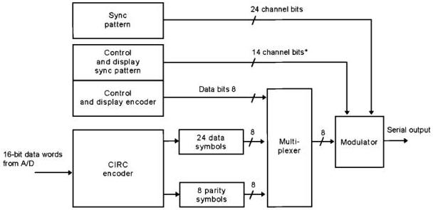

* Twice per 98 frames for synchronization of control and display channel.

The proper sequence of symbols from data, error correction and control and display units is generated by the time multiplexer.

The modulator then converts the symbol sequence into a channel bit sequence according to the EFM-code as given in clause 13 and adds the merging bits and sync pattern, resulting in a serial output of frames as given in clause 14.

## 16 Error correction

### 16.1 General

The error correction shall be carried out using the Cross Interleave Reed-Solomon Code (CIRC).

### 16.2 Structure

Each data word consists of two symbols which are designated as WmA and WmB. WmA includes the higher and WmB the lower 8 bits of the data word.

$$\underbrace{\frac{d_1 d_2 d_3 d_4 d_5 d_6 d_7 d_8}{\text{WmA}}}_{\text{MSB}} \quad \underbrace{\frac{d_1 d_2 d_3 d_4 d_5 d_6 d_7 d_8}{\text{WmB}}}_{\text{LSB}}$$

Each frame (see clause 14) recorded on a disc results, after demodulation, in a block of 32 symbols, of which 24 area data symbols and 8 are parity symbols, named Pm or Qm; these parity symbols are recorded inverted ($\overline{\text{Pm}}$ and $\overline{\text{Qm}}$).

The symbol names and their sequences are given in figure 9.

The definition of the 8 parity symbols:

- P12n, P12n+1, P12n+2, P12n+3
- Q12n, Q12n+1, Q12n+2, Q12n+3
(see figures 9 and 10)

is such that the following equations are satisfied:

$$\left. \begin{array}{l} H_p \cdot V_p = 0 \\ H_q \cdot V_q = 0 \end{array} \right\} \quad (\text{see figures 10 and 11})$$

The calculation is defined on GF (2⁸) (Galois Field) by the following polynomial:

$$P(x) = x^8 + x^4 + x^3 + x^2 + 1$$

and a primitive element $\alpha$ of GF (2⁸) is defined as follows:

$$\alpha = [0\ 0\ 0\ 0\ 0\ 0\ 1\ 0]$$
$$\uparrow$$
$$\text{LSB}$$

### 16.3 CIRC encoder and decoder

The CIRC consists of two Reed-Solomon Codes, C₁ and C₂.

C₁ is a (32,28) Reed-Solomon Code over GF (2⁸).

C₂ is a (28,24) Reed-Solomon Code over GF (2⁸).

A CIRC encoder is given in figure 12, a CIRC decoder in figure 13.

## 17 Subcode/control and display system

### 17.1 General

After demodulation, eight bits per frame are available for control and display purpose (see also clause 14). These bits are named P-Q-R-S-T-U-V-W and are used as eight different subcoding channels.

The following channels are defined:

- Channel P: a simple track (program item) separator flag (see 17.4);
- Channel Q: for control purposes, for example, track (program item) number and time (see 17.5);

An example of the encoding in channels P and Q is given in figure 14.

Channels R up to W inclusive have not yet been defined (see 17.6).

### 17.2 Data format

The data format of the control and display symbols shall be as follows:

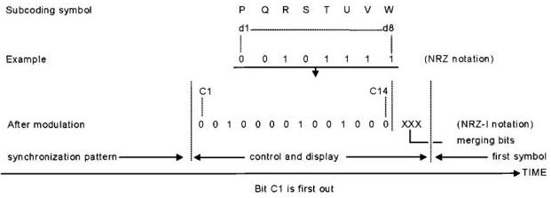

### 17.3 Subcode structure

One subcoding block shall consist of 98 subcoding symbols. The repetition frequency of one block is 75 Hz.

The first two subcoding symbols are replaced by the subcoding sync patterns, S0 and S1, and thus channels P to W inclusive cannot be encoded or decoded during this time interval.

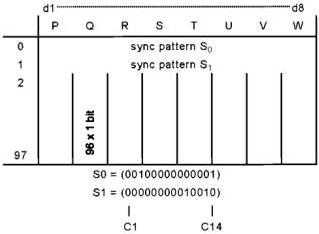

### 17.4 Channel P

Channel P is a flag bit that indicates the start of a track (program item) with the following code rules:

audio: P = 0

start flag: P = 1

The minimum length of the encoded start flag in channel P shall be 2 s; the end of the encoded start flag shall indicate the start of the next track (program item).

If the actual pause exceeds 2 s, the length of the start flag shall give the actual pause length.

In the lead-in track channel P is encoded as for audio. The first audio track (program item) shall be preceded by a start flag of 2 s to 3 s.

The lead-out track shall be preceded by a start flag of 2 s to 3 s (during the last audio track on the disc). The end of the start flag shall indicate the beginning of the lead-out track. Channel P shall remain zero for 2 s to 3 s after the start of the lead-out track, next P switches between 0 and 1 in a 2 Hz ± 2 % rhythm (duty cycle 50 % ± 10 %).

A change in channel P may take place only immediately after the subcoding sync pattern S0 and S1. The encoding of channel P is delayed by one subcoding block with respect to the encoding of channel Q.

### 17.5 Channel Q

The general data format of channel Q shall be:

|  S0, S1 | CONTROL | ADR | DATA-Q | CRC | S0, S1  |
| --- | --- | --- | --- | --- | --- |
|  Bit position | 0 1 2 3 | ... | 96 bits | ...95 Time |   |

CONTROL:

The control field contains 4 flag bits to define the kind of information in a track (program item), bit 0 is first out (MSB).

MBS LSB

| |

0 0 X 0 - 2 audio channels without pre-emphasis;

0 0 X 1 - 2 audio channels with pre-emphasis 50/15 μs;

0 X 0 X - copy prohibited;

0 X 1 X - copy permitted.

The bits of the control field (except for the copy bit) can change during an actual pause (X = 0 0) of at least 2 s and during the lead-in area only.

NOTE 1 - The four bits of the control field of the Q channel should be copied to the control field of the channel status of the digital audio interface for domestic use. (Under consideration.)

NOTE 2 - For non-audio applications of the compact disc the following control codes have been defined:

0 1 X 0: Digital data;

1 X X X: Broadcasting use.

All other combinations will be defined later on.

ADR:

4-address bits, MSB is first out:

0000: ADR 0, mode 0 for DATA-Q (see 17.5.4);

0001: ADR 1, mode 1 for DATA-Q (see 17.5.1);

0010: ADR 2, mode 2 for DATA-Q (see 17.5.2);

0011: ADR 3, mode 3 for DATA-Q (see 17.5.3);

0100: ADR 4, mode 4 for DATA-Q (see 17.5.4 of IEC 61104).

DATA-Q:

72-data bits, MSB is first out. For this block three modes are defined (see 17.5.1, 17.5.2 and 17.5.3).

CRC:

A 16-bit CRC on CONTROL, ADR and DATA-Q, MSB is first out. On the disc the parity bits are inverted. The syndrome shall be compared with 0.

Polynomial:

$$P(X) = X^{16} + X^{12} + X^5 + 1$$

#### 17.5.1 Mode 1 for DATA-Q

ADR = 1 = (0001)

Mode 1 occupies at least 9 out of 10 successive subcoding blocks.

Two different data formats are possible in mode 1.

During the lead-in track, the data format shall be:

|  S0, S1 | CON-TROL | 1 | 00 | POINT | MIN | SEC | FRAME | ZERO | P MIN | P SEC | P FRAME | CRC  |
| --- | --- | --- | --- | --- | --- | --- | --- | --- | --- | --- | --- | --- |
|   |   | ADR | TNO |   |   |   |   |   |   |   |   |   |

During the audio and lead-out tracks the data format shall be:

|  S0, S1 | CON-TROL | 1 | TNO | X | MIN | SEC | FRAME | ZERO | A MIN | A SEC | A FRAME | CRC  |
| --- | --- | --- | --- | --- | --- | --- | --- | --- | --- | --- | --- | --- |
|   |   | ADR |   |   |   |   |   |   |   |   |   |   |

TNO:

Track number (program item) expressed as two digits (4 bits encoded)

00: Lead-in track, BCD encoded.

The end of the lead-in track is at the starting diameter of the program area.

01-99: Track numbers, BCD encoded.

A track may be preceded by a pause with the same track number. The track numbering shall start with the value 01 and shall increment by one.

In the case of a program stored on several discs, the numbering may be continued. The minimum length of a track is 4 s, not including the pause length preceding this track.

AA: Lead-out track, hexadecimal code AA.

The lead-out track starts at the end of the last audio track on a disc, without a preceding pause encoding.

X:

Index to TNO, two digits BCD.

During the lead-in track, the index X is not encoded.

00: Pause encoding.

The pause encoding in channel Q coincides with the actual pauses in the audio program. The first audio track is preceded by a pause encoding of 2 s to 3 s (see channel P in 17.4). The lead-out track is encoded as audio.

01-99: Subdivision numbers.

During the lead-out track X is 01.

Within an audio track (TNO = 01-99 and X ≠ 00), the first value of X is 01. The value of X may only increase in increments of 1.

MIN, SEC, FRAME:

Running time within a track (TIME) is expressed as six digits BCD: MIN, SEC, and FRAME two digits each. The time is set to zero at the start of a track. Time increases during the audio and decreases during the pause, ending with the value zero at the end of the pause. During the lead-in and lead-out tracks the time increases.

The minutes are stored in MIN, the seconds in SEC. One second is subdivided into 75 FRAMEs (running from 00 to 74).

ZERO:

These eight bits are zero.

AMIN, ASEC, AFRAME:

Running time on the disc (ATIME) is expressed as six digits BCD: AMIN, ASEC and AFRAME two digits each.

At the starting diameter of the program area the running time is set to zero and TNO takes the value of the first track on the disc. The minutes are stored in AMIN, the seconds in ASEC. One second is subdivided into 75 AFRAMEs (running from 00 to 74).

POINT, PMIN, PSEC, PFRAME:

On the lead-in track a table of contents is stored in these locations. This table of contents is continuously repeated in the lead-in area (TNO = 00).

In each table of contents, the items are repeated three times (see figure 15). At the end of the lead-in area, the table of contents may be ended with any value of POINT.

The value of PMIN, PSEC and PFRAME gives the starting-point of the track number pointed to by POINT. These values give the start position of the track on the absolute time scale (AMIN, ASEC and AFRAME) with an accuracy of $\pm 1$ s. The start position of a track is the first position with the new track number and $(X \neq 00)$.

If POINT = A0, the value of PMIN gives the TNO of the first track on the disc, PSEC and PFRAME are zero.

If POINT = A1, the value of PMIN gives the TNO of the last track on the disc, PSEC and PFRAME are zero.

If POINT = A2, in PMIN, PSEC and PFRAME the starting-point of the lead-out track is given.

#### 17.5.2 Mode 2 for DATA-Q

ADR = 2 = (0010)

If mode 2 is present, it occupies at least 1 out of 100 successive subcoding blocks.

The data format shall be:

|  S0, S1 | CONTROL | 2 | N1 N2 N3 N4 N5 N6 N7 N8 N9 N10 N11 N12 N13 | ZERO | AFRAME | CRC  |
| --- | --- | --- | --- | --- | --- | --- |
|  ADR |   | 52 bits  |   |   |   |   |

N1-N13:

Catalogue number of the disc expressed in 13 digits BCD according to the UPC/EAN code (under consideration).

The catalogue number does not change on a disc. In case no catalogue number is encoded according to the UPC/EAN-code, N1-N13 are all zero, or mode 2 can be deleted from the disc.

ZERO:

These 12 bits are zero.

AFRAME:

The continuation of AFRAME in mode 1 (two digits BCD running from 00 to 74). During the lead-in area (TNO = 00), these eight bits are zero.

#### 17.5.3 Mode 3 for DATA-Q

ADR = 3 = (0011)

If mode 3 is present, it occupies at least 1 out of 100 successive subcoding blocks.

Mode 3 is used to give a unique number to an audio track.

This is done by means of the ISRC having 12 characters represented by I1 to I12 (see ISO 3901).

If no ISRC is used, mode 3 shall be deleted. During the lead-in and lead-out tracks, mode 3 is not present on the disc.

The ISRC can only change immediately after the TNO has been changed.

The data format shall be:

|  S0, S1 | CON-TROL | 3 | I1 I2 I3 I4 I5 | 00 | I6 I7 I8 I9 I10 I11 I12 | ZERO | A FRAME | CRC  |
| --- | --- | --- | --- | --- | --- | --- | --- | --- |
|  ADR |   | ISRC 60 bits |   |   |   |   |  |   |

I1-I2 give the country code;
12-15 give the owner code;
16-17 give the year of recording;
18-112 give the serial number of the recording.

The characters I1-I5 are coded in a 6-bit format as given below; the characters I6-I12 are 4-bit BCD numbers.

|  Character |   |   | Character  |   |   |
| --- | --- | --- | --- | --- | --- |
|   | Binary | Octal |  | Binary | Octal  |
|  0 | 000000 | 00 | I | 011001 | 31  |
|  1 | 000001 | 01 | J | 011010 | 32  |
|  2 | 000010 | 02 | K | 011011 | 33  |
|  3 | 000011 | 03 | L | 011100 | 34  |
|  4 | 000100 | 04 | M | 011101 | 35  |
|  5 | 000101 | 05 | N | 011110 | 36  |
|  6 | 000110 | 06 | O | 011111 | 37  |
|  7 | 000111 | 07 | P | 100000 | 40  |
|  8 | 001000 | 10 | Q | 100001 | 41  |
|  9 | 001001 | 11 | R | 100010 | 42  |
|  A | 010001 | 21 | S | 100011 | 43  |
|  B | 010010 | 22 | T | 100100 | 44  |
|  C | 010011 | 23 | U | 100101 | 45  |
|  D | 010100 | 24 | V | 100110 | 46  |
|  E | 010101 | 25 | W | 100111 | 47  |
|  F | 010110 | 26 | X | 101000 | 50  |
|  G | 010111 | 27 | Y | 101001 | 51  |
|  H | 011000 | 30 | Z | 101010 | 52  |

00: These 2 bits are zero.

ZERO: These 4 bits are zero.

AFRAME: The continuation of AFRAME in mode 1 (see 17.5.1).

#### 17.5.4 Mode 0 for DATA-Q

ADR = 0 = (0000)

Subcode channel mode 0 for DATA-Q shall contain, if used, only the CONTROL and CRC bits, all other bits are zero.

NOTE – If the CD data format is used on non-CD information channels this mode can be used to replace mode-1. In these cases, the rule "Mode-1 occupies at least 9 out of 10 successive subcoding blocks" (see 17.5.1) is no longer valid.

The data format of Mode 0 for DATA-Q shall be:

|   | S0, S1 | CONTROL | ADR | DATA-Q | CRC | S0, S1 |   |
| --- | --- | --- | --- | --- | --- | --- | --- |

S0, S1 See subcode CONTROL AND DISPLAY SYSTEM, clause 17.

CONTROL: See CONTROL AND DISPLAY SYSTEM, 17.5.

ADR: These 4 bits are zero, the MODE number.

DATA-Q: These 72 bits are zero.

CRC: See 17.5.

During the time subcode channel-Q Mode 0 is present, subcode channel-P is zero.

### 17.6 Channels R to W inclusive

These channels are under consideration and are all zero.

## 18 Control system and display data – General

The following clauses defines the basic format and the organization of the control and display data on the disc, and the control and display formats of different graphics modes.

## 19 General data organization

### 19.1 Basic format

The maximum available data rate in the subcoding channels R to W is 43,2 kbit/s.

The basic format is presented in figure 19. The data is synchronized with the subcode sync patterns S0 and S1. Each group of 6 bits (R to W) is called a SYMBOL. A group of 24 SYMBOLS is called a PACK. A PACKET consists of 4 PACKS. The SYMBOL following the syncs S0 and S1 is the first SYMBOL of the first PACK in a PACKET.

To protect the data in the subcoding channels R to W, a (24, 20) Reed-Solomon error correction code is used. To improve the burst error correction capability, 8 times interleaving is added to this error-correction system.

The first two symbols in a PACK have additional protection with a (4, 2) Reed-Solomon error correction code.

The first symbol of a PACK contains a MODE switch of 3 bits and a 3-bit subdivision of MODE called ITEM.

The defined MODE-ITEM combinations are:

|  MODE | ITEM |   |
| --- | --- | --- |
|  0 (000) | 0 (000) | : ZERO mode  |
|  1 (001) | 0 (000) | : LINE-GRAPHICS mode  |
|  1 (001) | 1 (001) | : TV-GRAPHICS mode  |
|  1 (001) | 2 (010) | : EXTENDED-TV-GRAPHICS mode  |
|  2 (010) | 4 (100) | : CD TEXT mode  |
|  3 (011) | 0 (000) | : MIDI mode  |
|  7 (111) | 0 (000) | : USER mode.  |

All MODE-ITEM combinations not defined are reserved for future use.

### 19.2 PACK format

For the organization of a PACK, see figure 20.

### 19.3 Error correction parity P

(24, 20) Reed-Solomon code over GF (2⁶)

Polynomial: $P(X) = X^6 + X + 1$

1 symbol = 6 bits

The parity matrix $WH_p$ is:

$$H_p = \begin{cases} 1 & 1 & 1 \\ a^{23} & a^{22} & a^{21} \\ a^{46} & a^{44} & a^{42} \\ a^{69} & a^{66} & a^{63} \end{cases} \qquad \qquad \begin{array}{c} 1 & 1 \\ a^1 & 1 \\ a^2 & 1 \\ a^3 & 1 \end{array}$$

The primitive element $a$ of GF(2⁶) is:

$$\begin{array}{c} \text{msb} \quad \text{lsb} \\ a = (0\ 0\ 0\ 0\ 1\ 0) \end{array}$$

The parity symbols $P0 = P - S_{24n+20}$, $P1 = P - S_{24n+21}$, $P2 = P - S_{24n+22}$ and $P3 = P - S_{24n+23}$ are defined to satisfy the following equation:

$$H_p \times V_p = 0$$

where

$$
V _ {p} = - \left\{ \begin{array}{l} D - S _ {2 4 n} \\ D - S _ {2 4 n + 1} \\ D - S _ {2 4 n + 2} \\ D - S _ {2 4 n + 3} \\ D - S _ {2 4 n + 4} \\ D - S _ {2 4 n + 5} \\ D - S _ {2 4 n + 6} \\ D - S _ {2 4 n + 7} \\ D - S _ {2 4 n + 8} \\ D - S _ {2 4 n + 9} \\ D - S _ {2 4 n + 1 0} \\ D - S _ {2 4 n + 1 1} \\ D - S _ {2 4 n + 1 2} \\ D - S _ {2 4 n + 1 3} \\ D - S _ {2 4 n + 1 4} \\ D - S _ {2 4 n + 1 5} \\ D - S _ {2 4 n + 1 6} \\ D - S _ {2 4 n + 1 7} \\ D - S _ {2 4 n + 1 8} \\ D - S _ {2 4 n + 1 9} \\ D - S _ {2 4 n + 2 0} \\ D - S _ {2 4 n + 2 1} \\ D - S _ {2 4 n + 2 2} \\ D - S _ {2 4 n + 2 3} \end{array} \right\}
$$

### 19.4 Interleaving

The sequences of interleaving and de-interleaving are described in figures 21 and 22.

The capacity of this interleaved error correction system is:

- 8 symbol burst error correction on the disc with a single-symbol correction strategy;
- 16 symbol burst error correction on the disc with a two-symbol correction strategy.

### 19.5 P-parity encoder and interleave sequence

For the organization of a $P$-parity encoder and interleave sequence, see figure 21.

### 19.6 P-parity decoder and de-interleave sequence

For the organization of a $P$-parity decoder and de-interleave sequence, see figure 22.

### 19.7 Error-correction parity $Q$

(4, 2) Reed-Solomon code over $\mathrm{GF}(2^6)$

Polynomial: $P(X) = X^6 + X + 1$

1 symbol = 6 bits

The parity matrix $WH_q$ is:

$$H_q = \begin{cases} 1 & 1 & 1 & 1 \\ a3 & a2 & a1 & 1 \end{cases}$$

The primitive element $a$ of $\text{GF}(2^6)$ is:

$$\begin{array}{cc} \text{msb} & \text{lsb} \\ a = (0\ 0\ 0\ 0\ 1\ 0) \end{array}$$

The parity symbols $Q0 = D - S_{24n+2}$ and $Q1 = D - S_{24n+3}$ are defined to satisfy the following equation:

$$H_q \times V_q = 0$$

where

$$V_q = \begin{cases} D - S_{24n} \\ D - S_{24n} + 1 \\ D - S_{24n} + 2 \\ D - S_{24n} + 3 \end{cases}$$

This Q-parity system combined with scrambling and interleaving can correct an error burst of 59 subcoding symbols on the disc by using a single symbol correcting strategy (symbols 0, 1, 2 and 3 only).

### 19.8 Q-parity encoder

For the organization of a Q-parity encoder, see figure 23.

### 19.9 Q-parity decoder

For the organization of a Q-parity decoder, see figure 24.

## 20 ZERO mode (MODE = 0, ITEM = 0)

### 20.1 General

All bits in the PACK with this mode are zero. This mode is used for empty channel purposes. So, if no data is transferred in a PACK, the ZERO mode can be used.

### 20.2 ZERO mode PACK format

The PACK format in the ZERO mode is:

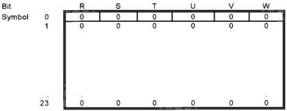

## 21 LINE GRAPHICS mode (MODE = 1, ITEM = 0)

### 21.1 General

The LINE-GRAPHICS system gives the possibility to display text and graphics pictures on a display with 288 (horizontal) × 24 (vertical) pixels. The data is displayed in a field of 48 (horizontal) × 2 (vertical) FONTs. A FONT is an array of 6 (horizontal) × 12 (vertical) pixels. A pixel is the smallest possible picture element.

The memory size of the display page is 50 × 4 FONTs. The outer ROWs and COLUMNs of the memory are intended for scroll actions. These ROWs and COLUMNs are not visible.

The data is displayed in monochrome. If a colour display device is available, the foreground and background colours in a FONT are chosen from eight possible colours.

Instructions are available to

- write a FONT with two colours (foreground/background) into memory,
- soft scroll the SCREEN.

### 21.2 LINE-GRAPHICS mode PACK format

|  Bit |  | R | S | T | U | V | W  |
| --- | --- | --- | --- | --- | --- | --- | --- |
|  Symbol | 0 | 0 | 0 | 1 | 0 | 0 | 0  |
|   | 1 | INSTRUCTION  |   |   |   |   |   |
|   | 2 | PARITY QO  |   |   |   |   |   |
|   | 3 | PARITY Q1  |   |   |   |   |   |
|   | 4 |   |   |   |   |   |   |
|   |  | DATA field  |   |   |   |   |   |
|   | 19 |   |   |   |   |   |   |
|   | 20 | PARITY P0  |   |   |   |   |   |
|   | 21 | PARITY P1  |   |   |   |   |   |
|   | 22 | PARITY P2  |   |   |   |   |   |
|   | 23 | PARITY P3  |   |   |   |   |   |

### 21.3 LINE-GRAPHICS mode FONT format

The location of the pixels in a FONT is:

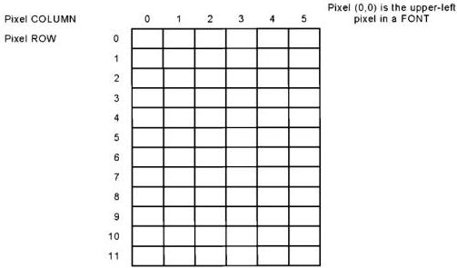

### 21.4 LINE-GRAPHICS mode SCREEN format

The visible part of the graphics memory is called the SCREEN area. The position (ROW, COLUMN) of the FONTs in the LINE-GRAPHICS memory is:

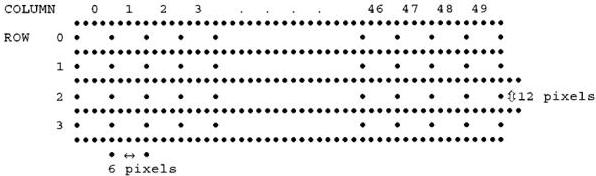

The graphics memory contains ROWs 0 .. 3 and COLUMNs 0 .. 49. The SCREEN area consists of 288 (horizontal) x 24 (vertical) pixels. The soft scroll pointers determine which pixel from FONT (1, 1) is the upper-left pixel from memory that is visible.

To facilitate soft scroll, screen pointers are available to define the shift (in pixels) on the screen of the data in memory. The following pointers are available:

- PH: (horizontal screen pointer) defines the horizontal shift in pixels of all pixel data in memory. The pixels with PIXEL-COLUMN = PH of FONTs (1 .. 3, 1) are the left-most pixels from memory that are visible;
- PV: (vertical screen pointer) defines the vertical shift in pixels of all pixel data in memory. The pixels with PIXEL-ROW = PV of FONTs (1, 1 49) are the upper pixels from memory that are visible.

### 21.5 LINE-GRAPHICS mode colour table

|   | (msb) |   | (lsb)  |   |
| --- | --- | --- | --- | --- |
|   | R | G | B |   |
|  0 = | 0 | 0 | 0 | : black  |
|  1 = | 0 | 0 | 1 | : blue  |
|  2 = | 0 | 1 | 0 | : green  |
|  3 = | 0 | 1 | 1 | : cyan  |
|  4 = | 1 | 0 | 0 | : red  |
|  5 = | 1 | 0 | 1 | : magenta  |
|  6 = | 1 | 1 | 0 | : yellow  |
|  7 = | 1 | 1 | 1 | : white  |

### 21.6 LINE-GRAPHICS mode instructions

|   |  | R | S | T | U | V | W |   |
| --- | --- | --- | --- | --- | --- | --- | --- | --- |
|  4 | = | 0 | 0 | 0 | 1 | 0 | 0 | : Write FONT  |
|  12 | = | 0 | 0 | 1 | 1 | 0 | 0 | : Soft scroll SCREEN  |

#### 21.6.1 Write FONT instruction (4)

If the instruction is Write FONT, the format of the DATA field in the PACK is:

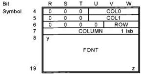

|  COL0 | background colour number (see 21.5) (lsb on bit W)  |
| --- | --- |
|  COL1 | foreground colour number (see 21.5) (lsb on bit W)  |
|  ROW | = 0 .. 3 (lsb on W)  |
|  COLUMN | = 0 .. 49 (lsb on W)  |
|  FONT | y = top-left pixel in the FONT z = bottom-right pixel in the FONT Pixel with value = 0: background colour (COL0) Pixel with value = 1: foreground colour (COL1)  |

The instruction Write FONT writes the data defined in FONT on address (ROW, COLUMN) into the LINE-GRAPHICS memory. On a monochrome display, the pixels with value 0 are off and the pixels with value 1 are on. On a colour display, the pixels with value 0 are displayed with colour COL0 and the pixels with value 1 with colour COL1.

#### 21.6.2 Write Scroll SCREEN instruction (12)

If the instruction is Scroll SCREEN the format of the DATA field in the PACK is:

|  Bit |  | R | S | T | U | V | W  |
| --- | --- | --- | --- | --- | --- | --- | --- |
|  Symbol | 4 | 0 | 0 | 0 | COLOR  |   |   |
|   |  5 | COPH |   | 0 | PH  |   |   |
|   |  6 | COPV |   | PV  |   |   |   |
|   |  7 | 0 | 0 | 0 | 0 | 0 | 0  |
|   |  19 | 0 | 0 | 0 | 0 | 0 | 0  |
|  COLOR |  | background colour number (see 21.5) (lsb on bit W)  |   |   |   |   |   |
|  COPH | = | 0: no horizontal copy  |   |   |   |   |   |
|   |  = | 1: copy right  |   |   |   |   |   |
|   |  = | 2: copy left (lsb on bit S)  |   |   |   |   |   |
|  PH | = | 0 .. 5 (lsb on bit W): horizontal shift pointer (in pixels)  |   |   |   |   |   |
|  COPV | = | 0: no vertical copy  |   |   |   |   |   |
|   |  = | 1: copy down  |   |   |   |   |   |
|   |  = | 2: copy up (lsb on bit S)  |   |   |   |   |   |
|  PV | = | 0 .. 11 (lsb on bit W): vertical shift pointer (in pixels)  |   |   |   |   |   |

The instruction Scroll SCREEN gives new values to the screen pointers PH and PV. The screen pointer PH is given the new value PH and the screen pointer PV is given the new value PV, for all values of COPH and COPV. Depending on the values of COPH and COPV, all FONTs can be copied to the next (or previous) ROW and COLUMN positions.

If COPH = 1 (scroll right) then all FONTs are shifted one COLUMN to the right in memory. The contents of FONT $(i,j)$ is copied to position $(i,j + 1)$ for $i = 0 \ldots 3$ and $j = 0 \ldots 48$. The original data of positions $(i,49)$ is lost ($i = 0 \ldots 3$). On a monochrome display, the FONTs with position $(i,0)$ are set to background and on a colour display, these FONTs are set to the colour defined in COLOR ($i = 0 \ldots 3$).

If COPH = 2 (scroll left) then all FONTs are shifted one COLUMN to the left in memory. The contents of FONT $(i,j)$ is copied to position $(i,j - 1)$ for $i = 0 \ldots 3$ and $j = 1 \ldots 49$. The original data of positions $(i,0)$ is lost ($i = 0 \ldots 3$). On a monochrome display, the FONTs with position $(i,49)$ are set to background and, on a colour display, these FONTs are set to the colour defined in COLOR ($i = 0 \ldots 3$).

If COPV = 1 (scroll down) then all FONTs are shifted one ROW down in memory. The contents of FONT $(i,j)$ is copied to position $(i + 1,j)$ for $i = 0 \ldots 2$ and $j = 0 \ldots 49$. The original data of positions $(3,j)$ are lost ($j = 0 \ldots 49$). On a monochrome display, the FONTs with position $(0,j)$ are set to background, and, on a colour display, these FONTs are set to the colour defined in COLOR ($j = 0 \ldots 49$).

If COPV = 2 (scroll up) then all FONTs are shifted one ROW up in memory. The contents of FONT $(i,j)$ is copied to position $(i - 1,j)$ for $i = 1 \ldots 3$ and $j = 0 \ldots 49$. The original data for positions $(0,j)$ are lost ($j = 0 \ldots 49$). On a monochrome display the FONTs with position $(3,j)$ are set to background, and, on a colour display, these FONTs are set to the colour defined in COLOR ($j = 0 \ldots 49$).

## 22 TV-GRAPHICS mode (MODE = 1, ITEM = 1)

### 22.1 General

The TV GRAPHICS system gives the possibility to display text and graphics pictures. The data is displayed in a field of 48 (horizontal) × 16 (vertical) FONTs. A FONT is an array of 6 (horizontal) × 12 (vertical) pixels. A pixel is the smallest possible picture element.

The memory size of the display page is 50 × 18 FONTs. The outer ROWs and COLUMNs of the memory are intended for scroll actions. These ROWs and COLUMNs are not visible.

The display area outside the visible part of 48 × 16 FONTs can be preset with a colour. This area is called the BORDER.

The FONT data is provided with a channel number (0 .. 15). This channel number gives a decoder the (optional) possibility to select a specific part of the incoming data. If no channel selector is available, the channels 0 and 1 are displayed. With a selector, a combination can be made from all available channels.

The data is displayed in maximum 16 colours. These 16 colours are defined in a colour look-up table (CLUT) of 16 × 12 bits. The colours of the CLUT can be chosen from a maximum of 4096 bits (12 bits in RED, GREEN and BLUE, 4 bits each). The CLUT is loaded from the disc.

INSTRUCTIONS are available to

- preset the memory with a colour,
- preset the BORDER with a colour,
write a FONT with two colours (foreground/background) into memory,
- EXCLUSIVE-OR a FONT with two colours,
- load the CLUT. Load the colour 0..7 and 8..15,
- soft scroll the SCREEN,
define colour transparency.

### 22.2 TV-GRAPHICS mode PACK format

Bit
Symbol

|   | R | S | T | U | V | W  |
| --- | --- | --- | --- | --- | --- | --- |
|  0 | 0 | 0 | 1 | 0 | 0 | 1  |
|  1 | INSTRUCTION  |   |   |   |   |   |
|  2 | PARITY Q0  |   |   |   |   |   |
|  3 | PARITY Q1  |   |   |   |   |   |
|  4 | DATA field  |   |   |   |   |   |
|  19 |   |   |   |   |   |   |
|  20 | PARITY P0  |   |   |   |   |   |
|  21 | PARITY P1  |   |   |   |   |   |
|  22 | PARITY P2  |   |   |   |   |   |
|  23 | PARITY P3  |   |   |   |   |   |

### 22.3 TV-GRAPHICS mode FONT format

The location of the pixels in a FONT is:

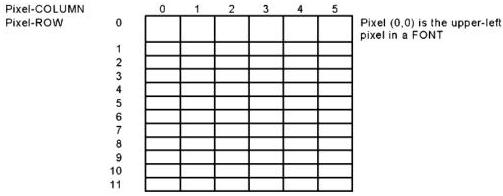

### 22.4 TV-GRAPHICS mode SCREEN format

The visible part of the graphics memory is called the SCREEN area. The position (ROW, COLUMN) of the FONTs in the TV-GRAPHICS memory is:

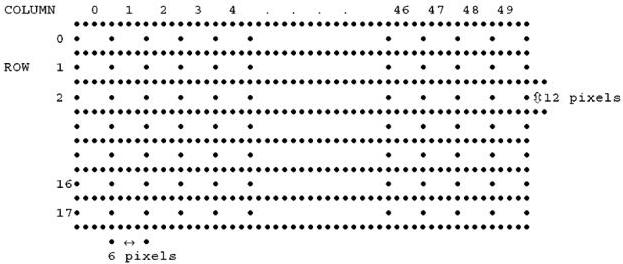

The graphics memory contains ROWs 0 .. 17 and COLUMNs 0 .. 49. The SCREEN area consists of 288 (horizontal) x 192 (vertical) pixels. The soft scroll pointers determine which pixel from FONT (1, 1) is the upper-left pixel from memory that is visible.

The graphics memory consists of four 1-bit planes (plane 0 .. 3). Bit plane 0 is the bit plane with the least significant bits (lsb) of the pixels and bit plane 3 the bit plane with the most significant bits (msb) of the pixels.

To facilitate soft scroll, screen pointers are available to define the shift (in pixels) on the screen of the data in memory. The following pointers are available:

- PH: (horizontal screen pointer) defines the horizontal shift in pixels of all pixel data in memory. The pixels with PIXEL-COLUMN = PH of FONTs (1 .. 17, 1) are the left-most pixels from memory that are visible;
- PV: (vertical screen pointer) defines the vertical shift in pixels of all pixel data in memory. The pixels with PIXEL-ROW = PV of FONTs (1, 1 49) are the upper pixels from memory that are visible.

### 22.5 TV-GRAPHICS mode instructions

|   |  | R | S | T | U | V | W |   |
| --- | --- | --- | --- | --- | --- | --- | --- | --- |
|  1 | = | 0 | 0 | 0 | 0 | 0 | 1 | Preset MEMORY 1)  |
|  2 | = | 0 | 0 | 0 | 0 | 1 | 0 | Preset BORDER  |
|  6 | = | 0 | 0 | 0 | 1 | 1 | 0 | Write FONT FOREGROUND/BACKGROUND  |
|  20 | = | 0 | 1 | 0 | 1 | 0 | 0 | Soft scroll SCREEN with preset  |
|  24 | = | 0 | 1 | 1 | 0 | 0 | 0 | Soft scroll SCREEN with copy  |
|  28 | = | 0 | 1 | 1 | 1 | 0 | 0 | Define colour transparency  |
|  30 | = | 0 | 1 | 1 | 1 | 1 | 0 | Load CLUT colour 0 .. colour 7  |
|  31 | = | 0 | 1 | 1 | 1 | 1 | 1 | Load CLUT colour 8 .. colour 15  |
|  38 | = | 1 | 0 | 0 | 1 | 1 | 0 | EXCLUSIVE-OR FONT with two colours  |

#### 22.5.1 Preset MEMORY instruction (1)

If the instruction is Preset MEMORY, the format of the DATA field in the PACK is:

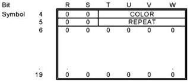

COLOR = colour number 0 .. 15 (lsb on W)

REPEAT = 0 .. 15 (lsb on bit W)

The instruction Preset MEMORY presets all FONTs in the MEMORY with the colour defined in COLOR. In addition to this, the scroll pointers PH and PV are reset to zero.

This instruction is repeated on the disc 16 times in succeeding PACKs. The value of REPEAT gives the sequence number of the Preset MEMORY instruction. In the first Preset MEMORY PACK from a sequence of 16 the value of REPEAT is zero. The value of REPEAT increases by one in the succeeding PACKs of a sequence.

#### 22.5.2 Preset BORDER instruction (2)

If the instruction is Preset BORDER, the format of the DATA field in the PACK is:

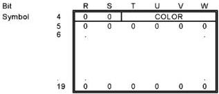

COLOR = colour number 0 .. 15 (lsb on W)

1) The Preset MEMORY instruction is repeated on the disc 16 times in succeeding PACKs.

The instruction Preset BORDER presets the BORDER area of the display with the colour defined in COLOR.

#### 22.5.3 Write FONT FOREGROUND/BACKGROUND instruction (6)

If the instruction is Write FONT FOREGROUND/BACKGROUND, the format of the DATA field in the PACK is:

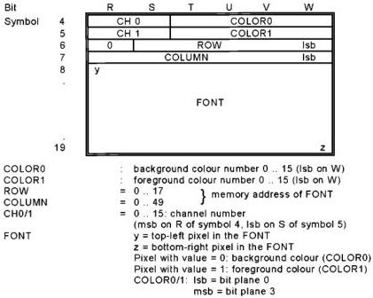

The instruction Write FONT FOREGROUND/BACKGROUND writes one FONT with the data defined in FONT and the colours COLOR0 and COLOR1 into memory. The data in FONT is written on address (ROW, COLUMN) in bit planes 0 .. 3 of the graphics memory.

The number CH gives a channel number to a FONT with data. Channels 0 and 1 contain the default picture (a decoder without a channel selector ignores all Write FONT instructions with CH 2 .. 15). If a decoder is equipped with a channel selector, all channels can be switched on or off selectively.

#### 22.5.4 Scroll SCREEN with preset instruction (20)

If the instruction is Scroll SCREEN with preset the format of the DATA field in the PACK is:

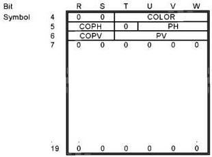

|  COLOR | : | colour number 0 .. 15 (lsb on bit W)  |
| --- | --- | --- |
|  COPH | = | 0: no horizontal copy  |
|   |  = | 1: copy right  |
|   |  = | 2: copy left  |
|   |  = | (lsb on bit S)  |
|  PH | = | 0 .. 5 (lsb on bit W): horizontal shift pointer (in pixels)  |
|  COPV | = | 0: no vertical copy  |
|   |  = | 1: copy down  |
|   |  = | 2: copy up  |
|   |  = | (lsb on bit S)  |
|  PV | = | 0 .. 11 (lsb on bit W): vertical shift pointer (in pixels)  |

The instruction Scroll SCREEN with preset gives new values to the screen pointers PH and PV. The screen pointer PH is given the new value PH and the screen pointer PV is given the new value PV, for all values of COPH and COPV. Depending on the values of COPH and COPV, all FONTs can be copied to the next (or previous) ROW and COLUMN positions.

If COPH = 1 (scroll right) then all FONTs are shifted one COLUMN to the right in memory. The contents of FONT (i,j) is copied to position (i,j + 1) for i = 0 .. 17 and j = 0 .. 48. The original data of positions (i,49) is lost (i = 0 .. 17). The FONTs with position (i,0) are preset with the colour defined in COLOR (i = 0 .. 17).

If COPH = 2 (scroll left) then all FONTs are shifted one COLUMN to the left in memory. The contents of FONT (i,j) is copied to position (i,j - 1) for i = 0 .. 17 and j = 1 .. 49. The original data of positions (i,0) is lost (i = 0 .. 17). The FONTs with position (i,49) are preset with the colour defined in COLOR (i = 0 .. 17).

If COPV = 1 (scroll down) then all FONTs are shifted one ROW down in memory. The contents of FONT (i,j) is copied to position (i + 1,j) for i = 0 .. 16 and j = 0 .. 49. The original data of positions (17,j) is lost (j = 0 .. 49). The FONTs with position (0,j) are preset with the colour defined in COLOR (j = 0 .. 49).

If COPV = 2 (scroll up) then all FONTs are shifted one ROW up in memory. The contents of FONT (i,j) is copied to position (i - 1,j) for i = 1 .. 17 and j = 0 .. 49. The original data of positions (0,j) is lost (j = 0 .. 49). The FONTs with position (17,j) are preset with the colour defined in COLOR (j = 0 .. 49).

#### 22.5.5 Scroll SCREEN with copy instruction (24)

If the instruction is Scroll SCREEN with copy the format of the DATA field in the PACK is:

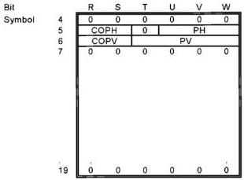

|  COPH | = | 0: no horizontal copy  |
| --- | --- | --- |
|   |  = | 1: copy right  |
|   |  = | 2: copy left  |
|   |   | (lsb on bit S)  |
|  PH | = | 0 .. 5 (lsb on bit W): horizontal shift pointer (in pixels)  |
|  COPV | = | 0: no vertical copy  |
|   |  = | 1: copy down  |
|   |  = | 2: copy up  |
|   |   | (lsb on bit S)  |
|  PV | = | 0 .. 11 (lsb on bit W): vertical shift pointer (in pixels)  |

The instruction Scroll SCREEN with copy gives new values to the screen pointers PH and PV. The screen pointer PH is given the new value PH and the screen pointer PV is given the new value PV, for all values of COPH and COPV. Depending on the values of COPH and COPV, all FONTs can be copied to the next (or previous) ROW and COLUMN positions. The 'with copy' clause in this instruction causes the pixel memory to be wrap-around.

If COPH = 1 (scroll right) then all FONTs are shifted one COLUMN to the right in memory. The contents of FONT $(i,j)$ is copied to position $(i,j + 1)$ for $i = 0 \ldots 17$ and $j = 0 \ldots 48$. The original data of the FONTs $(i,49)$ is copied to position $(i,0)$ for $i = 0 \ldots 17$.

If COPH = 2 (scroll left) then all FONTs are shifted one COLUMN to the left in memory. The contents of FONT $(i,j)$ is copied to position $(i,j - 1)$ for $i = 0 \ldots 17$ and $j = 1 \ldots 49$. The original data of the FONTs $(i,0)$ is copied to position $(i,49)$ for $i = 0 \ldots 17$.

If COPV = 1 (scroll down) then all FONTs are shifted one ROW down in memory. The contents of FONT $(i,j)$ is copied to position $(i + 1,j)$ for $i = 0 \ldots 16$ and $j = 0 \ldots 49$. The original data of the FONTs $(17,j)$ is copied to position $(0,j)$ for $j = 0 \ldots 49$.

If COPV = 2 (scroll up) then all FONTs are shifted one ROW up in memory. The contents of FONT $(i,j)$ is copied to position $(i - 1,j)$ for $i = 1 \ldots 17$ and $j = 0 \ldots 49$. The original data of the FONTs $(0,j)$ is copied to position $(17,j)$ for $j = 0 \ldots 49$.

#### 22.5.6 Load CLUT Colour-0 .. 7 instruction (30)

If the instruction is Load CLUT Colour-0 .. 7 the format of the DATA field in the PACK is:

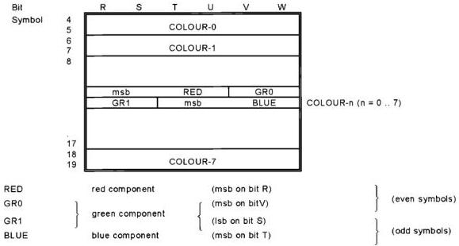

The instruction Load CLUT colour 0 .. 7 gives with a 12-bit code the first half (colour 0 .. 7) of the colour look-up table.

The encoding of the colours is R, G, B, 4 bits each. These 4 bits give the intensity (linear encoded) of red, green and blue:

minimum intensity: 0 = 0 0 0 0

maximum intensity: 15 = 1 1 1 1

#### 22.5.7 Load CLUT colour-8 .. 15 instruction (31)

If the instruction is Load CLUT colour-8 .. 15 the format of the DATA field in the PACK is:

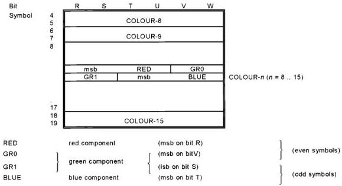

The instruction Load CLUT colour-8 .. 15 gives, with a 12-bit code, the second half (colour-8 .. 15) of the colour look-up table.

The encoding of the colours is R, G, B, 4 bits each. These 4 bits give the intensity (linear encoded) of red, green and blue:

Minimum intensity: 0 = 0 0 0 0

Maximum intensity 15 = 1 1 1 1

#### 22.5.8 EXCLUSIVE-OR FONT instruction (38)

If the instruction is EXCLUSIVE-OR FONT, the format of the DATA field in the PACK is:

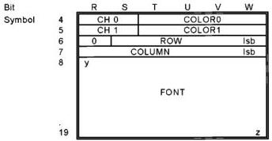

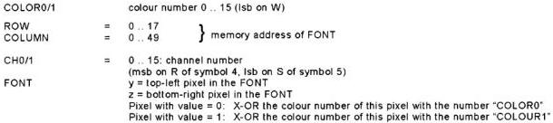

The instruction EXCLUSIVE-OR FONT with two colours X-ORs the colour values of the pixels in FONT (ROW, COLUMN) with the numbers given in COLOR0 and COLOR1; the result of this action is stored in memory location (ROW, COLUMN).

The number CH gives a channel number to a FONT with data. Channels 0 and 1 contain the default picture (a decoder without channel selector ignores all EXCLUSIVE-OR FONT instructions with CH = 2 .. 15). If a decoder is equipped with a channel selector, all channels can be switched on or off selectively.

If a pixel in FONT has value 0, the 4 bits in the memory for this pixel are X-ORed with the 4 bits given in COLOR0. If a pixel in FONT has value 1, the 4 bits in the memory for this pixel are X-ORed with the 4 bits given in COLOR1.

#### 22.5.9 Define colour transparency instruction (28)

If the instruction is define colour transparency the format of the DATA field in the PACK is:

Bit R S T U V W
Symbol 4 • TRANS0 •
5 • TRANS1 •
6 • TRANS2 •
TRANSn: binary values of 0 .. 63 (lsb on bit W)
• • n: colour number (0..15)
18 • TRANS14 •
19 • TRANS15 •

The values of the TRANS n words of the instruction Define colour transparency define the transparency level of each of the 16 colours specified in the CLUT. A pixel is mixed with the video according to the following rule: contribution of graphics is (63-TRANSn/63) of the graphics output level, contribution of analogue video is TRANSn/63 of the video output level for red, green and blue.

The colour transparency option is intended for creating overlays on video and for fading between graphics and video. Non-linearities of the fader hardware are allowed. A block diagram for a video/graphics mixing unit is shown in figure 25.

At system reset, the transparency of all colours is 0 (= non-transparent).

## 23 EXTENDED TV-GRAPHICS mode (MODE = 1, ITEM = 1 & 2)

### 23.1 General

The EXTENDED TV-GRAPHICS system allows presentation of natural pictures and video effects, such as cut and dissolve.

The EXTENDED TV-GRAPHICS mode is realized by combining MODE-1, ITEM-1 (TV-GRAPHICS mode, see 22.4) with MODE-1, ITEM-2.

The TV-GRAPHICS system and the EXTENDED TV-GRAPHICS system are completely backward and forward compatible.

The EXTENDED TV-GRAPHICS system uses two graphics memories, which can be used as one 8-bit memory plane (1-plane state) to present a 256-colour CLUT picture, or which can be used as two independent 4-bit memory planes (2-plane state) to present two 16-colour CLUT pictures. In the last case, cut and dissolve effects can be arranged between two 16-colour CLUT pictures. The CLUTs are loaded from the disc.

The PRIMARY MEMORY is used for the FONT data like the TV-GRAPHICS memory. The SECONDARY MEMORY is used for the FONT data or for the additional FONT data, adding 16 colours to each 16-colour number in the PRIMARY MEMORY. In the 1-plane state an 8-bit code defines one of the 256 colour numbers. The least significant 4 bits of the 8-bit code are in the PRIMARY MEMORY and the most significant 4 bits of the 8-bit code are in the SECONDARY MEMORY. The colours of the CLUT can be chosen from a maximum of 262 144 colours (256 × 18 bits, R, G, B, 6 bits each).

The display resolution is the same as for TV-GRAPHICS.

The PRIMARY MEMORY and the SECONDARY MEMORY and both BORDERs have the same size of display page and display area as the memory of the TV-GRAPHICS system.

The FONT-data and the additional FONT data are provided with a channel number (0 .. 15). The use of channel numbers is the same as in the TV-GRAPHICS system.

An EXTENDED TV-GRAPHICS decoder shall process both ITEM-1 and ITEM-2 instructions.

ITEM-2 instructions are available

for MEMORY control,
to write additional FONT with two levels (foreground/background),
to EXCLUSIVE-OR an additional FONT with two levels,
to load CLUT. Load the upper 4 bits from R, G, B, 6 bits each. 8 colours can be loaded per instruction,
to load Additional CLUT. Load the lower 2 bits from R, G, B, 6 bits each. Combined with Load CLUT.

### 23.2 EXTENDED TV-GRAPHICS mode PACK format

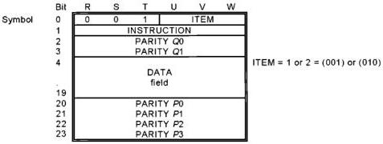

### 23.3 EXTENDED TV-GRAPHICS mode FONT format

The FONT format is the same as for TV-GRAPHICS (see 22.4).

### 23.4 EXTENDED TV-GRAPHICS mode SCREEN and MEMORY formats

The definition of the SCREEN/BORDER area and the position (ROW, COLUMN) of a FONT are the same as for TV-GRAPHICS.

FONT data and additional FONT data are written in the same position (ROW, COLUMN) of each memory.

When additional FONT data exists in the SECONDARY MEMORY, the FONTs of both memories are shifted together by the instruction Soft scroll SCREEN.

### 23.5 EXTENDED TV-GRAPHICS mode instructions

ITEM-1 instructions are described in 22.4.

These instructions affect the memory directed by the MEMORY control instruction.

ITEM-2 instructions:

|  3 | = 000011 : MEMORY control 2) |   |
| --- | --- | --- |
|  6 | = 000110 : Write additional FONT FOREGROUND/BACKGROUND |   |
|  14 | = 001110 : EXCLUSIVE-OR additional FONT with 2 colours |   |
|  16 | = 010000 : Load CLUT colour-0 .. 7 | (each colour 4 bits)  |
|  17 | = 010001 : Load CLUT colour-8 .. 15 | (each colour 4 bits)  |
|  18 | = 010010 : Load CLUT colour-16 .. 23 | (each colour 4 bits)  |
|  19 | = 010011 : Load CLUT colour-24 .. 31 | (each colour 4 bits)  |
|  20 | = 010100 : Load CLUT colour-32 .. 39 | (each colour 4 bits)  |
|  21 | = 010101 : Load CLUT colour-40 .. 47 | (each colour 4 bits)  |
|  22 | = 010110 : Load CLUT colour-48 .. 55 | (each colour 4 bits)  |
|  23 | = 010111 : Load CLUT colour-56 .. 63 | (each colour 4 bits)  |
|  24 | = 011000 : Load CLUT colour-64 .. 71 | (each colour 4 bits)  |
|  25 | = 011001 : Load CLUT colour-72 .. 79 | (each colour 4 bits)  |
|  26 | = 011010 : Load CLUT colour-80 .. 87 | (each colour 4 bits)  |
|  27 | = 011011 : Load CLUT colour-88 .. 95 | (each colour 4 bits)  |
|  28 | = 011100 : Load CLUT colour-96 .. 103 | (each colour 4 bits)  |
|  29 | = 011101 : Load CLUT colour-104 .. 111 | (each colour 4 bits)  |
|  30 | = 011110 : Load CLUT colour-112 .. 119 | (each colour 4 bits)  |
|  31 | = 011111 : Load CLUT colour-120 .. 127 | (each colour 4 bits)  |
|  32 | = 100000 : Load CLUT colour-128 .. 135 | (each colour 4 bits)  |
|  33 | = 100001 : Load CLUT colour-136 .. 143 | (each colour 4 bits)  |
|  34 | = 100010 : Load CLUT colour-144 .. 151 | (each colour 4 bits)  |
|  35 | = 100011 : Load CLUT colour-152 .. 159 | (each colour 4 bits)  |
|  36 | = 100100 : Load CLUT colour-160 .. 167 | (each colour 4 bits)  |
|  37 | = 100101 : Load CLUT colour-168 .. 175 | (each colour 4 bits)  |
|  38 | = 100110 : Load CLUT colour-176 .. 183 | (each colour 4 bits)  |
|  39 | = 100111 : Load CLUT colour-184 .. 191 | (each colour 4 bits)  |
|  40 | = 101000 : Load CLUT colour-192 .. 199 | (each colour 4 bits)  |
|  41 | = 101001 : Load CLUT colour-200 .. 207 | (each colour 4 bits)  |
|  42 | = 101010 : Load CLUT colour-208 .. 215 | (each colour 4 bits)  |
|  43 | = 101011 : Load CLUT colour-216 .. 223 | (each colour 4 bits)  |
|  44 | = 101100 : Load CLUT colour-224 .. 231 | (each colour 4 bits)  |
|  45 | = 101101 : Load CLUT colour-232 .. 239 | (each colour 4 bits)  |
|  46 | = 101110 : Load CLUT colour-240 .. 247 | (each colour 4 bits)  |
|  47 | = 101111 : Load CLUT colour-248 .. 255 | (each colour 4 bits)  |
|  48 | = 110000 : Load CLUT additional colour-0 .. 15 | (each colour 2 bits)  |
|  49 | = 110001 : Load CLUT additional colour-16 .. 31 | (each colour 2 bits)  |
|  50 | = 110010 : Load CLUT additional colour-32 .. 47 | (each colour 2 bits)  |
|  51 | = 110011 : Load CLUT additional colour-48 .. 63 | (each colour 2 bits)  |
|  52 | = 110100 : Load CLUT additional colour-64 .. 79 | (each colour 2 bits)  |
|  53 | = 110101 : Load CLUT additional colour-80 .. 95 | (each colour 2 bits)  |
|  54 | = 110110 : Load CLUT additional colour-96 .. 111 | (each colour 2 bits)  |
|  55 | = 110111 : Load CLUT additional colour-112 .. 127 | (each colour 2 bits)  |
|  56 | = 111000 : Load CLUT additional colour-128 .. 143 | (each colour 2 bits)  |
|  57 | = 111001 : Load CLUT additional colour-144 .. 159 | (each colour 2 bits)  |
|  58 | = 111010 : Load CLUT additional colour-160 .. 175 | (each colour 2 bits)  |
|  59 | = 111011 : Load CLUT additional colour-176 .. 191 | (each colour 2 bits)  |
|  60 | = 111100 : Load CLUT additional colour-192 .. 207 | (each colour 2 bits)  |
|  61 | = 111101 : Load CLUT additional colour-208 .. 223 | (each colour 2 bits)  |
|  62 | = 111110 : Load CLUT additional colour-224 .. 239 | (each colour 2 bits)  |
|  63 | = 111111 : Load CLUT additional colour-240 .. 255 | (each colour 2 bits)  |

ITEM-2 instructions, except MEMORY control and Load CLUT colour-0 .. 7 and 8 .. 15, are available only when the instruction MEMORY control indicates 1-plane state.

2) The MEMORY control instruction is repeated in the disc twice in succeeding PACKS.

#### 23.5.1 MEMORY control instruction (3)

If the instruction is MEMORY control, the format of the DATA-field in the PACK is:

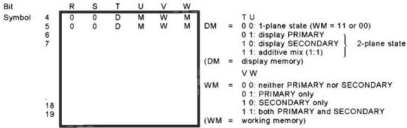

The instruction MEMORY control is used

- at the start point of every track,
- at the start and end of the CUT or DISSOLVE effect,
- at the start point of 1-plane state or 2-plane state,
- at the end of a chain of Load CLUT colour and Load CLUT additional colour instructions.

The last MEMORY control instruction defines which ITEM-1 instruction is active. Instead of using empty PACKs (MODE 0, ITEM 0) after the last MEMORY control instruction, the last MEMORY control instruction shall be repeated in subsequent empty PACKs.

The instruction MEMORY control indicates

- the attribute of 2 memories, i.e. 2 INDEPENDENT memories for 16-colour pictures (2-plane state) or an INDIVIDUAL memory for 256-colour pictures (1-plane state),
- the selection of the display mode in the 2-plane state, i.e. from PRIMARY MEMORY only, from SECONDARY MEMORY only or from an additive mix of both memories,
- the memory to which instructions are addressed.

The following table shows all possible combinations of DM and WM.

|  WM DM | 00: No ITEM-1 instruction available | 01: Instruction works on PRIMARY MEMORY | 10: Instruction works on SECONDARY MEMORY | 11: Instruction works on both MEMORIES  |
| --- | --- | --- | --- | --- |
|  00 | 1-plane state No ITEM-1 instruction | No operation | No operation | 1-plane state  |
|  01 | Display PRIMARY No instruction available | Display PRIMARY Work on PRIMARY | Display PRIMARY Work on SECONDARY MEMORY | Display PRIMARY Work on both MEMORIES  |
|  10 | Display SECONDARY MEMORY No instruction available | Display SECONDARY MEMORY Work on PRIMARY | Display SECONDARY MEMORY Work on SECONDARY MEMORY | Display SECONDARY MEMORY Work on both MEMORIES  |
|  11 | Display mix No instruction available | Display mix Work on PRIMARY | Display mix Work on SECONDARY MEMORY | Display mix Work on both MEMORIES  |

##### One-plane state usage

- DM, WM is 00, 11: the PRIMARY MEMORY and the SECONDARY MEMORY form an 8-bit code to construct a 256-colour picture.

Write additional FONT and X-OR additional FONT affect the SECONDARY MEMORY. Write FONT and X-OR FONT of ITEM-1 instructions affect the PRIMARY MEMORY. Soft scroll SCREEN shifts the FONT-data of both memories together. The instructions Preset MEMORY, Preset BORDER or Soft scroll SCREEN with preset give the COLOR defined in the instructions to all FONTs of the PRIMARY MEMORY and give the data 0000 to all FONTs of the SECONDARY MEMORY.

The procedure to change the CLUT at once is as follows:

a) a chain of Load CLUT colour and Load CLUT additional colour instructions for one picture is supplied in subsequent PACKS;
b) the MEMORY control instruction for 1-plane state is placed at the end of a chain of Load CLUT colour and Load CLUT additional colour instructions, which activates the new CLUT contents.

- DM, WM is 00, 00: the PRIMARY MEMORY and the SECONDARY MEMORY form an 8-bit code to construct a 256-colour picture. ITEM-1 instructions are not effective in this mode. All ITEM-1 instructions affect a TV-GRAPHICS decoder only. The displayed picture from the extended TV-GRAPHICS decoder is, however, not affected by ITEM-1 instructions.
- DM, WM is 00, 01 or 00, 10: these are the no operation codes of the instruction MEMORY control, and the last MEMORY control instruction is still effective.

##### Two-plane state usage

The ITEM-2 instructions are not effective in this state, except the instructions MEMORY control, Load CLUT colour-0 .. 7 and Load CLUT colour-8 .. 15, which are effective in both states.

DM (display memory) defines the memory to display:

- DM is 01: only the picture of the PRIMARY MEMORY can be seen on the display;
- DM is 10: only the picture of the SECONDARY MEMORY can be seen on the display;
- DM is 11: R, G, B data of both memories are simply added respectively. If the result of this addition is over 1111, the result should be represented by 1111.

WM indicates the MEMORY/CLUT is to be operated by the ITEM-1 instructions:

- WM = 00: no instruction is effective on either the PRIMARY MEMORY/CLUT or SECONDARY MEMORY/CLUT/BORDER, except MEMORY control. ITEM-1 instructions affect a TV-GRAPHICS decoder only;
- WM = 01: ITEM-1 instructions, Load CLUT colour-0 .. 7 and Load CLUT colour-8 .. 15 affect the PRIMARY MEMORY only;
- WM = 10: ITEM-1 instructions, Load CLUT colour-0 .. 7 and Load CLUT colour-8 .. 15 affect the SECONDARY MEMORY only;
- WM = 11: ITEM-1 instructions, Load CLUT colour-0 .. 7 and Load CLUT colour-8 .. 15 affect the PRIMARY MEMORY and the SECONDARY MEMORY.

#### 23.5.2 Write Additional FONT FOREGROUND/BACKGROUND instruction (6)

If the instruction is Write Additional FONT FOREGROUND/BACKGROUND, the format of the DATA-field in the PACK is:

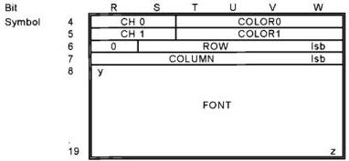

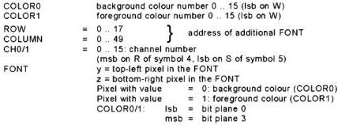

The instruction Write Additional FONT FOREGROUND/BACKGROUND writes one FONT with the data defined in FONT and the colours defined in COLOR0 and COLOR1 into memory. The data in FONT is written at address (ROW, COLUMN) in bit planes 0 .. 3 of the SECONDARY MEMORY.

The number CH gives a channel number to a FONT with data. The concept of a channel is the same as for TV-GRAPHICS. The FONT data and the additional FONT data of one picture have the same channel number.

#### 23.5.3 EXCLUSIVE-OR additional FONT with 2 colours instruction (14)

If the instruction is EXCLUSIVE-OR additional FONT with 2 colours, the format of the DATA field in the PACK is:

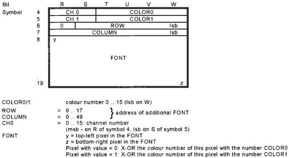

The instruction EXCLUSIVE-OR additional FONT with 2 colours X-ORes the colour values of pixels in FONT (ROW, COLUMN) with the numbers given in COLOR0 and COLOR1. The result of this action is stored at memory address (ROW, COLUMN).

The number CH gives a channel number to a FONT with data. The concept of a channel is the same as for TV-GRAPHICS. The FONT data and the additional FONT data of one picture have the same channel number.

If a pixel in FONT has value 0, the 4 bits in the memory for this pixel are X-ORed with the 4 bits given in COLOR0. If a pixel in FONT has value 1, the 4 bits in the memory for this pixel are X-ORed with the 4 bits given in COLOR1.

#### 23.5.4 Load CLUT colour instructions (16-47)

If the instruction is Load CLUT colour-(n x 8 .. n x 8 + 7), (n = 0 .. 31), the format of the DATA field in the PACK is:

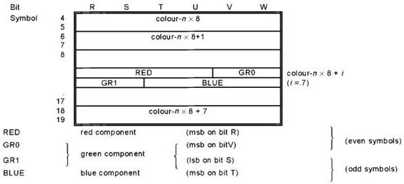

The instruction Load CLUT colour-(n x 8 .. n x 8 + 7) loads 12-bit data consisting of upper 4 bits of R, G, B, 6 bits each, for every 8-colour group.

One instruction handles (8/256 x 12/18) of the CLUT. The CLUT needs to be reloaded completely after changing from 2-plane state to 1-plane state. The MEMORY control instruction: 1-plane state is used for indicating both the state change and the end of a chain of Load CLUT colour and Load CLUT additional colour instructions.

The instructions load CLUT colour-0 .. 7 and Load CLUT colour-8 .. 15 are used in the 2-plane state. These two instructions are used for a DISSOLVE effect by changing both CLUTS.

#### 23.5.5 Load CLUT additional colour instructions (48-63)

If the instruction is Load CLUT additional colour-(16m .. 16m + 15) (m = 0 .. 15), the format of the DATA field in the PACK is:

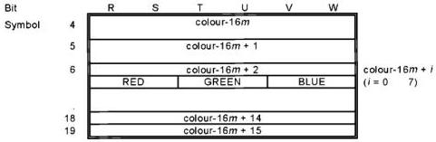

RED : red component (msb on bit R)
GREEN : green component (msb on bit T)
BLUE : blue component (msb on bit V)

The instruction Load CLUT additional colour-(16m .. 16m + 15) loads 6-bit data consisting of the lower 2 bits of R, G, B, 6 bits each, for every 16-colour group. One instruction handles (16/256 x 6/18) of the CLUT. The CLUT has to be reloaded completely after changing from 2-plane state to 1-plane state. The MEMORY control instruction 1-plane state is used for indicating both state change and the end of a chain of Load CLUT colour and Load CLUT additional colour instructions.

## 24 MIDI mode (MODE = 3, ITEM = 0)

### 24.1 General

The MIDI mode is a transparent data channel with a maximum data rate of 3 125 bytes per second intended for musical instrument digital interface (MIDI) data as specified by the International MIDI Association 3).

3) See publication MIDI 1.0 Detailed Specification.

### 24.2 MIDI mode PACK format

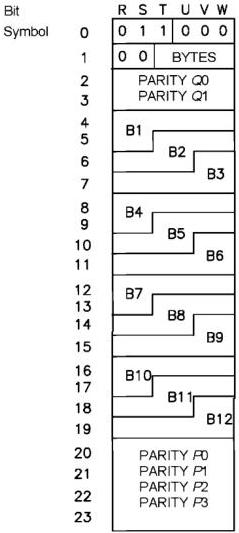

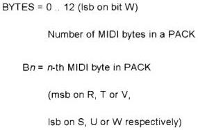

The number of MIDI bytes in a PACK is indicated by BYTEs (4-bit binary). All bits of unused bytes are zero.

Any 12 consecutive PACKs may contain no more than 125 MIDI bytes. If playback on equipment with up to +12,5 % pitch control is envisaged, it is recommended to limit the data rate to a maximum of 110 bytes in any 12 consecutive PACKs.

It is recommended that a CD player equipped with a MIDI output generates an all notes off message when the MIDI sequence is interrupted by the user (stop, pause, previous, next, scan).

## 25 USER mode (MODE = 7, ITEM = 0)

### 25.1 General

The USER mode is a "user" data channel intended for use by professional CD users.

### 25.2 USER mode PACK format

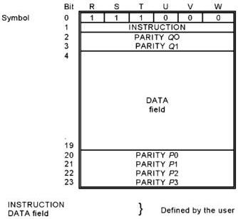

## 26 CD TEXT mode (MODE = 2, ITEM = 1, 2, 3, 5, 6, 7 or MODE = 4)

### 26.1 General

Text or data information can be stored in the lead-in area and the program area.

With this, two different applications can be supported:

a) player which reads information from the lead-in area (MODE = 4), stores it in a memory and can be requested to provide it immediately on a display;
a) player which reads information during the playback of the audio from the program area (Mode = 2). This application does not require a memory, as the requested information can be obtained from the disc. To limit the acquisition times the information is repeated continuously at a certain minimum rate.

### Notation

Hexadecimal values are preceded by a $.

Binary values are preceded by a %.

In this clause, the following definitions are used:

SYMBOL: a group of 6 bits (R to W), originating from the same 'control and display' SYMBOL

SUBCODE BLOCK: 96 successive SYMBOLS immediately following the subcode sync patterns S0 and S1

PACK: a group of 24 SYMBOLS, starting at the 1st, 25th, 49th or 73rd SYMBOL of a SUBCODE BLOCK

SUBCODE PACKET: a grouping of 4 successive packs, the first of which is the first PACK in a SUBCODE BLOCK

ITTS PACKET: a 48-byte unit as defined in IEC 61866, with an 8-byte header and 40-byte data field

In the case when bytes (8 bits) have to be encoded into SYMBOLs (6 bits), four successive SYMBOLs will carry three successive bytes:

The bytes are designated by x, y and z, with the number indicating the bit position: 7 = MSB, 0 = LSB.

### 26.2 CD TEXT mode for the lead-in area (MODE = 4)

#### 26.2.1 Text group and BLOCK

A set of text information representing one particular language is called a BLOCK. A BLOCK can contain up to 256 PACKs. Up to 8 BLOCKs are combined into a text group. The size of a text group is recommended to be less than 512 PACKs, and shall be at maximum 2048 PACKs.

Text groups shall be recorded repeatedly in the lead-in area (see figure 27).

#### 26.2.2 CD TEXT PACK format for the lead-in area

In the lead-in area the interleaving and error-correcting code shall not be used.

A PACK consists of a header field, a text data field and a cyclic redundancy checksum (CRC) field (see figure 28).

##### 26.2.2.1 Header field

The header field consists of 4 indicator (ID) bytes: ID1 (PACK type indicator), ID2 (track number indicator), ID3 (sequence number indicator) and ID4 (BLOCK number and character position indicator).

###### 26.2.2.1.1 Description of ID1 (PACK type indicator)

ID1 shows the items that are encoded in the PACK. Items are defined as follows:

($80) Title of album name (ID2 = $00) and track titles (ID2 = $01 .. $63)
($81) Name(s) of the performer(s) (i.e. singer(s) and/or player(s) and/or conductor(s) and/or orchestra(s))
($82) Name(s) of the songwriter(s)
($83) Name(s) of the composer(s)
($84) Name(s) of the arranger(s)
($85) Message(s) from content provider and/or artist
($86) Disc identification information
($87) Genre identification and genre information
($88) Table of contents information
($89) Second table of contents information
($8A) Reserved
($8B) Reserved
($8C) Reserved
($8D) Closed information (for internal use by content provider only)
($8E) UPC/EAN code of the album, and ISRC code of each track
($8F) Size information of the BLOCK

PACKs shall be encoded in the order of the items listed above.

NOTE – As the three most significant bits of ID1 are %100, this corresponds to an indication of Mode 4.

###### 26.2.2.1.2 Description of ID2 (track number indicator)

ID2 contains 1 bit of the extension flag, and 7 bits of either track number or PACK element number.

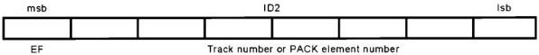

###### 26.2.2.1.2.1 Extension flag

The MSB of ID2 is the extension flag, and is normally set to %0.

If it is set to %1, the PACK is used for an extended application (to be defined). Players incompatible with an extended application shall discard this PACK.

###### 26.2.2.1.2.2 Track number

The lower 7 bits of ID2 show the track number to which the first character of the text data field of the BLOCK (Text1) belongs.

The track number (1 to 99) is expressed in binary code (%0000001 to %1100011).

Track number %0000000 is used for information that represents the whole disc (album name, main performer, main composer, main message, main songwriter, main arranger, etc.).

Track numbers %1100100 up to and including %1111111 are reserved.

###### 26.2.2.1.2.3 PACK element number

PACKs that are independent of the Tracks use the lower 7 bits of ID2 to indicate the PACK element number. The use of this field depends on the type of the PACK.

###### 26.2.2.1.3 Description of ID3 (sequence number indicator)

ID3 contains the sequence number of the PACK, numbered incrementally from the first PACK in each BLOCK. The sequence number starts at 0 ($00) and must not exceed 255 ($FF).

###### 26.2.2.1.4 Description of ID4 (BLOCK number and character position indicator)

ID4 contains 1 bit of the double byte character code indication, 3 bits of the BLOCK number and 4 bits of the character position.

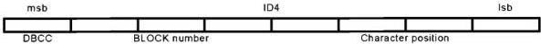

###### 26.2.2.1.4.1 Double byte character code indication

The most significant bit of ID4 is the double byte character code indication.

If a BLOCK contains double byte character strings in the text data field of PACKs with ID1 = $80 through $85, all PACKs within the BLOCK shall have their double byte character code indication set to %1.

In all other cases it shall be set to %0 to indicate a single byte character code is used.

###### 26.2.2.1.4.2 BLOCK number

The next 3 bits of ID4 contain the BLOCK number of the BLOCK to which the PACK belongs. BLOCK number is numbered incrementally from 0 from the first BLOCK within each group.

###### 26.2.2.1.4.3 Character position

The least significant 4 bits of ID4 contain the character position. The position of the first character of the text data field (Text1) is counted from the first character of its string. The character position starts from 0, and if the position exceeds 15, 15 shall be encoded.

When the character code is a double byte code, a set of 2 bytes in the text data field (i.e. each double byte character) is counted as one.

A null code is also counted as a character, when obtaining the character position.

Character position is not used in PACKs with ID1 = $88, $89 or $8F, and %0000 should be used in all of these PACKs.

##### 26.2.2.2 Text data field

A text data field consists of 12 bytes, and contains either character strings or binary information depending on the type of PACK.

###### 26.2.2.2.1 Character string information

All PACKs except PACKs with table of contents information (ID1 = $88), Second table of content information (ID1 = $89) or size information (ID1 = $8F) shall incorporate character strings in the text data field.

If PACKs with ID1 = $80 through ID1 = $85 and ID1 = $8E are used, a character string for each track (from the first track up to the last) should be provided.

A character string consists of a character sequence, and a terminator. The character sequence may be omitted if a character string does not contain any relevant information. The terminator may not be omitted, however.

The terminator is a null ($00) code for single byte characters codes, and two null codes for double byte character codes.

The size of a character string is recommended to be less than 160 bytes.

If a character string does not fit in a text data field of a PACK, it is continued onto the succeeding PACKs. The succeeding character string (with the same ID1) will be encoded starting at the next byte in the text data field after the terminator of the current string.

Unused bytes in the text data field (following the terminator of the final character string within the same information category) shall be filled with null codes ($00).

In case the same character string is used for consecutive tracks, the tab indicator may be used to represent the same as previous track.

The tab indicator is a single tab code ($09) for single byte character codes, and a set of two tab codes for double byte character codes.

A tab indicator shall be followed by a terminator.

Tab indicators shall only be used in PACKs with ID1 = $80 through $85, and shall not be used for the first track, nor for a track of which the previous track information does not contain any character information (i.e. is a null string).

Example: (_ indicates a space, X is unknown/don't care, SN = Sequence number)

|  ID1 | ID2 | ID3 | ID4 | Text1 | Text2 | Text3 | Text4 |   |
| --- | --- | --- | --- | --- | --- | --- | --- | --- |
|  $8X | $00 | SN | $X0 | S | T | R | I |   |
|  Text5 | Text6 | Text7 | Text8 | Text9 | Text10 | Text11 | Text12 | CRC  |
|  N | - | 1 | $00 | S | T | R | I |   |
|  ID1 | ID2 | ID3 | ID4 | Text1 | Text2 | Text3 | Text4 |   |
|  $8X | $01 | SN+1 | $X4 | N | G | - | 2 |   |
|  Text5 | Text6 | Text7 | Text8 | Text9 | Text10 | Text11 | Text12 | CRC  |
|  $00 | S | T | R | I | N | G | - |   |
|  ID1 | ID2 | ID3 | ID4 | Text1 | Text2 | Text3 | Text4 |   |
|  $8X | $03 | SN+2 | $X7 | 3 | $00 | S | T |   |
|  Text5 | Text6 | Text7 | Text8 | Text9 | Text10 | Text11 | Text12 | CRC  |
|  R | I | N | G | - | 4 | $00 | $00 |   |

###### 26.2.2.2.2 Binary information

PACKs that contain disc ID, genre ID, TOC, second TOC and size information (ID1 = $86, $87, $88, $89 or $8F) incorporate binary information in the text data field. The allocation of the binary information depends on the type of PACK.

##### 26.2.2.3 Cyclic redundancy checksum (CRC) field

A cyclic redundancy checksum (CRC) field consists of 2 bytes, msb first, and is used to check errors in the R to W channels in the lead-in area.

The CRC polynomial is $X^{16} + X^{12} + X^5 + 1$. All bits shall be inverted.

#### 26.2.3 CD TEXT application in the lead-in area

##### 26.2.3.1 Title, name and message information (ID1 = $80 through $85)

PACKs with ID1 equal to $80 through $85 can be used to encode textual information about album name and track titles, names and message information as indicated in 26.2.2.1.1.

When ID2 equals $00, the text data field contains information that represents the whole disc (see 26.2.2.1.2.2).

##### 26.2.3.2 Disc ID information (ID1 = $86)

The text data field of the PACK with ID1 = $86 shall contain disc ID information, such as the catalog number and the name of the record company, point of sale code, year of sales, etc. Each of these shall be separated by a slash ("/").

The PACK element number (ID2) shall be encoded as $00.

Only the ISO/IEC 8859-1 (modified) character code shall be used for this item (see 26.2.3.8).

|  ID1 | ID2 | ID3 | ID4 | Text1 | Text2 | Text3 | Text4 |   |
| --- | --- | --- | --- | --- | --- | --- | --- | --- |
|  $86 | PACK element = $00 | Sequence number | $X0 | C | A | T | A |   |
|  Text5 | Text6 | Text7 | Text8 | Text9 | Text10 | Text11 | Text12 | CRC  |
|  L | O | G | $20 [space] | N | U | M | B |   |
|  ID1 | ID2 | ID3 | ID4 | Text1 | Text2 | Text3 | Text4 |   |
|  $86 | PACK element = $00 | Sequence number + 1 | $XC | E | R | $00 | $00 |   |
|  Text5 | Text6 | Text7 | Text8 | Text9 | Text10 | Text11 | Text12 | CRC  |
|  $00 | $00 | $00 | $00 | $00 | $00 | $00 | $00 |   |

##### 26.2.3.3 Genre information (ID1 = $87)

The text data field of the PACK with ID1 = $87 shall contain genre information.

The genre code is the same as defined in chapter III.3.2.5.3.8 of the CD EXTRA specification. It will be encoded as a 2-byte entry, with the most significant byte first, in the first 2 bytes of the text data field.

The supplementary description of the genre may be appended.

The PACK element number (ID2) shall be encoded as $00.

|  ID1 | ID2 | ID3 | ID4 | Text1 | Text2 | Text3 | Text4 |   |
| --- | --- | --- | --- | --- | --- | --- | --- | --- |
|  $87 | Pack element = $00 | Sequence number | $X0 | Genre code upper byte | Genre code lower byte | S | U |   |
|  Text5 | Text6 | Text7 | Text8 | Text9 | Text10 | Text11 | Text12 | CRC  |
|  P | P | L | E | M | E | N | T |   |
|  ID1 | ID2 | ID3 | ID4 | Text1 | Text2 | Text3 | Text4 |   |
|  $87 | Pack element = $00 | Sequence number + 1 | $XA | A | R | Y | $20 [space] |   |
|  Text5 | Text6 | Text7 | Text8 | Text9 | Text10 | Text11 | Text12 | CRC  |
|  I | N | F | O | $00 | $00 | $00 | $00 |   |

##### 26.2.3.4 Table of contents information (ID1 = $88)

The track start times or pointers, as encoded in the subcode Q channel in the lead-in area, may also be encoded in CD TEXT PACKs with ID1 = $88.

The pointers are expressed in the order of minutes, seconds and frames, in the same way as encoded in the subcode Q channel.

All values are expressed in binary code.

If ID2 = $00, the text data field contains the first track number (A0), last track number (A1) and start of the lead-out area (A2):

|  ID1 | ID2 | ID3 | ID4 | Text1 | Text2 | Text3 | Text4 |   |
| --- | --- | --- | --- | --- | --- | --- | --- | --- |
|  $88 | PACK element = $00 | Sequence number | BLOCK number | First track number | Last track number | Reserved ($00) | Lead-out (minutes) |   |
|  Text5 | Text6 | Text7 | Text8 | Text9 | Text10 | Text11 | Text12 | CRC  |
|  Lead-out (seconds) | Lead-out (frames) | Reserved ($00) | Reserved ($00) | Reserved ($00) | Reserved ($00) | Reserved ($00) | Reserved ($00) |   |

If ID2 <> $00, the text data field contains pointers to tracks:

|  ID1 | ID2 | ID3 | ID4 | Text1 | Text2 | Text3 | Text4 |   |
| --- | --- | --- | --- | --- | --- | --- | --- | --- |
|  $88 | PACK element = Track No. N | Sequence number | BLOCK number | Track N (minutes) | Track N (seconds) | Track N (frames) | Track N+1 (minutes) |   |
|  Text5 | Text6 | Text7 | Text8 | Text9 | Text10 | Text11 | Text12 | CRC  |
|  Track N+1 (seconds) | Track N+1 (frames) | Track N+2 (minutes) | Track N+2 (seconds) | Track N+2 (frames) | Track N+3 (minutes) | Track N+3 (seconds) | Track N+3 (frames) |   |

Unused pointers to a track shall be filled with null ($00) codes.

The PACK element number shall represent the track number of the track pointed to by the pointer in Text1, Text2 and Text3. As such it shall be encoded in ascending order, incremented by 4 with every next table of contents PACK.

##### 26.2.3.5 Second table of contents information (ID1 = $89)

The second table of contents information indicates specific intervals in the program area (e.g. alternative scan passages of the disc can be indicated). The intervals are expressed in the order of track number (ID2), and start and end time in absolute time (minutes, seconds and frames). Such intervals may start in one track, and end in another.

One PACK can contain information about one such interval.

All entries are encoded in binary code.

The intervals are also given a priority number.

The PACKs should be recorded in the order of the priority number. As a result, the priority number is encoded incrementally from 1 up to the number of intervals: the interval to be played first is given priority number $01. The next priority is $02, etc.

|  ID1 | ID2 | ID3 | ID4 | Text1 | Text2 | Text3 | Text4 |   |
| --- | --- | --- | --- | --- | --- | --- | --- | --- |
|  $89 | Track number | Sequence number | BLOCK number | Priority number | Number of intervals | Reserved ($00) | Reserved ($00) |   |
|  Text5 | Text6 | Text7 | Text8 | Text9 | Text10 | Text11 | Text12 | CRC  |
|  Reserved ($00) | Reserved ($00) | Start point (minutes) | Start point (seconds) | Start point (frames) | End point (minutes) | End point (seconds) | End point (frames) |   |

##### 26.2.3.6 Closed information (ID1 = $8D)

Information such as manufacturing control or memorandum may be recorded using this PACK. The information will not be shown nor read by players available to the public. Closed information is recorded as character strings that represent the whole disc and each individual track (see 26.2.2.2.1).

##### 26.2.3.7 UPC/EAN and ISRC information (ID1 = $8E)

These PACKs contain the UPC/EAN (POS code) of the album and the ISRC code of each of the tracks. The UPC/EAN and ISRC codes are recorded as character strings (see 26.2.2.2.1).

The UPC/EAN code typically consists of 13 bytes and should be recorded as track 0.

The ISRC code typically consists of 12 bytes and should be recorded as information representing each of the tracks.

##### 26.2.3.8 Size information (ID1 = $8F)

Three PACKs with ID1 = $8F contain the character code, first track number, last track number, copy protection flags, number of PACKs in the BLOCK with respect to each PACK type, number of PACKs and language code information of each BLOCK.

All values are expressed in binary code.

|  ID1 | ID2 | ID3 | ID4 | Text1 | Text2 | Text3 | Text4 |   |
| --- | --- | --- | --- | --- | --- | --- | --- | --- |
|  $8F | PACK element = $00 | Sequence number | BLOCK number | Character code for this BLOCK | First track number | Last track number | Mode 2 & copy protection flags |   |
|  Text5 | Text6 | Text7 | Text8 | Text9 | Text10 | Text11 | Text12 | CRC  |
|  Number of PACKS with ID1 = $80 | Number of PACKS with ID1 = $81 | Number of PACKS with ID1 = $82 | Number of PACKS with ID1 = $83 | Number of PACKS with ID1 = $84 | Number of PACKS with ID1 = $85 | Number of PACKS with ID1 = $86 | Number of PACKS with ID1 = $87 |   |
|  ID1 | ID2 | ID3 | ID4 | Text1 | Text2 | Text3 | Text4 |   |
|  $8F | PACK element = $01 | Sequence number | BLOCK number | Number of PACKS with ID1 = $88 | Number of PACKS with ID1 = $89 | Number of PACKS with ID1 = $8A | Number of PACKS with ID1 = $8B |   |
|  Text5 | Text6 | Text7 | Text8 | Text9 | Text10 | Text11 | Text12 | CRC  |
|  Number of PACKS with ID1 = $8C | Number of PACKS with ID1 = $8D | Number of PACKS with ID1 = $8E | Number of PACKS with ID1 = $8F | Last sequence number BLOCK 0 | Last sequence number BLOCK 1 | Last sequence number BLOCK 2 | Last sequence number BLOCK 3 |   |
|  ID1 | ID2 | ID3 | ID4 | Text1 | Text2 | Text3 | Text4 |   |
|  $8F | PACK element = $02 | Sequence number | BLOCK number | Last sequence number BLOCK 4 | Last sequence number BLOCK 5 | Last sequence number BLOCK 6 | Last sequence number BLOCK 7 |   |
|  Text5 | Text6 | Text7 | Text8 | Text9 | Text10 | Text11 | Text12 | CRC  |
|  Language code BLOCK 0 | Language code BLOCK 1 | Language code BLOCK 2 | Language code BLOCK 3 | Language code BLOCK 4 | Language code BLOCK 5 | Language code BLOCK 6 | Language code BLOCK 7 |   |

The character code is defined as follows:

$00 = ISO/IEC 8859-1 (modified, see CD EXTRA specification, appendix 1)
$01 = ISO/IEC 646, ASCII (7 bit)
$02 .. $7F = Reserved
$80 = Music Shift-JIS Kanji
$81 = Korean character code (to be defined)
$82 = Mandarin Chinese character code (to be defined)
$83 .. $FF = Reserved

The character code indicates the character set used to code the character strings of the PACKs with ID1 = $80 through $85. Other PACKs shall have character code $00 (ISO 8859-1 modified).

All BLOCKS which use ISO 8859-1 (modified) or ASCII character code (as indicated by Text1 in the first size PACK) shall have a smaller BLOCK number (see 26.2.1.4.2) than BLOCKS which incorporate other character codes.

Mode 2 & copy protection flags:

msb

lsb

|  Mode 2 | PA C.P. | Reserved | Reserved | Reserved | LI C.P.2 | LI C.P.1 | LI C.P.0  |
| --- | --- | --- | --- | --- | --- | --- | --- |

The mode 2 flag indicates whether or not mode 2 CD TEXT PACKETs are encoded in the program area: if set to %1 then mode 2 PACKETs are available, otherwise set to %0.

The program area copy protection (PA C.P.) flag indicates whether or not additional information is available in the program area (see 26.3.2.1.1) about the copyright assertion of specific items: if set to %1 then such information is available, if set to %0 such information is unavailable and copyright is asserted for all CD TEXT information in the program area. This bit shall be set to %0 if the mode 2 flag is set to %0.

The reserved bits are set to %0.

The copy protection flags (LI C.P.0 through LI C.P.2) refer to lead-in area CD TEXT information in the current BLOCK only: they indicate whether or not copyright is asserted for the following PACK types:

LI C.P.2 Copyright asserted for message(s) (i.e. PACKs with ID1 = $85)

LI C.P.1 Copyright asserted for name(s) of performers, songwriters, composers and arrangers (i.e. PACKs with ID1 = $81 through $84)

LI C.P.0 Copyright asserted for album name and track titles (i.e. PACKs with ID1 = $80)

If the bit is set to %1, copyright is asserted, if set to %0, no copyright is asserted.

The language code is encoded as specified in annex 1 to part 5 of EBU Tech 3258-E.

A last sequence number equal to $00 indicates that the BLOCK does not exist.

### 26.3 CD TEXT mode for the program area (MODE = 2)

Text or data information arranged as PACKETs according to the interactive text transmission system (ITTS), as defined in IEC 61866, can be carried in the PACKs.

#### 26.3.1 CD TEXT PACK format for the program area

The CD TEXT PACK format for the program area is identical to the PACK format, except for the interleaving: the symbols of successive PACKs may either be interleaved or not.

The item field of the PACK indicates the data field contents, as well as the PACK interleave state.

|  Interleaved: | Item |   |
| --- | --- | --- |
|  PACK in subcode PACKET: | U V W |   |
|  1 | 0 0 1 | ITTS PACKET start  |
|  2, 3 | 0 1 0 | ITTS PACKET continuation  |
|  4 | 0 1 1 | ITTS PACKET continuation and end  |

|  Non-interleaved: | Item |   |
| --- | --- | --- |
|  PACK in subcode PACKET: | U V W |   |
|  1 | 1 0 1 | ITTS PACKET start  |
|  2, 3 | 1 1 0 | ITTS PACKET continuation  |
|  4 | 1 1 1 | ITTS PACKET continuation and end  |

The instruction field is undefined, with no relevant information for the decoder. It is encoded as $00.

##### 26.3.1.1 DATA FIELD contents

The 48 bytes of the ITTS PACKET, numbered 0 to 47, are distributed as follows:

PACK in subcode PACKET: ITTS PACKET bytes

|  1 | 0 to 11  |
| --- | --- |
|  2 | 12 to 23  |
|  3 | 24 to 35  |
|  4 | 36 to 47  |

##### 26.3.1.2 Interleave mode and partial interleave

In the case when no interleaving is applied, the P and Q error correction parity will still be encoded, but no symbol permutation or delay is applied.

Whether the symbols of a PACK are interleaved or not is indicated in the mode and item field of symbol 0 (for codes see 26.3.1). Optional additional information shall always be encoded according to the interleaved PACK format.

Changes in the interleaving of PACKs shall only occur at subcode sync boundaries.

When changing from interleaved to non-interleaved PACKs, or from non-interleaved to interleaved PACKs, a transition needs to be made, in which the PACKs will be partially interleaved (see 26.5). This is caused by the delays in the interleaving scheme, which delay symbols by a maximum of 7 PACKs.

The transition will be in two successive subcode BLOCKs.

When changing from interleaved to non-interleaved, the final PACK of the previous subcode BLOCK will be the last interleaved PACK. Symbols of this PACK will be encoded onto disc with a delay of up to 7 PACKs. The symbols in the transition PACKs which are not carrying information from the last interleaved PACK will be set to 0. The first PACK of the next subcode BLOCK will be the first with non-interleaved PACK information.

When changing from non-interleaved to interleaved, the final PACK of the previous subcode BLOCK will be the last non-interleaved PACK. The first PACK of the transition will be interleaved. Symbols of this PACK will be encoded onto disc with a delay of up to 7 PACKs. The symbols in the transition PACKs which are not carrying information from the interleaved PACKs will be set to 0.

#### 26.3.2 CD TEXT application in the program area

In this section, all references to PACKETs should be read as ITTS PACKETs.

##### 26.3.2.1 Additionally defined PACKET structures

###### 26.3.2.1.1 Static TOC data PACKET

In addition to the DATA PACKET DATA types defined in IEC 61866, a new DATA type may be used.

|  DATA type | Contents  |
| --- | --- |
|  %00101 | Static TOC information  |
|  The header of the static TOC information DATA PACKETs shall contain the following:  |   |
|  Language number | %000  |
|  Application item | %0111  |
|  PACKET index | $0000  |
|  MMC | $00  |
|  SMC | $00  |
|  CDS & CDE | %10 First TOC data PACKET  |
|   | %01 Last TOC data PACKET  |
|   | %00 Any other TOC data PACKET  |
|  ICI | %00 TOC data the same for entire volume  |
|  Byte 7 of the header indicates the kind of TOC data:  |   |
|   | $00 Volume TOC data  |
|   | $01 Track TOC data (for 2 tracks)  |
|   | $02 Additional copyright information for PACKETs with PACKET index not equal to $0000  |
|   | $03 Additional copyright information for PACKETs with PACKET index equal to $0000  |
|  All other values of byte 7 are reserved for future use.  |   |

All other values of byte 7 are reserved for future use.

###### 26.3.2.1.1.1 Volume TOC data

Volume TOC data may be encoded in one static TOC data PACKET with byte 7 of the header equal to $00.

The bytes of the data field shall contain information as follows:

|  Byte | Contents  |
| --- | --- |
|  8 | Total number of TOC data entries  |
|  9 | $00 = Volume information  |
|  10,11,12 | Interval scan mode start time (min:sec:fr), binary coded (see 26)  |
|  13,14 | Volume genre, according to the genre code as defined for CD EXTRA  |
|  15 | Total number of tracks  |
|  16 .. 28 | UPC/EAN code, if not used all = $00  |
|  29 | First track number  |
|  30 | Last track number  |
|  31,32,33 | Alternative interval scan mode start time (min:sec:fr), binary coded (see 26)  |
|  34 | Maximum sequence number for interval scan (see 26)  |
|  35 | Maximum sequence number for alternative interval scan mode (see 26)  |
|  36 | Additional copyright information flag: if set to $01 additional copyright information is available, if set to $00 such information is unavailable and copyright is asserted for all CD TEXT information in the program area  |
|  37 .. 47 | Reserved for future use, to be encoded as $00 if no function has been defined  |

###### 26.3.2.1.1.2 Track TOC data

Track TOC data may be encoded in static TOC data PACKETs with byte 7 of the header equal to $01.

The 40 bytes of the data field shall contain two track TOC data entries, each with a length of 20 bytes. The first track TOC data entry shall be located in bytes 8 to 27, the second one in bytes 28 to 47

|  Byte | Byte | Contents  |
| --- | --- | --- |
|  8 | 28 | TOC data entry number, count down, binary coded  |
|  9 | 29 | Track number, binary coded. The MSB holds the audio copy control bit (%0 = not copy protected, %1 = copy protected)  |
|  10,11,12 | 30,31,32 | Track start time (min:sec:fr), binary coded  |
|  13,14 | 33,34 | Track genre, according to the genre code  |
|  15 | 35 | Alternative sequence number, if not in sequence then $00  |
|  16 .. 27 | 36 .. 47 | ISRC (if not used then all $00)  |

The lead-out area shall be encoded with the following values:

|  Byte | Byte | Contents  |
| --- | --- | --- |
|  8 | 28 | TOC data entry number = $00 (final entry)  |
|  9 | 29 | Track number = $FF  |
|  10,11,12 | 30,31,32 | Lead-out start time (min:sec:fr), binary coded  |
|  13,14 | 33,34 | Track genre = $0000  |
|  15 | 35 | Highest alternative sequence number  |
|  16 .. 27 | 36 .. 47 | ISRC = all $00  |

If the lead-out area TOC data area is encoded in bytes 8 to 27, bytes 28 to 47 shall contain $00.

###### 26.3.2.1.1.3 Additional copyright information

Additional copyright information may be encoded in static TOC data PACKETs with byte 7 of the header equal to $02 (for PACKETs with PACKET index not equal to $0000) or $03 (for PACKETs with PACKET index equal to $0000).

For every submessage channel number one bit represents the copyright status: if set to %1 copyright is asserted, if set to %0 copyright is not asserted.

The submessage channel number $02 refers to runtime menu PACKETs.

The location of the bit for submessage channel $n$ ($0 \le n \le 255$) in the PACKET can be found with the following formulae:

Byte: $8 + (n \text{ div } 8)$

Bit: $n \bmod 8$ ($7 = \text{MSB}, 0 = \text{LSB}$)

The remaining bytes (40 through 47) in the PACKET are reserved for future use and shall be encoded as $00 until otherwise defined.

In case no additional copyright information is encoded, copyright is asserted for all CD TEXT information in the program area.

###### 26.3.2.1.2 Database packet

In addition to the PACKET types defined in IEC 61866, a new DATABASE type may be used. The structure is based on that of the TEXT PACKETs.

The header of the DATABASE PACKETs shall contain the following:

|  Language number | %000 | or language dependent  |
| --- | --- | --- |
|  Application item | %1100 | indicating this new DATABASE PACKET  |
|  PACKET index | $0000 | or as defined in IEC 61866  |
|  Byte 3 | Track number | will indicate the track number to which the information refers. If $00, then it is valid for the entire volume  |
|  Byte 4 | Item code | will indicate the kind of information that is encoded in the TEXT body (see below)  |
|  Byte 5 | Sequence number | count down (for CDS = 1 the highest sequence number shall be encoded), binary coded  |
|  ICP | %0 | TOC data the same for entire volume  |
|  SA | %000 |   |
|  TCI | %00 |   |
|  CDS & CDE | %10 | first DATABASE PACKET  |
|   |  %01 | last DATABASE PACKET  |
|   |  %00 | any other DATABASE PACKET  |
|   |  %11 | only allowed if just one DATABASE packet is available  |
|  Character set |  | as defined in IEC 61866  |
|  Item code: | $00 | Reserved  |
|   |  $01 | Track title  |
|   |  $02 | Performer(s)  |
|   |  $03 | Songwriter(s)  |
|   |  $04 | Composer(s)  |
|   |  $05 | Arranger(s)  |
|   |  $06 | Personal message(s)  |
|   |  $07 | Disc identification description  |
|   |  $08 | Keyword(s) or string for sorting purposes  |
|   |  $09 .. $FF | Reserved  |

The information is encoded as plain TEXT in the PACKET body (bytes 8 .. 47), without display control information.

##### 26.3.2.2 Additionally defined interactive commands

###### 26.3.2.2.1 Scan mode coding

Special interactive commands for scan functions can be encoded. In addition to scan modes defined in the player, the disc may provide a player with information to perform

- Interval scan: specific parts of tracks, indicated as intervals;
- Alternative interval scan: specific parts of tracks, as an alternative to the interval scan;
- Menu controlled scan: scanning the disc for parts as identified in a menu.

The header of the DATA PACKETS with scan information shall contain the following:

|  Language number | %000 | Language independent  |
| --- | --- | --- |
|  Application item | %0111 | DATA PACKET  |
|  PACKET index | $0000 | Decode immediately  |
|  MMC | $00 |   |
|  SMC | $00 |   |
|  DATA type | %00010 | Interactive commands  |
|  CDS & CDE |  | As defined in IEC 61866  |
|  ICI | %00 | Interactive commands the same for entire volume  |

Byte 7 will be $00.

The interactive command with the scan mode information shall have the following structure:

|  Byte | Value | Explanation | Comment  |
| --- | --- | --- | --- |
|  0,1 |  | $0000 or associated PACKET index | Execute when activated or link with menu text line  |
|  2 | $04 | IC4 = scan mode reference | New interactive command for this application  |
|  3 |  | Scan mode identification, binary coded | 0 = no scan 1 = interval scan 2 = alternative interval scan 3 = intro scan 4 = alternative intro scan 5 .. 255 = menu topic scan  |
|  4 |  | Scan sequence countdown number, binary coded | Indicates current sequence number, starting with the maximum sequence number (see 26.3.2.1.1.1) and counting down with every sequence  |
|  5 |  | Jump time minutes, binary coded | MSB = %0: start time of current sequence MSB = %1: end time of current sequence  |
|  6 |  | Jump time seconds, binary coded |   |
|  7 |  | Jump time frames, binary coded |   |

If applied, associated interactive commands will be encoded at least during the scan sequences.

### 26.4 Mandatory, recommended and optional items

It is optional to encode a compact disc according to the extended specification in this section. However, if it is encoded accordingly, it shall contain CD TEXT PACKs in the lead-in area, and may contain CD TEXT information in the program area according to the following rules.

#### 26.4.1 Lead-in area

In the lead-in area of a CD TEXT disc, the following items are mandatory or recommended:

|  ID1 | Status | Contents  |
| --- | --- | --- |
|  $80 | Mandatory | Title of album name (ID2 = $00) and track titles (ID2 = $01 .. $63)  |
|  $81 | Recommended | Name(s) of the performer(s)  |
|  $86 | Recommended | Disc identification information  |
|  $8F | Mandatory | Size information  |

Other items are optionally encoded.

#### 26.4.2 Program area

It is recommended to encode CD TEXT information in the program area, in which case it is mandatory to encode non-interleaved PACKs in the R to W subcode channels. The PACKs will contain ITTS PACKETs.

In addition, it is allowed to encode optionally

- interleaved PACKs with ITTS PACKETs. In this case, this will be an additional information structure, completely separate from the information in the non-interleaved PACKs,
- interleaved PACKs with other information, as specified in clause 5.

The information in the program area may be dynamic, i.e. it is possible to update specific items at any moment during the playback, because a continuous flow of information can be encoded in parallel to the audio program.

If applied in the program area, the following items are mandatory or recommended:

|  MMC | SMC | Status | Contents  |
| --- | --- | --- | --- |
|  $01 | $01 | Mandatory | Volume (album) title  |
|  $01 | $02 | Mandatory | Runtime menu (= track titles)  |
|  $01 | $03 | Recommended | Credits (= names of singer(s) etc.)  |
|  $01 | $FF | Mandatory | Main menu (with associated interactive commands)  |

The volume title plus any related information shall be encoded in at least one text PACKET with application item = %1000.

The sequence of runtime menu PACKETs shall contain at least one PACKET with the track title of each of the tracks recorded on the disc. This sequence shall be coded with the runtime menu segment number equal to the track number, and the runtime menu subsegment number equal to $01.

Additional information may optionally be encoded, as defined in IEC 61866 or this standard.

### 26.5 Repetition rate and skew

#### 26.5.1 Lead-in area

A complete sequence of CD TEXT mode 4 PACKs, organized as BLOCKs within a text group, shall be recorded sequentially. Text groups shall be repeated continuously up to the end of the lead-in area, and may be terminated at any PACK.

#### 26.5.2 Program area

If applied, CD TEXT mode 2 PACKs containing ITTS PACKETs shall be recorded in the program area with an average rate of at least 25 PACKETs per second. At least 75 PACKETs shall be recorded in each section of 5 s.

#### 26.5.3 Mode transition skew

The mode transition skew is defined as the offset after decoding, expressed in subcode sync periods, from the subcode Q-channel frame with the running time on the disc time equal to 00:00:00 (start of the program area), to the first subcode BLOCK with the first program area CD TEXT mode information (mode 2).

The reference point for the subcode Q-channel frame is the start of the subcode Q-channel sync S0 after demodulation and sync extraction with minimum delay. Only the minimum required delay of the subcode Q-channel frame data is calculated for the reference point.

The reference point for the subcode BLOCK with the first program area CD TEXT mode information is the start of the subcode sync S0 after demodulation and sync extraction with minimum delay. Only the minimum required delay of the subcode channel data is calculated for the reference point.

The maximum allowed mode transition skew is limited to the range from 0,0 to +8,0 subcode sync periods, where the subcode sync of the subcode BLOCK with the first program area CD TEXT mode information shall occur at the same time as or later than the subcode sync of the Q-channel frame with running time on the disc equal to 00:00:00 (see figure 31).

Subcode BLOCKs before this point shall carry lead-in area CD TEXT mode information.

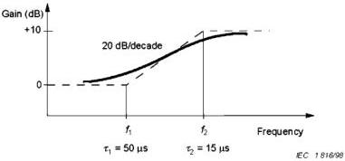

*Figure 1 – Pre-emphasis characteristic*

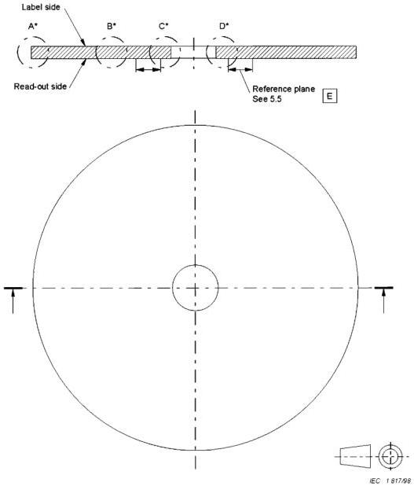

*Figure 2a – Dimensions of the disc*

* For details A, B, C and D, see figure 2b.

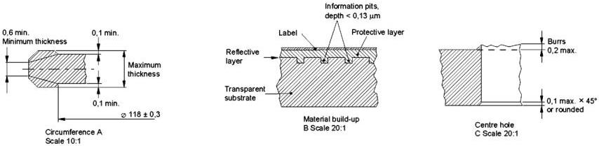

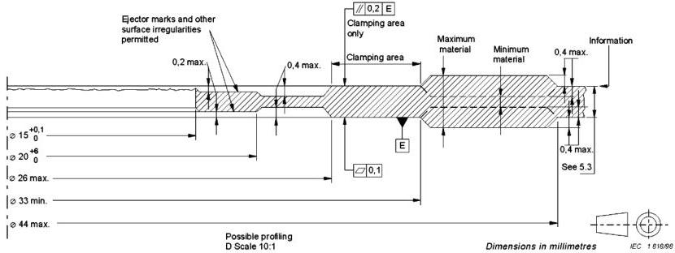

*Figure 2b – Dimensions of the disc*

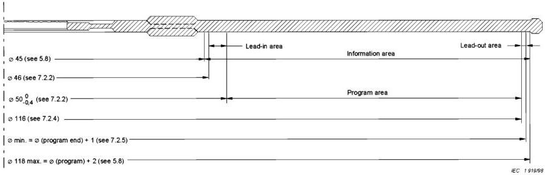

*Figure 2c – Dimensions of the disc*

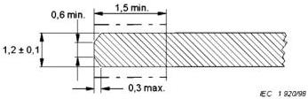

*Figure 2d – Edge shape of the disc (8 cm-CD)*

*Figure 2 – Overall disc layout*

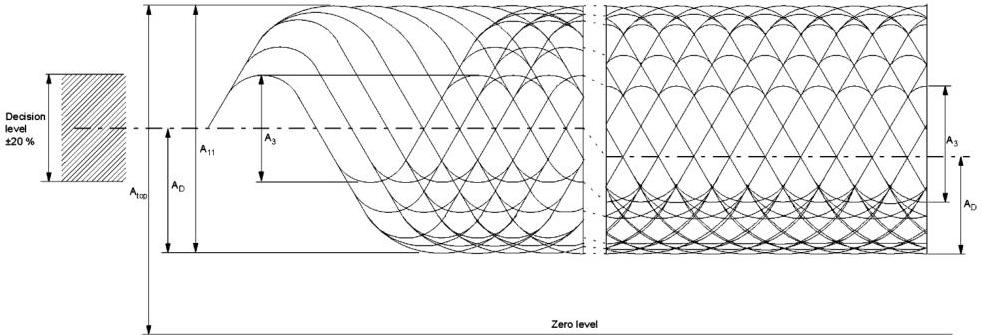

*Figure 3 – HF signal*

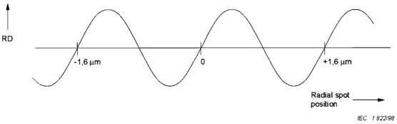

*Figure 4 – Typical shape of the RD signal used for tracking versus radial spot position*

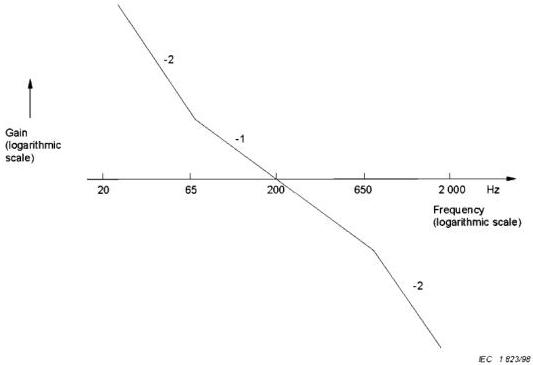

*Figure 5 – Transfer function*

Schematic representation of the open-loop transfer function for tracking measurements.

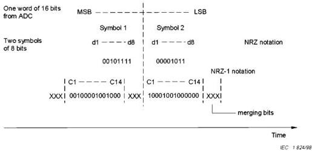

*Figure 6 – 8 to 14 modulation code (EFM code)*

For conversion of d1---d8 into C1---C14, see conversion table, figures 7a and 7b.
Bit C1 is first out.

|  0 : 00000000 | 01001000100000 | 64 : 01000000 | 01001000100100  |
| --- | --- | --- | --- |
|  1 : 00000001 | 10000100000000 | 65 : 01000001 | 10000100100100  |
|  2 : 00000010 | 10010000100000 | 66 : 01000010 | 10010000100100  |
|  3 : 00000011 | 10001000100000 | 67 : 01000011 | 10001000100100  |
|  4 : 00000100 | 01000100000000 | 68 : 01000100 | 01000100100100  |
|  5 : 00000101 | 00000100010000 | 69 : 01000101 | 00000000100100  |
|  6 : 00000110 | 00010000100000 | 70 : 01000110 | 00010000100100  |
|  7 : 00000111 | 00100100000000 | 71 : 01000111 | 00100100100100  |
|  8 : 00001000 | 01001001000000 | 72 : 01001000 | 01001001000100  |
|  9 : 00001001 | 10000001000000 | 73 : 01001001 | 10000001000100  |
|  10 : 00001010 | 10010001000000 | 74 : 01001010 | 10010001000100  |
|  11 : 00001011 | 10001001000000 | 75 : 01001011 | 10001001000100  |
|  12 : 00001100 | 01000001000000 | 76 : 01001100 | 01000001000100  |
|  13 : 00001101 | 00000001000000 | 77 : 01001101 | 00000001000100  |
|  14 : 00001110 | 00010001000000 | 78 : 01001110 | 00010001000100  |
|  15 : 00001111 | 00100001000000 | 79 : 01001111 | 00100001000100  |
|  16 : 00010000 | 10000000100000 | 80 : 01010000 | 10000000100100  |
|  17 : 00010001 | 10000010000000 | 81 : 01010001 | 10000010000100  |
|  18 : 00010010 | 10010010000000 | 82 : 01010010 | 10010010000100  |
|  19 : 00010011 | 00100000100000 | 83 : 01010011 | 00100000100100  |
|  20 : 00010100 | 01000010000000 | 84 : 01010100 | 01000010000100  |
|  21 : 00010101 | 00000010000000 | 85 : 01010101 | 00000010000100  |
|  22 : 00010110 | 00010010000000 | 86 : 01010110 | 00010010000100  |
|  23 : 00010111 | 00100010000000 | 87 : 01010111 | 00100010000100  |
|  24 : 00011000 | 01001000010000 | 88 : 01011000 | 01001000000100  |
|  25 : 00011001 | 10000000010000 | 89 : 01011001 | 10000000000100  |
|  26 : 00011010 | 10010000010000 | 90 : 01011010 | 10010000000100  |
|  27 : 00011011 | 10001000010000 | 91 : 01011011 | 10001000000100  |
|  28 : 00011100 | 01000000010000 | 92 : 01011100 | 01000000000100  |
|  29 : 00011101 | 00001000010000 | 93 : 01011101 | 00001000000100  |
|  30 : 00011110 | 00010000010000 | 94 : 01011110 | 00010000000100  |
|  31 : 00011111 | 00100000010000 | 95 : 01011111 | 00100000000100  |
|  32 : 00100000 | 00000000100000 | 96 : 01100000 | 01001000100010  |
|  33 : 00100001 | 10000100001000 | 97 : 01100001 | 10000100100010  |
|  34 : 00100010 | 00001000100000 | 98 : 01100010 | 10010000100010  |
|  35 : 00100011 | 00100100100000 | 99 : 01100011 | 10001000100010  |
|  36 : 00100100 | 01000100001000 | 100 : 01100100 | 01000100100010  |
|  37 : 00100101 | 00000100001000 | 101 : 01100101 | 00000000100010  |
|  38 : 00100110 | 01000000100000 | 102 : 01100110 | 01000000100100  |
|  39 : 00100111 | 00100100001000 | 103 : 01100111 | 00100100100010  |
|  40 : 00101000 | 01001001001000 | 104 : 01101000 | 01001001000010  |
|  41 : 00101001 | 10000001001000 | 105 : 01101001 | 10000001000010  |
|  42 : 00101010 | 10010001001000 | 106 : 01101010 | 10010001000010  |
|  43 : 00101011 | 10001001001000 | 107 : 01101011 | 10001001000010  |
|  44 : 00101100 | 01000001001000 | 108 : 01101100 | 01000001000010  |
|  45 : 00101101 | 00000001001000 | 109 : 01101101 | 00000001000010  |
|  46 : 00101110 | 00010001001000 | 110 : 01101110 | 00010001000010  |
|  47 : 00101111 | 00100001001000 | 111 : 01101111 | 00100001000010  |
|  48 : 00110000 | 00000100000000 | 112 : 01110000 | 10000000100010  |
|  49 : 00110001 | 10000010001000 | 113 : 01110001 | 10000010000010  |
|  50 : 00110010 | 10010010001000 | 114 : 01110010 | 10010010000010  |
|  51 : 00110011 | 10000100010000 | 115 : 01110011 | 00100000100010  |
|  52 : 00110100 | 01000010001000 | 116 : 01110100 | 01000010000010  |
|  53 : 00110101 | 00000010001000 | 117 : 01110101 | 00000010000010  |
|  54 : 00110110 | 00010010001000 | 118 : 01110110 | 00010010000010  |
|  55 : 00110111 | 00100010001000 | 119 : 01110111 | 00100010000010  |
|  56 : 00111000 | 01001000001000 | 120 : 01111000 | 01001000000010  |
|  57 : 00111001 | 10000000001000 | 121 : 01111001 | 00001001001000  |
|  58 : 00111010 | 10010000001000 | 122 : 01111010 | 10010000000010  |
|  59 : 00111011 | 10001000001000 | 123 : 01111011 | 10001000000010  |
|  60 : 00111100 | 01000000001000 | 124 : 01111100 | 01000000000010  |
|  61 : 00111101 | 00001000001000 | 125 : 01111101 | 00001000000010  |
|  62 : 00111110 | 00010000001000 | 126 : 01111110 | 00010000000010  |
|  63 : 00111111 | 00100000001000 | 127 : 01111111 | 00100000000010  |

*Figure 7a – EFM conversion table 0–127 (NRZ-I presentation)*

|  128 : 10000000 | 01001000100001 | 192 : 11000000 | 01000100100000  |
| --- | --- | --- | --- |
|  129 : 10000001 | 10000100100001 | 193 : 11000001 | 10000100010001  |
|  130 : 10000010 | 10010000100001 | 194 : 11000010 | 10010010010000  |
|  131 : 10000011 | 10001000100001 | 195 : 11000011 | 00001000100100  |
|  132 : 10000100 | 01000100100001 | 196 : 11000100 | 01000100010001  |
|  133 : 10000101 | 00000000100001 | 197 : 11000101 | 00000100010001  |
|  134 : 10000110 | 00010000100001 | 198 : 11000110 | 00010010010000  |
|  135 : 10000111 | 00100100100001 | 199 : 11000111 | 00100100010001  |
|  136 : 10001000 | 01001001000001 | 200 : 11001000 | 00001001000001  |
|  137 : 10001001 | 10000001000001 | 201 : 11001001 | 10000100000001  |
|  138 : 10001010 | 10010001000001 | 202 : 11001010 | 00001001000100  |
|  139 : 10001011 | 10001001000001 | 203 : 11001011 | 00001001000000  |
|  140 : 10001100 | 01000001000001 | 204 : 11001100 | 01000100000001  |
|  141 : 10001101 | 00000001000001 | 205 : 11001101 | 00000100000001  |
|  142 : 10001110 | 00010001000001 | 206 : 11001110 | 00000010010000  |
|  143 : 10001111 | 00100001000001 | 207 : 11001111 | 00100100000001  |
|  144 : 10010000 | 10000000100001 | 208 : 11010000 | 00000100100100  |
|  145 : 10010001 | 10000010000001 | 209 : 11010001 | 10000010010001  |
|  146 : 10010010 | 10010010000001 | 210 : 11010010 | 10010010010001  |
|  147 : 10010011 | 00100000100001 | 211 : 11010011 | 10000100100000  |
|  148 : 10010100 | 01000010000001 | 212 : 11010100 | 01000010010001  |
|  149 : 10010101 | 00000010000001 | 213 : 11010101 | 00000010010001  |
|  150 : 10010110 | 00010010000001 | 214 : 11010110 | 00010010010001  |
|  151 : 10010111 | 00100010000001 | 215 : 11010111 | 00100010010001  |
|  152 : 10011000 | 01001000000001 | 216 : 11011000 | 01001000010001  |
|  153 : 10011001 | 10000010010000 | 217 : 11011001 | 10000000010001  |
|  154 : 10011010 | 10010000000001 | 218 : 11011010 | 10010000010001  |
|  155 : 10011011 | 10001000000001 | 219 : 11011011 | 10001000010001  |
|  156 : 10011100 | 01000010010000 | 220 : 11011100 | 01000000010001  |
|  157 : 10011101 | 00001000000001 | 221 : 11011101 | 00001000010001  |
|  158 : 10011110 | 00010000000001 | 222 : 11011110 | 00010000010001  |
|  159 : 10011111 | 00100010010000 | 223 : 11011111 | 00100000010001  |
|  160 : 10100000 | 00001000100001 | 224 : 11100000 | 01000100000010  |
|  161 : 10100001 | 10000100001001 | 225 : 11100001 | 00000100000010  |
|  162 : 10100010 | 01000100010000 | 226 : 11100010 | 10000100010010  |
|  163 : 10100011 | 00000100100001 | 227 : 11100011 | 00100100000010  |
|  164 : 10100100 | 01000100001001 | 228 : 11100100 | 01000100010010  |
|  165 : 10100101 | 00000100001001 | 229 : 11100101 | 00000100010010  |
|  166 : 10100110 | 01000000100001 | 230 : 11100110 | 01000000100010  |
|  167 : 10100111 | 00100100001001 | 231 : 11100111 | 00100100010010  |
|  168 : 10101000 | 01001001001001 | 232 : 11101000 | 10000100000010  |
|  169 : 10101001 | 10000001001001 | 233 : 11101001 | 10000100000100  |
|  170 : 10101010 | 10010001001001 | 234 : 11101010 | 00001001001001  |
|  171 : 10101011 | 10001001001001 | 235 : 11101011 | 00001001000010  |
|  172 : 10101100 | 01000001001001 | 236 : 11101100 | 01000100000100  |
|  173 : 10101101 | 00000001001001 | 237 : 11101101 | 00000100000100  |
|  174 : 10101110 | 00010001001001 | 238 : 11101110 | 00010000100010  |
|  175 : 10101111 | 00100001001001 | 239 : 11101111 | 00100100000100  |
|  176 : 10110000 | 00000100100000 | 240 : 11110000 | 00000100100010  |
|  177 : 10110001 | 10000010001001 | 241 : 11110001 | 10000010010010  |
|  178 : 10110010 | 10010010001001 | 242 : 11110010 | 10010010010010  |
|  179 : 10110011 | 00100100010000 | 243 : 11110011 | 00001000100010  |
|  180 : 10110100 | 01000010001001 | 244 : 11110100 | 01000010010010  |
|  181 : 10110101 | 00000010001001 | 245 : 11110101 | 00000010010010  |
|  182 : 10110110 | 00010010001001 | 246 : 11110110 | 00010010010010  |
|  183 : 10110111 | 00100010001001 | 247 : 11110111 | 00100010010010  |
|  184 : 10111000 | 01001000001001 | 248 : 11111000 | 01001000010010  |
|  185 : 10111001 | 10000000001001 | 249 : 11111001 | 10000000010010  |
|  186 : 10111010 | 10010000001001 | 250 : 11111010 | 10010000010010  |
|  187 : 10111011 | 10001000001001 | 251 : 11111011 | 10001000010010  |
|  188 : 10111100 | 01000000001001 | 252 : 11111100 | 01000000010010  |
|  189 : 10111101 | 00001000001001 | 253 : 11111101 | 00001000010010  |
|  190 : 10111110 | 00010000001001 | 254 : 11111110 | 00010000010010  |
|  191 : 10111111 | 00100000001001 | 255 : 11111111 | 00100000010010  |
|   |   | 8-bit symbols | Transitions between channel bits  |

*Figure 7b – EFM conversion table 128–255 (NRZ-I presentation)*

*Figure 7 – EFM conversion table*

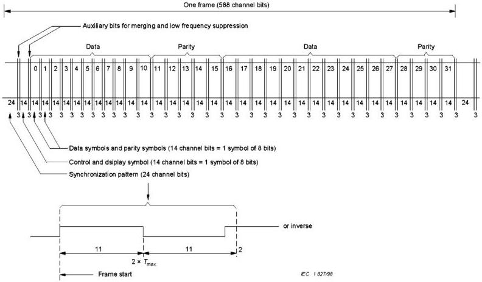

*Figure 8 – Frame format*

|  Symbol number | Symbol name | Sequence  |
| --- | --- | --- |
|  0 | WmA | m = 12n-12(3)  |
|  1 | WmB | m = 12n-12(D+2)  |
|  2 | WmA | m = 12n+4-12(2D+3)  |
|  3 | WmB | m = 12n+4-12(3D+2)  |
|  4 | WmA | m = 12n+8-12(4D+3)  |
|  5 | WmB | m = 12n+8-12(5D+2)  |
|  6 | WmA | m = 12n+1-12(6D+3)  |
|  7 | WmB | m = 12n+1-12(7D+2)  |
|  8 | WmA | m = 12n+5-12(8D+3)  |
|  9 | WmB | m = 12n+5-12(9D+2)  |
|  10 | WmA | m = 12n+9-12(10D+3)  |
|  11 | WmB | m = 12n+9-12(11D+2)  |
|  12 | Q̅m | m = 12n-12(12D+1)  |
|  13 | Q̅m | m = 12n+1-12(13D)  |
|  14 | Q̅m | m = 12n+2-12(14D+1)  |
|  15 | Q̅m | m = 12n+3-12(15D)  |
|  16 | WmA | m = 12n+2-12(16D+1)  |
|  17 | WmB | m = 12n+2-12(17D)  |
|  18 | WmA | m = 12n+6-12(18D+1)  |
|  19 | WmB | m = 12n+6-12(19D)  |
|  20 | WmA | m = 12n+10-12(20D+1)  |
|  21 | WmB | m = 12n+10-12(21D)  |
|  22 | WmA | m = 12n+3-12(22D+1)  |
|  23 | WmB | m = 12n+3-12(23D)  |
|  24 | WmA | m = 12n+7-12(24D+1)  |
|  25 | WmB | m = 12n+7-12(25D)  |
|  26 | WmA | m = 12n+11-12(26D+1)  |
|  27 | WmB | m = 12n+11-12(27D)  |
|  28 | P̅m | m = 12n-12  |
|  29 | P̅m | m = 12n+1  |
|  30 | P̅m | m = 12n+2-12  |
|  31 | P̅m | m = 12n+3  |

$$D = 4; n = 0, 1, 2, \dots$$

*Figure 9 – Block structure*

$$V_{p} = \left( \begin{array}{l} W12n-12(2), A \\ W12n-12(1D+2), B \\ W12n+4-12(2D+2), A \\ W12n+4-12(3D+2)), B \\ W12n+8-12(4D+2), A \\ W12n+8-12(5D+2), B \\ W12n+1-12(6D+2), A \\ W12n+1-12(7D+2), B \\ W12n+5-12(8D+2), A \\ W12n+5-12(9D+2), B \\ W12n+9-12(10D+2), A \\ W12n+9-12(11D+2), B \\ Q12n-12(12D) \\ Q12n+1-12(13D) \\ Q12n+2-12(14D) \\ Q12n+3-12(15D) \\ W12n+2-12(16D), A \\ W12n+2-12(17D), B \\ W12n+6-12(18D), A \\ W12n+6-12(19D), B \\ W12n+10-12(20D), A \\ W12n+10-12(21D), B \\ W12n+3-12(22D), A \\ W12n+3-12(23D), B \\ W12n+7-12(24D), A \\ W12n+7-12(25D), B \\ W12n+11-12(26D), A \\ W12n+11-12(27D), B \\ P12n \\ P12n+1 \\ P12n+2 \\ P12n+3 \end{array} \right)$$

$$V_{q} = \left( \begin{array}{l} W12n-24, A \\ W12n-24, B \\ W12n+4-24, A \\ W12n+4-24, B \\ W12n+8-24, A \\ W12n+8-24, B \\ W12n+1-24, A \\ W12n+1-24, B \\ W12n+5-24, A \\ W12n+5-24, B \\ W12n+9-24, A \\ W12n+9-24, B \\ Q12n \\ Q12n+1 \\ Q12n+2 \\ Q12n+3 \\ W12n+2, A \\ W12n+2, B \\ W12n+6, A \\ W12n+6, B \\ W12n+10, A \\ W12n+10, B \\ W12n+3, A \\ W12n+3, B \\ W12n+7, A \\ W12n+7, B \\ W12n+11, A \\ W12n+11, B \end{array} \right)$$

$$D = 4; n = 0, 1, 2, \dots$$

*Figure 10 – Column vectors*

$$\mathrm{H}_{\mathrm{p}} = \left[ \begin{array}{cccccccccccccccccccccccccc} 1 & 1 & 1 & 1 & 1 & 1 & 1 & 1 & 1 & 1 & 1 & 1 & 1 & 1 & 1 & 1 & 1 & 1 & 1 & 1 & 1 & 1 & 1 & 1 & 1 & 1 & 1 & 1 & 1 & 1 & 1 & 1 & 1 & 1 & 1 \\ \alpha^{31} & \alpha^{30} & \alpha^{29} & \alpha^{28} & \alpha^{27} & \alpha^{26} & \alpha^{25} & \alpha^{24} & \alpha^{23} & \alpha^{22} & \alpha^{21} & \alpha^{20} & \alpha^{19} & \alpha^{18} & \alpha^{17} & \alpha^{16} & \alpha^{15} & \alpha^{14} & \alpha^{13} & \alpha^{12} & \alpha^{11} & \alpha^{10} & \alpha^{9} & \alpha^{8} & \alpha^{7} & \alpha^{6} & \alpha^{5} & \alpha^{4} & \alpha^{3} & \alpha^{2} & \alpha^{1} & 1 \\ \alpha^{62} & \alpha^{60} & \alpha^{58} & \alpha^{56} & \alpha^{54} & \alpha^{52} & \alpha^{50} & \alpha^{48} & \alpha^{46} & \alpha^{44} & \alpha^{42} & \alpha^{40} & \alpha^{38} & \alpha^{36} & \alpha^{34} & \alpha^{32} & \alpha^{30} & \alpha^{28} & \alpha^{26} & \alpha^{24} & \alpha^{22} & \alpha^{20} & \alpha^{18} & \alpha^{16} & \alpha^{14} & \alpha^{12} & \alpha^{10} & \alpha^{8} & \alpha^{6} & \alpha^{4} & \alpha^{2} & 1 \\ \alpha^{93} & \alpha^{90} & \alpha^{87} & \alpha^{84} & \alpha^{81} & \alpha^{78} & \alpha^{75} & \alpha^{72} & \alpha^{69} & \alpha^{66} & \alpha^{63} & \alpha^{60} & \alpha^{57} & \alpha^{54} & \alpha^{51} & \alpha^{48} & \alpha^{45} & \alpha^{42} & \alpha^{39} & \alpha^{36} & \alpha^{33} & \alpha^{30} & \alpha^{27} & \alpha^{24} & \alpha^{21} & \alpha^{18} & \alpha^{15} & \alpha^{12} & \alpha^{9} & \alpha^{6} & \alpha^{3} & 1 \end{array} \right]$$

$$\mathrm{H}_{\mathrm{q}} = \left[ \begin{array}{cccccccccccccccccccccccccc} 1 & 1 & 1 & 1 & 1 & 1 & 1 & 1 & 1 & 1 & 1 & 1 & 1 & 1 & 1 & 1 & 1 & 1 & 1 & 1 & 1 & 1 & 1 & 1 & 1 & 1 & 1 & 1 & 1 & 1 & 1 & 1 & 1 & 1 & 1 \\ \alpha^{27} & \alpha^{26} & \alpha^{25} & \alpha^{24} & \alpha^{23} & \alpha^{22} & \alpha^{21} & \alpha^{20} & \alpha^{19} & \alpha^{18} & \alpha^{17} & \alpha^{16} & \alpha^{15} & \alpha^{14} & \alpha^{13} & \alpha^{12} & \alpha^{11} & \alpha^{10} & \alpha^{9} & \alpha^{8} & \alpha^{7} & \alpha^{6} & \alpha^{5} & \alpha^{4} & \alpha^{3} & \alpha^{2} & \alpha^{1} & 1 \\ \alpha^{54} & \alpha^{52} & \alpha^{50} & \alpha^{48} & \alpha^{46} & \alpha^{44} & \alpha^{42} & \alpha^{40} & \alpha^{38} & \alpha^{36} & \alpha^{34} & \alpha^{32} & \alpha^{30} & \alpha^{28} & \alpha^{26} & \alpha^{24} & \alpha^{22} & \alpha^{20} & \alpha^{18} & \alpha^{16} & \alpha^{14} & \alpha^{12} & \alpha^{10} & \alpha^{8} & \alpha^{6} & \alpha^{4} & \alpha^{2} & 1 \\ \alpha^{81} & \alpha^{78} & \alpha^{75} & \alpha^{72} & \alpha^{69} & \alpha^{66} & \alpha^{63} & \alpha^{60} & \alpha^{57} & \alpha^{54} & \alpha^{51} & \alpha^{48} & \alpha^{45} & \alpha^{42} & \alpha^{39} & \alpha^{36} & \alpha^{33} & \alpha^{30} & \alpha^{27} & \alpha^{24} & \alpha^{21} & \alpha^{18} & \alpha^{15} & \alpha^{12} & \alpha^{9} & \alpha^{6} & \alpha^{3} & 1 \end{array} \right]$$

*Figure 11 – Parity check matrices*

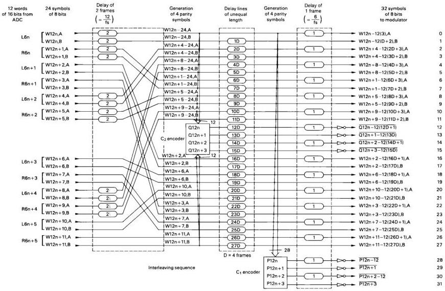

*Figure 12 – CIRC encoder*

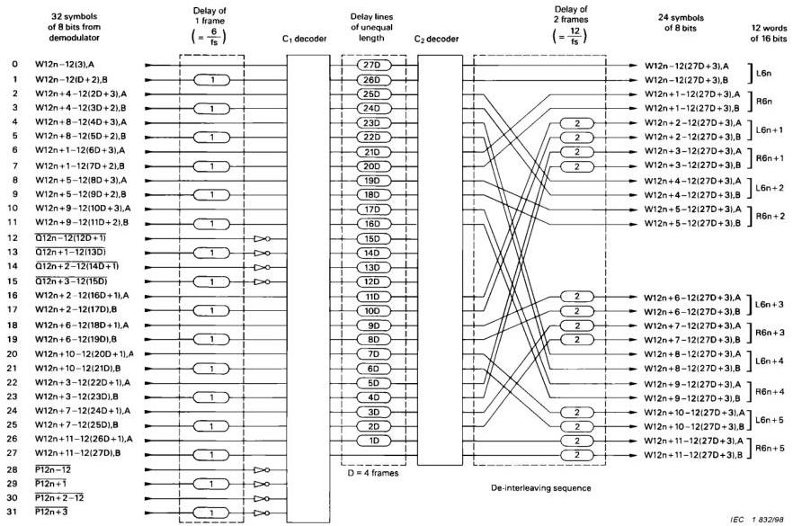

*Figure 13 – CIRC decoder*

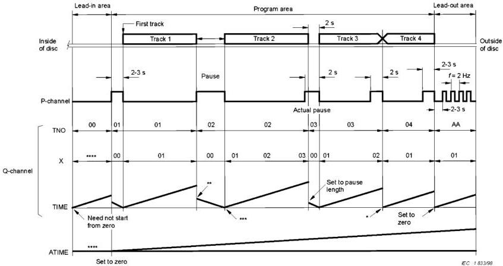

*Figure 14 – Example of encoding in channels P and Q*

* This point can be determined by the software manufacturer.

** The stop point of a track in the disc is the location where the TNO changes.

*** The part point of a track in the disc is the first location with the new TNO and X ≠ 00.

The accuracy of the start and stop point locations depend on the player design. The switch delay of the de-emphasis depends on the player design.

*** During the lead-in track ATIME and X are not available.

NOTE – See also figure 2c.

|  Subcode frame number | POINT | PMIN, PSEC, PFRAME  |
| --- | --- | --- |
|  n | 01 | 00, 02, 32  |
|  n+1 | 01 | 00, 02, 32  |
|  n+2 | 01 | 00, 02, 32  |
|  n+3 | 02 | 10, 15, 12  |
|  n+4 | 02 | 10, 15, 12  |
|  n+5 | 02 | 10, 15, 12  |
|  n+6 | 03 | 16, 28, 63  |
|  n+7 | 03 | 16, 28, 63  |
|  n+8 | 03 | 16, 28, 63  |
|  n+9 | 04 | . .  |
|  n+10 | 04 | . .  |
|  n+11 | 04 | .  |
|  n+12 | 05 | .  |
|  n+13 | 05 | . .  |
|  n+14 | 05 | . .  |
|  n+15 | 06 | 49, 10, 03  |
|  n+16 | 06 | 49, 10, 03  |
|  n+17 | 06 | 49, 10, 03  |
|  n+18 | A0 | 01, 00, 00  |
|  n+19 | A0 | 01, 00, 00  |
|  n+20 | A0 | 01, 00, 00  |
|  n+21 | A1 | 06, 00, 00  |
|  n+22 | A1 | 06, 00, 00  |
|  n+23 | A1 | 06, 00, 00  |
|  n+24 | A2 | 52, 48, 41  |
|  n+25 | A2 | 52, 48, 41  |
|  n+26 | A2 | 52, 48, 41  |
|  n+27 | 01 | 00, 02, 32  |
|  n+28 | 01 | 00, 02, 32  |
|  . | . | . .  |
|  . | . | . .  |

*Figure 15 – Example of encoding of table of contents with six tracks (program items)*

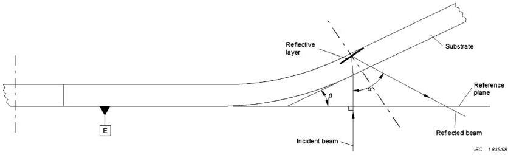

*Figure 16 – Angular deviation*

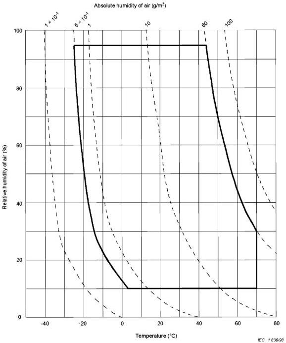

*Figure 17 – Operating conditions of disc*

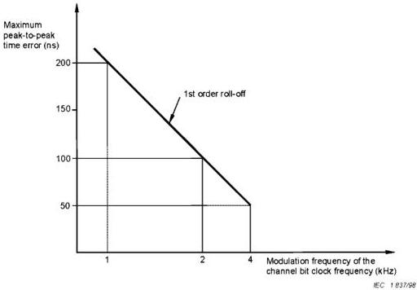

*Figure 18 – Time error versus modulation frequency*

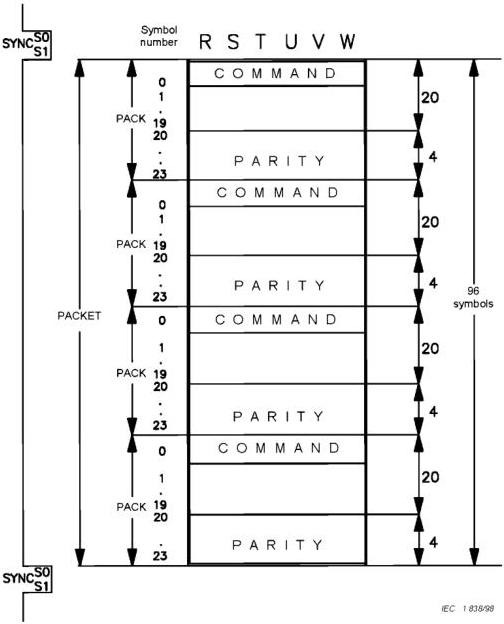

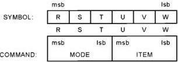

*Figure 19 – Basic format subcode channels R to W*

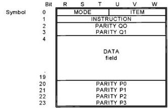

*Figure 20 – General organization of a PACK*

INSTRUCTION: Describes the nature of the DATA field

PARITY Q: Error detection and correction on symbols 0 .. 3

PARITY P: Error detection and correction on symbols 0 .. 23

*Figure 21 – P-parity and interleave sequence*

*Figure 22 – P-parity and de-interleave sequence*

*Figure 23 – Q-parity encoder*

*Figure 24 – Q-parity decoder*

*Figure 25 – Block diagram of a video/graphics mixing unit*

|  Symbol | Bit R | S | T | U | V | W  |
| --- | --- | --- | --- | --- | --- | --- |
|  N | x7 | x6 | x5 | x4 | x3 | x2  |
|  N + 1 | x1 | x0 | y7 | y6 | y5 | y4  |
|  N + 2 | y3 | y2 | y1 | y0 | z7 | z6  |
|  N + 3 | z5 | z4 | z3 | z2 | z1 | z0  |

*Figure 26 – Example of encoding 3 bytes in 4 SYMBOLS*

*Figure 27 – Text group and BLOCK structure*

1 PACK = 18 bytes = 24 SYMBOLS

*Figure 28 – CD TEXT mode PACK format for the lead-in area*

|   | Bit: R | S | T | U | V | W  |
| --- | --- | --- | --- | --- | --- | --- |
|  0 | 0 | 1 | 0 | Item  |   |   |
|  1 | Instruction  |   |   |   |   |   |
|  2 | Parity Q0  |   |   |   |   |   |
|  3 | Parity Q1  |   |   |   |   |   |
|  4 | Data field  |   |   |   |   |   |
|  19 |   |   |   |   |   |   |
|  20 | Parity P0  |   |   |   |   |   |
|  21 | Parity P1  |   |   |   |   |   |
|  22 | Parity P2  |   |   |   |   |   |
|  23 | Parity P3  |   |   |   |   |   |

*Figure 29 – CD TEXT mode PACK format for the program area*

*Figure 30 – Example of partial interleaving of PACKs*

*Figure 31 – Maximum allowed mode transition skew*

## Annex A (informative) – Examples of the combination of the EFM-code with 3 extra channel bits

(see also clause 13)

### Example 1

See figure A.1

An extra transition may be inserted in one of the merging bits 1, 2 or 3, if the requirement for
$T_{\min}$, is not violated, because these 3 bits do not contain any information. The maximum run
length between two blocks can thus be limited to $T_{\max}$.

### Example 2

See figure A.2

To limit the run length to $T_{\max}$, an extra transition in the merging bits is given.

### Example 3

See figure A.3

When no other rules determine the merging bits, the digital sum value (DSV) and hence the l.f.
content can be minimized by inserting a transition. The transition position can often be chosen
among one of the merging bits to shift the DSV by $\pm 2$ bits.

*Figure A.1*

* A signal which represents the position of the transition of the NRZ signal.

*Figure A.2*

*Figure A.3*

## Annex B (normative) – Abbreviations

|  English | Meaning  |
| --- | --- |
|  LSB | Least significant bit  |
|  MSB | Most significant bit  |
|  CIRC | Cross Interleave Reed-Solomon Code  |
|  NA | Numerical aperture  |
|  BLER | Block error rate  |
|  NRZ | Non-return to zero coding  |
|  A/D | Analogue to digital  |
|  DSV | Digital sum value  |
|  EFM | Eight to fourteen modulation code  |
|  GF | Galois field  |
|  TNO | Track number  |
|  r.m.s. | Root mean square  |
|  RD | Radial differential  |
|  ADR | Address  |
|  CRC | Cyclic redundancy check  |
|  BCD | Binary coded decimal  |
|  ISRC | International standard recording code  |
|  UPC/EAN | Universal product code/European article numbering  |
|  fs | Sampling frequency  |
|  ADC | Analogue to digital convertor  |

## Annex C (informative) – Recommendations

### De-emphasis

The pre-emphasis can be switched between track numbers. It is recommended to use an automatically controlled de-emphasis switch in the CD-player.

### Analogue audio output

It is recommended that all analogue audio outputs are muted during a non-audio track (such as a data track).

### Output level

This should be in accordance with clause 19 of IEC 60268-15.

## Annex D (informative) – Adaptor specification for 8 cm-CD

By using an adaptor all parameters in this standard should be maintained.

### D.1 Requirements for measurements

#### D.1.1 Conditions of measurement

- ambient temperature: \(15^{\circ} \mathrm{C}\) to \(35^{\circ} \mathrm{C}\);
relative humidity: \(45\%\) to \(75\%\)
- air pressure: 86 kPa to 106 kPa.

|  Parameters to be specified | Requirements | Methods and/or conditions of measurement  |
| --- | --- | --- |
|  **D.2 Mechanical parameters of adaptor** |  | Figure D.1  |
|  **D.2.1 Outer Diameter** |  |   |
|  D.2.1.1 Without disc D.2.1.2 Including disc | 119,8 ± 0,1 mm 120,0 ± 0,3 mm | To be measured at 23 ± 2 °C and (50 ± 5) % relative humidity  |
|  **D.2.2 Mass of adaptor** | 8 g to 12 g |   |
|  **D.2.3 Material** | Non-transparent in the range visible to near-infrared |   |
|  **D.2.4 Torque of joint** (between disc and adaptor) | 60 mN m to 120 mN m | At 23 ± 2 °C and (50 ± 5) % relative humidity. A minimum torque should be measured by using a minimum reference glass disc (Ø 79,8 × 1,1 mm) and a maximum torque should be measured by using a maximum reference glass disc (Ø 80,2 × 1,3 mm)  |

*Figure D.1 – Adaptor including disc*

## Annex E (informative) – TV-GRAPHICS mode implementation aspects

### E.1 Data speed

The maximum speed of the TV-GRAPHICS data is 300 PACKs per second. For TV-GRAPHICS a picture, in most cases, will be displayed 50 (PAL/SECAM) or 60 (NTSC) times per second (not interlaced video). As a result of this, new data and the update of the screen pointers will be visible maximum 50 (or 60) times per second.

### E.2 Graphics and soft scroll

Soft scroll is made possible by a POINTER system. For the LINE-GRAPHICS system, the available pointers and their general behaviour are described in 21.4. For the TV-GRAPHICS system, the pointers are described in 22.4.

To illustrate the behaviour of the soft scroll pointers a few possible pointer sequences are given below for the TV-GRAPHICS system.

Scroll SCREEN:

|   | ←---Scroll left--- |   | →●← | --- Scroll right ---→  |   |
| --- | --- | --- | --- | --- | --- |
|   | ←--- fast ---→●← |   |  | slow ---→●←fast ---→  |   |
|  PH | = 2 | 4 0 2 4 0 1 2 3 4 5 0 1 2 1 0 5 4 3 2 1 0 4 2 0 4 |  |  |   |
|  COPH | = 0 | 0 2 0 0 2 0 0 0 0 0 0 2 0 0 0 0 1 0 0 0 0 0 1 0 0 1 |  |  |   |
|  PV | = 0 | 0 0 0 0 0 0 0 0 0 0 0 0 0 0 0 0 0 0 0 0 0 0 0 0 0 0 0 0 0 |  |  |   |
|  COPV | = 0 | 0 0 0 0 0 0 0 0 0 0 0 0 0 0 0 0 0 0 0 0 0 0 0 0 0 0 0 0 0 |  |  |   |
|   |  | ● | ● | ● | ●  |
|  Preset |  | (i,49) (i,49) | (i,49) | (i,0) | (i,0) (i,0)  |

A second example of Scroll SCREEN:

|   | ←--- Scroll up ---→●← |   | --- Scroll down ---→  |   |
| --- | --- | --- | --- | --- |
|   | ←---fast---→●← |   | slow ---→●←---Fast---→  |   |
|  PH | = 0 | 0 0 0 0 0 0 0 0 0 0 0 0 0 0 0 0 0 0 0 0 0 0 0 0 0 0 0 0 0 0 0 0 0 0 0 0 0 0 0 0 0 0 0 0 0 0 0 0 0 0 0 0 |  |   |
|  COPH | = 0 | 0 0 0 0 0 0 0 0 0 0 0 0 0 0 0 0 0 0 0 0 0 0 0 0 0 0 0 0 0 0 0 0 0 0 0 0 0 0 0 0 0 0 0 0 0 0 0 0 0 0 0 |  |   |
|  PV | = 3 | 6 9 0 3 6 9 A B 0 1 2 3 2 1 0 B A 9 8 6 3 0 9 6 3 |  |   |
|  COPV | = 0 | 0 0 2 0 0 0 0 0 2 0 0 0 0 0 0 0 1 0 0 0 0 0 0 0 1 0 0 |  |   |
|   |  | ● | ● | ●  |
|  Preset |  | (17,j) | (17,j) | (0,j) (0,j)  |

A third example of Scroll SCREEN:

|   | Scroll left/up |   |   |   |   |   |   |   |   |   |   |   | Scroll right/down  |   |   |   |   |   |   |   |   |   |   |   |   |   |
| --- | --- | --- | --- | --- | --- | --- | --- | --- | --- | --- | --- | --- | --- | --- | --- | --- | --- | --- | --- | --- | --- | --- | --- | --- | --- | --- |
|  PH | = 4 | 0 | 2 | 4 | 0 | 1 | 2 | 3 | 4 | 5 | 0 | 1 | 2 | 1 | 0 | 5 | 4 | 3 | 2 | 1 | 0 | 4 | 2 | 0 | 4 | 2  |
|  COPH | = 0 | 2 | 0 | 0 | 2 | 0 | 0 | 0 | 0 | 0 | 2 | 0 | 0 | 0 | 0 | 1 | 0 | 0 | 0 | 0 | 0 | 1 | 0 | 0 | 1 | 0  |
|  PV | = 3 | 6 | 9 | 0 | 3 | 6 | 9 | A | B | 0 | 1 | 2 | 3 | 2 | 1 | 0 | B | A | 9 | 8 | 6 | 3 | 0 | 9 | 6 | 3  |
|  COPV | = 0 | 0 | 0 | 2 | 0 | 0 | 0 | 0 | 0 | 2 | 0 | 0 | 0 | 0 | 0 | 0 | 1 | 0 | 0 | 0 | 0 | 0 | 0 | 1 | 0 | 0  |
|   |  | • |  | • |  |  |  |  |  |  | • |  | • |  |  | • |  |  |  |  |  |  | • |  |  |   |
|  Preset |  | (i,49) |  | (i,49) |  |  |  |  |  |  | (i,49) |  | (i,0) |  |  | (i,0) |  |  |  |  |  |  | (i,0) |  |  |   |
|   |  |  |  | • |  |  |  |  |  |  | • |  |  |  |  | • |  |  |  |  |  |  |  | • |  |   |
|  Preset |  |  |  | (17,j) |  |  |  |  |  |  | (17,j) |  |  |  |  | (0,j) |  |  |  |  |  |  |  | (0,j) |  |   |

### E.3 CHANNEL concept

The CHANNEL number gives a software manufacturer the possibility to split up a picture into maximum 16 subpictures. A subpicture (marked by a channel number) can use FONTs with any position on the screen. Data with different channel numbers can have the same position on the screen; this can make sense if a few subpictures are used to give different languages.

A software manufacturer needs to create the default picture with CHANNELS 0 and 1. By using two channels for the default picture, he can split up the default picture into text and other graphics information. This gives the user at the display side the possibility to select from the default display information text only or picture only if the channels 0 and 1 are used in this way.

The following list gives an example of the contents of these 16 channels.

|  CHANNEL 0 | English text of the song  |
| --- | --- |
|  CHANNEL 1 | Pictures illustrating this song (flowers, etc.)  |
|  CHANNEL 2 | Japanese translation of the text  |
|  CHANNEL 3 | Phonetic version of the Japanese text  |
|  CHANNEL 4 | French translation of the text  |
|  CHANNEL 5 | Music notes  |
|  CHANNEL 6 | Dancing feet  |
|  CHANNEL 7 | Word pointer for the English text  |
|  CHANNEL 8 | German translation of the text  |
|  CHANNEL 9 .. 15 | Not used  |

On a decoder with selection possibilities, any combination of the channels 0 8 can be displayed with this disc.

The FONT data of the non-selected channels can be ignored, otherwise a huge amount of memory would be necessary in the graphics decoder.

## Annex F (informative) – EXTENDED TV-GRAPHICS mode implementation aspects

### F.1 Memory organization (see figure F.1)

Both the PRIMARY MEMORY and the SECONDARY MEMORY have 300 (pixels) × 216 (lines) or (50 × 18 FONTS). The pixels are coded with a 4-bit code, which is the colour address of the colour look-up table. Each of the two BORDERs is defined independently by the colour.

### F.2 Video effects CUT and DISSOLVE

The 4-bit code from each memory defines the address of the CLUT for 16-colour pictures independently. The change from one 16-colour picture to another gives the CUT effect. The additive mix of two 16-colour pictures gives the DISSOLVE effect by changing the CLUT, using Load CLUT colour-0 .. 7 and -8 .. 15 in ITEM-1 and Load CLUT colour-0 .. 7 and -8 .. 15 in ITEM-2, because of compatibility with TV-GRAPHICS decoders.

### F.3 CLUT organization (see figure F.2)

The CLUT consists of the 256-colour number which has R, G, B, 6 bits each. The instruction Load CLUT colour gives the upper 4 bits of the 6 bits to each group of 8 colours.

The instruction Load CLUT additional colour gives the lower 2 bits of the 6 bits to each group of 16 colours.

The 32 Load CLUT instructions define the 256-colour number. Two Load CLUT instructions are in ITEM-1. The remaining 30 are in ITEM-2. Two instructions Load CLUT colour-0 .. 7 and -8 .. 15 in ITEM-2 are used for a DISSOLVE effect in the 2-plane state.

The 16 Load CLUT additional colour instructions define the 256-colour numbers and are in ITEM-2.

When changing the mode from 1-plane state to 2-plane state, the CLUT data should be reloaded with the ITEM-1 instruction Load CLUT.

In the 1-plane state, the colours of colour numbers 0 .. 15 on the 16 × 16 CLUT shall be loaded at least once by Load CLUT in ITEM-1. Colour numbers 0 .. 15 are then ready for loading by Load CLUT colour-0 .. 7 and -8 .. 15 in ITEM-2.

### F.4 Changing one colour out of 256 colours

Both Load CLUT and Load CLUT additional colour instructions are required to change only one colour out of the 256 colours.

When changing any eight colours selected from the 256 colours, from one to eight pairs of the above instructions are required.

### F.5 Relationship between colour numbers in 1-plane state (see figure F.3)

The ITEM-1 instructions Load CLUT colour-0 .. 7 and Load CLUT colour-8 .. 15 determine the 16 colours with R, G, B, 4 bits each. A TV-GRAPHICS decoder represents pictures with these 16 colours and ignores any other Load CLUT colour or Load CLUT additional colour instructions.

The procedure to determine the colour to the CLUT is, for example, as follows:

- first of all, the 16 colours of R, G, B, 4 bits each, are selected from the original images. These 16 colours are allocated with colour numbers 0-15. The picture consisting of these 16 colours is for the TV-GRAPHICS picture;
- secondly, in the area of every colour number for the TV-GRAPHICS picture, the 16 colours of R, G, B, 6 bits each, are selected from the original images.

The colours of the colour number with the same lower 4 bits represent near colour tones.

### F.6 Compatibility with TV-GRAPHICS decoders

A TV-GRAPHICS decoder represents a 16-colour picture out of a 256-colour picture and executes no video CUT or DISSOLVE effects, because it has only one memory plane.

The lower 2 bits of R, G, B, 6 bits each, are ignored, even if the picture consists of 256 colours in the EXTENDED TV-GRAPHICS format.

The video effects CUT or DISSOLVE are not executed by a TV-GRAPHICS decoder.

When the instruction MEMORY control indicates 1-plane state, the PRIMARY MEMORY and CLUT 0-15 construct a 16-colour picture in the TV-GRAPHICS decoder.

### F.7 Difference of decoder output signal level between 4-bit data and 6-bit data

The dynamic range of the decoder output signal level is different between 4-bit data of 16-colour pictures and 6-bit data of 256-colour pictures.

One way to correct the level is to attenuate the video signal. Another way is to add suitable fixed data to the lower 2 bits. The fixed data is recommended to be 10 as a balance between white peak and set-up level.

*Figure F.1a – Two memory planes of 16 colours*

*Figure F.1b – One memory plane of 256 colours*

*Figure F.1 – Memory organization of EXTENDED TV-GRAPHICS*

*Figure F.2 – CLUT structure of EXTENDED TV-GRAPHICS*

TV-GRAPHICS can
display (16 colours: by
ITEM-1:
lsb/4 bits)

EXTENDED TV-
GRAPHICS can
display (256 colours:
by ITEM-1/2:
8 bits)

*Figure F.3 – Relationship of colours between TV-GRAPHICS and EXTENDED TV-GRAPHICS*

## Bibliography

L.B. Vries, K.A. Immink, J.G. Nijboer, H. Hoeve, T.T. Doi, K. Odaka, H. Ogawa: The Compact Disc Digital Audio System – Modulation and Error Correction, 67th AES Conv., No. 1674 (H-8), 1980.10

Philips' Technical Review, vol. 40, 1982, No. 6
