# Experiments with digitally mastered LaserVision® optical discs

BBC Research Department Report BBC RD 1986/1

M.A. Parker, B.Sc.

Research Department, Engineering Division
THE BRITISH BROADCASTING CORPORATION

March, 1986

## Summary

This Report describes experimental tests in which digital data was mastered onto a LaserVision disc to examine its potential as a source for a new BBC 1 channel logo. The logo had been electronically generated on a graphics computer and stored as digitally coded television frames.

The tests involved mastering a disc with segments of a short video sequence derived from the data for the new logo, and with pseudo-random data. Conventional pressings from this digital master were then replayed on a domestic player. After minor modification to the replay signal path and to the control system of the player both signal types were successfully recovered and various performance characteristics of the system were measured.

From the tests it was estimated that replay data rates up to 50 Mbit/s could be achieved and that errors in the replayed data could be corrected with an overhead of about 7%.

Although the replay data rates were satisfactory, the current degree of mechanical reliability of the domestic player makes the system unsuitable as a source for animated television logos.

Issued under the Authority of

M. E. B. Parker

Head of Research Department

Research Department, Engineering Division,
BRITISH BROADCASTING CORPORATION

March, 1986
(PH-275)

This Report may not be reproduced in any form
without the written permission of the British
Broadcasting Corporation.

It uses SI units in accordance with B.S. document
PD 5686.

© BBC 2006. All rights reserved. Except as provided below, no part of this document may be reproduced in any material form (including photocopying or storing it in any medium by electronic means) without the prior written permission of BBC Research & Development except in accordance with the provisions of the (UK) Copyright, Designs and Patents Act 1988.

The BBC grants permission to individuals and organisations to make copies of the entire document (including this copyright notice) for their own internal use. No copies of this document may be published, distributed or made available to third parties whether by paper, electronic or other means without the BBC's prior written permission. Where necessary, third parties should be directed to the relevant page on BBC's website at http://www.bbc.co.uk/rd/pubs/ for a copy of this document.

## 1. Introduction

### 1.1. General

LaserVision is a name of the American LaserVision Association for an optical disc system aimed at the domestic consumer market¹. The discs contain video material derived largely from television programmes and feature films. They are pressed, rather like conventional gramophone records, from a master. At present only relatively few mastering and pressing plants exist. The advantage of this system lies in the laser reading process which involves no physical contact with the storage medium and therefore no wear. Recordings may, in theory, be replayed an infinite number of times.

There are two disc formats commonly available, called Active Play and Long Play. Active Play discs provide one television picture (2 fields) per revolution of the disc. The players are capable of jumping complete tracks in the field blanking period allowing various 'stunt' modes to be achieved, such as still pictures and non-standard speed replay. The constant rotational speed used for Active Play discs results in an information density (along the direction of the track) which decreases with increasing radius. Where stunt modes are not required the total capacity may be increased by slowing down the disc when outer radii are in use so that data is recorded at a constant density at all radii. This is the Long Play format. The player recognises which format is being played from a code recorded at the beginning of the disc. For both formats, the pictures are recorded as f.m. composite video.

The object of the work described in this Report was to investigate the use of a LaserVision disc mastered with digital data as a source for a new interval logo for BBC 1. The logo had been electronically generated by computer and stored as a number of digitally coded television frames.

Experimental tests were carried out which involved mastering a LaserVision disc with segments of a short video sequence derived from the data for the new logo, and with pseudo-random data to provide means of checking error rates. Conventional pressings from this digital master were then replayed on a modified domestic player.

### 1.2. Digital data on a LaserVision disc

On a LaserVision disc, information is carried by a continuous spiral of pits which are formed in the surface of a disc and then covered by a metalized layer and a protective layer¹,². On a conventional analogue disc the composite video signal directly modulates the spacing of the pits, while the sound channel modulates the duty cycle i.e. the ratio of the length of pits to the length of the space between pits. Fig. 1 is an electron photomicrograph of the surface of a disc and shows the tracks of pits.

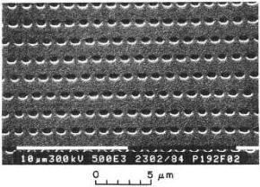

*Fig. 1 - Electron photomicrograph of the surface of a conventional LaserVision disc.*

In these experiments the pits and spaces were used to represent binary '1's and '0's. The limiting packing density is reached where one bit cell is just less than the resolution of the system. Factors affecting the resolution are discussed in Reference 3. In particular the spatial cut-off frequency, $f_c$, is dependent on the numerical aperture, $N$, of the objective and the wavelength, $\lambda$, of the reading laser and is given by:

$$f_c = 2N/\lambda$$

In the test $N = 0.4$ and $\lambda = 0.63$ μm giving,

$$f_c = 1270 \text{ cycles/mm}$$

The highest spatial frequency for an uncoded binary data stream would result from a sequence of 010101010. The smallest bit-cell size that may be resolved is therefore where $1/f_c$ = 0.8 μm, equivalent to a linear packing density of 2,500 bits/mm (64,000 bits/inch).

The discs were mastered at a constant rotational speed of 1500 r.p.m. This resulted in a linear packing density along the direction of the track which increased with decreasing radius. The mastering bit-rate was chosen to be 34 Mbit/s so that the highest theoretical packing density would occur roughly in the middle of the recorded band. The resulting packing density varied between 100 kbit/inch at the innermost radius and 36 kbit/inch at the largest radius.

It was decided that NRZ data could be mastered directly onto the disc and recovered by a standard player without the need for any form of channel coding. To ease the demands on clock recovery circuits, the data was processed to remove strings of ones or zeros of greater than fifteen bits.

## 2. Mastering the digital LaserVision disc

### 2.1. General

The disc had to be mastered as a continuous process in order to maintain a continuous spiral data track⁴,⁵. Therefore, both the digital video and pseudo-random data sources had to be capable of producing a continuous real time signal. Provision was made to switch between the sources during the mastering so that both signal types would be recorded at a number of different radii.

### 2.2. Digital video data source

#### 2.2.1. General

The video data to be recorded comprised a sequence of computer generated pictures of an animated, rotating world. Because of the limited data rate available from the disc, it was not possible to code the entire picture area to the CCIR digital YUV standard (Rec. 601) and reproduce real-time animation. Accordingly, only one sixth of the normal active picture area was recorded, comprising a square in the centre of the picture including the globe. This was the only part of the picture containing animation, the remainder being at black level.

The need to reproduce the video signal in real time for mastering purposes limited the length of video sequence to the size of store that was available as a source. A suitable store was that contained in the Research Department Enhanced Teletext equipment⁶, which comprised a computer connected to three picture stores, normally used as R, G and B stores. In order to reduce the hardware required to process the data before recording, much of this processing was carried out in software, in non-real time, using the internal computer. The results were stored on floppy discs and could be loaded directly into the video stores for the mastering operation.

#### 2.2.2. Signal format

The three video frame stores shared common address and control signals and each was organised as 625 lines of 768 samples, each of eight bit resolution. The reduced sized luminance and multiplexed chrominance frames were each 312 lines of 288 samples. This allowed, in all, twelve reduced size frames to be stored, or six coloured YUV pictures.

To limit the maximum string length in the serialised video data to below fifteen bits, the eight bit byte values 0 and 255 were converted to the values 1 and 254 respectively. These values are outside the normal video coding range.

Each line of video data contained six bytes of ancillary data which included a line number, a cyclic redundancy check byte, and a framing code (see Fig. 2). The framing code was used to provide both a reference at the beginning of the line and to provide the correct phase of serial to parallel conversion on replay. The code was chosen to include a string of fifteen binary zeros, a sequence prohibited in the video data.

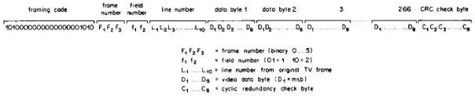

*Fig. 2 - Line structure of video data.*

The outputs from the three stores were taken to multiplexing circuitry which stepped through the six frames cyclically to produce a continuous palindromic picture sequence (..1,2,3,4,5,6,5,4,3,2,1,2,3..). This gave the appearance of a world oscillating about its axis.

The stores were clocked from their own fixed timing reference, and the data was taken to a buffer store in bursts to provide the correct mean data rate. The output from the buffer was read continuously at a lower rate prior to serialising the data for mastering. A schematic of the record processing is shown in Fig. 3. A photograph of the equipment is shown in Fig. 4 which also shows the video signal format used for mastering.

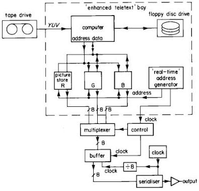

*Fig. 3 - Schematic of record processing.*

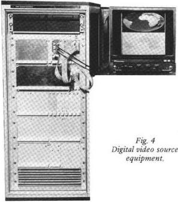

*Fig. 4 - Digital video source equipment.*

### 2.3. Test data source

A 2¹⁵-1 sequence was chosen for the pseudo-random data. This sequence has a wide spectral content and does not exceed the constraint on maximum string length. A commercial pseudo-random bit source (PRBS) was used.

### 2.4. Mastering

The Philips mastering equipment consisted of a turntable carrying a glass disc coated in a thin layer of photo-resist. A blue (short wavelength) laser was used to expose this layer while the disc rotated at 1500 r.p.m. During the mastering, the light level from the laser was monitored and could be adjusted for mean and peak-to-peak level.

Having 'cut' the disc the exposed resist was removed and the surface of the disc was electroplated. At this stage, the disc was replayed on a special player and the quality of the master examined. A metal master was then produced by electroplating the surface to a greater thickness and separating this layer from the glass baseplate. This master was used to press copy discs.

For the digital mastering, the data from our equipment was fed directly into the laser driving amplifier. This signal had carefully controlled amplitude, symmetry and rise and fall times. The selection between video and pseudo-random data was achieved by switching between the two asynchronous sources at arbitrary points in their respective sequences while both generators were left running continuously. Table 1 shows the times and radii of the switching points.

*Table 1 - Sequence of mastered data.*

| radius (mm) | time (min) | content |
| --- | --- | --- |
| 55 | 0 | start-up sequence |
| 56 | 0.5 | Pseudo-random data |
| 69 | 7 | Video data |
| 76 | 10 | Pseudo-random data |
| 96 | 18 | Video data |
| 106 | 22 | Pseudo-random data |
| 135 | 32 | Video data |
| 145 | 35 | |

After the initial electroplating process the master was placed on a test player and the replayed signal displayed on an oscilloscope. Fig. 5 shows a portion of the pseudo-random data at 120 mm. radius. From the replayed waveforms an estimate was made of the attenuation at a frequency equal to half the bit rate i.e. at 17 MHz. This frequency may be regarded as the highest frequency needed for the recovery of binary data (see Section 3.3).

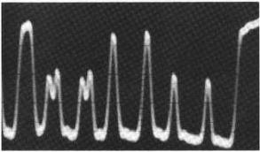

*Fig. 5 - Waveform of the pseudo-random data replayed from the master disc at 120 mm radius.*

This is plotted against radius in Fig. 6 (curve marked Philips test player). The other curve in this figure is discussed in Section 3.2.2.

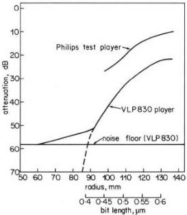

*Fig. 6 - Attenuation at 17 MHz vs radius for a digital LaserVision disc at 1500 r.p.m.*

Later, pressings of the disc were made and five of these were made available for our tests.

Electron photomicrographs (Fig. 7) were taken by Philips of the surface of one disc and these show that the pits are just capable of being resolved at the innermost radius.

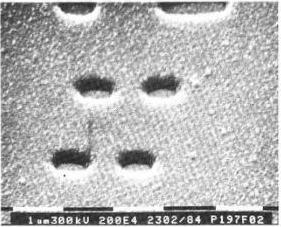

*144 mm*

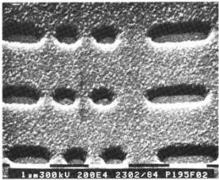

*100 mm*

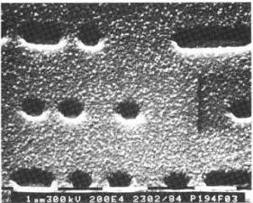

*90 mm*

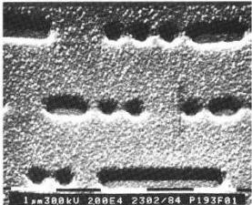

*72 mm*

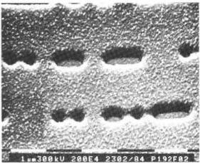

*57 mm*

*Fig. 7 - Electron photomicrographs of the surface of a digital disc at various radii.*

## 3. Replay

### 3.1. General

Our first experiments to replay the digital discs were carried out on an early VLP600 player. With this player there were problems in tracking the data, in particular the video segments. This was due to greater variation in duty cycle (i.e. ratio of the length of pits to the length of spaces between pits) compared with a standard analogue f.m. disc. Experiments with a later VLP830 player, which had improved tracking circuitry, proved more promising and all further tests were carried out on this machine.

The modifications made to the player were of two types. Firstly there were modifications to the housekeeping circuitry so that control data, normally derived from the replayed analogue video signal and decoded internally, could be supplied externally, and secondly there were modifications to the replay signal path to allow for the wider bandwidth of the digital data. Outside the player, hardware was constructed both to recover the video data and reorganise it so that it could be displayed as a picture, and to check the pseudo-random data and analyse any errors.

### 3.2. Characteristics of domestic players

#### 3.2.1. Disc speed control

In normal operation the player uses information derived from the replayed video signal to control various servo-mechanisms. When placed in the 'play' mode, with the player initially stopped, the disc is accelerated up to roughly the correct rotational speed as measured by a tachometer. At this speed the motor control circuitry switches to a phase-lock-loop which compares the frequency and phase of replayed television syncs with an internal quartz reference. The accurate time-base correction required for the replay of a composite PAL signal is effected with a second control loop. This compares a 4 MHz reference with a 4 MHz burst in the bottom of the line sync pulse in the data replayed from the disc. The output of this comparator is used to drive a mirror in the laser light path which can cause a small tangential deflection of the reading spot along the data track. For these experiments the tangential mirror was disconnected.

In the case of the player not locking up under the control of the phase-lock-loop, the speed of the disc is limited to 1600 r.p.m. According to the manufacturers, this is probably the highest safe operating speed for the player, due to the limitations of the drive motor. If an uprated motor were fitted, this speed could be increased to 3000 r.p.m. At speeds above this, the tracking and focusing servos might require modification.

#### 3.2.2. Replay response

The frequency response of the replay channel was measured in two parts; the response of the receiving diodes and their associated pre-amplifier, and the response of the complete replay chain, allowing for the finite spot size of the reading laser and other optical effects. The first of these was carried out by shining light from a modulated infra-red laser directly at the array of receiving diodes. A plot of this response is shown in Fig. 8.

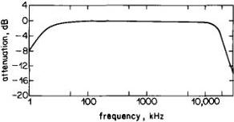

*Fig. 8 - Frequency characteristic of the light sensor and replay pre-amplifier combined.*

The response of the complete channel was found by replaying a portion of the pseudo-random sequence. The spectrum of this signal was displayed on a spectrum analyser. For a channel with a flat frequency response, a spectrum of type shown in Fig. 9a would result. The deviation from this spectrum represents the attenuation of the channel. The spectra at various radii are shown Figs 9b - 9e. Fig. 9f shows the spectrum of 'noise' replayed from a plain silvered disc with no data pits.

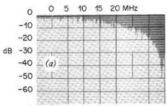

*(a) Spectrum of P.R.B.S. data at 34 Mbit/s direct from Generator*

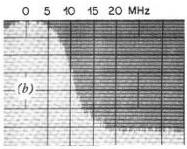

*(b) Spectrum of P.R.B.S. sequence off disc at radius 60 mm*

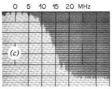

*(c) Spectrum at 90 mm*

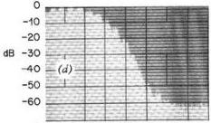

*(d) Spectrum at 110 mm*

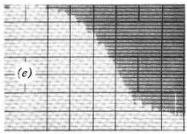

*(e) Spectrum at 130 mm*

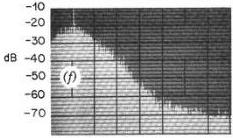

*(f) Spectrum off flat silvered disc - no data recorded (noise).*

*Fig. 9 - Spectra of the replayed data.*

The attenuation was calculated for different radii and is shown plotted in Fig. 6.

### 3.3. Equalisation

The replayed digital data contained frequency components both above and below those found in the f.m. signal replayed from conventional discs. The existing equalisation had been designed to match closely the analogue signal characteristics, and so additional equalisers had to be built to recover these extra frequency components.

When resampling NRZ binary data, to obtain full eye-height, a channel frequency response which is skew-symmetric on a linear scale about half sampling frequency is required (i.e. 6 dB attenuation at half sampling frequency). From the attenuation characteristics of the channel, as found in the previous section, the equalisation required at the half sampling frequency may be estimated. This is plotted in Fig. 10.

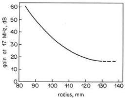

*Fig. 10 - Equalisation required at 17 MHz vs. radius.*

In the optical part of the replay chain, the main cause of high frequency attenuation is aperture loss, resulting from the spot size of the reading laser being comparable with the pit size on the disc. This high frequency loss was conveniently compensated for using a symmetrical transversal equaliser which did not introduce group delay effects.

The video data on the disc contained frequency components extending down to d.c. The pseudo-random sequence, while containing no d.c. had a considerable low frequency component which was not passed by the original circuits.

Fig. 11 is a simplified schematic of the first stage of the existing pre-amplification. The spot image is focused onto the array of four light sensitive diodes. The outputs from these are taken to a differential amplifier to provide focusing information. At higher frequencies, the four capacitors effectively commonise the four outputs to provide a low impedance, low noise source for the data signal. To recover the low frequencies, a side chain was built, comprising a high impedance resistive summing network and an equaliser.

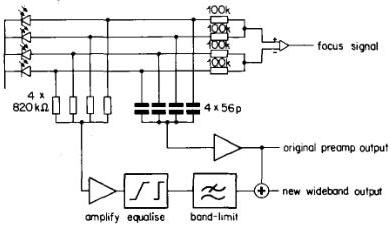

*Fig. 11 - Schematic of replay pre-amplifier with l.f. side chain.*

The high frequency component and the recovered low frequencies were then summed to form a wide-band output. Adjustment of the relative gains of these two paths and of the following transversal equaliser was carried out while replaying a segment of the pseudo-random sequence and displaying the output on a spectrum analyser.

### 3.4. Video data replay

#### 3.4.1. General

A block diagram of the video replay processing is shown in Fig. 12. The equalised signal was taken to a slicing circuit to provide a binary data stream. Clock recovery was implemented using a conventional phase-lock-loop. The binary serial data was then converted into parallel form using the framing word, inserted at the beginning of each line, to determine the correct phase of conversion.

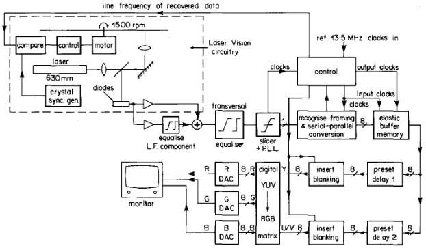

*Fig. 12 - Schematic of replay processing.*

Line numbers, recorded with the signal, were decoded and used to identify the start and finish of the reduced size fields and lines. The continuous data stream from the disc was then compressed in time, using a buffer store, to the correct length for display. This resulted in an intermittent data stream of alternate luminance and chrominance samples with a rate of 13.5 MHz during the reduced length active line.

The data was then divided into two branches, each being taken to a presettable digital delay. Appropriate setting of these delays resulted in co-timed luminance and chrominance samples. The two outputs were taken to a blanking level inserter, used to set the remainder of the full active picture area to black level. The two blanked signals were then taken respectively to the luminance and multiplexed chrominance inputs of a digital YUV-to-analogue RGB decoder. The output was displayed on a television monitor.

#### 3.4.2. Performance

After careful adjustments had been made to the equalisation, the subjective error rate seemed fairly good, perhaps slightly better than the drop-out rate of a domestic VCR. Most events appeared as short streaks of 10 to 100 samples in length, sometimes visible at the same point on the picture for several seconds. The noise-free nature of the computer originated picture tended to increase the visibility of errors. Fig. 13 is a photograph from a monitor showing the replayed picture.

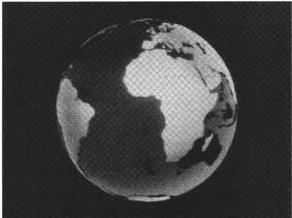

*Fig. 13 - Replayed frame from rotating word sequence.*

Low-frequency components in the data (not present in analogue f.m. signals) caused a certain amount of mistracking. This became evident on the outermost radii of video data as long streaks of errors, which were correlated with picture content.

### 3.5. Pseudo-random data

#### 3.5.1. General

The pseudo-random data contained no d.c. component and so the extreme l.f. and d.c. components were removed by a.c. coupling the signal after the equaliser. Tracking performance for the pseudo-random data portions of the disc was considerably better than for the video data portions of the disc and this difference was traced to the lower l.f. content in the pseudo-random data. In order to measure the probability of occurrence of different error lengths, as well as overall error ratios, an error logging system was built. This comprised programmable hardware, capable of measuring error length, linked to a computer. This system was capable of logging many thousands of error events and providing a statistical analysis in a short time.

#### 3.5.2. Error performance

Detailed measurements on all five discs were made only on the largest radius band of pseudo-random data. While the signal amplitude and noise characteristics of some inner bands was sufficient for recovery of the signal, only simple equalisers, with insufficient gain, were available for these tests. The five discs gave similar results with an overall error ratio of about 3 in 10⁵ which worsened to about 1 in 10⁵ when the discs became dusty. On inner tracks, where equalisation was sub-optimal, error ratios increased dramatically. The error length distribution of about 100,000 error events is plotted in Fig. 14. It can be seen from this graph that the majority of error events (99%) are between 40 bits and 2000 bits in length.

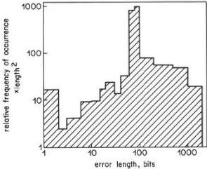

*Fig. 14 - Distribution of error burst lengths.*

### 3.6. Overall performance

From the photomicrographs of the surface of the disc shown in Fig. 7, it can be seen that individual pits are still capable of being physically resolved down to a radius of about 57 mm: the effective spot size of the 'cutting' laser appears to be about 0.6 μm. In these experiments, however, signals were successfully recovered only down to a radius of 115 mm. Errors at this radius were predominantly burst errors caused by disc defects and not single bit events as would be caused by inadequate signal-to-noise ratio. A small reduction in radius from this point caused a rapid increase in short burst errors, a sign of inadequate equalisation. At this radius the packing density was 1880 bits/mm (48,000 bits/inch).

By extrapolation from Fig. 6, the minimum optically resolvable bit-length may be estimated as 0.4 μm. This is equivalent to a cut-off in the spatial frequency response of 1,250 cycles/mm which agrees closely with the theoretical figure found in Section 1.2. From the noise characteristics of the disc and the response of the player, it may be estimated that with improved equalisation, single bit 'noise' errors would begin to be significant at a radius of about 105 mm. At this radius the packing density along the track is about 2100 bits/mm (52,000 bits/inch).

By using a constant bit density along the track, the total storage capacity per side at 52 kbits/inch would be 9 Gbyte. The data rate would then vary between 18 Mbit/s and 51 Mbit/s assuming a rotational speed of the disc of 1600 r.p.m. The playing time available will depend on the data rate required and this is plotted in Fig. 15a.

The rotational speed of the disc could be increased to 3000 r.p.m. if an uprated turntable motor were fitted (Section 3.2.1). This would increase the maximum data rate at the outer edge of the disc to 95 Mbit/s. Fig. 15b shows how the playing time would vary with data rate at this higher rotational speed.

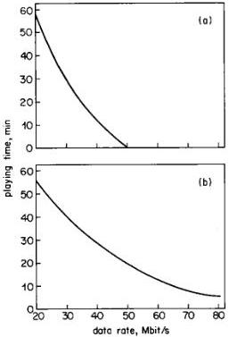

*Fig. 15 - Playing time vs. data rate. (a) Maximum disc speed of 1600 rpm. (b) Maximum disc speed of 3000 rpm.*

When increasing the data rate above 60 Mbit/s the attenuation of the photodiodes and their pre-amplifier becomes significant (Fig. 8). Some modification in this area would be necessary therefore at higher data rates.

### 3.7. Conclusions from tests

Large variations in the duty cycle of the recorded data should be avoided by improved pre-coding of the signal. If this coding also limits the frequency range such that there are few components below 100 kHz, then the need for a separate low-frequency side chain would be removed.

The bit packing density on the disc appears to be limited by the resolution of the reading laser optical system and not by the mastering or pressing process.

The discs may be used to store up to 9 Gbyte of data where data rates of 18 Mbit/s or less are acceptable. Above this rate total storage capacity reduces with a maximum replay rate of 51 Mbit/s.

By upgrading the turntable motor to give a rotational speed of 3000 r.p.m and with improved equalisation and higher performance photodiodes and pre-amplifier it may be possible to achieve data rates as high as 95 Mbit/s from the outermost radii.

## 4. Possible applications

### 4.1. General

Digitally mastered LaserVision disc based systems may be applied, in television, to the replaying of frequently used animated sequences in real time and to the storing of still pictures.

### 4.2. Real time television

Present-day players are capable of producing data rates of up to 50 Mbit/s after minor modification. In this form they could be used as replay devices for short, frequently used video sequences containing redundant features such as in the 'rotating world' logo which contains large plain areas.

To code an entire television picture to the full CCIR standard (Rec. 601) requires approximately 166 Mbit/sec. At its outer radius the LaserVision disc is capable of producing 50 Mbit/s. Some method of reducing the bit rate would therefore be required for the full active picture area to be stored. Conventional techniques proposed for the transmission of television signals such as d.p.c.m. coding could be used, but at present the resulting picture quality at this bit rate is only marginally acceptable for broadcast purposes⁷. However other techniques might be possible in the case of optical disc mastering where relatively short sequences are involved which could be preprocessed in non-real time before mastering. Because, with such a system, information is duplicated on to many discs, a system architecture is implied in which one coder is associated with many decoders. Thus a complicated slow coding process may be used but decoding must be fast and inexpensive.

One possible method of taking advantage of this structure is by using a process known as Vector-Quantisation⁸. The most visually sensitive and likely permutations of pixels are stored in a look-up table. The coding operation involves comparing an input set of pixels with each member of the look-up table to find the best match. At the receiving end, an inverse table exists and the address of the 'best match' is used to reconstruct the original array. The advantage of this approach is that patterns of maximum sensitivity may be selected in non-real time, according to any criteria, and stored. The disadvantage for transmission purposes is the complexity of the coding operation, since for each array value all locations of the look-up table must be searched. For any practical size of array the code table would be very large, involving slow, probably disc-based memory.

In some cases it may not be necessary to store the picture in YUV form. If the output is to be used directly as a source without passing through additional processing, such as CSO (colour separation overlay), it would be better to store the picture as digital PAL. Not only would data rate be saved but the need for a PAL coder would be removed. The coding would be carried out once before mastering and could therefore use a coder of the best quality. It has been shown that a sampling rate of 12 MHz is adequate for a composite PAL signal⁹. With 8 bits per sample this results in a data rate for a full size active picture of 74 Mbit/s. Thus, only a modest additional reduction in bit rate may be required in applications where the composite signal is stored.

### 4.3. Still picture storage

For a library of still pictures where data rate is not of primary importance, the entire area of the disc may be used giving a capacity of 9 Gbyte. The active picture area of one YUV encoded frame requires approximately 0.8 Mbyte, allowing over 10,000 stills to be stored per side of the disc. The storage volume requirement for these would be about 1/500 of that required for 35 mm slides.

In this case, the use of digitally mastered discs rather than recordable discs¹⁰ would have the advantage of economic provision of many copies of the library and, possibly, longer lifetime although the costs may be very much higher and individual stills cannot be added or deleted.

## 5. Further work

### 5.1. Signal coding

#### 5.1.1. Channel coding

The main problem found in replaying the discs could be attributed to the increased low frequency content of the data compared with that in analogue f.m. signals for which the player was designed. Firstly, the in-built pre-amplifier did not recover these components necessitating the addition of a separate l.f. side chain in the data path. Secondly, the increased l.f. component adversely affected the operation of the tracking circuitry causing loss of signal amplitude and in some cases, track-jumping. Any future tests should therefore use a code which ensures a low d.c. content.

The code used for the audio Compact Disc system provides a user packing density comparable to that achieved in these tests and has a low l.f. and d.c. content¹¹.

Inevitably, the use of a channel code reduces the effective user bit rate and the total capacity of the disc. This may be partly offset by taking advantage of the redundancy of the channel code in the error correction process¹².

#### 5.1.2. Error correction

The error performance was comparable with that of magnetic recording media, and was such that some form of correction or concealment would be necessary. Where possible, correction is a more desirable solution since the overall system performance may be made independent of picture content. This is particularly important where bit-rate reduction schemes are used.

When designing an error-correction system, a compromise must be struck between the various performance goals and the overheads they incur. Strictly worst-case design is not possible and a reasonable performance characteristic must be decided upon before a design is undertaken. Subjective tests have shown that a random bit-error ratio of 1 in 10⁷ for an 8-bit digital luminance signal is judged as 4.5 on the CCIR impairment scale for a viewing period of 20 seconds¹³.

From the measurements of error length probability, it can be judged that errors of up to 10,000 bits in length must be corrected. When correcting burst errors it is most efficient to use word orientated codes in which the longest possible word length is used compatible with practical implementation. An example is the Reed Solomon code. Its operation imposes a relationship between the length of correctable error burst and the length of data block which may be treated as an independent unit. To correct an m-bit word, a block length of 2ᵐ⁻¹ is required of which two words are the correction overhead. Multiple words per block may be corrected by scaling the overhead in proportion. Instrumental complexity increased rapidly with increasing block length and a reasonable compromise exists where m = 6 to 8.

The performances of various codes were simulated by computer using the error statistics measured previously. A 59:63(m=6) double error-correcting code gave a predicted output error rate of 1 in 10¹¹ with an overhead of 6.8%. This code would be combined with a 2000 way interleave to give a burst error-correcting performance of 12,000 bits. The principle of interleaving, or interlacing as it is sometimes known, is discussed in Reference 14.

#### 5.1.3. Bit-rate reduction

At present no bit-rate reduction scheme can successfully provide for a high-quality YUV television picture at the data rates available from the disc. However, the unusual requirements of the optical disc system suggest that some novel approaches might be applicable. One possible approach is discussed in Section 4.2.

### 5.2. Possible logo source

One of the possible applications of the mastered optical disc is for the sourcing of channel logos. This application demands a high degree of mechanical reliability. The system would be required to run continuously to allow instant access to the signal. To ensure a system failure less often than once a year, a mean time between failure of 10,000 hours is needed. This level of reliability has not been confirmed by the manufacturers. A possible remedy would be to run a second synchronised player, continuously, as a back-up.

### 5.3. Increased data rate

An important goal in optical recording is the ability to replay real-time YUV video data at 166 Mbit/s. It is unlikely that this could be achieved by increasing the rotational speed without using a smaller and mechanically more robust disc. One solution, based on the present disc and mechanical drive, would be to read several data tracks in parallel. This could be achieved by splitting the light from the laser to form several focused spots on the surface of the disc. The refocused image could be aligned with an array of light-sensitive diodes to produce the parallel signal. The separate light paths for the different tracks would be handled by a common set of optics, similar to the present system for tracking. Here, two beams of light are split from the main data reading beam and focused either side of the signal track. Images of these are focused onto two extra light-sensitive diodes whose outputs are then processed to derive tracking information.

The mastering equipment might, however, require similar modification to allow several tracks to be cut in parallel.

## 6. Conclusions

Digitally mastered optical discs provide a high data capacity storage medium capable of replaying, in real time, bit-rate-reduced video sequences, or of storing large numbers of high-quality still pictures.

It was found that the maximum data packing density which could be successfully replayed from a slightly modified domestic player was about 2000bits/mm. (50 kbit/inch). At the maximum allowable rotational speed of 1600 r.p.m., the corresponding data rate would range from about 50 Mbit/s at the outer-most radius of the disc to 20 Mbit/s at the smallest radius. The resulting data errors could be corrected with an overhead of about 7% and the maximum capacity of the disc would be about 9 Gbyte.

The data-rates at the outer radii are adequate for the real time display of broadcast quality moving picture sequences containing highly redundant features such as the large plain areas in the 'rotating world' logo. In this application, as in others where continuous running is required, the inherent low wear of the optical replay process is an essential requirement. However, the mechanical lifetime of domestic players would need to be improved for them to be used in this way. The presently inadequate degree of mechanical reliability was one of the chief reasons for the BBC's choice of solid-state instrumentation, designed by Designs Department, for the new rotating world BBC 1 interval logo. An improved motor drive system could also provide higher rotational speed up to 3000 r.p.m. and hence a maximum data rate approaching 100 Mbit/s.

The data rate that can be achieved with a slightly modified domestic player is sufficient to achieve the rapid replay of still pictures with an access time of a few seconds to the many thousands of stills that can be stored on one side of a disc.

## 7. Acknowledgement

The author wishes to acknowledge the work carried out by the staff of Philips ELA division which made it feasible to conduct this experiment.

## 8. References

1. VELZEL, C.H.F. 1978. Laser beam reading of video records. Applied Optics, 1 July 1978, p 2029.

2. BOUWHUIS, G., BRAAT, J., HUYSER, A., PASMAN J., VAN ROSMALEN G., SCHOUWHAMER IMMIK K., 1985 Principles of optical disc systems, Adam Hilger Ltd., Bristol and Boston 1985.

3. BOUWHUIS, G. and BRATT, J.M. 1978. Video disk player optics. Applied Optics, 1 July 1978, p 1993.

4. PASMAN, J.H.T., OLIJHOEK H.F., and VERKAIK, B., 1985 Developments in optical disc mastering. SPIE, Vol 529 Optical Mass Data Storage 1985.

5. OLIJHOEK, H.F., PEEK, T.H., and WESDROP, C.A. 1981 Mastering technology for the Philips Optical Disc Systems. Electro 1981.

6. RILEY, J.L. 1983. Enhanced UK Teletext: experimental equipment for high quality picture coding and other enhancements. BBC Research Department Report RD 1983/7.

7. WELLS, N.D. 1984. Digital video: YUV bit rate reduction for broadcasting applications. IBC 1984. IEE Conference Publication No. 240 pp338-340.

8. GERSHO, A. and RAMURMURTHI, B. 1982. Image coding using vector quantisation. Proc. ICASSP, Paris 1982.

9. DEVEREUX, V.G. 1982. Test on eight P.C.M. codecs in tandem handling composite and monochrome video signals. BBC Research Department Report. BBC RD 1982/19.

10. MIYAOKA, S. 1984. High density storage possible with optical disc recording. Journal of Electronic Engineering Vol. 21, No. 213. September 1984 pp 94-101.

11. Philips Technical Review 1982. Vol. 40, No. 6.

12. PARKER, M.A. 1983. A range of combined error correction and recording channel code schemes. BBC Research Department Report BBC RD 1983/16.

13. SLAVIN, K.R. 1985. The subjective effects of random bit errors on YUV component video signals. BBC Research Department Report BBC RD 1985/17.

14. STOTT, J.H., OLIPHANT, A., and OSBORNE, D.W. 1974. DIGITAL VIDEO: error-correcting codes and a practical study of a Wyner-Ash error corrector. BBC Research Department Report BBC RD 1974/40.
