# Broadcast Teletext

Specification

September 1976

Published jointly by the

BRITISH BROADCASTING CORPORATION

INDEPENDENT BROADCASTING AUTHORITY

BRITISH RADIO EQUIPMENT MANUFACTURERS' ASSOCIATION

Published jointly by the  
British Broadcasting Corporation  
Independent Broadcasting Authority  
British Radio Equipment Manufacturers' Association

ISBN 0 563 17261 4

First published September 1976

Reprinted with typographical corrections October 1976

Certain patent applications have been made  
in connection with equipment designed to operate  
to this Specification .

## FOREWORD

This document describes the parameters of the Teletext signals transmitted in the United Kingdom by the BBC and the Independent Television networks. It supersedes earlier specifications. The BBC uses the name Ceefax and the Independent Television Companies the name Oracle for their public information services. The technical specifications of the Oracle and Ceefax signals are identical.

Based on experience gained in the initial years of the transmissions, changes have been made since the first specification published in October 1974. Additional Control Characters have been allocated to provide facilities which can be used to enhance the display of information. These changes have been made in such a way that future transmissions remain compatible with Teletext decoders based on the later specification dated January 13th 1976.

Distortions, noise and spurious signals inevitably degrade the signal to a greater or less extent. An important point to note is that an increase in magnitude of these effects will cause a gradual deterioration in analogue television while a digital signal, such as Teletext, can still be decoded until the disturbances exceed a critical level. Field studies have confirmed that in almost all cases this critical level for Teletext occurs when television reception is already poor.

## SUMMARY

This Specification defines the Teletext system for broadcasting information. The main technical features of the system are:

1) The Teletext system is an information broadcasting system in which Pages of text and graphical symbols are transmitted in coded form on otherwise unused television lines during the field interval.
2) The decoded Pages are intended to be displayed in place of, or added to, the television picture. Newsflashes and Subtitles may be inset in the picture.
3) The system uses binary signalling at 6-9375 Mbits/s during each Data-Line. It is directly applicable to 625/50 television systems with video bandwidths of 5-0 MHz or greater.
4) Each Data-Line carries data synchronising and address information and the codes for a Row of 40 characters.
5) A Page comprises 24 Rows of 40 characters, including a special top Row called the Page-Header.
6) The Page-Header has additional address and control information in place of the first eight characters to identify the Page itself and to control its display. The remaining 32 characters include eight reserved for the display of clock-time.
7) The address and control codes use eight-bit Hamming Codes to convey four message bits, permitting single errors to be corrected at the receiver. The seven-bit character codes have an odd-parity bit added permitting single errors to be detected at the receiver.
8) Using two Data-Lines per field the system allows four full Pages per second to be transmitted.
9) Unoccupied Rows of a Page need not be transmitted.
10) Up to eight Magazines, each having up to 100 Pages, may be transmitted. Any of these Pages may be selected by the user.
11) Up to 3200 versions of each Page may be transmitted and selected by a four-digit Time Code. This is not necessarily related to clock-time.
12) Control Characters are provided to:
i) select one of seven Display Colours
ii) select one of eight Background Colours
iii) display selected characters with Double Height
iv) cause selected characters to Flash
v) Conceal selected characters until Revealed by the user.

## INTRODUCTION

This document defines the Teletext broadcasting system. Much of the detailed information is carried by figures and tables. The description is in four sections.

The first section describes how binary code groups are formed into Data-Lines for inclusion in the television field-blanking interval.

The second section describes how the control and address information carried on each Data-Line, together with the special Page-Header Data-Lines and the sequence of transmission of the Data-Lines, allow the Data-Lines corresponding to the Rows of a selected Page to be identified.

The third section describes how the Character Codes received on the Data-Lines corresponding to the Rows of the selected Page are interpreted to give the Page display.

The fourth section defines Teletext terms.

## 1. TELEVISION DATA-LINES

The television signal includes unused lines in the field-blanking interval (see Figure 1) to allow time for field flyback in receivers before each active field begins. The duration of this interval is usually 25 lines, and some of the later lines are used by broadcasters for test and signalling purposes.

This system can use any of these unused lines as Data-Lines. Initially lines 17(330) and 18(331) are being used but other lines may be used.

A line in the field-blanking interval is identified as a Teletext Data-Line by the presence of the Clock Run-In (see 1.2.1) followed by the Framing Code (see 1.2.2) at an appropriate time.

### 1.1 Data-Line Waveform

Each Data-Line contains binary elements (bits) as a two-level NRZ (Non-Return-to-Zero) signal, suitably shaped by a filter.

#### 1.1.1 Data Levels

The binary signalling levels are defined on a scale where television black level is 0% and white level 100% (see Figure 2). The binary '0' level is then $0(\pm 2)\%$ and the binary '1' level is $66(\pm 6)\%$. The difference between these levels is the basic data amplitude. The data waveform will contain overshoots so the peak-to-peak data amplitude will exceed the basic data amplitude.

The basic data amplitude may vary from Data-Line to Data-Line.

#### 1.1.2 Bit Rate

The binary element signalling rate is 6.9375 Mbit/s ($\pm 25$ parts per million).

It is 444 times the nominal television line frequency.

#### 1.1.3 Data Timing

The data timing reference point is the peak of the penultimate '1' of the Clock Run-In sequence (see Figure 3). This point has been selected to reduce the effect of any transient distortions at the start of the Data-Line.

The line time reference is the half-amplitude point of the leading edge of the line synchronising pulse.

The data timing reference in the signal as transmitted shall be $12.0 (+0.4/-1.0)\mu s$ after the line time reference.

The data timing may vary from Data-Line to Data-Line.

#### 1.1.4 Data Pulse Shape

The spectrum of the generated data pulses, which is the product of the spectrum of the basic NRZ data waveform and that of a phase-corrected shaping filter, is indicated in Figure 4. To minimise intersymbol interference the spectrum is substantially skew-symmetrical about a frequency corresponding to one-half of the bit rate. There is minimal energy above 5.0 MHz.

The corresponding one-bit pulse is indicated in Figure 5.

### 1.2 Data-Line Structure

Each Data-Line comprises 360 bits which may be considered as 45 eight-bit Bytes.

The first three Bytes, which have even parity, serve to synchronise the bit and Byte recovery operation in the receiver. The remaining 42 Bytes have odd parity and carry address and control information, and the codes for a Character Row (see Figure 6).

The use of odd parity during the variable part of the Data-Line ensures that there are never more than 14 bit periods between the data level transitions in the waveform. This simplifies the recovery of the bit-rate clock directly from the data waveform.

All the address and Page control information is transmitted using Hamming Code Bytes to reduce the possibility of the wrong Character Rows being stored in the receiver.

#### 1.2.1 Clock Run-In

The first two Bytes of every Data-Line comprise the Clock Run-In sequence of alternating bits, beginning 101010..., to indicate the presence of a Data-Line and to establish the timing of the bits on that line (see Figure 6).

In some circumstances the first one or two binary '1's may be absent.

#### 1.2.2 Framing Code

The third Byte of every Data-Line comprises the Framing Code 11100100. This code has been selected to enable Byte synchronisation to be established even if one bit of the Framing Code has been wrongly received.

Figure 9 indicates how incoming data are compared with the Framing Code pattern. It shows that a test for any seven corresponding bits will give a correct indication of the Framing Code in the presence of a single error.

#### 1.2.3 Hamming Codes

The fourth and fifth Byte of every Data-Line, and a further eight Bytes of the Page-Header Data-Lines, are Hamming Codes containing four 'message' bits interleaved with four 'protection' bits dependent on the message bits as listed in Table 1a. The bits are transmitted in numerical order from b₁ to b₈.

Table 1b details four parity tests that can be made on the received Byte. Table 1c shows how the results of these tests can be used to correct single errors in the received Byte and detect multiple errors (when 2, 4 or 6 bits are in error). When there are 3, 5, 7 or 8 errors in the Byte this procedure results in a false message being decoded.

Figure 6 shows the locations and lists the functions of all the Hamming 'message' bits. When error correction is used the decoded message bit may differ from the corresponding bit in the Data-Line as the bits of the Hamming Code Byte are interdependent.

#### 1.2.4 Character Bytes

The remaining Bytes of each Data-Line are seven-bit Character Codes (see Table 3) with an added odd-parity bit b₈. The bits are transmitted in numerical order from b₁ to b₈.

## 2. ORGANISATION OF PAGES AND ROWS

### 2.1 Addresses

#### 2.1.1 Magazine and Row Address Group

Every Data-Line contains two Hamming Codes signifying a three-bit Magazine number and a five-bit Row address (see Figure 6).

The Magazine number is in the range 1-8, Magazine 8 corresponding to the bits 000 and the others being directly the number obtained with the bit weights given in Figure 6.

The Row address is normally in the range 0-23 and it is directly the number obtained with the bit weights as given in Figure 6. Row addresses in the range 24-31 may be transmitted but such Data-Lines must be ignored.

#### 2.1.2 Page-Header

Data-Lines with Row address 0 are Page-Headers, which contain eight additional Hamming Code Bytes with message bits relating to that Page, including the two digits of the Page number and the four-digit Time Code (see Figure 6). The display and control functions of the other message bits are detailed in 2.3 below.

#### 2.1.3 Page Identification and Time Code

Each Page is identified by its single digit Magazine number (1-8) and its two-digit Page number (00-99).

Different Pages with the same Magazine and Page numbers may be identified by invoking a four-digit Time Code whereby up to 3200 versions of that Page may be individually selected and held.

The 'Hours' and 'Minutes' of the Time Code are not necessarily related to clock-time. The 'Hours Tens' may take any value 0-3 and the 'Minutes Tens' may take any value 0-7.

#### 2.1.4 Page Selection

A Page may be selected by its Magazine number and Page number, or by its Magazine number, Page number and Time Code.

Neither type of Page selection should respond to Page number 'Units' or 'Tens' in the range 10-15, and selection by Time Code should not respond to 'Minutes Units' or 'Hours Units' in that range, which may be used for other purposes.

### 2.2 Transmission Sequence

#### 2.2.1 Pages

The transmission of a selected Page begins with, and includes, its Page-Header and ends with, and excludes, the next Page-Header of the selected Magazine number. All the intermediate Data-Lines carrying the selected Magazine number relate to the selected Page.

Pages may be transmitted in any order. Occasionally incomplete Pages may be transmitted. Rows from Pages of different Magazine number may be interleaved in time.

#### 2.2.2 Rows

The Rows of a Page may be transmitted in any order. Rows, including the Page-Header, may be repeated in which case the latest apparently error-free information should take precedence. Rows containing no information for display need not be transmitted.

#### 2.2.3 Page Erasure Interval

Rows will be transmitted such as to allow an active television field period between an initial Page-Header and further Rows sufficient to complete the transmission for that Page.

This allows one display period for the receiver Page store to be erased when necessary.

### 2.3 Page-Header Structure

The Page-Header Data-Lines (see 2.1.2) contain eight Hamming Code Bytes in place of the first eight Character Bytes of the other Data-Lines (see Figures 6 and 7).

There are thus only 32 Character Codes in a Page-Header. They are used to present general information for display, such as the Magazine and Page number, the day and date and the programme source. In particular, the last eight characters are reserved for the display of clock-time. Examples of the content of a Page-Header are given in Figure 7a.

The locations of the 32 address and control message bits of the eight Hamming Codes peculiar to a Page-Header are shown in Figure 6. This also shows the binary weights of the eight Page number, and 13 Time Code, bits whose functions are described in 2.1. The remaining 11 bits are Control Bits numbered C4 to C14 whose functions are described below.

#### 2.3.1 Control Bits (see Figure 6)

C4-Erase Page. This Control Bit is set to '1' when the information on that Page is significantly different from that in the previous transmission of the Page bearing the same Magazine and Page number, such that the two should not be confused.

Its use will always be followed by a Page erasure interval (see 2.2.3).

C5-Newsflash Indicator. This Control Bit is set to '1'

on a Page designated as a 'Newsflash' Page, whether or not it currently contains information. All information intended for display on such a Page will be Boxed (see 3.1.5).

C6-Subtitle Indicator. This Control Bit is set to '1' on a Page designated as a 'Subtitle' Page, whether or not it currently contains information. All information intended for display on such a Page will be Boxed (see 3.1.5).

C7-Suppress Header. This Control Bit is set to '1' when the Page is better displayed without the characters of the Page-Header.

C8-Update Indicator. This Control Bit may be set to '1' when part or all of a Page contains later information than that in the previous transmission of the Page bearing the same Magazine and Page number. The 'Update' Page transmission may be incomplete, containing only the updated Rows of a Page (see 2.2.1).

C9-Interrupted Sequence. This Control Bit is set to '1' when a Page is being transmitted out of strict numerical sequence in order to give it priority (such as a Subtitle Page) or more frequent transmission (such as an Index Page).

It allows the Page-Header to be suppressed when Rolling Headers are displayed, to avoid discontinuities in the displayed Page numbers.

C10-Inhibit Display. This Control Bit is set to '1' when the contents of a Page cannot usefully be interpreted as a Teletext transmission. It can be used to inhibit the display of meaningless Pages.

C11-Magazine Serial. This Control Bit is set to '1' when the transmission sequence of Magazines and Pages is such that it is preferable to display all Page-Headers as Rolling Headers rather than only those of the selected Magazine.

C12 Unallocated. It is desirable that these unallocated
C13 Control Bits be accessible in decoders for future use
C14 as display control functions.

## 3. PAGE DISPLAY

The 24 Rows of a Page are numbered sequentially from 0 (Page-Header, top Row) to 23. The 40 Character Rectangles of a Row are directly related to the 40 Character Bytes of the corresponding Data-Line, each being assumed to be scanned sequentially from left to right (see Figure 7).

Every Character Byte contains a Character Code which represents either a Display Character or a Control Character. The Control Characters are used to establish Display Modes, which may be changed between Character Rectangles within a Row.

The Display Modes determine how a Display Character Code is interpreted as a character to be generated in the corresponding Character Rectangle of the Page display. The Character Rectangles corresponding to Control Character Codes are generally displayed as Spaces (but see 3.1.7).

### 3.1 Display Modes

The Display Modes are listed in Table 2 as complementary pairs; those on the left are assumed at the start of every Row. The Control Character Codes listed with each mode are used to initiate that mode.

Some Control Characters have immediate effect ('set at') in that the new mode obtains for and from the corresponding Character Rectangle, others have subsequent effect ('set after') when the new mode obtains for and from the next Character Rectangle. A later Control Character takes precedence over an earlier one.

When a Control Character signifies a change to a mode already obtaining, that mode generally continues uninterrupted throughout the corresponding Character Rectangle (but see 3.1.3).

In general the Character Codes of a Row are sufficient to define the entire display of that Row (but see 3.1.6).

The interpretation of the Display Modes is detailed below.

#### 3.1.1 Character Set

Three overlapping sets of 96 Display Characters are available for the interpretation of the 96 Display Character Codes.

During the Alphanumerics Mode the Alphanumerics Set applies. During the Graphics Mode the Contiguous Graphics Set applies during the Contiguous Mode and the Separated Graphics Set applies during the Separated Mode.

#### 3.1.2 Display Colour

One of the seven colours white, yellow, cyan, green, magenta, red, blue is used to depict the Display Character in the Character Rectangle. Seven pairs of Control Characters are available so that the Display Colour and/or the Alphanumerics/Graphics Mode may be changed by a

single Control Character. There is a direct correspondence between bits b1, b2, b3 of these codes and the red, green and blue components of the colours.

#### 3.1.3 Background Colour

The Background Colour of the Character Rectangles is black during the Black Background mode. Whenever the new background Control Character 1/13 (see Table 3) occurs the Display Colour then obtaining is adopted as the Background Colour in the new background mode.

#### 3.1.4 Conceal and Flash

Two modes are provided wherein all the Display Characters are displayed as Spaces at certain times. All characters in the Conceal mode are intended to be displayed as Spaces until the Reveal mode is restored after a time delay in the receiver or by user control. All characters in the Flash mode are intended to be displayed alternately as they would otherwise be displayed, and as Spaces, under the control of a timing device in the receiver.

#### 3.1.5 Boxing

All characters intended for display on Newsflash and Subtitle Pages will be in the Boxed Mode, which defines the part of the Page which is to be inset into the normal television picture. This inset operation may be controlled automatically by the Control Bits C5 or C6 (see 2.3.1).

Some or all of the characters on any other Pages may be Boxed, the Boxed Mode then defines a part of the Page which may be inset into the normal television picture under user control as an alternative to the display of the complete Page alone, or superimposed on the picture.

In order to give protection against spurious Boxing, two consecutive Start Box Control Characters 0/11 (see Table 3) will be transmitted to start the Boxed Mode and two consecutive End Box Control Characters 0/10 will be transmitted to terminate that mode. The mode changes occur between the corresponding consecutive Character Rectangles.

#### 3.1.6 Double Height

Whenever the Double Height mode occurs the information in that Row is sufficient to define the display of both that Row and the Row of next higher address. A receiver responding to the Double Height mode on a Row must ignore any information received for the Row of next higher address, but a receiver not responding to this mode will operate normally on both Rows.

A receiver responding to one or more occurrences of the Double Height mode in Row 'R' will operate as otherwise during that Row except that in every Character Rectangle during the Double Height mode only the upper half of what would otherwise have been displayed is displayed, stretched vertically to fill the rectangle. On Row 'R+1', the corresponding lower half of each of these is similarly displayed. The remaining Character Rectangles of Row 'R+1' are to be displayed as unboxed Spaces in the same Background Colour as the corresponding Character Rectangles of Row 'R'.

#### 3.1.7 Hold Graphics

Generally all Control Characters are displayed as Spaces, implying at least one Space between rectangles with different Display Colours in the same Row. The Hold Graphics mode allows a limited range of abrupt Display Colour changes by calling for the display of a Held Graphics Character in the rectangle corresponding to any Control Character occurring during the Graphics Mode. This Held Character is displayed in the modes obtaining for the rectangle in which it is displayed, except for the Contiguous/Separated Mode which forms part of the structure of the Held Graphics Character.

The Held Graphics Character is only defined during the Graphics Mode. It is then the most recent character with b₀=1 in its character code, providing that there has been no intervening change in either the Alphanumerics/Graphics or the Normal/Double Height modes. This character is to be displayed in the Contiguous or Separated Mode as when it was first displayed. In the absence of such a character the Held Graphics Character is taken to be a Space.

## 4. DEFINITION OF TELETEXT TERMS

Access Time—The time between selecting a Page at a receiver and the first complete reception of that Page.

Alphanumerics Character—One of the 96 Display Characters listed in columns 2, 3, 4, 5, 6 and 7 of Table 3. The shapes of the characters are not defined but they should all be different and recognisable.

Alphanumerics Mode—The Display Mode in which the Display Characters are those of the Alphanumerics Set.

Alphanumerics Set—The set of 96 Display Characters comprising all the Alphanumerics Characters.

Background Colour—The colour filling the parts of the Character Rectangle not occupied by the character itself (see Figure 8). The Background Colour may be black or one of the seven Display Colours. It may be changed within a Row by Control Characters.

Blast-Through Alphanumerics—The use of the 32 Alphanumerics Characters of columns 4 and 5 of Table 3 during the Graphics Mode.

Boxed Mode—The Display Mode in which, under the user's control, the characters are intended to be inset or added to a television picture. When a Newsflash or Subtitle is transmitted this operation may be automatic under the control of Control Bits.

Broadcast Teletext—The information broadcasting system defined in this document.

Byte—A group of eight consecutive data bits intended to be treated as an entity.

Character Byte—The Byte obtained by appending an odd-parity bit to a Character Code.

Character Code—A seven-bit binary number representing one of a set of Display Characters, or a Control Character.

Character Rectangle—One of the 960 units in the regular matrix of 24 Rows of 40 sites in which characters are generated in the display of a Page.

Character Row—see Row.

Clock Run-In—A sequence of alternating bits at the start of a Data-Line to allow a receiver to achieve bit synchronisation.

Conceal—A Display Mode during which all characters, although stored in the receiver, are intended to be displayed as Spaces until the viewer chooses to Reveal them.

Contiguous Graphics Set—The set of 96 Display Characters comprising the 64 Contiguous Graphics Characters listed in columns 2a, 3a, 6a and 7a of Table 3, together with the 32 Blast-Through Alphanumerics Characters of columns 4 and 5.

Contiguous Mode—The Display Mode in which the six cells of the Graphics Characters fill the Character Rectangle (see Figure 8).

Control Bits—Each Page-Header contains 11 Control Bits to regulate the display of the Page and its header (see 2.3.1).

Control Character—One of the 32 characters listed in columns 0 and 1 of Table 3. Five of these are reserved for compatibility with other data codes. The others are used to alter the Display Modes. They are usually displayed as Spaces (but see 3.1.7).

Data-Line—One of the otherwise unused lines of the television field-blanking interval used to carry information for one Teletext Character Row. A Data-Line is identified by the Clock Run-In sequence followed by a Framing Code at the appropriate time on a line in the field interval.

Display Character—One of 222 different shapes which can be generated in a Character Rectangle as part of a Page. There are Alphanumerics Characters to provide text and Graphics Characters to provide elementary pictorial information. There are three sets, the Alphanumerics Set, the Contiguous Graphics Set and the Separated Graphics Set, each of 96 Display Characters, some of which are common.

Display Colour—One of the seven colours (white, yellow, cyan, green, magenta, red, blue) used to depict a Display Character against the Background Colour in a Character Rectangle (see Figure 8). The Display Colour may be changed within a Row by Control Characters.

Display Mode—The way in which the Character Codes corresponding to Display Characters are interpreted and displayed depends on Display Modes established by previous Control Characters (see Table 2). These modes may be changed within a Row, and an initial set of modes is defined for the start of a Row.

Flash—A Display Mode in which all characters are intended to be displayed alternately as they would otherwise be displayed, and as Spaces, under the control of a timing device in the receiver.

Framing Code—A Byte following the Clock Run-In sequence, selected to allow the receiver to achieve Byte synchronisation even if one of its bits is wrongly decoded.

Graphics Character—One of 127 different Display Characters based on the division of the Character Rectangle into six cells, the cells being Contiguous or Separated. The corresponding character codes have b6=1; there is a direct correspondence between the other six bits of the code and the states of the six cells of the Character Rectangle. Examples are given in Figure 8.

Graphics Mode—The Display Mode in which the Display Characters are those of one or other of the Graphics Sets, depending on whether the Contiguous or Separated Mode obtains.

Graphics Set—see Contiguous Graphics Set and Separated Graphics Set.

Hamming Code—In the Teletext system a Hamming Code is a Byte containing four message bits and four protection

bits as indicated in Table 1. A single bit error in such a Byte can be corrected. Hamming Codes are used for sending address and control information.

Hold Graphics—A Display Mode in which any Control Character occurring during the Graphics Mode results in the display of a Hold Graphics Character (see 3.1.7).

Magazine—A group of up to a hundred Pages, each carrying a common Magazine number in the range 1-8. Up to eight Magazines may be transmitted in sequence or independently on a television programme channel.

Newsflash Page—A Page in which all the information for display is Boxed, and Control Bit C5 is set to allow this information to be automatically inset or added to a television picture.

Page—A group of 24 Rows of 40 characters intended to be displayed as an entity on a television screen.

Page-Header—A Page-Header Data-Line has Row address '0' and it separates the Pages of a Magazine in the sequence of transmitted Data-Lines. In place of the first eight Character Bytes it contains Hamming Coded address and control information relating to that Page. Thus the corresponding top Row of the Page has only 32 Character Bytes. These are used for the transmission of general information such as Magazine and Page number, day and date, programme source and clock-time.

Release Graphics—The Display Mode in which Control Characters are invariably displayed as Spaces. It is complementary to the Hold Graphics Mode.

Reveal—The Display Mode complementary to the Conceal Mode.

Rolling Headers—The use of the top Row of the Page to display all the Page-Headers of the selected Magazine (see 2.3.1—Magazine Serial) as they are transmitted. This gives an indication of the Page transmission sequence while the user is watching, or awaiting, a selected Page.

Row—A Page comprises 24 Rows of characters. When displayed on a television screen each Row occupies about 20 television display lines. Each Row is generated from the information on one television Data-Line. It is to avoid confusion with television 'lines' that Teletext Pages are said to contain 'Rows'.

Row-Adaptive Transmission—Teletext transmission in which Rows containing no information are not transmitted. This reduces the access times of the system. The non-transmitted Rows are displayed as Rows of unboxed black Spaces.

**Separated Graphics Set**—The set of 96 Display Characters comprising the 64 Separated Graphics Characters corresponding to the Contiguous Graphics Characters listed in columns 2a, 3a, 6a and 7a of Table 3, together with the 32 Blast-Through Alphanumerics Characters of columns 4 and 5.

**Separated Mode**—The Display Mode in which there is a Background Colour boundary around and between the six cells of the Graphics Characters within the Character Rectangle (see Figure 8).

**Space**—A Character Rectangle entirely filled by the background colour.

**Subtitle Page**—A Page in which all the information for display is Boxed, and Control Bit C₆ is set to allow this information to be automatically inset or added to a television picture.

**Teletext**—An information transmission system using the data and display formats described in sections 2 and 3 of this document.

**Television Data-Line**—see Data-Line.

**Time-Coded Page**—In addition to a Magazine number and Page number a Page may be assigned a 'Time Code' of one of 3200 numbers arranged as two 'Hours' digits and two 'Minutes' digits. This code may be used to select one of many Pages, bearing the same Magazine and Page number, transmitted in sequence. When the transmission of each version of the Page is isolated or infrequent this code may be made literally the 'Hours' and 'Minutes' of the clock-time at which it is transmitted.

**Time Display**—The last eight characters of every Page-Header are reserved for clock-time. A receiver may be arranged to display these characters from the Rolling Headers to give a clock-time display.

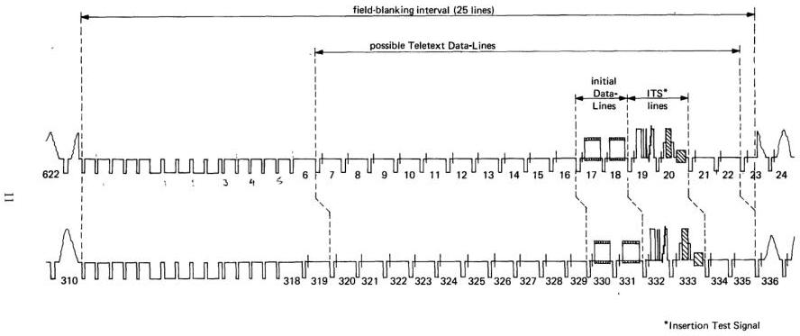

*FIG. 1: TELETEXT DATA-LINES*

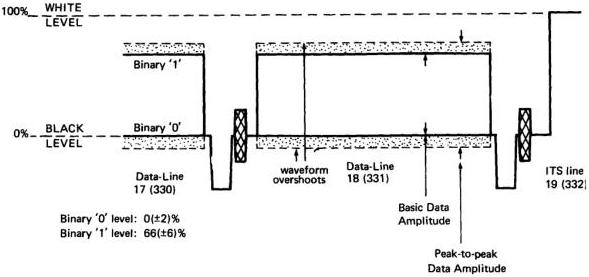

*FIG. 2: DATA LEVELS*

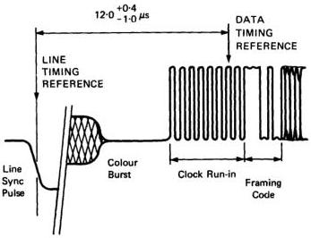

*FIG. 3: DATA TIMING*

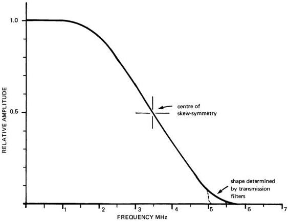

*FIG. 4: AN APPROXIMATE SPECTRUM OF A DATA PULSE\**

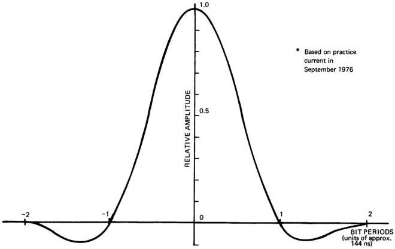

*FIG. 5: AN APPROXIMATE ONE-BIT DATA PULSE\**

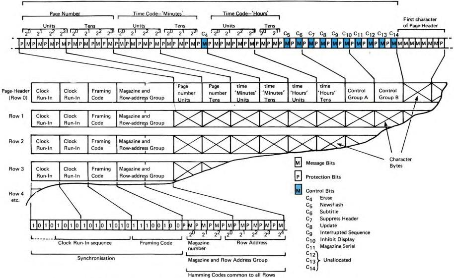

*FIG. 6: SYNCHRONISATION AND HAMMING CODES AT START OF PAGE-HEADER AND ROW TRANSMISSIONS. Eight Hamming Codes peculiar to Page-Header.*

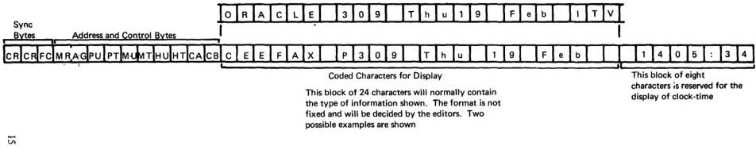

*FIG. 7a: PAGE-HEADER FORMAT*

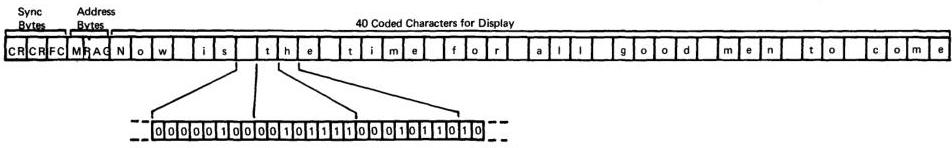

*FIG. 7b: ROW FORMAT*

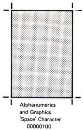

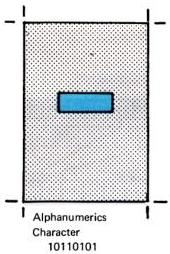

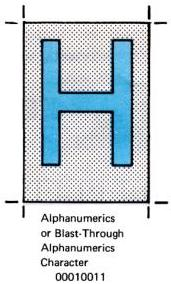

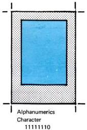

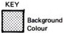

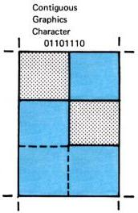

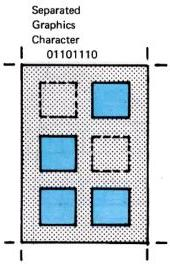

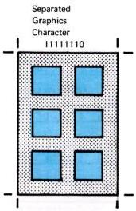

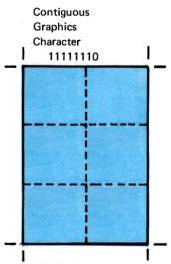

*FIG. 8: EXAMPLES OF ALPHANUMERICS AND GRAPHICS DISPLAYS. Note: Character Bytes are listed as transmitted from b₁ to b₈.*

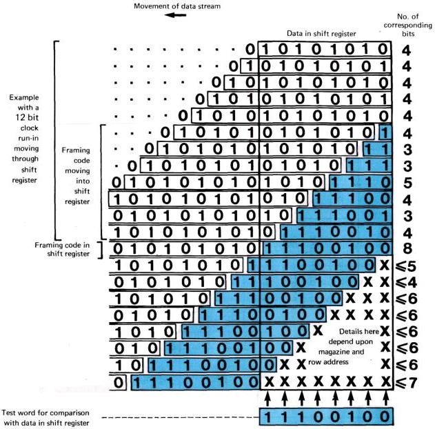

*FIG. 9: IDEALISED OPERATION OF FRAMING CODE. Diagram showing contents of shift register in each clock period. X's represent bits in the control and row address group; for clarity the framing code group is shown thus (shaded).*

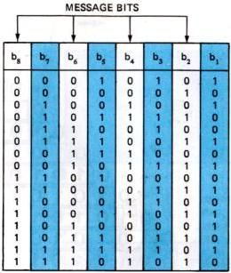

*TABLE 1a: HAMMING CODE BYTES. Protection Bits shown shaded.*

Table 1b
TESTS FOR ODD PARITY

• Tested bits

|   | b_{8} | b_{7} | b_{6} | b_{5} | b_{4} | b_{3} | b_{2} | b_{1}  |
| --- | --- | --- | --- | --- | --- | --- | --- | --- |
|  A | ● | . | ● | . | . | . | ● | ●  |
|  B | ● | . | . | . | ● | ● | ● | .  |
|  C | . | . | ● | ● | ● | . | ● | .  |
|  D | ● | ● | ● | ● | ● | ● | ● | ●  |

Table 1c
DECODING ACTION

|  RESULTS OF PARITY TESTS |   | INFERENCE | ACTION  |
| --- | --- | --- | --- |
|  A, B, C | D  |   |   |
|  All Correct | Correct | no errors | accept message bits  |
|  All Correct | Not Correct | error in b_{7} | accept message bits  |
|  Not all Correct | Correct | multiple errors | reject message bits  |
|  Not all Correct | Not Correct | single error | refer to Table 1b to identify error. Correct error if in message bit.  |

|  DISPLAY MODE |   | SET AT | SET AFTER |   |   |   | COMPLEMENTARY DISPLAY MODE |   | SET AT | SET AFTER |   |   |   | SEE SECTION  |
| --- | --- | --- | --- | --- | --- | --- | --- | --- | --- | --- | --- | --- | --- | --- |
|  ALPHANUMERICS |   | Row Start | 0/4 | 0/1 0/5 | 0/2 0/6 | 0/3 0/7 | GRAPHICS |   | - | 1/4 | 1/1 1/5 | 1/2 1/6 | 1/3 1/7 | 3.1.1.  |
|  CONTIGUOUS |   | Row Start 1/9* | 1/9* |   |   |   | SEPARATED |   | 1/10* | 1/10* |   |   |   | 3.1.1.  |
|  DISPLAY COLOUR | includes RED | Row Start | 0/1 1/1 | 0/3 1/3 | 0/5 1/5 | 0/7 1/7 | DISPLAY COLOUR | excludes RED | - | 0/2 1/2 | 0/4 1/4 | 0/6 1/6 |  | 3.1.2.  |
|   |  includes GREEN | Row Start | 0/2 1/2 | 0/3 1/3 | 0/6 1/6 | 0/7 1/7 |   | excludes GREEN | - | 0/1 1/1 | 0/4 1/4 | 0/5 1/5 |   |   |
|   |  includes BLUE | Row Start | 0/4 1/4 | 0/5 1/5 | 0/6 1/6 | 0/7 1/7 |   | excludes BLUE | - | 0/1 1/1 | 0/2 1/2 | 0/3 1/3 |   |   |
|  BLACK BACKGROUND |   | Row Start 1/12 | - |   |   |   | NEW BACKGROUND |   | 1/13** | - |   |   |   | 3.1.3.  |
|  REVEAL |   | Row Start User Control*** | 0/4 0/4 1/4 | 0/1 0/5 1/1 1/5 | 0/2 0/6 1/2 1/6 | 0/3 0/7 1/3 1/7 | CONCEAL |   | 1/8 | - |   |   |   | 3.1.4.  |
|  STEADY |   | Row Start 0/9 | - |   |   |   | FLASH |   | - | 0/8 |   |   |   | 3.1.4.  |
|  UNBOXED |   | Row Start 0/10*** | 0/10*** |   |   |   | BOXED |   | 0/11*** | 0/11*** |   |   |   | 3.1.5.  |
|  NORMAL HEIGHT |   | Row Start 0/12 | - |   |   |   | DOUBLE HEIGHT |   | - | 0/13 |   |   |   | 3.1.6.  |
|  RELEASE |   | Row Start | 1/15 |   |   |   | HOLD |   | 1/14 | - |   |   |   | 3.1.7.  |

* these codes may take effect 'at' or 'after' their occurrence,

** whenever this code occurs the Display Colour is adopted as the New Background colour,

*** the Reveal mode may be maintained throughout a page by a user control,

*** two consecutive codes are transmitted, the mode changes between them.

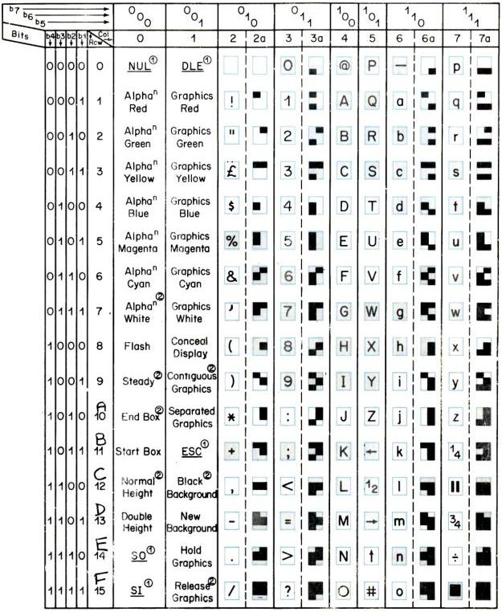

*TABLE 3: TELETEXT CHARACTER CODES. ① These control characters are reserved for compatibility with other data codes. ② These control characters are presumed before each row begins. Codes may be referred to by their column and row e.g. 2/5 refers to %. Character rectangle: black represents display colour, white represents background.*
