# RECOMMENDATION ITU-R BT.653-3

## Teletext systems

(1986-1990-1994-1998)

The ITU Radiocommunication Assembly,

considering

a) that several countries have developed and established satisfactory teletext systems;
b) that it would be highly desirable to assure the compatibility of such systems with the videotex (interactive videography) systems;
c) that a proliferation of such systems would add further complication to the interconnection of such systems,

recommends

1 that for a country wishing to initiate a teletext service, one of the four systems in Annex 1 is to be preferred.

## Annex 1

### Characteristics of teletext systems

### 1 Introduction

This Annex provides information about the teletext systems, developed for use with television systems of Recommendation ITU-R BT.470.

An outline description of the essential elements of the teletext systems is given in Table 1 and the accompanying diagrams (Figs 6, 7, 8 and 9). The structure of the Table is based, as far as practicable, on the ISO reference model¹.

Table 2 lists the countries and systems used.

### 2 Definition of the teletext service

A digital data broadcasting service which may be transmitted either within the structure of an analogue television signal or by using digital modulation systems. The service is primarily intended to display text or pictorial material in two-dimensional form reconstructed from coded data on the screens of suitably equipped television receivers.

* Radiocommunication Study Group 6 made editorial amendments to this Recommendation in 2002 in accordance with Resolution ITU-R 44.

** Radiocommunication Study Group 6 made editorial amendments to this Recommendation in October 2010 in accordance with Resolution ITU-R 1.

*** Also referred to as broadcast videography.

¹ ISO/IEC 7498-1: 1994 "Information technology – Open Systems Interconnection – Basic Reference Model: The Basic Model".

NOTE 1 – At the present time, the field-blanking interval is, in most cases, used for the data broadcasting service, but a possible option exists for extending the data broadcasting service to occupy all active lines in a television signal. The effect on protection ratios for television broadcasting has been studied for 625-line systems and the results published in Recommendation ITU-R BT.655.

### 3 A layered model for describing teletext systems

Teletext systems can be described, as shown in Fig. 1, according to the reference model for data broadcasting detailed in Recommendation ITU-R BT.807.

According to this functional model, services may be delivered by arranging the information into logical groupings, delivering them to lower layers for transmission and, after reception, reconstituting the information into the proper form for use by the recipient.

In what follows, the names of the layers are those adopted by the ISO in ISO 7498 (1984) “Basic reference model for open systems interconnection”. Some of these names are used in broadcasting technology to express different concepts. This particularly applies to the terms “network” and “link” and care must be taken to avoid confusion.

#### Layer 1: Physical

Within a given broadcast transmission system this layer relates to the electrical transmission of the data signal and includes such items as bit rate and pulse shaping.

#### Layer 2: Link

This layer includes logical functions related to the data transmission such as digital frame synchronization techniques, data formatting and error control procedures.

#### Layer 3: Network

This layer includes logical functions related to multiplexing and demultiplexing of data packets belonging to different communication flows. Examples of such functions are data channel addressing and data packet sequencing.

#### Layer 4: Transport

This layer provides the function of arranging the data in a way suitable for transfer from one point to another, by such means as segmenting data into groups of information, delivering them to the lower layers for transmission to the distant point and there reconstituting the groups of information and arranging them in a proper sequence.

#### Layer 5: Session

This layer includes data handling functions which are intended to assist the user to gain access to services. Examples of such functions are access control and page classification.

#### Layer 6: Presentation

This layer comprises data presentation functions. Examples are the codings used for the presentation of text, pictures and sound.

#### Layer 7: Application

This layer refers to practical use of the potential facilities provided by the lower layers for a given type of service.

Examples are captioning, telesoftware and cyclic teletext.

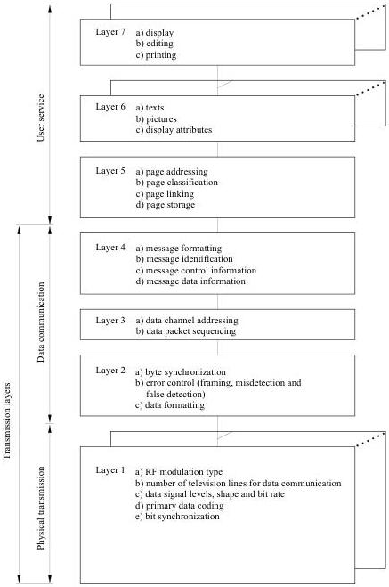

*Figure 1 – A functional layered model for the description of teletext systems.*

0653-01

### 4 Transmission characteristics

The logical structure of different elements of the teletext data and their relationship to the television signal are illustrated in Figs. 2, 3, 4 and 5.

#### 4.1 Data line (see Fig. 2)

A data line is a television line, the active part of which is assigned to digital data. The data content is subdivided into a bit synchronization sequence followed by a data unit.

#### 4.2 Data unit (see Fig. 3)

A data unit is a logical unit of data, subdivided into a byte synchronization sequence and a data packet.

#### 4.3 Data packet (see Fig. 4)

A data packet is an identifiable information package which comprises:

- a prefix providing for functions such as addressing, packet size indication, packet continuity indication and designation of packet type;
- a data block containing control signals or user information;
- in some systems, a suffix to perform the function of error detection or correction at the packet level.

#### 4.4 Data group (see Fig. 5)

A data group is an identifiable group of data blocks containing information from the same source.

### 5 Presentation layer characteristics

In specifying the presentation layer of teletext systems, substantive account has been taken of the work of ITU-T on videotex systems in its Recommendations T.100 (11/1988) and T.101 (11/1994). The work of ISO/IEC JTC 1/SC 2 which is formed from ISO TC 97/SC 2 on character repertoires and coding for all writing systems and languages also has to be taken into account.

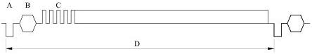

*Figure 2 – Data line. A: line sync; B: colour burst; C: bit sync; D: data line.*

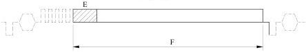

*Figure 3 – Data unit. E: byte sync; F: data unit.*

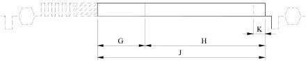

*Figure 4 – Data packet. G: prefix; H: data block; J: data packet; K: suffix where applicable.*

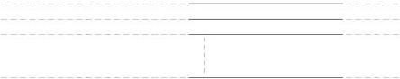

*Figure 5 – Data group.*

0653-02

#### 5.1 Repertoires

##### 5.1.1 Alphabets and character sets

###### a) Latin alphabet

The code tables for characters and pictorial commands for the presentation of Latin alphabet based alphanumeric and pictorial information are identical to the respective Videotex code tables of the annexes of Recommendation ITU-T T.101 (11/1994), with the exception of additional characters as indicated in § 5.1.2. For some coding formats, the controls, commands and instruction sequences are also identical to those of the respective Videotex coding standards. For other formats a precisely equivalent set of controls and description/instruction sequences are defined.

###### b) Cyrillic alphabet

For the Cyrillic alphabet all characters are ISO identified (ISO/IEC 8859-5:1997) with the exception of two symbols.

The system of coding the Cyrillic symbols for the transmission of Ukrainian texts is currently submitted to Study Group 11 for consideration. Method of switching Russian/Ukrainian specific symbols is under study.

###### c) Chinese character sets

Chinese characters are very large in number and complicated in form. According to the National Standard of the People's Republic of China GB 2312 "Code of Chinese Graphic Character Set for Information Interchange Primary Set", the number of the first grade characters is 3755, and that of the second grade characters is 3008. The stipulation on encoding and character forms in GB 1988 "Information processing – 7-bit coded character set for information interchange", GB 2311 "Information processing – ISO 7-bit and 8-bit coded character sets – Code extension techniques" and the GB 5007.1-5007.2 "24 × 24 dot matrix font set and data set of Chinese ideograms for information interchange" will be followed. GB/T 12345 "Code of Chinese ideogram set of information interchange supplementary set" and the HK-subset is specially used in the teletext broadcasting of complex form from Chinese ideograms.

###### d) Japanese character sets

The Japanese language is written with mixed use of three types of Japanese characters, and sometimes with the addition of Latin alphabets. They are Katakana, Hiragana and Kanji. The Katakana and Hiragana character sets have a single-byte structure based on ISO standards and respectively contain 86 and 83 Japanese phonetic characters. The Kanji character set has a two-byte structure also based on the ISO standards and contains 2965 characters of level 1 and 3388 characters of level 2 specified in Japanese Industrial Standard (JIS) X0208:1997 which is revision of former JIS C 6226². Kanji uses ideographic characters which have a close relation with Chinese characters.

2 Additional Kanji of 1 259 characters of level 3 and 2 436 characters of level 4 and 659 characters of non-Kanji are specified in JIS X0213:2004.

##### 5.1.2 Special characters

Certain characters of importance for the captioning functions of teletext services are not included in any of the presentation layer syntaxes defined in Annexes to ITU-T Recommendation T.101. These are:

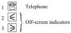

0653-051

#### 5.2 Source coding

##### 5.2.1 Alphanumeric coding

These codes are used to display text. Alphanumeric graphic elements include alphabetic letters, syllabic characters and ideographic characters with or without diacritical signs, figures, punctuation marks and special signs.

##### 5.2.2 Mosaic coding

These codes are used to construct drawings by means of block mosaic, smooth mosaic and line drawing characters. Each element defines part of a pattern and occupies one character position. Two forms of presentation are defined:

- separated: each element is surrounded by a border of the background colour;
- contiguous: elements adjoin one another.

##### 5.2.3 Dynamically re-definable character sets (DRCS)

Character sets in which some, or all, of the characters may be defined at the source and down loaded into the receiver, which can then use them as graphic elements.

##### 5.2.4 Geometric coding

These codes are used to construct drawings of various types by a succession of elements such as points, lines and surfaces.

##### 5.2.5 Photographic coding

These codes are used to cause the generation of individual picture elements for the display of an image. Continuous tone images as well as pattern oriented displays including graphics characters are included.

##### 5.2.6 Musical sound data

These codes are used to cause the generation of musical sounds. Pitch, tone duration, rhythm, timbre and harmonic relationship are defined.

TABLE 1a

Description of the essential elements of teletext systems specified for 625/50 television systems

|  Teletext system | A | B | C | D^{(1)}  |
| --- | --- | --- | --- | --- |
|  Layer 1: Physical |  |  |  |   |
|  1.1 Time slot usable for data | Active part of any TV line subject to availability  |   |   |   |
|  1.2 Data positioning (relative to line sync. timing reference)^{(2)} | 10.5 ± 0.32 μs | Bit 13 is reference plus 12.0 μs (-1.0, +0.4) | 10.48 ± 0.34 μs | 10.5-10.97 μs^{(3)}  |
|  1.3 Data amplitude^{(2)} logical 0 logical 1 | S: sync D: pedestal A: data D/S = 0 (± 3%) A/S = 7/3(+0, -10%) for positive modulation A/S = 14/9(-0, +6%) for negative modulation | Black level ± 2% 66% (± 6%) of black-to-white excursion | 0 IRE units 70 IRE units for negative modulation 100 IRE units for positive modulation | 0 ± 2.5 IRE units 70 ± 2.5 IRE units  |
|  1.4 Bit rate | 6.203125 Mbit/s ± 0.005% | 6.9375 Mbit/s ± 25 × 10^{-6} | 5.734375 Mbit/s^{(4)} (367 × line frequency) | 5.6427875 Mbit/s (14/11 × f_{sc})  |
|  1.5 Data shaping^{(2)} | Sine square | Spectral shaping is skew symmetrical about 0.5 bit rate | Typically a raised cosine 100% roll-off spectrum, followed by a video low pass filter | 100% cosine roll-off  |
|  1.6 Data coding | Binary NRZ | Binary NRZ | Binary NRZ | Binary NRZ  |
|  1.7 Data line including clock run-in | 320 bits | 360 bits | 288 bits (The first 16 bits of alternating 1's and 0's constitute the clock run-in) | 296 bits (bytes^{(5)} 1 to 37. Bytes 1 and 2 comprise clock run-in)  |
|  Layer 2: Link |  |  |  |   |
|  2.1 Digital frame synchronization | Byte 3 = 11100111 | Byte 3 = 11100100 | Byte BS = 11100111 | Byte 3 = 11100101  |
|  2.2 Length of data unit | 38 bytes | 43 bytes | 34 bytes (excluding clock run-in) | 35 bytes  |
|  2.3 Format indicator | Byte 8 (byte 5 in short prefix) | Not required | PS byte |   |

NOTE 1 – For Notes see the end of Table 1b.

TABLE 1a (Continued)

|  Teletext system | A | B | C | D^{(1)}  |
| --- | --- | --- | --- | --- |
|  2.4 Error detection/correction |  |  |  |   |
|  2.4.1 Byte error detection – parity | Odd parity on teletext data bytes | Odd parity for bytes 4 to 45 Even parity for bytes 1 to 3 | Odd parity |   |
|  2.4.2 Byte error detection/correction | 8/4 Hamming code on bytes 4 to 8 (4 and 5 in short prefix) | 8/4 Hamming code for bytes 4 and 5; 8/4 and 24/18 for extension packets numbers 26, 27, 28 and 29 | 8/4 Hamming code on all bytes in the prefix, data group header, record header |   |
|  2.4.3 Block error detection/correction | No | Bytes 44 and 45 of designated data blocks carry a cyclic redundancy check word (CRC)^{(6)} | Suffix bytes indicated by bits b8b6 of the PS byte | (272,190) majority logic decodable difference set cyclic code on bytes 4 to 37 as a block  |
|  Layer 3: Network |  |  |  |   |
|  3.1 Data channel addressing | Bytes 4, 5 and 6 | Bytes 4 and 5 of all packets | Bytes P1, P2, P3 | Byte 4 and the data line position  |
|  3.2 Data packet sequencing | Byte 7 | Bytes 4 and 5 of all packets | Byte C1 | Byte 5 (bits 1 to 4)  |
|  3.3 Length of prefix | 5 bytes (long prefix) or 2 bytes (short prefix) | 2 bytes | 5 bytes | 14 bits (byte 4 and byte 5, bits 1 to 6)  |
|  3.4 Length of data block | Given by value of byte 8 (byte 5 in short prefix) according to a look-up table | 40 bytes | 0, 26, 27 or 28 bytes indicated by bits b8b6 of PS byte | 22 bytes (D-bytes^{(7)} 1 to 22)  |
|  Layer 4: Transport |  |  |  |   |
|  4.1 Group of data blocks | Start = SOH-RS (0/1-1/14) End = ETX-EOT (0/3-0/4) | In page-oriented services: – start by page header packet, bytes 4 to 13 – termination by next page header packet For independent data services: – packets 30 and 31. | Byte GT indentifying 16 types of data group | Byte 5, bit 6 = 1 and D-byte 1 = 00/1 indicate the data block contains a data group header. D-bytes 2 to 7 constitute the data group header.  |

TABLE 1a (Continued)

|  Teletext system | A | B | C | D^{(1)}  |
| --- | --- | --- | --- | --- |
|  4.2 Data group size | 1920 bytes max. | 1024 bytes or multiples of 1024 bytes | Bytes S1, S2, and F1, F2 | D-bytes 4 and 5^{(8)}  |
|  4.3 Data group integrity |  |  |  |   |
|  4.3.1 Continuity | No | Automatic | Byte GC | A data group is a series of data blocks sequentially transmitted in a data channel. (See 3.1 and 3.2)  |
|  4.3.2 Error detection/correction | No | Packet 27, bytes 44 and 45 of designated data blocks carry a cyclic redundancy check word (CRC) | Suffix bytes identified by bits b8b6 of the PS byte | D-bytes 21 and 22 carry a cyclic redundancy check (CRC) if D-byte 20 is 01/7, 00/3 or 00/4  |
|  4.4 Data group sequencing | No | Packets 27, bytes 7 to 42 of designated data blocks | L1, L2 for a given page address | D-byte 3^{(8)}; byte 5, bit 5 = 1 delimits transmission units  |
|  Layer 5: Session |  |  |  |   |
|  5.1 Indicator of type of session |  |  |  |   |
|  5.1.1 Cyclic/non cyclic | Address of data channel (N2 = 96, for example) | Not required | RT = 0/RT = 1 | HI^{(9)} = 01/14 02/0 or 01/14 02/1, H-byte^{(10)} 7, bit 1  |
|  5.1.2 Access control | Y16b2b4b6 | Packet 27 and packet 29 of designated data blocks | Under study |   |
|  5.1.3 Terminal facilities | Y15b6b8 | Display/processable, packet 27, byte 43 of designated data blocks | Basic TTx service recognizes: RT = 0, 1, 2 and 3; RT = 4 to 13 are reserved; RT 14 and 15 are for broadcaster use | HI = 01/14 02/0 or 01/14 02/1, H-byte 8  |
|  5.1.4 Protocol | Y11b2b4b6b8 | Packet 27, byte 43 of designated data blocks |  | HI = 01/14 02/0 or 01/14 02/1, H-byte 7, bits 5-8  |
|  5.1.5 Batch | No | Packet 27, byte 43 of designated data blocks |  | HI = 01/14 02/0 or 01/14 02/1, H-byte 7, bit 2 = 1  |
|  5.1.6 Addressed to user | No | Packet 28, designated data blocks |  |   |

TABLE 1a (Continued)

|  Teletext system |   | A | B | C | D^{(1)}  |
| --- | --- | --- | --- | --- | --- |
|  5.1.7 | Priority | Magazine 0 (N2 = 0) | Not required | RT = 3 |   |
|  5.1.8 | Application | Row 0 (C1 = C2 = C3 = 0) | Packet 27, byte 43 | RT = 2 |   |
|  5.2 | Page classification |  |  | Record designator byte, RD, bit 6 = 1 indicates presence of classification sequence |   |
|  5.2.1 | Normal | C1 C2 C3 E(0...A) except 000 | Not required | RT = 0 or 1 and absence of other page classification indicators | HI = 01/14 02/1 H-byte 7, bit 3 = 0 and bit 4 = 0 and H-byte 9, bit 5 = 0 and bit 6 = 0  |
|  5.2.2 | Subtitle | C1 C2 C3 = 10 Y22b8 = 0 | Control bit in page header packet | Y1_{3} b8 = 1 | HI = 01/14 02/1, H-byte 7, bit 3 = 1 and bit 4 = 1  |
|  5.2.3 | Delayed/inhibited display | Y13b8 = 1 | Control bit in page header packet | Y1_{3} b6 = 1 |   |
|  5.2.4 | Linked | Y25Y26 | Packet 27, byte 43 of designated data blocks | Header extension bytes (HE) | All pages in a batch-type programme are linked (see 5.1.5) HI = 01/14 02/0, H-byte 9, bits 1 to 4 indicate the page linkage structure  |
|  5.2.5 | Index | Y12b4 = 1 | See 5.3 | Y1_{3} b4 = 1 |   |
|  5.2.6 | Alarm | Y12b8 = 1 | See 5.3 | Y1_{5} b8 = 1, Y1_{5} b6 = 1 (RT = 3) |   |
|  5.2.7 | Update | Y13b4b6 Y12b6 | Control bit in page header packet | Y1_{5} b4 = 1, version # (Y1_{6}) updated | HI = 01/14 02/0 or 01/14 02/1, H-byte 10, bit 2  |
|  5.2.8 | Priority | C1 = C2 = C3 = A | See 5.3 | Y1_{5} b8 = 1, Y1_{5} b6 = 0 (RT = 3) (Applies only to television mode) |   |
|  5.2.9 | Programme related | Y22b8 = 0 | Packet 30, bytes 17 to 25 of designated data blocks | See subtitle and priority page classifications | HI = 01/14 02/0 or 01/14 02/1, H-byte 7, bit 3 = 1 and bit 4 = 0  |
|  5.2.10 | Newsflash | Y22b8 = 0 | Control bit in page header packet | Access through data channel B00, page address 0. Y1_{6} updated | HI = 01/14 02/1, H-byte 9, bit 5 = 1 and bit 6 = 0 and H-byte 7, bit 3 = 0 and bit 4 = 0  |

TABLE 1a (Continued)

|  Teletext system | A | B | C | D^{(1)}  |
| --- | --- | --- | --- | --- |
|  5.2.11 Support | No | Packet 27, bytes 7 to 42 of designated data blocks | Support record address FFF, Y15 b2 = 1 Support needed Y14 b2 = 1 | HI = 01/14 02/0  |
|  5.2.12 Scrolling | No | Scrolling region defined by packet 26, bytes 7 to 45 of designated data blocks |  | HI = 01/14 02/1, H-byte 9, bit 6 = 1  |
|  5.2.13 Cover | Y22b4 = 1 | Control bit in page header packet | Data channel 0, page 0 or other page 0 addresses |   |
|  5.2.14 Reveal | Y13b8 = 0 | Control bit in page header packet or user operation | Y15 b8 = 0, Y15 b6 = 1 (RT = 3) |   |
|  5.3 Page access information |  |  |  |   |
|  5.3.1 Network label | Row 0 (C1 = C2 = C3 = 0) or N2 = 0 (0 or 99) | Packet 30, bytes 13 and 14 of designated data blocks | RT = 2 | HI = 01/14 02/2, H-bytes 5 to 7  |
|  5.3.2 Date and time | Row 0 (C1 = C2 = C3 = 0), if any | Packet 30, bytes 15 to 21 of designated data blocks | RT = 2 |   |
|  5.3.3 Page address | C1 C2 C3 | Bytes 6 and 7 of page header packet | A1 A2 A3 and RD b2 = 1 for A4-A9 (extended address) | HI = 01/14 02/0 or 01/14 02/1, or 01/14 02/3, H-byte 4, bits 1 to 4 and H-byte 5 (PR = 000 ~ 999)  |
|  5.3.4 Sub-page address | If Y12b6 = 0, then Y25 Y26 | Bytes 8 to 11 of page header packet | Y14 b8 = 1 (more) and extended address as above | HI = 01/14 02/1, H-byte 6 (PA = 00 ~ 99)  |
|  5.3.5 Logical data delimiter | Not required, see presentation layer | Not required | Not required. Consequence of record header format itself | 01/14 N: HI^{(9)} (N: parameter byte) 01/15 N: DI^{(11)} (N: parameter byte)  |
|  5.3.6 Page reconstruction | L | Not required | Update defined by Y15 b4 = 1 and Y16 (version #) | HI = 01/14 02/3  |
|  5.3.7 Cyclic marker | No | Not required | Y14 b6 = 1 (RT = 3) (Subcycle marker if RT = 0 or 1) |   |

TABLE 1a (Continued)

|  Teletext system | A | B | C | D^{(1)}  |
| --- | --- | --- | --- | --- |
|  5.3.8 Programme identification | N2 = 0, row 0 | Packet 30, bytes 22 to 25 of designated data blocks | RT = 2 | HI = 01/14 02/2, DI = 01/15 03/13  |
|  5.3.9 Initial page address | Cover page, Y12b2 | Packet 30, bytes 7 to 12 of designated data blocks | Data channel 0, page 0 |   |
|  5.3.10 Search indicator | No | Packet 27, byte 6 of designated data blocks | RT = 2 |   |
|  5.3.11 Auto acquisition | If Y12b6 = 0, then Y25 Y26 + C1 C2 C3 | As 5.3.9 and 5.3.12 | Y14 b4 = 1 |   |
|  5.3.12 Page linking | No | Packet 27, bytes 7 to 42 of designated data blocks | Header extension bytes (HE) | HI = 01/14 02/1, DI = 01/15 03/5, P-byte^{(12)} 5 to 9  |
|  5.4 Conditional access |  |  |  |   |
|  5.4.1 Control word synchronization | First US of an article | Packet 28, bytes 7 to 45 of designated data blocks | Under study  |   |
|  5.4.2 Initialization complement | C1 C2 C3 L | Packet 28, bytes 7 to 45 of designated data blocks  |   |   |
|  5.4.3 Entitlement checking messages | C1 C2 C3 = FFF, US 3/F 3/F | Packet 1 to 24 when designated for this function  |   |   |
|  5.4.4 Audience segmentation | Y16b2b4b6 | Packet 28, bytes 7 to 45 of designated data blocks  |   |   |
|  5.4.5 Descrambling generator | Pseudo-random generator | See 5.4.1  |   |   |
|  5.4.6 Descrambling procedure | XOR | See 5.4.1  |   |   |
|  Layer 6: Presentation | ITU-T Recommendation T.101 Annex C, Data Syntax II | ^{(13)}^{(14)} | ITU-T Recommendation T.101^{(15)} Annex D, Data Syntax III |   |
|  Layer 7: Application | Practical use of the potential facilities provided by the lower layers leads to services such as: access to pages of information, music with text, subtitling, telesoftware, etc.  |   |   |   |

TABLE 1b

Description of the essential elements of teletext systems specified for 525/60 television systems

|  Teletext system | A | B | C | D  |
| --- | --- | --- | --- | --- |
|  Layer 1: Physical |  |  |  |   |
|  1.1 Time slot usable for data | Active part of any TV line subject to availability  |   |   |   |
|  1.2 Data positioning (relative to line sync. timing reference)^{(2)} |  | Bit 13 is reference plus 11.7 μs (± 0.175) | 10.48 ± 0.34 μs | 9.78 ± 0.35 μs  |
|  1.3 Data amplitude^{(2)} logical “0” logical “1” |  | Black level ± 2% 70% (± 6%) of black-to-white excursion | 0 IRE units 70 IRE units for negative modulation 100 IRE units for positive modulation | 0 ± 2.5 IRE units 70 ± 2.5 IRE units  |
|  1.4 Bit rate |  | 5.727272 Mbit/s ± 25 × 10^{-6} | 5.727272 Mbit/s^{(3)} (364 × line frequency) | 5.727272 Mbit/s ± 3 × 10^{-6} (364 × f_{H}; 8/5 × f_{sc})  |
|  1.5 Data shaping^{(2)} |  | Spectral shaping is skew symmetrical about 0.5 bit rate | Typically a raised cosine 100% roll-off spectrum, followed by a video low pass filter | Spectrum shaping... Controlled cosine roll-off, roll-off factor 0.6, cut-off frequency 0.5 × bit rate  |
|  1.6 Data coding |  | Binary NRZ | Binary NRZ | Binary NRZ  |
|  1.7 Data line including clock run-in |  | 296 bits | 288 bits (The first 16 bits of alternating 1’s and 0’s constitute the clock run-in) | 296 bits (bytes^{(5)} 1 to 37. Bytes 1 and 2 comprise clock run-in)  |
|  Layer 2: Link |  |  |  |   |
|  2.1 Digital frame synchronization |  | Byte 3 = 11100100 | Byte BS = 11100111 | Byte 3 = 11100101  |
|  2.2 Length of data unit |  | 35 bytes | 34 bytes (excluding clock run-in) | 35 bytes  |
|  2.3 Format indicator |  | Not required | PS byte |   |

TABLE 1b (Continued)

|  Teletext system | A | B | C | D  |
| --- | --- | --- | --- | --- |
|  2.4 Error detection/correction |  |  |  |   |
|  2.4.1 Byte error detection – parity |  | Odd parity for bytes 4 to 37 Even parity for bytes 1 to 3 | Odd parity |   |
|  2.4.2 Byte error detection/correction |  | 8/4 Hamming code for bytes 4 and 5; 8/4 and 24/18 for extension packets numbers 26, 27, 28 and 29 | 8/4 Hamming code on all bytes in the prefix, data group header, record header |   |
|  2.4.3 Block error detection/correction |  | Bytes 7 and 8 of designated data blocks carry a cyclic redundancy check word (CRC)^{(6)} | Suffix bytes indicated by bits b8b6 of the PS byte | (272,190) majority logic decodable difference set cyclic code on bytes 4 to 37 as a block  |
|  Layer 3: Network |  |  |  |   |
|  3.1 Data channel addressing |  | Bytes 4 and 5 of all packets | Bytes P1, P2, P3 | Byte 4 and the data line position  |
|  3.2 Data packet sequencing |  | Bytes 4 and 5 of all packets | Byte CI | Byte 5 (bits 1 to 4)  |
|  3.3 Length of prefix |  | 2 bytes | 5 bytes | 14 bits (byte 4 and byte 5, bits 1 to 6)  |
|  3.4 Length of data block |  | 32 bytes | 0, 26, 27 or 28 bytes indicated by bits b8b6 of PS byte | 22 bytes (D-bytes^{(7)} 1 to 22)  |
|  Layer 4: Transport |  |  |  |   |
|  4.1 Group of data blocks |  | In page-oriented services: – start by page header packet, bytes 4 to 13 – termination by next page header packet For independent data services: – packets 30 and 31. | Byte GT indentifying 16 types of data group | Byte 5, bit 6 = 1 and D-byte 1 = 00/1 indicate the data block contains a data group header. D-bytes 2 to 7 constitute the data group header.  |
|  4.2 Data group size |  | 1024 bytes or multiples of 1024 bytes | Bytes S1, S2, and F1, F2 | D-bytes 4 and 5^{(8)}  |

TABLE 1b (Continued)

|  Teletext system | A | B | C | D  |
| --- | --- | --- | --- | --- |
|  4.3 Data group integrity |  |  |  |   |
|  4.3.1 Continuity |  | Automatic | Byte GC | A data group is a series of data blocks sequentially transmitted in a data channel. (See 3.1 and 3.2)  |
|  4.3.2 Error detection/correction |  | Packet 27, bytes 7 and 8 of designated data blocks carry a cyclic redundancy check word (CRC) | Suffix bytes identified by bits b8b6 of the PS byte | D-bytes 21 and 22 carry a cyclic redundancy check (CRC) if D-byte 20 is 01/7, 00/3 or 00/4  |
|  4.4 Data group sequencing |  | Packet 27, bytes 7 to 36 of designated data blocks | L1, L2 for a given page address | D-byte 3^{(8)}; byte 5, bit 5 = 1 delimits transmission units  |
|  Layer 5: Session |  |  |  |   |
|  5.1 Indicator of type of session |  |  |  |   |
|  5.1.1 Cyclic/non cyclic |  | Not required | RT = 0/RT = 1 | HI^{(9)} = 01/14 02/0 or 01/14 02/1, H-byte^{(10)} 7, bit 1  |
|  5.1.2 Access control |  | Packet 27 and packet 29, bytes 7 to 36 of designated data blocks | Under study |   |
|  5.1.3 Terminal facilities |  | Display/processable, packet 27, byte 37 of designated data blocks | Basic TTx service recognizes: RT = 0, 1, 2 and 3; RT = 4 to 13 are reserved; RT = 14 and 15 are for broadcaster use | HI = 01/14 02/0 or 01/14 02/1, H-byte 8  |
|  5.1.4 Protocol |  | Packet 27, byte 37 of designated data blocks |  | HI = 01/14 02/0 or 01/14 02/1, H-byte 7, bits 5-8  |
|  5.1.5 Batch |  | Packet 27, byte 37 of designated data blocks |  | HI = 01/14 02/0 or 01/14 02/1, H-byte7, bit 2 = 1  |
|  5.1.6 Addressed to user |  | Packet 28, designated data blocks |  |   |
|  5.1.7 Priority |  | Not required | RT = 3 |   |
|  5.1.8 Application |  | Packet 27, byte 37 | RT = 2 |   |

TABLE 1b (Continued)

|  Teletext system |   | A | B | C | D  |
| --- | --- | --- | --- | --- | --- |
|  5.2 | Page classification |  |  | Record designator byte, RD, bit 6 = 1 indicates presence of classification sequence |   |
|  5.2.1 | Normal |  | Not required | RT = 0 or 1 and absence of other page classification indicators | HI = 01/14 02/1 H-byte 7, bit 3 = 0 and bit 4 = 0 and H-byte 9, bit 5 = 0 and bit 6 = 0  |
|  5.2.2 | Subtitle |  | Control bit in page header packet | Y1_{3} b8 = 1 | HI = 01/14 02/1, H-byte 7, bit 3 = 1 and bit 4 = 1  |
|  5.2.3 | Delayed/inhibited display |  | Control bit in page header packet | Y1_{3} b6 = 1 |   |
|  5.2.4 | Linked |  | Packet 27, byte 37 of designated data blocks | Header extension bytes (HE) | All pages in a batch-type programme are linked (see 5.1.5) HI = 01/14 02/0, H-byte 9, bits 1 to 4 indicate the page linkage structure  |
|  5.2.5 | Index |  | See 5.3 | Y1_{3} b4 = 1 |   |
|  5.2.6 | Alarm |  | See 5.3 | Y1_{5} b8 = 1, Y1_{5} b6 = 1 (RT = 3) |   |
|  5.2.7 | Update |  | Control bit in page header packet | Y1_{5} b4 = 1, version # (Y1_{6}) updated | HI = 01/14 02/0 or 01/14 02/1, H-byte 10, bit 2  |
|  5.2.8 | Priority |  | See 5.3 | Y1_{5} b8 = 1, Y1_{5} b6 = 0 (RT = 3) (Applies only to television mode) |   |
|  5.2.9 | Programme related |  | Packet 30, bytes 17 to 25 of designated data blocks | See subtitle and priority page classifications | HI = 01/14 02/0 or 01/14 02/1, H-byte 7, bit 3 = 1 and bit 4 = 0  |
|  5.2.10 | Newsflash |  | Control bit in page header packet | Access through data channel B00, page address 0. Y1_{6} updated | HI = 01/14 02/1, H-byte 9, bit 5 = 1 and bit 6 = 0 and H-byte 7, bit 3 = 0 and bit 4 = 0  |

TABLE 1b (Continued)

|  Teletext system | A | B | C | D  |
| --- | --- | --- | --- | --- |
|  5.2.11 Support |  | Packet 27, bytes 7 to 36 of designated data blocks | Support record address FFF, Y15 b2 = 1 Support needed Y14 b2 = 1 | HI = 01/14 02/0  |
|  5.2.12 Scrolling |  | Scrolling region defined by packet 26, bytes 7 to 36 of designated data blocks |  | HI = 01/14 02/1, H-byte 9, bit 6 = 1  |
|  5.2.13 Cover |  | Control bit in page header packet | Data channel 0, page 0 or other page 0 addresses |   |
|  5.2.14 Reveal |  | Control bit in page header packet or user operation | Y15 b8 = 0, Y15 b6 = 1 (RT = 3) |   |
|  5.3 Page access information |  |  |  |   |
|  5.3.1 Network label |  | Packet 30, bytes 13 and 14 of designated data blocks | RT = 2 | HI = 01/14 02/2, H-bytes 5 to 7  |
|  5.3.2 Date and time |  | Packet 30, bytes 15 to 21 of designated data blocks | RT = 2 |   |
|  5.3.3 Page address |  | Bytes 6 and 7 of page header packet | A1 A2 A3 and RD b2 = 1 for A4-A9 (extended address) | HI = 01/14 02/0 or 01/14 02/1, or 01/14 02/3, H-byte 4, bits 1 to 4 and H-byte 5 (PR = 000 ~ 999)  |
|  5.3.4 Sub-page address |  | Bytes 8 to 11 of page header packet | Y14 b8 = 1 (more) and extended address as above | HI = 01/14 02/1, H-byte 6 (PA = 00 ~ 99)  |
|  5.3.5 Logical data delimiter |  | Not required | Not required. Consequence of record header format itself | 01/14 N: HI^{(9)} (N: parameter byte) 01/15 N: DI^{(11)} (N: parameter byte)  |
|  5.3.6 Page reconstruction |  | Not required | Update defined by Y15 b4 = 1 and Y16 (version #) | HI = 01/14 02/3  |
|  5.3.7 Cyclic marker |  | Not required | Y14 b6 = 1 (RT = 3) (subcycle marker if RT = 0 or 1) |   |

TABLE 1b (Continued)

|  Teletext system | A | B | C | D  |
| --- | --- | --- | --- | --- |
|  5.3.8 Programme identification |  | Packet 30, bytes 22 to 25 of designated data blocks | RT = 2 | HI = 01/14 02/2, DI = 01/15 03/13  |
|  5.3.9 Initial page address |  | Packet 30, bytes 7 to 12 of designated data blocks | Data channel 0, page 0 |   |
|  5.3.10 Search indicator |  | Packet 27, byte 6 of designated data blocks | RT = 2 |   |
|  5.3.11 Auto acquisition |  | As 5.3.9 and 5.3.12 | Y14 b4 = 1 |   |
|  5.3.12 Page linking |  | Packet 27, bytes 7 to 36 of designated data blocks | Header extension bytes (HE) | HI = 01/14 02/1, DI = 01/15 03/5, P-byte^{(12)} 5 to 9  |
|  5.4 Conditional access |  |  |  |   |
|  5.4.1 Control word synchronization |  | Packet 28, bytes 7 to 36 of designated data blocks | Under study | Under study  |
|  5.4.2 Initialization complement |  | Packet 28, bytes 7 to 36 of designated data blocks  |   |   |
|  5.4.3 Entitlement checking messages |  | Packet 1 to 25 when designated for this function  |   |   |
|  5.4.4 Audience segmentation |  | Packet 28, bytes 7 to 36 of designated data blocks  |   |   |
|  5.4.5 Descrambling generator |  | See 5.4.1  |   |   |
|  5.4.6 Descrambling procedure |  | See 5.4.1  |   |   |
|  Layer 6: Presentation |  | ^{(14)} | ITU-T Recommendation T.101^{(13)} Annex D, Data Syntax III | ^{(15)}  |
|  Layer 7: Application | Practical use of the potential facilities provided by the lower layers leads to services such as: access to pages of information, music with text, subtitling, telesoftware, etc.  |   |   |   |

### Notes to Tables 1a and 1b:

(1) Parameters for the PAL television system.
(2) Parameters for data positioning, amplitude and shaping may be altered to suit particular transmission requirements.
(3) Odd field: the leading edge of multiplexed packet with line 8H is the position at \(10.97\mathrm{ms}\) from line sync. In other lines, the packets are multiplexed sequentially from 8H, at 361-bit intervals.
Even field: the leading edge of multiplexed packet with 321H (in pairs with 8H) is a point 113 036 bit/s from 8H. Other packets are multiplexed at the same intervals as in the odd field.
(4) Bit rate parameter may be altered to suit particular transmission requirements.
(5) "Byte" number indicates a byte position in the data line.
(6) Data packet X/25 is used for vertical odd parity for bytes 3-42 of each basic data packet X/1-X/24 in the Chinese character set.
(7) "D-byte" number indicates a byte position in the data block.
(8) Data group header bytes (see 4.1).
(9) Data header identifier (see 5.3.5).
(10) "H-byte" number indicates a byte position in a data header.
(11) Protocol data unit identifier.
(12) "P-byte" number indicates a byte position in the protocol data unit.
(13) Latin alphabets based on ISO 6937 with subsets for French, German, Slavic languages, etc., coding for 12 syllabic writing systems in use in the Indian sub-continent and adjacent areas, are specified as are two byte systems for coding idiographic characters used in many languages throughout the world (Kanji, Katakana, Hiragana, Hangul, etc.).
(14) China has realized an extension of the character set of system B in order to accommodate Chinese characters. This extension is specified in the "Chinese Character System Teletext (CCST) Broadcasting Specification" GB/T 14219-93.
(15) Caters for all Latin and non-Latin graphic sets such as Greek, Cyrillic, Arabic, Chinese Hanzi, etc., registered in accordance with ISO/IEC 2375: 2003.

TABLE 1c

Description of essential elements of teletext systems specified for use with the packet multiplex of the MAC/packet systems

|  Teletext system | A | B | C | D  |
| --- | --- | --- | --- | --- |
|  Layer 1: Physical |  |  |  |   |
|  1. Data | As MAC/packet data component  |   |   |   |
|  Layer 2: Link |  |  |  |   |
|  2.1 Service identification data | MAC/packet address “0”  |   |   |   |
|  2.2 List of services | LISTX parameter ’18 in MAC/packet address “0”  |   |   |   |
|  2.3 LISTX item | TELETEXT coded ’03  |   |   |   |
|  2.4 Digital component information parameter DCINF in MAC/packet “0”, parameter identifier values |  | ’B0 Teletext ’B1 Teletext subtitles ’B2 Replacement teletext ’B3 Programme delivery control |  |   |
|  2.5 Access coordinates: 16 bits associated with DCINF parameter |  | 4 most significant bits indicate level of error protection ’1 First level ’2 Second level |  |   |
|  2.6 Complementary access coordinates |  | Optional 2-byte extension of access coordinates Byte 1, 3 LSBs: magazine number Byte 2: page number |  |   |
|  2.7 Error detection/correction |  | Level 1: 2 teletext packets in each data block plus a CRC check digit Level 2: 12-bit data words have 11-bit Golay Code and parity bit |  |   |
|  Other layers comprise teletext data as in Table 1a or 1b  |   |   |   |   |

TABLE 1d

Description of essential elements of teletext systems specified for use with the digital multiplex of the NICAM 728 sound system

|  Teletext system | A | B | C | D  |
| --- | --- | --- | --- | --- |
|  Layer 1: Physical |  |  |  |   |
|  1. Data | As NICAM 728 system data component when signalled as carrying independent data  |   |   |   |
|  Layer 2: Link |  |  |  |   |
|  2.1 Data frame |  | Includes frame alignment word, control data, component information, 88 bytes teletext data |  |   |
|  2.2 Component information |  | Signals 2 levels of protection as in Table 1c, 2.5 |  |   |
|  2.3 Error protection/correction |  | 2 levels of protection similar to that of Table 1c, 2.7 |  |   |
|  Other layers comprise teletext data as in Table 1a or 1b  |   |   |   |   |

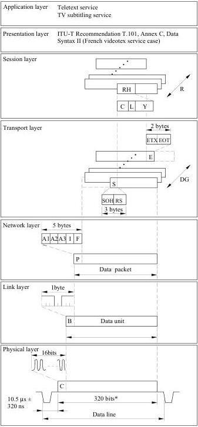

*Figure 6 – Layered structure of teletext system A.*

\* See Note 2 of Tables 1a and 1b

R: record
RH: record header
C: classification field
C1, C2, C3 (3 bytes)
L: link byte
Y: interpretation sequence
(variable length)

DG: data group
S: data group start
E: data group end
SOH = 0/1
RS = 1/14
ETX = 0/3
EOT = 0/4

P: prefix
A1, A2, A3: packet address
I: continuity index
F: format (packet size)

B: byte synchronization byte

C: clock synchronization bits

0653-06

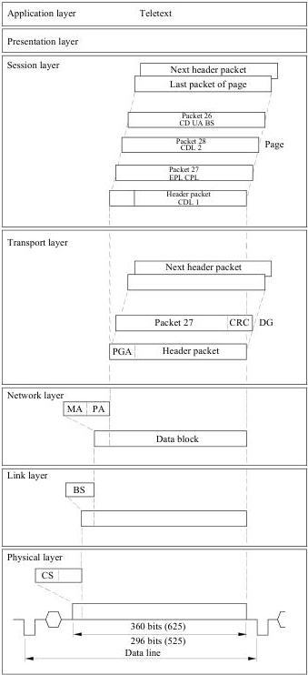

*Figure 7 – Layered structure of teletext system B.*

CDL 1: control data level 1
CDL 2: control data level 2
EPL: editorial page links
CPL: compositional page links
CD UA BS: control data for user addressing and byte structure

Header packet starts data group
Next header packet terminates data group
CRC: cyclic redundancy check word
PGA: page address

DG: data group
MA: magazine address (data channel)
PA: packet address

BS: byte synchronization

CS: clock synchronization

0653-07

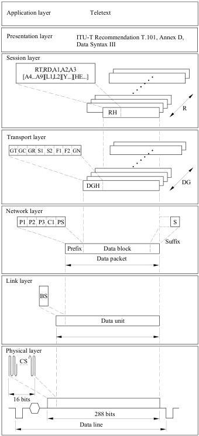

*Figure 8 – Layered structure of teletext system C.*

R: record
RH: record header
RT: record type
RD: record header designator
A1, A2, A3: record address
A4, A5, A6, A7, A8, A9: optional
record address extension
L1, L2: optional record link
Y: optional classification sequence
HE: optional header extension field (5)

DG: data group
DGH: data group header
GT: data group type
GC: data group continuity
GR: data group repetition
S1, S2: data group size
F1, F2: final non-zero block size
GN: data group network routing

P1, P2, P3: packet address bytes
CI: continuity index byte
PS: packet structure byte
S: suffix

BS: byte synchronization byte

CS: clock synchronization bits

0653-08

|  Layer | Principal function | Processing of data  |   |
| --- | --- | --- | --- |
|  Layer 7: Application | Programme services | – Subtitle, cyclic, batch and pseudo-interactive programme, etc.– User's programme selection and response  |   |
|  Layer 6: Presentation | Presentation coding | – Character and DRCS coding– Photographic coding– Geometric coding– Music coding  |   |
|  Layer 5: Session | Identification and control of programme data | 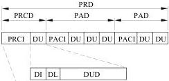 | PRD: programme dataPRCD: programme control dataPAD: page dataPRCI: programme control informationPACI: page control informationDU: protocol data unitDI: data unit identifierDL: data unit lengthDUD: data unit data  |
|  Layer 4: Transport | Data transmission control | 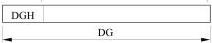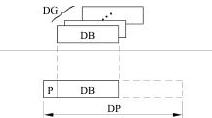 | DG: data groupDGH: data group headerDB: data block  |
|  Layer 3: Network | Multiplexing of data packet | 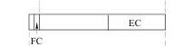 | DP: data packetP: prefix (14 bits)DB: data block(176 bits, 22 bytes)  |
|  Layer 2: Link | Digital frame sync and error control | 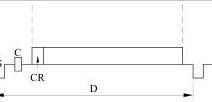 | FC: framing code (8 bits)EC: error correcting check bit(82 bits)  |
|  Layer 1: Physical | Physical transmission |  | D: data line(296 bits; 37 bytes)S: line-sync. signalC: colour burstCR: clock run-in (16 bits)  |

*Figure 9 – Layered structure of teletext system D.*

0653-09

TABLE 2*

Teletext systems used in various countries/geographical areas

|  Country/geographical area | Teletext system specified | Remarks  |
| --- | --- | --- |
|  Germany (Federal Republic of) | B |   |
|  Australia | B |   |
|  Belgium | A and B |   |
|  Bosnia and Herzegovina (Republic of) |  |   |
|  Brazil (Federative Republic of) | C | Modified  |
|  Burkina Faso | None |   |
|  Canada | C |   |
|  China (People's Republic of) | B | Extended character set with Chinese characters  |
|  Cyprus (Republic of) | None |   |
|  Colombia (Republic of) | A |   |
|  Croatia (Republic of) |  |   |
|  Denmark | B |   |
|  Spain | B | Primary character set with national variations to accommodate Basque, Catalan and Galician  |
|  United States of America | C |   |
|  Finland | B |   |
|  France | A |   |
|  India (Republic of) | A |   |
|  Italy | B |   |
|  Japan | D |   |
|  Macedonia (Former Yugoslav Republic of) |  |   |
|  Malaysia | B |   |
|  Malawi | None |   |
|  Maldives (Republic of) | None |   |
|  Mexico | None |   |
|  Norway | B |   |
|  New Zealand | B |   |
|  Oman (Sultanate of) | None |   |
|  Netherlands (Kingdom of the) | B |   |
|  Poland (Republic of) | B | Experimentally  |
|  Syrian Arab Republic | None |   |
|  United Kingdom of Great Britain and Northern Ireland | B |   |
|  Slovenia (Republic of) |  |   |
|  South Africa (Republic of) | B | Primary character set with national variations to also accommodate the Afrikaans language  |
|  Singapore (Republic of) | B |   |
|  Sweden | B |   |
|  Turkey | B | Primary character set with national variations to accommodate the Turkish alphabet  |
|  Ukraine | B |   |
|  Yugoslavia (Federal Republic of) | B | Extended character set  |

* Administrations are invited to provide the appropriate entries for Table 2.
