# ETSI EN 300 706 V1.2.1 (2003-04)

## 1 Scope

The present document defines the application of CCIR Teletext System B to CCIR 625 Line 50 field Television Systems B, D, G, H, I, K and L. The System is optimized for broadcast media using cable, terrestrial and satellite transmission and the associated service and product environment. Reliable reception of data is ensured, since there is a good match between the service area defined for vision and sound reception and that provided for Teletext data broadcasting.

The data is organized in a manner optimum for broadcast media by using the rigid timing framework of the television signal. When multiplexed with a video waveform, this permits a fixed relationship to be provided between the data bytes on a television signal data line and locations in the decoder memory. Using this relationship, error identification and correction are available, matched to the statistical occurrence of bit errors. Critical control data and addressing information are protected by Hamming coding. Basic data is protected by using parity checks.

Teletext data packets are normally grouped together to form "pages" of information, although some have a "stand-alone" function. The range of presentation and application features are arranged to be downward compatible. This permits initial services to be defined and existing services to be upgraded, without rendering obsolete equipment already in the field.

Four presentation Levels are defined:

- **Level 1:**
  - alphamosaic characters;
  - spacing attributes;
  - fixed colour palette;
  - 24 rows of 40 columns;
- **Level 1.5:**
  - extends the character repertoire;
- **Level 2.5:**
  - extends the language repertoire;
  - increases the colour palette with re-definable colours;
  - introduces non-spacing attributes;
  - allows a number of simple re-definable characters;
  - provides side panels for additional text or graphics;
- **Level 3.5:**
  - extends the number of re-definable characters and their complexity;
  - introduces different font styles and proportional spacing.

Levels 2.5 and 3.5 are intended to replace Levels 2 and 3 respectively as defined in earlier specifications. The new Levels offer more display features and can be transmitted more efficiently. Level 1.5 has evolved in the field due to the language requirements in certain countries and is documented here for the first time.

The facility to invoke the presentation of characters of any writing system or language, or a mixture of such systems is included. The present document includes the coding for Arabic, Cyrillic, Greek, Hebrew and Latin alphabets. Where appropriate the character repertoires and coding structures of the ISO are used.

In addition to the basic text and graphics display presentation, a wide range of other applications can be supported. Protocols for user-friendly navigation techniques also exist. These topics are covered in the reference documents and the other documents listed in annex R.

## 2 References

The following documents contain provisions which, through reference in this text, constitute provisions of the present document.

- References are either specific (identified by date of publication and/or edition number or version number) or non-specific.
- For a specific reference, subsequent revisions do not apply.
- For a non-specific reference, the latest version applies.

Referenced documents which are not found to be publicly available in the expected location might be found at http://docbox.etsi.org/Reference.

[1] ETSI EN 300 231: "Television Systems; Specification of the domestic video Programme Delivery Control system (PDC)".

[2] ETSI EN 300 708: "Television Systems; Data transmission within Teletext".

[3] ETSI EN 300 707: "Electronic Programme Guide (EPG); Protocol for a TV Guide using electronic data transmission".

[4] ISO 6937: "Information technology - Coded graphic character set for text communication; Latin alphabet ".

[5] Void.

[6] ETSI TS 101 231: "Television systems; Register of Country and Network Identification (CNI), Video Programming System (VPS) codes and Application codes for Teletext based systems".

[7] ETSI TR 101 233: "Television systems; Code of practice for allocation of services in the Vertical Blanking Interval (VBI)".

[8] IEC/PAS 62297 Edition 1.0 (2002-01): "Proposal for introducing a trigger mechanism into TV transmissions".

## 3 Definitions, symbols and abbreviations

### 3.1 Definitions

For the purposes of the present document, the following terms and definitions apply:

**active position:** position defined by row and column co-ordinates and is a reference to a screen location within the normal page area

NOTE: It is used to position enhancement data when overwriting a basic Level 1 Teletext page.

**bit numbering within bytes:** bits of Teletext data bytes numbered 1 to 8 (LSB to MSB)

**designation code:** data byte used as a packet address extender

NOTE: It is used to differentiate between instances of the packet X/Y/n. The designation code is the byte after the magazine and packet address and is 8/4 Hamming coded.

**magazine number 8:** a packet with a magazine value of 0 is referred to as belonging to magazine 8

**packet:** sequence of data bits transmitted as a single entity on one TV line

NOTE: The packet includes elements to establish synchronization within a decoder plus address and information data bits.

page address: page number plus sub-code - M Pt Pu: S4 S3 S2 S1

page format - CA: method of data broadcasting where the data is transmitted within Teletext pages

NOTE 1: Conditional access and scrambling techniques may be used at the transport layer

NOTE 2: See EN 300 708 [2], clause 5.

page format - Clear: method of data broadcasting where the data is transmitted within Teletext pages but without the possibility of applying conditional access and scrambling techniques at the transport layer

NOTE: See EN 300 708 [2], clause 4.

page number: M Pt Pu, where

M = magazine (range 1 - 8)

Pt = page number tens (range 0 - F)

Pu = page number units (range 0 - F)

prefix: sequence of clock run-in, framing code and packet address bytes at the start of every Teletext packet

sub-code: S4 S3 S2 S1, where

S1 = LSB digit (range 0 - F)

S2 = LSB+1 digit (range 0 - 7)

S3 = LSB+2 digit (range 0 - F)

S4 = MSB digit (range 0 - 3)

time filling headers: page header packets with the page number FF which are inserted into the transmission for the sole reason of maintaining a real-time clock display

transmission bit order: bits of a Teletext data byte transmitted least significant bit first

### 3.2 Symbols

For the purposes of the present document, the following symbols apply:

|  Character code r/c | The character in row r, column c of a given character set.  |
| --- | --- |
|  Cn | Control bit n.  |
|  Dn | Data bit n.  |
|  f_{H} | Nominal TV line frequency.  |
|  Packet M/yy | Magazine related packet, packet number = yy, from any magazine M and with any designation code value.  |
|  Packet M/yy/nn | Magazine related packet, packet number = yy, from any magazine M and with a designation code value of nn.  |
|  Packet X/yy | Page related packet, packet number = yy, forming part of a Teletext page and thus having the same magazine address value, X, as the page header packet of that page. If applicable, the precise designation code value is not relevant.  |
|  Packet X/yy/nn | Page related packet, packet number = yy and designation code value = nn, forming part of a Teletext page and thus having the same magazine address value, X, as the page header packet of that page.  |
|  Pn | Protection bit n.  |
|  Y = nn | Packet number = nn.  |
|  ⊕ | Logical exclusive-OR function.  |
|  ○ | Feature not available.  |
|  ⊗ | Feature available.  |

### 3.3 Abbreviations

For the purposes of the present document, the following abbreviations apply:

|  ACI | Automatic Channel Installation  |
| --- | --- |
|  AIT | Additional Information Table  |
|  BCD | Binary Coded Decimal  |
|  BTT | Basic TOP Table  |
|  CA | Conditional Access  |
|  CCIR | International Radio Consultative Committee  |
|  CLUT | Colour Look-Up Table  |
|  CRC | Cyclic Redundancy Check  |
|  CVBS | Composite Video and Blanking Signal  |
|  DCLUT | Colour Look-Up Table for Dynamically Re-definable Character Sets  |
|  DRCS | Dynamically Re-definable Character Set  |
|  EACEM | European Association of Consumer Electronic Manufacturers  |
|  EBU | European Broadcasting Union  |
|  EPG | Electronic Programme Guide  |
|  FLOF | Full Level One Facilities  |
|  GDRCS | Global Dynamically Re-definable Character Set  |
|  GPOP | Global Public Object Page  |
|  IDL | Independent Data Line  |
|  ISO | International Standards Organization  |
|  LOP | Level One Page  |
|  LSB | Least Significant Bit  |
|  MIP | Magazine Inventory Page  |
|  MJD | Modified Julian Date  |
|  MOT | Magazine Organization Table  |
|  MPT | Multi-Page Table  |
|  MPT-EX | Multi-Page Table EXtension  |
|  MSB | Most Significant Bit  |
|  NI | Network Identification  |
|  PDC | Programme Delivery Control  |
|  POP | Public Object Page  |
|  PTU | Pattern Transfer Unit  |
|  TOP | Table Of Pages  |
|  TV | TeleVision (set)  |
|  UTC | Universal Time Co-ordinated  |
|  VBI | Vertical Blanking Interval  |
|  VCR | Video Cassette Recorder  |
|  VPS | Video Programming System  |
|  VPT | Video Programming by Teletext  |

## 4 TV lines usable as data lines

### 4.1 When multiplexed with a composite video signal

Subject to availability, lines 6 to 22 and 318 to 335 may be used to carry Teletext data packets. Refer to clause F.4 for practical considerations.

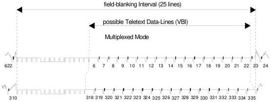

*Figure 1: Usable TV lines, when multiplexed with a CVBS signal*

### 4.2 When not multiplexed with a composite video signal

Subject to availability, all lines may be used to carry Teletext data packets except those occurring during the field synchronization and equalizing pulse periods.

Refer to clause F.6 for practical considerations.

## 5 Signalling characteristics

### 5.1 Signalling method

Binary Non-Return-to-Zero (NRZ).

### 5.2 Data Signal Levels

Data signal Levels in negative modulation systems:

0 Level: Black Level ± 2 %.

1 Level: 66 ± 6 % of the difference between Black Level and Peak White Level.

### 5.3 Bit Rate

444 × nominal fH (6,9375 Mbit/s ± 25 ppm).

### 5.4 Spectrum of data pulses

Skew symmetrical about 0,5 × bit rate, substantially zero by 5 MHz, as shown in figures 2 and 3.

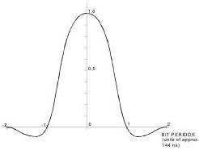

*Figure 2: Approximate one bit data pulse*

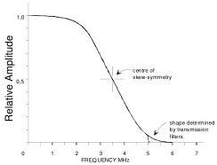

*Figure 3: Approximate spectrum of data pulse*

## 6 Teletext packet identification

A Teletext data packet occupies one TV line. Each packet starts with a clock run-in and framing code sequence for establishing bit and byte synchronization within the decoder. The framing code has a fixed timing relationship to the line synchronization pulses of the video signal.

### 6.1 Clock run-in

The clock run-in is used for bit synchronization within a decoder.

The bit pattern in transmission order is: 1010101010101010. (This sequence has even parity.)

NOTE: The clock run-in does not in itself identify a Teletext data line. Under some conditions, the two leading data "ones" may be absent or reduced in amplitude compared to the subsequent data.

### 6.2 Framing code

The framing code is used for identification of a Teletext data line and for byte synchronization within a decoder. Following the detection of the framing code sequence, a decoder should partition the remaining data bits of the packet into 8-bit bytes.

The bit pattern in transmission order is: 11100100. (This sequence has even parity.)

NOTE: Other framing code sequences may be used when the data packets are not intended for reception by decoders conforming to the present document.

### 6.3 Timing reference

The timing reference is measured from the half amplitude point of the leading edge of the line synchronizing pulse to the mid point of the penultimate '1' of the clock run in, as shown in figure 4.

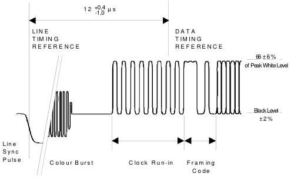

*Figure 4: Clock run-in, framing code and timing reference*

NOTE: Nominally, the data is inserted with the point of reference at 12,0 μs after the half-amplitude point of the leading edge of the line synchronizing pulse. However, it may be necessary to depart from this to allow for the re-timing of the synchronizing pulses on some networks, particularly as a result of sync reprocessing in some transmitters, so as to ensure that the timing of the data as transmitted is always within the allowable tolerance range.

## 7 Organization of Teletext data elements

### 7.1 Elements of a Teletext packet

A Teletext packet comprises 360 bits organized as 45 bytes, numbered 1 to 45. In each byte, the bits are numbered 1 to 8 (LSB to MSB), and are normally transmitted LSB first.

#### 7.1.1 Synchronization sequence

Bytes 1, 2 and 3, the clock run-in and framing codes sequences, enable Teletext packets to be identified and synchronization to be established within the decoder, as described in clauses 6.1 and 6.2.

#### 7.1.2 Packet address

The packet address is defined by bytes 4 and 5, both Hamming 8/4 coded. The packet address comprises magazine and packet number elements:

|  Function | Byte | Data Bits | Weighting | Range  |
| --- | --- | --- | --- | --- |
|  Magazine (X/or M/) | 4 | 2 | 2^{0} | 0 - 7  |
|   |   |  4 | 2^{1}  |   |
|   |   |  6 | 2^{2}  |   |
|   |  | 8 | 2^{0} |   |
|  Packet Number (Y) | 5 | 2 | 2^{1} | 0 - 31  |
|   |   |  4 | 2^{2}  |   |
|   |   |  6 | 2^{3}  |   |
|   |   |  8 | 2^{4}  |   |

NOTE: Odd numbered data bits carry the Hamming 8/4 protection bits.

Packets with Y = 26 to 31 may also use byte 6 to extend the packet address range. Byte 6 is then Hamming 8/4 coded and is referred to as the Designation Code.

#### 7.1.3 Data bytes

Bytes 6 to 45 carry address, control, character or data information depending on the address of the packet. Data bytes are normally coded with odd parity, though there are exceptions in certain data transmissions. Critical address and control data is normally transmitted using Hamming 8/4 coding, though for greater efficiency some control data is coded Hamming 24/18.

#### 7.1.4 Packet types

There are three main types of Teletext packet, distinguished by their packet number Y. As shown in figure 5, the three types are:

- the page header (Y = 0);
- normal packets intended for direct display (Y = 1 to 25;
- non-displayable packets (Y = 26 to 31).

The last type uses a designation code to extend the packet address range.

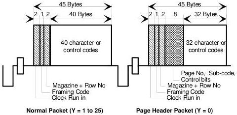

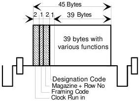

Non-Displayable Packet (Y = 26 to 31)

*Figure 5: Elements of Teletext packets*

### 7.2 Elements of a page

#### 7.2.1 Definition of a page

Packets with Y = 0 are referred to as page header packets. They contain unique information for a page including the page address.

Following the page header packet of a page, all subsequent packets with Y = 1 to Y = 28 inclusive, from the same magazine, relate to that page.

The transmission of a given page begins with, and includes, its page header packet. It is terminated by and excludes the next page header packet having the same magazine address in parallel transmission mode, or any magazine address in serial transmission mode.

#### 7.2.2 Page header packet

Page header packets (Y = 0) comprise three main elements: page address, control bits and data normally intended for display as described in clause 9.3.1.

The Page Address consists of a Page Number (see clause 9.3.1.1) and a Page Sub-code (see clause 9.3.1.2). The Page Address may take any value except: Page Number = FF and Sub-code = 3F7F. The address XFF:3F7F is reserved as a null page address.

#### 7.2.3 The body of a page

As shown in figure 6, the body of a page normally consists of one or more directly displayable packets in the range X/1 to X/24, and optional extension or non-display packets in the range X/25 to X/28. The latter may require additional processing to modify the appearance of the page or characters within it. The function and coding of each packet depends upon its packet number.

Packets containing no information do not need to be transmitted.

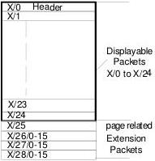

*Figure 6: The body of a page*

### 7.3 Elements of a magazine

A magazine consists of one or more pages, normally repeatedly transmitted in numerical sequence, as shown in figure 7. For editorial reasons, some pages may not be in sequence and are marked as such using the control bit C9 in the page header packet.

If a magazine has only one displayable page (and in some other circumstances), it may be necessary to indicate the completion of the transmission of that page by closing it with another page header packet. Headers with pages addresses in the range XFF:0000 to XFF:3F7E are defined for use for this purpose. These headers may be referred to as "Time Filling Headers", when they are used to keep the real-time clock field updated in a magazine in parallel transmission mode.

The magazine may also contain data in packets with Y = 29. The data relates to all pages with the included magazine address and not to any one specific page. The data contained in such packets may be over-ridden by data contained in each page. Packets with Y = 29 are normally transmitted at least once in each cycle of the magazine, i.e. the period after which, the numerical sequence of pages in a magazine, repeats.

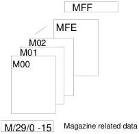

*Figure 7: Elements of a magazine*

### 7.4 Elements of the service

The service may contain Teletext pages in one or more magazines, and/or service related data in packets with X = 0 (8) and Y = 30, and/or other data in packets with Y = 30 or Y = 31, as shown in figure 8. Any packets with Y = 30 or Y = 31 are not page- or magazine-related.

The magazines may be transmitted in numerical sequence (serial magazines), or interleaved (parallel magazines) by using different VBI lines for particular magazines. In such cases, no particular relationship of VBI line to magazine number may be assumed.

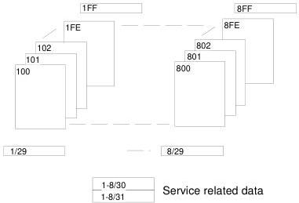

*Figure 8: Elements of the service*

## 8 Byte coding and error protection

The 8-bit bytes of data packets may be coded using one of four methods:

- 7 data bits plus one bit odd parity (see clause 8.1).
- 4 data bits plus 4 bits Hamming protection (see clause 8.2).
- 18 data bits plus 6 bits Hamming protection over 3 consecutive bytes (see clause 8.3).
- 8-bit data.

Unless otherwise stated, bytes are transmitted least significant bit first.

### 8.1 Odd parity

In a single 8-bit byte, bit 8 is the parity bit (P) and bits 1 to 7 carry the data bits (D). Bit 8 is set so that there is an odd number of bits with the value '1' in the byte. Single bit errors can be detected.

|  Bit | 1 | 2 | 3 | 4 | 5 | 6 | 7 | 8  |
| --- | --- | --- | --- | --- | --- | --- | --- | --- |
|   | D1 | D2 | D3 | D4 | D5 | D6 | D7 | P  |

NOTE: Bits shown in transmission order

For encoding: P = 1 ⊕ D1 ⊕ D2 ⊕ D3 ⊕ D4 ⊕ D5 ⊕ D6 ⊕ D7.

For decoding: if D1 ⊕ D2 ⊕ D3 ⊕ D4 ⊕ D5 ⊕ D6 ⊕ D7 ⊕ P = 1, accept data bits.

### 8.2 Hamming 8/4

In a single 8-bit byte, bits 1, 3, 5 and 7 are the protection bits and bits 2, 4, 6 and 8 carry the data. Single bit errors can be identified and corrected. Double bit errors can be detected.

|  Bit | 1 | 2 | 3 | 4 | 5 | 6 | 7 | 8  |
| --- | --- | --- | --- | --- | --- | --- | --- | --- |
|   | P1 | D1 | P2 | D2 | P3 | D3 | P4 | D4  |

NOTE: Bits shown in transmission order

For encoding: P1 = 1 ⊕ D1 ⊕ D3 ⊕ D4.

P2 = 1 ⊕ D1 ⊕ D2 ⊕ D4.

P3 = 1 ⊕ D1 ⊕ D2 ⊕ D3.

P4 = 1 ⊕ P1 ⊕ D1 ⊕ P2 ⊕ D2 ⊕ P3 ⊕ D3 ⊕ D4.

For decoding: Four odd parity tests (A - D) on bits marked •

|  Parity Tests | P1 | D1 | P2 | D2 | P3 | D3 | P4 | D4  |
| --- | --- | --- | --- | --- | --- | --- | --- | --- |
|  A | • | • |  |  |  | • |  | •  |
|  B |  | • | • | • |  |  |  | •  |
|  C |  | • |  | • | • | • |  |   |
|  D | • | • | • | • | • | • | • | •  |

|  Results of Odd Parity Tests |   | Inference | Action  |
| --- | --- | --- | --- |
|  A, B, C | D |  |   |
|  All correct | Correct | No errors | Accept data bits  |
|  All correct | Not correct | Error in P4 | Accept data bits  |
|  Not all correct | Correct | Double error | Reject data bits  |
|  Not all correct | Not correct | Single error | Refer to previous table to identify bit in error. Correct error if in data bit.  |

### 8.3 Hamming 24/18

Over three consecutive 8-bit bytes, bits 1, 2, 4, 8, 16, 24 are the protection bits and the remaining bits carry the data. Single bit errors can be identified and corrected. Double bit errors can be detected. A group of three consecutive bytes coded in this manner is referred to as a triplet.

|  Byte N |   |   |   |   |   |   |   | Byte N + 1 |   |   |   |   |   |   |   | Byte N + 2  |   |   |   |   |   |   |   |
| --- | --- | --- | --- | --- | --- | --- | --- | --- | --- | --- | --- | --- | --- | --- | --- | --- | --- | --- | --- | --- | --- | --- | --- |
|  1 | 2 | 3 | 4 | 5 | 6 | 7 | 8 | 9 | 10 | 11 | 12 | 13 | 14 | 15 | 16 | 17 | 18 | 19 | 20 | 21 | 22 | 23 | 24  |
|  P1 | P2 | D1 | P3 | D2 | D3 | D4 | P4 | D5 | D6 | D7 | D8 | D9 | D10 | D11 | P5 | D12 | D13 | D14 | D15 | D16 | D17 | D18 | P6  |

NOTE 1: Bits shown in transmission order.

For encoding: P1 = 1 ⊕ D1 ⊕ D2 ⊕ D4 ⊕ D5 ⊕ D7 ⊕ D9 ⊕ D11 ⊕ D12 ⊕ D14 ⊕ D16 ⊕ D18.

P2 = 1 ⊕ D1 ⊕ D3 ⊕ D4 ⊕ D6 ⊕ D7 ⊕ D10 ⊕ D11 ⊕ D13 ⊕ D14 ⊕ D17 ⊕ D18.

P3 = 1 ⊕ D2 ⊕ D3 ⊕ D4 ⊕ D8 ⊕ D9 ⊕ D10 ⊕ D11 ⊕ D15 ⊕ D16 ⊕ D17 ⊕ D18.

P4 = 1 ⊕ D5 ⊕ D6 ⊕ D7 ⊕ D8 ⊕ D9 ⊕ D10 ⊕ D11.

P5 = 1 ⊕ D12 ⊕ D13 ⊕ D14 ⊕ D15 ⊕ D16 ⊕ D17 ⊕ D18.

P6 = 1 ⊕ P1 ⊕ P2 ⊕ D1 ⊕ P3 ⊕ D2 ⊕ D3 ⊕ D4 ⊕ P4 ⊕ D5 ⊕ D6 ⊕ D7 ⊕ D8 ⊕ D9 ⊕ D10 ⊕ D11 ⊕ P5 ⊕ D12 ⊕ D13 ⊕ D14 ⊕ D15 ⊕ D16 ⊕ D17 ⊕ D18.

For decoding: Six odd parity tests (A - F) on bits marked •.

|   | Byte N |  |  |  |  |  |  |  | Byte N + 1 |  |  |  |  |  |  |  | Byte N + 2 |  |  |  |  |  |  |   |
| --- | --- | --- | --- | --- | --- | --- | --- | --- | --- | --- | --- | --- | --- | --- | --- | --- | --- | --- | --- | --- | --- | --- | --- | --- |
|   | 1 | 2 | 3 | 4 | 5 | 6 | 7 | 8 | 9 | 10 | 11 | 12 | 13 | 14 | 15 | 16 | 17 | 18 | 19 | 20 | 21 | 22 | 23 | 24  |
|   | P1 | P2 | D1 | P3 | D2 | D3 | D4 | P4 | D5 | D6 | D7 | D8 | D9 | D10 | D11 | P5 | D12 | D13 | D14 | D15 | D16 | D17 | D18 | P6  |
|  A | • |  | • |  | • |  | • |  | • |  | • |  | • |  | • |  | • |  | • |  | • |  | • |   |
|  B |  | • | • |  |  | • | • |  |  | • | • |  |  | • | • |  |  | • | • |  |  | • | • |   |
|  C |  |  |  | • | • | • | • |  |  |  |  | • | • | • | • |  |  |  |  | • | • | • | • |   |
|  D |  |  |  |  |  |  |  | • | • | • | • | • | • | • | • |  |  |  |  |  |  |  |  |   |
|  E |  |  |  |  |  |  |  |  |  |  |  |  |  |  |  | • | • | • | • | • | • | • | • |   |
|  F | • | • | • | • | • | • | • | • | • | • | • | • | • | • | • | • | • | • | • | • | • | • | • | •  |

|  Results of Odd Parity Tests |   | Inference | Action  |
| --- | --- | --- | --- |
|  A, B, C, D, E | F |  |   |
|  All correct | Correct | No errors | Accept data bits  |
|  All correct | Not correct | Error in P6 | Accept data bits  |
|  Not all correct | Correct | Double error | Reject data bits  |
|  Not all correct | Not correct | Single error | Complement bit in error, see note  |

NOTE 2: The position of the bit in error is calculated from:

$$2^4 \times \text{Test E result} + 2^3 \times \text{Test D result} + 2^2 \times \text{Test C result} + 2^1 \times \text{Test B result} + 2^0 \times \text{Test A result}$$

where A Test result = "1" if the odd parity test is failed.

## 9 Coding of data packets

### 9.1 Overview of packet types

Table 1 summarizes the function of each type of data packet and the presentation Levels at which it is used.

Table 1: Summary of packet types, their function and application

|  Packet | Function and application | Presentation Level 1 1.5 2.5 3.5  |
| --- | --- | --- |
|  X/0 (Page header) | Acts as both a page identifier and a page terminating packet. Decoders should respond to packets X/0 for ALL possible page numbers and sub-codes, including those with hexadecimal elements in their address. Any packet X/0 may be used for both time filling and page terminating applications. NOTE: It is not intended that the viewer should be provided with the means to select directly pages with hexadecimal elements in their address. | ⊕ ⊕ ⊕ ⊕  |
|  X/1 to X/23 (see note 1) | These packets carry the display data of basic Teletext pages, coded 7 data bits plus 1 odd parity bit. Other forms of coding may be used when the page does not carry data intended for direct display. | ⊕ ⊕ ⊕ ⊕  |
|   | Used for navigational purposes in the TOP Code of Practice, (see clause 11.2). | ⊕ ⊕ ⊕ ⊕  |
|   | Used for pages carrying enhancement data not intended for direct display, e.g. objects definitions and DRCS data. | ○ ○ ⊕ ⊕  |
|  X/24 (see note 1) | Used for navigational purposes in the FLOF Code of Practice, (see clause 11.1). | ⊕ ⊕ ⊕ ⊕  |
|   | Used for pages carrying enhancement data not intended for direct display, e.g. objects definitions and DRCS data. | ○ ○ ⊕ ⊕  |
|  X/25 (see note 1) | As part of a basic Teletext display page, the packet carries a number of displayable labels relating to the data in the page for key-word search applications. | ⊕ ⊕ ⊕ ⊕  |
|   | Used for pages carrying enhancement data not intended for direct display, e.g. objects definitions. | ○ ○ ⊕ ⊕  |
|  X/26/0 - 14 (see note 1) | Used to carry codes for programming ancillary equipment such as video recorders, EN 300 231 [1]. | ⊕ ⊕ ⊕ ⊕  |
|   | Used to address character locations within a page and define new characters to be written to these locations. This has the action of overwriting the character defined for this location on the Level 1 page. A Level 1.5 decoder may respond to some or all of the column address group triplets (see clause 12.3.4) which access the G0, G2 and G3 character sets. | ○ ⊕ ○ ○  |
|  X/26/0 - 15 (see note 1) | Used to address character locations within a page including any side-panels. They can select and place alphanumeric and mosaics characters from the G0, G1, G2 and G3 sets, redefinable characters, non-spacing attributes and objects. | ○ ○ ⊕ ⊕  |
|   | Used for object definition pages. | ○ ○ ⊕ ⊕  |
|  X/27/0 | Used for editorial page linking. An example of their use is the FLOF Code of Practice, (see clause 11.1). | ⊕ ⊕ ⊕ ⊕  |
|  X/27/1 - 3 | Provide additional links to editorial pages. | (see note 2)  |
|  X/27/4 Format 1 | Used for compositional page linking to objection definition and DRCS pages. | ○ ○ ⊕ ⊕  |
|  X/27/5 Format 1 | Used for compositional page linking to objection definition and DRCS pages. | ○ ○ ○ ⊕  |
|  X/27/6 - 7 Format 1 | Provide additional compositional links. | (see note 2)  |
|  X/27/4 - 7 Format 2 | Used for compositional page linking in data broadcasting applications | ○ ○ ○ ○  |
|  X/27/8 - 15 | Use not currently defined. |   |
|  X/28/0 Format 1 | Page specific data: Page function Page coding | ⊕ ⊕ ⊕ ⊕ (see note 3)  |
|  X/28/0 Format 1 | Page specific data (presentation related): Character set designation Size and position of side-panels Colour Map (CLUTs 2 and 3) Default screen colour Default row colour Black background substitution by row colour Colour table re-mapping of the foreground and background colours of the Level 1 page. | ○ ○ ⊕ ⊕  |
|  X/28/0 Format 2 | Page specific data for Page Format - CA type data broadcasting pages defined according to EN 300 708 [2] clause 5. | ○ ○ ○ ○  |

|  Packet | Function and application | Presentation Level 1 1.5 2.5 3.5  |
| --- | --- | --- |
|  X/28/1 | Page specific data (presentation related): Character set designation (according to earlier specifications, note 4) | ○ ⊕ ○ ○  |
|  X/28/1 | Page specific data (presentation related): DCLUT4 for global 12x10x2 DRCS mode characters DCLUT4 for normal 12x10x2 DRCS mode characters DCLUT16 for global 12x10x4 and 6x5x4 DRCS modes characters DCLUT16 for normal 12x10x4 and 6x5x4 DRCS modes characters. | ○ ○ ○ ⊕  |
|  X/28/2 | Contains a Page Key for the descrambling of the encrypted data contained in packets X/1 - X/25 of the associated data broadcasting page. See EN 300 708 [2]. | ○ ○ ○ ○  |
|  X/28/3 | Page specific data (related to DRCS downloading pages): Page function Page coding DRCS downloading mode invocation. | ○ ○ ⊕ ⊕  |
|  X/28/4 | Page specific data (presentation related): Page function Page coding Character set designation Size and position of side-panels Colour Map (CLUTs 0 and 1) Default screen colour Default row colour Black background substitution by row colour Colour table re-mapping of the foreground and background colours of the Level 1 page. | ○ ○ ○ ⊕  |
|  X/28/5 - 15 | Use not currently defined. |   |
|  M/29/0 | Same functions (apart from page function and coding) as defined for packets X/28/0 Format 1 except that the information applies to all pages in magazine M unless overridden for a particular page by a packet X/28/0 Format 1. | ○ ○ ⊕ ⊕  |
|  M/29/1 | Character set designation (according to earlier specifications). Applies to all pages in magazine M unless overridden for a particular page by a packet X/28/1. | ○ ⊕ ○ ○ (see note 4)  |
|  M/29/2 - 3 | Use not currently defined. |   |
|  M/29/4 | Same functions (apart from page function and coding) as defined for packets X/28/4 except that the information applies to all pages in magazine M unless overridden for a particular page by a packet X/28/4. | ○ ○ ○ ⊕  |
|  M/29/5 - 15 | Use not currently defined. |   |
|  1 - 3/30 5 - 7/30 | Use not currently defined, though in some countries these packets may be in use for independent data services. |   |
|  4/30 | Proposed use: Audio description data for the visually impaired. |   |
|  8/30/0 - 1 | Broadcast service data packet, Format 1. Includes multiplexed operation flag, the page number of a suitable initial page, the current time and date, network identification codes, and a text message. | ⊕ ⊕ ⊕ ⊕  |
|  8/30/2 - 3 | Broadcast service data packet, Format 2. Includes multiplexed operation flag, the page number of a suitable initial page, programme identification codes and control data for video recorders, and a text message. | ⊕ ⊕ ⊕ ⊕  |
|  8/30/4 - 15 | Use not currently defined. |   |
|  8/31 - 3/31 | Independent data services. | ⊕ ⊕ ⊕ ⊕  |
|  4/31 - 7/31 | Use not currently defined. |   |
|  NOTE 1: Where a packet has more than one entry in this table, the precise function and coding of a given packet is determined from the type of page to which it belongs. This may be ascertained from a packet X/28/0 Format 1, if transmitted, or by the context in which the page was referenced, e.g. a MOT entry pointing to an object definition page, or by a Code of Practice, e.g. TOP.  |   |   |
|  NOTE 2: Application not currently defined.  |   |   |
|  NOTE 3: Can form part of any page at any presentation Level to define its function and coding but its transmission is not mandatory.  |   |   |
|  NOTE 4: Function superseded by the present document.  |   |   |

### 9.2 Reserved bits

Decoders should ignore bits and bytes which are indicated as being reserved for future use.

### 9.3 Directly displayable data packets

#### 9.3.1 Page header

Page header packets (Y = 0) comprises three main elements: page address, control bits and data normally intended for display, as shown in figure 9. The page address consists of a page number and a page sub-code.

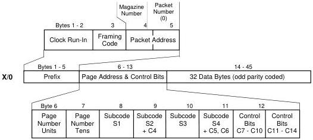

*Figure 9: Format of the page header packet (X/0)*

##### 9.3.1.1 Page number

The page number is defined by bytes 6 and 7, both Hamming 8/4 protected. The page number comprises page units and page tens elements:

|  Function | Byte | Data Bit | Weighting | Range  |
| --- | --- | --- | --- | --- |
|  Page Units | 6 | 2 | 2^{0} | 0 - F  |
|   |   |  4 | 2^{1}  |   |
|   |   |  6 | 2^{2}  |   |
|   |   |  8 | 2^{3}  |   |
|  Page Tens | 7 | 2 | 2^{0} | 0 - F  |
|   |   |  4 | 2^{1}  |   |
|   |   |  6 | 2^{2}  |   |
|   |   |  8 | 2^{3}  |   |

NOTE: Odd numbered data bits carry the Hamming 8/4 protection bits.

##### 9.3.1.2 Page sub-code

The page sub-code is defined by byte 8, part of byte 9, byte 10 and part of byte 11, all Hamming 8/4 protected. The page sub-code comprises four elements S1, S2, S3 and S4:

|  Function | Byte | Data Bit | Weighting | Range  |
| --- | --- | --- | --- | --- |
|  S1 (least significant) | 8 | 2 | 2^{0} | 0 - F  |
|   |   |  4 | 2^{1}  |   |
|   |   |  6 | 2^{2}  |   |
|   |   |  8 | 2^{3}  |   |
|  S2 | 9 | 2 | 2^{0} | 0 - 7  |
|   |   |  4 | 2^{1}  |   |
|   |   |  6 | 2^{2}  |   |
|  S3 | 10 | 2 | 2^{0} | 0 - F  |
|   |   |  4 | 2^{1}  |   |
|   |   |  6 | 2^{2}  |   |
|   |   |  8 | 2^{3}  |   |
|  S4 (most significant) | 11 | 2 | 2^{0} | 0 - 3  |
|   |   |  4 | 2^{1}  |   |

NOTE: Odd numbered data bits carry the Hamming 8/4 protection bits.

##### 9.3.1.3 Control bits

The page control bits, C4 to C14, are described in table 2. They are transmitted in bytes 9, 11, 12 and 13 of the page header packet and are all Hamming 8/4 protected. The control bits are active on being set to '1'.

Table 2: Control bits in the page header

|  Control Bit | Location | Function  |
| --- | --- | --- |
|  C4 Erase Page | Byte 9, bit 8 | Packets X/1 to X/28 belonging to a previous transmission of the page should be erased from the decoder's memory before packets belonging to the associated page are stored.  |
|  C5 Newsflash | Byte 11, bit 6 | When set to '1' this bit indicates that the associated page is a Newsflash page. All information intended for display on such a page will be boxed and will be displayed inset into the normal video picture.  |
|  C6 Subtitle | Byte 11, bit 8 | When set to '1' this bit indicates that the associated page is a subtitle page. All information intended for display on such a page will be boxed and will be displayed inset into the normal video picture.  |
|  C7 Suppress Header | Byte 12, bit 2 | Data addressed to row 0 is not to be displayed.  |
|  C8 Update Indicator | Byte 12, bit 4 | Data within packets X/1 to X/28 of the associated page has been changed since the previous transmission. The setting of this bit is under editorial control.  |
|  C9 Interrupted Sequence | Byte 12, bit 6 | The associated page is not in numerical order of page sequence, allowing the header to be excluded from a rolling header display to avoid discontinuities.  |
|  C10 Inhibit Display | Byte 12, bit 8 | Data addressed to rows 1 to 24 is not to be displayed.  |
|  C11 Magazine Serial | Byte 13, bit 2 | When set to '1' the service is designated to be in Serial mode and the transmission of a page is terminated by the next page header with a different page number. When set to '0' the service is designated to be in Parallel mode and the transmission of a page is terminated by the next page header with a different page number but the same magazine number. The same setting shall be used for all page headers in the service.  |
|  C12, C13, C14 National Option Character Subset | Byte 13, bits 4, 6 and 8 | Where the decoder is capable of displaying text in more than one language these control bits are used to select G0 character set options, (see clause 15.2). The response to these control bits may be modified by packets X/28/0 Format 1, X/28/4, M/29/0 and M/29/4.  |

##### 9.3.1.4 Data bytes

Bytes 14 to 45 in page header packets carry 32 character or display control codes, coded 7 data bits plus one bit odd parity. They are normally intended for display. Bytes 38 to 45 are usually coded to represent a real-time clock.

#### 9.3.2 Packets X/1 to X/25

Packets X/1 to X/25 intended for direct display are coded according to figure 10.

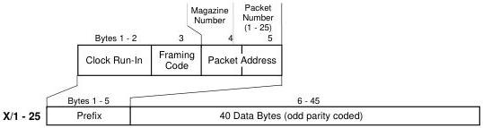

*Figure 10: Format of packets X/1 to X/25 for direct display*

The same coding is used for the packets X/1 to X/24 of DRCS data pages. Different coding schemes are used for packets X/1 to X/25 when they form part of pages not intended for direct display such as Object definition pages (see clause 10.5.1), magazine inventory pages (see clause 11.3), the additional data pages used in the "TOP" system (see clause 11.2), and for data broadcasting, EN 300 708 [2].

### 9.4 Page enhancement data packets

Packets X/26, X/28 and M/29 can carry data to enhance a basic Level 1 Teletext page. The general coding scheme is shown in figure 11. Byte 6 is used as an additional address byte (designation code), coded Hamming 8/4. This allows up to 16 versions of each packet type. The remaining 39 bytes are Hamming 24/18 coded, grouped as 13 triplets.

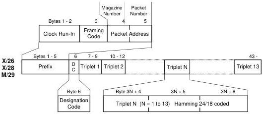

*Figure 11: Format of packets X/26, X/28 and M/29*

NOTE: Packets X/1 to X/25 of POPs and GPOPs use the same coding scheme for bytes 7 to 45. Byte 6 is Hamming 8/4 coded but does not have the function of a designation code (see clauses 10.5.1.2 and 10.5.1.3).

#### 9.4.1 Packet X/26

Packets X/26 are used for:

- at presentation Levels 1.5, 2.5, 3.5: addressing a character location and overwriting the existing character defined on the Level 1 page;
- at presentation Levels 2.5, 3.5: modifying existing display attributes and for object definitions;
- at all presentation Levels: VCR programming, see EN 300 231 [1].

Designation code values 0000 to 1111 allow up to 16 packets with Y = 26 to be associated with a given page.

Unlike other page enhancement packets, the function of a data bit within a packet X/26 is not determined by its overall position within the packet. The coding and function of the data bits of packets X/26 is described in clause 12.3.

#### 9.4.2 Packet X/28/0 Format 1

##### 9.4.2.1 Page Function and Page Coding

A Format 1 packet X/28 with a designation code value of 0000 may be transmitted as part of any page at any presentation level. The first 7 data bits of the packet define the function and the coding of packets X/1 to X/25 of the associated page, as shown in table 3. This coding scheme is also used for the first 7 data bits of packets X/28/3 and X/28/4.

Table 3: Page function and page coding bits (packets X/28/0 Format 1, X/28/3 and X/28/4)

|  Triplet | Bits | Function  |   |   |   |   |
| --- | --- | --- | --- | --- | --- | --- |
|  1 | 1-4 | **Page Function** These bits define the function of the data in packets X/1 to X/25 of the associated page.  |   |   |   |   |
|   |  | **Bit** |   |   |   |   |
|   |  | **4** | **3** | **2** | **1** | **Page Function**  |
|   |  | 0 | 0 | 0 | 0 | Basic Level 1 Teletext page (LOP)  |
|   |  | 0 | 0 | 0 | 1 | Data broadcasting page coded according to EN 300 708 [2], clause 4  |
|   |  | 0 | 0 | 1 | 0 | Global Object definition page (GPOP) - (see clause 10.5.1)  |
|   |  | 0 | 0 | 1 | 1 | Normal Object definition page (POP) - (see clause 10.5.1)  |
|   |  | 0 | 1 | 0 | 0 | Global DRCS downloading page (GDRCS) - (see clause 10.5.2)  |
|   |  | 0 | 1 | 0 | 1 | Normal DRCS downloading page (DRCS) - (see clause 10.5.2)  |
|   |  | 0 | 1 | 1 | 0 | Magazine Organization table (MOT) - (see clause 10.6)  |
|   |  | 0 | 1 | 1 | 1 | Magazine Inventory page (MIP) - (see clause 11.3)  |
|   |  | 1 | 0 | 0 | 0 | Basic TOP table (BTT) }  |
|   |  | 1 | 0 | 0 | 1 | Additional Information Table (AIT) } (see clause 11.2)  |
|   |  | 1 | 0 | 1 | 0 | Multi-page table (MPT) }  |
|   |  | 1 | 0 | 1 | 1 | Multi-page extension table (MPT-EX) }  |
|   |  | 1 | 1 | 0 | 0 | Page contain trigger messages defined according to [8]  |
|   |  | Other combinations are reserved for future use.  |   |   |   |   |
|  1 | 5-7 | **Page Coding** These bits define the coding of packets X/1 to X/25 of the associated page.  |   |   |   |   |
|   |  | **Bit** |   |   |   |   |
|   |  | **7** | **6** | **5** |  | **Page Coding**  |
|   |  | 0 | 0 | 0 |  | All 8-bit bytes, each comprising 7 data bits and 1 odd parity bit.  |
|   |  | 0 | 0 | 1 |  | All 8-bit bytes, each comprising 8 data bits.  |
|   |  | 0 | 1 | 0 |  | Per packet: One 8-bit byte coded Hamming 8/4, followed by thirteen groups of three 8-bit bytes coded Hamming 24/18. All packets coded in this way.  |
|   |  | 0 | 1 | 1 |  | All 8-bit bytes, each code Hamming 8/4.  |
|   |  | 1 | 0 | 0 |  | Per packet: Eight 8-bit bytes coded Hamming 8/4, followed by twelve 8-bit bytes coded 7 data bits and 1 odd parity bit. This sequence is then repeated for the remaining 20 bytes. All packets coded in this way.  |
|   |  | 1 | 0 | 1 |  | Per packet: First 8-bit byte coded Hamming 8/4. The data bits from this byte define the coding of the remaining 39 bytes of this packet only, according to the first five entries in this table.  |
|   |  | Other combinations are reserved for future use.  |   |   |   |   |

##### 9.4.2.2 Coding for basic Level 1 Teletext pages

When the Page Function bits (triplet 1, bits 1 to 4) indicate a basic Level 1 Teletext page (code 0000), the remaining bits of the packet define the following Level 2.5 and 3.5 presentation related data:

Default character sets;
Size and position of any side-panels;
Colour map entry coding for CLUTs 2 and 3;
Default screen and row colours;
Colour table re-mapping of the foreground and background colours of the basic Level 1 page.

The coding is shown in table 4. The same coding also applies to packets X/28/4 except that they redefine CLUTs 0 and 1 instead of CLUTs 2 and 3.

Where packets 28/0 and 28/4 are both transmitted as part of a page, packet 28/0 takes precedence over 28/4 for all but the colour map entry coding.

Table 4: Coding of packet X/28/0 Format 1 for basic Level 1 pages

|  Triplet | Bits | Function  |
| --- | --- | --- |
|  1 | 1-4 | **Page Function** = Basic Level 1 Teletext page (see clause 9.4.2.1).  |
|  1 | 5-7 | **Page Coding** = All 8-bit bytes, each comprising 7 bits data and 1 odd parity bit (see clause 9.4.2.1).  |
|  1 | 8-14 | **Default G0 and G2 Character Set Designation and National Option Selection** Default G0 primary and G2 supplementary character sets plus national option character sub-sets are designated. The 7-bit value is used to select an entry in table 32. NOTE: The default character sets at the start of each row are the default G0 and G2 sets. In some transmissions, each "ESC" control character (code 1/B) on the Level 1 page toggles the G0 set between the default and second G0 sets for the subsequent G0 characters of the row.  |
|  1 | 15-18 | **Second G0 Set Designation and National Option Selection**  |
|  2 | 1-3 | A second G0 character set and a national option sub-set are designated. The 7-bit value is used to select an entry in table 33. See previous note.  |
|  2 | 4 | **Left Side Panel** 0 = No left side panel is to be displayed; 1 = Left side panel is to be displayed.  |
|  2 | 5 | **Right Side Panel** 0 = No right side panel is to be displayed; 1 = Right side panel is to be displayed.  |
|  2 | 6 | **Side Panel Status Flag** 0 = Side panel(s) required at Level 3.5 only; 1 = Side panel(s) required at Levels 2.5 & 3.5.  |
|  2 | 7-10 | **Number of Columns in Side Panels** Bits 7 to 10 (LSB to MSB) define the number of columns in the left side panel. If the right side-panel is to be displayed, its width (in columns) is 16 minus this value. When only one side panel is in use, a value of 0 indicates a side panel of 16 columns.  |
|  2 | 11-18 | **Colour Map Entry Coding for CLUTs 2 and 3**  |
|  3-12 | 1-18 | The bits are organized as 16 data words, each of 12 bits. Each word defines an entry in the Colour Map of clause 12.4, proceeding in transmission order from CLUT 2, entry 0 to CLUT 3, entry 7. Each 12-bit data word contains 4 bits for each primary colour (Red, Green and Blue), in the transmission order: RRRRGGGGBBBB, with ascending order of bit significance within each 4 bits.  |
|  13 | 1-4  |   |
|  13 | 5-9 | **Default Screen Colour** Selects an entry in the Colour Map of clause 12.4 to be applied to the screen area above display row 0 and below row 23, or 24 if used. Screen colour selection via a packet X/26 takes priority over this value.  |
|  13 | 10-14 | **Default Row Colour** Selects an entry in the Colour Map of clause 12.4 to be applied to rows 0 to 23, and 24 where used. Row colour selection via a packet X/26 takes priority over this value.  |
|  13 | 15 | Black Background Colour Substitution This bit controls the substitution of black background colour on the Level 1 page by the pertaining full row colour. 0 = No substitution of black background by the pertaining row colour. NOTE: This black background may still be substituted by another colour as a result of the Colour Table Re-mapping function, see below. 1 = On any row where the Level 1 page displays a black background as a result of the start-of-row default or the spacing attribute Black Background (1/C), the black background is replaced by the full row colour applying to that row. This substitution takes place independently of any colour table re-mapping that may be applied by the function described below. This substitution does not occur as a result of the spacing attribute sequence Alpha (or Mosaics) Black (0/0 or 1/0) followed by New Background (1/D). Where background colour is used as a parameter in the determination of the operation of another function, for example colour table re-mapping, colour table flash and Level 2.5 and 3.5 windows, it shall be set explicitly by the transmission and not depend upon the result of a black background colour substitution invoked by this bit.  |
|  13 | 16-18 | Colour Table Re-mapping for use with Spacing Attributes Allows colour table re-mapping of the spacing colour attributes used on the Level 1 page. Foreground and background colours may be mapped independently to different CLUTs within the Colour Map of clause 12.4 according to the following table. The entry in the selected CLUT is specified by the 3 LSBs of the code for the spacing colour attribute.  |

|  Triplet | Bits | Function  |   |   |   |   |
| --- | --- | --- | --- | --- | --- | --- |
|   |  | Colour Table Re-mapping  |   |   |   |   |
|   |  | Bit |   |   | Foreground | Background  |
|   |  | 18 | 17 | 16 | CLUT | CLUT  |
|   |  | 0 | 0 | 0 | 0 | 0  |
|   |  | 0 | 0 | 1 | 0 | 1  |
|   |  | 0 | 1 | 0 | 0 | 2  |
|   |  | 0 | 1 | 1 | 1 | 1  |
|   |  | 1 | 0 | 0 | 1 | 2  |
|   |  | 1 | 0 | 1 | 2 | 1  |
|   |  | 1 | 1 | 0 | 2 | 2  |
|   |  | 1 | 1 | 1 | 2 | 3  |
|  NOTE: If Black Background Colour Substitution is in force, a background colour of black (entry number 0) on the Level 1 page is only re-mapped by this technique if the black background was set as a result of the spacing attribute sequence Alpha (or Mosaics) Black (0/0 or 1/0) followed by New Background (1/D).  |   |   |   |   |   |   |

##### 9.4.2.3 Coding for data broadcasting pages

The coding of table 5 applies to the data bits of a packet X/28/0 Format 1 when the Page Function bits indicate a page a data broadcasting page (code 0001).

Table 5: Coding of Packet X/28/0 Format 1 for Data Broadcasting Pages

|  Triplet | Bits | Function  |
| --- | --- | --- |
|  1 | 1-4 | Page Function = Data broadcasting page (see clause 9.4.2.1).  |
|  1 | 5-7 | Page Coding - defined according to clause 9.4.2.1.  |
|  1 | 8-18 | Set to 11111111100 (bits 8 to 18). This value is chosen to ensure existing data broadcasting decoders, designed according to EN 300 708 [2], ignore this type of page.  |
|  2-13 | 1-18 | Define by the data broadcasting application.  |

##### 9.4.2.4 Coding for other types of page

The coding of table 6 applies to the data bits of a packet X/28/0 Format 1 when the Page Function bits indicate a page other than a basic Level 1 Teletext page (code 0000) or a data broadcasting page (code 0001).

Table 6: Coding of Packet X/28/0 Format 1 for other types of pages

|  Triplet | Bits | Function  |
| --- | --- | --- |
|  1 | 1-4 | Page Function - defined according to clause 9.4.2.1.  |
|  1 | 5-7 | Page Coding - defined according to clause 9.4.2.1.  |
|  1 | 8-18 | Set to 11111111100 (bits 8 to 18). This value is chosen to ensure existing data broadcasting decoders, designed according to EN 300 708 [2], ignore this type of page.  |
|  2-13 | 1-18 | Reserved for future use.  |

#### 9.4.3 Packet X/28/0 - Format 2

A packet X/28/0 Format 2 is used in data broadcasting applications as part of the Page Format - CA protocol defined in EN 300 708 [2] clause 5. The first 8 data bits of the packet define the function of the associated page, and bits 15 to 18 define the coding of packets X/1 to X/25, as shown in table 7. This coding scheme is also used for the first triplet of packets X/28/2.

Table 7: Page function and page coding bits (packets X/28/0 Format 2 and X/28/2)

|  Triplet | Bits | Function  |   |   |   |   |   |   |   |
| --- | --- | --- | --- | --- | --- | --- | --- | --- | --- |
|  1 | 1-8 | **Page Function** These bits define the function of the data in packets X/1 to X/25 of the associated page when bits 9 to 14 of this triplet are all set to '0'.  |   |   |   |   |   |   |   |
|   |  | **Bit**  |   |   |   |   |   |   |   |
|   |  | **8** | **7** | **6** | **5** | **4** | **3** | **2** | **1**  |
|   |  | 0 | 0 | 0 | 0 | 0 | 0 | 0 | 0  |
|   |  | 1 | 0 | 0 | 0 | 0 | 1 | 0 | 0  |
|   |  | 1 | 0 | 0 | 0 | 0 | 1 | 0 | 1  |
|   |  | Page Function  |   |   |   |   |   |   |   |
|   |  | Basic Level 1 Teletext page with standard character position and row format  |   |   |   |   |   |   |   |
|   |  | Reformatted data  |   |   |   |   |   |   |   |
|   |  | Terminal equipment addressing page  |   |   |   |   |   |   |   |
|   |  | Other combinations are reserved for future use.  |   |   |   |   |   |   |   |
|  1 | 9-14 | **Set to '0'**  |   |   |   |   |   |   |   |
|  1 | 15-18 | **Page Coding** These bits define the coding of packets X/1 to X/25 of the associated page.  |   |   |   |   |   |   |   |
|   |  | **Bit**  |   |   |   |   |   |   |   |
|   |  | **18** | **17** | **16** | **15** | **Page Coding**  |   |   |   |
|   |  | 0 | 0 | 0 | 0 | All 8-bit bytes, each comprising 7 data bits and 1 odd parity bit.  |   |   |   |
|   |  | 0 | 0 | 0 | 1 | All 8-bit bytes, each comprising 8 data bits.  |   |   |   |
|   |  | 0 | 0 | 1 | 0 | Per packet: One 8-bit byte coded Hamming 8/4, followed by thirteen groups of three 8-bit bytes coded Hamming 24/18. All packets coded in this way.  |   |   |   |
|   |  | 0 | 0 | 1 | 1 | All 8-bit bytes, each code Hamming 8/4.  |   |   |   |
|   |  | Other combinations are reserved for future use.  |   |   |   |   |   |   |   |
|  2-13 | 1-18 | **Reserved**  |   |   |   |   |   |   |   |

#### 9.4.4 Packet X/28/1

A packet X/28 with a designation code value of 0001 may be transmitted as part of any page at any presentation Level. When associated with a Level 1 Teletext page the packet is used for:

- G0 and G1 character designation (but only for compatibility with some existing Level 1 and 1.5 decoders designed to earlier Teletext specifications);
- DCLUT4 for global 12x10x2 DRCS mode characters };
- DCLUT4 for normal 12x10x2 DRCS mode characters } at Level 3.5;
- DCLUT16 for global 12x10x4 and 6x5x4 DRCS mode characters } (see clauses 14.2.2 to 14.2.4);
- DCLUT16 for normal 12x10x4 and 6x5x4 DRCS mode characters }.

The coding shown in table 8 applies when the packet forms part of a basic Level 1 page.

Table 8: Coding of Packet X/28/1

|  Triplet | Bits | Function  |
| --- | --- | --- |
|  1 | 1-2 | Set to '00'. (see note)  |
|  1 | 3-9 | **Character Set Code for G0 Table.** (see note)  |
|  1 | 10 | Set to '0'. (see note)  |
|  1 | 11-17 | **Character Set Code for G1 Table.** (see note)  |
|  1 | 18 | Set to '0'. (see note)  |
|  2 | 1-18 | **DCLUT4 for Global 12x10x2 DRCS Mode Characters**  |
|  3 | 1-2 | 4 data words of 5 bits each to define the DCLUT for use with global 12x10x2 DRCS. The transmission order is least significant bit first.  |
|  3 | 3-18 | **DCLUT4 for Normal 12x10x2 DRCS Mode Characters**  |
|  4 | 1-4 | 4 data words of 5 bits each to define the DCLUT for use with normal 12x10x2 DRCS. The transmission order is least significant bit first.  |
|  4 | 5-18 | **DCLUT16 for Global 12x10x4 and 6x5x4 DRCS Mode Characters**  |
|  5-7 | 1-18 | 16 data words of 5 bits each to define the DCLUT for use with global 12x10x4 and 6x5x4 DRCS. The transmission order is least significant bit first.  |
|  8 | 1-12  |   |
|  8 | 13-18 | **DCLUT16 for Normal 12x10x4 and 6x5x4 DRCS Mode Characters**  |
|  9-12 | 1-18 | 16 data words of 5 bits each to define the DCLUT for use with global 12x10x4 and 6x5x4 DRCS. The transmission order is least significant bit first.  |
|  13 | 1-2  |   |
|  13 | 3-18 | Reserved for future use  |
|  NOTE: The function of these bits is defined by earlier specifications and is retained for compatibility with existing Level 1 and 1.5 decoders designed to them. They are not intended for use by Level 2.5 and 3.5 decoders designed to the present document.  |   |   |

#### 9.4.5 Packet X/28/2

A packet X/28 with a designation code value of 0010 may be transmitted as part of any page at any presentation Level. It is used to carry a Page Key for descrambling purposes in certain data broadcasting applications, (see EN 300 708 [2], clause 5.4.2). The first triplet is coded in an identical manner to a packet X/28/0 Format 2, as shown in table 7.

#### 9.4.6 Packet X/28/3

A packet X/28 with a designation code value of 0011 may be transmitted as part of a DRCS downloading page at presentation Levels 2.5 and 3.5. The first 7 data bits of the packet define the function and the coding of packets X/1 to X/25 of the associated page according to clause 9.4.2.1.

The coding of table 9 applies to the remaining data bits of the packet when the Page Function bits (triplet 1, bits 1 to 4) indicate a global or normal DRCS downloading page (codes 0100 and 0101). The type of DRCS character defined by each pattern transfer unit (PTU) transmitted via packets X/1 to X/24 is specified.

Table 9: Coding of Packet X/28/3 for DRCS Downloading Pages

|  Triplet | Bits | Function  |   |   |
| --- | --- | --- | --- | --- |
|  1 | 1-7 | Coded according to clause 9.4.2.1. Page Function = 0100 or 0101 (Global or normal DRCS downloading page) Page Coding = 000 (7 bits plus odd parity)  |   |   |
|  1 | 8-18 | Reserved for future use.  |   |   |
|  2-11 | 1-18 | **DRCS Downloading Mode Invocation**  |   |   |
|  12 | 1-12 | The downloading mode of DRCS characters at Level 3.5 are specified individually for each character. These 192 data bits are used to transmit 48 Mode Identification codes, each comprising 4 bits. One value is assigned to each Pattern Transfer Unit (PTU) of 20 bytes.  |   |   |
|   |  | **Bits** | **DRCS** |   |
|   |  | **(MSB LSB)** | **Mode** | **Resolution or Function**  |
|   |  | 0 0 0 0 | 0 | 12 x 10 x 1  |
|   |  | 0 0 0 1 | 1 | 12 x 10 x 2  |
|   |  | 0 0 1 0 | 2 | 12 x 10 x 4  |
|   |  | 0 0 1 1 | 3 | 6 x 5 x 4  |
|   |  | 1 1 1 0 |  | Subsequent PTU of a Mode 1 or 2 character  |
|   |  | 1 1 1 1 |  | No data for the corresponding character  |
|   |  | Other values are reserved. Where a DRCS character is defined by more than one PTU, the appropriate mode value is used for the first PTU and subsequent PTUs are coded 1110.  |   |   |
|  12 | 13-18 | Reserved for future use  |   |   |
|  13 | 1-18 |   |   |   |

#### 9.4.7 Packet X/28/4

A packet X/28 with a designation code value of 0100 may be transmitted as part of any page at presentation Level 3.5. The first 7 data bits of the packet define the function and the coding of packets X/1 to X/25 of the associated page according to clause 9.4.2.1.

When the Page Function bits (triplet 1, bits 1 to 4) indicate a Level 1 Teletext page (code 0000), the remaining bits of the packet define the following Level 2.5 and 3.5 presentation related data:

Default character sets;
Size and position of any side-panels;
Colour map entry coding for CLUTs 0 and 1;
Default screen and row colours.

Colour table re-mapping of the foreground and background colours of the Level 1 page.

The coding is shown in table 10. It is identical to packets X/28/0 Format 1 except that it redefines CLUTs 2 and 3 instead of CLUTs 0 and 1.

Where packets 28/0 and 28/4 are both transmitted as part of a page, packet 28/0 takes precedence over 28/4 for all but the colour map entry coding.

Table 10: Coding of packet X/28/4 for basic Level 1 pages

|  Triplet | Bits | Function  |
| --- | --- | --- |
|  1 | 1-7 | Page Function and Page Coding. As clause 9.4.2.1.  |
|  1 | 8-14 | Default G0 and G2 Character Set Designation and National Option Selection As clause 9.4.2.2.  |
|  1 | 15-18 | Second G0 Set Designation and National Option Selection. As clause 9.4.2.2.  |
|  2 | 1-3 |   |
|  2 | 4 | Left Side Panel. As clause 9.4.2.2.  |
|  2 | 5 | Right Side Panel. As clause 9.4.2.2.  |
|  2 | 6 | Side Panel Status Flag. As clause 9.4.2.2.  |
|  2 | 7-10 | Number of Columns in Side Panels. As clause 9.4.2.2.  |
|  2 | 11-18 | Colour Map Entry Coding for CLUTs 0 and 1.  |
|  3-12 | 1-18 | The bits are organized as 16 data words, each of 12 bits. Each word defines an entry in the Colour  |
|  13 | 1-4 | Map of clause 12.4, proceeding in transmission order from CLUT 0, entry 0 to CLUT 1, entry 7. Each 12 bit data word contains 4 bits for each primary colour (Red, Green and Blue), in the transmission order: RRRRGGGGBBBB, with ascending order of bit significance within each 4 bits. CLUT 1, entry 0 is always "transparent". The corresponding bits for this entry should be ignored by decoders.  |
|  13 | 5-9 | Default Screen Colour. As clause 9.4.2.2.  |
|  13 | 10-14 | Default Row Colour. As clause 9.4.2.2.  |
|  13 | 15 | Black Background Colour Substitution. As clause 9.4.2.2.  |
|  13 | 16-18 | Colour Table Re-mapping for use with Spacing Attributes. As clause 9.4.2.2.  |

### 9.5 Magazine-Related Page Enhancement Data Packets

#### 9.5.1 Packet M/29/0

The coding of the bits applicable to character set designation, side-panels, the CLUT, default row and screen colours, colour table re-mapping and black background substitution in packets X/28/0 Format 1 is also used in packets M/29/0. This data applies to all basic Level 1 pages in magazine M but is overridden for a particular page if a packet X/28/0 Format 1 exists for that page. Where M/29/0 and M/29/4 are transmitted for the same magazine, M/29/0 takes precedence over M/29/4.

Table 11: Coding of Packet M/29/0

|  Triplet | Bits | Function  |   |   |   |   |   |   |   |
| --- | --- | --- | --- | --- | --- | --- | --- | --- | --- |
|  1 | 1-7 | **Packet Function** These bits define the application and scope of the data bits in the remainder of this packet.  |   |   |   |   |   |   |   |
|   |  | **Bits** |   |   |   |   |   | **Packet Function**  |   |
|   |  | 7 | 6 | 5 | 4 | 3 | 2 | 1 |   |
|   |  | 0 | 0 | 0 | 0 | 0 | 0 | 0 | The remaining data bits have an identical coding and function to those of packet X/28/0 Format 1 (see clause 9.4.2) except that here the data applies to all pages in magazine M.  |
|   |  | All other values are reserved for future use.  |   |   |   |   |   |   |   |
|  1 | 8-14 | **Default G0 and G2 Character Set Designation and National Option Selection** As clause 9.4.2.2.  |   |   |   |   |   |   |   |
|  1 | 15-18 | **Second G0 Set Designation and National Option Selection.** As clause 9.4.2.2.  |   |   |   |   |   |   |   |
|  2 | 1-3 |   |   |   |   |   |   |   |   |
|  2 | 4 | **Left Side Panel.** As clause 9.4.2.2.  |   |   |   |   |   |   |   |
|  2 | 5 | **Right Side Panel.** As clause 9.4.2.2.  |   |   |   |   |   |   |   |
|  2 | 6 | **Side Panel Status Flag.** As clause 9.4.2.2.  |   |   |   |   |   |   |   |
|  2 | 7-10 | **Number of Columns in Side Panels.** As clause 9.4.2.2.  |   |   |   |   |   |   |   |
|  2 | 11-18 |   |   |   |   |   |   |   |   |
|  3-12 | 1-18 | **Colour Map Entry Coding for CLUTs 2 and 3.** As clause 9.4.2.2.  |   |   |   |   |   |   |   |
|  13 | 1-4 |   |   |   |   |   |   |   |   |
|  13 | 5-9 | **Default Screen Colour.** As clause 9.4.2.2.  |   |   |   |   |   |   |   |
|  13 | 10-14 | **Default Row Colour.** As clause 9.4.2.2.  |   |   |   |   |   |   |   |
|  13 | 15 | **Black Background Colour Substitution.** As clause 9.4.2.2.  |   |   |   |   |   |   |   |
|  13 | 16-18 | **Colour Table Re-mapping for use with Spacing Attributes.** As clause 9.4.2.2.  |   |   |   |   |   |   |   |

#### 9.5.2 Packet M/29/1

The coding used for X/28/1 is also used for packets M/29/1. This data applies to all Level 1 pages in magazine M but is overridden for a particular page if a packet X/28/1 exists for that page.

Table 12: Coding of Packet M/29/1

|  Triplet | Bits | Function  |
| --- | --- | --- |
|  1 | 1-18 | **Character Set Codes for G0 and G1 Tables.** As clause 9.4.4.  |
|  2 | 1-18 | **DCLUT4 for Global 12x10x2 DRCS Mode Characters.**  |
|  3 | 1-2 | As clause 9.4.4.  |
|  3 | 3-18 | **DCLUT4 for Normal 12x10x2 DRCS Mode Characters.**  |
|  4 | 1-4 | As clause 9.4.4.  |
|  4 | 5-18 | **DCLUT16 for Global 12x10x4 and 6x5x4 DRCS Mode Characters.** As clause 9.4.4.  |
|  5-7 | 1-18 |   |
|  8 | 1-12 |   |
|  8 | 13-18 | **DCLUT16 for Normal 12x10x4 and 6x5x4 DRCS Mode Characters.** As clause 9.4.4.  |
|  9-12 | 1-18 |   |
|  13 | 1-2 |   |
|  13 | 3-18 | Reserved for future use.  |

#### 9.5.3 Packet M/29/4

The coding of the bits applicable to character set designation, side-panels, the CLUT, default row and screen colours, colour table re-mapping and black background substitution in packets X/28/4 is also used in packets M/29/4. This data applies to all basic Level 1 pages in magazine M but is overridden for a particular page if a packet X/28/4 exists for that page. Where M/29/0 and M/29/4 are transmitted for the same magazine, M/29/0 takes precedence over M/29/4.

Table 13: Coding of Packet M/29/4

|  Triplet | Bits | Function  |
| --- | --- | --- |
|  1 | 1-7 | **Packet Function** These bits define the application and scope of the data bits in the remainder of this packet.  |
|   |  | **Bit**  |
|   |  | **Packet Function**  |
|   |  | 7 6 5 4 3 2 1 0 0 0 0 0 0 0 The remaining data bits of this packet have an identical coding and function to those of packet X/28/4 (see clause 9.4.7) except that here the data applies to all pages in magazine M.  |
|   |  | All other values are reserved for future use.  |
|  1 | 8-14 | **Default G0 and G2 Character Set Designation and National Option Selection** As clause 9.4.2.2.  |
|  1 | 15-18 | **Second G0 Set Designation and National Option Selection.** As clause 9.4.2.2.  |
|  2 | 1-3 |   |
|  2 | 4 | **Left Side Panel.** As clause 9.4.2.2.  |
|  2 | 5 | **Right Side Panel.** As clause 9.4.2.2.  |
|  2 | 6 | **Side Panel Status Flag.** As clause 9.4.2.2.  |
|  2 | 7-10 | **Number of Columns in Side Panels.** As clause 9.4.2.2.  |
|  2 | 11-18 | **Colour Map Entry Coding for CLUTs 0 and 1**  |
|  3-12 | 1-18 | The bits are organized as 16 data words, each of 12 bits. Each word defines an entry in the  |
|  13 | 1-4 | Colour Map of clause 12.4, proceeding in transmission order from CLUT 0, entry 0 to CLUT 1, entry 7. Each 12 bit data word contains 4 bits for each primary colour (Red, Green and Blue), in the transmission order: RRRRGGGGBBBB, with ascending order of bit significance within each 4 bits. CLUT 1, entry 0 is always "transparent". The corresponding bits for this entry should be ignored by decoders.  |
|  13 | 5-9 | **Default Screen Colour.** As clause 9.4.2.2.  |
|  13 | 10-14 | **Default Row Colour.** As clause 9.4.2.2.  |
|  13 | 15 | **Black Background Colour Substitution.** As clause 9.4.2.2.  |
|  13 | 16-18 | **Colour Table Re-mapping for use with Spacing Attributes.** As clause 9.4.2.2.  |

### 9.6 Packets for Page Linking

#### 9.6.1 Packets X/27/0 to X/27/3 for Editorial Linking

Packets X/27 with designation codes in the range 0000 to 0011 define editorially linked pages. Codes of Practice exist for user-friendly page access methods. To support certain methods, a decoder is required to respond to the linked page data in packets X/27/0 and the display data in packets X/24 (see clause 11.1).

The structure of packets X/27/0 - 3 is shown in figure 12.

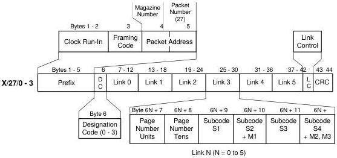

*Figure 12: Format of packets X/27/0-3 for editorial links*

Byte 6 is the designation code, coded Hamming 8/4. Bytes 7 to 42 are also coded Hamming 8/4 and are arranged as 6 groups of 6 bytes. Each group of 6 bytes defines a linked page address, the groups being numbered 0 to 5 in order of transmission. Bytes 43 to 45 are defined for packets X/27/0 only (see table 14).

Each linked page address has the same format as bytes 6 to 11 of a page header packet (see clause 9.3.1) and contains:

Relative magazine number: 3 bits;

Page number: 8 bits;

Page sub-code: 13 bits.

The bits M1, M2, M3 shown in figure 12 correspond to the control bits C4, C5 and C6 in the page header packet. They are used here to change the magazine number from that in byte 4 of this packet X/27. Setting any of these bits to '1' complements the corresponding magazine bit.

When no particular page number is to be specified, the page number FF is transmitted. When no particular page sub-code is to be specified, the page sub-code 3F7F is transmitted. When the page address XFF:3F7F is transmitted, no page is specified.

The mapping of the linked page addresses to the bytes of the packet is shown in table 14.

Table 14: Coding of Packet X/27/0-3

|  Byte | Data Bits | Function  |
| --- | --- | --- |
|  6 | 1-4 | Designation code  |
|  7-12 | 1-4 | Editorial link 0  |
|  13-18 | 1-4 | Editorial link 1  |
|  19-24 | 1-4 | Editorial link 2  |
|  25-30 | 1-4 | Editorial link 3  |
|  31-36 | 1-4 | Editorial link 4  |
|  37-42 | 1-4 | Editorial link 5  |
|  43 | 1, 2, 3 | Link Control Byte - see note. Coded Hamming 8/4. In the absence of any local Code of Practice, these bits should be set to '1'.  |
|   | 4 | '0': Data in packets with Y = 24 is not to be displayed. '1': Data in packets with Y = 24 is to be displayed in row 24.  |
|  44-45 | 1-8 | Cyclic Redundancy Check word (CRC) on data in packets X/0 to X/25 of the associated page - see note. Coded each as 8 bits data. The calculation is described below.  |
|  NOTE: Bytes 43, 44 and 45 have this significance for packets X/27/0 only. These bytes are reserved in packets X/27/1, X/27/2 and X/27/3.  |   |   |

The check word is generated in the following manner using the conceptual model of a 16 bit shift register, figure 13, having as input the modulo-2 sum of an external input and the contents of the 7th, 9th, 12th and 16th stages of the register. Initially the register is cleared to "all zeros". During a sequence of 8 192 clock pulses bytes 14 to 37 from packet X/0 and the following character bytes (bytes 6 to 45) of packets X/1 up to X/25, in ascending address order, form the input. Any absent packets are considered to contain the character "space" (2/0) throughout. For each byte, the bits are applied to the input in the order b8 to b1 inclusive. This order, the reverse of that used in the transmission sequence, is to facilitate decoder operation where the data used is stored in the page memory.

At the transmitting end of the generating process the contents of the register are the basic page check word and it is transmitted along the register beginning with the bit held in the first stage.

The transmission order for the two byte group resulting from the 16-bit cyclic redundancy check on the page is bits 9 to 16 followed by bits 1 to 8 inclusive.

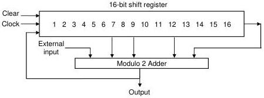

*Figure 13: Check word generation*

#### 9.6.2 Packets X/27/4 and X/27/5 - Format 1 - for compositional linking in presentation enhancement applications

Format 1 packets X/27 have valid designation codes of 0100 and 0101. The packets define compositional links to enhancement data pages (i.e. DRCS downloading pages and object definition pages) at Levels 2.5 and 3.5.

The structure of Format 1 packets X/27/4 and X/27/5 is shown in figure 14.

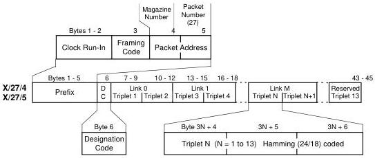

*Figure 14: Format of Format 1 packets X/27/4 and X/27/5 for compositional linking*

Byte 6 is the designation code, coded Hamming 8/4. Bytes 7 to 42 are arranged as 6 groups of 3 + 3 bytes, each subgroup of 3 bytes being one Hamming 24/18 coded triplet. Each group of 6 bytes defines a linked page address, the groups being numbered 0 to 5 in order of transmission. Bytes 43 to 45 are also Hamming 24/18 coded but the data bits are reserved for future use.

Each linked page address of 3 + 3 bytes contains 36 data bits:

|  Relative magazine number: | 3 bits;  |
| --- | --- |
|  Page number: | 8 bits;  |
|  Page sub-code flags: | 16 bits;  |
|  Link function flags: | 4 bits;  |
|  Compatibility bits | 2 bits;  |
|  Reserved: | 3 bits.  |

The mapping of these functions within a two triplet group, and the allocation of links to triplets, is shown in table 15.

Table 15: Coding of Packets X/27/4 and X/27/5, Format 1

|  Triplet | Data Bits | Function  |   |
| --- | --- | --- | --- |
|  1-2 | 1-18 | Link 0  |   |
|  1 | 1-2 | Link Function These bits define the type of page being linked.  |   |
|   |  | **Bit 2** | **Bit 1**  |
|   |  | 0 | 0  |
|   |  | 0 | 1  |
|   |  | 1 | 0  |
|   |  | 1 | 1  |
|  1 | 3-4 | Page Validity These bits define the presentation Levels requiring the linked page.  |   |
|   |  | **Bit 4** | **Bit 3**  |
|   |  | 0 | 0  |
|   |  | 0 | 1  |
|   |  | 1 | 0  |
|   |  | 1 | 1  |
|  1 | 5-6 | **Reserved for future use**  |   |
|  1 | 7-10 | **Page Number Units** (LSB - MSB)  |   |
|  1 | 11 | **Set to '1'** (for compatibility with Format 2 packets X/27/4-7)  |   |
|  1 | 12-14 | **Relative Magazine Number** (LSB - MSB). These bits change the magazine number from that in byte 4 of this packet X/27. Setting any of these bits to '1' complements the corresponding magazine bit.  |   |
|  1 | 15-18 | **Page Number Tens** (LSB - MSB)  |   |
|  2 | 1 | **Set to '0'** (for compatibility with Format 2 packets X/27/4-7)  |   |
|  2 | 2 | **Reserved for future use**  |   |
|  2 | 3-18 | **Page Sub-code Flags** These bits indicate the specific sub-pages required: '0' = Not required; '1' = Required.  |   |
|   |  | **Data bits** | 3 4 5 6 7 8 9 10 11 12 13 14 15 16 17 18  |
|   |  | **S1 sub-code value** | 0 1 2 3 4 5 6 7 8 9 10 11 12 13 14 15  |
|  3-4 | 1-18 | **Link 1**, coded the same as triplets 1 and 2.  |   |
|  5-6 | 1-18 | **Link 2**, coded the same as triplets 1 and 2.  |   |
|  7-8 | 1-18 | **Link 3**, coded the same as triplets 1 and 2.  |   |
|  9-10 | 1-18 | **Link 4**, coded the same as triplets 1 and 2.  |   |
|  11-12 | 1-18 | **Link 5**, coded the same as triplets 1 and 2.  |   |
|  13 | 1-18 | **Reserved for future use**  |   |

When no particular page number is to be specified, the page number FF is transmitted and all the sub-code flags are set to '1'.

The function of first four links in a packet X/27/4 with the link coding of table 15 is fixed for Level 2.5, as shown in table 16. The Page Validity bits may also indicate their use at Level 3.5. The function of the remaining two links in a packet X/27/4 and the first two links in a packet X/27/5 is defined by the Link Function and Page Validity bits. These links do not contain information relevant to a Level 2.5 decoder.

**Table 16: Fixed Link Functions of Packets X/27/4 and X/27/5**

|  Packet | Link | Function | Fixed Usage | Optional Usage  |
| --- | --- | --- | --- | --- |
|   | 0 | GPOP (Global Public Object Page) | Level 2.5 | Level 3.5  |
|   | 1 | POP (Public Object Page) | Level 2.5 | Level 3.5  |
|  X/27/4 | 2 | GDRCS (Global DRCS Page) | Level 2.5 | Level 3.5  |
|   | 3 | DRCS (Normal DRCS Page) | Level 2.5 | Level 3.5  |
|   | 4 | Defined by Link Function bits |  | Level 3.5  |
|   | 5 | Defined by Link Function bits |  | Level 3.5  |
|   | 0 | Defined by Link Function bits |  | Level 3.5  |
|   | 1 | Defined by Link Function bits |  | Level 3.5  |
|  X/27/5 | 2 | Reserved |  |   |
|   | 3 | Reserved |  |   |
|   | 4 | Reserved |  |   |
|   | 5 | Reserved |  |   |
|  NOTE: Duplicate settings are invalid, i.e. two GPOP links cannot be specified.  |   |   |   |   |

#### 9.6.3 Packets X/27/4 to X/27/7 - Format 2 - for compositional linking in data broadcasting applications

Format 2 packets X/27 have valid designation codes of 0100 and 0111. The packets define compositional links in Page Format - CA data broadcasting applications according to EN 300 708 [2] clause 5.

The overall structure of Format 2 packets is the same as that shown for Format 1 in figure 14, but the detailed coding is different.

Byte 6 is the designation code, coded Hamming 8/4. Bytes 7 to 42 are arranged as 6 groups of 3 + 3 bytes, each sub-group of 3 bytes being one Hamming 24/18 coded triplet. Each group of 6 bytes defines a linked page address, the groups being numbered 0 to 5 in order of transmission. Bytes 43 to 45 are also Hamming 24/18 coded but the data bits are all set to '0'.

Each linked page address of 3 + 3 bytes contains 36 data bits:

|  Relative magazine number: | 3 bits;  |
| --- | --- |
|  Page number: | 8 bits;  |
|  Page sub-code: | 13 bits;  |
|  Link control data: | 12 bits.  |

The mapping of these functions within a two triplet group, and the allocation of links to triplets, is shown in table 17.

Table 17: Coding of Format 2 packets X/27/4 - X/27/7

|  Triplet | Data Bits | Function  |   |   |   |   |   |
| --- | --- | --- | --- | --- | --- | --- | --- |
|  1-2 | 1-18 | Link 0  |   |   |   |   |   |
|  1 | 1-10 | Link Control Data (part 1) If bit 1 of triplet 2 = 1 or bit 11 of triplet 1 = 1, the function of bits 1 - 10 is reserved for future use. If bit 1 of triplet 2 = 0 and bit 11 of this triplet = 0, the following interpretation applies to these bits:  |   |   |   |   |   |
|   |  |  | Bit 10 | Bit 9 | Link Type  |   |   |
|   |  |  | 0 | 0 | Linked pages, not chained  |   |   |
|   |  |  | 0 | 1 | Linked pages, chained, start of chain  |   |   |
|   |  |  | 1 | 0 | Linked pages, chained, end of chain  |   |   |
|   |  |  | 1 | 1 | Linked pages, chained, within a chain  |   |   |
|  |   |   |   |   |   |   |   |
|   |  |  | Bit 8 | Bit 7 | Page Coding  |   |   |
|   |  |  | 0 | 0 | Linked page data format, 7 bits plus odd parity  |   |   |
|   |  |  | 0 | 1 | Interpretation reserved, bits 1 to 6 are also reserved  |   |   |
|   |  |  | 1 | 0 | Interpretation reserved, bits 1 to 6 are also reserved  |   |   |
|   |  |  | 1 | 1 | Linked page contains data in 8 bit format  |   |   |
|  |   |   |   |   |   |   |   |
|  1 | 1-10 | Bit |   |   |   | Page Function  |   |
|   | (continued) | 6 | 5 | 4 | 3 | 2 | 1  |
|   |  | 0 | 0 | 0 | 0 | 0 | 0 Page in standard format  |
|   |  | 0 | 0 | 0 | 1 | 0 | 1 Pseudo page for reformatted data  |
|   |  | 0 | 0 | 0 | 1 | 1 | 0 Pseudo page for page format extension  |
|   |  | 1 | 1 | 1 | 1 | 1 | 1 No linked page; page address FF:3F7F transmitted  |
|   |  | Other values are reserved  |   |   |   |   |   |
|  1 | 11 | Link Control Data (part 2) When set to '0', bits 1-10 have the functions described above When set to '1', the interpretation of bits 1-10 is reserved for future use  |   |   |   |   |   |
|  1 | 12-14 | Relative Magazine Number (LSB - MSB). These bits change the magazine number from that in byte 4 of this packet X/27. Setting any of these bits to '1' complements the corresponding magazine bit.  |   |   |   |   |   |
|  1 | 15-18 | Page Number Tens (LSB - MSB)  |   |   |   |   |   |
|  2 | 1 | Link Control Data (part 3) When set to '0', bits 1-11 of triplet 1 have the functions described above. When set to '1', the interpretation of bits 1-11 of triplet 1 is reserved  |   |   |   |   |   |
|  2 | 2-5 | Page Number Units (LSB - MSB)  |   |   |   |   |   |
|  2 | 6-7 | Page sub-code - S4 (LSB - MSB)  |   |   |   |   |   |
|  2 | 8-11 | Page sub-code - S3 (LSB - MSB)  |   |   |   |   |   |
|  2 | 12-14 | Page sub-code - S2 (LSB - MSB)  |   |   |   |   |   |
|  2 | 15-18 | Page sub-code - S1 (LSB - MSB)  |   |   |   |   |   |
|  3-4 | 1-18 | Link 1, coded the same as triplets 1 and 2.  |   |   |   |   |   |
|  5-6 | 1-18 | Link 2, coded the same as triplets 1 and 2.  |   |   |   |   |   |
|  7-8 | 1-18 | Link 3, coded the same as triplets 1 and 2.  |   |   |   |   |   |
|  9-10 | 1-18 | Link 4, coded the same as triplets 1 and 2.  |   |   |   |   |   |
|  11-12 | 1-18 | Link 5, coded the same as triplets 1 and 2.  |   |   |   |   |   |
|  13 | 1-18 | Set to '0'  |   |   |   |   |   |

When no particular page number is to be specified, the page number FF is transmitted. When no particular page sub-code is to be specified, the page sub-code 3F7F is transmitted. When the page address FF:3F7F is transmitted, no page is specified and the link control data bits are set to '1'.

### 9.7 General Coding of packets 30 and 31

For packets with addresses 30 and 31, the magazine value represents an additional channel identifier.

These packets can be used to carry information unrelated to, and completely independent of, any accompanying service organized as magazines of pages. They can be inserted at any point within the transmission. Details on their use to provide independent data services are given in EN 300 708 [2] clauses 6 and 7.

### 9.8 Broadcast Service Data Packets

#### 9.8.1 Packet 8/30 Format 1

Packets 8/30 Format 1 have designation code values of 0000 or 0001. They carry broadcast service data relating to the TV channel, including:

- multiplexed transmission flag;
- initial Teletext page number;
- network identification;
- current time and date;
- status display.

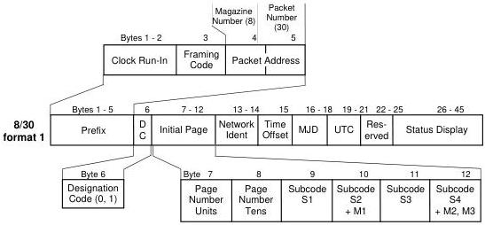

*Figure 15: Coding of Packet 8/30 Format 1*

The coding of bytes 7 to 45 shown in table 18 applies when the designation value is 0000 or 0001.

Table 18: Coding of Packet 8/30 Format 1

|  Bytes | Bits | Function  |
| --- | --- | --- |
|  6 | 1-4 | **Designation code** (Hamming 8/4 coded)  |
|  6 | 1 | '0' = Multiplexed function as defined in clause 4.1 (see note 1) '1' = Non-multiplexed function as defined in clause 4.2 (see note 1)  |
|  6 | 2-4 | When set to 000, bytes 7 to 45 have the functions designated in this table.  |
|  7-12 |  | **Initial Teletext Page** (for storage by a decoder without user action) (All bytes Hamming 8/4 coded.) (see notes 1 and 2)  |
|  7 | 1-4 | Page Units (LSB - MSB)  |
|  8 | 1-4 | Page Tens (LSB - MSB)  |
|  9 | 1-4 | Sub-code value S1 (LSB - MSB)  |
|  10 | 1-3 | Sub-code value S2 (LSB - MSB)  |
|  10 | 4 | (Absolute) Magazine address bit, weight 2^{0}  |
|  11 | 1-4 | Sub-code value S3 (LSB - MSB)  |
|  12 | 1-2 | Sub-code value S4 (LSB - MSB)  |
|  12 | 3-4 | (Absolute) Magazine address bits, weight 2^{1} and 2^{2} respectively  |
|  13-14 |  | **Network Identification Code** (coded 8 bits data) This permanently assigned code uniquely defines the network. The allocation of NI codes to networks is defined in TR 101 231 [6]. NOTE: The 16 bit NI value is transmitted most significant bit first. Thus the MSB is mapped to byte 13, bit 1 and the LSB to byte 14, bit 8.  |
|  15 |  | **Time Offset Code** (coded 8 bits data)  |
|  15 | 1 | Reserved for future use.  |
|  15 | 2-6 | Defines an offset, in hour units, between local time and Co-ordinated Universal Time (UTC). Bit: 2 3 4 5 6 Value (hours): 1/2 1 2 4 8  |
|  15 | 7 | Offset polarity. Negative offsets are west of Greenwich. '0' = positive offset '1' = negative offset  |
|  15 | 8 | Reserved for future use.  |
|  16-18 |  | **Modified Julian Date** (coded 8 bits data) A 5-digit (decimal) number defining Modified Julian Date (MJD), incrementing daily at midnight UTC. Reference point is 31 January 1982, MJD 45000. Each digit is incremented by one prior to transmission. Pairs of 4-bit values are assembled into bytes and the bytes are transmitted least significant bit first.  |
|  16 | 5-8 | Reserved  |
|  17 | 1-4 | 10^{4} (LSB - MSB)  |
|  17 | 5-8 | 10^{3} (LSB - MSB)  |
|  18 | 1-4 | 10^{2} (LSB - MSB)  |
|  18 | 5-8 | 10^{1} (LSB - MSB)  |
|  18 | 1-4 | 10^{0} (LSB - MSB)  |
|  19-21 |  | **Universal Time Co-ordinated** (coded 8 bits data) 6-digit number defining Universal Time Co-ordinated(UTC). The transmission relates to the next following second. Each digit is incremented by one prior to transmission.  |
|  19 | 5-8 | Hours Tens (LSB - MSB)  |
|  19 | 1-4 | Hours Units (LSB - MSB)  |
|  20 | 5-8 | Minutes Tens (LSB - MSB)  |
|  20 | 1-4 | Minutes Units (LSB - MSB)  |
|  21 | 5-8 | Seconds Tens (LSB - MSB)  |
|  21 | 1-4 | Seconds Units (LSB - MSB)  |
|  22-25 |  | **Reserved**  |
|  26-45 |  | **Status Display** (coded 7 bits plus odd parity). (see note 1) These bytes are coded with odd parity characters from the default G0 character set and, where appropriate, using the characters common to the range of options. The use of national option characters is not recommended. It is intended to display a transmission status message, e.g. the programme title.  |
|  NOTE 1: When packets 8/30 Format 2 are also present in a given transmission, the multiplexed operation flag in the designation code and the data in bytes 7 to 12 and 26 to 45 should be the same for both formats. NOTE 2: When no particular page number is to be specified, the page number FF is transmitted. When no particular page sub-code is to be specified the page sub-code 3F7F is transmitted. When the page address FF:3F7F is transmitted, no page is specified.  |   |   |

#### 9.8.2 Packet 8/30 Format 2

Packets 8/30 Format 2 have designation code values of 0010 or 0011. They carry broadcast service data relating to the TV channel, including:

multiplexed transmission flag;

- initial Teletext page number;
TV programme identification data for VCR control;
status display.

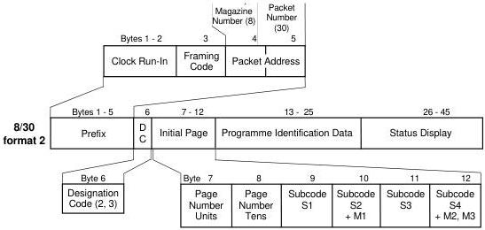

*Figure 16: Coding of Packet 8/30 Format 2*

The coding of bytes 7 to 45 shown in table 19 applies when the designation value is 0010 or 0011. See EN 300 231 [1] for the specification of the Programme Identification Data transmitted in this packet.

Table 19: Coding of Packet 8/30 Format 2

|  Bytes | Bits | Function  |
| --- | --- | --- |
|  6 |  | **Designation code** (Hamming 8/4 coded)  |
|  6 | 1 | '0' = Multiplexed function as defined in clause 4.1 (see note 1) '1' = Non-multiplexed function as defined in clause 4.2 (see note 1)  |
|  6 | 2-4 | When set to 100, bytes 7 to 45 have the functions designated in this table.  |
|  7-12 |  | **Initial Teletext Page** (for storage in a decoder without user action) (All bytes Hamming 8/4 coded) (see notes 1 and 2)  |
|  7 | 1-4 | Page Units (LSB - MSB)  |
|  8 | 1-4 | Page Tens (LSB - MSB)  |
|  9 | 1-4 | Sub-code value S1 (LSB - MSB)  |
|  10 | 1-3 | Sub-code value S2 (LSB - MSB)  |
|  10 | 4 | (Absolute) Magazine address bit, weight 2^{0}  |
|  11 | 1-4 | Sub-code value S3 (LSB - MSB)  |
|  12 | 1-2 | Sub-code value S4 (LSB - MSB)  |
|  12 | 3-4 | (Absolute) Magazine address bits, weight 2^{1} and 2^{2} respectively  |
|  13-25 |  | **Programme Identification Data** Bytes used for Programme Delivery Control (PDC) applications. Function and coding is defined in clause 8.2.1 of EN 300 231 [1].  |
|  26-45 |  | **Status Display** (coded 7 bits plus odd parity) (see note 1). These bytes are coded with odd parity characters from the default G0 character set and, where appropriate, using the characters common to the range of options. The use of national option characters is not recommended. It is intended to display a transmission status message, e.g. the programme title.  |
|  NOTE 1: When packets 8/30 Format 1 are also present in a given transmission, the multiplexed operation flag in the designation code and the data in bytes 7 to 12 and 26 to 45 should be the same for both formats. NOTE 2: When no particular page number is to be specified, the page number FF is transmitted. When no particular page sub-code is to be specified the page sub-code 3F7F is transmitted. When the page address FF:3F7F is transmitted, no page is specified.  |   |   |

## 10 System Components for Presentation

This clause defines system components which are related to the presentation of Teletext data.

### 10.1 Basic Teletext - Presentation Levels 1 and 1.5

Figure 17 summarizes the packets used in systems with presentation Levels 1 and 1.5.

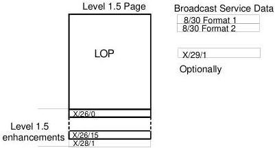

*Figure 17: System components for presentation Levels 1 and 1.5*

At presentation Level 1.5, only a limited number of functions from packets X/26 and X/28/1 are used:

X/26/0 - 15: Accessing G0 characters with diacritical marks from the G2 set.

A few characters from G2 and G3 sets, depending on local language requirements and Codes of Practice, may also be accessed.

Packets X/26 are used also for PDC (see EN 300 231 [1]).

X/28/1: Character set and national option designation (for compatibility with earlier specifications only).

NOTE: Some existing Level 1.5 decoders only respond to packets X/26 with designation codes in the range 0 to 14.

### 10.2 Enhanced Teletext - Presentation Levels 2.5 and 3.5

Figure 18 summarizes the packets used in systems with presentation Levels 2.5 and 3.5.

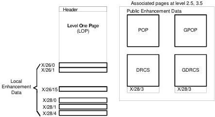

*Figure 18: System components for presentation Levels 2.5 and 3.5*

### 10.3 Page Specific Enhancement Data

The enhancement data carried in packets X/26, X/28/0 Format 1, X/28/1 and X/28/4 is available to the associated Level 1 page only.

#### 10.3.1 Enhancements via X/26/0 - 15

At Levels 2.5 and 3.5, up to 16 packets X/26 can be transmitted per basic Teletext page to implement the following enhancements:

- Adding full screen colour;
- Adding full row colours;
- Placing non-spacing attributes;
- Designating G0 and G2 character sets;
- Placing characters from the G0, G1, G2 and G3 character sets;
- Adding diacritical marks to characters from the G0 set;
- Designating DRCS tables;
- Placing characters from DRCS tables;

- Invoking objects;
- Defining Local Objects.

#### 10.3.2 Enhancements via X/28/0 Format 1

At Levels 2.5 and 3.5, the packet X/28/0 Format 1 of a Level 1 page allows:

- Character set designation;
- Definition of the size and position of side-panels;
- Colour Map coding for CLUTs 2 and 3;
- Substitution of black background colour by the full row colour;
- Re-mapping within the Colour Map of spacing attributes selecting foreground and background colours;
- Definition of a default screen colour;
- Definition of a default row colour.

#### 10.3.3 Enhancements via X/28/1

At Level 3.5, the packet X/28/1 of a Level 1 page allows:

- Dynamic Colour Look Up Table (DCLUT) definition for 12x10x2 12x10x4 and 6x5x4 mode DRCS characters.

#### 10.3.4 Enhancements via X/28/4

At Level 3.5, the packet X/28/4 of a Level 1 page allows:

- Character set designation;
- Definition of the size and position of side-panels;
- Colour Map coding for CLUTs 0 and 1;
- Substitution of black background colour by the full row colour;
- Re-mapping within the Colour Map of spacing attributes selecting foreground and background colours;
- Definition of a default screen colour;
- Definition of a default row colour.

### 10.4 Magazine Specific Enhancement Data

Magazine related packets M/29/0, M/29/1 and M/29/4 provide the same enhancements as the page-specific packets X/28/0 Format 1, X/28/1 and X/28/4 respectively except that the packets with Y = 29 apply to all pages within the magazine unless superseded by the corresponding packet with Y = 28.

### 10.5 Public Enhancement Data

Public enhancement data comprises object definition and DRCS downloading pages. The enhancement data contained within each type can be accessible to all Level 1 pages in the service. This clause describes the format of the pages used to transport the data. Objects and DRCS characters are defined in detail in clauses 13 and 14 respectively.

#### 10.5.1 Object Definition Pages

A Public Object Page (POP) or Global Public Object Page (GPOP) carries the definitions of a number of objects and a pointer table to the location of those objects within the page. Up to seven POPs and one GPOP may be defined per magazine.

##### 10.5.1.1 Page Format

A single (G)POP comprises a page header, packets with Y = 1 to Y = 25 and packets with Y = 26/0 to Y = 26/15. The data in packets with Y = 1 to Y = 25 is Hamming 24/18 coded in the same way as packets with Y = 26. Optionally, a packet with Y = 28/0 can be included to define the page function and coding. Unused packets do not have to be transmitted and partial updates are allowed. Rules governing the transmission of object pages are described in clause B.6.

If the object data does not fit within one page, additional sub-pages can be used but an object cannot continue from one sub-page to the next. Each sub-page can define up to 32 objects of each object type. The maximum number of sub-pages is 16 and each is distinguished by the S1 value of its sub-code. The format for the sub-code is described in clause A.1.

The format of an object definition page is shown in figure 19. There are two main components, a pointer table and object definitions. The 9-bit object number used in an Object Invocation triplet indicates the appropriate sub-page and a fixed location in the pointer table. The value at this location points to the start of the object definition.

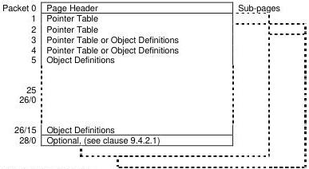

*Figure 19: Format of Object Definition Pages*

NOTE: Packets shown in encoding order.

##### 10.5.1.2 Pointer Table

Packets 1 and 2 are reserved for the transmission of an object pointer table. Pointers to 8 objects of each type can be accommodated in each packet. Optionally, if the number of objects of any one type is in the range 17 to 24, the table is extended into packet 3. Similarly, up to 32 objects of each type can be handled by using packet 4 as well.

If packets 3 and 4 are not an extension of the pointer table they can be used to carry object definitions. It is not allowed to mix both functions within one packet. It is possible to use packet 3 for object definitions and packet 4 for pointers providing the objects are defined and terminated within packet 3. The Hamming 8/4 coded byte (byte 6) at the start of packets 1 - 4 identifies the function of the packet.

|  Byte 6 Data Bits |   |   |   | Function of Packets 1 - 4  |
| --- | --- | --- | --- | --- |
|  B4 | B3 | B2 | B1  |   |
|  X | X | X | 0 | Packet contains object definition data  |
|  X | X | X | 1 | Packet contains table pointer data  |

X = Reserved for future use.

The first triplet in each pointer packet is reserved. The 18 data bits of each remaining triplet provide two 9-bit pointers for two consecutive objects of the same type. The object types are allocated to the triplets in a repeating sequence: two Active followed by two Adaptive followed by two Passive.

Triplet

|  Pkt | 0 | 1 | 2 | 3 | 4 | 5 | 6 | 7 | 8 | 9 | 10 | 11 | 12  |
| --- | --- | --- | --- | --- | --- | --- | --- | --- | --- | --- | --- | --- | --- |
|  1 | Reserved | C0 C1 | D0 D1 | P0 P1 | C2 C3 | D2 D3 | P2 P3 | C4 C5 | D4 D5 | P4 P5 | C6 C7 | D6 D7 | P6 P7  |
|  2 | Reserved | C8 C9 | D8 D9 | P8 P9 | C10 C11 | D10 D11 | P10 P11 | C12 C13 | D12 D13 | P12 P13 | C14 C15 | D14 D15 | P14 P15  |
|  3 | Reserved | C16 C17 | D16 D17 | P16 P17 | C18 C19 | D18 D19 | P18 P19 | C20 C21 | D20 D21 | P20 P21 | C22 C23 | D22 D23 | P22 P23  |
|  4 | Reserved | C24 C25 | D24 D25 | P24 P25 | C26 C27 | D26 D27 | P26 P27 | C28 C29 | D28 D29 | P28 P29 | C30 C31 | D30 D31 | P30 P31  |

C = aCtive objects, D = aDaptive objects, P = Passive objects

Each triplet provides two pointer values:

|  MSB |   |   |   |   |   |   |   | LSB  |
| --- | --- | --- | --- | --- | --- | --- | --- | --- |
|  18 | 17 | 16 | 15 | 14 | 13 | 12 | 11 | 10  |

Pointer to an odd numbered object

|  MSB |   |   |   |   |   |   |   | LSB  |
| --- | --- | --- | --- | --- | --- | --- | --- | --- |
|  9 | 8 | 7 | 6 | 5 | 4 | 3 | 2 | 1  |

Pointer to an even numbered object

111111111 = pointer not used

Each 9-bit pointer gives the absolute triplet number of the definition triplet for the object. The absolute triplet number is in the range 0 to 506 and the reference point is always the first triplet in packet 3, regardless of whether packets 3 and 4 are used to extend the pointer table. Triplet 506 is the last triplet in packet 26/15. Where a pointer is not used, as there is no object with the corresponding number, all nine bits of the pointer should be set to 1. Where a complete row of the pointer table is not used the packet need not be transmitted.

The information in an Object Invocation triplet allows a decoder to locate rapidly the pointer for the required object within the object page specified by the MOT or packets X/27/4 or X/27/5.

A default object invocation direct from the MOT uses a 9-bit object number in the same way. Default objects are restricted to the first 16 objects of each type on each sub-page.

##### 10.5.1.3 Object Definition Area

Object definitions start at the first triplet of the packet following a packet used for table pointers. Depending on the number of objects, object definitions can start in packet 3, 4 or 5. They can occupy all further packets up to and including packet 25 and may then continue in packets X/26/0 to X/26/15 inclusive. The definition of an object cannot continue from one sub-page to the next. Any packets which are not used need not be transmitted.

The function of the four data bits in the Hamming (8/4) coded byte (byte 6) at the start of packets 5 - 25 is reserved. For packets X/26 they have their normal designation code function. The coding of the triplets used for object definitions is described in clauses 12.3.3 and 12.3.4. In this instance the same coding also applies to packets X/1 to X/25.

The last used packet of an object sub-page shall contain at least one Termination Marker triplet. Any unused triplets in this packet should be filled with repetitions of this triplet.

##### 10.5.1.4 Page Number Identification

The page numbers of the POP and/or GPOP required to enhance a Level 1 page are identified from the Magazine Organization Table (MOT) along with the number of sub-pages in use. If packet X/27/4 (and packet X/27/5 if required) is transmitted, the actual sub-pages carrying the objects required by the page as well as the page numbers themselves can be identified. The data in packets X/27/4 and X/27/5, if transmitted, takes precedence over the data in the MOT.

#### 10.5.2 DRCS Downloading Pages

Redefinable characters are downloaded via DRCS pages. Up to seven normal DRCS pages and one global DRCS (GDRCS) page, each of up to 16 sub-pages, may be defined per magazine.

Further details on DRCS characters can be found in clause 14.

##### 10.5.2.1 Page Format

A single DRCS downloading page comprises a page header and packets with Y = 1 to Y = 24. The detailed coding is described in clause 14.1. At Level 3.5 the page may also require a packet with Y = 28/3 to define the display modes of the DRCS characters being downloaded. Optionally, a packet with Y = 28/0 can be included to define the page function and coding. Unused packets do not have to be transmitted and partial updates are allowed. However, the full page has to be transmitted each magazine cycle. Rules governing the transmission of DRCS pages are described in clause B.6.

If the DRCS data does not fit within one page, additional sub-pages can be used. The maximum number of sub-pages is 16 and each is distinguished by the S1 value of its sub-code. The format for the sub-code is described in clause A.1.

##### 10.5.2.2 Page Number Identification

The page numbers of the DRCS and/or GDRCS pages required to enhance a Level 1 page are identified from the Magazine Organization Table (MOT) along with the number of sub-pages in use. If packet X/27/4 (and packet X/27/5 if required) is transmitted, the actual sub-pages carrying the DRCS data required by the page as well as the page numbers themselves can be identified. The data in packets X/27/4 and X/27/5, if transmitted, takes precedence over the data in the MOT.

### 10.6 Magazine Organization Table

Each transmitted magazine contains a special page - a Magazine Organization Table (MOT) - to indicate the linking of up to two object definition pages and up to two DRCS downloading pages to each Level 1 page. The linked enhancement data is associated with the whole set of sub-pages of a Level 1 page, unless redefined by X/27/4 for individual sub-pages.

In addition to the linking information, the MOT data enables default display conditions to be set up to define the format of side-panels and to affect the substitution of black background by the full row colour. This allows these features to be available even if the transmission network cannot distribute packets with address greater than 23.

#### 10.6.1 Page Format

The page number MFE is reserved in each magazine for the MOT page. The page sub-code and other control bits are used to indicate partial or full page updates and the last transmitted packet as described in clauses A.1 and B.6.

A MOT consists of a normal page header plus packets in the range X/1 to X/24, coded Hamming 8/4 throughout. Packets X/1 to X/14 contain pairs of bytes, one pair per page number in the range X00 to XFE. The mapping used is shown in detail in figure 20 and is designed for maximum transmission efficiency if hexadecimal numbered display pages are not in use. The function of unused bytes in packets X/9 to X/14 and all of packets X/15 to X/18 is reserved.

Each pair of bytes associates a Level 1 page with links to object definition and DRCS pages. These links are carried in packets X/19 to X/24. The data in packets X/19 to X/21 is for use by decoders capable of Level 2.5 displays. Packets X/19 and X/20 together specify 8 links to object definition pages. Packet X/21 defines 8 links to DRCS downloading pages and an indication of the number of enhancement pages in the service. Packets X/22 to X/24 have the same format and are intended for use by decoders capable of Level 3.5 displays.

As a minimum, a Level 3.5 service is required to transmit packets X/22 and X/24 since these contain the links to global data. Level 3.5 decoders should first look for the presence of packets X/22 to X/24. It should default to using the data in packets X/19 to X/21 and processing the page to the Level 2.5 standard if either packet X/22 or X/24 is absent. (Packet X/23 may not be required and therefore not transmitted).

A packet X/28/0 Format 1 may be transmitted as part of a MOT to indicate the function of the page and to maintain compatibility with Page Format - CA -data broadcasting decoders designed according to EN 300 708 [2] clause 5.

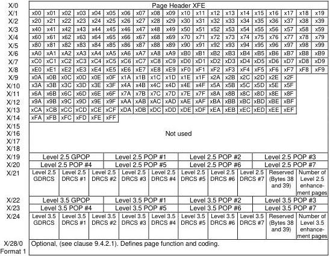

*Figure 20: Coding of a Magazine Organization Table*

#### 10.6.2 Object Page Association

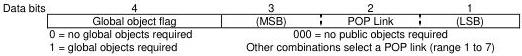

The most significant data bit of the first byte of each byte-pair indicates if the display enhancements to the associated Level 1 page include objects defined within an object definition page specified for global use, i.e. a GPOP.

The three least significant bits select one of the seven links to public object pages. A value of 000 is used to indicate that the page enhancements do not include objects from public object pages.

#### 10.6.3 DRCS Page Association

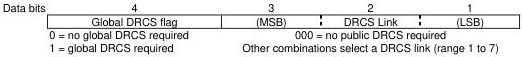

The most significant data bit of the second byte of each byte-pair indicates if the display enhancements to the associated Level 1 page include DRCS characters defined within a DRCS downloading page specified for global use, i.e. a GDRCS.

The three least significant bits select one of the seven links to public DRCS downloading pages. A value of 000 is used to indicate that the page enhancements do not include DRCS characters from public DRCS downloading pages.

#### 10.6.4 Object Links

Packets X/19, X/20, X/22 and X/23 contain links to object definition pages. The first link in packets X/19 and X/22 identifies the GPOPs for Levels 2.5 and 3.5 respectively. A GPOP is an object page for global use accessible by all Level 1 pages in the magazine. The remaining links are to 7 public object pages at Level 2.5 (packets X/19 and X/20) and 7 at Level 3.5 (packets X/22 and X/23). Each Level 1 page can point to one of these links via the first byte of its associated byte-pair.

The object links start at the positions shown in table 20 (bytes numbered 1 to 45):

**Table 20: Object link start positions within MOT**

|  Link | Level 2.5 |   | Level 3.5  |   |
| --- | --- | --- | --- | --- |
|   |  Packet | First Byte Position | Packet | First Byte Position  |
|  GPOP | X/19 | 6 | X/22 | 6  |
|  POP 1 | X/19 | 16 | X/22 | 16  |
|  POP 2 | X/19 | 26 | X/22 | 26  |
|  POP 3 | X/19 | 36 | X/22 | 36  |
|  POP 4 | X/20 | 6 | X/23 | 6  |
|  POP 5 | X/20 | 16 | X/23 | 16  |
|  POP 6 | X/20 | 26 | X/23 | 26  |
|  POP 7 | X/20 | 36 | X/23 | 36  |

Each object link consists of ten bytes:

|  Byte N | N+1 | N+2 | N+3 | N+4 | N+5 | N+6 | N+7 | N+8 | N+9  |
| --- | --- | --- | --- | --- | --- | --- | --- | --- | --- |
|  Magazine & X/27/4, 5 Flag | Page Tens | Page Units | Number of Sub- pages | Fallback Flags (Valid in POP links only) | Default Object Flags | 1st Default Object (lower nibble) | (upper nibble) | 2nd Default Object (lower nibble) | (upper nibble)  |

The function of each element is defined in table 21.

Table 21: Coding of object links within MOT

|  Byte | Bits | Function  |
| --- | --- | --- |
|  N | 4 | **X/27/4, 5 Flag** 0 = Link page number valid for all sub-versions of the display page 1 = Link page number may be superseded by X/27/4 or X/27/5 data  |
|  N | 1-3 | **Page Number of Object Page** Magazine  |
|  N+1 | 1-4 | Page Tens } Page number XFF = link not used  |
|  N+2 | 1-4 | Page Units }  |
|  N+3 | 1-4 | **Number of Sub-Pages** (i.e. highest S1 sub-code value transmitted) 0 = 1 sub-page, F = 16 sub-pages  |
|  N+4 |  | **Fallback Flags**. Valid for POP links only. Bits reserved in GPOP links.  |
|  N+4 | 1 | **Fallback protocol** In the absence of the appropriate packets X/28 and M/29 containing side-panel and black background colour substitution information, this bit specifies the default display mode: 1 = The default is no side-panel and no black background colour substitution 0 = The default conditions are specified by bits 2 - 4 of this byte  |
|   | 2-3 | **Default Side-Panel** (Valid only if bit 1 of this byte = 0) Bit 3 Bit 2 0 0 No side-panel 0 1 Left side-panel, 16 columns wide 1 0 Right side-panel, 16 columns wide 1 1 Left and right side-panels, each 8 columns wide  |
|   | 4 | **Default Background Colour** (Valid only if bit 1 of this byte = 0) 0 = No substitution of black background by Full Screen/Row Colour 1 = Black background replaced by Full Screen/Row Colour  |
|  N+5 | 1-4 | **Default Object Flags**. Object types for invocation purposes (see clause 10.6.4.1).  |
|  N+6 | 1-4 | **1st Default Object**. Object number for invocation purposes (see clause 10.6.4.1).  |
|  N+7 | 1-4 |   |
|  N+8 | 1-4 | **2nd Default Object**. Object number for invocation purposes (see clause 10.6.4.1).  |
|  N+9 | 1-4 |   |

##### 10.6.4.1 Default Object Invocation

The objects to be used as default objects are defined by bytes N+5 to N+9 of an object link.

Byte N+5 defines the types of object to be invoked:

|  Bit 2 | Bit 1 | Type of 1st Default Object  |
| --- | --- | --- |
|  0 | 0 | No default object required  |
|  0 | 1 | Active  |
|  1 | 0 | Adaptive  |
|  1 | 1 | Passive  |

|  Bit 4 | Bit 3 | Type of 2nd Default Object  |
| --- | --- | --- |
|  0 | 0 | No default object required  |
|  0 | 1 | Active  |
|  1 | 0 | Adaptive  |
|  1 | 1 | Passive  |

Bytes N+6, N+7 and N+8, N+9 provide the object numbers for invocation purposes:

|  1st Default Object |   |   |   |   |   |   |   | 2nd Default Object |   |   |   |   |   |   |   |
| --- | --- | --- | --- | --- | --- | --- | --- | --- | --- | --- | --- | --- | --- | --- | --- |
|  Byte N+7 |   |   |   | Byte N+6 |   |   |   | Byte N+9 |   |   |   | Byte N+8 |   |   |   |
|  4 | 3 | 2 | 1 | 4 | 3 | 2 | 1 | 4 | 3 | 2 | 1 | 4 | 3 | 2 | 1  |
|  N7 | N6 | N5 | N4 | N3 | N2 | N1 | N0 | N7 | N6 | N5 | N4 | N3 | N2 | N1 | N0  |

Bits N3 - N0 (MSB - LSB) define the S1 component of the sub-code of the sub-page containing the object definition.

Bit N7 defines the location of the relevant part of the Pointer Table within the object page:

|  N7 | Pointer Location  |
| --- | --- |
|  0 | Packet 1  |
|  1 | Packet 2  |

Bits N5 and N6 indicate the triplet containing the pointer data in the packet defined by bit N7. The interpretation depends upon the type of object being invoked. Bit N4 indicates the location of the pointer data within the triplet specified by bits N5 to N6:

|   |  | Triplet Number (range 0 - 12) |   |   |  | N4 | Pointer Position  |
| --- | --- | --- | --- | --- | --- | --- | --- |
|  N6 | N5 | Active | Adaptive | Passive |  | 0 | Bits 1 to 9 (LSB - MSB)  |
|  0 | 0 | 1 | 2 | 3 |  | 1 | Bits 10 to 18 (LSB - MSB)  |
|  0 | 1 | 4 | 5 | 6 |  |  |   |
|  1 | 0 | 7 | 8 | 9 |  |  |   |
|  1 | 1 | 10 | 11 | 12 |  |  |   |

#### 10.6.5 DRCS Links

Packets X/21 and X/24 contain links to DRCS downloading pages. The first link in each of these packets identifies the GDRCS page for Levels 2.5 and 3.5 respectively. A GDRCS is a DRCS downloading page for global use accessible by all Level 1 pages in the magazine. The remaining links are to 7 public DRCS downloading pages at Level 2.5 (packet X/21) and 7 at Level 3.5 (packet X/24). Each Level 1 page can point to one of these links via the second byte of its associated byte-pair.

The DRCS page links start at the positions shown in table 22 (bytes numbered 1 to 45):

Table 22: DRCS link start positions within MOT

|   | Level 2.5 |   | Level 3.5  |   |
| --- | --- | --- | --- | --- |
|  Link | Packet | First Byte Position | Packet | First Byte Position  |
|  GDRCS | X/21 | 6 | X/24 | 6  |
|  DRCS 1 | X/21 | 10 | X/24 | 10  |
|  DRCS 2 | X/21 | 14 | X/24 | 14  |
|  DRCS 3 | X/21 | 18 | X/24 | 18  |
|  DRCS 4 | X/21 | 22 | X/24 | 22  |
|  DRCS 5 | X/21 | 26 | X/24 | 26  |
|  DRCS 6 | X/21 | 30 | X/24 | 30  |
|  DRCS 7 | X/21 | 34 | X/24 | 34  |

Each DRCS link consists of 4 bytes:

|  Byte N | N+1 | N+2 | N+3  |
| --- | --- | --- | --- |
|  Magazine and X/27/4, 5 Flag | Page Tens | Page Units | Number of Sub-pages  |

The function of each element is defined in table 23.

Table 23: Coding of DRCS links within MOT

|  Byte | Bits | Function  |
| --- | --- | --- |
|  N | 4 | X/27/4, 5 Flag 0 = Link page number valid for all sub-versions of the display page 1 = Link page number may be superseded by X/27/4 or X/27/5 data  |
|  N | 1-3 | Page Number of DRCS Page  |
|  N+1 | 1-4 | Magazine Page Tens } Page number XFF = link not used  |
|  N+2 | 1-4 | Page Units }  |
|  N+3 | 1-4 | Number of Sub-Pages (i.e. highest S1 sub-code value transmitted) 0 = 1 sub-page, F = 16 sub-pages  |
|  NOTE 1: Bytes 38 and 39 in packets X/21 and X/24 are reserved.  |   |   |
|  NOTE 2: The broadcaster shall ensure that any DRCS characters referenced within an object invoked by a given page are implicitly referenced by the MOT link for that page, or are included in one of the DRCS downloading page(s) referenced by that page.  |   |   |

#### 10.6.6 Number of Enhancement Pages

The last six bytes in packet X/21 of the MOT are intended to indicate the total number of Level 2.5 object definition and DRCS downloading pages in the complete service. Similarly, the last six bytes in packet X/24 indicate the value for Level 3.5 enhancement pages. In some circumstances it may not be possible to include all magazines in the calculation and part of the transmitted data indicates which magazines have been included in the totals.

The total for object pages includes both public and global pages. For both object and DRCS pages the totals include all sub-pages of pages referenced by MOTs and local packets X/27.

The coding of bytes 40 - 45 in packets X/21 and X/24 is shown below. (All bytes are Hamming 8/4 encoded prior to transmission.)

|  Data bits | Byte 40 |   |   |   | Byte 41 |   |   |   | Byte 42 |   |   |   | Byte 43 |   |   |   | Byte 44 |   |   |   | Byte 45  |   |   |   |
| --- | --- | --- | --- | --- | --- | --- | --- | --- | --- | --- | --- | --- | --- | --- | --- | --- | --- | --- | --- | --- | --- | --- | --- | --- |
|   |  4 | 3 | 2 | 1 | 4 | 3 | 2 | 1 | 4 | 3 | 2 | 1 | 4 | 3 | 2 | 1 | 4 | 3 | 2 | 1 | 4 | 3 | 2 | 1  |
|   | M3 | M2 | M1 | M8 | M7 | M6 | M5 | M4 | P3 | P2 | P1 | P0 | P7 | P6 | P5 | P4 | D3 | D2 | D1 | D0 | D7 | D6 | D5 | D4  |

M8, M1 - M7 One flag per magazine to indicate if the magazine is included in the total.
P7 - P0 (MSB - LSB) Total number of object pages (range 0 to FF).
D7 - D0 (MSB - LSB) Total number of DRCS pages (range 0 to FF).

### 10.7 Links between Enhanced System Components

#### 10.7.1 Linking to Object and DRCS Pages via the MOT

The action of linking to object definition and DRCS downloading pages via the MOT is summarized in figure 21.

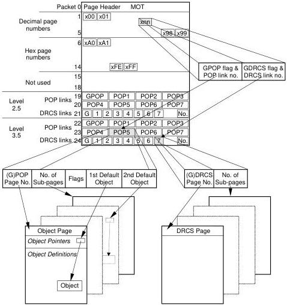

*Figure 21: Linking to object and DRCS pages via the MOT*

#### 10.7.2 Linking to Object and DRCS Pages via Packets X/27/4 and X/27/5

The action of linking to object definition and DRCS downloading pages via packets X/27/4 or X/27/5 is summarized in figure 22.

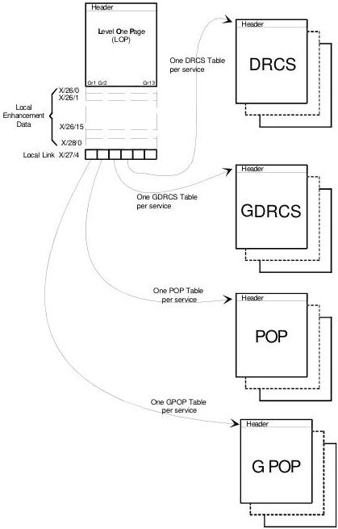

*Figure 22: Linking to object and DRCS data pages via packets X/27/4 at Level 2.5*

See also clause E.4 for the preferred use of packets X/27/4 and X/27/5.

In the above example the four links have the following functions at Level 2.5:

Link 1: Global POP;

Link 2: Normal POP;

Link 3: Global DRCS;

Link 4: Normal DRCS.

At Level 3.5 the last two links of the packet X/27/4 and the first two links of a packet X/27/5 might be used.

## 11 System Components for Navigation

This clause defines system components which suitable decoders can interpret to assist the user in finding information and navigating within a Teletext database.

### 11.1 Navigation via FLOF

#### 11.1.1 Principles

The FLOF Code of Practice (annex H) defines a user-friendly page access method. The user is presented with a number of choices regarding pages to read next and selects one with a single key press on his control unit. Page access times can be significantly reduced if the decoder has additional page storage capacity.

#### 11.1.2 Additional components

In addition to the normal page packets Y = 0 to Y = 23, the service features require the use of packets Y = 24, Y = 27/0 and optionally packet 8/30 Format 1.

- Packets Y = 24. In this application, this packet contains user "prompt" information for display, provided by the page editor. It associates a given key on the user's control unit with a linked page address included in packets with Y = 27.

Packets Y = 27, designation code value 0000. This packet contains the addresses of linked pages to be associated with the user "prompt" information carried in the packet with Y = 24, link control information, a display row 24 flag and error detection data (see clause 9.6.1).

- Packet 8/30 Format 1 - Broadcast Service Data (see clause 9.8.1). When there is no valid data available for a given category of the information carried by this packet, fall-back codes should be included.

Navigation via FLOF is summarized in figure 23.

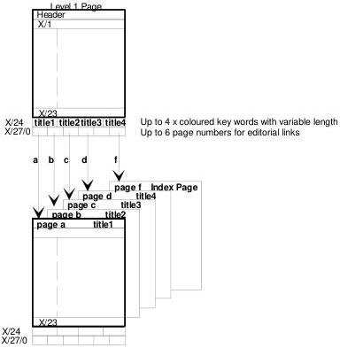

*Figure 23: Principles of navigation via FLOF*

### 11.2 Navigation via TOP

#### 11.2.1 Principles

The TOP Code of Practice (see annex I) defines a user-friendly page access method. The basic idea underlying the TOP system is to categorize the pages within a Teletext transmission according to specific themes and sub-themes. This information, comprising titles and page numbers, is transmitted via a number of special pages. The decoder can build menus for the user from this data, allowing the user to select a page by theme or content. Page access times can be significantly reduced if the decoder has additional page storage capacity.

#### 11.2.2 Additional components

There are four types of data pages used within TOP. Each comprises packets in the range Y = 0 to Y = 23 only, although an optional packet with Y = 28/0 (Format 1) may be included to define the page function and coding (see clause 9.4.2.4):

- Basic TOP table (BTT). Packets with Y = 1 to Y = 23 are coded Hamming 8/4 throughout. The page number is fixed at 1F0.
- Additional Information Table (AIT). Each packet in the range Y = 1 to Y = 23 has bytes 6 to 13 and 26 to 33 coded Hamming 8/4, and bytes 14 to 25 and 34 to 45 coded 7 bits data plus 1 odd parity bit. The page number is defined from within the BTT data.
- Multi-Page Tables (MPT). Packets with Y = 1 to Y = 23 are coded Hamming 8/4 throughout. The page number is defined from within the BTT data.
- Multi-Page Extension Table (MPT-EX). Packets with Y = 1 to Y = 23 are coded Hamming 8/4 throughout. The page number is defined from within the BTT data.

Navigation via TOP is summarized in figure 24.

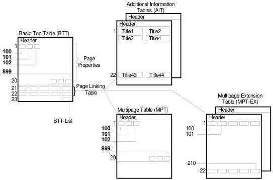

*Figure 24: Principles of navigation via TOP tables*

### 11.3 Magazine Inventory Page

#### 11.3.1 Principles

An inventory page may be transmitted for each magazine in the service. For each page in the magazine, the inventory data identifies the function of the page and indicates the number of sub-pages. A multi-page decoder may use this information to optimize its storage capacity, especially when handling rotating pages.

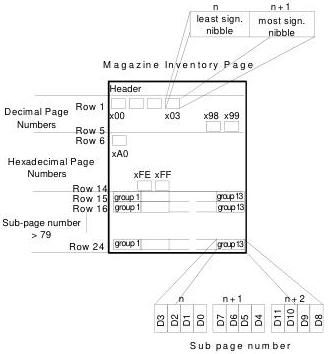

*Figure 25: Principles of the Magazine Inventory Page*

#### 11.3.2 Format of the Magazine Inventory Page

The page number FD is reserved for the Magazine Inventory Page (MIP) in each magazine. The page sub-code is set as for a data page according to clause A.1, with S1 fixed at 0. The page consists of a normal page header, and packets with Y= 1 to Y = 24 Hamming 8/4 coded throughout. An optional packet with Y = 28/0 (Format 1) may be transmitted as part of a MIP to define the page function and coding (see clause 9.4.2.4) to maintain compatibility with data broadcasting decoders designed according to EN 300 708 [2].

Within packets Y = 1 to Y = 14, pairs of bytes are allocated to each page number in the magazine (range 00 to FF). Each pair defines the function of the associated page. The page number mapping used within this table is designed for maximum transmission efficiency if hexadecimal page numbers are not in use. If there are no pages in transmission which are described in the same packet Y = 1 to Y = 14 then that packet need not be transmitted.

As described in clause 11.3.4, data from packets with Y = 15 to Y = 24 indicates the precise number of sub-pages for certain of the page classifications of table 24. A packet in the range Y=15 to Y =24 which carries no information need not be transmitted.

The construction of the MIP is shown in figure 26.

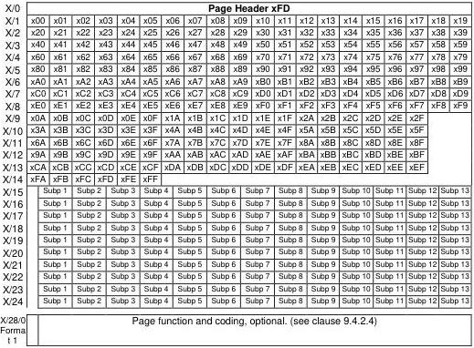

*Figure 26: Magazine Inventory Page*

NOTE: Shaded bytes are not used.

#### 11.3.3 Page Function Coding

The pair of Hamming 8/4 coded bytes per page number yield an 8-bit page code value. The first byte provides the lower nibble and the second the upper nibble.

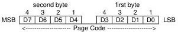

The interpretation to be placed on the Page Code values is shown in table 24.

Table 24: Magazine Inventory Page (MIP) Codes

|  Page Code | Function | Notes  |
| --- | --- | --- |
|  00 | Page not in transmission |   |
|  01 | Single normal page | (see note 1)  |
|  02 - 4F | Normal page Sub-pages in range 2 to 79 | A value in this range indicates the number of sub-pages being transmitted. The number of sub-pages is NOT defined in packets with Y = 15 to Y = 24.  |
|  50 | Normal page, multi-page set Sub-pages in the range 80 to 2^{12}-1 | Number of sub-pages defined according to clause 11.3.4.  |
|  51 | Normal page, multi-page set Sub-pages in the range 2^{12} to 2^{13}-2 | Number of sub-pages defined according to clause 11.3.4.  |
|  52 - 6F | Reserved |   |
|  70 - 77 | Subtitle page | Maximum of one page of storage required. The 3 LSBs correspond to the setting of the C12, C13 and C14 bits in the page header of the subtitle page.  |
|  78 | Subtitle Menu Page | Maximum of one page of storage required. (see note 2).  |
|  79 | Page not following normal sub-code rules | E.g. Alarm clock page. Maximum of one page of storage required.  |
|  7A | TV programme related warning page | Maximum of one page of storage required. (see note 3)  |
|  7B | Current TV Programme information, multi-page set | Number of sub-pages defined according to clause 11.3.4, range 2 to 2^{12}-1.  |
|  7C | Current TV Programme information, single page | Maximum of one page of storage required  |
|  7D | "Now and Next" TV Programmes | Maximum of one page of storage required. (see note 5)  |
|  7E | Index page to TV-related pages, multi-page set | Number of sub-pages defined according to clause 11.3.4, range 2 to 2^{12}-1.  |
|  7F | Index page to TV-related pages, single page | Maximum of one page of storage required.  |
|  80 | Page transmitted but NOT part of the public service | (see note 6)  |
|  81 | Single Page containing TV schedule information | (see note 1)  |
|  82 - CF | TV schedule pages, multi-page set Sub-pages in the range 2 to 79 | A value in this range indicates the number of sub-pages being transmitted. The number of sub-pages is NOT defined in packets with Y = 15 to Y = 24.  |
|  D0 | TV schedule pages, multi-page set Sub-pages in the range 80 to 2^{12}-1 | Number of sub-pages defined according to clause 11.3.4.  |
|  D1 | TV schedule pages, multi-page set Sub-pages in the range 2^{12} to 2^{13}-2 | Number of sub-pages defined according to clause 11.3.4.  |
|  D2 - DF | Reserved |   |
|  E0 | Page Format - CA - data broadcasting page Sub-pages in the range 1 to 2^{12}-1 | (see note 7) Page defined according to EN 300 708 [2] clause 5. Number of sub-pages defined according to clause 11.3.4.  |
|  E1 | Page Format - CA - data broadcasting page Sub-pages in the range 2^{12} to 2^{13}-2 | (see note 7) Page defined according to EN 300 708 [2] clause 5. Number of sub-pages defined according to clause 11.3.4.  |
|  E2 | Page Format - CA - data broadcasting page Number of sub-pages not defined in packets with Y = 15 to Y = 24 | (see note 7) Page defined according to EN 300 708 [2] clause 5  |
|  E3 | Page Format - Clear data broadcasting page including EPG data | Page defined according to EN 300 708 [2] clause 4. EPG data defined according to EN 300 707 [3]. Note 7  |
|  E4 | Page Format - Clear data broadcasting page but not carrying EPG data | Defined according to EN 300 708 [2] clause 4.(see note 7)  |
|  E5 | DRCS page (use not defined) |   |
|  E6 | Object page (use not defined) |   |
|  E7 | Systems page without displayable element. Function defined by page number. | e.g.: MOT and MIP.  |

|  Page Code | Function | Notes  |
| --- | --- | --- |
|  E8 | DRCS page referenced in the MOT for this magazine | (see note 8)  |
|  E9 | DRCS page referenced in the MOT for this magazine but not required by a page in this magazine | (see note 8)  |
|  EA | DRCS page referenced in the MOT for a different magazine but not required by a page in this magazine | (see note 8)  |
|  EB | DRCS page not referenced in the MOT for a different magazine and required by a page in another magazine | (see note 8)  |
|  EC | Object page referenced in the MOT for this magazine | (see note 8)  |
|  ED | Object page referenced in the MOT for this magazine but not required by a page in this magazine | (see note 8)  |
|  EE | Object page referenced in the MOT for a different magazine but not required by a page in this magazine | (see note 8)  |
|  EF | Object page not referenced in the MOT for a different magazine and required by a page in another magazine | (see note 8)  |
|  F0 - F3 | Systems Pages for Broadcasters use (downstream processing) |   |
|  F4 - F6 | Engineering Test pages | Test or operational information  |
|  F7 | Systems page with displayable element. Function defined by page number. |   |
|  F8 | Keyword Search list page, multi-page set | For use with packet X/25. Number of sub-pages defined according to clause 11.3.4, range 2 to 2^{12}-1  |
|  F9 | Keyword Search list page, single page | Maximum of one page of storage required. For use with packet X/25  |
|  FA - FC | Reserved |   |
|  FC | Trigger message page | Page carrying trigger messages as defined and coded in [8]  |
|  FD | Automatic Channel Installation (ACI) | Annex L.  |
|  FE | TOP page (BTT, AIT, MPT or MPT-EX) | (see note 9)  |
|  FF | Reserved |   |
|  NOTE 1: Decoders should treat this page as a single page storing only the last transmitted version. The contents of the page may change under editorial control. Any sub-pages should be displayed automatically when the page is selected for display.  |   |   |
|  NOTE 2: The Subtitle Menu Page is an editorial page indicating the pages numbers used for subtitles in a number of different languages.  |   |   |
|  NOTE 3: This page contains information concerning the content of the current TV programme so that the viewer can be warned of its suitability for general viewing. A decoder may chose to display this page automatically on a channel change or when it appears in the transmission.  |   |   |
|  NOTE 4: A decoder may display this page on request from the viewer while the receiver is operating in TV mode.  |   |   |
|  NOTE 5: This page may be displayed as a default in the absence of any Electronic Programme Guide data (see EN 300 707 [3]).  |   |   |
|  NOTE 6: This page could be designated editorially as being part of a premium or closed user group service that is not data broadcasting.  |   |   |
|  NOTE 7: Page not intended for display containing data for subsequent processing, e.g. telesoftware.  |   |   |
|  NOTE 8: The decoder can use this information to aid determination of the priority of storing a particular DRCS or object definition page.  |   |   |
|  NOTE 9: This code applies to all TOP related pages. The decoder should interpret the function according to the principles outlined in annex I.  |   |   |

#### 11.3.4 Sub-page range

Certain page codes in table 24 indicate that the page comprises a number of sub-pages. The precise number of sub-pages is coded into packets with Y = 15 to Y = 24. Groups of three bytes (coded Hamming 8/4) provide the 12 LSBs to define values up to 2¹²-1, the bits being transmitted least significant bit first. For a sub-set of these page codes, values up to 2¹³-2 can be identified and the least significant bit of the page code provides the most significant bit of the number of sub-pages.

|   | LSB of Page Code, where applicable 1 | third byte of group 4 3 2 1 | second byte of group 4 3 2 1 | first byte of group 4 3 2 1 | LSB  |
| --- | --- | --- | --- | --- | --- |
|  MSB | D12 | D11 D10 D9 D8 | D7 D6 D5 D4 | D3 D2 D1 D0 |   |
|  <--- Number of sub-pages --->  |   |   |   |   |   |

The three byte groups within packets with Y = 15 to Y = 24 are arranged in the order of occurrence of the page codes which support sub-page definition in packets with Y = 1 to Y = 14. In any packet, byte 6 is not used and the first group starts at byte 7.

## 12 Presentation Levels

This clause defines four Presentation Levels with reference to the transmission requirements, the display features available at each Level and the response of a suitable decoder. To maintain compatibility with all decoder types, especially all existing decoders, a display at a higher Presentation Level is achieved by sending additional data to enhance a basic Teletext page.

**Presentation Level 1:** defines the basic Teletext page, characterized by the use of spacing attributes only and a limited alphanumeric and mosaics repertoire.

**Presentation Level 1.5:** decoder responds as Level 1 but the character repertoire is extended via packets X/26.

**Presentation Level 2.5:** extends the fixed alphanumeric and mosaic repertoire and increases the number of display colours. Sixteen of the 32 colours are re-definable. The number of character spaces per row can be increased to 56, providing side panels of 16 characters. It introduces non-spacing display attributes and a limited number of redefinable characters.

**Presentation Level 3.5:** extends the number of redefinable characters and the modes available and introduces bolding, italicizing, and proportional spacing of alphanumeric characters. All 32 colours are redefinable.

### 12.1 Display Components

Table 25 summarizes the main display components and their availability at each presentation Level.

Table 25: Summary of Display Components and their application

|  Display Component | Description | Presentation Level 1 1.5 2.5 3.5  |
| --- | --- | --- |
|  Display Rows and Columns | Up to 24 rows, (plus an optional 25th row for navigation purposes), transmitted in packets X/0 to X/24, top to bottom of a page in magazine X. 40 character spaces (columns) in rows 1 to 24, transmitted from left to right. Following the 8 control codes (which should not be displayed), 32 character-spaces in the header (row 0), transmitted from left to right. NOTE: It is usual practice to transmit "time-of-day" information in the last 8 character spaces of packet X/0. | ⊕ ⊕ ⊕ ⊕  |
|   | An additional 16 character spaces can be displayed as side-panels in rows 1 - 24. The display data is defined via packets X/26 and Objects. NOTE: No side-panel information is transmitted for row 0. If side-panels are used with the page, the display format of row 0 is at the discretion of the equipment manufacturer. | ○ ○ ⊕ ⊕  |
|  Character Bytes | In packets X/0 to X/25, each data byte (coded 7 bits plus odd parity) selects an alphanumeric character from a G0 character set, a mosaic character from the G1 character set or a spacing attribute to occupy a character-space. | ⊕ ⊕ ⊕ ⊕  |
|   | In countries where Level 1 decoders exist, a suitable fall back character should be transmitted in character locations to be overwritten by data from packets X/26. In countries where there are no Level 1 decoders, an even parity character may be transmitted in these character locations. | ○ ⊕ ⊕ ⊕  |
|  G0 Character Set | Set of 95 alphanumeric characters, plus SPACE (2/0), used as the default character set. Address range 2/0 to 7/F. The Latin G0 set, table 35, is the default set. National option characters exist for certain locations in some G0 sets. Where the decoder is capable of displaying more than one national option sub-set, the correct character to display is determined from control bits C12 - C14. Note that this substitution of certain characters only occurs when a G0 set character is referenced from packets X/1-X/25 of the Level 1 page. It does not apply when characters are referenced via packets X/26 or objects. In some countries two G0 sets are required to meet the language requirements. The spacing attribute ESC (code 1/B) is used to switch between the two alternative character sets. The default G0 set to be used at the start of each display row is determined from the C12 - C14 control bits. Each occurrence of ESC within the display row causes the decoder to toggle between the two sets. | ⊕ ⊕ ⊕ ⊕  |
|  G0 Character Set Designation and Re-designation | Optionally, one G0 character set can be designated by packets X/28/1 and/or M/29/1 for compatibility with earlier specifications. The page-related data (X/28/1) takes precedence over the magazine-related data (M/29/1). Decoders may respond to this data to ensure the correct interpretation of the C12, C13 and C14 control bits when selecting national option sets related to the designated or default G0 character set. Equipment intended for operation with only a single group of character set options may ignore this data. | ○ ⊕ ○ ○  |
|   | Optionally, the two G0 character sets and additional data regarding the correct selection of national option subsets can be designated by packets X/28/0 Format 1 and M/29/0. The page-related data (X/28/0 Format 1) takes precedence over the magazine-related data (M/29/0). Equipment intended for operation with only a single group of character set options may ignore this data. | ○ ⊕ ⊕ ⊕  |
|   | Optionally, the G0 set accessible via packets X/26 or objects can be re-designated by a column address group triplet. | ○ ○ ⊕ ⊕  |
|   | Optionally, the two G0 character sets and additional data regarding the correct selection of national option subsets can be designated by packets X/28/4 and M/29/4. The page-related data (X/28/4) takes precedence over the magazine-related data (M/29/4). Equipment intended for operation with only a single group of character set options may ignore this data. | ○ ○ ○ ⊕  |
|  G1 Character Set | Fixed set of 63 block mosaic characters plus SPACE (2/0) and 32 alphanumeric characters, table 47. Address range 2/0 to 7/F. The mosaic characters are displayed with their elements either contiguous or separated, (see clause 15.7.1). The alphanumeric characters at positions 4/0 to 5/F are taken from the G0 set, applying the same rules to national option positions as described above. | ⊕ ⊕ ⊕ ⊕  |

|  Display Component | Description | Presentation Level 1 1.5 2.5 3.5  |
| --- | --- | --- |
|  G2 Supplementary Character Set | Set of 95 supplementary alphanumeric characters plus SPACE (2/0). Address range 2/0 to 7/F. The Latin G2 supplementary character set, table 37, is the default. The response of a decoder to codes 5/9, 5/A, 5/B and 6/5 is not defined. NOTE: The repertoire of these additional characters available in a Level 1.5 decoder is not fixed and is determined by the language requirements in the country of use. | ○ ⊕ ⊕ ⊕  |
|  G2 Supplementary Character | Optionally, the G2 character can be designated by packets X/28/0 Format 1 and M/29/0. The page-related data (X/28/0 Format 1) takes precedence over the magazine-related data (M/29/0). | ○ ○ ⊕ ⊕  |
|  Set Designation | Optionally, the G2 set accessible via packets X/26 or objects can be re-designated by a column address triplet. | ○ ○ ⊕ ⊕  |
|  and Re-designation | Optionally, the G2 character can be designated by packets X/28/4 and M/29/4. The page-related data (X/28/4) takes precedence over the magazine-related data (M/29/4). | ○ ○ ○ ⊕  |
|  G3 Character Set | Fixed set of 95 smoothed block mosaic and line drawing characters comprising 91 symbols plus SPACE (5/F), table 48. Address range 2/0 to 7/F. The response of a decoder to codes 6/E, 6/F, 7/E and 7/E is not defined. | ○ ⊕ ⊕ ⊕  |
|  Bold, Italics, Prop. spacing | The G0 and G2 character sets may be displayed in bold, in italics or proportionally spaced, (see clause 12.3.4). | ○ ○ ○ ⊕  |
|  Redefinable Characters (DRCS) | 24 DRCS characters of mode type 12x10x1, displayed using the foreground and background colours selected at the display position. Pixel patterns defined via DRCS downloading pages whose page numbers are specified in the Magazine Organization Table (MOT) and/or packets X/27/4 (see clauses 10.6 and 9.6.2 respectively). Each character is defined by one Pattern Transfer Unit (PTU) of 20 bytes. | ○ ○ ⊕ ○  |
|   | Four different DRCS modes are available: 12x10x1 Pixel colour = foreground colour at the display position. One PTU per character. 12x10x2 Pixel colours = up to 4 colours from the Colour Map; the set of colours is defined using a DCLUT4. Two PTUs per character. 12x10x4 Pixel colours = up to 16 colours from the Colour Map; the set of colours is defined using a DCLUT16. Four PTUs per character. 6x5x4 Pixel colours = up to 16 colours from the Colour Map; the set of colours is defined using a DCLUT16. One PTU per character. A Level 3.5 decoder should have the memory capacity to display up to 384 PTUs. The page numbers and number of sub-tables used for the downloading process are specified in the Magazine Organization Table and/or in packets X/27/4 and X/27/5. Packets X/28/3 are associated with DRCS downloading pages to define the mode of each DRCS character. | ○ ○ ○ ⊕  |
|  Objects | Objects as described in clause 13. An Object may comprise any collection of characters, mosaics or non-spacing attributes available at Levels 2.5. and 3.5. Objects may be displayed in both the page and side-panel areas. An Object may not be positioned so that it crosses the boundary between page and side-panel areas. | ○ ○ ⊕ ⊕  |

|  Display Component | Description | Presentation Level 1 1.5 2.5 3.5  |
| --- | --- | --- |
|  Character Colours | 8 background full intensity colours: Black, Red, Green, Yellow, Blue, Magenta, Cyan, White. 7 foreground full intensity colours: Red, Green, Yellow, Blue, Magenta, Cyan, White. Invoked as spacing attributes via codes in packets X/0 to X/25. | ⊕ ⊕ ⊕ ⊕  |
|   | Black foreground: Invoked as a spacing attribute via codes in packets X/0 to X/25. | ○ ○ ⊕ ⊕  |
|   | 32 colours per page. The Colour Map contains four CLUTs (numbered 0 - 3), each of 8 entries. Each entry has a four bit resolution for the RGB components, clause 12.4. Colour Definition CLUT 0 defaults to the full intensity colours used as spacing colour attributes at Levels 1 and 1.5. CLUT 1, entry 0 is defined to be transparent. CLUT 1, entries 1 to 7 default to half intensity versions of CLUT 0, entries 1 to 7. CLUTs 2 and 3 have the default values specified in clause 12.4. CLUTs 2 and 3 can be defined for a particular page by packet X/28/0 Format 1, or for all pages in magazine M by packet M/29/0. Colour Selection CLUT 0, entries 1 to 7 are selectable directly by the Level 1 data as spacing attributes. CLUTs 0 to 3 are selectable via packets 26 or objects as non-spacing attributes. The foreground and background colour codes on the Level 1 page may be used to select colours from other parts of the Colour Map. Different CLUTs may be selected for both foreground and background colours. This mapping information is transmitted in packet X/28/0 Format 1 for the associated page and in packet M/29/0 for all pages in magazine M. | ○ ○ ⊕ ⊕  |
|   | With the exception of entry 0 in CLUT 1 (transparent), CLUTs 0 and 1 can be redefined for a particular page by packet X/28/4, or for all pages in magazine M by packet M/29/4. | ○ ○ ○ ⊕  |
|  Row and Screen Colours | Full row and full screen colours may be displayed. Any of the 32 colours may be selected. Selection is made explicitly via data in packets X/26 or objects, or, as separate defaults for the screen area and all rows, from data in packets X/28/0 Format 1 (for the associated page) or packet M/29/0 (for all pages in magazine M). In the absence of any row or screen colour selection data, the default colour is defined by CLUT 0, entry 0. At Level 2.5 this will be Black, but at Level 3.5 it can be redefined. The colour selected also applies to the side-panel areas. | ○ ○ ⊕ ⊕  |
|  Side-Panel(s) | Side-panels, as described in clause 12.5, allow additional characters per row. A total of 56 characters/symbols can be displayed on each row. The additional columns can appear to the left or right of the normal 40 character row, in any combination. | ○ ○ ⊕ ⊕  |

### 12.2 Spacing attributes

Set of 32 spacing attributes, four without response at Levels 1 and 1.5, transmitted via packets X/0 to X/25. The decoder defaults to specified attributes at the start of each display row. Some attributes have effect immediately ("Set-At"), others at the following character-space ("Set-After"). The action of an attribute persists until the end of a row or until the transmission of a further attribute that modifies its action. Unless operating in "Hold Mosaics" mode, each character space occupied by a spacing attribute is displayed as a SPACE. The spacing attributes are summarized in table 26.

**Table 26: Spacing attributes**

|  Code (hex) | Function | Presentation Level 1 1.5 2.5 3.5  |
| --- | --- | --- |
|  0/0 to 0/7 | **Alpha Colour Codes** ('Set-After') The alpha colour codes set the foreground colour of the characters to the appropriate colour and select a G0 set as the current default character set. These conditions persist until changed by a further colour code attribute (either alpha or mosaic), or the start of a new row. |   |
|  0/0 | **Alpha Black** ('Set-After') NOTE: Alpha Black should be used with caution as it is interpreted by some existing Level 1 and Level 1.5 decoders. | ○ ○ ⊕ ⊕  |
|  0/1 | **Alpha Red** ('Set-After') | ⊕ ⊕ ⊕ ⊕  |
|  0/2 | **Alpha Green** ('Set-After') | ⊕ ⊕ ⊕ ⊕  |
|  0/3 | **Alpha Yellow** ('Set-After') | ⊕ ⊕ ⊕ ⊕  |
|  0/4 | **Alpha Blue** ('Set-After') | ⊕ ⊕ ⊕ ⊕  |
|  0/5 | **Alpha Magenta** ('Set-After') | ⊕ ⊕ ⊕ ⊕  |
|  0/6 | **Alpha Cyan** ('Set-After') | ⊕ ⊕ ⊕ ⊕  |
|  0/7 | **Alpha White** ('Set-After') - Start-of-row default condition. | ⊕ ⊕ ⊕ ⊕  |
|  0/8 | **Flash** ('Set-After') This code causes the foreground pixels of the following alphanumeric and mosaics characters to alternate between the foreground and background colours. The flash action is cancelled by a Steady command (0/9) or by the start of a new row. | ⊕ ⊕ ⊕ ⊕  |
|  0/9 | **Steady** ('Set-At') - Start-of-row default condition. This code cancels the flash action of code 0/8. | ⊕ ⊕ ⊕ ⊕  |
|  0/A | **End Box** ('Set-After') - Start-of-row default condition. This code cancels the action of the Start Box code 0/B | ⊕ ⊕ ⊕ ⊕  |
|  0/B | **Start Box** ('Set-After') On pages with the C5 or C6 bits set (Newsflash or subtitle), this code defines (on each appropriate row) the start of an area that is to be boxed into the normal video picture. Characters outside this area are not displayed, but changes in display mode, colour, height etc., will affect the boxed area. Cancelled by an End Box code (0/A) or by the start of a new row. NOTE: Protection against false operation is provided by double transmission of Start Box control characters, with the action taking place between them. | ⊕ ⊕ ⊕ ⊕  |
|  (continued)  |   |   |

Table 26 (continued): Spacing attributes

|  Code (hex) | Function | Presentation Level 1 1.5 2.5 3.5  |
| --- | --- | --- |
|  0/C | **Normal Size** ("Set-At") - Start-of-row default condition. This code cancels the action of the double height, double width and double size codes, and restores the characters to normal, single row height and single character width. | ⊕ ⊕ ⊕ ⊕  |
|  0/D | **Double Height** ("Set-After") The characters and mosaics following a double height code are stretched into the following row. The origin of a character is the upper character position. The whole of an enlarged character is displayed with the attributes that apply to the origin of the character. When double height (or double size) characters are used on a given row, the row below normal height characters on that row is displayed with the same local background colour and no foreground data. Any transmitted Level 1 characters and attributes for the lower row are ignored. ("Local background colour" is defined as the background colour invoked for the character cell immediately above as a result of processing Level 1 data, active objects and local enhancement data.) NOTE 1: The broadcaster should not insert double height control characters in rows 23 or 24. NOTE 2: The application of one size-related control code (double height, double width or double size) terminates the action of any other Level 1 spacing size-related attribute or Level 2.5/3.5 non-spacing size-related attribute. | ⊕ ⊕ ⊕ ⊕  |
|   | Characters defined by enhancement data (local X/26 or Objects) may be addressed to locations on the lower row that are not occupied by the lower parts of double height/size characters and will be displayed. NOTE 3: Some existing Level 1.5 decoders will not display local X/26 enhancement data in these circumstances. The display of these enhancement characters will follow the normal rules for the object concerned except that for Active and Adaptive Objects the attributes to be used in the absence of any defined by the object will be the start-of-row defaults modified only by any previous enhancement data on the row. This also applies to any characters written by the local X/26 triplets on the page itself. Character cells on the lower row of a double height pair in which the enhancement data does not specify an actual character will not be changed in any respect by the object. | ○ ○ ⊕ ⊕  |
|  (continued)  |   |   |

Table 26 (continued): Spacing attributes

|  Code (hex) | Function | Presentation Level 1 1.5 2.5 3.5  |
| --- | --- | --- |
|  0/E | **Double Width** ("Set-After") Characters are to be stretched horizontally to occupy the next character-space. NOTE 4: Double Width should be used with caution as it is interpreted by some existing Level 1 and Level 1.5 decoders. Since this attribute has a "Set-After" function, to ensure correct displays it must not be inserted in either of the last two columns positions of any display row, nor immediately preceding the edge of a boxed area". NOTE 5: The application of one size-related control code (double height, double width or double size) terminates the action of any other Level 1 spacing size-related attribute or Level 2.5/3.5 non-spacing size-related attribute. | ○ ○ ⊕ ⊕  |
|  0/F | **Double Size** ("Set-After") Characters are to be stretched horizontally and vertically as for both double height and double width characters. When double size characters are used on a given row, the row below normal height characters on that row is displayed with the same local background colour and no foreground data. Any transmitted Level one characters and attributes for the lower row are ignored. ("Local background colour" is defined as the background colour invoked for the character cell immediately above as a result of processing Level 1 data, active objects and local enhancement data.) Characters defined by enhancement data (local X/26 or Objects) may be addressed to locations on the lower row that are not occupied by the lower parts of double height/size characters and will be displayed. NOTE 6: Some existing Level 1.5 decoders will not display local X/26 enhancement data in these circumstances. The display of these enhancement characters will follow the normal rules for the object concerned except that for Active and Adaptive Objects the attributes to be used in the absence of any defined by the object will be the start-of-row defaults modified only by any previous enhancement data on the row. This also applies to any characters written by the local X/26 triplets on the page itself. Character cells on the lower row of a double height pair in which the enhancement data does not specify an actual character will not be changed in any respect by the object. NOTE 7: The broadcaster should not insert double height control characters in rows 23 or 24. NOTE 8: The application of one size-related control code (double height, double width or double size) terminates the action of any other Level 1 spacing size-related attribute or Level 2.5/3.5 non-spacing size-related attribute. NOTE 9: Double Size should be used with caution as it is interpreted by some existing Level 1 and Level 1.5 decoder. Some may interpret it as Double Height. Since this attribute has a "Set-After" function, to ensure correct displays it must not be inserted in either of the last two columns positions of any display row, nor immediately preceding the edge of a boxed area. | ○ ○ ⊕ ⊕  |
|  (continued)  |   |   |

Table 26 (continued): Spacing attributes

|  Code (hex) | Function | Presentation Level 1 1.5 2.5 3.5  |
| --- | --- | --- |
|  1/0 to 1/7 | **Mosaic Colour Codes** ("Set-After") The mosaic colour codes set the foreground colour of the characters to the appropriate colour and select the G1 set as the current default character set. These conditions persist until changed by a further colour code attribute (either alpha or mosaic), or the start of a new row. For subsequent characters in columns 2, 3, 6 & 7 of the G1 set, bits 1, 2, 3, 4, 5 & 7 respectively set the top left, top right, middle left, middle right, lower left and lower right graphic blocks of each character. |   |
|  1/0 | **Mosaics Black** ("Set-After") NOTE 10: Mosaics Black should be used with caution as it is interpreted by some existing Level 1 and Level 1.5 decoders. | ○ ○ ⊕ ⊕  |
|  1/1 | **Mosaics Red** ("Set-After") | ⊕ ⊕ ⊕ ⊕  |
|  1/2 | **Mosaics Green** ("Set-After") | ⊕ ⊕ ⊕ ⊕  |
|  1/3 | **Mosaics Yellow** ("Set-After") | ⊕ ⊕ ⊕ ⊕  |
|  1/4 | **Mosaics Blue** ("Set-After") | ⊕ ⊕ ⊕ ⊕  |
|  1/5 | **Mosaics Magenta** ("Set-After") | ⊕ ⊕ ⊕ ⊕  |
|  1/6 | **Mosaics Cyan** ("Set-After") | ⊕ ⊕ ⊕ ⊕  |
|  1/7 | **Mosaics White** ("Set-After") | ⊕ ⊕ ⊕ ⊕  |
|  1/8 | **Conceal** ("Set-At") The following characters up to the end of the row, or until a Colour Code attribute (codes 0/0 to 0/7 or 1/0 to 1/7) is encountered, are to be displayed as SPACES until revealed by a decoder or user operation. | ⊕ ⊕ ⊕ ⊕  |
|  1/9 | **Contiguous Mosaic Graphics** ("Set-At") - Start-of-row default condition The blocks of a mosaics character adjoin one another. NOTE 11: This code has effect only on characters defined at Levels 1 and 1.5. | ⊕ ⊕ ⊕ ⊕  |
|  1/A | **Separated Mosaic Graphics** ("Set-At") Each block of a mosaics character is surrounded by a border of the background colour. NOTE 12: This code has effect only on characters defined at Levels 1 and 1.5. | ⊕ ⊕ ⊕ ⊕  |
|  1/B | **ESC** (or Switch) ("Set-After") Toggles between the first and second G0 sets defined by packets X/28/0 Format 1, X/28/4, M/29/0 or M/29/4. The default at the start of each row is the default G0 set. This does not affect characters written via packets X/26 or as part of an object. NOTE 13: May also be used in connection with data for processing. | ⊕ ⊕ ⊕ ⊕  |
|  1/C | **Black Background** ("Set-At") - Start-of-row default condition. This code immediately changes the background colour to the colour at entry 0 of the background CLUT, or to the current Full Row colour if black background colour substitution is in operation. The foreground colour is not affected. | ⊕ ⊕ ⊕ ⊕  |
|  |   |   |
|  (continued)  |   |   |

Table 26 (concluded): Spacing attributes

|  Code (hex) | Function | Presentation Level 1 1.5 2.5 3.5  |
| --- | --- | --- |
|  1/D | **New Background** ("Set-At") This code causes a new background colour to be selected immediately. Any following characters and mosaics may be invisible until a different foreground colour attribute is encountered. | ⊕ ⊕ ⊕ ⊕  |
|   | The foreground colour currently selected is adopted as the background colour. | ⊕ ⊕ ○ ○  |
|   | The CLUT from which the background colour is to be taken is defined by the Colour Table Re-mapping bits in a packet X/28/0 Format 1, X/28/4, M/29/0 or M/29/4, if valid, otherwise defaulting to CLUT 0. The entry in the selected CLUT is specified by the entry number of the foreground colour currently selected by the Level 1 page. | ○ ○ ⊕ ⊕  |
|  1/E | **Hold Mosaics** ("Set-At") Generally, all spacing attributes are displayed as spaces, implying at least one space between characters or mosaics with different colours in the same row. In mosaics mode, the "Hold Mosaics" option allows a limited range of attribute changes without intervening spaces. A mosaic character from the G1 set (referred to as the "Held-Mosaic" character) is displayed in place of the character "SPACE" corresponding to a control character. Substitution only takes place in mosaics mode when Hold Mosaics mode is in force. At a screen location where substitution is permitted, the "Held-Mosaic" character inserted is the most recent mosaics character with bit 6 = '1' in its code on that row. The "Held-Mosaic" character is reset to "SPACE" at the start of each row, on a change of alphanumeric/mosaics mode or on a change of size. It is not reset by reinforcement of the existing size setting. It is not reset by a change in Hold Mosaics mode. The "Held-Mosaic" character is always displayed in its original contiguous or separated form regardless of the mode prevailing at the time of substitution. NOTE 14: This code has effect only on characters defined at Levels 1 and 1.5. Size and character set changes invoked by enhancement triplets at Levels 2.5 and 3.5 do not cancel Hold Mosaics. | ⊕ ⊕ ⊕ ⊕  |
|  1/F | **Release Mosaics** ("Set-After") - Start-of-row default condition. This code cancels the Hold Mosaics mode. NOTE 15: This code has effect only on characters defined at Levels 1 and 1.5. | ⊕ ⊕ ⊕ ⊕  |

### 12.3 Non-spacing attributes and additional characters

#### 12.3.1 Use of Packets X/26

This clause defines the function of the triplets of packets X/26. It is also applicable to packets X/3 to X/25 of an object definition page. In general, a triplet or combination of triplets define a screen location and the enhancements to the Level 1 page to be set at that location. Certain enhancements also apply to subsequent positions on the same row until either explicitly terminated or the end of the row is reached. The function of certain triplets may be modified depending on whether the triplet occurs in local enhancement data or within an object.

The 18 data bits of each triplet are divided into 3 fields:

|  Address |   |   |   |   |   | Mode |   |   |   |   |   | Data  |   |   |   |   |   |
| --- | --- | --- | --- | --- | --- | --- | --- | --- | --- | --- | --- | --- | --- | --- | --- | --- | --- |
|  6 | 5 | 4 | 3 | 2 | 1 | 11 | 10 | 9 | 8 | 7 | 18 | 17 | 16 | 15 | 14 | 13 | 12  |
|  A5 | A4 | A3 | A2 | A1 | A0 | M4 | M3 | M2 | M1 | M0 | D6 | D5 | D4 | D3 | D2 | D1 | D0  |

Triplets are divided into two groups according to the value of the address field - a Column Address Group (0 ≤ Address ≤ 39) and a Row Address Group (40 ≤ Address ≤ 63).

The functions of the Row Address and Column Address triplets are summarized in table 27 and defined in clauses 12.3.3 and 12.3.4 respectively.

**Table 27: Summary of Packet X/26 Triplet Functions**

|  Mode | Row Address Group (40 ≤ Address field ≤ 63) | Column Address Group (0 ≤ Address field ≤ 39)  |
| --- | --- | --- |
|  00000 | Full Screen Colour | Foreground Colour  |
|  00001 | Full Row Colour | Block Mosaic Character from the G1 set  |
|  00010 | Reserved | Line Drawing or Smoothed Mosaic Character from the G3 set (Level 1.5)  |
|  00011 | Reserved | Background Colour  |
|  00100 | Set Active Position | Reserved  |
|  00101 | Reserved | Reserved  |
|  00110 | Reserved | PDC - Cursor Column & Announced Starting & Finishing Time Minutes  |
|  00111 | Address Display Row 0 | Additional Flash Functions  |
|  01000 | PDC - Country of Origin and Programme Source | Modified G0 and G2 Character Set Design.  |
|  01001 | PDC - Month & Day | Character from the G0 set (Levels 2.5 & 3.5)  |
|  01010 | PDC - Cursor Row & Announced Starting Time Hours | Reserved  |
|  01011 | PDC - Cursor Row & Announce Finishing Time Hours | Line Drawing or Smoothed Mosaic Character from the G3 set (Levels 2.5 & 3.5)  |
|  01100 | PDC - Cursor Row & Local Time Offset | Display Attributes  |
|  01101 | PDC - Series Identifier and Series Code | DRCS Character Invocation  |
|  01110 | Reserved | Font Style  |
|  01111 | Reserved | Character from the G2 set  |
|  10000 | Origin Modifier | G0 character without diacritical mark  |
|  10001 | Active Object Invocation | G0 character with diacritical mark  |
|  10010 | Adaptive Object Invocation | G0 character with diacritical mark  |
|  10011 | Passive Object Invocation | G0 character with diacritical mark  |
|  10100 | Reserved | G0 character with diacritical mark  |
|  10101 | Active Object Definition | G0 character with diacritical mark  |
|  10110 | Adaptive Object Definition | G0 character with diacritical mark  |
|  10111 | Passive Object Definition | G0 character with diacritical mark  |
|  11000 | DRCS Mode | G0 character with diacritical mark  |
|  11001 | Reserved | G0 character with diacritical mark  |
|  11010 | Reserved | G0 character with diacritical mark  |
|  11011 | Reserved | G0 character with diacritical mark  |
|  11100 | Reserved | G0 character with diacritical mark  |
|  11101 | Reserved | G0 character with diacritical mark  |
|  11110 | Reserved | G0 character with diacritical mark  |
|  11111 | Termination Marker | G0 character with diacritical mark  |

#### 12.3.2 Active Position

The address field of certain packet X/26 triplets is used to specify the Active Position. The Active Position is defined by row and column co-ordinates and is a reference to a screen location within the normal page area. It is used to position enhancement data when overwriting a Level 1 page. The valid ranges are 0 to 24 for the row component and 0 to 39 for the column component. The range is extended to the side-panel areas through the action of the Origin Modifier triplet.

Display row 0 is addressed by explicit use of the row address group with mode value 00111. This triplet also has the action of setting both the row and column co-ordinates of the Active Position to 0.

A row co-ordinate in the range 1 to 24 is set by the address field of the most recent Full Row Colour or Set Active Position triplet. Address value 40 (decimal) implies row 24 and values 41 to 63 indicate rows 1 to 23 inclusive. A Full Row Colour triplet also sets the column co-ordinate to 0. A Set Active Position triplet sets the column co-ordinate explicitly.

Level 2.5 and 3.5 decoders should not use the address field of other row address triplets for modifying the Active Position.

The Active Position is assumed to be reset to row 0, column 0 when starting to process local enhancement data or placing default objects.

Apart from the one column address triplet used for PDC and those which are reserved, the column co-ordinate is set by the address field of column address triplets and the row co-ordinate is not modified.

#### 12.3.3 Row Address triplets

Table 28 defines the function of each Row Address triplet, i.e. triplets with address values ≥ 40.

Table 28: Function of Row Address triplets

|  Mode Bits (M4...M1) | Function |   |   |   |   |   |   |   |   |   |   |   |   |   |   |   |   |   |   |   | Presentation Level 1 1.5 2.5 3.5  |
| --- | --- | --- | --- | --- | --- | --- | --- | --- | --- | --- | --- | --- | --- | --- | --- | --- | --- | --- | --- | --- | --- |
|  00000 | Full Screen Colour |   |   |   |   |   |   |   |   |   |   |   |   |   |   |   |   |   |   |   | ○ ○ ⊕ ⊕  |
|   | Address (≥ 40) |   |   |   |   |   | Mode |   |   |   |   | Data |   |   |   |   |   |   |   |   |   |
|   | 6 | 5 | 4 | 3 | 2 | 1 | 11 | 10 | 9 | 8 | 7 | 18 | 17 | 16 | 15 | 14 | 13 | 12 |  |   |   |
|   | R5 | R4 | R3 | R2 | R1 | R0 | 0 | 0 | 0 | 0 | 0 | S1 | S0 | C1 | C0 | E2 | E1 | E0 |  |   |   |
|  |   |   |   |   |   |   |   |   |   |   |   |   |   |   |   |   |   |   |   |   |   |
|   | The address value does not alter the Active Position for object placement. When S1 and S0 are both set to '0', the remaining data bits define the full screen colour. Bits C1 and C0 select a CLUT in the Colour Map of table 30, and bits E2 - E0 select an entry from that CLUT. All other data field values are reserved. Full screen colour applies to the screen area above row 0 and below row 23, or row 24 if used. The default full screen colour to be used in the absence of this triplet is defined in clause A.5. The use of this function is restricted to local enhancement data and Active Objects. (continued)  |   |   |   |   |   |   |   |   |   |   |   |   |   |   |   |   |   |   |   |   |

Table 28 (continued): Function of Row Address triplets

|  Mode Bits (M4...M1) | Function |   |   |   |   |   |   |   |   |   |   |   |   |   |   |   |   |   |   |   | Presentation Level 1 1.5 2.5 3.5  |   |
| --- | --- | --- | --- | --- | --- | --- | --- | --- | --- | --- | --- | --- | --- | --- | --- | --- | --- | --- | --- | --- | --- | --- |
|  00001 | **Full Row Colour** |   |   |   |   |   |   |   |   |   |   |   |   |   |   |   |   |   |   |   | ○ ○ ⊕ ⊕  |   |
|   | Address (≥ 40) |   |   |   |   |   | Mode |   |   |   |   |   | Data |   |   |   |   |   |   |   |   |   |
|   | 6 | 5 | 4 | 3 | 2 | 1 | 11 | 10 | 9 | 8 | 7 |  | 18 | 17 | 16 | 15 | 14 | 13 | 12 |  |   |   |
|   | R5 | R4 | R3 | R2 | R1 | R0 | 0 | 0 | 0 | 0 | 1 |  | S1 | S0 | C1 | C0 | E2 | E1 | E0 |  |   |   |
|   | The row co-ordinate of the Active Position is set by the address field according to clause 12.3.2 and the column co-ordinate is set to '0'. When S1 and S0 have the same value, the remaining bits of the data field select a row colour. Bits C1 and C0 select a CLUT in the Colour Map of table 30, and bits E2 - E0 select an entry from that CLUT. The rows adopting this colour are specified by the S1 and S0 bits and the address field: |   |   |   |   |   |   |   |   |   |   |   |   |   |   |   |   |   |   |   |   |   |
|   | **S1** | **S0** | **Rows Affected** |   |   |   |   |   |   |   |   |   |   |   |   |   |   |   |   |   |  |   |
|   | 0 | 0 | Full Row Colour applies only to the addressed row |   |   |   |   |   |   |   |   |   |   |   |   |   |   |   |   |   |  |   |
|   | 0 | 1 | Reserved |   |   |   |   |   |   |   |   |   |   |   |   |   |   |   |   |   |  |   |
|   | 1 | 0 | Reserved |   |   |   |   |   |   |   |   |   |   |   |   |   |   |   |   |   |  |   |
|   | 1 | 1 | Full Row Colour applies to the area from and inclusive of the addressed row down to and including row 23 (or 24 if used), unless subsequently overridden by a further Full Row Colour command on a subsequent row |   |   |   |   |   |   |   |   |   |   |   |   |   |   |   |   |   |  |   |
|   | The use of this function is restricted to local enhancement data and Active Objects. The default row colour to be used in the absence of this triplet is defined in clause A.5. |   |   |   |   |   |   |   |   |   |   |   |   |   |   |   |   |   |   |   |   |   |
|  00010 | **Reserved** |   |   |   |   |   |   |   |   |   |   |   |   |   |   |   |   |   |   |   |  |   |
|  00011 | **Reserved** |   |   |   |   |   |   |   |   |   |   |   |   |   |   |   |   |   |   |   |  |   |
|  00100 | **Set Active Position** |   |   |   |   |   |   |   |   |   |   |   |   |   |   |   |   |   |   |   |  |   |
|   | Address (≥ 40) |   |   |   |   |   | Mode |   |   |   |   |   | Data |   |   |   |   |   |   |   |  |   |
|   | 6 | 5 | 4 | 3 | 2 | 1 | 11 | 10 | 9 | 8 | 7 |  | 18 | 17 | 16 | 15 | 14 | 13 | 12 |  |   |   |
|   | R5 | R4 | R3 | R2 | R1 | R0 | 0 | 0 | 1 | 0 | 0 |  | C6 | C5 | C4 | C3 | C2 | C1 | C0 |  |   |   |
|   | The Active Position comprises row and column co-ordinates and enables objects to be placed at defined screen locations. It also allows the row co-ordinate to be set prior to column-based instructions. The address field sets the row co-ordinate (according to clause 12.3.2) for all data field values. If the data field value is less than 40 (decimal), bits C6 - C0 (MSB - LSB) define the column co-ordinate. All other data field values are reserved. |   |   |   |   |   |   |   |   |   |   |   |   |   |   |   |   |   |   |   |   |   |
|   | Row co-ordinate: |   |   |   |   |   |   |   |   |   |   |   |   |   |   |   |   |   |   |   | ○ ⊕ ⊕ ⊕ |   |
|   | Column co-ordinate: |   |   |   |   |   |   |   |   |   |   |   |   |   |   |   |   |   |   |   | ○ ○ ⊕ ⊕ |   |
|  00101 | **Reserved** |   |   |   |   |   |   |   |   |   |   |   |   |   |   |   |   |   |   |   |  |   |
|  00110 | **Reserved** |   |   |   |   |   |   |   |   |   |   |   |   |   |   |   |   |   |   |   |  |   |
|  (continued) |   |   |   |   |   |   |   |   |   |   |   |   |   |   |   |   |   |   |   |   |   |   |

Table 28 (continued): Function of Row Address triplets

|  Mode Bits (M4...M1) | Function |   |   |   |   |   |   |   |   |   |   |   |   |   |   |   |   |   |   |   |   | Presentation Level 1 1.5 2.5 3.5  |   |
| --- | --- | --- | --- | --- | --- | --- | --- | --- | --- | --- | --- | --- | --- | --- | --- | --- | --- | --- | --- | --- | --- | --- | --- |
|  00111 | **Address Display Row 0** |   |   |   |   |   |   |   |   |   |   |   |   |   |   |   |   |   |   |   |   | ○ ⊕ ⊕ ⊕  |   |
|   |  | Address |   |   |   |   |   |  | Mode |   |   |   |   |  | Data |   |   |   |   |   |  |   |   |
|   |  | 6 | 5 | 4 | 3 | 2 | 1 |  | 11 | 10 | 9 | 8 | 7 |  | 18 | 17 | 16 | 15 | 14 | 13 | 12 |   |   |
|   |  | 1 | 1 | 1 | 1 | 1 | 1 |  | 0 | 0 | 1 | 1 | 1 |  | S1 | S0 | C1 | C0 | E2 | E1 | E0 |   |   |
|  |   |   |   |   |   |   |   |   |   |   |   |   |   |   |   |   |   |   |   |   |   |   |   |
|   | When the address field is set to 111111 the Active Position is set to row 0, column 0. Subsequent column address triplets should address columns 8 to 39 only. The function of the triplet for other address values (40 - 62) is reserved and the Active Position is not modified. When row 0 is to be addressed and bits S1 and S0 have the same value, the remaining bits of data field select a colour. Bits C1 and C0 select a CLUT in the Colour Map of table 30, and bits E2 - E0 select an entry from that CLUT. The rows adopting this colour are specified by the S1 and S0 bits: |   |   |   |   |   |   |   |   |   |   |   |   |   |   |   |   |   |   |   |   |   |   |
|   |  | **S1** | **S0** |   | **Rows Affected** |   |   |   |   |   |   |   |   |   |   |   |   |   |   |   |   |  |   |
|   |  | 0 | 0 |   | Full Row Colour applies to row 0 only |   |   |   |   |   |   |   |   |   |   |   |   |   |   |   |   |  |   |
|   |  | 0 | 1 |   | Reserved |   |   |   |   |   |   |   |   |   |   |   |   |   |   |   |   |  |   |
|   |  | 1 | 0 |   | Reserved |   |   |   |   |   |   |   |   |   |   |   |   |   |   |   |   |  |   |
|   |  | 1 | 1 |   | Full Row Colour applies to the area from row 0 down to and including row 23 (or 24 if used), unless subsequently overridden by a Full Row Colour command on a subsequent row |   |   |   |   |   |   |   |   |   |   |   |   |   |   |   |   |  |   |
|   | The default row colour to be used in the absence of this triplet is defined in clause A.5. The use of this function is restricted to local enhancement data and Active Objects. NOTE: The use of double height and double size attributes in row 0 is not permitted. |   |   |   |   |   |   |   |   |   |   |   |   |   |   |   |   |   |   |   |   |   |   |
|  01000 | **PDC Data - Country of Origin and Programme Source** (see EN 300 231 [1]) |   |   |   |   |   |   |   |   |   |   |   |   |   |   |   |   |   |   |   |   | ○ ⊕ ⊕ ⊕  |   |
|  01001 | **PDC Data - Month and Day** (see EN 300 231 [1]) |   |   |   |   |   |   |   |   |   |   |   |   |   |   |   |   |   |   |   |   | ○ ⊕ ⊕ ⊕  |   |
|  01010 | **PDC Data - Cursor Row and Announced Starting Time Hours** (see EN 300 231 [1]) |   |   |   |   |   |   |   |   |   |   |   |   |   |   |   |   |   |   |   |   | ○ ⊕ ⊕ ⊕  |   |
|  01011 | **PDC Data - Cursor Row and Announced Finishing Time Hours** (see EN 300 231 [1]) |   |   |   |   |   |   |   |   |   |   |   |   |   |   |   |   |   |   |   |   | ○ ⊕ ⊕ ⊕  |   |
|  01100 | **PDC Data - Cursor Row and Local Time Offset** (see EN 300 231 [1]) |   |   |   |   |   |   |   |   |   |   |   |   |   |   |   |   |   |   |   |   | ○ ⊕ ⊕ ⊕  |   |
|  01101 | **PDC Data - Series Identifier and Series Code** (see EN 300 231 [1]) |   |   |   |   |   |   |   |   |   |   |   |   |   |   |   |   |   |   |   |   | ○ ⊕ ⊕ ⊕  |   |
|  01110 | **Reserved** |   |   |   |   |   |   |   |   |   |   |   |   |   |   |   |   |   |   |   |   |  |   |
|  01111 | **Reserved** |   |   |   |   |   |   |   |   |   |   |   |   |   |   |   |   |   |   |   |   |  |   |
|  (continued)  |   |   |   |   |   |   |   |   |   |   |   |   |   |   |   |   |   |   |   |   |   |   |   |

Table 28 (continued): Function of Row Address triplets

|  Mode Bits (M4...M1) | Function |   |   |   |   |   |   |   |   |   |   |   |   |   |   |   |   |   |   |   |   | Presentation Level 1 1.5 2.5 3.5  |
| --- | --- | --- | --- | --- | --- | --- | --- | --- | --- | --- | --- | --- | --- | --- | --- | --- | --- | --- | --- | --- | --- | --- |
|  10000 | **Origin Modifier** |   |   |   |   |   |   |   |   |   |   |   |   |   |   |   |   |   |   |   |   | ○ ○ ⊕ ⊕  |
|   | Address (≥ 40) |   |   |   |   |   | Mode |   |   |   |   |   | Data |   |   |   |   |   |   |   |   |   |
|   | 6 | 5 | 4 | 3 | 2 | 1 | 11 | 10 | 9 | 8 | 7 |  | 18 | 17 | 16 | 15 | 14 | 13 | 12 |  |  |   |
|   | rR5 | rR4 | rR3 | rR2 | rR1 | rR0 | 1 | 0 | 0 | 0 | 0 |  | rC | rC | rC | rC | rC | rC | rC |  |  |   |
|   |  |  |  |  |  |  |  |  |  |  |  |  | 6 | 5 | 4 | 3 | 2 | 1 | 0 |  |  |   |
|   | = Row Offset + 40 |   |   |   |   |   |  |  |  |  |  |  | = Column Offset |   |   |   |   |   |   |   |   |   |
|   | The Origin Modifier changes the origin of the object whose invocation triplet immediately follows it by adding temporary offset values to the row and column co-ordinates of the current Active Position. After one object invocation both offsets are reset to '0' and the current Active Position is restored. The row offset is calculated by subtracting 40 (decimal) from the address field value. The column offset is defined by the data field. The valid range is 0 to 71 (decimal), allowing access to the side-panels. |   |   |   |   |   |   |   |   |   |   |   |   |   |   |   |   |   |   |   |   |   |
|  10001 | **Object Invocation** |   |   |   |   |   |   |   |   |   |   |   |   |   |   |   |   |   |   |   |   | ○ ○ ⊕ ⊕  |
|  10010 | These three row address groups are used to invoke Active, Adaptive and Passive Objects respectively. The sequence of triplets defined in the object is executed at each invocation instance. The screen position of each element is determined from its individual co-ordinates, the Active position at the point of invocation and any Origin Modifier triplet immediately preceding the invocation triplet. General format of Object Invocation triplets: |   |   |   |   |   |   |   |   |   |   |   |   |   |   |   |   |   |   |   |   |   |
|  10011 |  |   |   |   |   |   |   |   |   |   |   |   |   |   |   |   |   |   |   |   |   |   |
|   | Address (≥ 40) |   |   |   |   |   | Mode |   |   |   |   |   | Data |   |   |   |   |   |   |   |   |   |
|   | 6 | 5 | 4 | 3 | 2 | 1 | 11 | 10 | 9 | 8 | 7 |  | 18 | 17 | 16 | 15 | 14 | 13 | 12 |  |  |   |
|   | 1 | S1 | S0 | X | N8 | N7 | 1 | 0 | 0 | M | M0 |  | N6 | N5 | N4 | N3 | N2 | N1 | N0 |  |  |   |
|   |  |  |  |  |  |  |  |  |  | 1 |  |  |  |  |  |  |  |  |  |  |  |   |
|   | Bit 3 is reserved. Bits 4 and 5 define the source of the object, and bits 7 and 8 the object type: |   |   |   |   |   |   |   |   |   |   |   |   |   |   |   |   |   |   |   |   |   |
|   | **S1** | **S0** | **Object Source** |   |   |   |   |   | **M1** |   |   | **M0** |   |   | **Object Type** |   |   |   |   |   |  |   |
|   | (0 | 0 | Illegal) |   |   |   |   |   | (0 |   |   | 0 |   |   | Origin Modifier) |   |   |   |   |   |  |   |
|   | 0 | 1 | Local |   |   |   |   |   | 0 |   |   | 1 |   |   | Active |   |   |   |   |   |  |   |
|   | 1 | 0 | POP |   |   |   |   |   | 1 |   |   | 0 |   |   | Adaptive |   |   |   |   |   |  |   |
|   | 1 | 1 | GPOP |   |   |   |   |   | 1 |   |   | 1 |   |   | Passive |   |   |   |   |   |  |   |
|  (continued) |   |   |   |   |   |   |   |   |   |   |   |   |   |   |   |   |   |   |   |   |   |   |

Table 28 (continued): Function of Row Address triplets

|  Mode Bits (M4...M1) | Function |   |   |   |   | Presentation Level 1 1.5 2.5 3.5  |
| --- | --- | --- | --- | --- | --- | --- |
|  10001 | **Object Invocation** (continued) |   |   |   |   |   |
|  10010 | Bits N0 - N8 select a particular object of the specified type from the specified source. The interpretation of these bits depends on whether a POP/GPOP or Local Object is being invoked. |   |   |   |   |   |
|  10011 |  |   |   |   |   |   |
|  (cont.) | POP or GPOP Object |   |   |   |   |   |
|   | When the Object Source is indicated as POP or GPOP (S1 = 1, S0 = X), bits N0 to N8 identify the sub-page carrying the object definition and the position of the associated pointer within the pointer table at the start of the page: |   |   |   |   |   |
|   | Bits N3 - N0 (MSB - LSB) define the S1 component of the sub-code of the page containing the object definition. |   |   |   |   |   |
|   | Bits N7 and N8 define the location of the relevant part of the Pointer Table within the object page: |   |   |   |   |   |
|   | **N8** | **N7** | **Pointer Location** |   |  |   |
|   | 0 | 0 | Packet 1 |   |  |   |
|   | 0 | 1 | Packet 2 |   |  |   |
|   | 1 | 0 | Packet 3 |   |  |   |
|   | 1 | 1 | Packet 4 |   |  |   |
|   | Bits N5 and N6 indicate the triplet containing the pointer data in the packet defined by bits N7 and N8. The interpretation depends upon the type of object being invoked: |   |   |   |   |   |
|   |  |  | Triplet Number (range 0 - 12) |   |  |   |
|   | **N6** | **N5** | **Active** | **Adaptive** | **Passive** |   |
|   | 0 | 0 | 1 | 2 | 3 |   |
|   | 0 | 1 | 4 | 5 | 6 |   |
|   | 1 | 0 | 7 | 8 | 9 |   |
|   | 1 | 1 | 10 | 11 | 12 |   |
|   | Bit N4 indicates the location of the pointer data within the triplet specified by bits N5 to N8: |   |   |   |   |   |
|   | **N4** | **Pointer Position** |   |  |  |   |
|   | 0 | Bits 1 to 9 (LSB - MSB) |   |  |  |   |
|   | 1 | Bits 10 to 18 (LSB - MSB) |   |  |  |   |
|   | Local Object |   |   |   |   |   |
|   | NOTE: A Local Object can only be invoked by local packet 26 enhancement data, either directly by an Object Invocation command, or via another Local Object of the appropriate type, as defined in clauses 13.3 to 13.5. It is not possible to invoke a Local Object from outside the page to which it belongs or from public objects. When the Object Source is indicated as Local (S1 = 0, S0 = 1), bit N8 is set to '0'. Bits N0 - N7 identify the location of the object's definition triplet in terms of a packet 26 designation code and triplet number: |   |   |   |   |   |
|   | N7 - N4 (MSB - LSB) define the packet 26 designation code (range 0 - 15). N3 - N0 (MSB - LSB) define the triplet number (range 0 - 12). |   |   |   |   |   |
|   | (continued) |   |   |   |   |   |

Table 28 (continued): Function of Row Address triplets

|  Mode Bits (M4...M1) | Function |   |   |   |   |   |   |   |   |   |   |   |   |   |   |   |   |   |   |   |   | Presentation Level 1 1.5 2.5 3.5  |
| --- | --- | --- | --- | --- | --- | --- | --- | --- | --- | --- | --- | --- | --- | --- | --- | --- | --- | --- | --- | --- | --- | --- |
|  10100 | **Reserved** |   |   |   |   |   |   |   |   |   |   |   |   |   |   |   |   |   |   |   |   |   |
|  10101 | **Object Definition** |   |   |   |   |   |   |   |   |   |   |   |   |   |   |   |   |   |   |   |   | ○ ○ ⊕ ⊕  |
|  10110 | These three row address groups identify the start of Active, Adaptive and Passive Object definitions respectively. The following sequence of triplets is executed at each object invocation. An object is terminated by the next Object Definition or Termination Marker triplet. |   |   |   |   |   |   |   |   |   |   |   |   |   |   |   |   |   |   |   |   |   |
|  10111 | **General Format of Object Definition triplets:** |   |   |   |   |   |   |   |   |   |   |   |   |   |   |   |   |   |   |   |   |   |
|   |  | Address (≥ 40) |   |   |   |   |   |  | Mode |   |   |   |   |   |  | Data |   |   |   |   |   |   |
|   |  | 6 | 5 | 4 | 3 | 2 | 1 |  | 11 | 10 | 9 | 8 | 7 |  | 18 | 17 | 16 | 15 | 14 | 13 | 12 |   |
|   |  | 1 | S1 | S0 | X | N8 | N7 |  | 1 | 0 | 1 | M1 | M0 |  | N6 | N5 | N4 | N3 | N2 | N1 | N0 |   |
|  |   |   |   |   |   |   |   |   |   |   |   |   |   |   |   |   |   |   |   |   |   |   |
|   | Bit 3 is reserved. Bits 4 and 5 define the presentation Levels at which the object is required, and bits 7 and 8 the object type: |   |   |   |   |   |   |   |   |   |   |   |   |   |   |   |   |   |   |   |   |   |
|   |  | **S1** | **S0** |   | **Object Usage** |   |   |   |   |  |  | **M1** | **M0** |   | **Object Type** |   |   |   |   |   |  |   |
|   |  | (0 | 0 |   | Illegal) |   |   |   |   |  |  | (0 | 0 |   | Reserved) |   |   |   |   |   |  |   |
|   |  | 0 | 1 |   | Level 2.5 |   |   |   |   |  |  | 0 | 1 |   | Active |   |   |   |   |   |  |   |
|   |  | 1 | 0 |   | Level 3.5 |   |   |   |   |  |  | 1 | 0 |   | Adaptive |   |   |   |   |   |  |   |
|   |  | 1 | 1 |   | Levels 2.5 and 3.5 |   |   |   |   |  |  | 1 | 1 |   | Passive |   |   |   |   |   |  |   |
|   | Bits N0 - N8 are set to match the corresponding bits in any Object Invocation triplet used to invoke this object: Object definitions on POP or GPOP pages N3 - N0 (MSB - LSB) are set to the same value as the S1 component of the sub-code of the page containing this object definition. Bits N7 and N8 define the packet within this object page containing the pointer to this object: |   |   |   |   |   |   |   |   |   |   |   |   |   |   |   |   |   |   |   |   |   |
|   |  | **N8** | **N7** |   | **Pointer Location** |   |   |   |   |  |  |  |  |  |  |  |  |  |  |  |  |   |
|   |  | 0 | 0 |   | Packet 1 |   |   |   |   |  |  |  |  |  |  |  |  |  |  |  |  |   |
|   |  | 0 | 1 |   | Packet 2 |   |   |   |   |  |  |  |  |  |  |  |  |  |  |  |  |   |
|   |  | 1 | 0 |   | Packet 3 |   |   |   |   |  |  |  |  |  |  |  |  |  |  |  |  |   |
|   |  | 1 | 1 |   | Packet 4 |   |   |   |   |  |  |  |  |  |  |  |  |  |  |  |  |   |
|   | Bits N5 and N6 indicate the triplet containing the pointer data in the packet defined by bits N7 and N8. The interpretation depends upon the type of object being invoked: |   |   |   |   |   |   |   |   |   |   |   |   |   |   |   |   |   |   |   |   |   |
|   |  |  |  |  | Triplet Number (range 0 - 12) |   |   |   |   |  |  |  |  |  |  |  |  |  |  |  |  |   |
|   |  | **N6** | **N5** |   | **Active** |   | **Adaptive** |   | **Passive** |   |  |  |  |  |  |  |  |  |  |  |  |   |
|   |  | 0 | 0 |   | 1 |   | 2 |   | 3 |   |  |  |  |  |  |  |  |  |  |  |  |   |
|   |  | 0 | 1 |   | 4 |   | 5 |   | 6 |   |  |  |  |  |  |  |  |  |  |  |  |   |
|   |  | 1 | 0 |   | 7 |   | 8 |   | 9 |   |  |  |  |  |  |  |  |  |  |  |  |   |
|   |  | 1 | 1 |   | 10 |   | 11 |   | 12 |   |  |  |  |  |  |  |  |  |  |  |  |   |
|  (continued) |   |   |   |   |   |   |   |   |   |   |   |   |   |   |   |   |   |   |   |   |   |   |

Table 28 (continued): Function of Row Address triplets

|  Mode Bits (M4...M1) | Function |   |   |   |   |   |   |   |   |   |   |   |   |   |   |   |   |   | Presentation Level 1 1.5 2.5 3.5  |
| --- | --- | --- | --- | --- | --- | --- | --- | --- | --- | --- | --- | --- | --- | --- | --- | --- | --- | --- | --- |
|  10101 10110 | Bit N4 indicates the location of the pointer data within the triplet specified by bits N5 to N8: |   |   |   |   |   |   |   |   |   |   |   |   |   |   |   |   |   |   |
|  10111 | **N4** | **Pointer Position** |   |   |   |   |   |   |   |   |   |   |   |   |   |   |   |   |   |
|  (cont.) | 0 | Bits 1 to 9 (LSB - MSB) |   |   |   |   |   |   |   |   |   |   |   |   |   |   |   |   |   |
|   | 1 | Bits 10 to 18 (LSB - MSB) |   |   |   |   |   |   |   |   |   |   |   |   |   |   |   |   |   |
|   | Local Object Definitions N8 is set to '0' and the remaining bits specify the location of the Object Definition triplet: N7 - N4 (MSB - LSB) define the packet 26 designation code (range 0 - 15). N3 - N0 (MSB - LSB) define the triplet number (range 0 - 12). |   |   |   |   |   |   |   |   |   |   |   |   |   |   |   |   |   |   |
|  11000 | **DRCS Mode** The DRCS Mode triplet designates a DRCS sub-table and the validity of the DRCS data. |   |   |   |   |   |   |   |   |   |   |   |   |   |   |   |   |   | ○ ○ ⊕ ⊕  |
|   | Address (≥ 40) |   |   |   |   | Mode |   |   |   |   | Data |   |   |   |   |   |   |   |   |
|   | 6 | 5 | 4 | 3 | 2 | 1 | 11 | 10 | 9 | 8 | 7 | 18 | 17 | 16 | 15 | 14 | 13 | 12 |   |
|   | R5 | R4 | R3 | R2 | R1 | R0 | 1 | 1 | 0 | 0 | 0 | S | L1 | L0 | T3 | T2 | T1 | T0 |   |
|   | The address field is reserved and the Active Position is not modified. The page numbers of normal and global DRCS pages are indicated in the MOT or via packets X/27/4 or X/27/5. Bit 18 defines whether a Global or a Normal DRCS sub-table page is being specified. Bits 16 and 17 define the presentation Levels at which the DRCS data will be used: |   |   |   |   |   |   |   |   |   |   |   |   |   |   |   |   |   |   |
|   | **S** | **Source Page** |   |   |   |   | **L1** |   |   |   | **L0** |   | **DRCS Usage** |   |   |   |   |   |   |
|   | 0 | Global DRCS |   |   |   |   | 0 |   |   |   | 0 |   | Reserved |   |   |   |   |   |   |
|   | 1 | Normal DRCS |   |   |   |   | 0 |   |   |   | 1 |   | Level 2.5 |   |   |   |   |   |   |
|   |  |  |   |   |   |   | 1 |   |   |   | 0 |   | Level 3.5 |   |   |   |   |   |   |
|   |  |  |   |   |   |   | 1 |   |   |   | 1 |   | Levels 2.5 and 3.5 |   |   |   |   |   |   |
|   | Bits T3 - T0 (MSB-LSB) indicate the sub-table (sub-page) required. T3 - T0 correspond to the S1 component of the sub-code. The designated sub-table is assumed to be latched and used during subsequent DRCS character invocations. Where an object invokes a DRCS character, the sub-table designation shall be included within the definition of the same object. A normal and a global sub-table can be designated simultaneously. NOTE: The scope of the DRCS mode information is restricted to the object or the local enhancement data in which it occurs. It is not transferred to an invoked object or inherited on return. |   |   |   |   |   |   |   |   |   |   |   |   |   |   |   |   |   |   |
|  11001 to 11110 | **Reserved** |   |   |   |   |   |   |   |   |   |   |   |   |   |   |   |   |   |   |
|  (continued) |   |   |   |   |   |   |   |   |   |   |   |   |   |   |   |   |   |   |   |

Table 28 (concluded): Function of Row Address triplets

|  Mode Bits (M4...M1) | Function |   |   |   |   |   |   |   |   |   |   |   |   |   |   |   |   |   |   |   |   | Presentation Level 1 1.5 2.5 3.5  |
| --- | --- | --- | --- | --- | --- | --- | --- | --- | --- | --- | --- | --- | --- | --- | --- | --- | --- | --- | --- | --- | --- | --- |
|  11111 | **Termination Marker** |   |   |   |   |   |   |   |   |   |   |   |   |   |   |   |   |   |   |   |   |   |
|   | Address |   |   |   |   |   |   | Mode |   |   |   |   | Data |   |   |   |   |   |   |   |   |   |
|   | 6 | 5 | 4 | 3 | 2 | 1 |  | 11 | 10 | 9 | 8 | 7 | 18 | 17 | 16 | 15 | 14 | 13 | 12 |  |   |   |
|   | 1 | 1 | 1 | 1 | 1 | 1 |  | 1 | 1 | 1 | 1 | 1 | D6 | D5 | D4 | D3 | D2 | D1 | D0 |  |   |   |
|  |   |   |   |   |   |   |   |   |   |   |   |   |   |   |   |   |   |   |   |   |   |   |
|   | Since more than one packet with Y = 26 may be needed to display a given page, a terminator is provided by setting the Address and Mode Description bits all to 1, in the last triplet (bytes 43, 44 and 45) in the final packet in use. Any unused data groups between the active data groups and the termination group shall be filled with repetitions of the data in the termination group.  |   |   |   |   |   |   |   |   |   |   |   |   |   |   |   |   |   |   |   |   |   |
|   | The data field bits are reserved. |   |   |   |   |   |   |   |   |   |   |   |   |   |   |   |   |   |   |   |   | ○ ⊕ ○ ○  |
|   | At Levels 2.5 and 3.5, bits 12 - 14 in the data field identify the type of data being terminated. Bits 15 -18 are reserved. |   |   |   |   |   |   |   |   |   |   |   |   |   |   |   |   |   |   |   |   | ○ ○ ⊕ ⊕  |
|   | **D2** | **D1** | **D0** | **Function** |   |   |   |   |   |   |   |   |   |   |   |   |   |   |   |   |   |   |
|   | 0 | 0 | 0 | Intermediate (G)POP sub-page. End of object, more objects follow on this page. |   |   |   |   |   |   |   |   |   |   |   |   |   |   |   |   |   |   |
|   | 0 | 0 | 1 | Intermediate (G)POP sub-page. End of last object on this page. |   |   |   |   |   |   |   |   |   |   |   |   |   |   |   |   |   |   |
|   | 0 | 1 | 0 | Last (G)POP sub-page. End of object, more objects follow on this page. |   |   |   |   |   |   |   |   |   |   |   |   |   |   |   |   |   |   |
|   | 0 | 1 | 1 | Last (G)POP sub-page. End of last object on this page. |   |   |   |   |   |   |   |   |   |   |   |   |   |   |   |   |   |   |
|   | 1 | 0 | 0 | Local Object definitions. End of object, more objects follow on this page. |   |   |   |   |   |   |   |   |   |   |   |   |   |   |   |   |   |   |
|   | 1 | 0 | 1 | Local Object definitions. End of last object on this page. |   |   |   |   |   |   |   |   |   |   |   |   |   |   |   |   |   |   |
|   | 1 | 1 | 0 | Local enhancement data. End of enhancement data, Local Object definitions follow. |   |   |   |   |   |   |   |   |   |   |   |   |   |   |   |   |   |   |
|   | 1 | 1 | 1 | Local enhancement data. End of enhancement data, no Local Object definitions follow. |   |   |   |   |   |   |   |   |   |   |   |   |   |   |   |   |   |   |
|   | The Termination Marker triplet may also be used as a "space-filler" between object definitions and between the end of local enhancement data and the start of Local Object definitions.  |   |   |   |   |   |   |   |   |   |   |   |   |   |   |   |   |   |   |   |   |   |

#### 12.3.4 Column Address triplets

A Column address triplet has the following format:

|  Address ≤ 39  |   |   |   |   |   |   |
| --- | --- | --- | --- | --- | --- | --- |
|  6 | 5 | 4 | 3 | 2 | 1 |   |
|  C5 | C4 | C3 | C2 | C1 | C0 |   |

|  Mode  |   |   |   |   |   |   |
| --- | --- | --- | --- | --- | --- | --- |
|  11 | 10 | 9 | 8 | 7 |  |   |
|  M4 | M3 | M2 | M1 | M0 |  |   |

|  Data  |   |   |   |   |   |   |
| --- | --- | --- | --- | --- | --- | --- |
|  18 | 17 | 16 | 15 | 14 | 13 | 12  |
|  D6 | D5 | D4 | D3 | D2 | D1 | D0  |

For all mode description values except all reserved values and the one used for PDC, the address field sets the column co-ordinate of the Active Position.

Table 29 defines the function of each Column Address triplet. The bits of the data field are numbered D0 to D6.

Table 29: Function of Column Address triplets

|  Mode Bits (M4...M1) | Function | Presentation Level 1 1.5 2.5 3.5  |
| --- | --- | --- |
|  00000 | **Foreground Colour** When data field bits D6 and D5 are both set to '0', bits D4 - D0 define the foreground colour. Bits D4 and D3 select a CLUT in the Colour Map of table 30, and bits D2 - D0 select an entry from that CLUT. All other data field values are reserved. The effect of this attribute persists to the end of a display row unless overridden by either a spacing or a non-spacing attribute defining the foreground colour. | ○ ○ ⊕ ⊕  |
|  00001 | **Block Mosaic Character from the G1 Set** The 7 data field bits select a block mosaic character from the G1 set, table 47. Data field values < 20 hex are reserved but decoders should still set the column co-ordinate of the Active Position to the value of the address field. | ○ ○ ⊕ ⊕  |
|  00010 | **Line Drawing or Smoothed Mosaic Character from the G3 Set at Level 1.5** The 7 data field bits select a line drawing or smoothed mosaic character from the G3 set, table 48. Data field values < 20 hex are reserved but decoders should still set the column co-ordinate of the Active Position to the value of the address field. NOTE 1: This command is intended for use at Level 1.5 only to ensure existing decoders remain compatible with Level 2.5 and 3.5 transmissions but it should also be interpreted by Level 2.5 and 3.5 decoders. Level 1.5 decoders may not respond to some or all valid data field values. | ○ ⊕ ⊕ ⊕  |
|  00011 | **Background Colour** When data field D6 and D5 are both set to '0', bits D4 - D0 define the background colour. Bits D4 and D3 select a CLUT in the Colour Map of table 30, and bits D2 - D0 select an entry from that CLUT. All other data field values are reserved. The effect of this attribute persists to the end of a display row unless overridden by either a spacing or a non-spacing attribute defining the background colour. | ○ ○ ⊕ ⊕  |
|  00100 | **Reserved** |   |
|  00101 | **Reserved** |   |
|  00110 | **PDC Data - Cursor Column and Announced Starting and Finishing Time Minutes** (see EN 300 231 [1]). NOTE 2: The Active Position is not modified. | ⊕ ⊕ ⊕ ⊕  |
|  (continued)  |   |   |

Table 29 (continued): Function of Column Address triplets

|  Mode Bits (M4...M1) | Function |   |   |   | Presentation Level 1 1.5 2.5 3.5  |
| --- | --- | --- | --- | --- | --- |
|  00111 | **Additional Flash Functions** The flash functions affect the foreground colour only. For 12x10x2, 12x10x4 and 6x5x4 DRCS characters, all the pixels are considered to be foreground pixels. When data field bits D6 and D5 are both set to '0', bits D4 - D0 select a particular flash function. Bits D1 and D0 define the flash mode, and bits D4, D3 and D2 the flash rate and phase. Other data field values are reserved. |   |   |   | ○ ○ ⊕ ⊕  |
|   | **D1** | **D0** | **Flash Mode** |   |   |
|   | 0 | 0 | Steady |   |   |
|   | 0 | 1 | Normal flash to background colour |   |   |
|   | 1 | 0 | Invert phase of flash to background colour |   |   |
|   | 1 | 1 | Flash to the corresponding colour in an adjacent CLUT (0 to 1, 1 to 0, 2 to 3 and 3 to 2 only). Example: CLUT 0, entry 2 ⇔ CLUT 1, entry 2 |   |   |
|   | **D4** | **D3** | **D2** | **Flash Rate and Phase** |   |
|   | 0 | 0 | 0 | Slow rate (1Hz) |   |
|   | 0 | 0 | 1 | Fast rate (2Hz), phase 1 |   |
|   | 0 | 1 | 0 | Fast rate (2Hz), phase 2 |   |
|   | 0 | 1 | 1 | Fast rate (2Hz), phase 3 |   |
|   | 1 | 0 | 0 | Fast rate (2Hz), incremental flash, apparent movement to the right. Starts at phase 1. |   |
|   | 1 | 0 | 1 | Fast rate (2Hz), decremental flash, apparent movement to the left. Starts at phase 1. |   |
|   | 1 | 1 | 0 | Reserved |   |
|   | 1 | 1 | 1 | Reserved |   |
|  01000 | **Modified G0 and G2 Character Set Designation** This command allows different G0 and G2 characters sets to be designated for current use, the existing settings having been defined by the default conditions, packets X/28/0 Format 1, X/28/4, M/29/0 or M/29/4, or a previous command of this type. This command only influences characters written by packets X/26 and objects, and not the Level 1 page. The 7 data field bits define a pair of character sets (one G0, one G2) from table 34. Only two G0/G2 character set pairs may be used per page and one of these will be the default G0 and G2 sets specified by packets X/28/0 Format 1, X/28/4, M/29/0 or M/29/4, or the default sets in the absence of these packets. The modified designation persists until the end of a display row or until a further modification is signalled. At the end of a display row, the default G0 and G2 sets specified by packets X/28/0 Format 1, X/28/4, M/29/0 or M/29/4, or the default conditions in the absence of these packets, are re-selected. |   |   |   | ○ ○ ⊕ ○  |
|   | As above except that any number of G0/G2 pairs may be designated. |   |   |   | ○ ○ ○ ⊕  |
|  01001 | **Character from the G0 Set at Levels 2.5 and 3.5** The 7 data field bits select an alphanumeric character from the current G0 character set. The G0 set currently selected can be the default set, that specified by packets X/28/0 Format 1, X/28/4, M/29/0 or M/29/4, or that specified by the most recent "Modified G0 and G2 Character Set Designation" triplet. Data field values < 20 hex are reserved but decoders should still set the column co-ordinate of the Active Position to the value of the address field. |   |   |   | ○ ○ ⊕ ⊕  |
|  (continued)  |   |   |   |   |   |

Table 29 (continued): Function of Column Address triplets

|  Mode Bits (M4...M1) | Function |   |   |   |   |   |   | Presentation Level 1 1.5 2.5 3.5  |
| --- | --- | --- | --- | --- | --- | --- | --- | --- |
|  01010 | **Reserved** |   |   |   |   |   |   |   |
|  01011 | **Line Drawing and Smoothed Mosaic Character from the G3 Set at Levels 2.5 and 3.5** The 7 data field bits select a line drawing or smoothed mosaic character from the G3 set, table 48. Data field values < 20 hex are reserved but decoders should still set the column co-ordinate of the Active Position to the value of the address field. NOTE 3: This command is intended for use at Levels 2.5 and 3.5 only to ensure existing decoders remain compatible with Level 2.5 and 3.5 transmissions. Level 1.5 decoders should ignore this command. |   |   |   |   |   |   | ○ ○ ⊕ ⊕  |
|  01100 | **Display attributes** The data field bits enable/disable a range of non-spacing attributes to take effect simultaneously at the current Active Position. A function is enabled when its bit is set to '1'. The action persists to the end of a display row but may be cancelled by the transmission of a further triplet of this type with the relevant bit set to '0', or, in most cases, by an appropriate spacing attribute on the Level 1 page. By implication, setting both D0 and D6 to 0 sets the character size to normal height. |   |   |   |   |   |   | ○ ○ ⊕ ⊕  |
|   | **D6** | **D5** | **D4** | **D3** | **D2** | **D1** | **D0** |   |
|   | Double Width | Underline/Separated Mosaics | Invert Colour | Reserved | Conceal | Boxing/Window | Double Height |   |
|   | **Double Height (D0)** Where only Double Height or Double Size is invoked anywhere on a row by a non-spacing attribute the row below is not suppressed. All characters and attributes in that row continue to have their normal effect outside the area of the lower parts of the double height characters, including any characters or attributes for that row defined in the Level 1 page. Where a row contains a mixture of spacing and non-spacing Double Height or Double Size attributes, the row below is handled as described in clause 12.2, table 26, code 0/D (Double Height). **Boxing/Window (D1)** The Boxing/Window attribute has a boxing function when either control bit C5 or C6 in the page header is set to '1'. It defines the start of an area of text to be inset into the normal video picture. When neither of these control bits is set to '1', this attribute has the "Window" function. In this case it defines the start of an area where the full row colour becomes transparent, permitting any video picture to become visible, where the foreground or background colours are also transparent. See table C.1, in clause C.1. **Conceal (D2)** Characters are displayed as SPACES until revealed by a decoder or user operation. **Reserved (D3)** |   |   |   |   |   |   |   |
|  (continued)  |   |   |   |   |   |   |   |   |

Table 29 (continued): Function of Column Address triplets

|  Mode Bits (M4...M1) | Function | Presentation Level 1 1.5 2.5 3.5  |
| --- | --- | --- |
|  01100 | **Display attributes (continued)** **Invert Colour (D4)** This attribute exchanges the foreground and background colours. It has the priority of the display plane or the object in which it is invoked. Since there is no equivalent function at Level 1, this attribute can only be set and cleared by changes to this bit, or cleared when the end of a row is encountered. Any change in foreground or background colour on the Level 1 page while this attribute is in force will cause a change in the background or foreground colours respectively on the Level 2.5 or 3.5 page. NOTE 4: This command may adversely affect the display of the page in "Mix" mode. |   |
|   | **Underlined Alphanumeric/Separated Mosaic Graphics (D5)** Setting this bit to '1' causes alphanumeric characters from the G0, G1 (columns 4 and 5) and G2 sets to be displayed underlined, and mosaic characters from the G1 set (columns 2, 3, 6 and 7) to be displayed in their separated form. The response of a decoder is not defined when this bit is set for G3 or DRCS characters. Alphanumeric characters *at and* following the Active Position are displayed underlined and G1 mosaic characters are displayed in their separated form until the receipt of a further Display Attribute triplet with this bit set to '0', or the end of a display row. If the Underline/Separated Mosaics state is invoked by a Display Attribute triplet then that state cannot be cancelled by a subsequent spacing Contiguous Mosaics attribute in the Level 1 page. The cancellation of the Underline/Separated Mosaics states by a Display Attribute triplet also cancels the Separated Mosaics state invoked by a previous spacing attribute in the Level 1 page. |   |
|   | **Double Width (D6)** Characters are stretched horizontally to occupy the next character-space. **Double Size (D0 and D6 set together)** Where only Double Height or Double Size is invoked anywhere on a row by a non-spacing attribute the row below is not suppressed. All characters and attributes in that row continue to have their normal effect outside the area of the lower parts of the double height characters, including any characters or attributes for that row defined in the Level one page. Where a row contains a mixture of spacing and non-spacing Double Height or Double Size attributes, the row below is handled as described in clause 12.2, table 26, code 0/D (Double Height). |   |
|  (continued)  |   |   |

Table 29 (continued): Function of Column Address triplets

|  Mode Bits (M4...M1) | Function |   |   |   |   |   |   | Presentation Level 1 1.5 2.5 3.5  |
| --- | --- | --- | --- | --- | --- | --- | --- | --- |
|  01101 | **DRCS Character Invocation** Data field bits D5 - D0 select a character from a DRCS sub-table. The valid range is 0 to 47 (decimal). Data field bit D6 specifies whether the character is to be taken from the global or the normal DRCS sub-table designated for current use, '0' = global, '1' = normal. |   |   |   |   |   |   | ○ ○ ⊕ ⊕  |
|   | Global and normal sub-tables for current use are specified by DRCS Mode triplets within the same object or within the local enhancement data prior to a DRCS Character Invocation triplet. In the absence of such a DRCS Mode triplet within the same object or within the local enhancement data, the default conditions are: Global DRCS sub-table = '0' } Valid for Levels Normal DRCS sub-table = '0' } 2.5 and 3.5 |   |   |   |   |   |   |   |
|   | This default is assumed at the start of the local enhancement data and at each object invocation. The existing mode is not inherited by an invoked object, nor passed back on completion of an object. |   |   |   |   |   |   |   |
|  01110 | **Font Style** This command specifies the appearance of the text with respect to italics, bold and proportional spacing. The address field defines the column at which the style(s) starts. The effect of this attribute persists to the end of a display row unless overridden by a further Font Style command. |   |   |   |   |   |   | ○ ○ ○ ⊕  |
|   | **D6** | **D5** | **D4** | **D3** | **D2** | **D1** | **D0** |   |
|   | R2 | R1 | R0 | Reserved | Italics | Bold | Proportional Spacing |   |
|   | The functions controlled by bits D0, D1 and D2 are enabled when the bit is set to '1', and cancelled when it is set to '0'. Bits D6 - D4 allow the font style to be extended to the following 0 to 7 (maximum) rows, at the same column positions. |   |   |   |   |   |   |   |
|  01111 | **Character from the G2 Supplementary Set** The 7 data field bits select a character from the current G2 set. The G2 set currently selected can be the default set, that specified by packets X/28/0 Format 1, X/28/4, M/29/0 or M/29/4, or that specified by the most recent "Modified G0 and G2 Character Set Designation" triplet. Data field values < 20 hex are reserved but decoders should still set the column co-ordinate of the Active Position to the value of the address field. NOTE 5: The repertoire of supplementary characters in a Level 1.5 decoder is not fixed and is determined by the language requirements in the country of use. |   |   |   |   |   |   | ○ ⊕ ⊕ ⊕  |
|  10000 to 11111 | **Characters Including Diacritical Marks** These commands "compose" a display character by adding one of up to 16 diacritical marks to an alphabetic character from a G0 set. The 4 LSBs of the Mode Description value select a diacritical mark from column 4 of the G2 supplementary character set, in ascending numerical order. The associated character from the G0 set is defined by the 7 bits of the data field. No diacritical mark exists for mode description value 10000. An unmodified G0 character is then displayed unless the 7 bits of the data field have the value 0101010 (2/A) when the symbol "@" shall be displayed. Data field values < 20 hex are reserved but decoders should still set the column co-ordinate of the Active Position to the value of the address field. The current sets can be the default sets or those specified by packets X/28/0 Format 1, X/28/4, M/29/0 or M/29/4, or those specified by the most recent "Modified G0 and G2 Character Set Designation" triplet. |   |   |   |   |   |   | ○ ⊕ ⊕ ⊕  |

### 12.4 Colour Map

Table 30: Colour Map

|  CLUT | Entry Number | Default Colour | Default Values |   |   | Comments  |
| --- | --- | --- | --- | --- | --- | --- |
|   |   |   |  R | G | B  |   |
|   | 0 | Black | 0 | 0 | 0 |   |
|   | 1 | Red | 15 | 0 | 0 |   |
|   | 2 | Green | 0 | 15 | 0 | Fixed at Levels 1, 1.5 and 2.5  |
|  0 | 3 | Yellow | 15 | 15 | 0 |   |
|   | 4 | Blue | 0 | 0 | 15 | Re-definable using X/28/4 or  |
|   | 5 | Magenta | 15 | 0 | 15 | M/29/4 at Level 3.5  |
|   | 6 | Cyan | 0 | 15 | 15 |   |
|   | 7 | White | 15 | 15 | 15 |   |
|   | 0 | Transparent | - | - | - | Valid at Levels 2.5 and 3.5 (fixed)  |
|   | 1 | Half red | 7 | 0 | 0 |   |
|   | 2 | Half green | 0 | 7 | 0 | Valid at Levels 2.5 and 3.5  |
|  1 | 3 | Half yellow | 7 | 7 | 0 |   |
|   | 4 | Half blue | 0 | 0 | 7 | Fixed at Level 2.5  |
|   | 5 | Half magenta | 7 | 0 | 7 |   |
|   | 6 | Half cyan | 0 | 7 | 7 | Re-definable using X/28/4 or  |
|   | 7 | Grey | 7 | 7 | 7 | M/29/4 at Level 3.5  |
|   | 0 |  | 15 | 0 | 5 |   |
|   | 1 |  | 15 | 7 | 0 |   |
|   | 2 |  | 0 | 15 | 7 | Valid at Levels 2.5 and 3.5  |
|  2 | 3 |  | 15 | 15 | 11 |   |
|   | 4 |  | 0 | 12 | 10 |   |
|   | 5 |  | 5 | 0 | 0 | Re-definable using X/28/0  |
|   | 6 |  | 6 | 5 | 2 | Format 1 or M/29/0  |
|   | 7 |  | 12 | 7 | 7 |   |
|   | 0 |  | 3 | 3 | 3 |   |
|   | 1 |  | 15 | 7 | 7 |   |
|   | 2 |  | 7 | 15 | 7 | Valid at Levels 2.5 and 3.5  |
|  3 | 3 |  | 15 | 15 | 7 | Re-definable using X/28/0  |
|   | 4 |  | 7 | 7 | 15 | Format 1 or M/29/0  |
|   | 5 |  | 15 | 7 | 15 |   |
|   | 6 |  | 7 | 15 | 15 |   |
|   | 7 |  | 13 | 13 | 13 |   |
|  NOTE: The individual R, G, B levels are variable in 16 equally spaced steps. A value of 0 represents zero intensity and a value of 15 (decimal) represents full intensity. The levels are not gamma corrected.  |   |   |   |   |   |   |

### 12.5 Side Panels

Level 2.5 and 3.5 decoders may have the ability to display 56 characters per row. The transmission may include additional data to be displayed outside of the normal text area. This data may be displayed over 16 column positions which, under editorial control, can be placed to the left of the normal page, to the right or split in any combination. Enhanced graphics and additional navigational information are foreseen as possible uses for these Side Panels.

Normally the data in the Side Panel will be supportive of the basic page and will supply additional information. If the basic page is not intended for display by Level 1 or 1.5 decoders then, in theory, it is possible for the editor to create a true 56 character display. However, it is not mandatory for a decoder to display Side Panels.

It should be noted that the display of 56 characters is not restricted to TV receivers with screen aspect ratios of 16:9. 56 characters with a slightly modified aspect ratio can be displayed successfully on 4:3 screens.

To maintain compatibility with existing decoders, the display data for side-panels is transmitted via objects only.

#### 12.5.1 Panel position

Data to enable the display of a Side Panel and position it relative to the normal page is transmitted in packets X/28/0 Format 1 or X/28/4 of the basic page, or, as a default for all pages in that magazine, by packets M/29/0 or M/29/4. This data includes:

- Side Panel enable/disable;
- Side Panel valid at Level 3.5 only, or at both Levels 2.5 and 3.5;
- Side Panel position to the left of the page, or the right, or split;
- the numbers of columns.

In the absence of these extension packets, limited side-panel requirements can be indicated through the POP links in the MOT. In the absence of any information a decoder should default to a 40 character display only.

#### 12.5.2 Panel size

Sixteen character positions are always available once a Side Panel is enabled for display. The Side Panel area that may be written to by the broadcast extends vertically from row 1 to row 24. No information may be transmitted for row 0 and decoders may chose to reformat the page header data to take account of the extended width of the display.

#### 12.5.3 Data transmission and addressing

Data for display in a Side Panel is transmitted via objects. Any character or non-spacing attribute accessible via packets X/26 may be used with the exception of screen colour and row colour selection.

The normal page has column addresses in the range 0 to 39. Side Panels positioned to the right of the normal page have column addresses in the range 40 to 55 and the first character position is always column 40. The number of columns available will be reduced if a side panel to the left is also required.

Side Panels positioned to the left of the normal page have column addresses in the range 56 to 71 and the last character position is always column 71. The column address of the first position positioned is influenced by the width of any side panel to the right of the normal page.

EXAMPLES:

a) A full width Side Panel to the right of the normal page

|  Columns 0 - 39 | 40 - 55  |
| --- | --- |
|  Normal Page | Right Side Panel  |

b) A full width Side Panel to the left of the normal page

|  Columns 56 - 71 | 0 - 39  |
| --- | --- |
|  Left Side Panel | Normal Page  |

c) A split Side Panel with 8 column positions on either side of the normal page

|  Columns 64 - 71 | 0 - 39 | 40 - 47  |
| --- | --- | --- |
|  Left Side Panel | Normal Page | Right Side Panel  |

Unless adjusted by the Origin Modifier triplet, the row addresses included in the definitions of the display elements are used to place the elements vertically within the Side Panel.

#### 12.5.4 Display rules

1) The default attributes settings at the start of each Side Panel row are those used at the start of a Level 1 text row, i.e. white foreground (CLUT 0, entry 7), normal size, steady, boxing off, not concealed, contiguous mosaic graphics. The one exception is the background colour which defaults to the pertaining full row colour instead of black. The default character at each location within the Side Panel is considered to be a SPACE (i.e. code 2/0 from the G0 set) until overwritten explicitly.

2) The attributes settings at end of a Side Panel displayed to the left of the normal page have no effect on the normal page. Similarly, a Side Panel displayed to the right of the normal page does not inherit attributes from the normal page.

3) Double width and double size characters are not allowed to spread from the normal page into the Side Panel, or vice-versa.

4) Objects are not allowed to spread over from the main page into the side-panel, or vice-versa, or from one side-panel to the other.

5) The C5, C6, C7 and C10 control bits in the page header of the normal page also influence the display of the Side Panel.

6) If no side-panels are in use, a 4:3 decoder should display the page with the correct aspect ratio.

## 13 Objects

Objects provide a transmission method for adding enhancements to Level 1 pages. The enhancement can take the form of a page template, perhaps containing the broadcaster's logo, to be applied to several pages. Alternatively, the same enhancement in the form of an improved graphic might be used more than once within a page.

Under some circumstances an object may invoke further objects.

### 13.1 Object definitions

Objects are defined either within the local enhancement data (the packets X/26) associated with the Level 1 page (Local Objects) or via object definition pages (Global or Public Objects). The use of Local Objects is restricted to the page containing their definition. Global and Public Objects may be invoked by any number of pages.

Local Object definitions are inserted within the packets X/26 after the local enhancement data. A Termination Marker triplet is inserted after the local enhancement data, before the first object definition triplet.

Objects comprise the enhancements provided by packet 26 triplets. A single object can consist of up to 507 triplets. The definition of the object starts with an Object Definition triplet. Object definitions are terminated either by a further Object Definition triplet or a Termination Marker triplet.

There are three types of object: Active, Adaptive and Passive. Each has different properties and these determine how the elements of the object interact with the Level 1 page and objects of a lower display priority. Nine different classifications of object are possible and all may be invoked on any one page:

|  Global Public Local | X | Active Adaptive Passive  |
| --- | --- | --- |

A particular display page can have access to 512 global objects and 512 public objects of each type. The number of Local Objects is limited only by the capacity of the packets 26 associated with the Level 1 page.

### 13.2 Display priority order

The components of the display page have the following display priority order:

|  Highest | Passive Objects Adaptive Objects Local enhancement data Active Objects  |
| --- | --- |
|  Lowest | Level 1 page  |

### 13.3 Active Objects

The intention of the Active Object type is to extend the local enhancement data for a page with a set of triplets that can be considered as a re-usable block. The triplets in the object definition have the same effect as they would have if they were placed in the local enhancement data for the page at the current Active Position. The local enhancement data can be considered equivalent to a one-time usable Active Object.

An example of an Active Object is a template to enhance a Level 1 page.

An Active Object has the following properties:

1) The default attribute settings at the current Active Position are those of the Level 1 page as modified by any Active Objects and any local enhancement data at that location. Attributes may be re-defined by elements of the object definition.

2) Default or defined attributes within the definition of an Active Object have their normal effect on all characters to the end of the row on which they are invoked, regardless of whether the characters are defined by the Active Object or by the Level 1 page. They may be superseded for succeeding character positions by other attributes, either defined by the Active Object or by the underlying Level 1 page.

3) Active Objects may invoke Adaptive and Passive Objects.

### 13.4 Adaptive Objects

The Adaptive Object type is intended for over-writing a part, or parts, of a page where it is necessary for the over-writing character to adapt to the attributes in the underlying page at the location of its placement.

An example use of an Adaptive Object is to replace Level 1 mosaic graphics with DRCS characters while keeping the same attribute set.

An Adaptive Object has the following properties:

1) The attribute settings at the current Active Position are those of the Level 1 page after the processing of any Active Objects and local enhancement data at that position.

2) These Level 1 page display attributes are effective unless changed by elements of the Adaptive Object. If they are altered, the changes affect both characters from the Adaptive Object and characters from the Level 1 page, where these are visible and lie between the first and last cells addressed by the Adaptive Object on the row.

3) Any attribute changes made by elements of the Adaptive Object are effective until either changed by other elements of the Adaptive Object or until the rightmost cell addressed by the object on a row. To the right of this position the original attributes of the underlying page remain in force. The one exception concerns character set re-definition which is not reset at the end of a row but persists until the last character cell of the object or until further re-definition.

4) Adaptive Objects may invoke Passive Objects only.

### 13.5 Passive Objects

The Passive Object type is intended for over-writing part, or parts, of a page where it is necessary for the over-writing character to be reproduced in exactly the same way, regardless of the underlying page data and attributes at the location of its placement. A Passive Object is always displayed in the same way on any page, apart from its colours which may be Colour Map dependent.

An example use of a Passive Object is to lay a logo or icon over the Level 1 page. A Passive Object has the following properties:

1) The default attribute settings at the first defined screen position of a Passive Object is white foreground (CLUT 0, entry 7), black background (CLUT 0, entry 0), normal size, steady, boxing off, not concealed and contiguous mosaic graphics. Attributes may be re-defined by elements of the object definition.

2) The display attributes are effective until changed or until the object is terminated. The display attributes are not reset by a change of Active Position or row.

3) The display attributes are only effective at screen positions where the Passive Object explicitly defines a character. Attributes on the underlying page do not affect the characters defined by the object. They shall be transmitted before the character information.

4) Passive Object cannot invoke objects of any type.

### 13.6 Object invocation

Objects may be invoked from:

1) The local enhancement data;

2) Within other objects;

3) The MOT as default objects.

Refer to clause E.11.

NOTE: A Local Object may not be invoked by a global or public object.

To invoke a particular object it is necessary to specify:

1) The source of the object: POP/GPOP/Local;

2) The object type: Active/Adaptive/Passive;

3) The object number.

This information is contained within an Object Invocation triplet (see clause 12.3.3). The object number is a 9-bit value for global and public objects. This provides an indirect address to the start of the object definition within a GPOP or POP. For Local Objects, the object number indicates the start of the definition within the local enhancement data. Additionally, 9-bit object numbers for global or public objects may be specified by links in a MOT (see clause 10.6.4).

### 13.7 Screen position of Object elements

The screen position of the origin of an object is calculated by adding, for both row and column co-ordinates:

1) The Active Position at the point of invocation;

2) The offset values of any Origin Modifier triplet immediately preceding the Object Invocation triplet.

The screen position of each element of the object is then relative to the object's origin. The Active Position within the object is set to row 0, column 0 at the start of the object. Evaluation of the triplets within the object definition may modify the current Active Position.

After evaluating an object of any type, the Active Position returns to its value at the point the object was invoked and the effect of any Origin Modifier triplet is cancelled.

### 13.8 Default Objects

Default Objects provide a way of invoking objects on a page without having to send any local packets X/26 for that page. The objects are selected via data specified in a MOT.

For a given page, up to two default objects are selected through the page's MOT link (see clause 10.6.4.1). Selection is by object type (i.e. Active, Adaptive or Passive) and an 9-bit object number. Four bits identify the appropriate sub-page and the remaining bits select one of 16 objects of the specified type. The object shall exist within the set of POP sub-pages defined by the MOT link for that page.

For all pages in a magazine, up to two Default Objects are defined by the global link within the MOT. Object selection is via object type and number, as above. The object shall exist within the set of GPOP sub-pages defined by the global MOT link for that magazine.

When an object is invoked as a Default Object, the cursor position at the beginning and end of invocation is deemed to be row 0, column 0.

If a page includes any local enhancement data (i.e. packets X/26), all objects required by that page should be invoked within the local enhancement data and a decoder should ignore all Default Object instructions. Refer to clause E.11.

A Local Object cannot be used as a Default Object.

The recommended order of invocation of default objects by a decoder is given in clause G.5.

### 13.9 Object example

This example demonstrates the functionality of a simple object when overwriting the Level 1 page. The object comprises text and just one attribute, foreground colour. The table shows the result for each object type.

αB = Alpha Blue spacing attribute;

αR = Alpha Red spacing attribute;

αG = Alpha Green spacing attribute;

fP = Foreground Pink non-spacing attribute;

fY = Foreground Yellow non-spacing attribute.

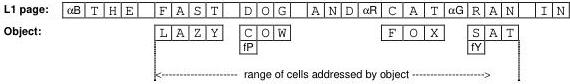

Results:

|  Text Displayed | Foreground colour if object was type:  |   |   |
| --- | --- | --- | --- |
|   |  Active | Adaptive | Passive  |
|  THE | Blue | Blue | Blue  |
|  LAZY | Blue | Blue | White (see note 1)  |
|  COW | Pink | Pink | Pink  |
|  AND | Pink (see note 7) | Pink (see note 7) | Blue (see note 2)  |
|  FOX | Red (see note 3) | Pink (see note 8) | Pink (see note 4)  |
|  SAT | Yellow | Yellow | Yellow  |
|  IN | Yellow (see note 5) | Green (see note 6) | Green (see note 6)  |

NOTE 1: All attributes are reset to their default states at the start of a passive object. (This example assumes that the Passive Object has not re-defined the foreground colour on a previous row).
NOTE 2: The underlying word shows through the gap and is not affected by the Passive Object.
NOTE 3: The text from the object adopts the underlying attributes.
NOTE 4: The object uses its own attribute set and is not affected by the underlying attributes.
NOTE 5: The effect of the attribute within the Active Object continues along the row beyond the last cell addressed by the object.
NOTE 6: The effect of the attribute within adaptive and Passive Objects terminates at the last cell addressed by the object on that row.
NOTE 7: The foreground colour of the Level 1 word in the gap is changed by the object.
NOTE 8: The foreground colour has been changed previously within the object and subsequent foreground colour changes on the Level 1 page are ignored.

## 14 Dynamically Re-definable Characters

Presentation Levels 2.5 and 3.5 are not restricted to pre-defined characters and graphics. New symbols, based on a matrix of 12 pixels horizontally and 10 pixels vertically to occupy one character position, can be downloaded as bit patterns. Four display modes are defined, differentiated by the number of bits used to define the colour of each pixel. DRCS characters can be defined for the exclusive use of one page, or can be shared by any number of pages.

### 14.1 Downloading pages

DRCS characters are downloaded using one or two DRCS tables with up to 16 sub-tables each. One table is defined by the MOT as the global table (GDRCS), the other as the normal table (DRCS) for a page. Each sub-table defines one complete DRCS table of up to 48 characters.

Characters are downloaded using Pattern Transfer Units (PTUs) of 20 bytes each. Each packet X/1 to X/24 of the DRCS downloading page carries 2 PTUs in a defined format of 20 plus 20 bytes, proceeding in time through the packet.

The page coding for downloading is 7 data bits plus one odd parity bit. The data bytes defining a PTU use the transmission codes 4/0 to 7/F. Each byte thus defines the value of 6 bits of a PTU and is called a D-byte.

Unused packets need not be transmitted and unused addresses may be padded with the character SPACE (2/0).

The PTU addresses relate directly to positions in the code table used when invoking DRCS characters.

The format of a DRCS downloading page is shown in figure 27.

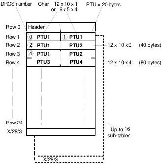

*Figure 27: Format of DRCS downloading pages*

As DRCS characters in different modes can be downloaded on one page, a packet X/28/3 is required to define the function of each PTU. This may be omitted if the page defines 12x10x1 mode characters only.

### 14.2 DRCS Character Modes

The four DRCS Modes are defined in table 31.

Table 31: DRCS modes

|  Mode | Mode Identification | Format (see note) | PTUs/ Char | Bytes/ Char | Presentation Level  |   |   |   |
| --- | --- | --- | --- | --- | --- | --- | --- | --- |
|   |  |  |  |  | 1 | 1.5 | 2.5 | 3.5  |
|  0 | 0000 | 12x10x1 | 1 | 20 | ○ | ○ | ◎ | ◎  |
|  1 | 0001 | 12x10x2 | 2 | 40 | ○ | ○ | ○ | ◎  |
|  2 | 0010 | 12x10x4 | 4 | 80 | ○ | ○ | ○ | ◎  |
|  3 | 0011 | 6x5x4 | 1 | 20 | ○ | ○ | ○ | ◎  |
|  NOTE: Format = Horizontal Dots x Vertical Dots x Bits/Pixel  |   |   |   |   |   |   |   |   |

DRCS Mode Identification is achieved individually for each PTU via the second and following groups of 18 data bits in the packet X/28/3 associated with each DRCS sub-table. The first 192 data bits in these data groups are used to transmit the 48 Mode Identification Codes required for each DRCS sub-table.

Where a DRCS character is defined by more than one PTU, the appropriate Mode Identification value from table 31 is used for the first PTU, and subsequent PTUs are coded 1110. The mode Identification value 1111 indicates that no data is transmitted for the corresponding character. See table 9 in clause 9.4.6.

#### 14.2.1 Mode 0 - 12x10x1

Mode Identification 0000

A Mode 0 DRCS character is defined by one PTU (20 D-bytes). The address in the DRCS code table corresponds to the PTU defining the character.

The dots of a character are loaded 6 at a time from each D-byte, using the 6 least significant bits from codes 4/0 to 7/F. Loading proceeds from the top left hand corner, left to right, row by row, the most significant bit of each 6 corresponding to the left hand dot.

The DRCS characters are displayed in the foreground and background colours active at the positions where they are located, '1' = foreground colour, '0' = background colour.

#### 14.2.2 Mode 1 - 12x10x2

Mode Identification 0001

A Mode 1 DRCS character is defined by two consecutive PTUs. The address in the DRCS code table corresponds to the first PTU defining the character.

Two bit planes are downloaded for each character. The first is downloaded using the first PTU as for the Mode 0 (see clause 14.2.1). The second is downloaded using the second PTU.

Four colours are available for display, selected from the 32 entry Colour Map via a DRCS Colour Look-Up Table (DCLUT) defined in X/28/1 or M/29/1. The first bit plane corresponds to the least significant bit of the DCLUT address and the second bit plane corresponds to the most significant DCLUT address bit.

If the character is taken out of the global DRCS table, the two bit planes define the addresses in the DCLUT4 for global DRCS characters. If the character is taken out of the normal DRCS table, the two bit planes define the addresses in the DCLUT4 for normal DRCS characters.

#### 14.2.3 Mode 2 - 12x10x4

Mode Identification 0010

A Mode 2 DRCS character is defined by four consecutive PTUs. The address in the DRCS code table corresponds to the first PTU defining the character.

Four bit planes are downloaded for each character. The first is downloaded using the first PTU as for the mode 0 (see clause 14.2.1). The second, third and fourth bit planes are downloaded using the following three PTUs.

Sixteen colours are available for display, selected from the 32 entry Colour Map via a DRCS Colour Look-Up Table (DCLUT) defined in X/28/1 or M/29/1. The first bit plane corresponds to the least significant bit of the DCLUT address and the fourth bit plane corresponds to the most significant bit.

If the character is taken out of the global DRCS table, the four bit planes define the addresses in the DCLUT16 for global DRCS characters. If the character is taken out of the normal DRCS table, the four bit planes define the addresses in the DCLUT16 for normal DRCS characters.

#### 14.2.4 Mode 3 - 6x5x4

Mode Identification 0011

A Mode 3 DRCS character is defined by one PTU (20 D-bytes). The address in the DRCS code table corresponds to the PTU defining the character.

Each PTU is considered as five groups of four D-bytes. Within each group, the four D-bytes define respectively the first, second, third and fourth bit planes for one row of pixels of the character.

Sixteen colours are available for display, selected from the 32 entry Colour Map via a DRCS Colour Look-Up Table (DCLUT) defined in X/28/1 or M/29/1. The first bit plane corresponds to the least significant bit of the DCLUT address and the fourth bit plane corresponds to the most significant bit.

If the character is taken out of the global DRCS table, the four bit planes define the addresses in the DCLUT16 for global DRCS characters. If the character is taken out of the normal DRCS table, the four bit planes define the addresses in the DCLUT16 for normal DRCS characters.

### 14.3 Flashing DRCS

#### 14.3.1 Mode 0

Flashing is handled in the same way as for G0, G1, G2 and G3 set characters. All the modes defined in clause 12.3.4 are valid.

#### 14.3.2 Modes 1, 2 and 3

All the DRCS pixels are treated as foreground pixels.

Normal and Inverted flash modes:

"on" phase: The DRCS character is displayed as in the steady mode;

"off" phase: A space character is displayed in the background colour valid at that screen location.

The "Colour Flash" mode is handled in the same way as for G0, G1, G2 and G3 set characters.

### 14.4 DRCS availability

#### 14.4.1 Level 2.5

Mode 12x10x1 only is available at Level 2.5. A maximum of two DRCS sub-tables per display page can be designated. Sub-tables from the normal and global DRCS tables can be invoked simultaneously. A page may reference any 24 of the 96 DRCS characters defined by the two sub-tables.

#### 14.4.2 Level 3.5

All modes are available. A page may reference any number of DRCS characters defined by the 32 accessible sub-tables (16 normal, 16 global), up to a limit of 384 PTUs. Sub-tables from the normal and global DRCS tables can be invoked simultaneously.

The maximum number of characters that can be addressed per display page is 384 if all of the characters are in the simplest modes (12x10x1 and 6x5x4). This maximum is reduced to 96 characters per display page if all characters are in the 12x10x4 mode. The maximum will vary between these extremes for mixtures of the various modes.

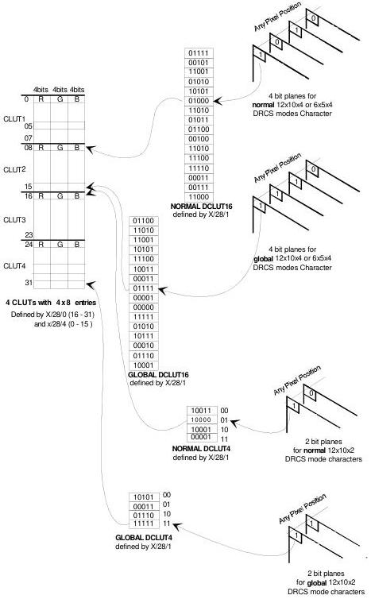

*Figure 28: Pixel colour designation (Example)*

## 15 Character sets and their designation

This clause defines the fixed alphanumeric and graphic character sets referenced by the present document. Code tables for Latin, Cyrillic, Greek, Arabic and Hebrew alphabets are included.

### 15.1 Overview of designation requirements

In general, there is a G0 basic character set and a G2 supplementary character set, each of 96 entries, for each alphabet. Level 1 transmissions are restricted to using the G0 set and some characters in the table may be substituted to accommodate the requirements of the local languages. These national option sub-sets are selected by the C12, C13 and C14 control bits in the page header. At levels 2.5 and 3.5 a more precise method of designating the required G0 and G2 character sets and the national option subset is available via packets X/28 and M/29, as described in clause 15.2.

Where the local language requirements require more than 96 alphanumeric characters to provide a basic service, additional packets X/26 may be introduced to form Level 1.5 transmissions. Typically these incorporate a few characters from the G2 supplementary set of characters, plus a few G0 characters with diacritical marks.

In certain countries there is a requirement to mix characters from different alphabets on the same page. This requires two G0 sets to be designated simultaneously. These are implied by a local Code of Practice or, with Level 2.5 and 3.5 transmissions, they are defined formally via packets X/28 and M/29, as described in clause 15.3. A spacing attribute (ESC) enables the G0 sets to be toggled from within the Level 1 page.

At Levels 2.5 and 3.5, the G0 and G2 character sets to be used may be re-designated from within the enhancement data, as described in clause 15.4.

The G1 and G3 graphic sets are fixed and cannot be re-designated. Re-definable Character Sets (DRCS) are described in clause 14.

### 15.2 Designation of default G0 and G2 sets and national option sub-sets

The default G0 primary and G2 supplementary character sets to be used by all pages in a magazine are defined by the *Default G0 and G2 Character Set Designation and National Option Selection* value (triplet 1, bits 8 to 14) of a packet M/29/0 or M/29/4, or, with higher priority for a particular page, by the same bits in a packet X/28/0 Format 1 or X/28/4. This value defines an entry in table 32. In the case of the G0 character set, this is the character set used by the Level 1 page at the start of each display row although it is recognized that this definition will be ignored by existing Level 1 and 1.5 decoders. Under these circumstances, or in the absence of a packet X/28/0 Format 1, X/28/4, M/29/0 or M/29/4, the default sets are established by a local Code of Practice. The designated G0 and G2 character sets are also the default G0 and G2 sets to be addressed by packet 26 triplets as part of Level 1.5, 2.5 and 3.5 transmissions.

A national option character is displayed when a display code corresponding to one of the reserved positions in the designated G0 set occurs on the Level 1 page. At levels 1 and 1.5 the national option sub-set in use on the page is defined by the C12, C13 and C14 control bits in the page header alone and, in theory, this will result in an ambiguous reference to an entry in table 32. At levels 2.5 and 3.5 the national option subset in use on the page can be defined explicitly by bits in a packet X/28/0 Format 1 or X/28/4 according to table 32. Bits 8 to 10 of triplet 1 are set to the values of the C12, C13 and C14 control bits. At the magazine level, the sub-set is designated via a packet M/29/0 or M/29/4 but is superseded by a page-related X/28/0 Format 1 or X/28/4. The recommended use of these bits is described in clause E.9.

For compatibility with earlier specifications certain national option sub-sets are duplicated in table 32.

**Table 32: Function of *Default G0 and G2 Character Set Designation and National Option Selection* bits in packets X/28/0 Format 1, X/28/4, M/29/0 and M/29/4**

|  Triplet 1 bits (see note 1) |   |   |   |   |   |   |   | G0 character set | G2 character set | Control bits from header C12 C13 C14 |   |   | National option sub-set  |   |
| --- | --- | --- | --- | --- | --- | --- | --- | --- | --- | --- | --- | --- | --- | --- |
|  14 | 13 | 12 | 11 | 10 | 9 | 8 |  |   |   |  |  |   |   |   |
|  0 | 0 | 0 | 0 | X | X | X | Latin | Latin |  | 0 | 0 | 0 | English  |   |
|   |   |   |   |   |   |   |   |   |   |  0 | 0 | 1 | German  |   |
|   |   |   |   |   |   |   |   |   |   |  0 | 1 | 0 | Swedish/Finnish/Hungarian  |   |
|   |   |   |   |   |   |   |   |   |   |  0 | 1 | 1 | Italian  |   |
|   |   |   |   |   |   |   |   |   |   |  1 | 0 | 0 | French  |   |
|   |   |   |   |   |   |   |   |   |   |  1 | 0 | 1 | Portuguese/Spanish  |   |
|   |   |   |   |   |   |   |   |   |   |  1 | 1 | 0 | Czech/Slovak  |   |
|   |   |   |   |   |   |   |   |   |   |  1 | 1 | 1 |   |   |
|  0 | 0 | 0 | 1 | X | X | X | Latin | Latin |  | 0 | 0 | 0 | Polish  |   |
|   |   |   |   |   |   |   |   |   |   |  0 | 0 | 1 | German  |   |
|   |   |   |   |   |   |   |   |   |   |  0 | 1 | 0 | Swedish/Finnish/Hungarian  |   |
|   |   |   |   |   |   |   |   |   |   |  0 | 1 | 1 | Italian  |   |
|   |   |   |   |   |   |   |   |   |   |  1 | 0 | 0 | French  |   |
|   |   |   |   |   |   |   |   |   |   |  1 | 0 | 1 |   |   |
|   |   |   |   |   |   |   |   |   |   |  1 | 1 | 0 | Czech/Slovak  |   |
|   |   |   |   |   |   |   |   |   |   |  1 | 1 | 1 |   |   |
|  0 | 0 | 1 | 0 | X | X | X | Latin | Latin |  | 0 | 0 | 0 | English  |   |
|   |   |   |   |   |   |   |   |   |   |  0 | 0 | 1 | German  |   |
|   |   |   |   |   |   |   |   |   |   |  0 | 1 | 0 | Swedish/Finnish/Hungarian  |   |
|   |   |   |   |   |   |   |   |   |   |  0 | 1 | 1 | Italian  |   |
|   |   |   |   |   |   |   |   |   |   |  1 | 0 | 0 | French  |   |
|   |   |   |   |   |   |   |   |   |   |  1 | 0 | 1 | Portuguese/Spanish  |   |
|   |   |   |   |   |   |   |   |   |   |  1 | 1 | 0 | Turkish  |   |
|   |   |   |   |   |   |   |   |   |   |  1 | 1 | 1 |   |   |
|  0 | 0 | 1 | 1 | X | X | X | Latin | Latin |  | 0 | 0 | 0 |   |   |
|   |   |   |   |   |   |   |   |   |   |  0 | 0 | 1 |   |   |
|   |   |   |   |   |   |   |   |   |   |  0 | 1 | 0 |   |   |
|   |   |   |   |   |   |   |   |   |   |  0 | 1 | 1 |   |   |
|   |   |   |   |   |   |   |   |   |   |  1 | 0 | 0 |   |   |
|   |   |   |   |   |   |   |   |   |   |  1 | 0 | 1 | Serbian/Croatian/Slovenian  |   |
|   |   |   |   |   |   |   |   |   |   |  1 | 1 | 0 |   |   |
|   |   |   |   |   |   |   |   |   |   |  1 | 1 | 1 | Rumanian  |   |
|  0 | 1 | 0 | 0 | X | X | X | Cyrillic - 1 | Cyrillic |  | 0 | 0 | 0 | (Serbian/Croatian) (see note 3)  |   |
|   |   |   |   |   |   |   |  Latin | Latin |  | 0 | 0 | 1 | German  |   |
|   |   |   |   |   |   |   |  Latin | Latin |  | 0 | 1 | 0 | Estonian  |   |
|   |   |   |   |   |   |   |  Latin | Latin |  | 0 | 1 | 1 | Lettish/Lithuanian  |   |
|   |   |   |   |   |   |   |  Cyrillic - 2 | Cyrillic |  | 1 | 0 | 0 | (Russian/Bulgarian) (see note 3)  |   |
|   |   |   |   |   |   |   |  Cyrillic - 3 | Cyrillic |  | 1 | 0 | 1 | (Ukrainian) (see note 3)  |   |
|   |   |   |   |   |   |   |  Latin | Latin |  | 1 | 1 | 0 | Czech/Slovak  |   |
|   |   |   |   |   |   |   |   |  |  | 1 | 1 | 1 |   |   |
|  0 | 1 | 0 | 1 | X | X | X |  |  |  | Reserved |   |   |   |   |
|  0 | 1 | 1 | 0 | X | X | X | Latin Greek | Latin Greek |  | 0 | 0 | 0 |   |   |
|   |   |   |   |   |   |   |   |   |   |  0 | 0 | 1 |   |   |
|   |   |   |   |   |   |   |   |   |   |  0 | 1 | 0 |   |   |
|   |   |   |   |   |   |   |   |   |   |  0 | 1 | 1 |   |   |
|   |   |   |   |   |   |   |   |   |   |  1 | 0 | 0 |   |   |
|   |   |   |   |   |   |   |   |   |   |  1 | 0 | 1 |   |   |
|   |   |   |   |   |   |   |   |   |   |  1 | 1 | 0 | Turkish  |   |
|   |   |   |   |   |   |   |   |   |   |  1 | 1 | 1 | (Greek) (see note 3)  |   |
|  (continued)  |   |   |   |   |   |   |   |   |   |   |   |   |   |   |

Table 32 (concluded): Function of Default G0 and G2 Character Set Designation and National Option Selection bits in packets X/28/0 Format 1, X/28/4, M/29/0 and M/29/4

| Triplet 1 bits (see note 1) | G0 character set | G2 character set | Control bits from header C12 C13 C14 | National option sub-set |
| --- | --- | --- | --- | --- |
| 14 | 13 | 12 | 11 | 10 | 9 | 8 |
| 0 | 1 | 1 | 1 | X | X | X | Reserved |
| 1 | 0 | 0 | 0 | X | X | X | Latin | Arabic | 0 | 0 | 0 | English |
| 0 | 0 | 1 |  |
| 0 | 1 | 0 |  |
| 0 | 1 | 1 |  |  |
| Latin | Arabic | 1 | 0 | 0 | French |
| 1 | 0 | 1 |  |
| 1 | 1 | 0 |  |  |
| 1 | 0 | 0 | 1 | X | X | X | Arabic | Arabic | 1 | 1 | 1 | (Arabic) (see note 3) |
| Reserved |
| 1 | 0 | 1 | 0 | X | X | X | Hebrew | Arabic | 0 | 0 | 0 |  |
| 0 | 0 | 1 |  |
| 0 | 1 | 0 |  |
| 0 | 1 | 1 |  |
| 1 | 0 | 0 |  |
| 1 | 0 | 1 | (Hebrew) (see note 3) |
| 1 | 1 | 0 |  |
| 1 | 1 | 1 | (Arabic) (see note 3) |
| Other values | Reserved |
| NOTE 1: For packets X/28/0 format 1 and X/28/4, bits 8, 9 and 10 are set to the same values as the control bits in the page header packet, i.e. bit 10 = C12, bit 9 = C13 and bit 8 = C14. For packets M/29/0 and M/29/4 these bits should be set to the most common value of C12, C13 and C14 used in that magazine, see clause E.9. NOTE 2: Entries in the table with no character set or national option sub-set specified are reserved. NOTE 3: No separate sub-sets exist for the national options shown in brackets. The characters are contained within the appropriate G0 set. |

### 15.3 Second G0 Set Designation and National Option Set Selection

The Second G0 Set Designation and Nation Option Selection value (Triplet 1, bits 15 to 18 and Triplet 2, bits 1 to 3) in the relevant packets 28 and 29 defines the second G0 set. Typically the second G0 set will contain a different alphabet compared to the default G0 set, allowing words written in different alphabets to be mixed on the same page. This is accessed by a Level 1 decoder through the character codes on the Level 1 page following the first ESC character within a display row. Subsequent ESC characters cause the decoder to alternate between the G0 set defined by the Default G0 and G2 Character Set Designation and National Option Selection value and this second G0 set. A further function of this value is to define the national option character sub-set to appear in the national option positions of this second G0 set. The national option sub-set selected by the C12, C13 and C14 bits is not relevant to the secondary set. Where a transmission does not use two G0 sets, this second value is set to 1111111. A decoder may interpret this value to mean that the ESC function should be disabled for this page (packets X/28/0 Format 1 or X/28/4) or magazine (packets M/29/0 or M/29/4). The coding is shown in table 33.

This information is unlikely to be interpreted by Level 1 or 1.5 decoders but it is required by Level 2.5 and 3.5 decoders to ensure they function correctly when receiving Level 1.5 transmissions. This value does not specify any parameter of a Level 2.5 or 3.5 transmission. Also, a G2 set is not designated by this value. The G2 set designated by the Default G0 and G2 Character Set Designation and National Option Selection value remains selected throughout and is independent of the ESC function.

Table 33: Function of Second Language Designation and National Option Selection bits in packets X/28/0 Format 1, X/28/4, M/29/0 and M/29/4

|  Triplet 2 bits |   |   | Triplet 1 bits |   |   |   | G0 character set | National option sub-set  |
| --- | --- | --- | --- | --- | --- | --- | --- | --- |
|  3 | 2 | 1 | 18 | 17 | 16 | 15  |   |   |
|  0 | 0 | 0 | 0 | 0 | 0 | 0 | Latin | English  |
|  0 | 0 | 0 | 0 | 0 | 0 | 1 |   | German  |
|  0 | 0 | 0 | 0 | 0 | 1 | 0 |   | Swedish/Finnish/Hungarian  |
|  0 | 0 | 0 | 0 | 0 | 1 | 1 |   | Italian  |
|  0 | 0 | 0 | 0 | 1 | 0 | 0 |   | French  |
|  0 | 0 | 0 | 0 | 1 | 0 | 1 |   | Portuguese/Spanish  |
|  0 | 0 | 0 | 0 | 1 | 1 | 0 |   | Czech/Slovak  |
|  0 | 0 | 0 | 0 | 1 | 1 | 1 |   |   |
|  0 | 0 | 0 | 1 | 0 | 0 | 0 | Latin | Polish  |
|  0 | 0 | 0 | 1 | 0 | 0 | 1 |   | German  |
|  0 | 0 | 0 | 1 | 0 | 1 | 0 |   | Swedish/Finnish/Hungarian  |
|  0 | 0 | 0 | 1 | 0 | 1 | 1 |   | Italian  |
|  0 | 0 | 0 | 1 | 1 | 0 | 0 |   | French  |
|  0 | 0 | 0 | 1 | 1 | 0 | 1 |   |   |
|  0 | 0 | 0 | 1 | 1 | 1 | 0 |   | Czech/Slovak  |
|  0 | 0 | 0 | 1 | 1 | 1 | 1 |   |   |
|  0 | 0 | 1 | 0 | 0 | 0 | 0 | Latin | English  |
|  0 | 0 | 1 | 0 | 0 | 0 | 1 |   | German  |
|  0 | 0 | 1 | 0 | 0 | 1 | 0 |   | Swedish/Finnish/Hungarian  |
|  0 | 0 | 1 | 0 | 0 | 1 | 1 |   | Italian  |
|  0 | 0 | 1 | 0 | 1 | 0 | 0 |   | French  |
|  0 | 0 | 1 | 0 | 1 | 0 | 1 |   | Portuguese/Spanish  |
|  0 | 0 | 1 | 0 | 1 | 1 | 0 |   | Turkish  |
|  0 | 0 | 1 | 0 | 1 | 1 | 1 |   |   |
|  0 | 0 | 1 | 1 | 0 | 0 | 0 | Latin |   |
|  0 | 0 | 1 | 1 | 0 | 0 | 1 |   |   |
|  0 | 0 | 1 | 1 | 0 | 1 | 0 |   |   |
|  0 | 0 | 1 | 1 | 0 | 1 | 1 |   |   |
|  0 | 0 | 1 | 1 | 1 | 0 | 0 |   |   |
|  0 | 0 | 1 | 1 | 1 | 0 | 1 |   | Serbian/Croatian/Slovenian  |
|  0 | 0 | 1 | 1 | 1 | 1 | 0 |   |   |
|  0 | 0 | 1 | 1 | 1 | 1 | 1 |   | Rumanian  |
|  0 | 1 | 0 | 0 | 0 | 0 | 0 | Cyrillic - 1 | (Serbian/Croatian) (see note 2)  |
|  0 | 1 | 0 | 0 | 0 | 0 | 1 | Latin | German  |
|  0 | 1 | 0 | 0 | 0 | 1 | 0 | Latin | Estonian  |
|  0 | 1 | 0 | 0 | 0 | 1 | 1 | Latin | Lettish/Lithuanian  |
|  0 | 1 | 0 | 0 | 1 | 0 | 0 | Cyrillic - 2 | (Russian/Bulgarian) (see note 2)  |
|  0 | 1 | 0 | 0 | 1 | 0 | 1 | Cyrillic - 3 | (Ukrainian) (see note 2)  |
|  0 | 1 | 0 | 0 | 1 | 1 | 0 | Latin | Czech/Slovak (Latin)  |
|  0 | 1 | 0 | 0 | 1 | 1 | 1 |  |   |
|  0 | 1 | 0 | 1 | X | X | X | Reserved  |   |
|  0 | 1 | 1 | 0 | 0 | 0 | 0 |  |   |
|  0 | 1 | 1 | 0 | 0 | 0 | 1 |  |   |
|  0 | 1 | 1 | 0 | 0 | 1 | 0 |  |   |
|  0 | 1 | 1 | 0 | 0 | 1 | 1 |  |   |
|  0 | 1 | 1 | 0 | 1 | 0 | 0 |  |   |
|  0 | 1 | 1 | 0 | 1 | 0 | 1 |  |   |
|  (continued)  |   |   |   |   |   |   |   |   |

Table 33 (concluded): Function of Second Language Designation and National Option Selection bits in packets X/28/0 Format 1, X/28/4, M/29/0 and M/29/4

|  Triplet 2 bits |   |   | Triplet 1 bits |   |   |   | G0 character set | National option sub-set  |
| --- | --- | --- | --- | --- | --- | --- | --- | --- |
|  3 | 2 | 1 | 18 | 17 | 16 | 15  |   |   |
|  0 | 1 | 1 | 0 | 1 | 1 | 0 | Latin | Turkish  |
|  0 | 1 | 1 | 0 | 1 | 1 | 1 | Greek | (Greek) (see note 2)  |
|  0 | 1 | 1 | 1 | X | X | X | Reserved  |   |
|  1 | 0 | 0 | 0 | 0 | 0 | 0 | Latin | English  |
|  1 | 0 | 0 | 0 | 0 | 0 | 1 |  |   |
|  1 | 0 | 0 | 0 | 0 | 1 | 0 |  |   |
|  1 | 0 | 0 | 0 | 0 | 1 | 1 |  |   |
|  1 | 0 | 0 | 0 | 1 | 0 | 0 | Latin | French  |
|  1 | 0 | 0 | 0 | 1 | 0 | 1 |  |   |
|  1 | 0 | 0 | 0 | 1 | 1 | 0 |  |   |
|  1 | 0 | 0 | 0 | 1 | 1 | 1 | Arabic | (Arabic) (see note 2)  |
|  1 | 0 | 0 | 1 | X | X | X | Reserved  |   |
|  1 | 0 | 1 | 0 | 0 | 0 | 0 |  |   |
|  1 | 0 | 1 | 0 | 0 | 0 | 1 |  |   |
|  1 | 0 | 1 | 0 | 0 | 1 | 0 |  |   |
|  1 | 0 | 1 | 0 | 0 | 1 | 1 |  |   |
|  1 | 0 | 1 | 0 | 1 | 0 | 0 |  |   |
|  1 | 0 | 1 | 0 | 1 | 0 | 1 | Hebrew | (Hebrew) (see note 2)  |
|  1 | 0 | 1 | 0 | 1 | 1 | 0 |  |   |
|  1 | 0 | 1 | 0 | 1 | 1 | 1 | Arabic | (Arabic) (see note 2)  |
|  Other values |   |   |   |   |   |   | Reserved  |   |
|  1 | 1 | 1 | 1 | 1 | 1 | 1 | No second G0 set required  |   |
|  NOTE 1: Entries in the table with no character set or national option sub-set specified are reserved.  |   |   |   |   |   |   |   |   |
|  NOTE 2: No separate sub-sets exist for the national options shown in brackets. The characters are contained within the appropriate G0 set.  |   |   |   |   |   |   |   |   |

### 15.4 Modified G0 and G2 Character Set Designation

At Levels 2.5 and 3.5, the Modified G0 and G2 Character Set Designation triplet allows alternative G0 and G2 character sets to be selected. These are only accessible by Level 2.5 and 3.5 triplets. The coding, shown in table 34, is similar to that used in tables 32 and 33.

NOTE: When the G0 set is referenced by a triplet, characters with addresses 2/0 to 7/F are selectable and the set of characters is not modified by any national option sub-set selection.

Table 34: Function of the Modified G0 and G2 Character Set Designation triplet

|  Data Field Bits |   |   |   |   |   |   | G0 character set | G2 character set  |
| --- | --- | --- | --- | --- | --- | --- | --- | --- |
|  18 | 17 | 16 | 15 | 14 | 13 | 12  |   |   |
|  0 | 0 | 0 | 0 | X | X | X | Latin | Latin  |
|  0 | 0 | 0 | 1 | X | X | X | Latin | Latin  |
|  0 | 0 | 1 | 0 | X | X | X | Latin | Latin  |
|  0 | 0 | 1 | 1 | X | X | X | Latin | Latin  |
|  0 | 1 | 0 | 0 | 0 | 0 | 0 | Cyrillic - 1 | Cyrillic  |
|  0 | 1 | 0 | 0 | 0 | 0 | 1 | Latin | Latin  |
|  0 | 1 | 0 | 0 | 0 | 1 | 0 | Latin | Latin  |
|  0 | 1 | 0 | 0 | 0 | 1 | 1 | Latin | Latin  |
|  0 | 1 | 0 | 0 | 1 | 0 | 0 | Cyrillic - 2 | Cyrillic  |
|  0 | 1 | 0 | 0 | 1 | 0 | 1 | Cyrillic - 3 | Cyrillic  |
|  0 | 1 | 0 | 0 | 1 | 1 | 0 | Latin | Latin  |
|  0 | 1 | 0 | 0 | 1 | 1 | 1 |  |   |
|  0 | 1 | 0 | 1 | X | X | X | Reserved  |   |
|  0 | 1 | 1 | 0 | 0 | 0 | 0 |  |   |
|  0 | 1 | 1 | 0 | 0 | 0 | 1 |  |   |
|  0 | 1 | 1 | 0 | 0 | 1 | 0 |  |   |
|  0 | 1 | 1 | 0 | 0 | 1 | 1 |  |   |
|  0 | 1 | 1 | 0 | 1 | 0 | 0 |  |   |
|  0 | 1 | 1 | 0 | 1 | 0 | 1 |  |   |
|  0 | 1 | 1 | 0 | 1 | 1 | 0 | Latin | Latin  |
|  0 | 1 | 1 | 0 | 1 | 1 | 1 | Greek | Greek  |
|  0 | 1 | 1 | 1 | X | X | X | Reserved  |   |
|  1 | 0 | 0 | 0 | 0 | 0 | 0 | Latin | Arabic  |
|  1 | 0 | 0 | 0 | 0 | 0 | 1 |  |   |
|  1 | 0 | 0 | 0 | 0 | 1 | 0 |  |   |
|  1 | 0 | 0 | 0 | 0 | 1 | 1 |  |   |
|  1 | 0 | 0 | 0 | 1 | 0 | 0 | Latin | Arabic  |
|  1 | 0 | 0 | 0 | 1 | 0 | 1 |  |   |
|  1 | 0 | 0 | 0 | 1 | 1 | 0 |  |   |
|  1 | 0 | 0 | 0 | 1 | 1 | 1 | Arabic | Arabic  |
|  1 | 0 | 0 | 1 | X | X | X | Reserved  |   |
|  1 | 0 | 1 | 0 | 0 | 0 | 0 |  |   |
|  1 | 0 | 1 | 0 | 0 | 0 | 1 |  |   |
|  1 | 0 | 1 | 0 | 0 | 1 | 0 |  |   |
|  1 | 0 | 1 | 0 | 0 | 1 | 1 |  |   |
|  1 | 0 | 1 | 0 | 1 | 0 | 0 |  |   |
|  1 | 0 | 1 | 0 | 1 | 0 | 1 | Hebrew | Arabic  |
|  1 | 0 | 1 | 0 | 1 | 1 | 0 |  |   |
|  1 | 0 | 1 | 0 | 1 | 1 | 1 | Arabic | Arabic  |
|  Other values |   |   |   |   |   |   | Reserved  |   |
|  NOTE: Entries in the table with no character sets specified are reserved.  |   |   |   |   |   |   |   |   |

### 15.5 Spacing attributes

Codes 0/0 to 1/F within packets X/0 to X/24 of a Level 1 page select the spacing attributes defined in clause 12.2.

### 15.6 Alphanumeric Character Sets

It should be noted that the precise appearance of the characters defined here is a decoder option. The characters shown are based on a matrix of 12 pixels horizontally and 10 pixels vertically.

#### 15.6.1 Latin G0 Set

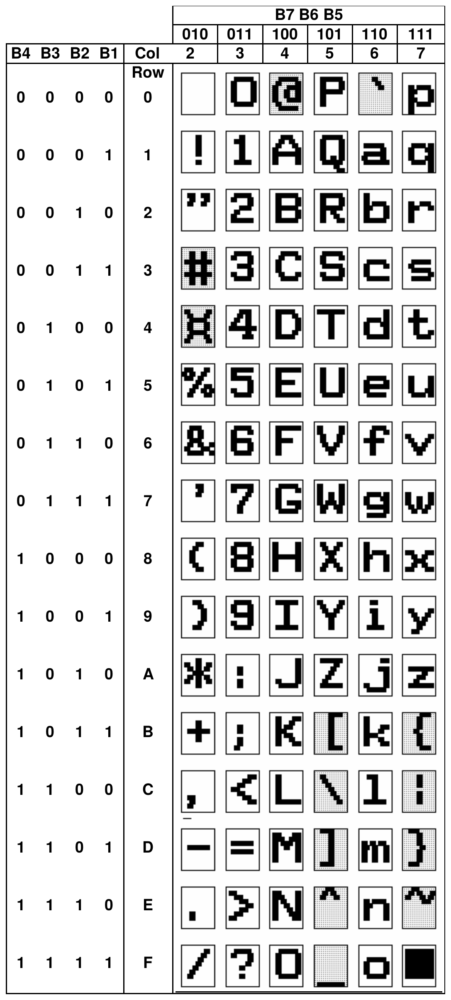

*Table 35: Latin G0 Primary Set*

NOTE 1: The character in position 2/0 is to be interpreted as SPACE.

NOTE 2: The characters at the shaded positions apply when the set is accessed via packets X/26. Characters from a national option sub-set from table 36 occupy these positions when the set is addressed directly from a Level 1 page.

NOTE 3: The @ symbol replaces the * symbol at position 2/A when the table is accessed via a packet X/26 Column Address triplet with Mode Description = 10 000 and Data = 0101010. See clause 12.2.4.

NOTE 4: The character in position 7/F occupies an area equivalent to that of any character which does not include a descender. It is thus a rectangle surrounded by the background colour.

#### 15.6.2 Latin National Option Sub-Sets

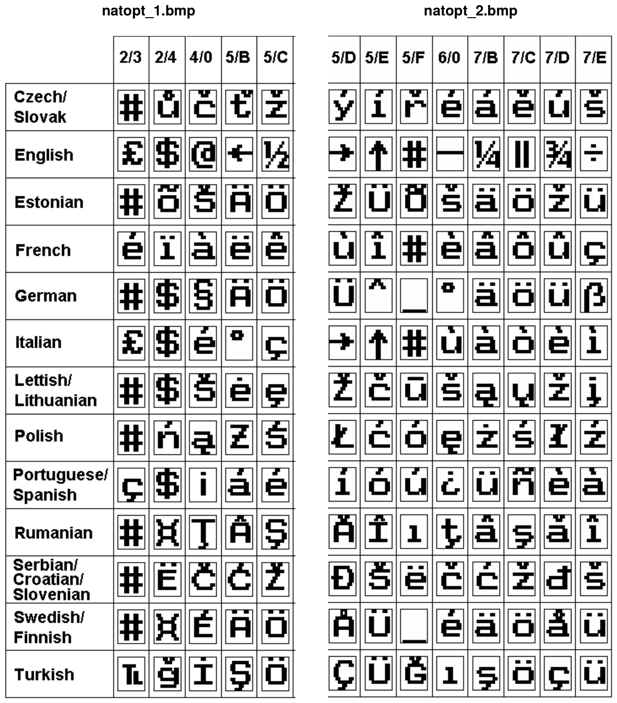

*Table 36: Latin National Option Sub-sets*

NOTE 1: The character TL is the Turkish currency symbol.

NOTE 2: In some decoders the **Ē** at 2/4 of the Serbian/Croatian/Slovenian set has been replaced by either **$** or ½.

NOTE 3: The Swedish/Finnish sub-set is also used for Hungarian.

#### 15.6.3 Latin G2 Set

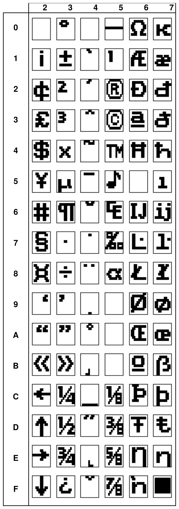

*Table 37: Latin G2 Supplementary Set*

NOTE 1: The character in position 2/0 is to be interpreted as SPACE.

NOTE 2: Column 4 contains diacritical marks for association with G0 set characters.

NOTE 3: The characters in positions 5/6, 5/7 and 5/8 are in addition to those specified in ISO 6937/2 [4].

NOTE 4: The character in position 5/6 represents the European currency symbol.

NOTE 5: The characters codes 5/9, 5/A, 5/B and 6/5 should not be transmitted.

NOTE 6: The character in position 7/F occupies an area equivalent to that of any character which does not include a descender. It is thus a rectangle surrounded by the background colour.

NOTE 7: Bit allocations are as for table 35.

#### 15.6.4 Cyrillic G0 Set - Option 1 - Serbian/Croatian

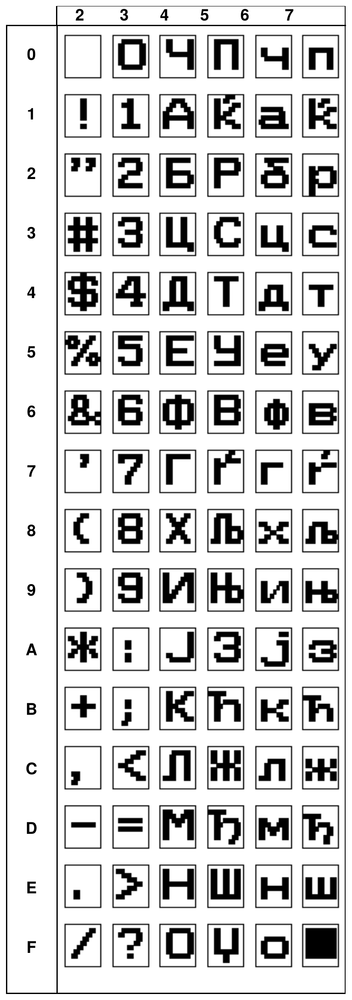

*Table 38: Cyrillic G0 Primary Set - Option 1 - Serbian/Croatian*

NOTE 1: The character in position 2/0 is to be interpreted as SPACE.

NOTE 2: The @ symbol replaces the * symbol at position 2/A when the table is accessed via a packet X/26 Column Address triplet with Mode Description = 10000 and Data = 0101010. See clause 12.3.4.

NOTE 3: The character in position 7/F occupies an area equivalent to that of any character which does not include a descender. It is thus a rectangle surrounded by the background colour.

NOTE 4: Bit allocations are as for table 35.

#### 15.6.5 Cyrillic G0 Set - Option 2 - Russian/Bulgarian

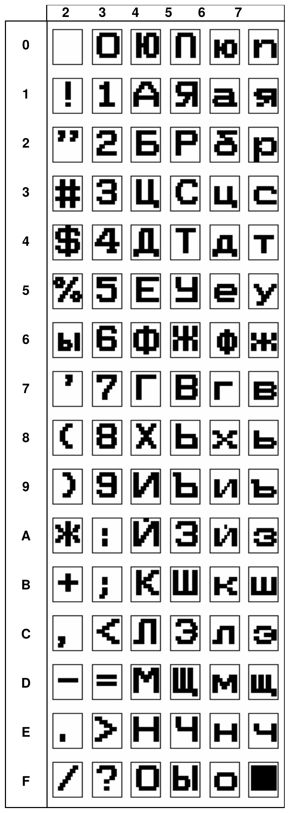

*Table 39: Cyrillic G0 Primary Set - Option 2 - Russian/Bulgarian*

NOTE 1: The character in position 2/0 is to be interpreted as SPACE.

NOTE 2: The @ symbol replaces the * symbol at position 2/A when the table is accessed via a packet X/26 Column Address triplet with Mode Description = 10000 and Data = 0101010. See clause 12.3.4.

NOTE 3: The character in position 7/F occupies an area equivalent to that of any character which does not include a descender. It is thus a rectangle surrounded by the background colour.

NOTE 4: Bit allocations are as for table 35.

#### 15.6.6 Cyrillic G0 Set - Option 3 - Ukrainian

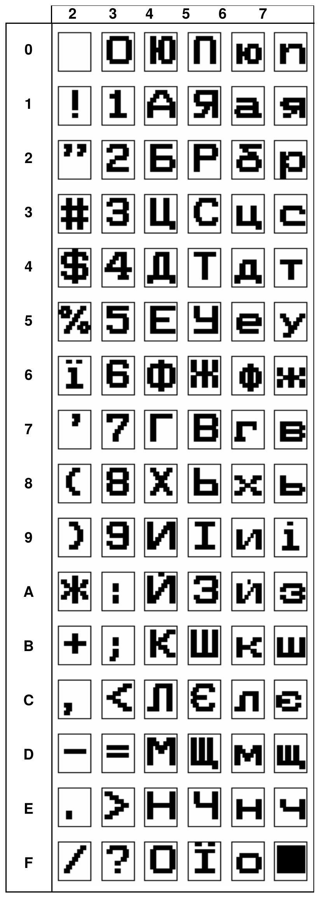

*Table 40: Cyrillic G0 Primary Set - Option 3 - Ukrainian*

NOTE 1: The character in position 2/0 is to be interpreted as SPACE.

NOTE 2: The @ symbol replaces the * symbol at position 2/A when the table is accessed via a packet X/26 Column Address triplet with Mode Description = 10000 and Data = 0101010. See clause 12.3.4.

NOTE 3: The character in position 7/F occupies an area equivalent to that of any character which does not include a descender. It is thus a rectangle surrounded by the background colour.

NOTE 4: Bit allocations are as for table 35.

#### 15.6.7 Cyrillic G2 Set

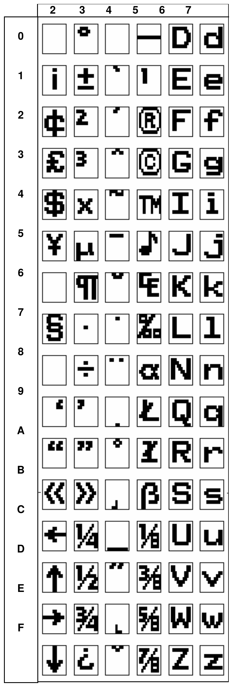

*Table 41: Cyrillic G2 Supplementary Set*

NOTE 1: The character in position 2/0 is to be interpreted as SPACE.

NOTE 2: The characters codes 2/6 and 2/8 should not be transmitted.

NOTE 3: Column 4 contains diacritical marks for association with G0 set characters.

NOTE 4: The characters in positions 5/6, 5/7 and 5/8 are in addition to those specified in ISO 6937/2 [4].

NOTE 5: The character in position 5/6 represents the European currency symbol.

NOTE 6: Bit allocations are as for table 35.

#### 15.6.8 Greek G0 Set

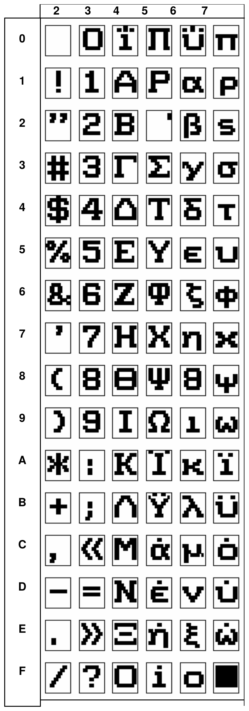

*Table 42: Greek G0 Primary Set*

NOTE 1: The character in position 2/0 is to be interpreted as SPACE.

NOTE 2: The @ symbol replaces the * symbol at position 2/A when the table is accessed via a packet X/26 Column Address triplet with Mode Description = 10000 and Data = 0101010. See clause 12.3.4.

NOTE 3: The character in position 7/F occupies an area equivalent to that of any character which does not include a descender. It is thus a rectangle surrounded by the background colour.

NOTE 4: Bit allocations are as for table 35.

#### 15.6.9 Greek G2 Set

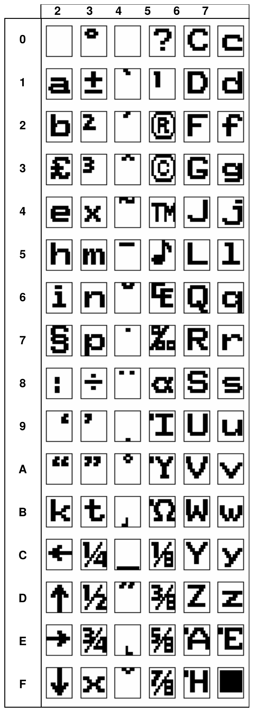

*Table 43: Greek G2 Supplementary Set*

NOTE 1: The character in position 2/0 is to be interpreted as SPACE.

NOTE 2: Column 4 contains diacritical marks for association with G0 set characters.

NOTE 3: The characters in positions 5/6, 5/7 and 5/8 are in addition to those specified in ISO 6937/2 [4].

NOTE 4: The character in position 5/6 represents the European currency symbol.

NOTE 5: The character in position 7/F occupies an area equivalent to that of any character which does not include a descender. It is thus a rectangle surrounded by the background colour.

NOTE 6: Bit allocations are as for table 35.

#### 15.6.10 Arabic G0 Set

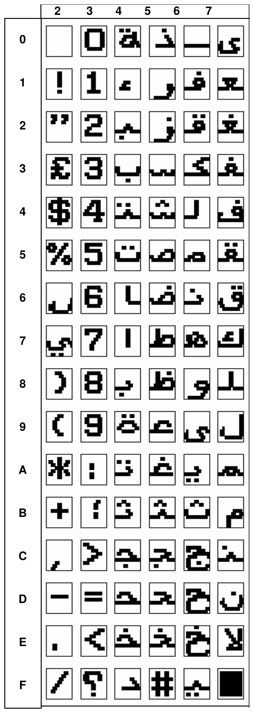

*Table 44: Arabic G0 Primary Set*

NOTE 1: The character in position 2/0 is to be interpreted as SPACE.

NOTE 2: The @ symbol replaces the * symbol at position 2/A when the table is accessed via a packet X/26 Column Address triplet with Mode Description = 10000 and Data = 0101010. See clause 12.3.4.

NOTE 3: The character in position 7/F occupies an area equivalent to that of any character which does not include a descender. It is thus a rectangle surrounded by the background colour.

NOTE 4: Bit allocations are as for table 35.

#### 15.6.11 Arabic G2 Set

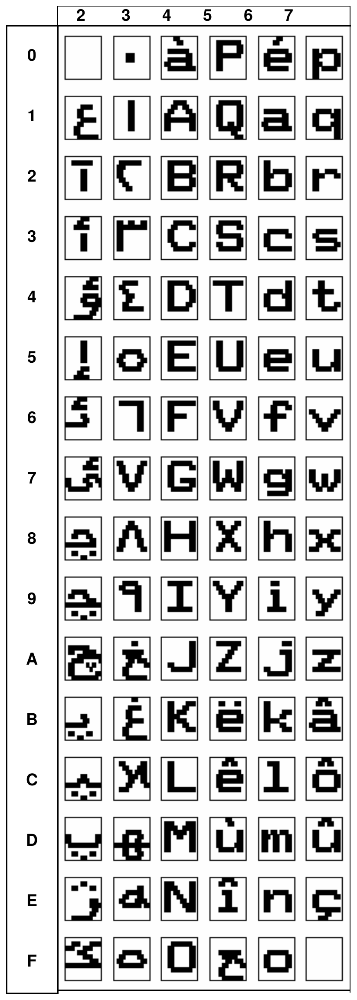

*Table 45: Arabic G2 Supplementary Set*

NOTE 1: The character in position 2/0 is to be interpreted as SPACE.

NOTE 2: Bit allocations are as for table 35.

#### 15.6.12 Hebrew G0 Set

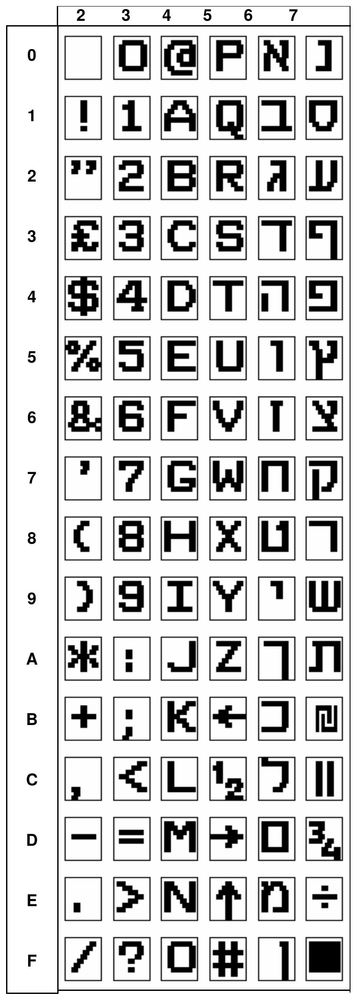

*Table 46: Hebrew G0 Primary Set*

NOTE 1: The character in position 2/0 is to be interpreted as SPACE.

NOTE 2: The @ symbol replaces the * symbol at position 2/A when the table is accessed via a packet X/26 Column Address triplet with Mode Description = 10000 and Data = 0101010. See clause 12.3.4.

NOTE 3: The character in position 7/F occupies an area equivalent to that of any character which does not include a descender. It is thus a rectangle surrounded by the background colour.

NOTE 4: The character at 7/B is the Shekel currency sign.

NOTE 5: Bit allocations are as for table 35.

### 15.7 Graphics Character Sets

#### 15.7.1 G1 Block Mosaics Set

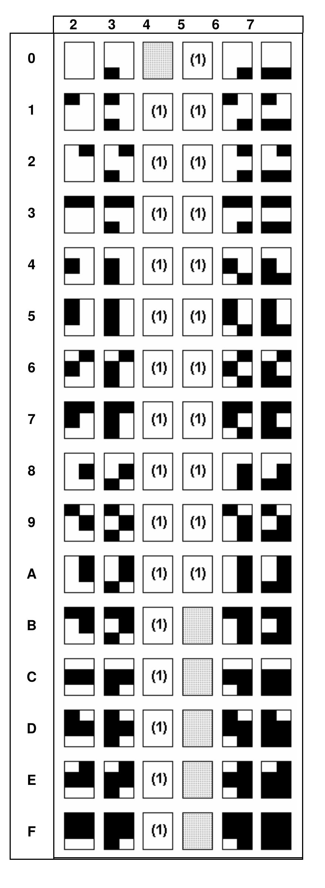

*Table 47: G1 Block Mosaics Set*

NOTE 1: The locations in columns 4 and 5 indicated by (1) contain the corresponding characters from the G0 set currently selected.
NOTE 2: When addressed from the Level 1 page, the characters at the shaded positions in columns 4 and 5 are taken from the national option sub-set currently selected via the C12, C13 and C14 control bits and any "ESC" commands in force at that time.
NOTE 3: When selected by a packet X/26 command, the characters at the shaded positions in columns 4 and 5 are the corresponding characters in the G0 set currently selected.
NOTE 4: The character in position \(2/0\) is to be interpreted as a mosaics SPACE.
NOTE 5: The dark areas of the characters in columns 2, 3, 6 and 7 are displayed in the foreground colour.
NOTE 6: The characters are shown in their contiguous form in the table. An example of the separated form is shown below.

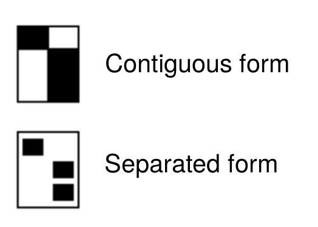

NOTE 7: Bit allocations are as for table 35.

#### 15.7.2 G3 Smooth Mosaics and Line Drawing Set

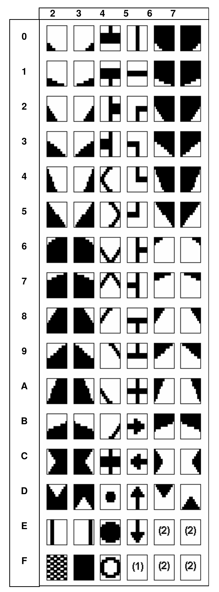

*Table 48: G3 Smooth Mosaics and Line Drawing Set*

NOTE 1: The character at 5/F permits the display of background colour.

NOTE 2: No character is assigned to the positions marked (2) and the corresponding codes should not be transmitted.

NOTE 3: The dark areas of the characters are displayed in the foreground colour.

NOTE 4: The character at position 2/F represents the activation of alternate dots of the matrix.

NOTE 5: Bit allocations are as for table 35.

## Annex A (normative): Page addresses

### A.1 Page numbering

There is a need for page headers to be available without any following data for time filling and page terminating applications. There is also a need for a page address to be available for internal use in decoders that will not occur in transmission. The following rules apply:

1) Any page address up to and including hexadecimal FE with any value of sub-code (range 0000 to 3F7F), can be used for a page carrying data and can be specified as a linked page.

2) Pages address number FF in any magazine, with any sub-code in the range 0000 to 3F7E may be used for time filling and as a terminator. Pages with these addresses will not carry data for acquisition by a decoder.

3) Page header packets with the page address FF, sub-code 3F7F, will not be transmitted. This address will occur as a null link in packets with \( \mathrm{Y} = 27 \) and \( 8/30 \).

To provide efficient handling of pages with sub-pages that are intended for display the following rules apply:

1) Pages with no sub-pages associated should be coded Mxx-0000.

2) Pages intended for display with sub-pages should have sub-pages coded sequentially from Mxx-0001 to Mxx-0009 and then Mxx-0010 to Mxx-0019 and similarly using the decimal values of sub-code nibbles S2 and S1 to Mxx-0079.

3) If a sub page editorial content is not different from the preceding sub-page the current sub-page may be transmitted with the same sub-code as the preceding sub-page.

NOTE 1: Some existing decoders may require a non-zero sub-code to ensure that each version of the rotating page is displayed and/or collected. A sub-code outside the range 1 to 79 (S2, S1) should be used in order to prevent sub-page collecting decoders indicating that a page is a rotating page when it only has one sub-page (i.e. a rotating advertisement).

The sub-code of each sub-page of a data page (e.g. MOT, POP, GPOP, DRCS, GDRCS, MIP) should be coded sequentially nnXs, where:

- nn comprises S4 and S3 elements and indicates the last packet that would be transmitted according to clause B.2 if the page or sub-page were to be broadcast without interruption. S3 and S4 provide a 6-bit value, with S4 as the 2 MSBs and S3 as the 4 LSBs. The valid range is 1 to 41 (decimal), with values 1 to 25 representing packets X/1 to X/25, and values 26 to 41 representing packets X/26/0 to X/26/15.

NOTE 2: When a partial page or sub-page is being broadcast, this value represents the last packet the decoder will receive during this transmission of the page. It is not modified if the page is transmitted in fragments.

- X comprises the S2 element and is an update indicator which is incremented (modulo 8) each time a change is made to this sub-page.

NOTE 3: This indicator may still be incremented even when changes have not been made between the last partial update and a full transmission if there has been a multiple of 8 changes made since the last full transmission.

- s comprises the S1 element and uniquely identifies the sub-page. The first sub-page has S1 set to 0 and the value is incremented for each successive sub-page used. For MIP and MOT data pages the value should always be set to 0.

### A.2 Use of control bits C4 (Erase Page) and C8 (Update Indicator)

These rules only apply to pages intended for display:

1) The Update Indicator bit (C8) is used by the editor specifically to indicate that an update has occurred. The expected effect in the decoder is that, where a page display has been cancelled by an appropriate user key, ("cancel page", "picture" etc.), the setting of the Update Indicator bit will cause a prompt, which may involve automatic redisplay of the page. An application where this is standard practice is "Newsflash" pages. The unnecessary or inappropriate setting of the Update Indicator bit can cause annoying redisplay of a page or Newsflash that a user wishes to cancel. The setting of the Update Indicator bit is thus an editorial decision.

2) When the Erase bit C4 is set, that page is expected to be erased completely and a new page written into memory.

3) The effect of both of these bits applies to packets 1 to 28 inclusively and for any data written by a default object.

### A.3 Backwards compatibility in X/26 addressing

The designation code of the first transmitted packet 26 of a page of any type should be '0'. Following packets 26 should use ascending, contiguous designation code values.

NOTE: Some existing Level 1.5 and PDC decoders may not respond to packet X/26/15.

The most recent value of the address bits in the range 40 to 63 will be treated by existing Level 1.5 decoders as setting the row co-ordinate of the Active Position, regardless of the mode value of the triplet.

For any display position there should be only one column address group selecting a character which could be interpreted by a Level 1.5 decoder.

To ensure compatibility with Level 1.5 decoders, a Termination Marker triplet should be transmitted after the local enhancement data, prior to any Object Definition triplets. For the benefit of Level 2.5 and 3.5 decoders, the data field of this Termination Marker should be set to identify the type and position of the data being terminated according to clause 12.3.3, mode 11111.

### A.4 Addressing order for enhancement triplets

In order to simplify decoding software and avoid excessive re-writing of screen data, local enhancement data triplets and the elements of objects shall be encoded in order of the screen address, left to right and top to bottom of the screen. (Screen address is determined by the encoded row and column addresses, i.e. data for columns 0 to 39 of the row comes before data for the right side-panel in columns 40 to 55 which in turn comes before data for the left side-panel in columns 56 to 71).

A decoder may ignore any triplet from the local enhancement data or from any object which addresses a screen location earlier than that addressed by the previous triplet from the same source.

The following row address group triplets and all column address triplets cause the Active Position to be modified and shall be encoded in screen address order:

|  Mode 00001 | Full Row Colour  |
| --- | --- |
|  Mode 00100 | Set Active Position  |
|  Mode 00111 | Address Display Row 0  |

Any one object may not address more than one display area. For example, if an object addresses the normal page, it shall not itself contain data for a side panel but can call another object for the side-panel.

The transmission order for row address group triplets which set screen or row colour is:

|  Mode 00000 | Full Screen Colour  |
| --- | --- |
|  Mode 00111 | Address Display Row 0  |
|  Mode 00001 | Full Row Colour  |

### A.5 Rules for row and screen colours

Screen colour is determined by (in order of precedence):

1) A Full Screen Colour triplet explicitly invoked;

2) The default screen colour invoked by a packet 28 for the page;

3) The default screen colour invoked by a packet 29 for the magazine;

4) Default to Black.

NOTE 1: There should be only one full screen colour definition per page and it should be the first triplet encountered that defines any attribute or character for the page. For compatibility with Level 1.5 decoders, an address field value of 41 (decimal) is recommended.

Row colour is determined by (in order of precedence):

1) A Full Row Colour triplet explicitly invoked (latest takes precedence);

2) The screen colour already invoked;

3) The default row colour invoked by packet 28 for the page;

4) The default row colour invoked by packet 29 for the magazine;

5) Default to Black.

NOTE 2: There should be only one full row colour definition per row and it should be the first triplet encountered that defines any attribute or character for that row.

### A.6 Object definition pages

If an object definition page uses packets X/1 to X/25 then a packet X/28/0 Format 1 shall be transmitted to indicate the format of the packets.

### A.7 Rules for the overlapping and interleaving of objects

#### A.7.1 Overlapping rules

Two more objects are said to "overlap" if they each address the same character cell on a row.

Objects of different types (Active, Adaptive, Passive) may overlap. The priority order for display is:

|  Highest Passive  |
| --- |
|  Adaptive  |
|  Lowest Active  |

Two or more Active Objects may overlap provided that they do not re-define attributes of the same attribute type.

Adaptive Objects shall not overlap one another.

Two or more Passive Objects may overlap one another.

Where objects of the same type are allowed to overlap, the priority order for display is the order of their invocation, with the latest invoked object taking precedence.

The four "attribute types" are defined as:

- Foreground Colour
- Background Colour
- Flashing
- Display Attributes - Double Height

Double Width

Boxing/Window

Conceal

Invert

Separated Mosaic Graphics/Underline

#### A.7.2 Interleaving rules

Two or more objects are said to be "interleaved" if one or more of them addresses character cells between cells addressed by another on the same row.

|  Example: | Column | 23 | 24 | 25 | 26 | 27  |
| --- | --- | --- | --- | --- | --- | --- |
|   |  | Object A | Object A | Object B | Object A | Object B  |

Objects of different types (Active, Passive, Adaptive) may be freely interleaved.

Two or more Active Objects may be freely interleaved.

Two or more Adaptive Objects may only be interleaved if they do not re-define any attribute.

Two or more Passive Objects may be freely interleaved.

### A.8 Number of objects per page

1) The number of object invocations of each object type on one display page (including any side-panels) shall be limited to a maximum of 127.

2) The maximum number of objects of all types can be "open" at any one time, regardless of whether they affect a screen location or not, is 15. An object is "open" from the Active Position at invocation up to and including the last position explicitly addressed by the object. The "open" area includes the side-panel locations. Examples of the "open" area are shown in figure A.1.

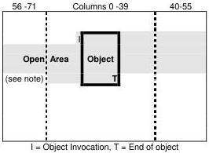

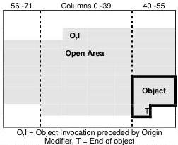

*Figure A.1: Definition of the "Open Area" for Objects*

NOTE: The "open" area does not extend into the left-hand side-panel on this row as the column addresses are beyond the last cell addressed by the object.

3) The maximum number of objects that may be opened successively by the local enhancement data, or by any other object, without any intervening displayable character or attribute being written is 15.

### A.9 Coding of packets 8/30, Formats 1 and 2

1) When packets 8/30 Format 1 and 8/30 Format 2 are both present in a given transmission, the data in bytes 7 to 12 and 26 to 45 of each packet shall be identical.

2) Where a broadcaster has not been allocated an official NI value, bytes 13 and 14 of packet 8/30 format 1 should be coded with all bits set to 0.

### A.10 Reserved page number

The following page numbers shall be used solely for carrying the information indicated. Unless otherwise indicated, the page numbers are reserved in all magazines.

|  1BE | Automatic Channel Installation (ACI)  |
| --- | --- |
|  1F0 | Basic TOP Table (BTT), see clause 11.2.2  |
|  mFD | Magazine Inventory Page (MIP), see clause 11.3  |
|  mFE | Magazine Organization Table (MOT), see clause 10.6  |
|  mFF | Time filling and terminator, see clause A.1  |

NOTE: See also clause E.15.

## Annex B (normative): Transmission Rules

### B.1 Transmission of basic Teletext pages with a page erasure interval

For compatibility with earlier decoders in the field, a page clearing interval of 20 ms should be maintained in the transmission between the header and any packets of a page that is intended to be interpreted by a Level 1 or 1.5 decoder. This time interval is required by many decoders for erasing the previous page from memory.

### B.2 Transmission order of packets with Y = 26, 27 and 28

1) To permit the most efficient operation of a decoder the transmission of a page header packet (Y = 0) shall be followed by the transmission of any packets with Y = 27 (containing links to other pages) and Y = 28 (containing formatting information to assist interpretation of the rest of the page), in that order.

2) In the case of pages intended for direct display, packets with Y = 26 shall be transmitted before any packets with Y = 1 to Y = 25. Packets with Y = 26 shall be transmitted in ascending order of designation code.
If the transmission of the page is interrupted and then restarted, any packets with Y = 27, Y = 28 and Y = 26 shall be re-transmitted following the page header, regardless of the state of the C4 bit for that page.

3) In the case of pages intended for further processing, e.g. presentation enhancement data pages, packets with Y = 1 to Y = 26 shall be transmitted in ascending order of packet address, and in ascending order of designation code for packets with Y = 26.
If the transmission of the page is interrupted and then restarted, any packets with Y = 27 and Y = 28 shall be re-transmitted following the page header.

### B.3 Serial mode transmission

A serial mode transmission is defined by control bit C11 in packet X/0 being set to 1.

1) Any packets in the range X/1 to X/28 transmitted between two successive page headers are part of the page defined by the first page header.

2) They shall carry the same magazine address as that page header.

3) The transmission between these two page headers of packets in the range X/1 to X/28 from other magazines is not permitted.

4) The second page header may be from any magazine.

5) Packets M/29 from any magazine and independent packets with addresses 30 and 31 may be inserted at any point in the transmission sequence.

In practical terms, the following statements may be made:

a) In a transmission multiplexed with a video signal, it is likely that each page will be transmitted on the maximum number of VBI lines available, and all pages from all magazines will be transmitted one after the other, although not necessarily in numerical sequence.

b) It is preferable for a decoder to use all page headers (providing control bit C9 is set to 0) from all magazines when displaying rolling headers.

### B.4 Parallel mode transmission

A parallel mode transmission is defined by control bit C11 in packet X/0 being set to 0.

1) Packets in the range X/0 to X/28 from any magazine may be transmitted in any sequence, providing the packets of an individual page are transmitted according to clause B.2.

2) Following a page header with a certain magazine address, only those packets in the range X/1 to X/28 with the same magazine address belong to the page defined by the page header.

3) Packets M/29 from any magazine, packets 30 and 31 may be inserted at any point in the transmission sequence.

In practical terms, the following statements may be made:

a) In a transmission multiplexed with a video signal, it is likely that pages from one or more magazines will be allocated to groups of VBI lines for transmission.
Thus a single VBI period can consist of packets from a number of different magazines.
Pages within each magazine need not to be transmitted in numerical sequence.

b) It is preferable for a decoder to use page headers (providing control bit C9 set to 0) from only one magazine when displaying rolling headers.

### B.5 Transmission of packets 8/30

1) Packets 8/30 Format 1 shall be transmitted within the VBI immediately following the boundary between clock-seconds.

2) Up to four Format 2 packets 8/30 may be transmitted within a one second interval interleaved with a Format 1 packet 8/30 (if any).

3) The transmission of any packet 8/30 should be separated by at least 200 ms from any following packet 8/30.

### B.6 Rules for the transmission of presentation enhancement data

1) Each presentation enhancement page, e.g. MOT, POP, GPOP, DRCS, GDRCS, and all non-page related presentation enhancement packets, e.g. M/29, shall be transmitted in full every 20 s maximum.

2) Presentation enhancement pages may be transmitted without a 20 ms interval between the page header and the remaining packets of the page.

3) These pages may be transmitted as continuous burst where one page is followed immediately by the next.

4) The format for the sub-code is defined in clause A.1.

5) When the Erase bit, C4, is set, a decoder should erase all the packets belonging to the previous version of the page.

6) Partial updates, comprising the page header and the changed packet(s), can be sent between each full transmission. The C13 bit is set to 1 to indicate a partial page.

7) An enhancement page, either the full page or a partial update, may be transmitted in fragments to utilize otherwise unused VBI data lines. However, it may not be known whether the page will be transmitted in fragments when the page header is first broadcast. For the first attempt at transmitting the page, the C12 bit should set to 0. If the page is interrupted, all subsequent headers used until the last packet has been transmitted should have this bit set to 1.

8) The C14 bit is reserved.

The C8, C12 and C13 control bits in combination with the S2 component of the page sub-code are used to indicate the status of the page currently being transmitted. In table B.1 it is assumed that the previous transmission of the page header had the S2 value set to N.

Table B.1: Indicating Fragmented and Partial Pages

|  C4 | C8 | C12 | C13 | S2 | Interpretation  |
| --- | --- | --- | --- | --- | --- |
|  0 | 0 | 0 | 0 | N | Full page, complete page or first fragment, no changes since last transmission  |
|  0 | 0 | 1 | 0 | N | Full page, second or further fragment, no changes since last transmission  |
|  1 | 1 | 0 | 0 | N+1 | Full page, complete page or first fragment, changes since last transmission, erase old page  |
|  0 | 1 | 1 | 0 | N | Full page, second or further fragment, changes since last transmission,  |
|  0 | 1 | 0 | 1 | N+1 | Partial page, complete page or first fragment, changes implied  |
|  0 | 1 | 1 | 1 | N | Partial page, second or further fragment, changes implied  |

A combination of this information and the S3 and S4 components of the sub-code allow a decoder to determine if all the packets of a page have been received.

### B.7 Transmission sequence of enhancement data for page updates

The sequence of packets transmitted when one or more pages change from an existing coherent situation to a new coherent situation is to be in the following order:

1) Any information relating to the old coherent state shall not be transmitted again.

2) The updated MOT is transmitted with the new information.

3) The updated DRCS pages are transmitted with the new information.

4) The updated object pages are transmitted with the new information.

5) The updated Level one page is transmitted.

### B.8 Rules for the transmission of Magazine Inventory Pages (MIP)

1) Each Magazine Inventory Page shall be transmitted in full every 20 s maximum.

2) The page shall be transmitted with a page erasure interval of 20 ms.

### B.9 Maximum time between successive packets of a page

For all types of pages, the maximum time interval between the transmission of successive packets of the same page shall be 100 ms.

NOTE: This parameter is included to allow software-based decoders to determine when to display the packets received so far if the closing page header is delayed or absent.

## Annex C (normative): Decoding Rules

### C.1 Relationship between the display planes

Transparency (entry 0 in CLUT 1) in a higher plane makes the plane below visible. There are three display planes with a defined priority order:

1) Foreground/Background;

2) Full Screen/Full Row Colour;

3) Video.

The action of the Boxing/Window attribute in the conjunction with the Newsflash and Subtitle control bits is summarized in table C.1.

Table C.1: Display Priorities

|  Foreground/Background Colour | Full Row Colour | Boxed or Windowed Area | Newsflash or Subtitle Page Control Bit | Result  |
| --- | --- | --- | --- | --- |
|  ■ | ■ | 0 | 0 | F/B Colour  |
|  ■ | ■ | 0 | 1 | Video  |
|  ■ | ■ | 1 | 0 | F/B Colour  |
|  ■ | ■ | 1 | 1 | F/B Colour  |
|  ■ | □ | 0 | 0 | F/B Colour  |
|  ■ | □ | 0 | 1 | Video  |
|  ■ | □ | 1 | 0 | F/B Colour  |
|  ■ | □ | 1 | 1 | F/B Colour  |
|  □ | ■ | 0 | 0 | Row Colour  |
|  □ | ■ | 0 | 1 | Video  |
|  □ | ■ | 1 | 0 | Video  |
|  □ | ■ | 1 | 1 | Row Colour  |
|  □ | □ | 0 | 0 | Video  |
|  □ | □ | 0 | 1 | Video  |
|  □ | □ | 1 | 0 | Video  |
|  □ | □ | 1 | 1 | Video  |
|  NOTE: □ = CLUT1, entry 0 (Transparent), ■ = any other colour (not transparent)  |   |   |   |   |

### C.2 Rules for determining priorities of spacing and non-spacing attributes

Where two or more attributes of the same type are in contention at the same character location it is necessary to have rules to establish which will take effect. The basic rule is that the latest one takes precedence where consideration is given to the following, in the order below:

1) The locations at which the contending attributes first take effect;

2) The locations at which the contending attributes are placed (but only if the priority cannot be resolved by rule 1);

3) The relative positions in the transmission of the contending attributes (but only if the priority cannot be resolved by rules 1 or 2).

EXAMPLES:

|   | n-1 | n  |
| --- | --- | --- |
|  level 1 row | a-red | A  |
|  X/26 | fgnd blue |   |

Foreground Blue takes effect at location n-1 while alpha red takes effect at location n. Alpha red therefore takes effect latest and "A" is displayed in red by rule 1.

|   | n-1 | n  |
| --- | --- | --- |
|  level 1 row | a-red | A  |
|  X/26 |  | fgnd blue  |

Both attributes take effect at location n and so rule 1 cannot be used to resolve the priority. Foreground Blue is located at a later position and so, by rule 2, the "A" is displayed in blue.

|   | n-1 | n  |
| --- | --- | --- |
|  level 1 row | a-red | A  |
|  X/26/0 |  | fgnd blue  |
|  X/26/1 |  | fgnd yellow  |

Both attributes take effect and are located at "n" so neither rules 1 nor 2 will resolve the priority. Foreground Yellow is later in the transmission sequence and so, by rule 3, wins. The "A" is displayed in yellow.

### C.3 Rules applying to the size attributes

The size attributes are:

- Normal Size;
- Double Height;
- Double Width;
- Double Size.

Size attributes may be transmitted as Level 1 spacing attributes or as Level 2.5/3.5 non-spacing attributes (via packets X/26 or objects).

Spacing size attributes, apart from Normal Size, take effect at the character following their location ("Set After"). Non-spacing size attributes and the Normal Size spacing attribute take effect at the location in which they are placed ("Set At"). Both spacing and non-spacing size attributes affect all characters following the first location at which their action starts until either they are superseded by another size attribute or the end of the row is reached.

The following rules apply to the size attributes:

1) The transmission should not define the display in such a way that partial characters are implied. It should inhibit the transmission of double height/double size attributes in rows 0, 23 and 24, and double width/double size attributes that take effect in column 39 or the last column in either side-panel. If a decoder receives an illegal combination, it may choose, for example, to display a partial character, to reduce the size or to ignore the character completely.

2) Priority is given in scan order, where the display scanning is considered as left to right and top to bottom, with earlier encountered size attributes taking precedence over later ones.

3) In the event of a situation which would conflict with rules 1 or 2 occurring, the doubling of width and/or height of the conflicting character shall be ignored so that rules 1 and 2 are satisfied. A double size character shall only be reduced to normal size in these circumstances if it is not possible to satisfy the rules by making it either double width or double height.

4) All attributes applying to the origin of an enlarged character shall also apply to all parts of that character.

5) All attributes located at positions obscured by an enlarged character shall take effect at the first non-obscured position following that character, unless subsequently superseded.

### C.4 Interpretation of character set and DRCS table changes at enhanced levels

1) In the absence of any re-definition, the default G0 and G2 characters sets are those defined by the Default Designation bits (triplet 1, bits 8 - 14) in packets X/28/0 Format 1 or X/28/4 (Level 3.5 only), or M/29/0 or M/29/4 (Level 3.5 only), in descending priority order. In the absence of any information, a decoder may default to the Latin characters sets (see also clause D.2.1).

In the absence of any explicit DRCS sub-table selection, a decoder should default to sub-tables 0 for both normal and global DRCS characters.

2) The column address group triplet with mode value 01000 designates the G0 and G2 character sets for current use.

When this triplet is found within local enhancement data or within an Active Object, the new definition applies to all further characters from these sets on the same row, where the characters are defined either by the local enhancement data or the Active Object. The new definition lasts until changed by another mode 01000 triplet or the end of the row.

When this triplet is found within an Adaptive or Passive Object, the new definition applies to all further characters from that set that are defined by the object concerned. The new definition lasts until the last character cell of the object or until further changed by another mode 01000 triplet for the corresponding character set in the object's definition.

3) The row address group with mode value 11000 designates the DRCS sub-table in current use. Where an object invokes a DRCS character, designation of the appropriate sub-table shall be included within the definition of the same object.

## Annex D (normative): Default operation of decoders

Decoders should make certain assumptions and decisions in the absence of particular presentation related packets to ensure uniformity of response should these packets be deliberately omitted from the transmission. This annex does not define the response of a decoder when a packet has been lost due to error conditions, nor to the absence of non-presentation related packets.

### D.1 Page level

In the absence of certain packets X/28, Level 2.5 and 3.5 decoders may chose to assume that a particular page is not a basic text page and has a different coding scheme from the default defined below. This decision could be made following:

1) inspection of the data in the Magazine Organization Table(MOT); or

2) inspection of the links in packets X/27/4 of other pages; or

3) because a Code of Practice allocates fixed page numbers for particular functions.

#### D.1.1 Missing packets X/1 to X/25

NOTE: Basic text pages and DRCS downloading pages may be transmitted row adaptively. For Object definition pages, packets X/1 to X/25 if required should be used sequentially, starting with packet X/1, and unused rows need not be transmitted.

1) If any decoder assumes the page is a basic text page, any missing rows in the range X/1 to X/23 should be displayed as if they contained 40 character spaces (code 2/0). Where required, packets X/24 and X/25 should be treated in the same way.

2) If a Level 2.5 or 3.5 decoder believes the page to be a DRCS downloading page, the absence of particular packets may be interpreted by a decoder as an error condition if the DRCS character(s) containing the PTUs in those packets is selected for display, or a downloading mode is specified in packets X/28/3 that refers to the PTUs in the missing packets.

3) If a Level 2.5 or 3.5 decoder believes the page to be an Object definition page, the absence of a particular packet prior to the Termination Marker triplet may be interpreted as an error condition. Under these circumstances the response of a decoder is not defined here.

#### D.1.2 No packets X/26

1) Level 1.5 decoders should assume that the display of the page does not require characters or symbols which cannot be selected via codes in packets X/1 to X/24.

2) Level 2.5 and 3.5 decoders should assume that there are no enhancements to the page other than default objects, if any, or defaults from any packets X/28/0 Format 1, X/28/4, or M/29/0,4.

#### D.1.3 Packets X/26 with non-sequential designation codes

Packets X/26 should be transmitted with sequential designation codes, starting at 0000. Consequently, the absence of a packet with a particular designation code from a sequence of packets X/26 and prior to a Termination Marker triplet may be interpreted as an error condition by a decoder. Under these circumstances the response of a decoder is not defined here.

#### D.1.4 No packet X/27/4

Level 2.5 and 3.5 decoders should assume that the Magazine Organizational Table (MOT) contains valid page numbers for the Object and DRCS pages required to display the associated page.

#### D.1.5 No packet X/28/0 Format 1

1) A Level 2.5 decoder may assume that the associated page (packets X/1 to X/25) is a Level 1 text page, each 8-bit byte coded with 7 data bits and 1 odd parity bit. A Level 3.5 decoder should check for packets X/28/3 and X/28/4 before making the same assumptions.

2) The decoder should check for packet M/29/0 before loading default values for the following:

- Primary/Secondary G0/G2 character set designation;
- Side-panels;
- CLUTs 2 and 3;
- Default screen colour;
- Default row colour;
- Black background colour substitution;
- Colour Table re-mapping.

#### D.1.6 No packet X/28/1

A Level 3.5 decoder should check for packet M/29/1 before loading the DCLUTs with default colours.

#### D.1.7 No packet X/28/3

1) A Level 3.5 decoder should check for packets X/28/0 Format 1 and X/28/4 before assuming that the associated page (packets X/1 to X/25) is a Level 1 text page, each 8-bit byte coded with 7 data bits and 1 odd parity bit.

2) If a Level 3.5 decoder believes that the page is a DRCS downloading page, the absence of this packet should be taken as an indication that the page defines 12x10x1 mode DRCS characters only.

#### D.1.8 No packet X/28/4

1) A Level 3.5 decoder should check for packets X/28/0 Format 1 and X/28/3 before assuming that the associated page (packets X/1 to X/25) is a Level 1 text page, each 8-bit byte coded with 7 data bits and 1 odd parity bit.

2) A Level 3.5 decoder should check for packet M/29/4 before loading CLUTs 0 and 1, with the normal full and reduced intensity colours, including "transparent" at entry 0 in CLUT 1.

### D.2 Magazine level

These assumptions are required to be implemented by Level 2.5 and 3.5 decoders only. They should be applied as a set of default conditions to all pages in the magazine in the absence of particular packets M/29 and specific page-related data.

#### D.2.1 No packet M/29/0

These default conditions apply to both Level 2.5 and 3.5 decoders in the absence of a packet X/28/0 Format 1 in magazine M.

1) In the absence of a local (i.e. country specific) Code of Practice, the default G0 and G2 character sets should be assumed to be the Latin G0 Primary and Latin G2 Supplementary sets shown in tables 35 and 37 respectively. Thus the default value from table 32 to be assumed for the *Default G0 and G2 Character Set Designation and National Option Selection* bits is 0000XXX. The C12, C13 and C14 controls bits select a national option sub-set.

2) A default value for the Second Language Definition bits is not specified here since this is decoder dependent. It may be covered in a local Code of Practice.

3) The side-panel requirements are determined from the data in page's public object link in the MOT. In the absence of a MOT, no side-panels should be displayed.

4) CLUTs 2 and 3 should be filled with the default colours shown in table 30.

5) The screen colour is black, i.e. Colour Map entry 0.

6) The row colour for all rows is black, i.e. Colour Map entry 0.

7) The requirement for black background substitution by full screen/row colour is determined from data in the page's public object link in the MOT. In the absence of a MOT, black background is not substituted.

8) No re-mapping of the spacing attribute colours is required, i.e. CLUT 0 should be used for both foreground and background colours.

#### D.2.2 No packet M/29/1

In the absence of a packet X/28/1 for a page in magazine M, a Level 3.5 decoder should load the DCLUTs as follows:

1) The DCLUT4 for both global and normal 12x10x2 DRCS modes should be filled, in ascending address order, with the first four full intensity colours, i.e. entries 0 to 3 from CLUT 0.

2) The DCLUT16 for both global and normal 12x10x4 and 6x5x4 DRCS modes should be filled, in ascending address order, with the normal full and reduced intensity colours, i.e. CLUTs 0 and 1, including "transparent".

#### D.2.3 No packet M/29/4

In the absence of a packet X/28/4 for a page in magazine M, a Level 3.5 decoder should load CLUTs 0 and 1 with the normal full and reduced intensity colours, including "transparent" at entry 0 of CLUT 1.

### D.3 Service level

These assumptions should be implemented by all decoders, regardless of their Presentation Level capabilities.

1) If a packet 8/30/1 or a packet 8/30/3 is not transmitted during the VBI period, the Teletext transmission, if present, should be assumed to be confined to the VBI period.

2) In the absence of any packet 8/30/0, 8/30/1, 8/30/2 or 8/30/3 in the Teletext transmission, it can be assumed that the page number 100 is being broadcast and is suitable for use as an introductory page.

NOTE: A decoder may chose to display a user-specified page in preference to the Initial page indicated via packet 8/30, or page number 100.

## Annex E (informative): Encoding aspects

### E.1 Page numbers for object definition and DRCS data pages

Pages used for object definitions and downloading DRCS data should have page numbers which include a hex digit to prevent them being captured as normal display pages.

### E.2 Page Time-Code

Bytes 8, 9, 10 and 11 of a page header packet (the page sub-code) may in addition be used to transmit time related information, e.g. for an Alarm Clock page. Bytes 8 and 9 indicate the minutes units and tens respectively, and bytes 10 and 11 indicate hours units and tens respectively. All bytes coded BCD.

### E.3 Use of packets X/26 in Level 1.5 transmissions

The packet X/26 content of Level 1.5 transmissions is determined by local Codes of Practice, subject to the local language requirements.

Many existing Level 1.5 decoders will interpreted the address field of all row address triplets as a genuine row address. The packet X/26 functionality is usually limited to a sub-set of the following column address triplets:

|  Mode | Function | Valid Data Range  |
| --- | --- | --- |
|  00010 | G3 set character | 5/1, 5/B, 5/C and 5/D only  |
|  01111 | G2 set character | 2/0 to 7/F  |
|  10000 | G0 set character (no diacritical mark) | 2/0 to 7/F  |
|  10001 } |  |   |
|  to } | Diacritical mark + G0 set character | 2/0 to 7/F  |
|  11111 } |  |   |

In addition, many existing decoders will not respond to packet X/26/15.

Packet 26 characters which address positions in row 0 should appear when the page is displayed in full. A decoder is not required to reproduce such characters for incorrect page headers while it is searching for a page and rolling the Level 1 text from those page headers.

### E.4 Preferred use of packets X/27/4 and X/27/5

Packet X/27/4 (Format 1) links provide a complete definition of the pages carrying enhancement data required to display the associated page.

The X/27/4 links provide information on the particular POP and DRCS sub-pages required by a page. (This is in the form of 16 flags for the 16 possible sub-pages). Since this information is not available in the MOT, the transmission of a packet X/27/4 could speed up the processing of the page by a decoder.

If a packet X/27/4 is transmitted, the links defined will have precedence over the information supplied by the MOT. This is required, for example, to support the "news-reel" type of page where a selection of pages with different enhancement data (POP and DRCS), possibly from different magazines, are presented on a single page number as a multi-page set.

At Level 3.5, packets X/27/5 (Format 1) should be used in the same way when required.

### E.5 Character set designation

1) The G1 mosaics and G3 smooth mosaics/line drawing sets cannot be designated, there is only one set of each.

2) Designation of G0 and G2 is possible by a X/28/0 Format 1 or X/28/4 for a page, or by M/29/0,4 for a magazine.

3) Within one display row the char set designation by X/28 and X/29 might be modified by a X/26 triplet "Modified G0 and G2 Character Set Designation" for characters placed using X/26 triplets.

### E.6 Use of DRCS characters within objects

The transmission equipment should ensure that any DRCS characters referenced within objects invoked by a page are included in one of the DRCS definition page(s) which are referenced by that page, either explicitly via packets X/27/4 or X/27/5 Format 1 (where applicable), or, in the absence of such packets, implicitly referenced by the MOT data for that page.

### E.7 Character cells addressable by objects

1) Some decoders reserve the first eight character cells in the page header row for their own purposes, thus objects should avoid writing to these positions.

2) The use of objects which spread from rows higher up the screen into row 24 is not recommended as many decoders will display row 24 below rows 0 to 11 when operating in "Page Expansion" mode.

3) Objects which address character positions in row 0 should appear when the page is displayed in full. A decoder is not required to reproduce such objects or any other Level 2.5 or 3.5 enhancements for incorrect page headers while it is searching for a page and rolling the Level 1 text from those page headers.

### E.8 Limits for global enhancement data

Level 2.5 - The total number of packets used for DRCS and object definition pages over all magazines shall not exceed 500.

Level 3.5 - The total number of packets used for DRCS and object definition pages over all magazines shall not exceed 1 200.

### E.9 Selection of national option sub-sets

Level 1 and 1.5 decoders are likely to select the national option sub-set to be used on a given page by inspecting only the C12, C13 and C14 control bits of the page header.

At levels 2.5 and 3.5, character and national option sub-set requirements can be conveyed by the appropriate packets X/28 and M/29. Some Level 2.5 decoders will ignore the setting of bits 8 to 10 of triplet 1 (part of the Default G0 and G2 Character Set Designation and National Option Selection value) and use the C12, C13 and C14 control bits to select a national option sub-set from table 32 in clause 15.2. Other Level 2.5 decoders will ignore the C12, C13 and C14 control bits if there is a valid packet X/28/0 Format 1 or M/29/0. (The page-related packets X/28 take precedence over the magazine-related packets M/29.) Under these circumstances the national option sub-set is determined from table 32 by the setting of bits 8 to 10 of triplet 1 of the packet with the highest priority.

The following recommendations are made to ensure all Level 2.5 decoders display a page in the same way:

1) In the interests of transmission efficiency, bits 8 to 10 in the triplet 1 of a packet M/29/0 or M/29/4 should be chosen to select the most commonly used national option sub-set in that magazine.

2) If a given level 2.5 page requires a different national sub-set from that specified in a packet M/29 for that magazine, a packet X/28 should be transmitted with the bits 8 to 10 of triplet 1 set to select the required national option sub-set.

3) The setting of bits 8 to 10 in triplet 1 of a packet X/28/0 Format 1 or X/28/4 should be identical to the setting used for the C12, C13 and C14 control bits in the page header.

### E.10 Characters including diacritical marks

The technique for defining a diacritical mark from a G2 character set and adding it to a character from a G0 character set (see clause 12.3.4, table 26, mode bits = 1000 to 11111) should be restricted to the Latin character sets as defined in clauses 15.6.3 and 15.6.1 respectively. Decoders are unlikely to be able to handle other G0 sets in this way.

### E.11 Invocation of default objects

Clause 13.8 requires that a decoder ignores instructions to display Default Objects if the page includes local enhancement data in packets X/26. Since decoders cannot identify when the packet X/26 data is included exclusively to achieve a Level 1.5 display, it is necessary to invoke all the required objects from within the packets X/26 of a Level 1.5 page.

### E.12 Coding of default objects

To ensure decoders process and interpret default objects in the same way, it is necessary to ensure that if two or more objects used as default objects address the same character cell, they must not refer to the same attribute nor select more than one new character.

### E.13 Use of Start and End box spacing attributes

The spacing attributes Start box and End box should not be used on level 1/1.5 pages that do not have the Newflash or Subtitle bits set to 1 to ensure that a spurious window (i.e. the display of video within the boxed area) is not created by a level 2.5 decoder.

### E.14 Real-time clock Page Header Packets

The last 8 bytes of page header packets are usually coded with a real time clock: hours, minutes seconds numerically in that order. The preferred format is H H separator M M separator S S.

The absence of real-time clock, either continuously or intermittently, can give problems for some TV receivers and VCRs which set their internal time-of-day clock from this data. If a true real-time clock is not to be broadcast continually, the transmission should also include a packet 8/30 format 1 with the correct coding of the UTC data bytes, and a transmission rate of at least once per second.

### E.15 Recommended and default page numbers

It is recommended that the following page numbers are reserved or allocated for certain functions:

|  100 | The 'Home' page of the complete service. The 'Home' page can be reassigned via the 'Initial Teletext Page' field of a packet 8/30, format 1.  |
| --- | --- |
|  1DF | Data broadcasting page carrying EPG data as defined in [3] and coded according to clause 4 in [2]. A Magazine Inventory Page should be used to indicate the use of a different page number.  |
|  1E7 | Page carrying trigger messages as defined and coded in [8]. A Magazine Inventory Page should be used to indicate the use of a different page number.  |
|  1F1 } | TOP data pages: Additional Information Table (AIT), Multi-Page  |
|  1F2 } | Table (MPT) and Multi-Page Extension Table (MPT-EX). The page  |
|  1F3 } | numbers for all these pages are assigned through the Basic Top  |
|  1F4 } | Table (BTT)  |

NOTE: See also clause A.10.

## Annex F (informative): Transmission aspects

### F.1 Cycle Times

#### F.1.1 Serial transmissions

Where all pages are transmitted in a page number sequence, the Cycle Time is the time between successive transmissions of any one page.

#### F.1.2 Parallel transmissions

As for serial mode, but can be different for each of up to 8 magazines.

#### F.1.3 Complex systems

The Cycle Time may be affected by the insertion of pages out of numerical sequences.

### F.2 Interrupted pages

In order to keep existing Level 1 decoders functioning correctly, it is recommended that Level 1 pages are completely re-transmitted, including all extension packets, after any interruption (e.g. for the immediate insertion of a subtitle page).

Pages carrying enhancement data (MOT, POP, DRCS) may be interrupted and continued by transmitting only the remaining part of the page after re-transmitting the same header again (see also clause B.6).

### F.3 Packets M/29

Packets M/29 can be transmitted at any time on any line in the service.

### F.4 Allocation of Teletext packets to VBI lines

Some existing Level 1 and 1.5 decoders may not decode Teletext signals on lines 6, 318 and 319. Thus these lines should be used for Level 2.5 or 3.5 enhancement data only, or non-Teletext signals (see annex P). Further information can be found in TR 101 233 [7].

### F.5 Use of lines 22 and 335

Some existing decoders will not display the text (usually real time clock information) contained in bytes 39 to 45 of packets with Y = 0 if these packets are transmitted exclusively on lines 22 or 335. Thus if a packet M/0 is broadcast on either of these lines it may be beneficial to transmit at least once per second an additional packet M/0 on a line other than 22 or 335. This packet M/0 should not have the Interrupted Sequence bit set (C9 = 0) and the text part of the header (bytes 14-45) should be consistent with other page headers in the same magazine. This requirement may be satisfied by a repeated packet X/0 (i.e. a time filling header) or the page header for enhancement data and under these circumstances a specific additional packet may not be required.

### F.6 Teletext transmissions outside of the VBI

Teletext packets may be inserted on any or all of the lines outside of the VBI. This is referred to as Full Field or Full Channel transmission. The following points should be noted:

1) The LSB of the designation code (byte 6) of a packet 8/30 (Format 1 or 2) should be set to 1 to indicate to a decoder that Teletext packets can occur outside of the VBI.

2) The packet 8/30 should be transmitted in the VBI period so that it can be detected by a decoder working in its default mode after power-up or a change of channel (see clause D.3).

3) Once enabled to receive Teletext packets from any line in the field, some existing decoders will not attempt to clear explicitly the old page from memory prior to receiving a new page, either on first reception of a page or in response to the C4 (Erase Page) control bit. Consequently, row adaptive transmission techniques should not be adopted and the C4 control bit should not be used.

Thus it is necessary to arrange that the old page in the decoder's memory will be erased fully by the arrival of a new page. It is recommended that packets X/0 to X/23 (and X/24 where applicable) are broadcast for every page in the service. If a packet X/26 is used by any page within the service then such a packet should be transmitted for every page, even if it contains only Termination Markers triplets (i.e. no information). Packets X/27 and X/28 containing dummy or default information may also be required for each page.

If it is known that all decoders can erase the old page immediately on receiving an appropriate page header then pages can be broadcast row adaptively and the C4 control bit can be set.

4) The transmission rules of clauses B.2 to B.8 inclusive apply, apart from the need for a page erasure interval with a MIP (clause B.8, point 2) when the recommendations in point 3 above should be considered.

## Annex G (informative): Decoding aspects

### G.1 Mixed mode operation of decoders

Existing decoders operating in "mixed" mode may also display the foreground of non-boxed characters.

### G.2 Character displays

The precise appearance of all characters and mosaics (other than DRCS characters) in any mode, including enlarged and underline modes, is a decoder option.

### G.3 Behaviour of display attributes

#### G.3.1 Start Box and End Box

Example of the Start Box (0/B) and End Box (0/A) codes:

X = Don't Care, except that changes of colour (foreground and/or background) will affect the boxed characters.

#### G.3.2 Separated Mosaic Graphics

Example of the Separated Mosaic Graphics code (1/A):

#### G.3.3 Hold Mosaics, Release Mosaics and Separated Mosaic Graphics

Example of the Hold Mosaics (1/E), Release Mosaics (1/F) and Separated Mosaics (1/A) codes (sequence is assumed to start at the beginning of a display row):

The above sequence shows:

- 1/7 - Mosaics White - displayed as black background;
- 6/6 - G1 mosaics character - displayed in its contiguous form as white foreground on a black background and adopted in its contiguous form as the current "Held Mosaic" character;
- 1/E - Hold Mosaics - causes the current "Held Mosaic" character (6/6) to be displayed;
- 3/9 - G1 mosaics character - displayed in its contiguous form as white foreground on a black background and adopted in its contiguous form as the current "Held Mosaic" character;
- 1/A - Separated Mosaic Graphics - cause the current "Held Mosaic" character (3/9) to be displayed;
- 1/F - Release Mosaics code - causes the current "Held Mosaics" character (3/9) to be displayed;
- 6/6 - G1 mosaics character - displayed in its separated form as white foreground on a black background and adopted in its separated form as the current "Held Mosaic" character.

Although the Separated Mosaic Graphics code normally becomes active on the next character, in this case it only takes effect when the next new mosaics character is encountered. This illustrates how the "Held Mosaic" character continues to be displayed over control codes.

### G.4 Minimum decoder configurations

Level 2.5 and 3.5 decoders should have sufficient memory to store the maximum number of packets used for DRCS and object definition pages, including all sub-pages, that may be transmitted at each Level.

### G.5 Order of invocation of default objects

In the absence of any local packets 26, and when the default objects are of the same type, the preferred order of invocation is: GPOP 1, GPOP 2, POP 1, POP 2. When the default objects are of different types, the object type defines the relative priority according to clause 13.2. The origin of a default object is fixed at row 0, column 0 and the active position returns to row 0, column 0 after invocation.

## Annex H (informative): Code of Practice for navigation via FLOF

### H.1 Objectives

The Full Level One Facilities (FLOF) system is intended to fulfil the following objectives:

- Simple user control;
- Easier selection of information;
- Reduced page access time;
- Compatibility with existing products in the field;
- Compatibility with existing database structures;
- Minimum transmission overheads;
- Moderate editorial overheads;
- Optimum cost effectiveness;
- Flexibility in use;
- Unambiguous operation;
- Compatibility with decoders having storage facilities for any number of pages.

### H.2 Packets with Y = 27 for automatic page acquisition

A decoder intended for use according to this Code of Practice shall process the linked page addresses of a packet X/27/0 to acquire pages automatically. The maximum number of pages stored is limited by the decoder memory capacity.

#### H.2.1 Coloured keys - prompt mode

A decoder intended for use according to this Code of Practice will provide four keys on the user's control unit, associated with the first four linked page addresses, in transmission order. These keys shall be respectively coloured red, green, yellow and cyan and relate to the associated displayable prompts that may be transmitted in a packet with Y = 24.

#### H.2.2 Link address number 4

The fifth link address is not used in the functions defined above but may be used for additional automatic page acquisition.

#### H.2.3 Link address number 5

A decoder intended for use with this Code of Practice will provide an Index Key on the user's control unit. The sixth link address is associated with this key and the linked page shall carry suitable introductory material to assist the user. The use of the Index Key is not associated with a prompt transmitted in a packet with Y = 24.

#### H.2.4 Link Control Byte

Decoders compatible with this Code of Practice shall process the Display Row 24 Flag, bit 4 in the Link Control Byte, as follows:

Set to 1: Packet with Y = 24, if present, is to be displayed at the bottom of the associated page. Such a packet 24 may include the prompts as defined above.

Set to 0: Packet with Y=24 is not to be displayed but may be present for other applications.

#### H.2.5 Basic page check word

Decoders intended for use according to this Code of Practice may optionally process the CRC check word in bytes 44 and 45.

### H.3 Packets with Y = 24

This packet is used in this Code of Practice to assist the user in page selection. The relationship between the displayed prompts and the users control keys should be clear.

Up to four prompts can be included in this packet, respectively distinguished by the inclusion of the colours red, green, yellow and cyan. The display should be such that a prompt can be distinguished by position as well as by colour.

The number of characters used in the prompts is only limited by the availability of 40 character codes in packets with Y = 24.

### H.4 Fall-back conditions

#### H.4.1 No packet 8/30

Multiplexed operation is assumed, with an initial page address 100, page sub-code being interpreted as "don't care". No status message is to be displayed.

#### H.4.2 No packet with Y = 27 and no packet with Y = 24

The index key will cause the initial page to be displayed; the coloured keys will be disabled.

#### H.4.3 Packet with Y = 27 but no packet with Y = 24

At least an index link in the appropriate link number shall be provided.

#### H.4.4 Packet with Y = 24 included, other than for prompts in conformity with this Code of Practice

A packet with Y = 24 may be included in any sequence of data. It shall only be displayed when the Display Row 24 Flag Bit in the packet X/27/0 is set to 1.

## Annex I (informative): Navigation via Table Of Pages (TOP)

The specification for the Table Of Pages (TOP) system can be found in the document:

- Institut für Rundfunktechnik, ARD/ZDF Technical Guidelines, No. 8 R 5, 2nd Edition (2nd December 1991):
"TOP" System for Teletext".

The combination of TOP and parallel transmissions for Level 1 and 1.5 services is not recommended due to the limited performance of Level 1 and Level 1.5 decoders. This is caused by a lack of memory, amongst other factors, in a significant number of existing decoders. Therefore, where a parallel transmission is implemented, the use of navigation via FLOF or the MIP is encouraged.

### I.1 Objectives

The TOP system is intended to fulfil the following objectives:

- Simple user control;
- Rapid orientation with in the Teletext service structure;
- Reduced page access time;
- Better use of the decoder data base;
- Direct page access facilities;
- Minimum transmission overhead;
- Moderate editorial overhead;
- Low additional costs for providers and viewers;
- Compatible with multi-page decoders;
- Additional features improving user's guidance.

### I.2 Main principles

The basic idea underlying the TOP system is to arrange the pages within a Teletext transmission cycle according to specific themes comparable to the structure of themes established by ordinary file-card boxes. All "news" pages, for example, are assigned to a specific file-card box; further "blocks" of pages are conceivable: one for "sport", one for "service", one for "TV programme preview" and so on. Correspondingly, as it is also customary for file-card boxes, a further sub-division is provided: each "block" is composed of different "groups", for instance, the "news" block might be subdivided into the groups "politics", "economics" and "culture".

#### I.2.1 User-controlled selection of pages

In accordance with the partition into blocks and groups, the selection of pages is established by way of four specially-marked keys on the decoder remote-control unit:

|  1st key ("+"): | leads to the next page in the "file-card" box;  |
| --- | --- |
|  2nd key (e.g. "red"): | leads to the first page of the next group;  |
|  3rd key (e.g. "blue"): | leads to the next block; and  |
|  4th key ("-"): | leads back to the page(s) last seen.  |

In the commentary row (25th text row) at the bottom of the display screen, two fields, in the same colour as used by the corresponding keys, serve as guide for the user. This commentary row generated by the decoder announces the title of the block just selected, the title of the next group in that block and the title of the next block. In addition, the TV programme-preview pages can directly be selected by pressing a special key on the remote-control unit.

#### I.2.2 Direct page access

In place of a step-by-step keying-in from one block to the next and from one group to the next, direct page access may also be offered by the TOP system. By way of a "guide" page listing all the blocks together with their groups a user can mark the desired group within that page to have direct access to the pages of this group.

In addition, specific pages can be marked by the Teletext editor in order to generate a special "review" page for direct access by the viewer. Thus the editor can provide a simple and comfortable access for pages, which are particularly important or frequently viewed by the viewers.

#### I.2.3 Additional features

By evaluating the TOP tables included in the Teletext transmission cycle additional announcements such as "Page not included", "Please wait", "Multi-page with 4 sub-pages" can be issued by the decoder in the commentary row without having to await the appearance of the page demanded.

By use of TOP the waiting time for requested pages may also be considerably reduced where an appropriate design of multi-page memory decoder is used. Stored pages in the vicinity of a selected page which have a high probability of viewer interest within a group or a block may be stored while the viewer is reading the last-selected page.

TOP contributes, to providing user-friendly guidance through the multitude of pages within a complex-structured Teletext programme, and also to exploit the storage capacity offered by the Teletext decoder.

## Annex J (informative): Magazine Inventory Pages (MIP)

The Magazine Inventory Page is magazine based to support parallel transmission from multiple service providers as well as serial transmission. The MIP is transmitted as a page-format Teletext page and can be sent row adaptively as required. It should be transmitted at least every 20 seconds.

The page address is fixed at mFD:nnx0, where m is the magazine number, nn (range 1 to 24) is the address of the last packet that will be transmitted when the page is sent in ascending packet order, and x (range 0 to 7) increments on each update. The S1 element is fixed at 0.

The MIP is designed to signal to the decoder the key features of the pages in that magazine so enabling the decoder to decide how a page should be handled in advance of the page being received. In particular it signals the number of sub-pages in a multi-page set so that the decoder can allocate memory and can indicate to viewer the total number of sub-pages and the particular sub-pages which have been stored.

In the interests of transmission efficiency, a decoder should not assume that the absence of a packet in the range X/1 to X/14 is an indication that the pages covered by that packet are not in the current transmission. A page can only be assumed to be absent from the current transmission if the page code 00 is encountered. However, if a MIP is transmitted and there are pages in the same magazine that have reserved or default status (as listed in clauses A.10 and E.15), such pages should always be indicated in the MIP.

On each update the decoder should compare the current contents of the MIP with the previous version. If the number of sub-pages in a page has changed a decoder should delete all the sub-pages of that page from the store and start re-acquisition. This is the only way in which out-of-date pages can be removed efficiently.

Codes have been allocated to group like functions together, with significant bit patterns used for specific functions or reserved. In order to state the number of sub-pages efficiently, three ranges are used for normal and television schedule pages. Table J.1 should be read in conjunction in with the table defining the MIP codes, table 24. The column headed "PR" indicates pages which are related to the current TV programme and are suitable for recording with the programme.

Table J.1: Application of MIP codes

|  Page Code | Application | PR  |
| --- | --- | --- |
|  00 | Page not in transmission |   |
|  01 (and 81) | A single page with sub-code 0000 or editorially identical pages with a variable sub-code. Only the latest version of the page should be displayed. |   |
|  02 to 4F (and 82 to CF) | This page has 2 to 79 sub-pages, the number being set by the value of the code. |   |
|  50 (and D0) | This page has the number of sub-pages represented by the 12 data bits in the group of three bytes in packets X/15 to X/24. |   |
|  51 (and D1) | This page has the number of sub-pages represented by 13 data bits, where the MSB is set to one, and the remaining 12 bits are a group of three bytes from packets X/15 to X/24. NOTE: The last two possible codes are not used as they are reserved sub-codes. |   |
|  70 to 77 | This page is a subtitle page with the value of the language bits C12, C13 and C14 corresponding to the 3 LSBs of the byte. | ☑  |
|  78 | Points to a Subtitle Menu Page (if transmitted). | ☑  |
|  79 | This page needs only one page of storage and the sub-code should be interpreted as a time. |   |
|  7A | This page contains information concerning the content of the current TV programmes so that the viewer can be warned of the suitability of the contents for general viewing. | ☑  |
|  7B | This page is a multi-page set containing information associated with the current TV programme. The number of sub-pages in Packets X/15 to X/24. These pages may be accessed on demand by the viewer. | ☑  |
|  7C | As code 7B but for a single page. | ☑  |
|  7A to 7F 81 to D1 | TV programme related pages suitable for use by EPG equipment when no valid EPG data is available. |   |
|  81 to D1 | These pages have been identified at carrying programme listings information which will enable suitably equipped VCRs to identify pages that may contain machine readable data, coded according to EN 300 231 [1], to enable automatic programme recording. The general format is the same as for codes 01 to 51. |   |
|  E0 to E2 | These pages contain data broadcasting information coded according to the Page Format - CA protocol of EN 300 708 [2] clause 5. The number of sub-pages (where known) is signalled via packets X/15 to X/24. |   |
|  E3 | Data broadcasting page conforming to the Page Format - Clear protocol of EN 300 708 [2] clause 4. The page contains EPG data defined according to EN 300 707 [3]. |   |
|  E4 | Data broadcasting page conforming to the Page Format - Clear protocol of EN 300 708 [2] clause 4. The page does not contain EPG data defined according to EN 300 707 [3]. |   |
|  E7 | Systems page whose page number defines its function, but whose contents are not meaningful if displayed. |   |
|  E8 to EF | Codes used to signal the relationship of a DRCS or object definition page to the current magazine. This complements the information in the MOT, which points to a particular page. The decoder can use this information to determine the priority of storing a particular DRCS or object definition page. |   |
|  F0 to F3 | These identify different forms of "command pages" that the Broadcaster/service provider may use - for instance to control downstream processing of the service. |   |
|  F4 to F6 | These pages are for "engineering use such as "Clock Cracker " or pages about the operation of the origination system. |   |
|  F7 | Systems page whose page number defines its function, but whose contents are meaningful if displayed (see also code E7). |   |
|  F7 and F8 | Codes used for the pages associated with packet X/25 key word searching. |   |
|  FC | Page carrying trigger messages as defined and coded in [8] |   |
|  FE | Applied to any TOP page. It is assumed that the decoder will interpret the TOP pages from within the TOP specification. |   |

For multi-page sets of normal and TV schedule pages where the number of sub-pages is in the range 2 to 79, the two bytes per page (page code) in packet X/1 to X/14 indicates the number of sub-pages. Thus there is no additional transmission overhead.

The number of sub-pages for certain other page classifications is indicated via groups of three bytes of 8/4 Hamming coded data in packets X/15 to X/24. Values up to 2¹²-1 are coded directly by the 12 data bits. The range can be extended to 2¹³-2 where two page code values have been allocated per classification, the LSB of the page code providing the MSB of the range value. The group of three bytes in packets X/15 to X/24 are arranged in order of invocation from the sequence of pages in packets X/1 to X/14. Up to 13 × 10 such pages which comprise a large number of sub-pages can be supported in this way.

## Annex K (informative): VCR programming and control via Teletext

EN 300 231 [1] defines the use of Teletext data packets for the programming and control of domestic video recorders.

A method of labelling broadcast programmes is provided via the packets X/26 of Teletext pages listing TV programme schedules. This is based on a first announced transmission time for compatibility with other services. Simple programme selection with a cursor can be provided for the viewer by associating machine codes in the packets X/26 with the displayed items.

The Broadcast Service Data packet (8/30 Format 2) includes data identifying the origin of a broadcast programme, network identification and a programme label. The recording process can be controlled automatically by comparing the programme labels of the requested programmes with the label for the current programme. This allows the equipment to compensate for any changes in the transmission schedule.

## Annex L (informative): Use of Teletext Data for Automatic Channel Installation

A protocol exists for a system which enables automatic installation of TVs and VCRs when connected to a cable TV network. A unique Teletext page is part of the service delivered by the cable network operator. This contains machine-readable data giving the names of the channels provided and their transmission frequencies.

Details can be found in the document published by:

- EACEM/ECCA, Draft 2 (12th January 1994): "Automatic Channel Installation of TV and VCR via a Unique Teletext Page provided by a Cable Network Operator".

## Annex M (informative): Data transmission via Teletext

EN 300 708 [2] defines the use of some of the Teletext packets presented in the present document for the transmission of non-specific data. There are two basic methods, each with the possibility of access control.

The first method carries the data within Teletext pages but the data is not always intended for direct display by conventional Teletext decoders. The pages used will normally be allocated hexadecimal page addresses and/or have the display inhibited.

The Page Format - Clear protocol does not include access control at the transport layer. The type of data to be broadcast depends on the application but it is likely to be displayed on domestic equipment following processing within the decoder, possibly using presentation techniques defined in the present document. Information on specific applications is given in annex N.

In the Page Format - CA protocol the data for transmission can be scrambled at the transport layer to provide access control for closed user groups or subscription user groups. The descrambling keys can be addressed to individual users or groups of users by an "over air" addressing system, as can credit tokens for "Pay per View" services. Both scrambling and addressing functions are of very high security and reliability. Complete blocks of data may be checked for accuracy using Cyclic Redundancy Check (CRC) words and these may also be used to provide error correction. The type of data to be broadcast depends on the application and, in general, it will not be intended for reception or display by domestic equipment.

The second data broadcasting method carries the data within Independent Data Lines (i.e. packets 30 and 31) and is referred to by the abbreviation IDL. Such services are independent of any page based services in the same broadcast. Again, Conditional Access (CA) features can be incorporated.

## Annex N (informative): Data broadcasting services

### N.1 Electronic Programme Guide (EPG)

EN 300 707 [3] defines a protocol for an Electronic Programme Guide (EPG) using Teletext data packets at the transport layer in accordance with the Page Format - Clear protocol of EN 300 708 [2] clause 4. TV schedule information including transmission times, programme synopsis, ratings, themes, etc., is downloaded as machine readable data. The publisher of the information can define this own on-screen menu structure and navigation protocol to be adopted by suitable decoders. The availability of the schedule data and transmission bandwidth determines the number of channels covered and number of programmes included.

To a large extent the performance and features offered by decoding equipment is at the manufacturer's discretion. Typical features might include sorting multi-channel programme information by time-slot, channel or themes chosen by the viewer. Presentation aspects are compatible with those described in the present document although the manufacturer can chose to use any suitable method.

In the absence of any EPG data, a decoder may find the information carried by the Magazine Inventory Page (MIP) useful in providing a default mode of operation based on the TV schedule pages in the normal Teletext service.

## Annex O (informative): Relationship to earlier specifications

The present document together with EN 300 708 [2] replace fully the EBU document "Teletext Specification for 625-line television systems", SPB492, December 1992. The present document covers the fundamentals of Teletext and presentation-related aspects. EN 300 708 [2] deals with the application of Teletext in the data broadcasting environment.

Certain items described in SPB492 have been omitted where it is known that they have never been implemented or where they are fully covered by a revised method or modified coding contained in the new specifications.

## Annex P (informative): Non-Teletext signals in the VBI

TV lines 6-22 and 318-335 may be used for test signals, noise measurements, encryption and other information services as well as Teletext. Some existing signals, for example Videocrypt, can be interpreted as valid Teletext by some existing decoders under some circumstances, resulting in corrupted displays.

It is desirable that any new signals are constructed and transmitted to have no effect on Teletext decoders. This may be achieved by ensuring that there is no part of the waveform which a Teletext decoder might interpret as a valid framing code especially in the presence of noise. It should be noted that some existing decoders will accept a single bit error in the framing code and have a framing code acceptance window which is considerably wider than the transmission limits defined in the present document.

Teletext decoders should be designed to be insensitive to non-Teletext waveforms.

It is not reasonable to assume that the type of waveform on a given line on any channel will remain constant.

Further details of the signals likely to be encountered in the VBI can be found in TR 101 233 [7].

## Annex Q (informative): Triggering data broadcasting applications

IEC/PAS 62297: "Proposal for introducing a trigger mechanism into TV transmissions" (reference [8]) specifies a triggering scheme for TV broadcasting. Further, the present document specifies how the trigger information is broadcast. Both page-format and independent data line methods are possible, using teletext-based data broadcasting methods as defined in [2].

A trigger is defined as information sent from a service provider as part of a data broadcasting transmission that initiates an application in a receiver. Additional information is supplied along with the basic trigger data to allow filtering or prioritization techniques to be applied at the receiver.

Examples of possible use include the forcing of the display of information to warn of severe weather conditions and advising of extreme content in the TV programme. In an interactive system, a message or icon might be displayed inviting on-line access to vote, to register an interest in an advertised product, or to browse programme-related content.

## Annex R (informative): Bibliography

- Institut für Rundfunktechnik, ARD/ZDF Technical Guidelines, No. 8 R 5, 2nd Edition (2nd December 1991): "TOP System for Teletext".
- EACEM/ECCA, Draft 2 (12 January 1994): "Automatic Channel Installation of TV and VCR via a Unique Teletext Page provided by a Cable Network Operator".
- EBU SPB492 (December 1992): "Teletext Specification for 625-line television systems".
- ETSI TR 101 287: "Services and Protocols for Advanced Networks (SPAN); Terms and Definitions".

## History

|  Document history  |   |   |
| --- | --- | --- |
|  Edition 1 | May 1997 | Publication as ETS 300 706  |
|  V1.2.1 | December 2002 | One-step Approval Procedure OAP 20030411: 2002-12-11 to 2003-04-11  |
|  V1.2.1 | April 2003 | Publication  |
|  |   |   |
|  |   |   |
