# Videotex/Teletext Presentation Level Protocol Syntax (North American PLPS)

American National Standard

X3.110-1983

Videotex/Teletext
Presentation Level
Protocol Syntax

North American PLPS

## American National Standards and Canadian Standards

Standards approved by the American National Standards Institute (ANSI) and the Canadian Standards Association (CSA) imply a consensus of those substantially concerned with their scope and provisions. These standards are intended as guides to aid the manufacturer, the consumer, and the general public. The existence of a standard does not in any respect preclude any of the above groups, whether they have approved the standard or not, from manufacturing, marketing, purchasing, or using products, processes, or procedures not conforming to the standard. These standards are subject to periodic review and users are cautioned to obtain the latest editions.

In this standard, the words "shall," "should," and "may" represent requirements, recommendations, and options, respectively, as specified in ANSI and CSA policy and style guides.

CAUTION NOTICE: This standard may be revised or withdrawn at any time. The procedures of the American National Standards Institute and the Canadian Standards Association require that action be taken to reaffirm, revise, or withdraw this standard no later than five years from the date of publication.

ISSN 0317-5669

## Preface

Note: This preface is not a part of the standard.

This is the first edition of Videotex/Teletext Presentation Level Protocol
Syntax (North American PLPS) published jointly by ANSI and CSA. The
standard is designated as X3.110-1983 by ANSI and as T500-1983 by CSA. The
standard specifies the coding scheme to be used in videotex and teletext
services. Videotex and teletext services are two-way and one-way services,
respectively, providing users with access to "pages" or "frames" that include
alphanumeric and graphic information. The North American PLPS (NAPLPS)
is an information interchange standard that permits videotex and teletext
information and transaction service providers and equipment manufacturers to
develop their products according to a standard interchange format. Without
such a standard, information providers, service providers, and device
manufacturers would not be willing to make the initial and continuing
investments that are necessary for videotex and teletext services to become
widely used.

Videotex and teletext services can be structured into seven layers according to
the Open Systems Interconnections (OSI) architecture. Other standards or
specifications are required to completely define these services.

Note: This standard defines a specific data syntax for use by OSI presentation
layer protocols in videotex and teletext applications. This standard does not
define the OSI standard presentation layer protocol itself.

This standard is the first interchange standard providing the "blind
interchange" that is desirable for electronic media envisioned for videotex and
teletext. Blind interchange means that the sender and receiver of the
information do not need any prior agreements or negotiation dialog in order to
meaningfully interchange information; they need only to agree to conform to
the standard.

The conformance requirements specified in this standard can be generally
described as defining the rules (syntax) for conforming interchange at the
coding interface, as well as the execution (semantics) to be applied by a
conforming presentation process. These conformance requirements were
carefully specified so that a number of different implementation technologies
can be used. For example, the body of the standard does not specify the
resolution of the display. It is intended that the same interchange can be
presented on current TV sets as well as higher resolution devices.

In order to further define sets of specific implementation parameters for videotex and teletext, two Service Reference Models (SRMs) for videotex and teletext are included in Appendix D. While the SRMs are not part of this standard, an implementation which meets the requirements of an SRM also conforms to the standard. An SRM specifies the minimum implementation of a receiving device and the maximum implementation to be assumed by an information provider.

The potential coding conflicts between this standard and existing ANSI, CSA and ISO coding standards have been taken care of through the use of the "complete code" mechanism of ANSI X3.41-1974, CSA Z243.35-1976, and ISO 2022-1982.

This standard has been prepared by the joint effort of the ANSI X3L2.1 Standing Task Group on Videotex/Teletext Coded Character Sets, the Canadian Videotex Consultative Committee/Canadian Standards Association/Working Group (CVCC/CSA/WG) on Videotex and the Electronic Industries Association (EIA) Broadcast Television Systems, Teletext Steering Committee, Special Working Group.

Historical events that took place prior to the development of this standard are described briefly in the following paragraphs.

In November 1980, the International Telegraph and Telephone Consultative Committee (CCITT) adopted Recommendation S.100, International Information Exchange for Interactive Videotex. This recommendation was developed by CCITT Study Group VIII, and included the essence of the British (Prestel), French (Antiope), and Canadian (Telidon) coding schemes. However, S.100 was incomplete since it did not completely define how to integrate the two mosaic modes (ie, Prestel's serial coding and Antiope's parallel coding), the geometric mode (ie, Telidon), the Dynamically Redefinable Character Sets (DRCS), or the photographic mode.

In May 1981, the American Telephone and Telegraph Company announced the publication of the Bell System Videotex Standard Presentation Level Protocol (PLP), which combined all of the functions of S.100 with more complete graphical and color capabilities and provided a unified coding syntax. The PLP contained functions such as the incremental commands, continuously variable text size, dynamic blink, DRCS, MACRO's, and color maps.

In February 1982, a functionally equivalent version of PLP titled Telidon Videotex Presentation Level Protocol: Augmented Picture Description Instructions was published in Canada as CRC Technical Note No. 709. For a more complete understanding of the events and technical contributions that preceded this standard, refer to the publications listed in Appendix F.

The authors of the following documents:

Bell System Videotex Standard Presentation Level Protocol, copyrighted May 1981 by the American Telephone and Telegraph Co.; and

Telidon Videotex Presentation Level Protocol: Augmented Picture Description Instructions, CRC Technical Note No. 709, copyrighted February 1982 by the Government of Canada, Department of Communications

have specifically authorized the use of this material, in whole or in part, in this standard.

Note: Although the intended primary application of this standard is stated in its scope, it is important to note that it remains the responsibility of the user of the standard to judge its suitability for any particular purpose.

ANSI and CSA standards are subject to periodical review and suggestions for their improvement will be referred to the appropriate committee. In Canada such suggestions should be addressed to Canadian Standards Association, Standards Division, 178 Rexdale Boulevard, Rexdale (Toronto), Ontario M9W 1R3. In the USA, suggestions should be sent to X3 Secretariat/CBEMA, Suite 500, 311 First Street, N.W. Washington D.C. 20001.

Requests for interpretation will be accepted. They should:

(1) Define the problem, making reference to a specific place and, where appropriate, include an illustrative sketch;
(2) Provide an explanation of circumstances surrounding the actual field condition; and
(3) Be phrased, where possible, to permit a specific "yes" or "no" answer.

## American National Standards Committees

This standard was processed and approved for submittal to ANSI by American National Standards Committee on Information Processing Systems, X3.

Committee approval of the standard does not necessarily imply that all committee members voted for its approval. At the time it approved this standard, the X3 Committee had the following members:

E. Lohse, Chairman

W.C. Rinehuls, Vice-Chairman

C.A. Kachurik, Administrative Secretary

Organization

|  American Library Association | P. Peters  |
| --- | --- |
|  American Nuclear Society | G.C. Main  |
|   | D.R. Vondy (Alt)  |
|  AMP Incorporated. | P.E. Lannan  |
|   | C. Brill (Alt)  |
|  Association of American Railroads | R.A. Petrash  |
|  Association for Computing Machinery | J.A.N. Lee  |
|   | P. Skelly (Alt)  |
|  Association of the Institute for Certification of Computer Professionals | T.M. Kurihara  |
|   | A.E. Dubnow (Alt)  |
|  AT & T Information Systems | R.J. Angner  |
|   | H.V. Bertine (Alt)  |
|  Burroughs Corporation. | I.R. Purchis  |
|   | E.L. Dixon (Alt)  |
|  Control Data Corporation | C.E. Cooper  |
|   | K. Lucke (Alt)  |
|  Data General Corporation | J. Pilat  |
|   | H.A. Richards (Alt)  |
|  Data Processing Management Association | A.E. Dubnow  |
|   | R.A. Hoadley (Alt)  |
|  Digital Equipment Computer Users Society | J. Hodges  |
|   | J.R. Barr (Alt)  |
|  Digital Equipment Corporation | L.C. Frampton  |
|   | G.S. Robinson (Alt)  |
|  Exxon Office Systems | R. Greenblatt  |
|   | M. Bucher (Alt)  |
|  General Services Administration | W.C. Rinehuls  |
|   | D.J. Page (Alt)  |
|  GUIDE International. | F. Kirshenbaum  |
|   | T.F.O'Leary, Jr. (Alt)  |

Name of Representative

|  Harris Corporation | S. Mathan D. Abmayr (Alt)  |
| --- | --- |
|  Hewlett-Packard | D.C. Loughry  |
|  Honeywell Information Systems | T.J. McNamara D.M. Taylor (Alt)  |
|  IBM Corporation | M.A. Gray J.S. Wilson (Alt)  |
|  IEEE | S. Sherr R. Poston (Alt) T.A. Varetoni (Alt)  |
|  Lawrence Berkeley Laboratory | J.A. Baker R.J. Harvey (Alt)  |
|  Life Office Management Association | J.J. Merrick J.F. Foley, Jr (Alt)  |
|  Moore Business Forms, Inc. | D.H. Oddy  |
|  National Bureau of Standards | R.E. Rountree J.H. Burrows (Alt)  |
|  National Communications System | M.L. Cain G.W. White (Alt)  |
|  NCR Corporation | T.W. Kern A.R. Daniels (Alt)  |
|  Perkin-Elmer Corporation | J. Pisarcik  |
|  Prime Computer | M.L. Cassio W.A. Burke (Alt)  |
|  Recognition Technology Users Association | H.F. Schantz G.W. Wetzel (Alt)  |
|  SHARE, Inc. | T.B. Steel D. Schuster (Alt)  |
|  Sperry Corporation | M.W. Bass C.D. Card (Alt)  |
|  Telephone Group | H.L. Marchese S.H. Garland (Alt) R. Gibson (Alt)  |
|  Texas Instruments, Inc. | P. Smith R.F. Trow, Jr (Alt)  |
|  Travelers Insurance Companies, Inc. | J.T. Brophy  |
|  3M Company | R.C. Smith  |
|  US Department of Defense | W. LaPlant, Jr. B. Leong-Hong (Alt)  |
|  VIM | C. Tanner J. Fitzgerald (Alt)  |
|  Wang Laboratories, Inc. | M. Hayek  |
|  Xerox Corporation | J.L. Wheeler A.R. Machell (Alt)  |

Technical Committee X3L2 on Codes and Character Sets had the following members:

T.N. Hastings, Chairman

J.J. Andersen

B. Astle, liaison with EIA Teletext Subcommittee

J.W. Beland

M.W. Bishop

W.L. Brown

B.W. Chester

P.M. Collins

M.E. Cook

D.R. Hall

R.E. Hill

D.S. Hilton

D.B. Hughes

J.T. Hsu

H.F. Ickes

S. Kustedjo

J.L. Little

J.H. Maynard

W.E. Miller

R.J. Pellar

P.G. Recicar

D.M. Rosenberg

J.P. Russell

S. Shayan

P.G. Skelly

G.S. Soloway

J.W. Soltes

W. Urban

G. Watson

J.D. Wetherington, liaison with VTEP (Videotex Technical Experts Panel)

Y.F. Lum, liaison from CVCC/CSA/WG

Standing Task Group X3L2.1, Videotex/Teletext Character Sets, which developed this standard under the direction of X3L2, had the following members:

T.N. Hastings, Chairman

B. Astle

M.W. Bishop

W.L. Brown

J.R. Burk

S.B. Calo

C.J. Duffy

W. Frezza

D. Hall

G. Herbel

C.L. Herrmann

- J.T. Hsu
- M. Lemas
- C.D. O'Brien
- D. Raines
- S. Shayan
- G.S. Soloway
- J.W. Soltes
- R. Veith
- J.D. Wetherington

## CSA Committees

This standard was approved by the Technical Committee on Videotex and the Steering Committee on Computers, Information Processing and Office Machines.

### Technical Committee on Videotex

|  M. Lane . . . . . . . . . . . . . . . . . . . . . . . . . . . . . . . . . . . . . . . . . . . . . . . . . . . . . . . . . . . . . . . . . . . . . . . . . . . . . . . . . . . . . . . . . . . . . . . . . . . . | Infomart, Toronto, Ontario Representing Videotex Information Service Providers Association of Canada (VISPAC)  |
| --- | --- |
|  P. Learmouth (Alternate) . . . . . . . . . . . . . . . . . . . . . . . . . . . . . . . . . . . . . . . . . . . . . . . . . . . . . . . . . . . . . . . . . . . . . . . . . . . . . . . . . . . . . . . . . . . . . . . . . . . | The Canadian Bankers Association, Toronto, Ontario  |
|  P. Levesque (Alternate) . . . . . . . . . . . . . . . . . . . . . . . . . . . . . . . . . . . . . . . . . . . . . . . . . . . . . . . . . . . . . . . . . . . . . . . . . . . . . . . . . . . . . . . . . . . . . . . | Canadian Broadcasting Corporation, Montreal, Quebec  |
|  E. Lin (Associate) . . . . . . . . . . . . . . . . . . . . . . . . . . . . . . . . . . . . . . . . . . . . . . . . . . . . . . . . . . . . . . . . . . . . . . . . . . . . . . . . . . . . . . . . . . . . . . . . . . | B.C. Telephone Company, Vancouver  |
|  Y.F. Lum . . . . . . . . . . . . . . . . . . . . . . . . . . . . . . . . . . . . . . . . . . . . . . . . . . . . . . . . . . . . . . . . . . . . . . . . . . . . . . . . . . . . . . . . . . . . . . . . . . . | Department of Communications, Ottawa, Ontario  |
|  (Chairman of Working Group) |   |
|  V.C. MacDonald (Alternate) . . . . . . . . . . . . . . . . . . . . . . . . . . . . . . . . . . . . . . . . . . . . . . . . . . . . . . . . . . . . . . . . . . . . . . . . . . . . . . . . . . . . . . . . . . . . . . . | Department of Communications, Ottawa, Ontario  |
|  J.V. Marisi (Associate) . . . . . . . . . . . . . . . . . . . . . . . . . . . . . . . . . . . . . . . . . . . . . . . . . . . . . . . . . . . . . . . . . . . . . . . . . . . . . . . . . . . . . . . . . . . . . . . | Saskatchewan Telecommunications, Regina  |
|  J. Matte . . . . . . . . . . . . . . . . . . . . . . . . . . . . . . . . . . . . . . . . . . . . . . . . . . . . . . . . . . . . . . . . . . . . . . . . . . . . . . . . . . . . . . . . . . . . . . . . . . . | University of Quebec, Quebec  |
|  M. Melnyk . . . . . . . . . . . . . . . . . . . . . . . . . . . . . . . . . . . . . . . . . . . . . . . . . . . . . . . . . . . . . . . . . . . . . . . . . . . . . . . . . . . . . . . . . . . . . . . . . . . | Department of Communications, Ottawa, Ontario  |
|  T.G. Moore (Alternate) . . . . . . . . . . . . . . . . . . . . . . . . . . . . . . . . . . . . . . . . . . . . . . . . . . . . . . . . . . . . . . . . . . . . . . . . . . . . . . . . . . . . . . . . . . . . . . . | CNCP Telecommunications, Toronto, Ontario  |
|  R. Morin . . . . . . . . . . . . . . . . . . . . . . . . . . . . . . . . . . . . . . . . . . . . . . . . . . . . . . . . . . . . . . . . . . . . . . . . . . . . . . . . . . . . . . . . . . . . . . . . . . . | Manitoba Telephone System, Winnipeg  |
|  H. Mykytyn (Alternate) . . . . . . . . . . . . . . . . . . . . . . . . . . . . . . . . . . . . . . . . . . . . . . . . . . . . . . . . . . . . . . . . . . . . . . . . . . . . . . . . . . . . . . . . . . . . . . . | Infomart, Toronto, Ontario  |
|  C.D. O'Brien . . . . . . . . . . . . . . . . . . . . . . . . . . . . . . . . . . . . . . . . . . . . . . . . . . . . . . . . . . . . . . . . . . . . . . . . . . . . . . . . . . . . . . . . . . . . . . . . . . . | Norpak Ltd., Kanata, Ontario  |
|  R. Orchard . . . . . . . . . . . . . . . . . . . . . . . . . . . . . . . . . . . . . . . . . . . . . . . . . . . . . . . . . . . . . . . . . . . . . . . . . . . . . . . . . . . . . . . . . . . . . . . . . . . | National Research Council of Canada, Ottawa, Ontario  |
|  M. Pejskar . . . . . . . . . . . . . . . . . . . . . . . . . . . . . . . . . . . . . . . . . . . . . . . . . . . . . . . . . . . . . . . . . . . . . . . . . . . . . . . . . . . . . . . . . . . . . . . . . . . | Microtel Pacific Research Limited, Burnaby, British Columbia  |
|  A.C. Pendleton (Associate) . . . . . . . . . . . . . . . . . . . . . . . . . . . . . . . . . . . . . . . . . . . . . . . . . . . . . . . . . . . . . . . . . . . . . . . . . . . . . . . . . . . . . . . . . . . . . . . | New Brunswick Telephone, Saint John  |
|  D.J. Phillpotts (Associate) . . . . . . . . . . . . . . . . . . . . . . . . . . . . . . . . . . . . . . . . . . . . . . . . . . . . . . . . . . . . . . . . . . . . . . . . . . . . . . . . . . . . . . . . . . . . . . . | Edmonton Telephones, Edmonton, Alberta  |
|  K. Read . . . . . . . . . . . . . . . . . . . . . . . . . . . . . . . . . . . . . . . . . . . . . . . . . . . . . . . . . . . . . . . . . . . . . . . . . . . . . . . . . . . . . . . . . . . . . . . . . . . | Bell-Northern Research, Ottawa, Ontario  |
|  V.C. Reed . . . . . . . . . . . . . . . . . . . . . . . . . . . . . . . . . . . . . . . . . . . . . . . . . . . . . . . . . . . . . . . . . . . . . . . . . . . . . . . . . . . . . . . . . . . . . . . . . . . | Skyline Cablevision Ltd., Ottawa, Ontario  |
|  Liaison IEC SC 12/G |   |
|  J. Scott . . . . . . . . . . . . . . . . . . . . . . . . . . . . . . . . . . . . . . . . . . . . . . . . . . . . . . . . . . . . . . . . . . . . . . . . . . . . . . . . . . . . . . . . . . . . . . . . . . . | Gandalf Technologies Inc., Manotick, Ontario  |
|  K. Sharma . . . . . . . . . . . . . . . . . . . . . . . . . . . . . . . . . . . . . . . . . . . . . . . . . . . . . . . . . . . . . . . . . . . . . . . . . . . . . . . . . . . . . . . . . . . . . . . . . . . | The Royal Bank of Canada, Toronto, Ontario  |
|   | Representing Canadian Bankers Association  |
|  U.C. Strahlendorf . . . . . . . . . . . . . . . . . . . . . . . . . . . . . . . . . . . . . . . . . . . . . . . . . . . . . . . . . . . . . . . . . . . . . . . . . . . . . . . . . . . . . . . . . . . . . . . . . . . | Bell Canada, Ottawa, Ontario  |
|  O. Stubits . . . . . . . . . . . . . . . . . . . . . . . . . . . . . . . . . . . . . . . . . . . . . . . . . . . . . . . . . . . . . . . . . . . . . . . . . . . . . . . . . . . . . . . . . . . . . . . . . . . | CNCP Telecommunications, Toronto, Ontario  |
|  F.W. Tompa . . . . . . . . . . . . . . . . . . . . . . . . . . . . . . . . . . . . . . . . . . . . . . . . . . . . . . . . . . . . . . . . . . . . . . . . . . . . . . . . . . . . . . . . . . . . . . . . . . . | University of Waterloo, Waterloo, Ontario  |
|  Q. Tu . . . . . . . . . . . . . . . . . . . . . . . . . . . . . . . . . . . . . . . . . . . . . . . . . . . . . . . . . . . . . . . . . . . . . . . . . . . . . . . . . . . . . . . . . . . . . . . . . . . | Teleglobe Canada, Montreal, Quebec  |
|  V.S. Umamaheswaran . . . . . . . . . . . . . . . . . . . . . . . . . . . . . . . . . . . . . . . . . . . . . . . . . . . . . . . . . . . . . . . . . . . . . . . . . . . . . . . . . . . . . . . . . . . . . . . . . . . | AES Data Ltd., Mississauga, Ontario  |
|  J.D. Warmer . . . . . . . . . . . . . . . . . . . . . . . . . . . . . . . . . . . . . . . . . . . . . . . . . . . . . . . . . . . . . . . . . . . . . . . . . . . . . . . . . . . . . . . . . . . . . . . . . . . | IBM Canada Ltd., Toronto, Ontario  |
|  J. Zukiwski (Alternate) . . . . . . . . . . . . . . . . . . . . . . . . . . . . . . . . . . . . . . . . . . . . . . . . . . . . . . . . . . . . . . . . . . . . . . . . . . . . . . . . . . . . . . . . . . . . . . . . . . . | Alberta Government Telephones, Edmonton  |
|  B.J. Weir . . . . . . . . . . . . . . . . . . . . . . . . . . . . . . . . . . . . . . . . . . . . . . . . . . . . . . . . . . . . . . . . . . . . . . . . . . . . . . . . . . . . . . . . . . . . . . . . . . . | Canadian Standards Association, Rexdale, Ontario  |
|  (Standards Administrator, Non-voting) |   |

### CSA Working Group on Videotex

Y.F. Lum (Chairman) . . . . . . . Department of Communications,
Ottawa

J. Buccino . . . . . . . . . . . . . . . . . . . . . . . . . . . . . . . . . . . . . . . . . . . . . . . . . . . . . . . . . . . . . . . . . . . . . . . . . . . . . . . . . . . . . . . . . . . . . . . . . . . . Electrohome, Waterloo

S.J. Crossman . . . . . . . . . . . . . . . . . . . . . . . . . . . . . . . . . . . . . . . . . . . . . . . . . . . . . . . . . . . . . . . . . . . . . . . . . . . . . . . . . . . . . . . . . . . . . . . . . . . Trans Canada Telephone System,
Ottawa

B. Crozier . . . . . . . . . . . . . . . . . . . . . . . . . . . . . . . . . . . . . . . . . . . . . . . . . . . . . . . . . . . . . . . . . . . . . . . . . . . . . . . . . . . . . . . . . . . . . . . . . . . Department of Communications
Ottawa

J. James. . . . . . . . . . . . . . . . . . . . . . . . . . . . . . . . . . . . . . . . . . . . . . . . . . . . . . . . . . . . . . . . . . . . . . . . . . . . . . . . . . . . . . . . . . . . . . . . . . . . Electrohome, Waterloo

W. Knapp . . . . . . . . . . . . . . . . . . . . . . . . . . . . . . . . . . . . . . . . . . . . . . . . . . . . . . . . . . . . . . . . . . . . . . . . . . . . . . . . . . . . . . . . . . . . . . . . . . . Infomart, Toronto

A. Kwan. . . . . . . . . . . . . . . . . . . . . . . . . . . . . . . . . . . . . . . . . . . . . . . . . . . . . . . . . . . . . . . . . . . . . . . . . . . . . . . . . . . . . . . . . . . . . . . . . . . . Department of Communications,
Ottawa

P. Levesque . . . . . . . . . . . . . . . . . . . . . . . . . . . . . . . . . . . . . . . . . . . . . . . . . . . . . . . . . . . . . . . . . . . . . . . . . . . . . . . . . . . . . . . . . . . . . . . . . . . Canadian Broadcasting Corporation
Montreal

D. MacMillan. . . . . . . . . . . . . . . . . . . . . . . . . . . . . . . . . . . . . . . . . . . . . . . . . . . . . . . . . . . . . . . . . . . . . . . . . . . . . . . . . . . . . . . . . . . . . . . . . . . . Department of Communications,
Ottawa

R. Morin. . . . . . . . . . . . . . . . . . . . . . . . . . . . . . . . . . . . . . . . . . . . . . . . . . . . . . . . . . . . . . . . . . . . . . . . . . . . . . . . . . . . . . . . . . . . . . . . . . . . Manitoba Telephone System, Winnipeg

H. Mykytyn . . . . . . . . . . . . . . . . . . . . . . . . . . . . . . . . . . . . . . . . . . . . . . . . . . . . . . . . . . . . . . . . . . . . . . . . . . . . . . . . . . . . . . . . . . . . . . . . . . . Infomart, Toronto

C.D. O'Brien . . . . . . . . . . . . . . . . . . . . . . . . . . . . . . . . . . . . . . . . . . . . . . . . . . . . . . . . . . . . . . . . . . . . . . . . . . . . . . . . . . . . . . . . . . . . . . . . . . . Norpak Ltd., Kanata

D.T. O'Leary . . . . . . . . . . . . . . . . . . . . . . . . . . . . . . . . . . . . . . . . . . . . . . . . . . . . . . . . . . . . . . . . . . . . . . . . . . . . . . . . . . . . . . . . . . . . . . . . . . . Microtel Pacific Research Limited
Burnaby

R. Orchard. . . . . . . . . . . . . . . . . . . . . . . . . . . . . . . . . . . . . . . . . . . . . . . . . . . . . . . . . . . . . . . . . . . . . . . . . . . . . . . . . . . . . . . . . . . . . . . . . . . . National Research Council of Canada,
Ottawa

M. Pejskar . . . . . . . . . . . . . . . . . . . . . . . . . . . . . . . . . . . . . . . . . . . . . . . . . . . . . . . . . . . . . . . . . . . . . . . . . . . . . . . . . . . . . . . . . . . . . . . . . . . Microtel Pacific Research Ltd.,
Burnaby

B.M. Read . . . . . . . . . . . . . . . . . . . . . . . . . . . . . . . . . . . . . . . . . . . . . . . . . . . . . . . . . . . . . . . . . . . . . . . . . . . . . . . . . . . . . . . . . . . . . . . . . . . TV Ontario, Toronto

K. R+ad . . . . . . . . . . . . . . . . . . . . . . . . . . . . . . . . . . . . . . . . . . . . . . . . . . . . . . . . . . . . . . . . . . . . . . . . . . . . . . . . . . . . . . . . . . . . . . . . . . . Bell-Northern Research, Ottawa

A. Srivastava. . . . . . . . . . . . . . . . . . . . . . . . . . . . . . . . . . . . . . . . . . . . . . . . . . . . . . . . . . . . . . . . . . . . . . . . . . . . . . . . . . . . . . . . . . . . . . . . . . . . Systemhouse Ltd., Ottawa

J.R. Storey. . . . . . . . . . . . . . . . . . . . . . . . . . . . . . . . . . . . . . . . . . . . . . . . . . . . . . . . . . . . . . . . . . . . . . . . . . . . . . . . . . . . . . . . . . . . . . . . . . . . Department of Communications,
Ottawa

B. Weir . . . . . . . . . . . . . . . . . . . . . . . . . . . . . . . . . . . . . . . . . . . . . . . . . . . . . . . . . . . . . . . . . . . . . . . . . . . . . . . . . . . . . . . . . . . . . . . . . . . Canadian Standards Association,
Rexdale

A joint editing group, acting under the direction of the members of the X3L2.1
Task Group and the CVCC/CSA Working Group, had the following members:

B. Astle

D.R. Hall

T.N. Hastings

A. Kwan

Y.F. Lum

C.D. O'Brien

D.T. O'Leary

G.S. Soloway

J.W. Soltes

B. Weir

J.D. Wetherington

## 1. Scope

1.1 This standard describes the formats, rules, and procedures for the encoding of alphanumeric text and pictorial information for videotex and teletext* applications. This standard is based on the architecture defined in ISO's multilayered reference model of open systems interconnection. This standard† defines a specific data syntax for use by OSI presentation layer protocols and some specific semantics for use at the application layer in videotex and teletext applications.

*The term "teletext" (not yet adopted by CCIR) is commonly used to refer to a broadcast television videotex service. It is different from "teletex", a term officially adopted by CCITT to define a specific type of terminal-to-terminal text communications service.

†This standard does not define the OSI Standard presentation layer protocol itself.

1.2 The basic coding scheme is built upon the framework established by Recommendation S.100-1980 (International Information Exchange for Interactive Videotex) of the International Telegraph and Telephone Consultative Committee (CCITT). Operation in both a 7-bit and an 8-bit environment is accommodated. Alphanumeric text, a set of supplementary characters, and a dynamically redefinable character set (DRCS) are provided. Both mosaics and geometric primitives, as well as DRCS, can be used to create pictorial displays. The mosaic coding is compatible with CCITT Recommendation S.100-1980. The geometric primitives are compatible enhancements to the picture description instructions (PDI's) defined in the alphageometric option of CCITT Recommendation S.100-1980. Additional capabilities include color mapping, a controllable stroke width, macros, continuous character scaling, programmable texture masks, unprotected fields, partial screen scrolling, and incremental encoding for highly compact descriptions of certain classes of images.

Note: The user's attention is called to the possibility that conformance with this standard may require use of an invention covered by patent rights. By publication of this standard, no position is taken with respect to the validity of this claim or of any patent rights in connection therewith. A patent applicant has, however, filed a statement of willingness to grant a license under these rights on reasonable and nondiscriminatory terms and conditions to applicants desiring to obtain such a license. Details may be obtained from the publishers.

## 2. Definitions

**Absolute coordinates** means an ordered pair or triplet of signed numbers between -1 (inclusive) and 1 (noninclusive) that specifies (in two's complement arithmetic) the new location of the drawing point with respect to the origin of the unit screen. Only nonnegative absolute coordinate specifications lie within the unit screen.

**Alphanumeric text** means the written form of languages, comprising alphabetic letters with or without diacritical marks, numerical digits and fractions, punctuation marks, typographical symbols, and mathematical signs as well as SPACE and special letters, signs, symbols, etc. In this standard, alphanumeric text characters are denoted by names that are intended to reflect their customary meanings for the characters and symbols displayed. These names are not intended to specify a particular style, font design, character size, or position within a character field.

**Attribute** means a settable parameter to be applied to subsequent alphanumeric text or pictorial information.

**Bit combination** means an ordered set of bits (binary digits) that represents a character or a control function.

**Border area** means the area of the physical display screen that is outside the display area.

**C-set** (or control set) means the two control sets, C0 and C1, each comprising 32 character positions arranged in two columns of 16.

**Character field** means the rectangular area within which a character is displayed.

**Code extension** means the techniques for expanding the absolute character address space of a byte-oriented code into a larger virtual address space.

**Code table** means the set of unambiguous rules that defines the mapping between received bit combinations and presentation level characters.

**Coding interface** means an interface through which coded bit combinations are passed between receiving equipment and communication media.

**Color map address** means an ordinal number associated with each pixel in a stored digital image that determines the address in the color map at which the actual color value of that pixel can be found. (This is sometimes abbreviated to simply *color* when it can be done unambiguously.)

**Color map** means a look-up table that is used during scan conversion of the digital image that converts color map addresses into actual color values.

**Color value** means an entry in a color map that indicates the actual color of the pixel to be displayed.

**Composite symbol** means a symbol consisting of a combination of two or more symbols in a single character field, such as a diacritical mark and a basic letter.

**Consistent with the physical resolution** means the position of the display information is calculated to sufficient precision that it is displayed within one pixel of the true position (see Appendix B).

**Cursor** means a logical indicator (having character field dimensions) of the screen position at which the next character is to be deposited. This position may or may not be marked by a cursor symbol.

**Designate** means to identify a given set from the repertory of G-sets as a G0, G1, G2, or G3 set.

**Display area** means the rectangular part of the physical display screen in which information coded in conformance to this standard is visibly displayed. The display area does not include the border area.

**Drawing point** means a logical indicator of the position at which the next geometric graphic primitive will commence execution. This is not normally marked by a drawing point symbol.

**Dynamically Redefinable Character Set (DRCS)** means a G-set containing definable characters whose patterns can be downloaded from the host.

**Escape sequence** means a string of two or more bit combinations beginning with the ESCAPE (ESC) character. A three-character escape sequence contains an intermediate character (I) and ends with a final character (F), and is used primarily to designate a set of 94 or 96 character codes as one of the four active G-sets. A two-character escape sequence contains only a final character (F) and is one method by which code sets are invoked into the in-use table. Formats and rules regarding the use of the escape sequences are specified in ISO 2022-1982.

**Final character** means the last character of an escape sequence.

**G-set** means one of the four sets, G0, G1, G2, and G3, each of which comprises 94 or 96 character positions arranged in six columns of 16.

**G-set repertory** means the collection of available code sets that are subject to designation as one of the G-sets.

**Geometric graphic primitive** means a locally stored picture drawing algorithm that can be called via a specified opcode and associated operand(s).

Graphic character repertoire means the list of graphic characters defined in this standard, including accented letters and characters obtained by the composition of two or more graphic symbols.

Implementation-dependent means a feature that may be specified more completely in a service reference model or by an implementor, within the constraints imposed by this standard.

In-use means the code sets or attributes that will be used to interpret or be applied to subsequently received commands.

Intermediate character means any character that occurs between the escape character and the final character in an escape sequence.

Invoke means to cause a designated code set to be represented by the bit combinations in the prescribed in-use table.

Layer means each individual module of the reference model for open systems interconnection (OSI).

Locking shift means an invocation of a code set into the in-use table that remains in effect until another code set is invoked in its place.

Logical picture element (logical pel) means a geometric construct associated with the drawing point whose size determines the stroke width of graphics primitives. Although the terms pixel and pel are synonymous in common usage, throughout this document pixel is used for physical picture elements and pel for logical picture elements.

Macro means a locally stored string of presentation code represented with a single-character name. When the macro-name is used the locally stored string is processed in its place.

Mosaic means a rectangular matrix of predefined elements that can be used to construct block-style graphic images.

Nominal black means the color black (all zeros) in color mode zero, or the color that is at color map address zero in color modes 1 and 2.

Nominal white means the color white (all ones) in color mode zero, or the color that is at color map address 011...1 in color modes 1 and 2.

Nonspacing means a character that does not cause the cursor to be automatically advanced when it is received after the character is displayed.

Opcode means a one-byte character that initiates the execution of a locally stored geometric primitive or control operation. An opcode may be followed by zero or more operands.

**Operand** means a single- or multiple-byte string from the numeric data field of the PDI code set that is used to specify control, attribute, or coordinate parameters required by the opcode.

**Physical picture element (pixel)** means the smallest displayable unit on a given display device.

**Pictorial information** means the display information resulting from the application of geometric primitives, mosaics, and DRCS.

**Picture description instruction (PDI)** means a command composed of an opcode followed by zero or more operands that constitutes an executable picture drawing or control command.

**Presentation layer** means the sixth of seven layers defined by ISO's reference model for open systems interconnection. The use of the presentation layer in this standard is primarily for the encoding of text, graphic, and display control information.

**Protocol** means a set of formats, rules, and procedures governing the exchange of information between peer processes at the same layer.

**Receiving device** means equipment that can receive coded bit combinations by means of, for example, telecommunication or physical interchange of storage media.

**Relative coordinates** means an ordered pair or triplet of signed numbers between -1 (inclusive) and 1 (noninclusive) that specifies (in two's complement arithmetic) either the new location of the drawing point with respect to the old location of the drawing point, when used within a geometric primitive, or the dimensions of a given field when used with one of the control commands.

**Service Reference Model (SRM)** means a specification of the minimum set of features that must be implemented by a receiving device in order to meet the requirements for a particular service and the maximum set of features that should be assumed by an information provider when encoding text and pictorial information.

**Single shift** means an invocation of a code set into the in-use table that affects only the interpretation of the next bit combination received. Interpretation then automatically reverts to the previous contents of the table. (This is also referred to as *nonlocking shift*).

**Spacing** means a character that causes the cursor to be automatically advanced when it is received after the character is displayed.

**Unit screen** means the logical display address space within which all drawing operations are executed and alphanumeric characters are deposited. The dimensions of the unit screen are 0 (inclusive) to 1 (noninclusive) in the horizontal (X), vertical (Y), and depth (Z) dimensions. (The last is only defined in three-dimensional mode.)

## 3. Reference Publications

3.1 This standard refers to the following publications and where reference is made it shall be to the edition listed below, including all revisions published thereto.

3.2 ANSI* Standards

ANSI X3.4-1977,

American National Standard Code for Information Interchange (ASCII).

ANSI X3.41-1974,

American National Standard Code Extension Techniques for Use with the 7-Bit Coded Character Set of American National Standard Code for Information Interchange.

3.3 CSA† Standards

Z243.4-1973,

7-Bit Coded Character Sets for Information Processing Interchange.

Z243.35-1976,

Code Extension Techniques for Use with the 7-Bit Coded Character Sets of CSA Standard Z243.4-1973.

3.4 CCIR‡ Report

957-October, 1981,

Characteristics of Teletext Systems, Document 11/5001-E.

3.5 CCITT§ Recommendations

F.300-1980,

Videotex Service.

S.100-1980,

International Information Exchange for Interactive Videotex.

3.6 Department of Communications, Canada

Telecommunications Regulatory Service,

Broadcast Specification BS-14 June, 1981

3.7 EIA/CVCC** Recommendation

1983,

North American Basic Teletext Specification (NABTS).

3.8 ISO†† Standards

646-1983,

Information Processing - ISO 7-Bit Coded Character Set for Information Interchange.

2022-1982,

Information Processing - ISO 7-Bit and 8-Bit Coded Character Sets - Code Extension Techniques.

2375-1980,

Data Processing - Procedure for Registration of Escape Sequences.

DIS 6937/1-1982,

Information Processing - Coded Character Sets for Text Communication -

Part 1: General Introduction.

DIS 6937/2-1982,

Information Processing - Coded Character Sets for Text Communication -

Part 2: Latin Alphabetic and Non-Alphabetic Graphic Characters.

DIS 7498-1983

Information Processing Systems - Open Systems Interconnection - Basic Reference Manual.

*American National Standards Institute.

†Canadian Standards Association

‡International Radio Consultative Committee.

§International Telegraph and Telephone Consultative Committee.

**Electronic Industries Association/Canadian Videotex Consultative Committee.

††International Organization for Standardization.

Note: DIS means Draft International Standard, which is subject to revision.

## 4. Coding Architecture

4.1 Reference Model (OSI). The coding scheme described in this standard addresses itself primarily to the presentation layer of the ISO seven layer reference model for open systems interconnection. This reference model is described in ISO DIS 7498-1983, Information Processing Systems - Open Systems Interconnection - Basic Reference Model (see Appendix A).

### 4.2 Presentation Level Overview

4.2.1 General. This standard is based on the code extension principles of ISO 2022-1982* and on currently existing national and international standards and recommendations. The relationship of the various coding standards and the manner in which they are woven into a unified data syntax is described below.

In the character coded method of describing alphanumeric characters and pictorial information, particular character codes are identified by an 8-bit code sequence in which 7 of the bits are used as an index into a 128-character code table and the eighth bit is used for extension to another code table of 128 characters, as will be described later in this standard, or for use at other protocol layers, for example, parity.

The character code table is normally represented as a table of 8 columns and 16 rows with bits b7, b6, and b5 addressing the columns and bits b4, b3, b2, and b1 addressing the rows (see Figure 3). This general format is used throughout this standard. In diagrams, the bits are numbered b1 to b8 with b1 occupying the least significant position. See Figure 1. The code table may be subdivided into different segments as detailed in 4.3.

*ISO is developing a draft addendum to ISO 2022-1982 which deals, among other things, with the definition and code extension of 96 character G-sets.

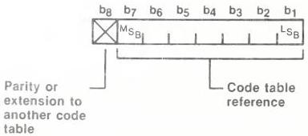

*Figure 1: Coding Format*

The coding of alphanumeric characters is based on current national standards (ANSI X3.4-1977, American National Standard Code for Information Interchange (ASCII), and CSA Standard Z243.4-1973, 7-Bit Coded Character Sets for Information Processing Interchange) and an international standard (ISO 646-1983, Information Processing - ISO 7-Bit and 8-Bit Coded Character Set for Information Interchange) as the primary character set (see 5.1) together with a supplementary character set based on CCITT S.100-1980 (see 5.2).

The coding of the pictorial information is based on:

(1) Picture description instructions (PDI's) (see 5.3), which are based on an enhancement of the alphageometric option described in CCITT Recommendations S.100-1980 and F.300-1980.
(2) Mosaic set (see 5.4), which is based on the union of the two mosaic tables described in CCITT Recommendations S.100-1980 and F.300-1980.
(3) Macro set (see 5.5).
(4) Dynamically redefinable character set (DRCS) (see 5.6).

4.2.2 Coordinate System. The coordinate system used in this standard is based on the abstract concept of a three-dimensional cartesian space with unit coordinates. This achieves independence of display hardware constraints. The coordinates are the width (X), height (Y), and depth (Z), and the range of possible values for each coordinate is from 0 (inclusive) to 1 (noninclusive). Note that the Z coordinate is only meaningful on receiving devices with a capability for operating in three-dimensional mode. It is allowed in data structures both for logical completeness and to facilitate the graceful introduction of this feature when the technology becomes available. In this standard, two-dimensional mode will be assumed, with complete specification of the three-dimensional mode operation deferred for future standardization. In general, therefore, descriptions will deal with a two-dimensional (X, Y) plane of the space at Z = 0. This plane will be referred to as the unit screen. A value of Z = 0 is interpreted as being farthest from the user.

Drawing of alphanumeric characters and pictorial information always occurs within the unit screen. The unit screen is visible in the display area, which is a rectangular area of the device's physical display screen. The lower left corner of the unit screen is the origin (0, 0), and coincides with the lower left corner of the display area. While the entire display area is always visible, the amount of the unit screen visible in the display area is implementation-dependent. Note that although it is always permissible to draw anywhere on the unit screen, only that portion of the unit screen coinciding with the display area is visible.

For example, on the cathode ray tubes used in television sets, the physical display screen usually has an aspect ratio of approximately 4:3 (width:height). If the display area on such a device has the same 4:3 aspect ratio, then the visible portion of the unit screen will be X from 0 (inclusive) to 1 (noninclusive), and Y from 0 (inclusive) to approximately 0.75 (see Figure 2).

The border area, if any, is not part of the display area, and no portion of the unit screen is visible in the border. Note that the physical display screen may also be used by other implementation-dependent display processes. Such processes are outside the scope of this standard.

Note: The sender can always assume that the entire display area is available. It is the responsibility of the receiving device to ensure that the entire display area is visible to the user.

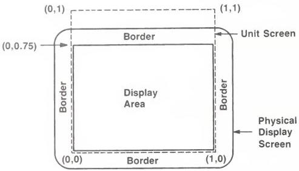

*Figure 2: Unit Screen Concept*

4.2.3 Display Format. There is no special positional dependence upon the order in which drawing primitives are presented. Pictures are built up out of a sequence of drawing commands, with the effects of each superimposed over those of previous ones. In this manner, pictures are built up in layers. If a subsequent drawing command or alphabetic character affects a given pixel of the display, it supersedes the effect of any previous command on that pixel. Specifically, this means that composite pictorial or alphabetic character images may be composed by the superimposition of multiple characters and/or drawing primitives. The registration between alphanumeric characters and pictures and the superimposition between these drawing modes shall be maintained to within one pixel, consistent with the physical resolution.

### 4.3 Code Extension

#### 4.3.1 General

4.3.1.1 The method of code extension used in this standard is based on the code extension techniques specified in ISO 2022-1982 (the corresponding ANSI and CSA Standards are ANSI X3.41-1974 and CSA Z243.35-1976, respectively).

It provides the capability to "designate" from the repertory of sets and "invoke" into the in-use table, where a specified byte of coded data acts as a pointer into a combined code table consisting of C- and G-sets. In most applications, there are not enough characters available in the in-use table, so provision has been made in the structure to permit G- or C-sets to be switched.

4.3.1.2 The entire coding environment described in this standard is to be designated and invoked as a "complete code" by the escape sequence ESC 2/5 F₁, in accordance with ISO 2022-1982, where F₁ is the final character to be assigned by the ISO Registration Authority, according to ISO 2375-1980, Data Processing - Procedure for Registration of Escape Sequences. Conforming interchange does not require the use of this escape sequence except when interchanging with other services. In this complete code, special attention is to be paid to the following:

- G0: A 94 code position G-set
- G1: A 94 or 96 code position G-set
- G2: A 94 or 96 code position G-set
- G3: A 94 or 96 code position G-set

A 94 code position G-set is one that does not include code positions 2/0 and 7/15. When such a set is invoked into columns 2 to 7, these two positions shall have the meanings of SPACE and DELETE, respectively.

A 96 code position G-set, on the other hand, is one in which the positions 2/0 and 7/15 have meanings other than SPACE and DELETE.

The designation and invocation of this "complete code" will be terminated by a different sequence ESC I F₂ (to be assigned by the ISO Registration Authority or standardized by ISO) or by the designation and invocation of any other "complete code".

4.3.1.3 There are four G-sets and two C-sets that are designated at any one time; that is, any one of the four tables G0, G1, G2, or G3 could be invoked into the in-use table by an invocation sequence. Invocation sequences may be either locking or nonlocking. The G0, G1, G2, and G3 sets act as slots into which code sets from the G-set repertory of meanings may be designated. In the default state G0 contains the primary character set, G1 the PDI set, G2 the supplementary character set, and G3 the mosaic set. A designation sequence is used to establish a new meaning to a code set slot.

4.3.1.4 The choice of the 7-bit or 8-bit code environment may be explicitly established or changed for a particular service, or may be implicitly established by prior agreement.

The in-use table is structured into 32 code position C-sets and 94 or 96 code position G-sets. The contents of these sets apply to either the 7-bit or the 8-bit environment. These sets are manipulated for the purpose of providing a virtual address space larger than the 128 or 256 code positions available in a 7-bit or 8-bit environment, respectively.

4.3.2 Code Extension in a 7-Bit Environment. An in-use table with 128 code positions is defined, as shown in Figure 3. Each incoming bit combination is either decoded according to the current contents of this table or is used to change the contents of this table. The table itself is organized into 8 columns of 16 rows, with bits 1 through 4 defining the row number and bits 5 through 7 defining the column number. The in-use table contains, in columns 0 and 1, the C0 set. Five characters of this set, ESCAPE (ESC or 1/11, ie, column 1, row 11), SHIFT-IN (SI or 0/15), SHIFT-OUT (SO or 0/14), SINGLE-SHIFT TWO (SS2 or 1/9), and SINGLE-SHIFT THREE (SS3 or 1/13), are used to control the contents of the remaining six columns of the in-use table. The manner in which this is accomplished is graphically depicted in Figure 4 and is described below.

A single additional active control set, the C1 set, and four active G-sets, the G0, G1, G2, and G3 sets, are defined. The contents of the C1 set are described in 6.2. The contents of the G0, G1, G2, and G3 sets can be dynamically selected from the larger repertory of G-sets by using escape sequences. These sequences take the form ESC I F where I is the intermediate character and F is the final character. The intermediate character determines which set is to be changed (redesignated).

ISO 2022-1982 specifies that the syntax of an escape sequence is ESC I...I F, where I...I is zero or more occurrences of intermediate characters in the range 2/0 through 2/15 and F is one occurrence of a final character in the range 3/0 through 7/14. The occurrence of any other bit combination in an escape sequence shall cause the partial escape sequence to be terminated and ignored, and that bit combination shall be executed.

The final character determines which set from the larger repertory is to be selected. Table I shows the I and F character pairs assigned to each C- and G-set. The F character for the primary character set, for example, is 4/2 and for G0 the I character is 2/8. The three character escape sequence ESC 2/8 4/2, therefore, designates the primary character set as the current G0 set.

Table 1
Escape Sequences for Designation of C- and G-Sets

|  Escape Sequence | Set to be Designated  |
| --- | --- |
|  Control sets:  |   |
|  ESC 2/1 F_{3} | C0 set  |
|  ESC 2/2 F_{4} | C1 set  |
|  94-character sets:  |   |
|  ESC 1 4/2 | Primary character set  |
|  ESC 1 7/12 | Supplementary character set  |
|  where 1 is 2/8, 2/9, 2/10, 2/11 for G0, G1, G2, G3, respectively  |   |
|  96-character sets:  |   |
|  ESC 1 5/7 | PDI set  |
|  ESC 1 7/13 | Mosaic set  |
|  ESC 1 7/10 | Macro set  |
|  ESC 1 7/11 | DRCS set  |
|  where 1 is 2/9, 2/10, 2/11 for G1, G2, G3, respectively*  |   |
|  1 is also 2/13, 2/14, 2/15 for G1, G2, G3, respectively  |   |

*There are two 1 characters that will result in the redesignation of each of the three G-sets, G1, G2, and G3. This dual coding may be removed from the standard in a future revision. See Appendix E.

The designation and invocation sequences for the C0 and C1 sets are ESC 2/1 F$_{3}$ and ESC 2/2 F$_{4}$, respectively, where F$_{3}$ and F$_{4}$ are to be assigned by the ISO Registration Authority according to ISO 2375-1980. All designation sequences designating G- and C1-sets defined in this standard shall be implemented. Other G- and C1-sets defined according to the rules of ISO 2022-1982 may be implemented. All other designation sequences shall designate either a null G- or a null C1-set. The redesignation of the C0 set is not permitted in the context of this standard and such redesignating escape sequences shall be ignored. A null set is a set in which all code positions are executed as null operations.

The SHIFT-IN (SI) character is used to invoke the current G0 set into the in-use table where it remains until further control action is taken (ie, it is invoked in a locking manner). The SHIFT-OUT (SO) character is used to invoke the current G1 set into the in-use table in a locking manner. The sequence LOCKING-SHIFT TWO (LS2) is used to invoke the G2 set into the in-use table in a locking manner. The sequence LOCKING-SHIFT THREE (LS3) is used to invoke the G3 set into the in-use table in a locking manner. Table 2 shows the coding of the shift functions.

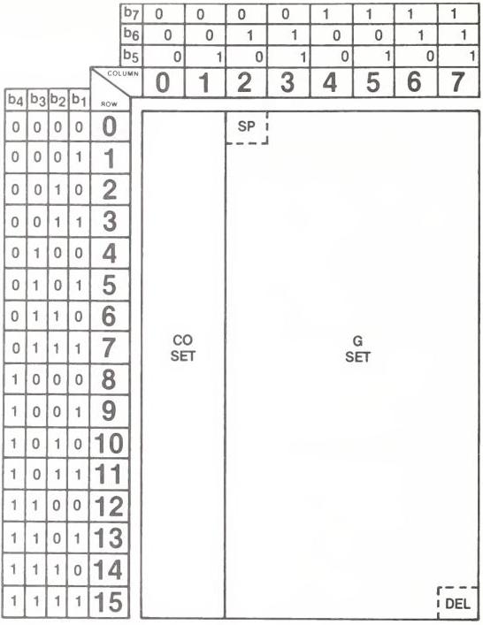

*Figure 3: 7-Bit In-Use Table*

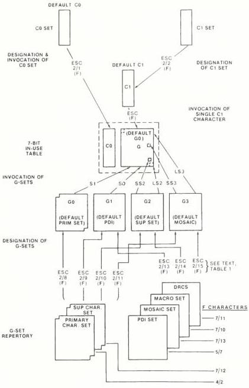

*Figure 4: Code Extension in a 7-Bit Environment*

Table 2
Coding of Shift Functions

|  Shift Function |  | 7-Bit Environment | 8-Bit Environment | G-Set Invoked  |
| --- | --- | --- | --- | --- |
|  SHIFT-IN | SI | 0/15 | 0/15 | G0 into GL  |
|  SHIFT-OUT | SO | 0/14 | 0/14 | G1 into GL  |
|  LOCKING-SHIFT ONE RIGHT | LS1R | — | ESC 7/14* | G1 into GR  |
|  LOCKING-SHIFT TWO | LS2 | ESC 6/14 | ESC 6/14 | G2 into GL  |
|  LOCKING-SHIFT TWO RIGHT | LS2R | — | ESC 7/13* | G2 into GR  |
|  LOCKING-SHIFT THREE | LS3 | ESC 6/15 | ESC 6/15 | G3 into GL  |
|  LOCKING-SHIFT THREE RIGHT | LS3R | — | ESC 7/12* | G3 into GR  |
|  SINGLE-SHIFT TWO | SS2 | 1/9 | 1/9 | G2 (nonlocking)  |
|  SINGLE-SHIFT THREE | SS3 | 1/13 | 1/13 | G3 (nonlocking)  |

*LS1R, LS2R, and LS3R are also coded as ESC 6/11, ESC 6/12, and ESC 6/13, respectively. This dual coding may be removed from this standard in a future revision. See Appendix E.

The single-shift characters, SINGLE-SHIFT TWO (SS2) and SINGLE-SHIFT THREE (SS3), are used to invoke, in a nonlocking manner, the G2 or G3 set, respectively, into the in-use table. The range of the single-shift characters extends only to the next character received, that is, the in-use table automatically reverts to its former state after the character immediately following the single-shift is interpreted. If a C0 character immediately follows an SS2 or SS3 character (instead of a byte from columns 2 to 7), the SS2 or SS3 character is ignored and the C0 character is executed. Note that the PDI set can be single-shifted into the in-use table only in those cases where the PDI command is not to be followed by an associated numeric operand.

The C1 set (in 7-bit environment) is never invoked into the in-use table in a locking manner. Rather, single characters from the C1 set are accessed via two-character escape sequences. These sequences take the form, ESC Fe, where Fe represents the desired character from the C1 set. This character, by definition, must have a bit combination corresponding to column 4 or 5 of the 7-bit in-use table and represents the corresponding C1 character of column 8 or 9. As with the single-shift characters, the in-use table is not changed by these two-character escape sequences. The in-use table automatically reverts

to its former state after the C1 command is executed. (Note that, although the C1 controls all consist of single characters, some commands may initiate multiple byte operations.)

If any of the G-sets are redesignated via an escape sequence while in the in-use table, the new code interpretations are simultaneously invoked, that is, a locking shift is not required for the change to take effect.

Upon initialization, the primary character set (see 5.1) is designated as the G0 set and the G0 set is invoked into the in-use table, by default. The PDI set (see 5.3) is designated as the G1 set, the supplementary character set (see 5.2) is designated as the G2 set, and the mosaic set (see 5.4) is designated as the G3 set, all by default.

4.3.3 Code Extension in an 8-Bit Environment. When operating in an 8-bit environment, the 256 code positions available can also be extended to a much larger address space using similar code extension procedures as for the 7-bit environment. An in-use table with 256 code positions is defined, as shown in Figure 5. Again, each incoming bit combination is either decoded according to the contents of this table or used to change the contents of this table. The table itself is organized into 16 columns of 16 rows, with bits 1 through 4 defining the row number and bits 5 through 8 defining the column number. The in-use table contains the C0 set in columns 0 and 1 and the C1 set in columns 8 and 9. The use of ESC Fe sequences to represent C1 characters (see 4.3.2) is permitted, although not encouraged, in an 8-bit environment. Columns 2 through 7, which by convention will be called the GL (G-left) area of the in-use table, can accommodate any of the four invoked G-sets (G0, G1, G2, G3). Columns 10 through 15, which will be called the GR (G-right) area, can accommodate the G1, G2, or G3 sets. The manner in which this is accomplished is graphically depicted in Figure 6.

The SI character is used to invoke, in a locking manner, the G0 set into GL. Note that G0 cannot be invoked into GR. The SO character is used to invoke, in a locking manner, the G1 set into GL. The escape sequence LOCKING-SHIFT ONE RIGHT (LS1R) is used to invoke, in a locking manner, the G1 set into GR. The escape sequences LOCKING-SHIFT TWO (LS2) and LOCKING-SHIFT TWO RIGHT (LS2R) are used to invoke, in a locking manner, the G2 set into GL and GR, respectively. The escape sequences LOCKING-SHIFT THREE (LS3) and LOCKING-SHIFT THREE RIGHT (LS3R) are used to invoke, in a locking manner, the G3 set into GL and GR, respectively. See Table 2 for the coding of the shift functions.

Note also that the G2 and G3 sets can be invoked into GL in a nonlocking manner using the SS2 and SS3 characters, respectively, as described for use in a 7-bit environment. If the byte immediately following the SS2 or SS3 character is from columns 10 to 15, bit b8 is ignored.

Upon initialization, the primary, PDI, supplementary, and mosaic sets are designated as G0, G1, G2, and G3 sets, respectively, and G0 is invoked into GL by default as in the 7-bit environments. In addition, G1 is invoked into GR.

4.4 SPACE and DELETE. SPACE is an empty character field subject to the same attributes as alphanumeric characters. The coding is 2/0 in the 7- and 8-bit in-use table when a G-set with 94 code positions is invoked.

DELETE has been used primarily to erase or obliterate erroneous or unwanted characters in punched tape. The coding of DELETE is 7/15 in the 7-bit and 8-bit in-use table when a G-set with 94 code positions is invoked. DELETE is executed as a null operation in this standard.

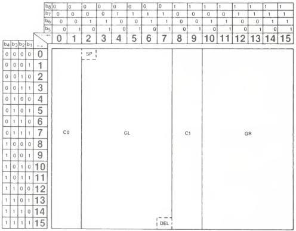

*Figure 5: 8-Bit In-Use Table*

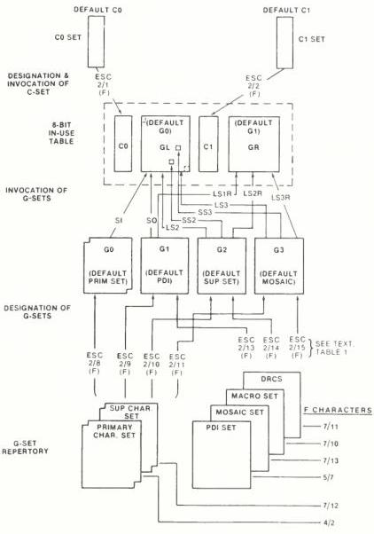

*Figure 6: Code Extension in an 8-Bit Environment*

## 5. Coding of G-Sets

5.1 Primary Character Set. The primary character set consists of 94 Latin alphabetic characters, digits, punctuation marks, and symbols as illustrated in Figure 7. This set is identical to the graphic character set of ANSI X3.4-1977 (ASCII) and CSA Z243.4-1973. The particular patterns (font) chosen for the characters are implementation-dependent and are constrained only by the specified character field at each size for a given display resolution. Character legibility is not guaranteed at all sizes, in all colors, and at all display resolutions. When any character of the primary set is received, the cursor is automatically advanced (see 5.3.2.3.4).

The sequence used to designate the primary character set is ESC I 4/2, where I is 2/8, 2/9, 2/10, or 2/11 to indicate G0, G1, G2, or G3, respectively (see 4.3).

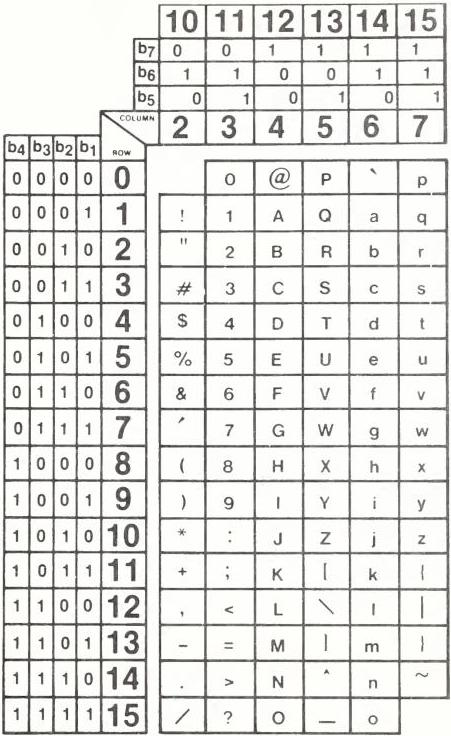

*Figure 7: Primary Character Set*

5.2 Supplementary Character Set. The supplementary character set of accents, diacritical marks, and special characters for Latin-based alphabets is illustrated in Figure 8. This table is based on CCITT Recommendation S.100-1980 and includes some additional characters proposed by CCIR, ISO, and other organizations. Those additional characters which are not yet included in a CCITT recommendation are in code positions 4/0, 4/9, 4/12, 5/0 to 5/15, and 6/5. The particular patterns (font) chosen for the characters are implementation-dependent and are constrained only by the specified character field at each size for a given display resolution. The 16 accent and symbol characters in Column 4 of the table are treated differently from all of the other characters in that they are nonspacing. That is, when one of these characters is received, the cursor is not automatically advanced as it would be normally, as described in 5.3.2.3.4.

Coding for an accented character is obtained by composition of a nonspacing accent from the supplementary set together with the letter from the primary set. Only certain combinations of nonspacing characters of the supplementary set are combined with the characters of the primary set to form characters of the graphic character repertoire (see 7.2). In typical usage, a composite character would require three bytes to encode. For example, in a 7-bit environment with the primary set designated in its default position as G0 and invoked into the in-use table and the supplementary set designated as G2, the coding for 'e' (e with diaeresis) would be as follows. An SS2 (position 1/9 in the C0 set) would start the sequence invoking a single character from the code table G2. The diaeresis mark '"' would then be specified, followed by the primary character. In such a manner, the letter 'e' would be coded SS2 '"' e, that is, three characters from code table positions 1/9, 4/8, 6/5. In an 8-bit environment, the coding may be the same as in the 7-bit environment or, if the primary set is invoked into GL and the supplementary set is invoked into GR, then the letter 'e' would be coded '"' e, that is, the two characters from the code table 12/8, 6/5.

The sequence used to designate the supplementary character set is ESC I 7/12, where I is 2/8, 2/9, 2/10, or 2/11 to indicate G0, G1, G2, or G3, respectively (see 4.3).

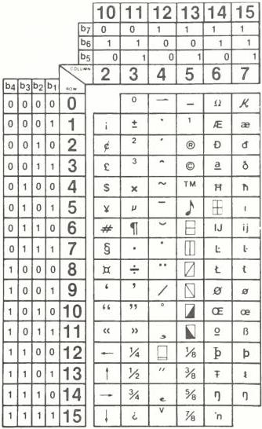

*Figure 8: Supplementary Character Set*

Note: Column 4 (12) is nonspacing. Also, the rectangles surrounding the characters in 4/12, 5/6 through 5/11, and 6/5 are for illustrative purposes only and are not part of the graphic symbols.

### 5.3 Picture Description Instruction (PDI) Set

#### 5.3.1 General

5.3.1.1 The picture description instruction (PDI) set, shown in Figure 9, comprises six geometric graphic primitives (POINT, LINE, ARC, RECTANGLE, POLYGON, and INCREMENTAL), each of which has four forms; eight control codes (RESET, DOMAIN, TEXT, TEXTURE, SET COLOR, WAIT, SELECT COLOR, and BLINK); and 64 character positions for numeric data (corresponding to a 6-bit data field in each information byte). The PDI set can be fundamentally differentiated from the alphanumeric character sets in that it does not consist of predefined patterns, one per character, but executable drawing functions that produce an image not necessarily restricted to a single character field.

The sequence used to designate the PDI set is ESC I 5/7, where I is 2/9 or 2/13 to indicate G1, 2/10 or 2/14 to indicate G2, or 2/11 or 2/15 to indicate G3 (see 4.3).

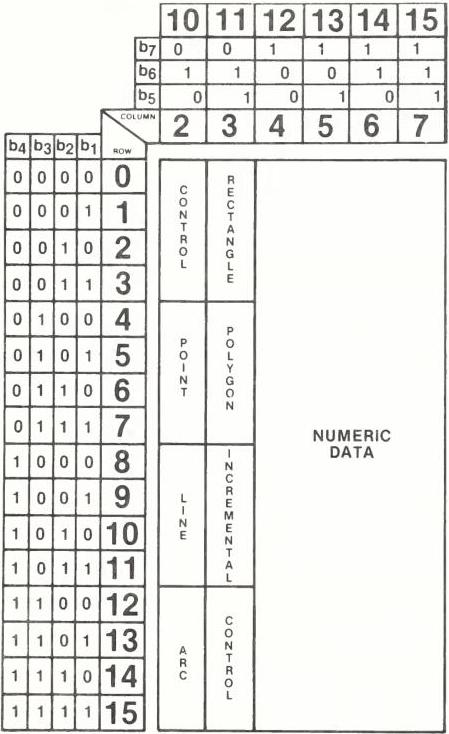

*Figure 9: General PDI Set*

A PDI is composed of an opcode, which must be either one of the four forms of the six graphic primitives or one of the eight control codes, followed by zero, one or more operands, each of which consists of one or more bytes of numeric data. The former can always be distinguished from the latter by examining bit 7. If b7 is set to 0, an opcode is indicated. If b7 is set to 1, numeric data (ie, an operand) is indicated. A PDI sequence is terminated by an opcode introducing the next PDI sequence or by any other presentation layer code not from the numeric data section of the same PDI set. The transmission control characters (0/1-0/6, 1/0, 1/5-1/7), the device control characters (1/1-1/4), and NULL (0/0) have no effect on the presentation layer and, therefore, do not terminate PDI sequences (see 6.1.4, 6.1.5, and 6.1.6.1). The invocation of a macro either from the in-use table or by single shift will not by itself terminate a PDI; the PDI may be continued in the operand data contained in the macro. There are four types of operands: fixed format, string, single-value, and multi-value.

The fixed format operands consist of one or more bytes of numeric data whose length and interpretation depends on the opcode with which they are used. The string operands are of indeterminate length, that is, they consist of any number of bytes of numeric data. Their interpretation also depends on the opcode with which they are used, but in all cases they are decoded left to right, ie, b6 to b1. The single-value operands consist of one to four bytes of numeric data, as determined by the DOMAIN command described in 5.3.2.2. They are interpreted as unsigned integers (ordinal numbers) composed of the sequence of concatenated bits taken consecutively (high order bit or b6 to low order bit or b1) from the numeric data bytes as shown in Figure 10.

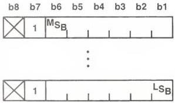

MSB — MOST SIGNIFICANT BIT OF OPERAND
LSB — LEAST SIGNIFICANT BIT OF OPERAND
MOST SIGNIFICANT BYTE TRANSMITTED FIRST

*Figure 10: Single-Value Format*

The multi-value operands consist of one to eight bytes of numeric data, as determined by the DOMAIN command. These operands are used to specify coordinate information (when used in conjunction with the graphic primitives) or color information (when used in conjunction with the SET COLOR command).

The coordinate specifications are based on a unit Cartesian numbering scheme with positions being specified as fractions of this range from 0 (inclusive) to 1 (noninclusive).

The coordinate data defined by the PDI operands can be interpreted either as the absolute coordinates within the unit screen of a logical drawing point or as displacements from the previous drawing point, depending on the context defined by the particular opcode. This drawing point is then used in the execution of the geometric primitives, described in 5.3.3.

The representation of the coordinate data within the multi-value operand is shown in Figure 11.

TWO-DIMENSIONAL MODE

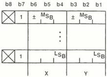

THREE-DIMENSIONAL MODE

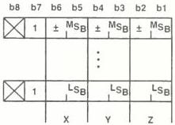

*Figure 11: Multi-value Format*

All coordinate operands are interpreted as signed, two's complement numbers, ie, binary decimals where the MSB represents the digit just to the right of the decimal point. The precision to which the position of the cursor and drawing point must be maintained is implementation-dependent and shall be consistent with the physical resolution. If a coordinate specification or a drawing operation would cause the drawing point or any portion of the resulting drawing to be outside the unit screen, then the PDI is considered to be in error. The handling of this error condition is implementation-dependent. For example, this PDI may either be rejected (ie, executed as a null operation) or executed and clipped within the unit screen.

When the multi-value operand is used along with the SET COLOR control, described in 5.3.2.5, it specifies an unsigned color value in the GRB (green-red-blue) color system. The representation of the color data within the multi-value operand is shown in Figure 12.

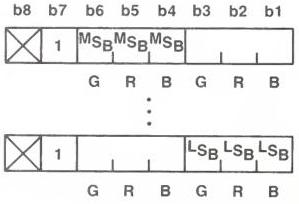

*Figure 12: Color Value Format*

Each byte contains two three-tuples. Each three-tuple contains one bit for each of the three primary colors. These are specified in the order green, red, blue, which is the order of decreasing luminance. A complete color value for each primary consists of the concatenated bits, taken one from each three-tuple, starting with the indicated MSB and proceeding, left to right, to the indicated LSB. The color value thereby obtained represents a binary fraction in which the MSB acts as the digit just to the right of the decimal point.

Table 3 shows the types of operands used by each of the opcodes.

Table 3
Operand Types

|  Opcode | Operand  |
| --- | --- |
|  RESET | Fixed  |
|  DOMAIN | Fixed/multi-value  |
|  TEXT | Fixed/multi-value  |
|  TEXTURE | Fixed/multi-value  |
|  SET COLOR | Multi-value  |
|  WAIT | Fixed  |
|  SELECT COLOR | Single-value  |
|  BLINK | Fixed/single-value  |
|  POINT | Multi-value  |
|  LINE | Multi-value  |
|  ARC | Multi-value  |
|  RECTANGLE | Multi-value  |
|  POLYGON | Multi-value  |
|  FIELD | Multi-value  |
|  INCREMENTAL POINT | Fixed/string  |
|  INCREMENTAL LINE | Multi-value/string  |
|  INCREMENTAL POLYGON (FILLED) | Multi-value/string  |

5.3.1.2 The functions of the opcodes are summarized as follows:

(1) POINT sets the drawing point to any position in the unit screen and optionally displays a dot.
(2) LINE draws a line based on its end points.
(3) ARC draws a circular arc based on the end points of the arc and a point on the arc. The end points of the arc may optionally be joined by a chord and the area so defined filled in. If more points are given, they define a higher level arc, a curvilinear line defined by a spline function. A circle is described as an arc whose end points coincide and whose intermediate point (with the end points) defines the diameter.
(4) RECTANGLE draws a rectangular outline or fills in an area of specified length and width.
(5) POLYGON draws a polygonal outline or fills in the circumscribed area based on a series of defined vertices.
(6) INCREMENTAL draws a point, line, or polygon in an incremental manner.
(7) CONTROL provides control over the modes of the drawing commands. One of its major functions is to set up a value or color of an object.

Figure 13 shows the detailed layout of the PDI set with each form of the geometric primitives and control codes identified.

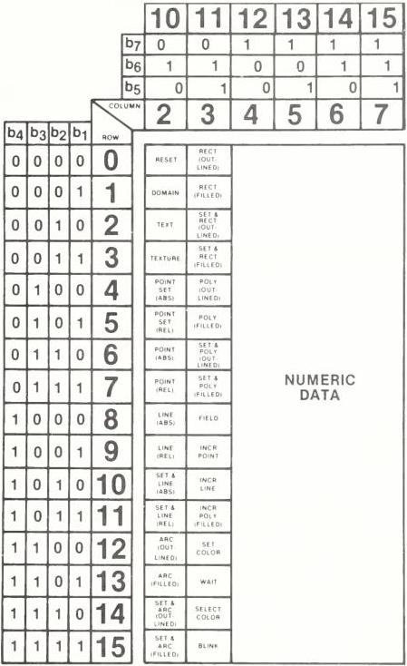

*Figure 13: PDI Set*

#### 5.3.2 Attribute Control Functions

5.3.2.1 General. The opcodes described in 5.3.2.2 to 5.3.2.9 control the attributes and display parameters.

##### 5.3.2.2 DOMAIN

5.3.2.2.1 Command Format. The DOMAIN command is used to control the precision of single-value and multi-value operands, the dimensionality of coordinate specifications, and the size of the logical pel. (See Figure 14.) Once set, these parameters do not change until acted upon by either the RESET command, another DOMAIN command, or the NSR control code described in 6.1.6.5. The DOMAIN opcode takes a one byte, fixed format operand, followed by a multi-value operand, whose interpretations are shown below.

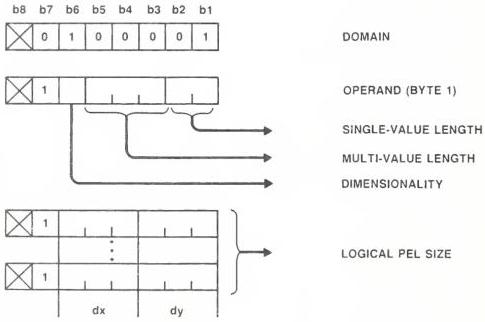

*Figure 14: Domain*

5.3.2.2.2 Single-Value Operand Length. Bits b2 and b1 of byte 1 determine the length, that is, the number of bytes to be used in single-value operands, as shown in Table 4. The default length is one byte.

Table 4
Single-Value Operand Length

|  b2 | b1 | Number of Bytes  |
| --- | --- | --- |
|  0 | 0 | 1 (default value)  |
|  0 | 1 | 2  |
|  1 | 0 | 3  |
|  1 | 1 | 4  |

5.3.2.2.3 Multi-value Operand Length. Bits b5, b4, and b3 of byte 1 determine the length, that is, the number of bytes to be used in multi-value operands as shown in Table 5. The default length is three bytes.

Table 5
Multi-value Operand Length

|  b5 | b4 | b3 | Number of Bytes  |
| --- | --- | --- | --- |
|  0 | 0 | 0 | 1  |
|  0 | 0 | 1 | 2  |
|  0 | 1 | 0 | 3 (default value)  |
|  0 | 1 | 1 | 4  |
|  1 | 0 | 0 | 5  |
|  1 | 0 | 1 | 6  |
|  1 | 1 | 0 | 7  |
|  1 | 1 | 1 | 8  |

5.3.2.2.4 Dimensionality. Bit 6 of byte 1 determines the dimensionality of the coordinate specification. A 0 indicates two-dimensional (X,Y) mode, which is the default. A 1 indicates three-dimensional (X,Y,Z) mode. If three-dimensional coordinates are received, the Z coordinate is to be ignored, thereby projecting the image into the two-dimensional (X,Y) plane. The full definition of three-dimensional mode is reserved for future standardization.

5.3.2.2.5 Operand Length. If an operand following an opcode is shorter than the length previously specified by the DOMAIN command (or the implicit length in the fixed format case), trailing zero bits are supplied by the receiving presentation process, unless otherwise indicated in the definition of the command. If an operand following an opcode is longer than the length previously specified by the DOMAIN command (or the implicit length), it is taken as an indication to repeat the execution of the opcode with the subsequent numeric data taken as new operands, unless otherwise indicated in this standard.

5.3.2.2.6 Logical Pel. The coordinate data following byte 1 of the operand is interpreted to be the width (dx) and height (dy) of the logical pel, which is a rectangle whose orientation is fixed with respect to the Cartesian coordinate system. This multi-value operand specifies the logical pel size to be used with the POINT, LINE, ARC, RECTANGLE, POLYGON, and INCREMENTAL PDI's, as well as UNDERLINE START, separated mosaics, line textures, and texture patterns, but not for the display of alphanumeric characters (including underline and nonspacing underline). This is accomplished by defining the drawing operations to affect all of those pixels that lie under any portion of the logical pel as it is mapped to the display screen. The logical pel, therefore, will always map to at least one and possibly many display pixels. Note that if the width and height of the logical pel are both reduced to 0, the logical pel reduces to the dimensionless drawing point. The default logical pel size is dx = 0, dy = 0, with the origin at the lower left.

A drawing primitive is defined by an implementation dependent algorithm that describes as closely as possible a precise geometric path for all displacements, including zero. For example, a LINE is a locus of points following a straight line algorithm between two specified coordinates. The physical picture elements (pixels) through which the infinitely small locus point passes would be drawn. The logical pel specification allows the locus point to take on specific dimensions, thereby acting as a larger "brush" that turns on additional pixels as it traverses its geometric path and generates the effect of line width. See Figure 15, which is illustrative of the application of logical pel to a line, an arc, and a point.

The geometric alignment of the drawing point within the logical pel is:

(1) Lower left corner if both dx and dy are positive.
(2) Lower right corner if dx is negative and dy is positive.
(3) Upper left corner if dx is positive and dy is negative.
(4) Upper right corner if both dx and dy are negative.

Note that the new length of the multi-value operands, as set in byte 1, applies to the multi-value logical pel size operand of that DOMAIN command.

Additional numeric data bytes following the logical pel size data byte(s) are reserved for future standardization and shall be ignored. If the logical pel size operand is omitted, the size of the logical pel shall not be changed.

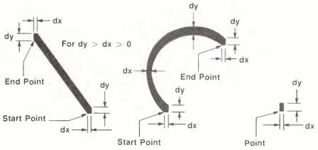

*Figure 15: Application of Logical Pel to a Line, an Arc, and a Point (Effect of Logical Pel Size on Stroke Width)*

##### 5.3.2.3 TEXT

5.3.2.3.1 Command Format. This command is used to modify parameters that describe the manner in which subsequent alphanumeric characters, mosaic characters, and DRCS are presented. The TEXT opcode takes a two byte, fixed format operand, followed by a multi-value operand whose interpretations are shown below. (See Figure 16.)

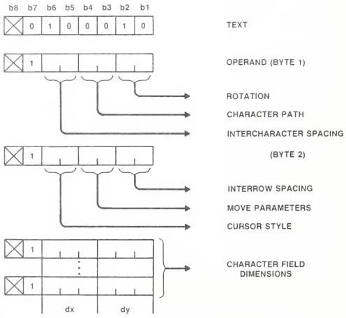

*Figure 16: Text*

5.3.2.3.2 Character Rotation. Bits b2 and b1 of byte 1 are used to specify character rotation as shown in Table 6.

Table 6
Character Rotation

|  b2 | b1 | Degrees of Rotation  |
| --- | --- | --- |
|  0 | 0 | 0 (default value)  |
|  0 | 1 | 90  |
|  1 | 0 | 180  |
|  1 | 1 | 270  |

Rotation causes the character field and the cursor to rotate counterclockwise about the character field origin. This rotation is measured relative to horizontal within the unit screen and is independent of the character path. The character field origin is the lower left corner of the character field at the default 0 degree rotation regardless of the sign of the character field dimensions dx and dy (see Figure 17). All alphanumeric characters (including diacritical marks and underlines), DRCS, mosaics, and separated mosaic characters, and the underline produced when underline mode (see 6.2.7.15) is in effect, are affected by rotation so that the relative position of the images within the character field is unchanged.

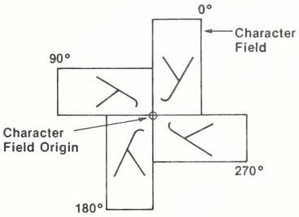

*Figure 17: Character Rotation*

5.3.2.3.3 Character Path Movement. Bits b4 and b3 of byte 1 determine the direction of the character path, that is, the direction in which the cursor is automatically advanced after a character is deposited. Table 7 describes the four possible character paths. The character path is defined relative to horizontal within the unit screen and is independent of the character rotation. The default character path is right.

Table 7
Character Path

|  b4 | b3 | Cursor Movement  |
| --- | --- | --- |
|  0 | 0 | Right (default value)  |
|  0 | 1 | Left  |
|  1 | 0 | Up  |
|  1 | 1 | Down  |

5.3.2.3.4 Intercharacter Spacing. Bits b6 and b5 of byte 1 are used to determine the distance the cursor is moved after a character is displayed or after a SPACE or APB (backspace) or APF (horizontal tab) character is received. The distance the cursor is moved is in multiples of the character field width (dx) or height (dy), whichever lies parallel to the character path, depending on the character path and character rotation. This is known as the intercharacter spacing and is as defined in Table 8.

Table 8
Intercharacter Spacing

|  b6 | b5 | Spacing  |
| --- | --- | --- |
|  0 | 0 | 1 (default value)  |
|  0 | 1 | 5/4  |
|  1 | 0 | 3/2  |
|  1 | 1 | Proportional spacing  |

The three fixed intercharacter spacings (1, 5/4, and 3/2, consistent with the physical resolution) are interpreted as multiplicative functions of the dimension of the current character field lying parallel to the character path that are applied to movements of the cursor. In the proportionally spaced mode, the intercharacter spacing is a variable that may be a function of the width of the actual pattern deposited as well as the current character size and

font style. The proportional spacing algorithm is implementation dependent. However, each character shall be completely contained within the area defined by the current character field (see 5.3.2.3.9). This means that the exact number of characters per line is not known in proportional spacing mode, but it is at least as many characters per line as would be allowed by the current character field dimensions. Note that in order to guarantee the display of proportionally spaced text within an active field (see 5.3.3.6.2) on all implementations, without unintentional wrap (see 6.2.7.11 and 5.3.2.3.6) or scroll (see 6.2.7.13), either:

(1) the field should be large enough to wholly contain the text as though the text were not proportionally spaced, or
(2) the number and size of the characters should be small enough to fit within the field as though the text were not proportionally spaced.

The width of the character field does not change. For example, when a character is displayed at the end of a line in color mode 2, the background color is displayed for the full width of the character field. The default intercharacter spacing is a fixed space of 1 in which the current character field abuts the previous character field.

5.3.2.3.5 Interrow Spacing. Bits b2 and b1 of byte 2 determine the interrow spacing of characters, which defines the relative location of the cursor when it is advanced to a new line in a direction perpendicular (-90 degrees) to the character path, either automatically as described below or by the APD (line feed) or APU (vertical tab) characters, as defined in 6.1.2. Table 9 shows the four interrow spacings (1, 5/4, 3/2, and 2, consistent with the physical resolution), which are interpreted as multiples of the character field width (dx) or height (dy), whichever lies perpendicular to the character path, depending on the character path and character rotation. An interrow spacing of 1, in which the character field on the current row abuts the character field of the previous row, is the default.

Table 9
Interrow Spacing

|  b2 | b1 | Spacing  |
| --- | --- | --- |
|  0 | 0 | 1 (default value)  |
|  0 | 1 | 5/4  |
|  1 | 0 | 3/2  |
|  1 | 1 | 2  |

5.3.2.3.6 Automatic APR APD. When using fixed or proportional inter-character spacing, if the result of moving the cursor (with a format effector or as a result of displaying a character) would cause any part of the full corresponding character field to be outside of the unit screen (or outside of the active field - see 5.3.3.6.2, FIELD - if the character field was entirely within the active field immediately before the movement), an automatic APR (carriage return) and APD (line feed) are immediately executed. If an explicit APR APD (or APD APR) sequence is received after an automatic APR APD is executed but before the character field origin is moved, aligned, or set by any other received command or sequence, the explicit APR APD (or APD APR) sequence shall be executed as a null operation.

5.3.2.3.7 Move Attributes. Bits b4 and b3 of byte 2 are used to define the relationship between movement of the cursor and movement of the graphics drawing point as shown in Table 10.

Table 10
Move Attributes

|  b4 | b3 | Attribute  |
| --- | --- | --- |
|  0 | 0 | Move together (default value)  |
|  0 | 1 | Cursor leads  |
|  1 | 0 | Drawing point leads  |
|  1 | 1 | Move independently  |

If the cursor and drawing point are set to move together (00), then whenever the cursor is moved (such as when characters are displayed), the graphics point is moved with it, maintaining its alignment relative to the cursor. Correspondingly, whenever the drawing point is moved (such as with a geometric drawing primitive), the cursor is also moved so as to maintain its alignment relative to the drawing point.

If the cursor is defined as leading (01), then every time the cursor is moved, the drawing point will move along with it, but not vice versa.

If the drawing point is set to lead the cursor (10), then every time the drawing point is moved, the cursor will move with it, but not vice versa.

If the drawing point and the cursor are set to move independently (11), then movement of one will not affect the position of the other.

Movement of the drawing point should never cause the cursor to be located such that any part of the character field indicated by the cursor would fall outside the unit screen. Should such a situation arise, the cursor shall be adjusted as close as possible to the drawing point without violating the above condition. Subsequent relative cursor positioning operations shall be made with reference to the adjusted cursor position.

The alignment of the drawing point corresponds to the character field origin for the underscore cursor and block cursor, and the center of the character field for the cross-hair cursor and custom cursor. (See Figure 18.)

The execution of a TEXT command shall cause alignment of the drawing point if the "move together" or "cursor leads" move attribute is in effect after execution. The execution of a TEXT command shall have no effect on the position of the character field origin, except if it would cause any part of the character field to fall outside the unit screen. In this case, the cursor shall be adjusted as described above.

5.3.2.3.8 Cursor Styles. Bits b6 and b5 of byte 2 are used to determine the display style of the cursor symbol as in Table 11 and Figure 18.

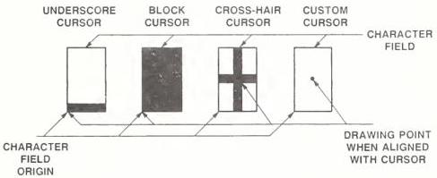

*Figure 18: Cursor Styles*

Note: The boxes around the cursors are for illustrative purposes only and are not part of the cursor style.

Table 11
Cursor Styles

|  b6 | b5 | Style  |
| --- | --- | --- |
|  0 | 0 | Underscore (default value)  |
|  0 | 1 | Block  |
|  1 | 0 | Cross-hair  |
|  1 | 1 | Custom  |

The cursor indicates the position at which the next character is to be displayed. The underscore cursor symbol is a single line the width of the current character field at the bottom of the character field. The block cursor symbol is a solid block whose size is the size of the current character field. The cross-hair cursor symbol consists of a vertical line and a horizontal line that intersect at the center of the character field and whose height and width are equal to the height and width of the current character field. The thickness of the underscore cursor and that of the cross-hair cursor and the definition of the shape of the custom cursor symbol are implementation-dependent.

5.3.2.3.9 Character Field Dimensions. The multi-value operand data following the first two fixed format operands give the width (dx) and height (dy) of the character field.

If dx is negative, the character patterns are reflected about the vertical center axis of the character field. If dy is negative, the character patterns are reflected about the horizontal center axis of the character field.

If the character field dimensions are omitted from the operand, then the current character field dimensions remain unchanged.

The default dimensions of the character field are dx = 1/40 and dy = 5/128, consistent with the physical resolution.

The font and position of alphanumeric text characters within the character field are implementation-dependent. Each such character shall be completely contained within the area defined by the current character field.

Additional numeric data bytes following the multi-value operand are reserved for future standardization and shall be ignored.

##### 5.3.2.4 TEXTURE

5.3.2.4.1 Command Format. This command is used to set texture attributes that are applied to the subsequent drawing of lines, the highlighting of filled areas, and the patterns used to fill areas. The TEXTURE opcode takes a one-byte, fixed format operand, followed by a multi-value operand whose interpretations are shown below. (See Figure 19.)

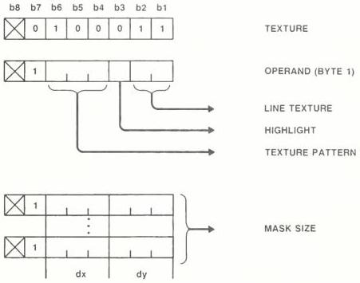

*Figure 19: Texture*

5.3.2.4.2 Line Texture. Bits b2 and b1 of byte 1 are used to set the line texture attribute, which determines the style of lines and outlines (but not highlights) drawn with the LINE, ARC, RECTANGLE, POLYGON, and INCREMENTAL LINE PDI's (see Figure 20 and Table 12). The size of the dot is set equal to the size of the logical pel. For horizontal lines, the inter-dot spacing is the width of the logical pel, while for vertical lines it is the height of the logical pel. For horizontal lines, the height of the dash is equal to the height of the logical pel while the width (length) of the dash and the inter-dash spacing are equal to three times the width of the logical pel. For vertical lines, the width of the dash is equal to the width of the logical pel while the height (length) of the dash and the inter-dash spacing are equal to three times the height of the logical pel. The inter-dot-dash spacing is equivalent to the inter-dot spacing. In color mode 2, the inter-dot and inter-dash spacing is drawn in the background color.

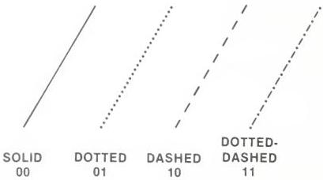

*Figure 20: Line Textures*

The algorithm for generating line textures is implementation-dependent, and it should produce characteristics for arbitrary lines that yield a visually consistent effect with that specified for horizontal and vertical lines, although exact alignment is not guaranteed. All end points of lines and arcs and all vertices of incremental lines (with the draw flag on), highlighted incremental polygons, outlined or highlighted rectangles and polygons must be plotted regardless of the line texture used.

Note: If logical pel size dx = 0, all nonvertical lines are solid. If logical pel size dy = 0, all nonhorizontal lines are solid.

Table 12

Line Texture

|   | b2 | b1 | Texture  |
| --- | --- | --- | --- |
|   | 0 | 0 | Solid (default value)  |
|   | 0 | 1 | Dotted  |
|   | 1 | 0 | Dashed  |
|   | 1 | 1 | Dotted-dashed  |

5.3.2.4.3 Highlight. Bit b3 of byte 1 determines the highlight attribute. If bit 3 is equal to 1, then all filled rectangles, arcs, polygons, and incremental polygons are drawn in highlighted mode. In this mode, the line(s) or arc comprising the outline are drawn with solid line texture (independent of the current line texture) using the current logical pel size in nominal black in color modes 0 and 1, and in the background color in color mode 2. The outline is the region traced out by the logical pel when the arc, rectangle, polygon, or incremental polygon is drawn. The default state of this attribute is no highlight (b3 = 0). (See 5.3.2.6 for a description of the three color modes.)

5.3.2.4.4 Texture Pattern. Bits b6, b5, and b4 are used to select the texture pattern to be used in filling rectangles, arcs, polygons, and incremental polygons according to Table 13 and Figure 21.

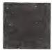

SOLID

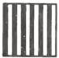

VERTICAL
HATCHING

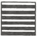

HORIZONTAL
HATCHING

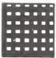

CROSS-
HATCHING

*Figure 21: Texture Patterns*

Table 13
Texture Pattern

|  b6 | b5 | b4 | Pattern  |
| --- | --- | --- | --- |
|  0 | 0 | 0 | Solid (default value)  |
|  0 | 0 | 1 | Vertical hatching  |
|  0 | 1 | 0 | Horizontal hatching  |
|  0 | 1 | 1 | Vertical and horizontal cross-hatching  |
|  1 | 0 | 0 | Mask A  |
|  1 | 0 | 1 | Mask B  |
|  1 | 1 | 0 | Mask C  |
|  1 | 1 | 1 | Mask D  |

The width and spacing of hatching lines in the vertical hatching pattern are equal to the width of the logical pel. The height and spacing of hatching lines in the horizontal hatching pattern are equal to the height of the logical pel. Registration of the patterns shall be maintained across figures if the logical pel size is the same. For the predefined texture patterns, if the logical pel size is (0,0), solid texture patterns will always be drawn. In color mode 2, the fill areas not drawn in the drawing color are drawn in the background color.

The programmable texture masks A, B, C, and D are defined using the DEF TEXTURE command. The default pattern for the four programmable texture masks is a null texture pattern, resulting in no fill in color modes 0 and 1, and a fill with the background color in color mode 2.

5.3.2.4.5 Mask Size. The block of coordinate data following the first byte of the operand specifies the mask size (dx, dy) to be used in the step-and-repeat process for masks A, B, C, and D. This process takes the selected texture mask, scales it to the specified mask size, logically covers the given object with contiguous copies of the mask, and then deposits the in-use color(s) in all pixels indicated by the mask pattern. This process takes as its reference the origin (0,0) point of the unit screen in order that registration of the pattern be maintained across figures at any given mask size.

The default mask size is dx = 1/40 and dy = 5/128, consistent with the physical resolution (the default character field size). The sign bits of dx and dy are used to reflect the mask pattern within the mask field in a manner similar to reflection of text character fields.

If the mask size operand is not present within the TEXTURE PDI, then the current mask size is not changed. Additional numeric data bytes following the mask size operand are reserved for future standardization and shall be ignored.

##### 5.3.2.5 SET COLOR

5.3.2.5.1 The SET COLOR command is used to specify color values applied to all subsequent drawing commands and characters from the primary, supplementary, DRCS, and mosaic sets. It can also affect colors previously displayed. Three different color modes can be selected, the choice of which dictates the precise interpretation of the two color control opcodes, SET COLOR and SELECT COLOR. The color mode is established to 0, 1, or 2 via the SELECT COLOR PDI as described in 5.3.2.6. Color mode 0 is designed to support those situations in which the drawing color is directly specified as a color value. Colors are implicitly defined in the color map in this mode. Color modes 1 and 2 are designed to make explicit use of a color map capability. That is, the drawing color is specified as an ordinal number that is used as an address into a look-up table that provides the actual color value.

To illustrate the differences between the three color modes, consider the example of writing text. In color mode 0, the drawing color is set directly and then applied only to the foreground pixels, ie, only to the pixels that comprise the character pattern. In color mode 1, the color is selected from the color map, and again applied only to the foreground pixels. In color mode 2, both the drawing and background colors are selected from the color map and then applied to the foreground and background pixels, respectively.

The color map is used to convert, at display time, the color map address stored for each pixel in the physical display area into an actual color value for that pixel. The number of bits (N) of the color map address (ie, the number of bits per pixel in the display storage medium) is, by design, smaller than the number of bits (M) in the actual color value stored in the color map (ie, the width of the color map). This provides, among other things, an increase in the total number of possible display colors (up to 2^M) without an increase in the size of the display storage medium, with the constraint that not more than 2^N colors can be displayed simultaneously.

Completely defining a color in color mode 1 and 2 takes two steps. The color values stored in the color map must be specified and the color map address (ie, the ordinal number) to be associated with the drawing color must be specified. In color modes 1 and 2, the SET COLOR control performs the former function and the SELECT COLOR control performs the latter function. Note that the color map applies to the entire display. A change in the color map will immediately be reflected in the color of all pixels whose associated color map address points to the color map entry that has been changed.

Color mode 0 also uses the color map. If the color specified in the color mode 0 SET COLOR command has already been specified in the color map, then the address of the drawing color is set to the lowest address containing that color and the color map is not changed. If that color has not already been specified in the color map, color mode 0 makes use of the lowest address that has not been used (via a color mode 0, 1, or 2 SET COLOR command or a color mode 1 or 2 SELECT COLOR command) since the last RESET command that reestablishes the default color map, and that is not the address of nominal black or nominal white. If no addresses are available, then the color map shall not be changed and the drawing color is established in an implementation-dependent manner.

The following relation between the number of bits (N) of the color map address and the number of bits (M) in the color values stored in the color map is recommended.

$$M \ge 3 (N-1)$$

The SET COLOR opcode takes a multi-value operand and is shown in Figures 22 and 23. The color value operand is used to define a color according to Figure 23.

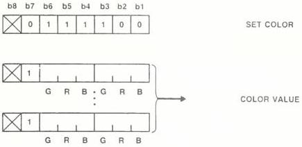

*Figure 22: Set Color*

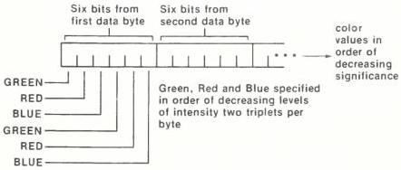

*Figure 23: Color Encoding Scheme*

In color mode 0, this sets the drawing color. This drawing color is applied to subsequently received alphanumerics and pictorial drawings until changed by another SET COLOR command, the RESET command, described in 5.3.2.9, or the NSR control character, described in 6.1.6.5. The default drawing color in color mode 0 is white. A background color cannot be specified in color mode 0, that is, character patterns and pictorial drawings merely overwrite the existing contents of the physical display area which otherwise remain unchanged.

In color modes 1 and 2, the SET COLOR command is used to load color values into the color map. The address of the entry to be loaded is taken to be the one indicated by the drawing color (which must have been set previously with the SELECT COLOR command).

If the maximum size entry (ie, number of bits) that the color map can accommodate is smaller than the number of bits provided by the SET COLOR operand, the operand is truncated and only the most significant bits are used. If the maximum size entry that the color map can accommodate is larger than the number of bits provided by the SET COLOR operand, trailing zero bits are supplied by the receiving presentation process. For each primary, the maximum color fraction attainable, given the number of bits specified in the color value operand, shall be interpreted as full intensity and intermediate values shall be equally distributed between zero and full intensity.

If the SET COLOR command is implicitly repeated via the sending of additional numeric data, the address of the color entry to be changed is automatically incremented prior to the execution of the new opcode. The algorithm for incrementing is to change the most significant zero to a one and to change all ones to the left of it to zero. For example, color map address 010100 would be incremented to 110100, which in turn would be incremented to 001100. This incrementing does not affect the color map address associated with the drawing color. This incrementing process stops and subsequent operand data are ignored when the physical limit (all ones) of the implemented color map is reached.

Note: This incrementing algorithm permits the same presentation to occur on a device with a greater number of color map entries than the sender has assumed. Furthermore, careful placement of similar colors in adjacent color map entries will permit a reasonable presentation to occur on a device with fewer color map entries than the sender had assumed.

If no operand follows a SET COLOR opcode, the transparent color is set. If transparent color is used, then any lower order planes would show through the display. (These lower order planes could correspond to planes with a lower Z value in a multi-planar terminal architecture or an analog video signal in applications where the videotex display is superimposed over a standard television image, eg, for captioning.) If there are no lower order planes or if transparency is not implemented, then the transparent color shows as black.

5.3.2.5.2 The default contents of the color map are defined according to the algorithm described below:

N = number of bits of the color map address

2^N = size of the color map

M = number of bits in the color values (ie, width of the color map)

M ≥ 3(N-1) as specified previously

The first half of the default color map is used to store a complete, uniformly spaced grey scale. This comprises the ordered set of colors where G = R = B. (Note that if M = 3 (N-1), there should be exactly (2^N)/2 grey levels including black and white.) The second half of the default color map is used to store a full range of hues equally spaced around the perimeter of the hue circle. The hue circle is shown in Figure 2^4 and is defined with the three primary colors (green, red, and blue) lying equidistant around the circle with blue at 0 degrees, red at 120 degrees, and green at 240 degrees. All other hues can be obtained with various combinations of these three primaries mixed in proportions that are a function of the position of the desired hue on the hue circle. The algorithm for obtaining the GRB values for the default hues, which lie equally spaced around the hue circle starting at 0 degrees and proceeding counterclockwise, is as follows:

Let

h = desired hue

ang h = the angle of h

P₁ = the closest primary to h

ang P₁ = the angle of P₁

P₂ = the second closest primary to h

ang P₂ = the angle of P₂

P₃ = the furthest primary from h

The values of the primaries in the GRB system that must be combined to give the hue h will be:

1) P₁ = 1 (i.e., all bits set to 1)

2) P₂ = |ang h - ang P₁|
60 degrees

3) P₃ = 0 (ie, all bits set to 0)

The value of P₂ is then normalized by multiplying it by the maximum color value which can be stored for that primary. For example, if three bits are available to store the primary, the result given by the above equation for P₂ is multiplied by 7/8 (the maximum binary fraction expressible in three bits) and then rounded to three places.

As an example, the default color map for N = 4 and M = 9 shall be as shown in Figure 25.

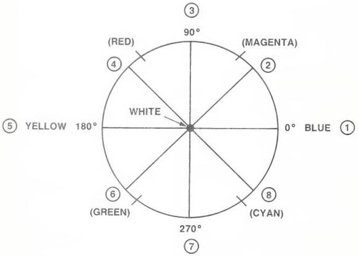

*Figure 24: Selection of Default Colors*

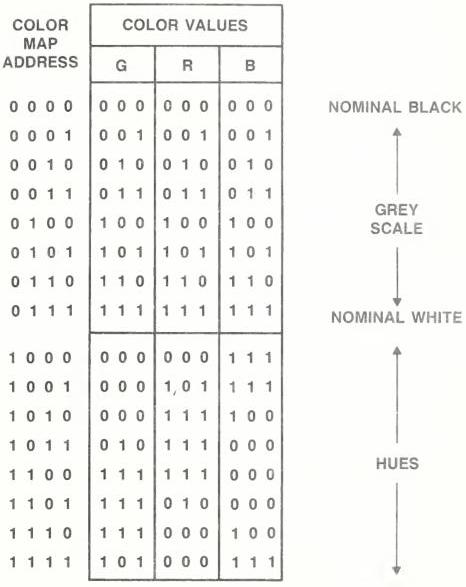

*Figure 25: Default Color Map for N = 4, M = 9*

##### 5.3.2.6 SELECT COLOR

5.3.2.6.1 The SELECT COLOR opcode is used to establish the color mode as well as select the drawing color for modes 1 and 2, and the background color for mode 2. (See Figure 26.)

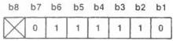

SELECT COLOR

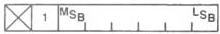

DRAWING COLOR
(MODES 1 + 2 ONLY)

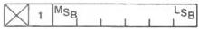

BACKGROUND COLOR
(MODE 2 ONLY)

*Figure 26: Select Color*

The SELECT COLOR opcode can take zero, one, or two single-value operands. Additional numeric data bytes are reserved for future standardization and shall be ignored. If the SELECT COLOR opcode is followed by no operands, color mode 0 is indicated. The terminal will remain in color mode 0 until either another SELECT COLOR command with operands is received or the color mode is changed with a RESET command (described in 5.3.2.9). While in color mode 0, the SET COLOR command is used to set the drawing color, as described in the previous section, and the SELECT COLOR command is not used. A background color is not specified in color mode 0, rather, alphanumerics and pictorial drawings merely overwrite the existing contents of the physical display screen only where the drawing color is applied.

If the number of bits of color map address (N) implemented is less than the number of concatenated bits available in a single-value operand (6, 12, 18, or 24 depending on the single-value length operand of the most recently received DOMAIN command, or the default of 6 if no DOMAIN command has been received since a RESET or NSR command), only the high order bits are significant. In other words, the number of bits required to specify the color map address is left justified within the single-value operand. For example, for the default single-value operand length of one byte and a four-bit color map address (N=4), the receiving presentation process responds to b6 through b3 and ignores b2 and b1 of each color map address operand in the SET COLOR and BLINK command. If the number of bits of color map address (N) implemented is greater than the number of concatenated bits available in a single-value operand (6, 12, 18, or 24), trailing zero bits are supplied by the receiving presentation process.

5.3.2.6.2 If the SELECT COLOR opcode is followed by a single operand, color mode 1 is indicated. (This has no effect on the color map.) The terminal will remain in color mode 1 until either another SELECT COLOR command with 0 or 2 operands is received or the color mode is changed with a RESET or NSR command. While in color mode 1, the single operand following the SELECT COLOR opcode is used to set the drawing color that is applied to subsequently received alphanumeric text and pictorial information. Note, again, that the drawing color in this case is an ordinal number that represents an address in the color map in which the actual color value was previously, or will later be, loaded with a SET COLOR command. A background color is not specified in color mode 1, rather, alphanumerics and pictorial drawings merely overwrite the existing contents of the physical display area only where the drawing color is applied.

5.3.2.6.3 If the SELECT COLOR opcode is followed by two operands, color mode 2 is indicated. Again, the terminal will remain in color mode 2 until either another SELECT COLOR command with 0 or 1 operand is received or the color mode is changed with a RESET or NSR command. While in color mode 2, the first operand following the SELECT COLOR opcode is used to set the drawing color and the second operand is used to set the background color. Characters received while in color mode 2 will be drawn in the drawing color over the background color, which occupies the remainder of the character field. That part of the intercharacter spacing which is not part of the character field is not affected by the background color. For the special case in which the two operands are identical, ie, the drawing color is specified to be the same as the background color, the drawing color is, instead, left at its current value and only the background color is changed to the value specified. The background color also applies to the highlight as well as the alternating color in the line and area texture patterns, as described in 5.3.2.4.

##### 5.3.2.7 BLINK

5.3.2.7.1 The BLINK command is used to cause a color map entry to periodically alternate between two colors.

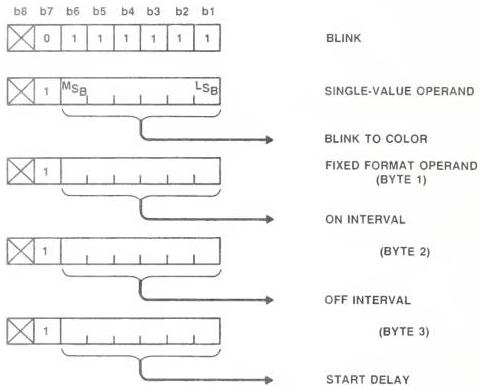

*Figure 27: Blink*

5.3.2.7.2 The mechanism for performing this alternation is called a blink process. This process periodically overwrites the contents of the current in-use drawing color (the "blink-from" color) and substitutes the current contents of another entry in the color map, which is called the "blink-to" color. The blink-to color is activated for a period of time known as the ON interval. The blink-from color is activated for a period of time known as the OFF interval. The ON and OFF intervals alternate with each other, starting with the ON interval. A start delay may also be specified, this being a delay in the start of the ON interval referenced to the start of the ON interval of the most recently defined active blink process. A start delay specification when there are no active blink processes has no effect. If multiple blink processes have ON or OFF intervals that expire simultaneously, they are processed sequentially starting with the most recently defined blink process and ending with the least recently defined blink process. In this case, each blink process takes as its input the color map that resulted from the previously executed blink process.

5.3.2.7.3 The first single-value operand following the BLINK opcode is the blink-to color specification, specified as a color map address (see 5.3.2.6.1). The next fixed format operand is the ON interval specified in units of 1/10 of a second. Only bits b6 through b1 are used for this specification. In a similar manner, the next fixed format operand specifies the OFF interval. The fourth fixed format operand specifies the start delay, also in units of 1/10 of a second. If this byte is omitted, a start delay of 0 is indicated, and if there are no currently active blink processes, it is ignored. An ON or OFF interval of 0 is taken to mean termination of any active blink process on the blink-from/blink-to color pair (see Figure 27).

5.3.2.7.4 Defining a blink process on a pair of blink-to and blink-from colors automatically terminates any previously defined blink process operating on the same pair of colors. If no operands follow the blink opcode, then all blink processes utilizing the current drawing color as the blink-from color will be terminated. The original blink-from color shall be restored (unless it has been changed explicitly by a SET COLOR command) when all blink processes using that blink-from color are terminated.

5.3.2.7.5 If additional data follow a completely specified blink process, then the BLINK command is implicitly repeated, with the address of the blink-from color being automatically incremented (as in 5.3.2.5.1) prior to the execution of the new opcode. The drawing color is not affected by this incrementing.

##### 5.3.2.8 WAIT

5.3.2.8.1 The WAIT command is used to cause a delay in processing for a specific time interval.

The wait interval starts at the completion of the execution of the command preceding WAIT or the receipt of the WAIT command, whichever occurs later.

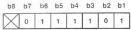

WAIT

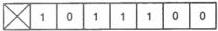

FIXED FORMAT BYTE

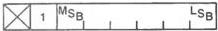

INTERVAL

*Figure 28: Wait*

5.3.2.8.2 The first byte of operand data following the WAIT opcode shall follow the format given in Figure 28. If any other bit combination follows the WAIT opcode, the entire command is reserved for future standardization and shall be executed as a null operation. The next byte of operand data gives the time delay in units of 1/10 of a second (64 binary coded values). Only bits b1 through b6 are used for this purpose. If any additional data bytes follow, they are treated as additional periods of waiting time, each period being specified independently by each data byte. An operand of zero indicates a wait interval between zero and 1/10 of a second (inclusive) that is implementation-dependent.

##### 5.3.2.9 RESET

5.3.2.9.1 The RESET command is used to selectively reinitialize the control and attribute parameters to their default values, clear the screen, set the border color, home the cursor, and clear the DRCS set, texture attributes, macros, and unprotected fields (described in 6.2). The RESET opcode takes a two byte, fixed format operand. The order of execution of the resets is byte 1, low order bit (b1) to high order bit (b6), followed by byte 2, low order bit (b1) to high order bit (b6). The RESET opcode and its operand are shown below. (See Figure 29.)

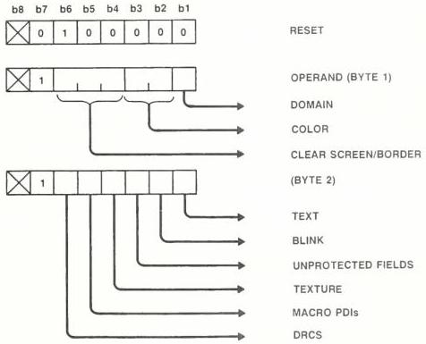

*Figure 29: Reset*

5.3.2.9.2 Operand Byte 1 of RESET. If bit b1 of byte 1 equals 1, the DOMAIN parameters are reset to their default values. If b1 is 0, the DOMAIN parameters are not changed.

Bits b3 and b2 of byte 1 modify the color mode and/or current drawing color as shown in Table 14.

Table 14
Color Mode Reset

|  b3 | b2 | Color mode  |
| --- | --- | --- |
|  0 | 0 | No action.  |
|  0 | 1 | Select color mode 0, set color map to default colors, and set the in-use drawing color to white.  |
|  1 | 0 | Select color mode 1 and set color map to default colors. If this is executed while in color mode 0, then it has the same effect as "11".  |
|  1 | 1 | Select color mode 1, set color map to default colors, and set the in-use drawing color to white.  |

Bits b6, b5, and b4 of byte 1 clear the display area and/or border area to the colors shown in Table 15.

The border area surrounds the display area and may only be set to one color at a time.

Table 15
Screen and Border Reset

|  b6 | b5 | b4 | Screen/Border Colors  |
| --- | --- | --- | --- |
|  0 | 0 | 0 | No action.  |
|  0 | 0 | 1 | Display area to nominal black.  |
|  0 | 1 | 0 | Display area to current drawing color.  |
|  0 | 1 | 1 | Border area to nominal black.  |
|  1 | 0 | 0 | Border area to current drawing color.  |
|  1 | 0 | 1 | Display area and border area to current drawing color.  |
|  1 | 1 | 0 | Display area to current drawing color and border area to nominal black.  |
|  1 | 1 | 1 | Display area and border area to nominal black.  |

5.3.2.9.3 Operand Byte 2 of RESET. If bit b1 of byte 2 equals 1, the cursor is sent to its home position (top left character position in the display area) and all text parameters (from the TEXT opcode, from the C1 set and the active field) are reset to their default values. If b1 is 0, the text parameters and the cursor position are not changed.

If bit b2 of byte 2 equals 1, all blink processes are terminated. If b2 is 0, then blink processes are not changed.

If bit b3 of byte 2 equals 1, all unprotected fields are changed to protected status but the displayed contents are unaffected. However, the field definitions (except that of the active field) are lost, as well as any data structures maintained for user editing and transmission. If b3 is 0, unprotected fields are not changed.

If bit b4 of byte 2 equals 1, all texture attributes are set to their default values. The four programmable texture masks are not cleared. If b4 is 0, current texture attributes are not changed.

If bit b5 of byte 2 equals 1, all macros are cleared. This includes transmit-macros. If b5 is 0, macros are not changed.

If bit b6 of byte 2 equals 1, all DRCS characters are cleared, that is, all character positions are set to the space character. If b6 is 0, the DRCS characters are not changed.

If the RESET command is received with no operands, it is interpreted as if it had been sent with bits b6 to b1 in both bytes set equal to 0. If only one byte is received, the second operand is then interpreted as if it had been received with bits b6 to b1 set equal to 0. If more than two data bytes are received, the additional byte(s) are reserved for future standardization and shall be ignored.

For descriptions of transmit-macro and DRCS, see 5.5 and 5.6, respectively.

#### 5.3.3 Geometric Drawing Primitives

Note that the drawings in this section are stylized and are not intended to indicate an actual image (see Figure 15).

##### 5.3.3.1 POINT

5.3.3.1.1 The POINT command is used to perform two basic geometric drawing operations, that of establishing the coordinate at which to commence drawing and that of drawing a point. A coordinate pair is specified with this command to set the drawing point. Optionally, a point may be drawn (ie, made visible) at the specified coordinate position. The coordinate is specified either as an absolute (X,Y) position or as a relative (dx, dy) displacement from the current drawing point. (See Figure 30.)

A series of coordinate positions following a POINT opcode may be used to draw a point by point graph. The final drawing point, ie, the drawing point at the completion of execution of the POINT command, is the last specified point.

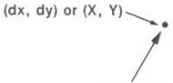

Final Drawing
Point Position

*Figure 30: POINT*

5.3.3.1.2 POINT SET (Absolute, Invisible). This command sets the drawing point to the absolute coordinates specified. A point is not drawn. (See Figure 31.)

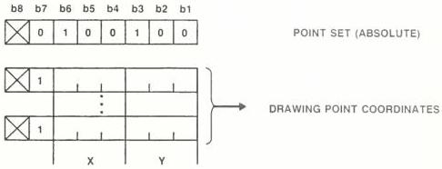

*Figure 31: POINT SET (Absolute, Invisible)*

5.3.3.1.3 POINT SET (Relative, Invisible). This command sets the drawing point to the coordinates obtained by adding the displacement specified to the coordinates of the current drawing point. A point is not drawn. (See Figure 32.)

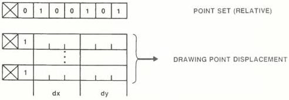

*Figure 32: POINT SET (Relative, Invisible)*

5.3.3.1.4 POINT (Absolute, Visible). This command sets the drawing point to the absolute coordinates specified and draws a point whose size is determined by the logical pel size, and whose color is determined by the drawing color. (See 5.3.2.2 for a description of logical pel.) (See Figure 33.)

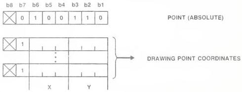

*Figure 33: POINT (Absolute, Visible)*

5.3.3.1.5 POINT (Relative, Visible). This command sets the drawing point to the coordinates obtained by adding the displacement specified to the coordinates of the current drawing point, and draws a point whose size is determined by the logical pel size, and whose color is determined by the drawing color. (See Figure 34.)

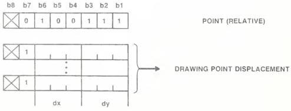

*Figure 34: POINT (Relative, Visible)*

##### 5.3.3.2 LINE

5.3.3.2.1 The LINE command is a basic geometric drawing operation. The direction and length of a line are specified by the start and end points. The start point is specified either explicitly within the LINE command or as the current drawing point. The end point is specified either as a relative (dx, dy) displacement from the start point or as an absolute (X, Y) coordinate. At the completion of drawing a line, the drawing point is coincident with the end point. The line is drawn from the start point to the end point in the current color(s), has a width that is determined by the logical pel size, and a texture determined by the line current texture attribute. (See Figure 35.)

The LINE command may be used to draw a line graph from a table of numbers described as absolute or relative coordinates in the same manner as the POINT opcode.

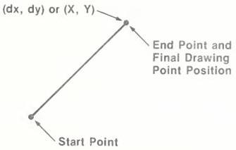

*Figure 35: LINE*

5.3.3.2.2 LINE (Absolute). The start point is the current drawing point. The end point is specified in absolute coordinates. (See Figure 36.)

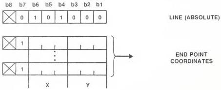

*Figure 36: LINE (Absolute)*

5.3.3.2.3 LINE (Relative). The start point is the initial drawing point. The end point is specified as a relative displacement from the start point. (See Figure 37.)

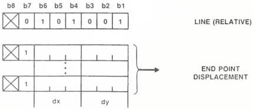

*Figure 37: LINE (Relative)*

5.3.3.2.4 SET and LINE (Absolute). Both the start and end points are specified in absolute coordinates. (See Figure 38.) If more than two operands are present, lines are drawn from the first to the second point, then from the third to the fourth point, etc.

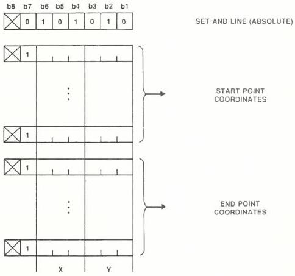

*Figure 38: SET and LINE (Absolute)*

5.3.3.2.5 SET and LINE (Relative). The start point is specified in absolute coordinates, and the end point is specified as a relative displacement from the start point. (See Figure 39.)

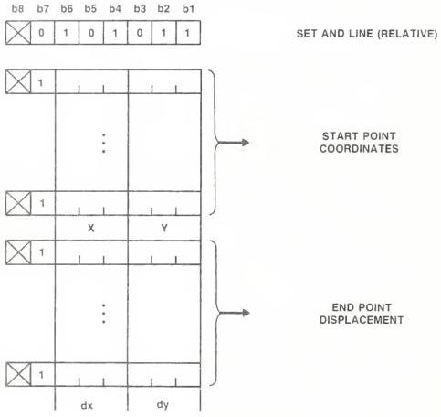

*Figure 39: SET and LINE (Relative)*

##### 5.3.3.3 ARC

5.3.3.3.1 The ARC geometric drawing operation provides the capability of drawing circles, segments of circles, and curvilinear splines. For circles and segments of circles, an arc is drawn from a start point to an end point through an intermediate point on the arc. Drawing of a circle results when the start and end points are coincident; the intermediate point defines the diameter of the circle, and therefore is the midpoint on the arc between the start and end points. A segment of a circle is drawn when the start and end points are not coincident.

The start point is specified either explicitly within the ARC command or as the current drawing point. The intermediate point is described as a relative displacement from the start point. The end point is specified as a relative displacement from the intermediate point. It is good practice, in order to minimize error, to always specify the intermediate point on the arc as being approximately midway between the start and end points.

If the three drawing points are colinear, a line is drawn from the start point to the end point, except for the error condition in which the intermediate point does not lie between the start and end points. If the end point is omitted, it is taken to be coincident with the start point and a circle is drawn. Note that the arc may not be specified so that any portion of it lies outside the unit screen (see 5.3.1.1). At the completion of drawing an arc, the drawing point is coincident with the end point.

An arc may be either filled or outlined. Outlined arcs are drawn in the current color(s), have a width that is determined by the logical pel size, and a line texture that is as specified by the TEXTURE command. The chord that joins the start and end points is not considered part of the outline and, as such, is not drawn.

For filled arcs, the area enclosed by the outline and the chord (including the region of the outline and the chord traced by the logical pel) is filled in the current color(s) with the texture pattern specified in the TEXTURE command. The stroke width of the chord is affected by the logical pel, but the chord is not considered a part of the arc and, as such, is not highlighted if highlight mode is selected (see 5.3.2.4.3 and Figure 40.)

Drawing of a curvilinear spline results when more than three points are specified. The last point specified is the end point. The drawing point at the completion of drawing a spline is the end point. The minimum implementation of the spline shall be a series of lines connecting the start, intermediate, and end points of the spline. The display device may draw a smoother spline, but the shape of this spline and the characteristics of the algorithm used are implementation-dependent. The complete algorithm for a curvilinear spline is

reserved for future standardization. All the attributes described above for circles and segments of circles (colinear points, points outside the unit screen, fill, and outline) apply to splines. In the case of a filled spline, the spline and the chord (the line that joins the start and end points) must enclose a single area, ie, no portion of the spline outline or chord may cross any other portion of the spline or chord. The maximum number of points permitted to describe a spline is implementation-dependent, and shall be at least 256 points.

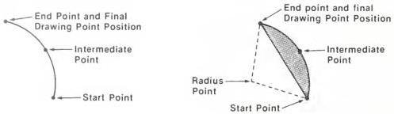

*Figure 40: ARC*

5.3.3.3.2 ARC (Outlined). The start point is the current drawing point, the intermediate point is the first block of coordinate data, specified as a relative displacement from the start point, and the end point is the second block of coordinate data, specified as a relative displacement from the intermediate point. (See Figure 41.) The arc is not filled.

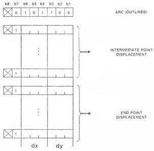

*Figure 41: ARC (Outlined)*

5.3.3.3.3 ARC (Filled). The start point is the current drawing point, the intermediate point is the first block of coordinate data, specified as a relative displacement from the start point, and the end point is the second block of coordinate data, specified as a relative displacement from the intermediate point. The start and end points are joined by a chord and the resulting figure is filled in the current color(s) with the current texture pattern. (See Figure 42.)

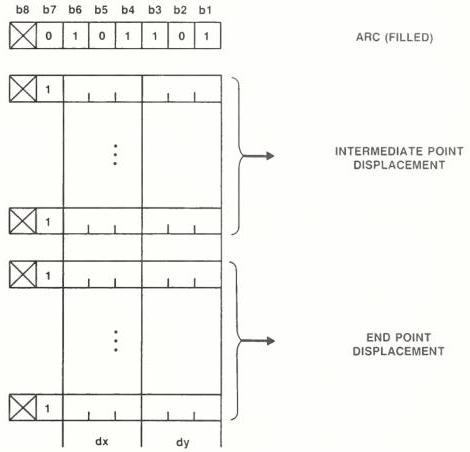

*Figure 42: ARC (Filled)*

5.3.3.3.4 SET and ARC (Outlined). The start point is the first block of coordinate data, specified in absolute coordinates. The intermediate point is the second block of coordinate data, specified as a relative displacement from the start point, and the end point is the third block of coordinate data, specified as a relative displacement from the intermediate point. (See Figure 43.) The arc is not filled.

*Figure 43: SET and ARC (Outlined)*

5.3.3.3.5 SET and ARC (Filled). The start point is the first block of coordinate data, specified in absolute coordinates. The intermediate point is the second block of coordinate data, specified as a relative displacement from the start point, and the end point is the third block of coordinate data, specified as a relative displacement from the intermediate point. (See Figure 44.) The start and end points are joined by a chord and the resulting figure is filled in the current color(s) with the current texture pattern.

*Figure 44: SET and ARC (Filled)*

##### 5.3.3.4 RECTANGLE

5.3.3.4.1 The RECTANGLE command provides the capability of drawing a rectangular area of width dx and height dy. The start point is specified either explicitly within the RECTANGLE command or as the current drawing point. At the completion of drawing a rectangle, the drawing point is the start point altered in x only, by the amount of the dx displacement.

A rectangle may be either filled or outlined. Outlined rectangles are drawn in the current color(s) and have a line width that is determined by the logical pel size and a line texture that is specified by the TEXTURE command. For filled rectangles, the area enclosed by the outline (including the region of the outline traced by the logical pel) is filled in the current color(s) with the texture pattern specified in the TEXTURE command, and the outline is highlighted if the highlight mode is selected (see 5.3.2.4.3).

The RECTANGLE command may be used to draw a histogram from a table of numbers representing relative dy and dx displacements in the same manner as the POINT and LINE commands may be used to plot graphs. (See Figure 45.)

*Figure 45: RECTANGLE*

5.3.3.4.2 RECTANGLE (Outlined). The start point is the current drawing point and the width and height (dx, dy) are given as the first block of coordinate data. (See Figure 46.) The rectangle is not filled.

*Figure 46: RECTANGLE (Outlined)*

5.3.3.4.3 RECTANGLE (Filled). The start point is the current drawing point and the width and height (dx, dy) are given as the first block of coordinate data. (See Figure 47.) The rectangle is filled in the current color(s) with the current texture pattern.

*Figure 47: RECTANGLE (Filled)*

5.3.3.4.4 SET and RECTANGLE (Outlined). The start point is specified in absolute coordinates as the first block of coordinate data, and the width and height (dx, dy) are given as the second block of coordinate data. (See Figure 48.) The rectangle is not filled.

*Figure 48: SET and RECTANGLE (Outlined)*

5.3.3.4.5 SET and RECTANGLE (Filled). The start point is specified in absolute coordinates as the first block of coordinate data, and the width and height (dx, dy) are given as the second block of coordinate data. (See Figure 49.) The rectangle is filled in the current color(s) with the current texture pattern.

*Figure 49: SET and RECTANGLE (Filled)*

##### 5.3.3.5 POLYGON

5.3.3.5.1 The POLYGON command provides the capability of drawing a general polygonal area with the specified vertices. A polygon is specified as a series of coordinates of the vertices about the perimeter of the polygon. The start point is specified either explicitly within the POLYGON command or as the current drawing point. Each (dx, dy) coordinate pair represents a relative displacement from the last vertex (a relative displacement of magnitude 0 is ignored). There is implicit closure between the start point and the last vertex specified so that at the completion of drawing a polygon, the drawing point is coincident with the start point. (See Figure 50.)

A polygon may be either filled or outlined. Outlined polygons are drawn in the current color(s) and have a line width that is determined by the logical pel size, and a line texture that is as specified by TEXTURE command. For filled polygons, the area enclosed by the outline (including the region of the outline traced by the logical pel) is filled in the current color(s) with the texture pattern specified in the TEXTURE command, and the outline is highlighted if the highlight mode is selected (see 5.3.2.4.3).

A filled POLYGON must enclose a single area; that is, no line joining two consecutive vertices may cross any other line joining two consecutive vertices.

The number of vertices describing a polygon is determined by the amount of data following the POLYGON opcode. The maximum number of vertices permitted to describe a polygon is implementation dependent and shall be at least 256 vertices.

*Figure 50: POLYGON*

5.3.3.5.2 POLYGON (Outlined). The start point is the current drawing point and subsequent vertex coordinates are specified as relative displacements from the previous vertex coordinate. (See Figure 51.) The polygon is not filled.

*Figure 51: POLYGON (Outlined)*

5.3.3.5.3 POLYGON (Filled). The start point is the current drawing point and subsequent vertex coordinates are specified as relative displacements from the previous vertex coordinate. (See Figure 52.) The polygon is filled in the current color(s) with the current texture pattern.

*Figure 52: POLYGON (Filled)*

5.3.3.5.4 SET and POLYGON (Outlined). The start point is specified in absolute coordinates as the first block of coordinate data, and subsequent vertex coordinates are specified as relative displacements from the previous vertex coordinates. (See Figure 53.) The polygon is not filled.

*Figure 53: SET and POLYGON (Outlined)*

5.3.3.5.5 SET and POLYGON (Filled). The start point is specified in absolute coordinates as the first block of coordinate data, and subsequent vertex coordinates are specified as relative displacements from the previous vertex coordinates. (See Figure 54.) The polygon is filled in the current color(s) with the current texture pattern.

*Figure 54: SET and POLYGON (Filled)*

##### 5.3.3.6 INCREMENTAL

5.3.3.6.1 The INCREMENTAL command allows for the specification of complex images in a compact manner. There are four INCREMENTAL opcodes, namely FIELD, INCREMENTAL POINT, INCREMENTAL LINE, and INCREMENTAL POLYGON (Filled).

The image may be of a photographic nature (FIELD and INCREMENTAL POINT) or may consist of complex lines such as signatures (INCREMENTAL LINE) or filled polygons such as logos or other symbols (INCREMENTAL POLYGON).

5.3.3.6.2 FIELD. The FIELD command is used to define the active field used for columnated text, unprotected fields and INCREMENTAL POINT. The origin point of the field is specified in absolute coordinates (X,Y) as the first block of coordinate data. The next block of coordinate data gives the field dimensions, width and height (dx,dy) (see Figure 55). Note that dx or dy, or both, may be positive or negative, so that the origin point may be placed in any of the four corners of the field. The drawing point is set to the origin of the field after FIELD has been executed. Only one active field may be defined at a time; i.e., execution of FIELD will undefine any previous active field. If no data bytes follow the FIELD opcode, the active field is set to the full unit screen and the origin point is (0,0). If only one operand follows the FIELD opcode, it specifies the field dimensions and the origin point is the current drawing point. Additional numeric data bytes following the second operand are reserved for future standardization and shall be ignored. The default active field is the unit screen.

*Figure 55: FIELD*

5.3.3.6.3 INCREMENTAL POINT. With the INCREMENTAL POINT command, an image can be described as a string of color specifications that are deposited in a raster-sequential manner within the active field. These color specifications are contained in a string operand. In color mode 0, these will be interpreted as actual color values. In color modes 1 and 2, these will be interpreted as color map addresses. The algorithm by which the image is constructed is as follows:

(1) The operation starts at the current drawing point.

(2) If no portion of the logical pel exceeds the active field, then the first color obtained from the string operand is deposited in the display memory location(s) corresponding to the pixel(s) lying under the logical pel. If a pixel lies under the logical pel associated with the drawing point for more than one deposit operation, it retains the color deposited there last. The drawing point is then automatically moved in the X direction a distance equal to the width (dx) of the logical pel. Note that if dx is positive, the drawing point moves to the right and if dx is negative, the drawing point moves to the left. The next color is then obtained and the process is repeated.

(3) If any portion of the logical pel exceeds the active field, then any remaining bits in the byte of the string operand currently being interpreted are discarded, even if there is a sufficient number of bits remaining to make up a complete color specification. Interpretation resumes at the first bit (ie, b6) in the next complete byte. If there are no further numeric data bytes, then the operation is terminated; otherwise the drawing point is repositioned to the opposite boundary. If moving the drawing point in the Y direction a distance equal to the height (dy) of the logical pel would cause any portion of the logical pel to exceed the active field, then the Y value is left constant and the entire display image lying within the area of the screen defined by the active field is scrolled in the opposite direction, ie, a distance equivalent to -dy; otherwise the drawing point is moved in the Y direction a distance equal to the height (dy) of the logical pel. Note that if dy is positive, the drawing point moves up and if dy is negative, the drawing point moves down. If the operation has not terminated, then the process continues at Step 2. If the operation has terminated, the drawing point is then set to the origin of the active field.

The INCREMENTAL POINT opcode and its operands are shown in Figure 56. An example of an INCREMENTAL POINT picture is shown in Figure 57.

*Figure 56: Incremental Point*

*Figure 57: Example INCREMENTAL POINT Picture*

The INCREMENTAL POINT command takes two operands. The first is a single byte, fixed format operand that describes the packing counter. The packing counter is an unsigned integer that determines the number of consecutive bits to be taken from the string operand to make up a single color specification. The range of values of the packing counter shall be 1 to 48, inclusive. Values of 0 or greater than 48 are reserved for future standardization and the entire INCREMENTAL POINT command containing packing counters with such values shall be executed as a null operation. The second operand is a string operand of indeterminate length. It contains the color specifications, stored sequentially without regard to byte boundaries, high order bit (b6) to low order bit (b1) within the numeric data fields. In color mode 0, these color specifications are interpreted as actual color values; that is, a number of bits equal to the packing count is used to define the color applied to each drawing operation. As in the multi-value color specification, the bits are organized into three-tuples and the order of interpretation of the bits is G, R, B. Note that a single color specification may contain multiple three-tuples depending on the packing count, in which case the first three-tuple contains the MSB's and the last contains the LSB's of the three primaries. For example, if the packing count were 6, the color specification for each drawing operation would look like GRBGRB and each primary would be specified to two bits of accuracy. If the packing count is not an integer multiple of three, then each primary will not be specified to an equal accuracy. For example, if the packing count were 4, the color specification for each drawing operation would look like GRBG. Note that these would be concatenated within the string operand without regard to byte boundaries. In this example, then, the bits in the string operand would look like GRBGGRBG . . .

In color modes 1 and 2, these color specifications are ordinal numbers, ie, addresses in the color map in which the actual color value was previously, or will later be, loaded. Again, a number of bits equal to the packing count is used to define the color applied to each drawing operation. These specifications are concatenated in the string operand without regard to byte boundaries.

It is required, depending on the relationship between the logical pel dimensions and the physical pixel dimensions on an individual display device, to perform a preexecution rescaling of both the logical pel dimensions and the active field dimensions to avoid certain types of distortions (ie, skew) that will result from a mismatch. When the drawing point is in such an active field, the relative position of the drawing point inside the scaled field should remain the same as before scaling. The goal of this type of rescaling is to make the logical pel dimensions become either integer multiples or integer fractions of the corresponding physical pixel dimensions. (The active field dimensions would have to be scaled equivalently in order to prevent skew in the image.) The following conditions are required: (1) the logical pel dimensions and active field dimensions are restored to their prescaled values after the INCREMENTAL POINT command completes execution; (2) the resultant image is guaranteed to lie within the original active field; and (3) the implementation ensures that skew does not occur for all possible precisions of the logical pel and field dimensions as specified by the DOMAIN command.

If INCREMENTAL POINT is received and if any portion of the logical pel indicated by the initial drawing point lies outside the active field, the entire command is considered to be in error and is executed as a null operation. If INCREMENTAL POINT is received and either or both dimensions of the logical pel are equal to 0, then these dimensions are set, for the duration of the command only, to the smallest positive value specifiable within the current domain. (For example, if the current multi-value operand length is 3 bytes, then the smallest specifiable value would be +0.00000001, ie, 1/256.)

5.3.3.6.4 INCREMENTAL LINE. The INCREMENTAL LINE command provides the capability of compactly describing an image consisting of a series of short line segments drawn in the current color(s) and line texture. (See Figures 58 and 59.)

*Figure 58: INCREMENTAL LINE*

*Figure 59: Example INCREMENTAL LINE Picture*

The first multi-value operand specifies the step size parameters, dx and dy, as signed displacements.

The last block of data is a string operand that gives the move values as an indefinite number of bytes, each of which contains three two-bit nibbles in the numeric data field that are interpreted b6 to b1. The interpretation of these two-bit nibbles is as shown in Table 16.

Table 16
Incremental Line Move Values

|  Nibble Value | Interpretation  |
| --- | --- |
|  00 | Interpret the following nibble as a modify parameter instruction (see Table 17)  |
|  01 | Advance the drawing point a distance dx in the x direction and optionally draw a line  |
|  10 | Advance the drawing point a distance dy in the y direction and optionally draw a line  |
|  11 | Advance the drawing point a distance dx in the x direction and dy in the y direction and optionally draw a line  |

If the draw flag is on, then every time the drawing point is stepped, a line in the current line texture and color is drawn joining the current drawing point (after the step operation) with the previous drawing point (before the step operation). If the draw flag is off, then no line is drawn after the step operation. When a nibble value of (0,0) is encountered (Table 16), the next nibble is interpreted as a modify parameter instruction as shown in Table 17. The nibble following that is interpreted as a step operation (Table 16). The draw flag is initially on whenever the INCREMENTAL LINE opcode is encountered. When the string operand is terminated, the drawing point is left at the final drawing point.

Table 17
Incremental Line Modify Parameter Instructions

|  Nibble Value | Modify Parameter Instruction  |
| --- | --- |
|  00 | Change the state of the draw flag (ON to OFF or OFF to ON).  |
|  01 | Change sign of dx.  |
|  10 | Change sign of dy.  |
|  11 | Change sign of dx and dy.  |

5.3.3.6.5 INCREMENTAL POLYGON (Filled). The INCREMENTAL POLYGON command provides the capability of compactly describing a filled polygon drawn with a series of short line segments. (See Figures 60 and 61.) The area enclosed by the outline (including the region of the outline traced by the logical pel) is filled in the current color(s) with the texture pattern specified in the TEXTURE command, and the outline is highlighted if the highlight mode is selected (see 5.3.2.4.3).

*Figure 60: INCREMENTAL POLYGON (Filled)*

*Figure 61: Example INCREMENTAL POLYGON Picture*

The interpretation of the operand data following the opcode is exactly the same as for the INCREMENTAL LINE opcode, with the following exceptions:

(1) The draw flag is always on.
(2) Should a "modify parameter" instruction (Table 17) to change the state of the draw flag (0,0) be encountered, it is treated as a null, and the following nibble is interpreted as the "modify parameter" instruction.
(3) The final drawing point is implicitly taken as the initial drawing point.
(4) The resulting figure is filled in the current color and texture pattern and according to the highlight attribute.

Note that INCREMENTAL POLYGON shall enclose a single area (similar to POLYGON, see 5.3.3.5).

5.4 Mosaic Set. Figure 63 shows the character assignments for the mosaic set. This comprises sixty-five 2 x 3 block mosaic characters including a second copy of the solid mosaic in position 5/15. The remaining character positions are reserved for future standardization and shall be displayed as SPACE. Mosaic characters can be displayed in two modes, contiguous or separated, depending on the underline mode described in 6.2.7.15. In contiguous mode, the six mosaic elements that compose each character shall completely span the given character field at any size. In separated mode, each of the mosaic elements that are illuminated are reduced in the horizontal dimension by the absolute value of the width (dx) of the logical pel size, and are reduced in the vertical dimension by the absolute value of the height (dy) of the logical pel size. (The logical pel is described in 5.3.2.2.) The reduced mosaic elements, in this case, are left and bottom justified within the normal element area, the remainder of the area being considered as background. If either dimension of the logical pel is equal to or exceeds the corresponding dimension of the mosaic element, then the illuminated area is reduced to zero. The graphic symbol in position 2/0 of the Mosaic Set is not subject to underline. Mosaics (in separated or contiguous mode) are not subject to proportional spacing.

The algorithm that determines which of the sub-elements is on is derived from the bit combinations of the code table reference. (See Figure 62.)

2x3
MOSAIC
CELL

*Figure 62: Mosaic Sub-element Encoding*

The code combination 5/15 (1011111) also implies that all sub-elements are on. See Figure 63 for a code table representation of the mosaic scheme.

The sequence used to designate the mosaic set is ESC I 7/13, where I is 2/9 or 2/13 to indicate G1, 2/10 or 2/14 to indicate G2, or 2/11 or 2/15 to indicate G3 (see 4.3).

*Figure 63: Mosaic Set*

Note: The rectangles surrounding the characters are for illustrative purposes only and are not part of the graphic symbols.

5.5 Macro Set. The macro feature provides the capability of encoding sequences of presentation level codes to be executed upon command. A macro definition consists of an arbitrary string of locally buffered presentation layer code that is identified by a code from the macro G-set. This name thereafter acts as a substitute for the entire string of characters that make up that particular macro. Up to 96 macros can be defined simultaneously (see 6.2.2). A macro can be used by designating the macro set as one of the G-sets, followed by invoking the macro set into the in-use table and transmitting the macro code. A macro code may also be included within any macro definition, thereby providing a nesting capability. It is essential that the application layer assume responsibility for infinite loops.

Any macro (whether defined by DEF MACRO, DEFP MACRO, or DEFT MACRO, see 6.2.2) may be linked to a user input mechanism, such as a function key, to allow its execution or transmission to be activated by the user. The number of macro names that can be linked is implementation-dependent.

The sequence used to designate the macro set is ESC I 7/10, where I is 2/9 or 2/13 to indicate G1, 2/10 or 2/14 to indicate G2, or 2/11 or 2/15 to indicate G3 (see 4.3).

5.6 Dynamically Redefinable Character Set (DRCS). Unlike the other character sets, whose pattern definitions are permanently stored in the receiving device and cannot be altered by the information provider, the Dynamically Redefinable Character Set (DRCS) designated by a three-character escape sequence provides a facility whereby a maximum of 96 custom defined patterns can be downloaded and utilized in a similar manner as the primary, supplementary, and mosaic sets. At display time, they are subject to the same attributes as alphanumeric text. The manner in which the patterns are actually downloaded is described in 6.2.3. If a DRCS character has not been defined by the DEF DRCS command, it shall be displayed as if it were SPACE.

The sequence used to designate the DRCS set is ESC I 7/11, where I is 2/9 or 2/13 to indicate G1, 2/10 or 2/14 to indicate G2, or 2/11 or 2/15 to indicate G3 (see 4.3).

## 6. Coding of C-Sets

### 6.1 C0 Control Set

6.1.1 This clause describes the C0 control set (see Figure 64) that occupies columns 0 and 1 of the 7- and 8-bit in-use tables. The functions are as follows.

#### 6.1.2 Format Effector Characters

6.1.2.1 ACTIVE POSITION BACKWARD (APB). This character (0/8) (backspace) is used to move the cursor a distance equal to the intercharacter spacing lying parallel to the character path in the direction opposite to the character path (ie, 180 degrees from the direction of the character path). If such a movement would cause any part of the full corresponding character field to be outside of the display area (or outside of the active field, if the character field was entirely within the active field immediately before the movement), then the cursor is instead moved to the opposite edge (along the character path) of the display area (or active field) and an automatic APU is executed.

6.1.2.2 ACTIVE POSITION FORWARD (APF). This character (0/9) (horizontal tab) is used to move the cursor a distance equal to the intercharacter spacing lying parallel to the character path in the direction of the character path. If such a movement would cause any part of the full corresponding character field to be outside of the display area (or outside of the active field, if the character field was entirely within the active field immediately before the movement), then the cursor is instead moved to the opposite edge (along the character path) of the display area (or active field) and an automatic APD is executed.

6.1.2.3 ACTIVE POSITION DOWN (APD). This character (0/10) (line feed) is used to move the cursor a distance equal to the interrow space lying perpendicular to the character path in a direction perpendicular to the character path (-90 degrees). If such a movement would cause any part of the full corresponding character field to be outside of the display area (or outside of the active field, if the character field was entirely within the active field immediately before the movement), then special action is taken that is dependent on whether or not scroll mode is in effect (see 6.2.7.13 and 6.2.7.14).

*Figure 64: C0 Control Set*

6.1.2.4 ACTIVE POSITION SET (APS). This character (1/12) is used to set the cursor position without resetting any parameters or attributes.

The two bytes immediately following an APS shall both come from columns 2 through 7 or 10 through 15 of the in-use table. They represent the row address and column address, respectively, to which the cursor is to be moved. The row address is obtained from the first byte following an APS by taking the binary integer comprising bits b7 through b1 with b7 being the MSB, masking out b8, and subtracting 32. Similarly, the column address is obtained from the second byte following an APS by taking the binary integer comprising bits b7 through b1 with b7 being the MSB, and subtracting 32. This gives an address range from 0 through 95 inclusive for the row and column addresses. For example, the bit combination 3/6 yields the binary integer 54, which, after subtracting 32, gives the address 22. If either of the characters following the APS character is a C0 or C1 control, the APS is ignored and the C0 or C1 control is executed.

Rows and columns are numbered starting with row 0, column 0, in the lower leftmost character position of the display area, and refer to the nominal screen format established by the current character field size (with the default intercharacter and interrow spacing). The cursor is positioned assuming zero character rotation to establish the character field origin. Once the character field origin is established, the character field and cursor are rotated, if necessary.

6.1.2.5 ACTIVE POSITION UP (APU). This character (0/11) (vertical tab) is used to move the cursor a distance equal to the interrow space lying perpendicular to the character path in a direction perpendicular to the character path (90 degrees). If such a movement would cause any part of the full corresponding character field to be outside of the display area (or outside of the active field, if the character field was entirely within the active field immediately before the movement), then special action is taken that is dependent on whether or not scroll mode is in effect (see 6.2.7.13 and 6.2.7.14).

6.1.2.6 CLEAR SCREEN (CS). This character (0/12) is used to move the cursor to the upper left character position of the display area, in which the top of the character field coincides with the top boundary of the display area. In color modes 0 and 1, it clears the display area to nominal black. In color mode 2, it clears the display area to the background color.

6.1.2.7 ACTIVE POSITION RETURN (APR). This character (0/13) (carriage return) is used to move the cursor to the first character position within the display area (or within the active field, should the full character field corresponding to the cursor lie entirely within the active field before the movement) along the character path.

6.1.2.8 ACTIVE POSITION HOME (APH). This character (1/14) is used to move the cursor to the upper left character position in the display area, in which the top of the character field coincides with the top boundary of the display area.

#### 6.1.3 Code Extension Control Characters

6.1.3.1 SHIFT-OUT (SO). This character (0/14) is used to invoke the G1 set into the in-use table (see 4.3.2 and 4.3.3).

6.1.3.2 SHIFT-IN (SI). This character (0/15) is used to invoke the G0 set into the in-use table (see 4.3.2 and 4.3.3).

6.1.3.3 SINGLE-SHIFT TWO (SS2). This character (1/9) is used to invoke the G2 set into the in-use table in a nonlocking manner (see 4.3.2 and 4.3.3).

6.1.3.4 SINGLE-SHIFT THREE (SS3). This character (1/13) is used to invoke the G3 set into the in-use table in a nonlocking manner (see 4.3.2 and 4.3.3).

6.1.3.5 ESCAPE (ESC). This character (1/11) is used for code extension (see 4.3.2 and 4.3.3).

6.1.4 Transmission Control Characters. The transmission control characters, ie, SOH (0/1), STX (0/2), ETX (0/3), EOT (0/4), ENQ (0/5), ACK (0/6), DLE (1/0), NAK (1/5), SYN (1/6), and ETB (1/7), have no effect on the presentation layer and are reserved for use at other protocol layers. They may be embedded within any presentation layer sequence without affecting that sequence.

6.1.5 Device Control Characters. The device control characters, ie, DC1(1/1), DC2(1/2), DC3(1/3), and DC4(1/4), have no effect on the presentation layer and are reserved for use at other protocol layers. They may be embedded within any presentation layer sequence without affecting that sequence.

#### 6.1.6 Other Control Characters

6.1.6.1 NULL (NUL). This character (0/0) has no effect on the presentation layer and is reserved for use at other protocol layers. It may be embedded within any presentation layer sequence without affecting that sequence.

6.1.6.2 BELL (BEL). This character (0/7) is used to momentarily ring a bell or effect another transient indication.

6.1.6.3 CANCEL (CAN). This character (1/8) is used to terminate processing of all currently executing macros. Execution is resumed at the next presentation layer character following the terminated macro call. The effect of CAN is immediate, ie, it is not put at the end of any existing queue of unprocessed presentation layer code. The operation of the CAN character is not guaranteed unless it is guaranteed to be delivered by the lower layers.

6.1.6.4 SERVICE DELIMITER CHARACTER (SDC). This character (1/10) shall be executed as a null operation at the presentation layer and any other use is implementation-dependent (see Appendix D).

6.1.6.5 NON-SELECTIVE RESET (NSR). This character (1/15) serves two functions: it non-selectively resets the presentation process as defined below and it can be used as an alternative means to position the cursor. When an NSR is received, the following action is taken:

(1) The G0, G1, G2, G3, C0, and C1 sets are designated to their default states and the in-use code table is invoked to its default state, as described in 4.3.
(2) The DOMAIN parameters are set to their default values, as described in 5.3.2.2.
(3) The text parameters (from the TEXT opcode, from the C1 set and the active field), as described in 5.3.2.9.3, are set to their default values.
(4) The TEXTURE parameters are set to their default values, as described in 5.3.2.4. The programmable masks are not cleared.
(5) The color mode is set to color mode 0 and the drawing color is set to nominal white. The color map is not changed.
(6) If the two bytes that immediately follow the NSR are both from columns 4 through 7 of the in-use table, the cursor is positioned. These two bytes represent, in binary form (ie, the binary digit comprising the bits b6 through b1 with b6 being the MSB), the row and column address, respectively, to which the cursor should be moved. Rows and columns are numbered starting with row 0, column 0 in the upper leftmost character position in the display area and refer to the nominal screen format established by the default character size. The top of the character field for row 0 coincides with the top boundary of the display area. If either of the two bytes following the NSR is not from columns 4 through 7 (or columns 12 through 15) of the in-use table, the non-selective reset function of NSR is executed and the cursor is not repositioned. If the two bytes are from columns 2 and 3 (or columns 10 and 11), they are ignored. If either of the two bytes are C0 or C1 control characters (columns 0, 1 or 8, 9), they terminate the NSR sequence and they are executed.

*Figure 65: C1 Control Set*

**Definition of Columns A and B**

(1) If a C1 control function is represented by a 2-character escape sequence (in a 7-bit code), the table specifies the bit combination of the final character by taking A = 4 and B = 5.
(2) If a C1 control function is represented by a single 8-bit combination, the table specifies this combination by taking A = 8 and B = 9.

### 6.2 C1 Control Set

6.2.1 The C1 control set (see Figure 65) is used to allow control over text format and also to create macros, DRCS, programmable texture masks, and unprotected fields. These capabilities are described in 6.2.2 to 6.2.6.

#### 6.2.2 Macros: General

6.2.2.1 DEF MACRO. This C1 control is used to define a macro. Bits b7 through b1 of the character following this control shall be in the range 2/0 to 7/15 and are the bit combination representing the macro being defined. All characters subsequent to this character are stored (but not executed) within the receiving device under the specified macro name. Definition of the macro terminates upon receipt of one of the following C1 controls: DEF MACRO, DEFP MACRO, DEFT MACRO, DEF DRCS, DEF TEXTURE, or END. Neither the terminating control character nor its preceding ESC character in a 7-bit environment is stored as part of the macro. If the character following the DEF MACRO control is not in this range, the entire command (ie, the C1 control and the out of range character) is in error and is executed as a null operation.

During the definition of a macro, a reference to a macro results in the storage of that reference only, not the expansion. The definition of a macro replaces any previously existing macro under the same name. A macro may be longer or shorter than the previously existing macro that it replaces. A null macro definition, ie, a macro definition in which there are no characters between the macro name and the terminating C1 character (or its preceding ESC character in a 7-bit environment) causes that macro to be deleted. Definition of a macro is independent of whether the macro set is invoked or not (though it must, of course, be invoked in order to actually execute the macro).

All macros may be simultaneously deleted with the RESET command.

6.2.2.2 DEFP MACRO. The operation of this control character is identical to that of the DEF MACRO command, except that incoming characters that make up the macro definition are simultaneously executed and stored. A macro is considered to be undefined during definition until the definition is terminated. Therefore, if a DEFP MACRO command contains a reference to itself, or if it references another macro which references the one being defined, the reference to the macro being defined is executed as a null operation.

6.2.2.3 DEFT MACRO. The DEFT MACRO control character is used to define a transmit-macro. Transmit-macros, when called, are not executed, but are transmitted in their entirety to the host computer or to a local application process. This could, for example, be used to provide a programmable-function key capability if one or more keys on the keyboard were capable of causing the execution of macros.

Transmit-macros are defined and deleted in a manner similar to that described for normal macros, and they share the same 96 macro names.

6.2.3 DEF DRCS. The DEF DRCS command is used to start the downloading operation for one of the DRCS characters, of which a total of 96 are permitted. Bits b7 through b1 of the character following this control shall be in the range 2/0 to 7/15 and are the bit combination representing the DRCS character being defined. Next comes any valid stream of presentation layer code. The DRCS downloading command is terminated when an END, DEF MACRO, DEFP MACRO, DEFT MACRO, DEF TEXTURE, or another DEF DRCS command is received.

When the current DRCS downloading operation is terminated by another DEF DRCS command, the next character of the DRCS G-set (ie, in the circular sequence 2/0, 2/1, . . . 2/15, 3/0, 3/1 . . . 7/14, 7/15, 2/0, 2/1. . .) is defined by the presentation layer code immediately following this new DEF DRCS command. (This is the only time DEF DRCS is not followed by the DRCS character to be defined.) If bits b7 through b1 of the character following the DEF DRCS control are not in the range 2/0 to 7/15 and the DEF DRCS control is not terminating a previous DEF DRCS command, the entire command (ie, the C1 control and the out of range character) is in error and is executed as a null operation. If a DRCS definition is immediately terminated with no intervening presentation layer code, the buffer space allocated to that character is freed.

Definition of a DRCS set is independent of whether the set is invoked or not (though it must, of course, be accessed from the in-use table in order to actually display the character).

The presentation layer code defining the DRCS character shall be executed upon being received. It is executed within the unit screen but is not displayed in the display area. The effect of this execution is to modify a separate storage buffer that is used for any subsequent display of the DRCS character. The effect on the physical display screen of the redefinition or deletion of a DRCS character that is being displayed is undefined.

All presentation layer code shall have the usual effect on the state of the receiving device with the single exception that all drawing operations affect the DRCS storage buffer rather than the display area. For example, if the color map is changed, then any part of the physical display screen using that color map entry will change color. Any changes to the state of the receiving device, such as character field size, in-use G-sets, etc, shall persist after the completion of the DRCS definition.

The aspect ratio of the storage buffer shall be the same as that of the character field dimensions when the DEF DRCS character is received. The lower left corner of the buffer shall coincide with the lower left corner of the unit screen. The larger buffer dimension (dx or dy) shall coincide with the entire corresponding axis of the unit screen. For example, a character field that is 6/256 (of the unit screen) wide and 10/256 high would cause the DRCS character shape to be defined only by code that writes into that portion of the unit screen in the range 0.0 to 0.6 in the X axis and 0.0 (inclusive) to 1.0 (noninclusive) in the Y axis. If the character field size is changed within the DRCS definition, it will have no effect on the aspect ratio and resolution of the storage buffer, but it will have an effect on the execution of subsequent characters within the unit screen.

The storage buffer for each DRCS character is divided into elements. Each element may be in either an off state or an on state. At the beginning of each DRCS definition, all of the elements in its storage buffer shall be set to the off state by the receiving device. The state of each element of the storage buffer shall be affected by presentation layer code that writes into that portion of the unit screen which coincides with the element during the DRCS definition. Each element that is affected shall be set to the on state, unless it is written into with nominal black, in which case it is set to the off state. The effective resolution of the storage buffer is implementation dependent.

After the downloading sequence has been terminated, the receiving device reverts to the normal procedure of mapping the unit screen to the physical display screen, with the drawing point reset to (0,0).

The entire DRCS character set may be cleared using the RESET command. Should a RESET that clears the DRCS be received during a downloading operation, it will clear the character pattern definition in progress, but the downloading operation will continue.

The effect of displaying a DRCS character shall be to scale the contents of its storage buffer to fit into the current character field. The elements in the on state shall be displayed in the drawing color at the time of display, not in the drawing color at the time of definition. In color mode 2, the elements in the off state shall be displayed in the background color. The display of DRCS characters shall be subject to all TEXT attributes. Note that if the current character field is neither the same size as, nor an integer multiple of, the character field size at the beginning of the DRCS definition, then some distortion may occur due to scaling and interpolation. Note also that a storage buffer as described here is not the only way to achieve the defined effects.

6.2.4 DEF TEXTURE. This command is used to define one of the four programmable texture masks described in 5.3.2.4.

Bits b7 through b1 of the character following this control shall be one of the following bit combinations: (4/1), (4/2), (4/3), (4/4), that causes mask A, B, C, or D, respectively, to be defined. Any existing texture pattern associated with the specified mask is deleted. The mask is cleared by terminating the command at this point. If presentation layer code follows, it describes the texture mask in the same manner as DRCS characters, except that the texture mask size is used rather than the character field size. The DEF TEXTURE command is terminated when an END, DEF MACRO, DEFP MACRO, DEFT MACRO, DEF DRCS, or another DEF TEXTURE command is received. If bits b7 to b1 of the character following the DEF TEXTURE control are not in the range 4/1 to 4/4, the entire command (ie, the C1 control and the out of range character) is in error and is executed as a null operation. At the end of the DEF TEXTURE command, the receiving device reverts to the normal procedure of mapping the unit screen to the physical display screen, with the drawing point reset to (0,0).

Note: The INCREMENTAL POINT command may scale the actual active field before execution (see 5.3.3.6.3), causing the actual area defined to be smaller than requested.

6.2.5 END. This command terminates the current DEF MACRO, DEFP MACRO, DEFT MACRO, DEF DRCS, or DEF TEXTURE operation. It is also used in the transmission of data in an unprotected field (see 6.2.6).

6.2.6 PROTECT/UNPROTECT. Unprotected fields are rectangular areas on the display into which the user may enter or edit data for possible subsequent transmission. The method of entering and editing data into these fields is implementation-dependent.

By default, the entire unit screen is protected; ie, it is not possible for the user to enter or alter data that displays on the unit screen. However, if the UNPROTECT command is given, the active field (as defined by the FIELD command described in 5.3.3.6.2) is made unprotected and the user may subsequently enter or locally edit data within that field. Any number of unprotected fields may be defined (subject to implementation-dependent memory limitations) by defining an active field via a FIELD command and then issuing the UNPROTECT command. Should an UNPROTECT command result in unprotecting a field that partially or wholly lies within an already unprotected field, the already unprotected field is made protected (without affecting the displayed contents) before the new field is made unprotected. This prevents unprotected fields from overlapping.

Data that are received and displayed in an unprotected field after it has been unprotected, and when that unprotected field coincides with the active field, can also be subsequently edited by the user. When the user initiates a transmission, the information in the unprotected field(s) is transmitted in conformance with this standard. The FIELD command containing the coordinates of the origin of the unprotected field as well as its dimensions is transmitted, followed by the contents of the field, and then by the END command. When more than one unprotected field is transmitted, the order of transmission is from the top to the bottom of the unit screen, using field origin points as a reference. If two or more field origins have the same Y coordinate, the order of transmission is leftmost first. The transmit presentation process and its associated state shall be maintained separately from the receive presentation process.

Unprotected fields may be reprotected via the PROTECT command. This command causes all unprotected fields of which any portion lies within the active field to be made protected. The RESET command may be used to protect all currently defined unprotected fields.

The use of unprotected fields does not preclude the use of other user input modes that are independent of and that do not affect the state of the unprotected fields. Such alternative input modes are implementation-dependent and may temporarily use the display area.

#### 6.2.7 Text Controls

6.2.7.1 This set of 20 controls allows simple textual functions to be implemented, some of which may also be performed via the TEXT or BLINK commands.

6.2.7.2 REPEAT. This command causes the immediately preceding byte to be repeated a specific number of additional times if the byte is SPACE or any spacing character from the primary, supplementary, DRCS, or mosaic sets. Otherwise, the command is in error and shall be executed as a null operation. Bits b6 to b1 of the character following the REPEAT character shall be interpreted as the repeat count. Bits b7 through b1 of this repeat count character shall be in the range 4/0 through 7/15; otherwise the command is in error and shall be executed as a null operation, and the count character is executed as a character from columns 0 to 3 or 8 to 11.

6.2.7.3 REPEAT TO EOL. This command causes the immediately preceding byte to be repeated until the last character position along the current character path is reached if the byte is SPACE or any spacing character from the primary, supplementary, DRCS, or mosaic sets. Otherwise the command is in error and shall be executed as a null operation. If the full character field corresponding to the text cursor lies entirely within the active field when this command is encountered, then characters are repeated only up to the last character position along the current character path within the active field.

6.2.7.4 REVERSE VIDEO. This command causes the receiving device to enter reverse video mode in which any subsequently received alphanumeric text, mosaic, and DRCS characters are drawn so that the pixels surrounding the character shape in the character field are drawn in the drawing color. The pixels of the character shape are not drawn, except in color mode 2, when they are drawn in the background color.

6.2.7.5 NORMAL VIDEO. This command causes the receiving device to exit reverse video mode. This is the default state.

6.2.7.6 SMALL TEXT. This command causes the dimensions of the character field to be set to dx = 1/80 and dy = 5/128, consistent with the physical resolution.

6.2.7.7 MEDIUM TEXT. This command causes the dimensions of the character field to be set to dx = 1/32 and dy = 3/64, consistent with the physical resolution.

6.2.7.8 NORMAL TEXT. This command causes the dimensions of the character field to be set to their default value; that is, dx = 1/40 and dy = 5/128, consistent with the physical resolution.

6.2.7.9 DOUBLE HEIGHT. This command causes the dimensions of the character field to be set to dx = 1/40 and dy = 5/64, consistent with the physical resolution.

6.2.7.10 DOUBLE SIZE. This command causes the dimensions of the character field to be set to dx = 1/20 and dy = 5/64, consistent with the physical resolution.

Note that SMALL TEXT, MEDIUM TEXT, NORMAL TEXT, DOUBLE HEIGHT, and DOUBLE SIZE only affect the sign and magnitude of the character field dimensions. They do not affect rotation, character path, intercharacter and interrow spacing, reverse video, scroll, word wrap, underline, cursor state, cursor style, or move attributes.

6.2.7.11 WORD WRAP ON. This command causes the receiving device to enter word wrap mode. In this mode, subsequently received alphanumeric text is buffered into words. A word is displayed on the current line only if the entire buffered word will fit into the space remaining on the current line within the unit screen (or within the active field, should the full character field corresponding to the text cursor lie entirely within the active field). If the word does not fit into the space remaining on the current line, an automatic APR APD is executed and the word is displayed. The SPACE character should be dropped if the last word on the line is terminated with a SPACE that does not fit on that line. For the purposes of this section, a word is defined as being an accumulation of characters between SPACE characters.

Words consisting entirely of alphabetic characters (see Table 18) and one or more embedded (ie, not at the beginning or end of the word) special terminating characters (: " $ % ( ) [ ] < > { } ^ * + - / , . : ; = ? _ ~ ) may be broken between the special terminating character and the following character, which causes as much of the word to fit on the current line as possible. All other words shall be kept together on a single line.

A word is also terminated by a mosaic set character; a PDI; any C-set character defined at the presentation layer except SO, SI, SS2, and SS3; or any character that causes the length of the word to equal the maximum length of a line.

6.2.7.12 WORD WRAP OFF. This command causes the receiving device to exit word wrap mode. In this mode (the default mode), all text is broken on character boundaries whenever an automatic APR and APD are executed.

6.2.7.13 SCROLL ON. In this mode, a subsequently received APD or APU command or an automatic APR APD that would advance any part of the cursor out of the display area (or the active field, should the full character field corresponding to the cursor lie entirely within the active field) causes the entire display within the area or field to be scrolled. Scrolling occurs pixel-by-pixel in a direction perpendicular to the character path and far enough to bring the next intended character location just into the area or field. The color of background pixels scrolled into the area or field is nominal black in color modes 0 and 1 and the background color in color mode 2.

Buffering of data scrolled out of the display area or active field is implementation-dependent.

6.2.7.14 SCROLL OFF. In this mode (the default mode) an APD or APU command or an automatic APR APD that would advance any part of the cursor out of the display area (or the active field, should the full character field corresponding to the cursor lie entirely within the active field), causes the cursor to be repositioned to the opposite edge of the area or field such that the character field so defined lies entirely within the area or field.

6.2.7.15 UNDERLINE START. This command causes the receiving device to enter underline mode. In this mode, all subsequently received primary, supplementary, DRCS characters, and the SPACE character have a line added to their patterns. The line appears in the character field starting at the character field origin and extending across the entire width (dx dimension) of the character field, but not across the space between character fields when the intercharacter spacing is greater than one. Its thickness is determined by the vertical dimension (dy) of the logical pel size. The underline mode also causes subsequently received mosaic characters to be displayed in separated mode (see 5.4). Mosaic characters are not underlined.

6.2.7.16 UNDERLINE STOP. This command causes the receiving device to exit underline mode. While in this mode (the default mode), characters from the mosaic set are displayed in contiguous mode, ie, the six mosaic elements composing each mosaic character completely span their normal element areas.

6.2.7.17 FLASH CURSOR. This command turns on the cursor display and causes it to flash intermittently and may enable user input (see 6.2.6) and user activation of linked macros (see 5.5).

6.2.7.18 STEADY CURSOR. This command turns on the cursor display, which remains constantly visible and may enable user input (see 6.2.6) and user activation of linked macros (see 5.5).

6.2.7.19 CURSOR OFF. This command causes the cursor to be made invisible (default mode). Note that the cursor still functions and moves as usual; it is just not visible while in this mode. Whether CURSOR OFF disables or buffers or has no effect on user input (see 6.2.6) and/or disables or has no effect on user activation of linked macros (see 5.5) is implementation-dependent.

#### 6.2.8 OTHER CONTROLS

6.2.8.1 BLINK START. This command creates a blink process in which: the blink-from color is the drawing color; the blink-to color is nominal black in color modes 0 and 1 or the background color in color mode 2; the on and off intervals are implementation-dependent; and the phase delay is 0.

In color mode 0 the C1 BLINK START command establishes an automatic process that implicitly defines a blinking color. Note that objects drawn with the previous drawing color will remain not blinking, but objects subsequently drawn with the new drawing color will blink. If the drawing color is changed, the old color remains blinking and the new drawing color does not blink.

6.2.8.2 BLINK STOP. This command (the default condition) turns off any currently active blink processes utilizing the drawing color as the blink-from color.

6.2.8.3 EXTENDED DEVICE CONTROLS (EDC1, EDC2, EDC3, and EDC4).

The precise meanings of EDC1, EDC2, EDC3, and EDC4 are reserved for future standardization, and are executed as null operations.

## 7. Graphic Character Repertoire

7.1 The repertoire of graphic characters and their coded representations are specified by Tables 18 to 26 and the characters of Table 27 when combined with SPACE. The nonspacing characters of Table 27 may be used in combination with any graphic character of the repertoire, including an accented character. However, such combinations or other combinations (such as using APB or other positioning commands) do not constitute characters of the repertoire. Any character of the graphic character repertoire shall be displayed in all color modes. This may require special attention in color mode 2 and in reverse video mode. The presentation of characters that are not in the graphic character repertoire is implementation dependent.

7.2 In Tables 18 to 27, the Coded Representation column specifies the coded representation of the graphic characters for the 7-bit and 8-bit environments. The symbol S is used to identify that the immediately following bit combination represents an element of the supplementary set. In the tables, the coded representations without the symbol S refer to characters in the primary set. Where the coded representation consists of 2-bit combinations (eg, lower case a with acute accent: S 4/2 6/1), the left bit combination shall precede the right one in the information interchange. In 7-bit and 8-bit environments, the elements of the primary set are represented by bit combinations in the range 2/1 to 7/14. In the 7-bit environment, elements of the supplementary set shall be represented by SS2 or SS3 followed by 2/1 to 7/14 when the supplementary set is designated as G2 or G3, respectively. In the 8-bit environment, elements of the supplementary set shall be represented either by SS2 followed by 2/1 to 7/14 when the supplementary set is designated as G2 or as 10/1 to 15/14 when the supplementary set is invoked into GR. The actual number of bit combinations needed to code accented characters depends on the invocation sequence required (if any) to invoke the supplementary and primary sets. The invocation sequence for the primary set may occur after the supplementary character, in the coding of accented characters. This character repertoire is based on ANSI X3.4-1977, CSA Z243.4-1973, ISO 646-1983, CCITT S.100-1980, and ISO 6937-1982.

7.3 In Tables 18 to 27, the coded representations merely refer to the primary set and supplementary set without reference as to which G-sets these two sets are designated and invoked into. In this standard, the primary set can be designated and invoked as a G0, G1, G2, or G3 set, with G0 as the default and the supplementary set can be designated and invoked as G0, G1, G2 or G3 set, with G2 as default.

Table 18
Latin Alphabetic Characters

|  Graphic | Name or Description | Coded Representation  |
| --- | --- | --- |
|  a | lower case a | 6/1  |
|  A | upper case A | 4/1  |
|  á | lower case a with acute accent | S 4/2 6/1  |
|  Á | upper case A with acute accent | S 4/2 4/1  |
|  à | lower case a with grave accent | S 4/1 6/1  |
|  À | upper case A with grave accent | S 4/1 4/1  |
|  â | lower case a with circumflex accent | S 4/3 6/1  |
|  Â | upper case A with circumflex accent | S 4/3 4/1  |
|  ä | lower case a with diaeresis or umlaut mark | S 4/8 6/1  |
|  Ä | upper case A with diaeresis or umlaut mark | S 4/8 4/1  |
|  ǟ | lower case a with tilde | S 4/4 6/1  |
|  Ã | upper case A with tilde | S 4/4 4/1  |
|  ǟ | lower case a with breve | S 4/6 6/1  |
|  Ã | upper case A with breve | S 4/6 4/1  |
|  å | lower case a with ring | S 4/10 6/1  |
|  Å | upper case A with ring | S 4/10 4/1  |
|  ā | lower case a with macron | S 4/5 6/1  |
|  Ā | upper case A with macron | S 4/5 4/1  |
|  ā̄ | lower case a with ogonek | S 4/14 6/1  |
|  Ā̄ | upper case A with ogonek | S 4/14 4/1  |

(Continued)

Table 18 (Continued)

|  Graphic | Name or Description | Coded Representation  |
| --- | --- | --- |
|  æ | lower case æ diphthong | S 7/1  |
|  Æ | upper case Æ diphthong | S 6/1  |
|  b | lower case b | 6/2  |
|  B | upper case B | 4/2  |
|  c | lower case c | 6/3  |
|  C | upper case C | 4/3  |
|  ć | lower case c with acute accent | S 4/2 6/3  |
|  Ĉ | upper case C with acute accent | S 4/2 4/3  |
|  ē | lower case c with circumflex accent | S 4/3 6/3  |
|  Č | upper case C with circumflex accent | S 4/3 4/3  |
|  č̄ | lower case c with caron | S 4/15 6/3  |
|  Č̄ | upper case C with caron | S 4/15 4/3  |
|  č̄ | lower case c with dot | S 4/7 6/3  |
|  Č̄ | upper case C with dot | S 4/7 4/3  |
|  ç̄ | lower case c with cedilla | S 4/11 6/3  |
|  Ç̄ | upper case C with cedilla | S 4/11 4/3  |
|  d | lower case d | 6/4  |
|  D | upper case D | 4/4  |
|  đ̄ or d̄ | lower case d with caron | S 4/15 6/4  |
|  Ḋ̄ | upper case D with caron | S 4/15 4/4  |

(Continued)

Table 18 (Continued)

|  Graphic | Name or Description | Coded Representation  |
| --- | --- | --- |
|  ♂ | lower case d with stroke | S 7/2  |
|  ♂ | upper case D with stroke, Icelandic eth | S 6/2  |
|  ♂ | lower case eth, Icelandic | S 7/3  |
|  e | lower case e | 6/5  |
|  E | upper case E | 4/5  |
|  ♂ | lower case e with acute accent | S 4/2 6/5  |
|  ♂ | upper case E with acute accent | S 4/2 4/5  |
|  ♂ | lower case e with grave accent | S 4/1 6/5  |
|  ♂ | upper case E with grave accent | S 4/1 4/5  |
|  ♂ | lower case e with circumflex accent | S 4/3 6/5  |
|  ♂ | upper case E with circumflex accent | S 4/3 4/5  |
|  ♂ | lower case e with diaeresis or umlaut mark | S 4/8 6/5  |
|  ♂ | upper case E with diaeresis or umlaut mark | S 4/8 4/5  |
|  ♂ | lower case e with caron | S 4/15 6/5  |
|  ♂ | upper case E with caron | S 4/15 4/5  |
|  ♂ | lower case e with dot | S 4/7 6/5  |
|  ♂ | upper case E with dot | S 4/7 4/5  |
|  ♂ | lower case e with macron | S 4/5 6/5  |
|  ♂ | upper case E with macron | S 4/5 5/5  |
|  ♂ | lower case e with ogonek | S 4/14 6/5  |
|  ♂ | upper case E with ogonek | S 4/14 4/5  |

(Continued)

Table 18 (Continued)

|  Graphic | Name or Description | Coded Representation  |
| --- | --- | --- |
|  f | lower case f | 6/6  |
|  F | upper case F | 4/6  |
|  g | lower case g | 6/7  |
|  G | upper case G | 4/7  |
|  ġ | lower case g with acute accent | S 4/2 6/7  |
|  ḡ | lower case g with circumflex accent | S 4/3 6/7  |
|  G̅ | upper case G with circumflex accent | S 4/3 4/7  |
|  g̅̇ | lower case g with breve | S 4/6 6/7  |
|  G̅̇ | upper case G with breve | S 4/6 4/7  |
|  ġ | lower case g with dot | S 4/7 6/7  |
|  Ġ | upper case G with dot | S 4/7 4/7  |
|  G̅ | upper case G with cedilla | S 4/11 4/7  |
|  h | lower case h | 6/8  |
|  H | upper case H | 4/8  |
|  h̅ | lower case h with circumflex accent | S 4/3 6/8  |
|  H̅ | upper case H with circumflex accent | S 4/3 4/8  |
|  h̅ | lower case h with stroke | S 7/4  |
|  H | upper case H with stroke | S 6/4  |
|  i | lower case i | 6/9  |
|  I | upper case I | 4/9  |
|  i̇ | lower case i with acute accent | S 4/2 6/9  |
|  İ | upper case I with acute accent | S 4/2 4/9  |

(Continued)

Table 18 (Continued)

|  Graphic | Name or Description | Coded Representation  |
| --- | --- | --- |
|  i | lower case i with grave accent | S 4/1 6/9  |
|  Ī | upper case I with grave accent | S 4/1 4/9  |
|  ī | lower case i with circumflex accent | S 4/3 6/9  |
|  Ī | upper case I with circumflex accent | S 4/3 4/9  |
|  Ī | lower case i with diaeresis or umlaut mark | S 4/8 6/9  |
|  Ī | upper case I with diaeresis or umlaut mark | S 4/8 4/9  |
|  Ī | lower case i with tilde | S 4/4 6/9  |
|  Ī | upper case I with tilde | S 4/4 4/9  |
|  Ī | upper case I with dot | S 4/7 4/9  |
|  Ī | lower case i with macron | S 4/5 6/9  |
|  Ī | upper case I with macron | S 4/5 4/9  |
|  Ī | lower case i with ogonek | S 4/14 6/9  |
|  Ī | upper case I with ogonek | S 4/14 4/9  |
|  Īj | lower case ij ligature | S 7/6  |
|  IJ | upper case IJ ligature | S 6/6  |
|  ı | lower case i without dot | S 7/5  |
|  j | lower case j | 6/10  |
|  J | upper case J | 4/10  |
|  j̄ | lower case j with circumflex accent | S 4/3 6/10  |
|  J̄ | upper case J with circumflex accent | S 4/3 4/10  |
|  k | lower case k | 6/11  |
|  K | upper case K | 4/11  |

(Continued)

Table 18 (Continued)

|  Graphic | Name or Description | Coded Representation  |
| --- | --- | --- |
|  k | lower case k with cedilla | S 4/11 6/11  |
|  K | upper case K with cedilla | S 4/11 4/11  |
|  K | lower case k, Greenlandic | S 7/0  |
|  l | lower case l | 6/12  |
|  L | upper case L | 4/12  |
|  ĺ | lower case l with acute accent | S 4/2 6/12  |
|  Ĺ | upper case L with acute accent | S 4/2 4/12  |
|  Ĭ or Ĭ | lower case l with caron | S 4/15 6/12  |
|  Ķ or Ĵ | upper case L with caron | S 4/15 4/12  |
|  l | lower case l with cedilla | S 4/11 6/12  |
|  L | upper case L with cedilla | S 4/11 4/12  |
|  ł | lower case l with stroke | S 7/8  |
|  Ł | upper case L with stroke | S 6/8  |
|  l | lower case l with middle dot | S 7/7  |
|  Ł | upper case L with middle dot | S 6/7  |
|  m | lower case m | 6/13  |
|  M | upper case M | 4/13  |
|  n | lower case n | 6/14  |
|  N | upper case N | 4/14  |
|  ń | lower case n with acute accent | S 4/2 6/14  |
|  Ń | upper case N with acute accent | S 4/2 4/14  |

(Continued)

Table 18 (Continued)

|  Graphic | Name or Description | Coded Representation  |
| --- | --- | --- |
|  n | lower case n with tilde | S 4/4 6/14  |
|  N | upper case N with tilde | S 4/4 4/14  |
|  n | lower case n with caron | S 4/15 6/14  |
|  N | upper case N with caron | S 4/15 4/14  |
|  n | lower case n with cedilla | S 4/11 6/14  |
|  N | upper case N with cedilla | S 4/11 4/14  |
|  η | lower case eng, Lapp | S 7/14  |
|  η | upper case eng, Lapp | S 6/14  |
|  n | lower case n with apostrophe | S 6/15  |
|  o | lower case o | 6/15  |
|  O | upper case O | 4/15  |
|  ó | lower case o with acute accent | S 4/2 6/15  |
|  Ó | upper case O with acute accent | S 4/2 4/15  |
|  ò | lower case o with grave accent | S 4/1 6/15  |
|  Ò | upper case O with grave accent | S 4/1 4/15  |
|  ō | lower case o with circumflex accent | S 4/3 6/15  |
|  Ō | upper case O with circumflex accent | S 4/3 4/15  |
|  ō | lower case o with diaeresis or umlaut mark | S 4/8 6/15  |
|  Ō | upper case O with diaeresis or umlaut mark | S 4/8 4/15  |
|  ō | lower case o with tilde | S 4/4 6/15  |
|  Ō | upper case O with tilde | S 4/4 4/15  |

(Continued)

Table 18 (Continued)

|  Graphic | Name or Description | Coded Representation  |
| --- | --- | --- |
|  ó | lower case o with double acute accent | S 4/13 6/15  |
|  Ó | upper case O with double acute accent | S 4/13 4/15  |
|  ō | lower case o with macron | S 4/5 6/15  |
|  Ō | upper case O with macron | S 4/5 4/15  |
|  œ | lower case œ ligature | S 7/10  |
|  Π| upper case Πligature | S 6/10  |
|  ø | lower case o with slash | S 7/9  |
|  Ø | upper case O with slash | S 6/9  |
|  p | lower case p | 7/0  |
|  P | upper case P | 5/0  |
|  q | lower case q | 7/1  |
|  Q | upper case Q | 5/1  |
|  r | lower case r | 7/2  |
|  R | upper case R | 5/2  |
|  r̄ | lower case r with acute accent | S 4/2 7/2  |
|  R̄ | upper case R with acute accent | S 4/2 5/2  |
|  ȳ | lower case r with caron | S 4/15 7/2  |
|  R̄ | upper case R with caron | S 4/15 5/2  |
|  ȳ̄ | lower case r with cedilla | S 4/11 7/2  |
|  R̄̄ | upper case R with cedilla | S 4/11 5/2  |
|  s | lower case s | 7/3  |
|  S | upper case S | 5/3  |

(Continued)

Table 18 (Continued)

|  Graphic | Name or Description | Coded Representation  |
| --- | --- | --- |
|  s | lower case s with acute accent | S 4/2 7/3  |
|  S | upper case S with acute accent | S 4/2 5/3  |
|  s | lower case s with circumflex accent | S 4/3 7/3  |
|  S | upper case S with circumflex accent | S 4/3 5/3  |
|  s | lower case s with caron | S 4/15 7/3  |
|  S | upper case S with caron | S 4/15 5/3  |
|  s | lower case s with cedilla | S 4/11 7/3  |
|  S | upper case S with cedilla | S 4/11 5/3  |
|  β | lower case sharp s, German | S 7/11  |
|  t | lower case t | 7/4  |
|  T | upper case T | 5/4  |
|  t or t | lower case t with caron | S 4/15 7/4  |
|  T | upper case T with caron | S 4/15 5/4  |
|  t | lower case t with cedilla | S 4/11 7/4  |
|  T | upper case T with cedilla | S 4/11 5/4  |
|  t | lower case t with stroke | S 7/13  |
|  F | upper case T with stroke | S 6/13  |
|  p | lower case thorn, Icelandic | S 7/12  |
|  p | upper case thorn, Icelandic | S 6/12  |
|  u | lower case u | 7/5  |
|  U | upper case U | 5/5  |

(Continued)

Table 18 (Continued)

|  Graphic | Name or Description | Coded Representation  |
| --- | --- | --- |
|  u | lower case u with acute accent | S 4/2 7/5  |
|  Ü | upper case U with acute accent | S 4/2 5/5  |
|  u | lower case u with grave accent | S 4/1 7/5  |
|  Ü | upper case U with grave accent | S 4/1 5/5  |
|  ü | lower case u with circumflex accent | S 4/3 7/5  |
|  Ü | upper case U with circumflex accent | S 4/3 5/5  |
|  ü | lower case u with diaeresis or umlaut mark | S 4/8 7/5  |
|  Ü | upper case U with diaeresis or umlaut mark | S 4/8 5/5  |
|  ü | lower case u with tilde | S 4/4 7/5  |
|  Ü | upper case U with tilde | S 4/4 5/5  |
|  ü | lower case u with breve | S 4/6 7/5  |
|  Ü | upper case U with breve | S 4/6 5/5  |
|  ü | lower case u with double acute accent | S 4/13 7/5  |
|  Ü | upper case U with double acute accent | S 4/13 5/5  |
|  ü | lower case u with ring | S 4/10 7/5  |
|  Ü | upper case U with ring | S 4/10 5/5  |
|  ü | lower case u with macron | S 4/5 7/5  |
|  Ü | upper case U with macron | S 4/5 5/5  |
|  u | lower case u with ogonek | S 4/14 7/5  |
|  Ü | upper case U with ogonek | S 4/14 5/5  |
|  v | lower case v | 7/6  |
|  V | upper case V | 5/6  |

(Continued)

Table 18 (Continued)

|  Graphic | Name or Description | Coded Representation  |
| --- | --- | --- |
|  w | lower case w | 7/7  |
|  W | upper case W | 5/7  |
|  w̄ | lower case w with circumflex accent | S 4/3 7/7  |
|  W̄ | upper case W with circumflex accent | S 4/3 5/7  |
|  x | lower case x | 7/8  |
|  X | upper case X | 5/8  |
|  y | lower case y | 7/9  |
|  Y | upper case Y | 5/9  |
|  ȳ | lower case y with acute accent | S 4/2 7/9  |
|  Ȳ | upper case Y with acute accent | S 4/2 5/9  |
|  ȳ̄ | lower case y with circumflex accent | S 4/3 7/9  |
|  Ȳ̄ | upper case Y with circumflex accent | S 4/3 5/9  |
|  ȳ̄̄ | lower case y with diaeresis or umlaut mark | S 4/8 7/9  |
|  Ȳ̄̄ | upper case Y with diaeresis or umlaut mark | S 4/8 5/9  |
|  z | lower case z | 7/10  |
|  Z | upper case Z | 5/10  |
|  ẑ | lower case z with acute accent | S 4/2 7/10  |
|  Ẑ | upper case Z with acute accent | S 4/2 5/10  |
|  ẑ̄ | lower case z with caron | S 4/15 7/10  |
|  Ẑ̄̄ | upper case Z with caron | S 4/15 5/10  |
|  ẑ̄ | lower case z with dot | S 4/7 7/10  |
|  Ẑ̄ | upper case Z with dot | S 4/7 5/10  |

Table 19

Decimal Digits

|  Graphic | Name or Description | Coded Representation  |
| --- | --- | --- |
|  1 | digit 1 | 3/1  |
|  2 | digit 2 | 3/2  |
|  3 | digit 3 | 3/3  |
|  4 | digit 4 | 3/4  |
|  5 | digit 5 | 3/5  |
|  6 | digit 6 | 3/6  |
|  7 | digit 7 | 3/7  |
|  8 | digit 8 | 3/8  |
|  9 | digit 9 | 3/9  |
|  0 | digit 0 | 3/0  |

Table 20

Currency Signs

|  Graphic | Name or Description | Coded Representation  |
| --- | --- | --- |
|  ⌘ | general currency sign | S 2/8  |
|  ⌘ | pound sign | S 2/3  |
|  $ | dollar sign | 2/4; S 2/4  |
|  ¢ | cent sign | S 2/2  |
|  ¥ | yen sign | S 2/5  |

Table 21

Punctuation Marks

|  Graphic | Name or Description | Coded Representation  |
| --- | --- | --- |
|   | space | 2/0  |
|  ! | exclamation point | 2/1  |
|  i | inverted exclamation point | S 2/1  |
|  " | quotation mark | 2/2  |
|  ' | apostrophe | 2/7  |
|  ( | opening parenthesis (left parenthesis) | 2/8  |
|  ) | closing parenthesis (right parenthesis) | 2/9  |
|  , | comma | 2/12  |
|  — | underline | 5/15  |
|  - | hyphen, minus sign | 2/13  |
|  . | period (decimal point) | 2/14  |
|  / | slant (solidus) | 2/15  |
|  : | colon | 3/10  |
|  ; | semicolon | 3/11  |
|  ? | question mark | 3/15  |
|  ¿ | inverted question mark | S 3/15  |
|  « | angle quotation marks left | S 2/11  |
|  » | angle quotation marks right | S 3/11  |
|  6 | single quotation mark left | S 2/9  |
|  9 | single quotation mark right | S 3/9  |
|  “ | double quotation marks left | S 2/10  |
|  ” | double quotation marks right | S 3/10  |

Table 22

Arithmetic Signs

|  Graphic | Name or Description | Coded Representation  |
| --- | --- | --- |
|  + | plus sign | 2/11  |
|  ± | plus/minus sign | S 3/1  |
|  < | less than sign | 3/12  |
|  = | equals sign | 3/13  |
|  > | greater than sign | 3/14  |
|  ÷ | divide sign | S 3/8  |
|  x | multiply sign | S 3/4  |

Table 23

Subscripts and Superscripts

|  Graphic | Name or Description | Coded Representation  |
| --- | --- | --- |
|  1 | superscript 1 | S 5/1  |
|  2 | superscript 2 | S 3/2  |
|  3 | superscript 3 | S 3/3  |

Table 24

Fractions

|  Graphic | Name or Description | Coded Representation  |
| --- | --- | --- |
|  1/2 | fraction one-half | S 3/13  |
|  1/4 | fraction one-quarter | S 3/12  |
|  3/4 | fraction three-quarters | S 3/14  |
|  1/8 | fraction one-eighth | S 5/12  |
|  3/8 | fraction three-eighths | S 5/13  |
|  5/8 | fraction five-eighths | S 5/14  |
|  7/8 | fraction seven-eighths | S 5/15  |

Table 25

Miscellaneous Symbols

|  Graphic | Name or Description | Coded Representation  |
| --- | --- | --- |
|  # | number sign | 2/3; S 2/6  |
|  % | per cent sign | 2/5  |
|  & | ampersand | 2/6  |
|  * | asterisk | 2/10  |
|  @ | commercial at | 4/0  |
|  [ | opening bracket (left square bracket) | 5/11  |
|  \ | reverse slant (reverse solidus) | 5/12  |
|  ] | closing bracket (right square bracket) | 5/13  |
|  { | opening brace (left curly bracket) | 7/11  |
|  | | vertical line | 7/12  |
|  } | closing brace (right curly bracket) | 7/13  |
|  μ | micro sign | S 3/5  |
|  Ω | ohm sign | S 6/0  |
|  ° | degree sign | S 3/0  |
|  o | masculine ordinal indicator | S 6/11  |
|  a | feminine ordinal indicator | S 6/3  |
|  § | section sign | S 2/7  |
|  ¶ | paragraph sign, pilcrow | S 3/6  |
|  • | middle dot | S 3/7  |
|  ← | leftward arrow | S 2/12  |
|  → | rightward arrow | S 2/14  |
|  ↑ | upward arrow | S 2/13  |
|  ↓ | downward arrow | S 2/15  |

(Continued)

Table 25 (Continued)

|  Graphic | Name or Description | Coded Representation  |
| --- | --- | --- |
|  ® | registered sign | S 5/2  |
|  © | copyright sign | S 5/3  |
|  " | trade mark sign | S 5/4  |
|  ♪ | musical note | S 5/5  |
|  ´ | grave accent | 6/0  |
|  ^ | circumflex | 5/14  |
|  ~ | tilde | 7/14  |
|  ▨ | diagonal (see note 1) | S 5/8  |
|  ▦ | reverse diagonal (see note 2) | S 5/9  |
|  ▧ | filled diagonal (see note 3) | S 5/10  |
|  ▨ | filled reverse diagonal (see note 4) | S 5/11  |
|  ⊕ | cross (see note 5) | S 6/5  |
|  ⊖ | full horizontal line (see note 6) | S 5/6  |
|  ⊞ | full vertical line (see note 7) | S 5/7  |
|  — | horizontal bar (see note 8) | S 5/0  |

Notes:

(1) The diagonal extends from the lower left corner of the character field to the upper right corner of the character field.
(2) The reverse diagonal extends from the lower right corner of the character field to the upper left corner of the character field.
(3) The filled diagonal is a filled triangle occupying the lower right half of the character field.
(4) The filled reverse diagonal is a filled triangle occupying the lower left half of the character field.

(Continued)

**Table 25 (Continued)**

(5) The cross character is equivalent to overlaying the full horizontal line character with the full vertical line character.
(6) The full horizontal line extends from the middle of the left edge of the character field to the middle of the right edge of the character field.
(7) The full vertical line extends from the middle of the bottom edge of the character field to the middle of the top edge of the character field.
(8) The typical graphic representation of the horizontal bar is a horizontal line about level with the middle of a capital letter.

The rectangles surrounding the characters described by notes (1) to (7) above are for illustrative purposes only and are not part of the graphic symbols.

Table 26

Diacritical Marks

|  Graphic | Name or Description | Coded Representation  |
| --- | --- | --- |
|  ´ | acute accent | S 4/2 2/0  |
|  ´ | grave accent | S 4/1 2/0  |
|  ^ | circumflex | S 4/3 2/0  |
|  ~ | tilde | S 4/4 2/0  |
|  .. | diaeresis or umlaut mark | S 4/8 2/0  |
|  ° | cedilla | S 4/11 2/0  |
|  ° | ogonek | S 4/14 2/0  |
|  ˘ | breve | S 4/6 2/0  |
|  v | caron | S 4/15 2/0  |
|  " | double acute accent | S 4/13 2/0  |
|  • | dot | S 4/7 2/0  |
|  — | macron | S 4/5 2/0  |
|  ° | ring | S 4/10 2/0  |

Note: The grave accent, circumflex, and tilde marks are also coded as 6/0, 5/14, and 7/14 respectively.

Table 27

Miscellaneous Nonspacing Characters

|  Graphic | Name or Description | Code Representation  |
| --- | --- | --- |
|  ☐ | nonspacing underline | S 4/12  |
|  — | nonspacing vector overbar | S 4/0  |
|  / | nonspacing slant | S 4/9  |

Note: The graphic representation of nonspacing vector overbar is that of a vector arrow at just above the top of a capital letter. When nonspacing underline, nonspacing vector overbar, and nonspacing slant are used, their coded representations precede those of the characters in Tables 18 through 26.

The rectangle surrounding the nonspacing underline is for illustrative purposes only and is not part of the graphic symbol.

## 8. Conformance Requirements

8.1 General. This standard provides a coding scheme by which specific information may be conveyed and correctly interpreted regardless of the hardware dependencies of particular receiving device configurations. This provides manufacturers and information providers with the flexibility to develop a range of products and service offerings to address different segments of the market. However, the existence of ranges of service causes problems both for the manufacturer and for the information provider. Receiving display device manufacturers may wish to interpret and display only the information that their products can handle, whereas information providers may wish all receiving devices to display all the information in a consistent manner. These conformance requirements attempt to meet these separate objectives in a reasonable manner.

The conformance requirements specified here can be generally described as defining the rules (syntax) for conforming interchange at the coding interface, as well as the execution (semantics) to be applied by a conforming presentation process. In order to ensure consistent and reliable interchange in both directions across the coding interface, it is essential that all interchange be in full compliance with the syntactical rules as defined in this standard (see Figure 66). It is only in the area of semantic execution that a range of physical properties and display capabilities is possible, and thus requirements are necessary to define conformance.

*Figure 66: Relationship of Conforming Entities*

It is recognized that evolving technology and market forces may determine an implementation appropriate to particular segments of the videotex/teletext industry. These implementations are to be known as service reference models (SRM's), which are not part of this standard. A general SRM for videotex and a general SRM for teletext are in Appendix D and should serve as a guideline in defining additional SRM's.

### 8.2 Conforming Interchange

8.2.1 The data stream comprising the exchange of presentation information across the coding interface is subject to certain syntactical restrictions in order to be conforming interchange according to this standard. Conforming interchange:

(1) Shall be a sequence of 7-bit or 8-bit bit combinations following the syntactic formats described throughout the body of this standard.

(2) Shall not include any byte or value reserved for future standardization by this standard. This is intended to facilitate forward compatibility with any future versions of this standard.

(3) Shall not include any bit combinations allocated by this standard for any purpose other than that defined in this standard, unless they represent functions or elements of other code sets that have been invoked by code extension according to ISO 2022-1982, subject to mutual agreement between interchange parties.

(4) Shall not include sequences that would result in an undefined presentation process or those which are indicated as errors in this standard; for example, a drawing point shall not be placed outside the unit screen.

(5) Shall immediately follow sequences that result in an implementation dependent state of the presentation process, with those sequences that will reestablish the presentation process to a known state. For example, the positioning with respect to automatic APR APD, word wrap, and proportional spacing is implementation-dependent. Conforming interchange shall re-establish the position of the cursor and the graphic drawing point if tied to the cursor.

### 8.3 Conforming Presentation Process

8.3.1 Hereafter, the following definitions apply:

(1) Recognize means to determine the syntactic form of a code sequence.

(2) Execute means to process a code sequence to allow the display of information conveyed by the code sequence, if presented, and by subsequent code sequences, as specified in this standard (eg, computation of positional information).

(3) Present means to display the information conveyed by a code sequence, and, in the case of a control function, to display subsequent information affected by the control function.

8.3.2 A receive presentation process conforming to this standard shall be capable of receiving all interchange and recognizing whether or not it is conforming (as defined in 8.2). Nonconforming interchange shall be ignored, unless otherwise specified in this standard. This is intended to facilitate backward compatibility in any future versions of this standard.

8.3.3 A receiving display device conforming to this standard:

(1) Shall execute all code extension sequences defined in this standard.
(2) Shall execute and present all 94 characters of the primary set consistent with the text attributes implemented.
(3) Shall execute all remaining characters of the graphic character repertoire (see 7.1) and present them exactly or in an approximate form or as a symbol(s) that cannot be confused with any character in the graphic character repertoire.
(4) Shall execute and present all geometric graphic primitives (ie, POINT, LINE, ARC, RECTANGLE, POLYGON, and INCREMENTAL), shall execute and present the control function RESET, and shall execute the control functions DOMAIN and WAIT.
(5) Shall execute all discrete values of the attribute control functions which affect the recognition and execution of subsequent code sequences, ie, single-value operand length (1 to 4), multi-value operand length (1 to 8), dimensionality (2, 3), and color modes (0, 1, and 2).
(6) Shall execute all other control codes from the PDI set and shall present them consistently with the attributes implemented.
(7) Shall execute and present all 65 codes of the mosaic set.
(8) Shall execute and present all 96 macros, which are defined according to the procedures of this standard.
(9) Shall execute and present all 96 DRCS characters, which are dynamically redefinable according to the procedure of this standard.
(10) Shall execute and present all C0 control functions defined in this standard.
(11) Shall execute all control codes from the C1 code set as defined in this standard, except for one-way services in which the following may not be required: FLASH CURSOR, STEADY CURSOR, CURSOR OFF, PROTECT, and UNPROTECT. The presentation of the C1 control codes is implementation-dependent except for REPEAT, REPEAT TO EOL, SCROLL ON, and SCROLL OFF, which shall be executed and presented.

8.3.4 In a receiving display device conforming to this standard, attributes may be implemented to a variety of capabilities, as follows:

(1) All parameters for drawing commands or attributes that are specified as continuous variables may be approximated with an implementation-dependent value or values, one value of which shall be the default value.
(2) All parameters for drawing commands or attributes that may take on multiple (two or more) discrete values may be approximated with an implementation-dependent value or values, one value of which shall be the default value.
(3) For the interpretation of all conforming interchange, the cursor and drawing point positions shall be calculated so as to minimize the accumulation of round-off error.

8.3.5 The default conditions of the attributes for all transmit and receive presentation processes conforming to this standard are summarized in Table 28.

Table 28
Default Conditions

|  Parameters | Values  |
| --- | --- |
|  (a) Default condition on initialization and as reestablished by NSR.  |   |
|  In-use table and active C- and G-sets: | As shown in Figures 4 and 6  |
|  Color mode: | 0  |
|  Drawing color: | White  |
|  Single-value length (color map address): | 1 byte  |
|  Multi-value length (coordinate data): | 3 bytes  |
|  Dimensionality: | 2 dimensions with Z = 0  |
|  Logical pel size: | dx = 0, dy = 0 (origin at lower left)  |
|  Text rotation: | 0 degrees (relative to horizontal)  |
|  Character path: | To the right  |
|  Intercharacter spacing: | 1 (width of current character field)  |
|  Interrow spacing | 1 (height of current character field)  |
|  Move parameters: | Cursor and graphics drawing point move together.  |
|  Cursor and drawing point positions: | Undefined  |
|  Cursor style: | Underscore  |
|  Cursor display: | Off (invisible)  |
|  Character field dimensions: | dx = 1/40, dy = 5/128, consistent with the physical resolution  |
|  Line texture: | Solid  |
|  Highlight: | No highlight  |
|  Texture pattern: | Solid  |
|  Texture mask size: | dx = 1/40, dy = 5/128, consistent with the physical resolution  |
|  Active field: | The unit screen  |
|  Underline mode: | Off  |
|  Word wrap mode: | Off  |
|  Scroll mode: | Off  |
|  Reverse video mode: | Off  |
|  (b) Other default conditions on initialization.  |   |
|  Color map: | Half grey scale, half saturated hues, as defined in 5.3.2.5.2  |
|  Blink condition: | Off  |
|  Macros: | Null  |
|  DRCS: | Null  |
|  Programmable texture patterns: | Null  |
|  Unprotected fields: | None defined  |

## 9. Enhanced Capabilities

The future addition of enhanced capabilities is accommodated by the code extension techniques defined in this standard. New features could be grouped into logically consistent classes, which would then be used to define entire additional code sets that would be added to the existing repertory. The addition of new functionality within the C- and G-sets described herein beyond that already defined, for example, to PDI commands which are specified with fixed sequences or in commands indicated to be in error where the receiving device is to ignore the entire command, is reserved for future compatible extension to this standard.

## Appendix A — Layered Architecture Model

Note: This appendix is not a mandatory part of this standard.

The Basic Reference Model for Open Systems Interconnection is described in ISO DIS 7498-1983. A similar concept is also defined in CCITT (Provisional) Recommendation X.200. The layered system architecture is an assembly of interrelated protocols required to define an entire communication system. The layered system architecture allows an "open systems interconnection" (ie, data exchange) between participating systems. Each layer covers an independent aspect of a communications system in such a way that other protocols may be substituted at various layers in order to operate over different media. Figure A1 illustrates the model. The coding scheme described in this standard addresses itself to the user data conveyed by the presentation layer of the Basic Reference Model, and is independent of the protocols used to transfer data between systems.

Both videotex and teletext services make use of the same presentation layer protocol data syntax and semantics but may have different protocols at other layers. The protocols for other layers for teletext are defined in CCIR Report 957, Characteristics of Teletext Systems, Document 11/5001-E, October 1981; Broadcast Specification BS-14, Department of Communications, Canada, Telecommunications Regulatory Service, June 1981; and the North American Basic Teletext Specification (NABTS).

The seven layers may be viewed in two major groupings. Layers 1 to 4 treat the transference of data while layers 5 to 7 treat how the data is processed and used.

(1) The physical layer provides mechanical, electrical and procedural functions in order to establish, maintain, and release physical connections.
(2) The data link layer provides a data transmission link across one or several physical connections. Error correction, sequencing, and flow control are performed in order to maintain data integrity.
(3) The network layer provides routing, switching, and network access considerations in order to make invisible to the transport layer how underlying transmission resources are utilized.
(4) The transport layer provides an end-to-end transparent virtual data circuit over one or several tandem network transmission facilities.

(5) The session layer provides the means to establish a session connection and to support the orderly exchange of data and other related control functions for a particular communication service.

(6) The presentation layer provides the means to represent information in a data coding format in a way that preserves its meaning. The detailed coding formats for the scheme described in this document provide the basis of a presentation layer protocol data syntax for videotex, teletext, and related applications.

(7) The application layer is the highest layer in the reference model and the protocols of this layer provide the actual service sought by the end user. As an example, the information retrieval service commands of a videotex application form part of the application layer.

*Figure A1: The Seven Functionally Separate Layers of the OSI Model*

## Appendix B — Coordinate System Concepts

Note: This appendix is not a mandatory part of this standard.

This standard makes use of the concept of the abstract Cartesian coordinate system upon which all pictorial, textual, and incremental drawing operations are defined. Normalized unit coordinates are used. In two dimensions, the drawing plane consists of a square area, the unit screen, whose points along the X and Y axes range from 0 (inclusive) to 1 (noninclusive). In three dimensions, the drawing space consists of a cube whose points along the X, Y, and Z axes also range from 0 to 1, where 0 is defined as the farthest point along the Z axis from the viewer. No other details of the three-dimensional mode have been defined.

Drawing commands and other operations make use of coordinate specifications that are binary fractions of the unit screen. Drawing specifications outside the unit screen either directly specified in the negative coordinate space below or to the left of zero or specified by relative displacements outside the unit screen are in error.

Coordinate specifications may be described to several levels of accuracy due to their representations as fractions in this standard. These fractions are written in the abstract terms of the unit drawing area only, in order not to eliminate any possible implementations. However, these "natural" fractions may not be exactly representable in the receiving device's "internal" arithmetic, so some approximation is necessary. (Example - 1/40 is an irrational fraction in binary representation.) This is done by eliminating unrepresentable least significant bits by an implementation-dependent truncation process. One way to achieve "consistent with the physical resolution" for text and graphics, when a physical resolution of 256 pixels is specified in the SRM, is to maintain at least 12 bits of precision in the receiving device. For example, the NORMAL TEXT character width of 1/40 is represented as 102/4096 at 12 bits of precision. Note that for higher physical resolutions, correspondingly greater internal precision may be needed to maintain consistency with the physical resolution.

Conceptually there are several numerical representations in use in this communications process. First of all there is the theoretical or "natural" infinite precision representation in which pictures are defined. This must be represented within the limits of the syntax of this standard; that is, with a specified DOMAIN for communications.

Within a receiving device, this numerical representation is mapped to the "internal" precision of the device. Some precision may be lost at this stage. Coordinates (or positions) are maintained in this internal resolution. Actual drawing makes use of the physical display resolution. There is a mapping from the internal representation to the physical representation with another possible loss of precision.

Those physical pixels are illuminated to which any portion of the internal representation of the drawing maps; for example, an internal representation of 12 bits accuracy might map to a physical resolution of 256 pixels (8 bits). The mapping in this case would simply be a truncation of the low order 4 bits. If the representations are not simply related by a power of 2, then the mapping is more complex.

The standard purposely does not specify relationships between the three representations, only that they must be consistent. This is to allow differing implementations to achieve the consistency specified in the SRM.

The standard is written in the abstract terms of the unit screen only, in order not to eliminate any possible implementation; however, this abstraction can cause confusion for the implementor and for the information provider. Since the service reference model for a particular service defines certain parameters such as resolution, it becomes possible to greatly clarify the actual display results that would occur on various types of hardware. An example is developed below that shows the physical display parameters that would result from the choice of a bit plane memory implementation with 256 pixels in the X axis and 4 bit planes of memory.

The standard indicates that the exact registration of the pictorial, textual, and photographic drawing techniques is only guaranteed to within certain limits. This is because, for certain display resolutions or when using certain display technologies, the number of physical display pixels does not exactly divide into the number of logical pels specified, that is, quantization error may result. Quantization error causes an effect similar to moiré patterns in optics, which may cause a severe degradation of a picture.

Jagged edges similar to those which occur in drawing line segments may occur in character drawing or elsewhere, primarily due to scaling transformations. This may be eliminated or minimized by various implementation techniques.

For example, examining the case of 256 physical pixels of resolution in each axis of a bit plane memory, one can map the unit screen of 0 (inclusive) to 1 (noninclusive) to it exactly. The binary representation of fractions map exactly to the pixel locations, with the result that a 45 degree line is smooth. Pixels must be square or very nearly square for there to be no appearance of geometric distortion. Circles must appear round. This means that in the vertical direction the physical pixels should align with the scan lines of the television display.

In the videotex and teletext SRM's, the default text size results in 40 characters per row and 20 rows guaranteed within the display area of a television display screen. The aspect ratio applies to the outer bounds of the television physical display screen. If a separate decoder and television display are used, then some allowance should be made in decoder design for overscan. See Society of Motion Picture and Television Engineers (SMPTE) Recommended Practice, Specifications for Safe Action and Safe Title Areas, Test Pattern for Television Systems, SMPTE RP 27.3-1972.

The number 40 does not divide exactly into 256 and, when a character field width 1/40 of the unit screen is defined, there may be quantization error effects. For example, the 40 character positions might be defined to fit on the display screen in slightly fewer than 256 pixel elements in order to minimize quantization error effects.

Psychological studies have shown that the most readable characters in this size range are 6 pixels by 10 pixels. This, then, means that in the vertical direction 200 scan lines are required to produce 20 rows.

If pictures are drawn as pixel patterns using the INCREMENTAL POINT command, they cannot be scaled except by simple integer exact divisions or multiplications without resulting in quantization error. This means that such pictures may be reduced in size in a transformation from one piece of apparatus of one physical display density to another with a different and not simply related resolution. A similar effect causes the scaling of DRCS characters and definable texture masks to be limited to integer exact divisions or multiplications. Such scaling is required when a DRCS or texture mask is described by a character field or mask size that is greater than the physical limit implied by the memory size available.

The physical parameters for the display apparatus used in this example are:

(1) 256 pixels in the X axis by 200 pixels in the Y axis.
(2) An aspect ratio of 0.78125.
(3) Default character field physical dimensions of 102/4096 in X by 10/256 in Y.

Character sizes other than the default NORMAL text can also fit within this display area. Text of 32 character positions and 16 rows divides exactly into the 256 pixel positions in X and makes use of 192 scan lines in Y, with resulting physical character field dimensions of 12/256 in Y by 8/256 in X. Text of 40 character positions and 24 rows would result in 102/4096 in X by 8/256 in Y.

As another example, 240 physical pixels of resolution may be used over the full 0 to 1 range in the X axis, along with 200 pixels in the Y axis. The aspect ratio of 0.78125 remains the same as in the previous example. The default character field physical dimensions are 6/240 in the X axis by 10/256 in the Y axis. This yields exactly 40 columns of characters. The transformation from binary fraction specifications of coordinates into 240 physical pixels may not be exact and may result in quantization error.

Since the numbers used in the above examples may apply to the SRM(s), they can be used as a guideline for information providers to define pictures.

## Appendix C — Code Extension and 7-Bit/8-Bit Transform

Note: This appendix is not a mandatory part of this standard.

ISO 2022-1982, Information Processing- 7-Bit and 8-Bit Coded Character Sets—Code Extension Techniques (the corresponding ANSI and CSA standards are ANSI X3.41-1974 and CSA Z243.35-1976, respectively), specifies the structure of 7-bit and 8-bit coded character environments (see 4.3). Code extension refers to the means to represent more graphic characters and control functions than 128 or 256 in 7-bits or 8-bits, respectively. There are two means of extension: (1) changing the interpretation of a C- or G-set by invoking a different set, and (2) representing a graphic character or control function as a sequence of bytes. The first character of such a sequence is called an introducer since it alters the interpretation of following bytes. Each introducer has a specified syntax for following bytes.

In this standard, the sequences listed in table C1 are used to represent graphic characters or functions.

Table C1
Introducers

|  Name of Introducer | Syntax Examples | Reference  |
| --- | --- | --- |
|  ESCAPE | ESC I . . . I F | 4.3.2  |
|  SS2, SS3 | SS2 G | 4.3.2  |
|  Nonspacing accent | G G | 5.2  |
|  PDI opcode | P D . . . D | 5.3  |
|  APS | APS G G | 6.1.2.4  |
|  NSR | NSR G G | 6.1.6.5  |
|  DEF MACRO, DEFP MACRO, DEFT MACRO, DEF DRCS DEF TEXTURE | DEF MACRO M . . . END | 6.2.2  |
|  REPEAT | REPEAT G | 6.2.7.2  |

The standard also specifies an error recovery if an unexpected character is received in the sequence. The recovery is to treat the partial sequence as a null operation and to execute the offending character.

ISO 2022-1982 specifies an algorithm to transform between 7-bit and 8-bit environments while making minimal assumptions about the coded character sets being transformed. Such transformations are typically performed at gateways between services. The assumptions are:

(1) C-sets are columns 0-1 and 8-9.
(2) G-sets are columns 2-7 and 10-15.
(3) The C0 set contains ESC, SO, and SI coded as 1/11, 0/14, and 0/15, respectively.

(4) Additional locking shifts are coded as ESC 6/14, ESC 6/15, ESC 7/14, ESC 7/13, and ESC 7/12.
(5) Any other C0 or C1 character may be an introducer.

The simplest 7-bit to 8-bit transform merely adds b8 = 0 to the data. This means that GR is unused and C1 controls are represented as 2-byte ESC F_e sequences.

Consider the following example following the ISO 2022 transform:

7-bits: SI 4/1 SO 2/1 SS2 3/1

When transformed to 8-bits that puts G0 in GL and G1 in GR:

8-bits: 4/1 10/1 SS2 11/1

The byte following the SS2 has b8 set to 1, since the data stream is still in the shift out (G1) state. (The transform algorithm doesn't know about SS2 or any other introducers except ESC.) This is why the standard specifies that the 8th bit, b8, is to be ignored in operand bytes following an introducer.

Note: For the bytes following the single operand byte after DEF's up to the END, bit b8 is significant.

Consider the following example where G0 is in GL and G1 is in GR:

8-bits: 4/1 10/1 SS2 3/1

When transformed to 7-bits:

7-bits: 4/1 SO 2/1 SS2 SI 3/1

The transform algorithm puts an SI before the 3/1 since the 8-bit data stream went from G1 (GR) to G0 (GL). Thus a locking shift was introduced between the introducer and its operand byte. The developers of the standard consider it too complex to require a receiving device to be able to handle locking shifts between an introducer and its one or two bytes of operand data, especially since many of the locking shifts are 2-byte escape sequences themselves.

A preferred 8-bit to 7-bit transform algorithm would be to treat all C0 and C1 characters as if they were introducers and to always insert a locking shift before any C-set character followed by a G-set character that required a shift. This does require that the 8-bit to 7-bit transform algorithms buffer one character ahead.

## Appendix D — A General Service Reference Model (SRM) for Videotex and a General Service Reference Model (SRM) for Teletext

Note: This appendix is not a mandatory part of this standard.

### Scope

These Service Reference Models (SRM's) define the sets of specific implementation requirements for the videotex and teletext services. These sets of requirements represent the maximum functionalities that the information provider should assume when encoding text and pictorial information. These sets also represent the minimum functionalities that a receiving display device manufacturer should implement in order to ensure the satisfactory display of text and pictorial information. Equipment and information interchange meeting the requirements of these SRM's shall also meet the Conformance Requirements of this standard.

The SRM's are combined in Table D1. The requirements are identical in practically all cases. Where they differ, the particular parameters for the videotex and teletext services are specified separately. The minor differences arise primarily because of the one-way nature of the teletext service versus the two-way nature of the videotex service. Certain features, such as UNPROTECTED FIELD, are meaningful only in the videotex service and are therefore not used in the teletext service.

The requirements listed in Table D1 define the functionalities guaranteed (by a receiving display device that meets the requirements of the respective SRM) to the information provider and service operator for the generation and display of information. Normally, it is expected that the information provider would create information and the manufacturer would produce receiving display devices meeting these requirements. However, the following variants may arise:

(1) The information provider may create information exceeding the respective SRM requirements. In such a case, a receiving display device meeting the SRM requirements may be expected to display the additional features in a reasonably satisfactory manner. However, such display is not always guaranteed. For example, the information provider may reasonably use a color palette of 4096 colors if they are selected so that receiving display devices having a color palette of only 512 colors give a satisfactory display.

(2) A receiving display device may exceed the requirements of the respective SRM. Such a receiving display device may produce a more pleasing display which does not depend upon direct utilization of the additional requirements in the information created by the information provider. For example, a receiving display device that has a horizontal resolution of 512 pixels may produce more pleasing images than a receiving display device with a horizontal resolution of 256 pixels, even though the information provider is using an address range of only 256 pixels.

(3) A receiving display device may implement features to a lesser extent than defined in the Service Reference Model and still conform to this standard just as a monochrome television set conforms to the National Television System Committee (NTSC) color television standard. It is cautioned that in such a case some information may be lost just as a monochrome television receiver loses the color information. Analogously, in both cases these standards have been organized in such a way that the essence of the information is preserved.

The parameters listed in Table D1 have been identified as necessary to define an SRM for videotex and an SRM for one-way teletext. The conformance section of this standard indicates which functions shall be executed and presented exactly and which can be presented in an approximate form.

*Figure D1: Character Field Layout*

Table D1
General Videotex and Teletext Service Reference Models (SRM's)

|  Functions | Requirements  |
| --- | --- |
|  1. Code extension sequences | All code extension sequences defined in this standard (consistent with the lower layers of the service) shall be executed (see 8.3.3(1)).  |
|  2. Primary character set | All 94 primary characters shall be uniquely presented for character field sizes greater than or equal to dx = 6/256, dy = 8/256 (see 8.3.3(2)). The offset of the visual font baseline, ie, the apparent bottom of upper case alphabetic characters (see Figure D1) shall be 20% of the height (dy) of the current character field size, consistent with the physical resolution. The accent space (see Figure D1) shall be sufficient for a discernible, but not necessarily distinguishable, display. It is recommended that, if possible, the font be centered within the character field, leaving an equal amount of visual interfont space to the left and right of the font, but in any case, there shall be some such space to the right of the font. All other aspects of the character font are implementation-dependent.  |
|  3. All remaining characters of the graphic character repertoire | All remaining characters of the graphic character repertoire (see 7.1) shall be presented. Character font shall be visually consistent with the primary character set but depends on implementation (see 8.3.3(3)).  |
|  4. PDI set, geometric drawing primitives | All geometric drawing primitives shall be executed and presented as specified in 8.3.3(4). The limit on the number of vertices in a polygon and in a spline shall be 256. (See 5.3.3.3.1, 5.3.3.5.1. and 5.3.3.6.5)  |

(Continued)

Table D1 (Continued)

|  Functions | Requirements  |
| --- | --- |
|  5. PDI set, attribute control functions | All attribute control functions shall be executed as specified in 8.3.3(4), (5), and (6), and presented as below:  |
|  (1) DOMAIN |   |
|  (a) Single-value operand length | All single-value operand lengths shall be executed.  |
|  (b) Multi-value operand length | All multi-value operand lengths shall be executed.  |
|  (c) Dimensionality | Shall execute and present both the two and the three-dimensional modes. However, the third dimension shall be ignored when in the three-dimensional mode.  |
|  (d) Logical pel | The full range of logical pel heights and widths, consistent with the physical resolution, shall be executed and presented.  |
|  (e) Drawing execution | The position of the drawing point and cursor shall be maintained, consistent with the physical resolution (see Item 10 of this Table and Appendix B).  |
|  (2) TEXT |   |
|  (a) Character rotation | All four orientations (ie, 0 degrees, 90 degrees, 180 degrees, and 270 degrees) shall be executed and presented.  |
|  (b) Character path movement | All four directions (ie, left, right, up, and down) shall be executed and presented.  |
|  (c) Intercharacter spacing | All four spacings (ie, 1, 5/4, 3/2, and proportional) shall be executed and presented, consistent with the physical resolution. The spacing of proportional spacing is implementation-dependent, as font is not defined.  |
|  (d) Interrow spacing | All four spacings (ie, 1, 5/4, 3/2, and 2) shall be executed and presented, consistent with the physical resolution.  |
|  (e) Move attributes | All four attribute combinations (ie, move together, cursor leads, drawing point leads, and move independently) shall be executed.  |

(Continued)

Table D1 (Continued)

|  Functions | Requirements  |
| --- | --- |
|  (f) Cursor style | All four styles (ie, underscore, block, cross-hair, and custom) shall be executed and presented.  |
|  (g) Character field sizes | All character field sizes greater than or equal to dx = 6/256, dy = 8/256 (see Appendix B) shall be executed and presented consistent with the physical resolution, which includes the following character display formats (column x row): 40 x 24, 40 x 20, 40 x 10, 32 x 16, 20 x 10.  |
|  (3) TEXTURE |   |
|  (a) Line texture | All four textures (ie, solid, dotted, dashed, and dotted-dashed) shall be presented.  |
|  (b) Texture pattern | All four defined masks (ie, solid, vertical hatching, horizontal hatching, and cross-hatching) shall be presented. The four programmable texture masks shall be presented up to a resolution of 16 x 16 stored elements.  |
|  (c) Highlight | The highlight attribute shall be executed as specified in 5.3.2.4.3 in all color modes.  |
|  (4) COLOR | All color modes (ie, 0, 1, and 2) shall be presented. Sixteen simultaneous colors out of a set of 512 obtained by allocating three bits each to G R & B shall be available. The exact values of the default colors are not guaranteed due to the round off errors in the color equation (see 5.3.2.5.2). The reference for the chrominance and luminance of the primary colors is that defined by the NTSC system (FCC Rules and Regulations, Part 73 Radio Broadcast Services, Subpart E).  |
|  (5) BLINK | BLINK commands from the PDI set and the CI set shall be executed and presented. Sixteen blink processes shall be available.  |

(Continued)

Table D1 (Continued)

|  Functions | Requirements  |
| --- | --- |
|  (6) WAIT | Videotex: The duration of a minimum wait interval (operand of zero, see 5.3.2.8.2) shall be between 0 and 1/10 s, inclusive. Teletext: The duration of a minimum wait interval (operand of zero, see 5.3.2.8.2) shall be between two complete TV fields (approximately 1/30 s) and three complete TV fields, inclusive.  |
|  (7) RESET | This command shall be executed and presented as described in 5.3.2.9.  |
|  6. Mosaic set | All separated and contiguous mosaics shall be uniquely presented for character field sizes greater than or equal to dx = 6/256, dy = 8/256 (see 8.3.3(7)).  |
|  7. Macro set | The number of macros definable shall be 96, subject to memory limitation. Macros may be accessed by user input mechanisms, for example, keys. Transmit-macros that are linked to user input are always available for user activation. Other macros that are linked to user input are only available for user activation when the cursor is on. Execution of a macro by user activation may result in an implementation-dependent state of the receive presentation process. A macro activated in this manner shall be executed in a contiguous sequence to completion. It is the responsibility of the service provider to restore the receiving device to a known state, if desired. Videotex: A minimum of eight such linkages is required to activate macros 2/0 to 2/7. It is recommended that the service provider define nonlinked macros starting at 7/15. A linkage may be represented, for example, by an individual key or a keying sequence. A transmit-macro shall be considered as a communication to a host computer (see 8.3.3(8)).  |

(Continued)

Table D1(Continued)

|  Functions | Requirements  |
| --- | --- |
|   | Teletext: A transmit-macro shall be considered as a transmission to a local process (see 8.3.3(8)).  |
|  8. DRCS | The number of DRCS characters definable shall be 96, subject to memory limitation. The minimum resolution of the storage buffer shall be the minimum physical resolution (as specified in Item 10 of this Table) covered by the character field at the beginning of the DRCS definition. For example, if the character field size is dx = 6/256 and dy = 10/256, then the storage buffer shall be an array of at least 6 elements horizontal by at least 10 elements vertical. This minimum resolution is assumed by the memory requirements in Item 11 of this Table. The TEXT attributes defined in Item 5(2) of this Table shall apply during definition and display of DRCS (see 8.3.3(9)).  |
|  9. C0 CONTROL set | The set shall be executed and presented as described in 8.3.3(10). Videotex: The lower layers of the service do not guarantee that the CAN character will be processed (see 8.3.3(10)) unless the CAN immediately follows the macro invocation. Teletext: The lower layers of the service do not guarantee that the CAN character will be processed (see 8.3.3(10)).  |
|  10. Physical display parameters | Resolution shall be on the order of 256 pixels horizontal by 200 pixels vertical. The full X dimension (width) of the unit screen, and the Y dimension (height) from 0.0 to 0.78125, shall be visible in the display area. Implementation of the border area is not guaranteed (see 4.2.2).  |

(Continued)

Table D1(Continued)

|  Functions | Requirements  |
| --- | --- |
|  11. Memory requirements | The receiving device shall provide at least 32 bytes of storage organized as 16 x 16 pixels for each programmable texture mask. This storage is not included in the totals described below. Videotex: The total storage of macro definitions, DRCS characters, and unprotected fields shall not require more than 3 kilobytes (3072 bytes). This total does not include implementation overhead in the receiving device, and assumes the following: (a) The storage of macro definitions requires one byte for each byte of defining code excluding the DEF and terminating codes. (b) Three bytes of storage are required for each complete character cell in unprotected fields. (c) The storage of DRCS is such as to allow 96 characters of NORMAL size to be defined in the shared memory and still leave 2 kilobytes (2048 bytes) of that memory for use by macro definitions and unprotected fields, provided that the total amount of presentation layer code defining the DRCS characters does not exceed 3 kilobytes (3072 bytes). Teletext: The total storage of macro definitions and DRCS characters shall not require more than 3 kilobytes (3072 bytes). This total does not include implementation overhead in the receiving device. Assumptions similar to those made in the videotex SRM are made, but are more fully specified for this and other memory limitations in NABTS.  |

(Continued)

Table D1(Continued)

|  Functions | Requirements  |
| --- | --- |
|  12. C1 CONTROL set | Executes and presents the following: NORMAL TEXT, MEDIUM TEXT, DOUBLE HEIGHT, DOUBLE SIZE (see 8.3.3(11)). Characters following a SMALL TEXT control (4/10) shall be executed but may not be presented. Buffering of data scrolled out of the display area or active field shall not be required (see 8.3.3(11)). Videotex: Executes all control codes from the C1 code set as defined in this standard. Teletext: All control codes from the C1 set shall be executed except for the following whose execution is implementation-dependent: 5/0 PROTECT 5/15 UNPROTECT  |
|  (1) Unprotected fields | Teletext: Not applicable. The execution of the PROTECT and UNPROTECT commands shall have no effect. Videotex: The number of unprotected fields available shall be 40, subject to memory limitation. Only characters from the graphic character repertoire, from the mosaic set (including separated mosaics), and from the DRCS set may be stored for the purpose of editing and subsequent transmission (see note 1). Any such characters are required to have a uniform size that is the same as the text size established when the field was unprotected, as well as the default text attributes  |

(Continued)

Table D1(Continued)

|  Functions | Requirements  |
| --- | --- |
|   | for rotation, character path, intercharacter spacing, interrow spacing, and reflection in order to be guaranteed to be stored. This uniform character size defines a grid which is aligned with the field origin. Characters are guaranteed to be stored only when their respective character fields align with this grid (see note 2). The storage and display when such alignment does not occur is implementation-dependent, eg, the character may be moved into alignment and stored, or the character might not be moved or stored. In addition, it is only guaranteed that characters received from the host will be stored if the active field coincides with the unprotected field being written into by the host. Characters which fall in an unprotected field but do not satisfy the above condition concerning attributes may be handled in an implementation-dependent manner. All other presentation level data are displayed according to the normal presentation display process but are not stored. Color is permitted to be different for each character field within an unprotected field. Color mode is permitted to be different for each character field within an unprotected field. The colors stored for the color attribute in unprotected fields are the colors as they appear in the color map and appear to the user. The color map itself is only transmitted back to the host indirectly if and when color mode 0 is used for transmission.  |

(Continued)

Table D1(Continued)

|  Functions | Requirements  |
| --- | --- |
|   | DRCS pattern definitions need not be stored with an unprotected field or subsequently transmitted. Such definitions may not be interpreted if transmitted to a host. Only those unprotected fields which have been edited by user (keyboard) interaction need be transmitted (see note 3). Data can be entered and/or edited in unprotected fields by user interaction only if the display cursor is on. User entry of data into unprotected fields shall not interfere with the reception and proper interpretation of received presentation layer code. It is permissible for the transmission of the data in unprotected fields (initiated by the user) to turn the display cursor off. The contents of the unprotected field should be maintained until the unprotected field is protected. When no unprotected fields are defined, or when the display cursor is off, an implementation-dependent communications mode exists. The transmission format is shown in Table D2 (see notes 1 and 4). **Notes:** *(1) The transmission of data from the receiving display device to the host is a separate presentation level process independent of the host to receiving display device presentation process. Table D2 defines the presentation layer code that the terminal may use to transmit the data stored in the unprotected field and the maximum which a host is required to interpret. If additional codes are transmitted that exceed this SRM, a host may ignore them. A terminal should not send data in such a way that a host that interprets only up to the SRM limit will become confused by any additional data.*  |

(Continued)

Table D1(Concluded)

|  Functions | Requirements  |
| --- | --- |
|   | (2) The alignment of the size and position of characters within an unprotected field cannot be guaranteed if different multi-value operand lengths are used to specify the field and the character. If the size specified is NORMAL, SMALL, DOUBLE HEIGHT, or DOUBLE SIZE, alignment of positioning is only guaranteed if Format Effectors are used to position characters relative to the origin of the field. (3) When the user initiates transmission of an unprotected field, at least the information required for every transmission should be sent (see Table D2), even if no unprotected fields are sent. (4) Table D2 indicates the transmission format of the unprotected field information. As indicated in the condition column, some of the codes are optional and are only required when necessary to ensure that the code conforms to this standard and accurately represents the image stored in the unprotected field (within the constraints previously discussed). Different applications may have different input requirements. It is desirable for terminals to attempt to minimize the amount of transmitted code, and that each field be context-independent of other fields. In particular, reestablishment of the default designations and invocations of G-sets in each field is important for context independence. (5) The coordinate specification of the origin of the field must be the same for transmission as that which was used to define the field.  |

Table D2
Unprotected Field Transmission Format

|  Occurrence | Code | Condition (see note 4)  |
| --- | --- | --- |
|  Per unprotected field block transmission | NSR | Required at the beginning of a transmission. Optional before other fields.  |
|   |  DOMAIN | Required only if different from the default.  |
|  Per unprotected field | FIELD (see Note 5) | Required for each field.  |
|   |  TEXT | Required only if text size is different from the default or that specified in the last field.  |
|   |  POINT SET (or Format Effector) | Required only to locate the first character within the field if not already located.  |
|  Per character in an unprotected field | SELECT COLOR (or SET COLOR in color mode 0) | Required only if color changes.  |
|   |  Character codes (including appropriate code extension sequences) and any of: |   |
|   |  Format Effectors, SPACE, REPEAT, REPEAT TO EOL | Required only to position characters within the field.  |
|   | END | Required at the end of each field.  |
|   | : |   |
|   | POINT SET | Required to establish, for the host, the position where the next user input would occur.  |
|   | SDC | Required to logically delimit the end of the unprotected field transmission.  |

## Appendix E — Future Developments

Note: This appendix is not a mandatory part of this standard.

### E1. Service Reference Models (SRM's) for Other Applications

Other Service Reference Models (SRM's) may be developed by the appropriate industrial committees and organizations. Such proposals shall be subject to the full ANSI and CSA processes for the revision of standards, to ensure joint agreement.

### E2. Maintenance

The continuing maintenance responsibilities for this standard shall remain with the organizations which jointly developed this standard in accordance with their rules and procedures to ensure continued joint agreement.

### E3. Alignment with Addendum to ISO 2022-1982

There is a draft proposed addendum to ISO 2022-1982 which adds the following functionality used by this standard:

(1) 96-character sets.
(2) G-set function.
(3) Macro capability.

In the draft proposed addendum, LS1R, LS2R, and LS3R (ESC 7/14, ESC 7/13, and ESC 7/12, respectively) are used for both 94- and 96-character sets as in this standard. Designating escape sequences for 94-character sets are ESC 1F where 1 is 2/8 to 2/11 for G0, G1, G2, and G3, respectively, and for 96-character sets are ESC 1F where 1 is 2/13 to 2/15 for G1, G2, and G3, respectively.

The draft proposed addendum to ISO 2022-1982 needs to be approved by ISO TC97/SC2 and TC97 member bodies. The approval is expected to be achieved in late 1983 or early 1984. In the meantime, certain dual codings will remain in the document (see 4.3).

This standard is compatible with ISO 2022-1982 by using the "complete code" mechanism. Using this mechanism it is possible to mix character sets defined in this standard with other coded character sets and not have ambiguous (confused) interchange.

## Appendix F — Publications for Further Reference

Note: This appendix is not a mandatory part of this Standard.

Bell System Videotex Standard Presentation Level Protocol. Parsippany, N.J. American Telephone and Telegraph Company; May 1981.

Bown, H.G.; Allard, P.E. On the Generation and Representation of Line Drawings. Ottawa, Canada. Department of Communications; February 1978; CRC Technical Note No. 689.

Bown, H.G.; O'Brien, C.D.; Sawchuk, W.; Storey, J.R. Picture Description Instructions (PDI) for the Telidon Videotex Systems. Ottawa, Canada. Department of Communications; November 1979; CRC Technical Note No. 699.

Computer Graphics Quarterly Report of SIGGRAPH-ACM, Status Report of the Graphics Standards Planning Committee. Volume 13, Number 3. New York, N.Y. Association for Computing Machinery; August 1979.

European Interactive Videotex Service Display Aspects and Transmission Coding. CEPT Sub-working Group CD/SE; June 1981; Recommendation No. T/CD 6-1.

North American Broadcast Teletext Specification. New York, N.Y. CBS Television Network; June 1981.

O'Brien, C.D.; Bown, H.G. A Perspective on the Development of Videotex in North America. IEEE Journal on Selected Areas in Communications, Vol. SAC-1,(2): pp 260-266; February 1983.

O'Brien, C.D.; Bown, H.G.; Smirle, J.C.; Lum, Y.F.; Kukulka, J.Z. Telidon Videotex Presentation Level Protocol: Augmented Picture Description Instructions. Ottawa, Canada. Department of Communications; February 1982; CRC Technical Note No. 709.

Society of Motion Picture and Television Engineers Recommended Practice, Specifications for Safe Action and Safe Title Areas, Test Pattern for Television Systems. SMPTE RP 27.3-1972.

Wetherington, J.D. The Story of PLP. IEEE Journal on Selected Areas in Communications, Vol. SAC-1,(2): pp 267-277; February 1983.

Published jointly by
the American National Standards
Institute, Inc. and Canadian
Standards Association.
