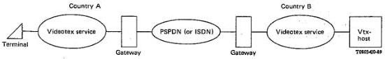
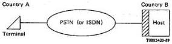
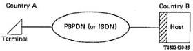
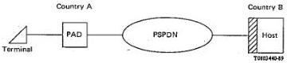
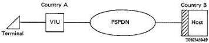
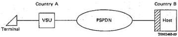
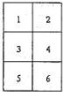
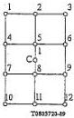
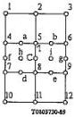
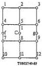

# Recommendation T.101 – International interworking for Videotex services

INTERNATIONAL TELECOMMUNICATION UNION

**CCITT**

THE INTERNATIONAL  
TELEGRAPH AND TELEPHONE  
CONSULTATIVE COMMITTEE

**T.101**

(11/1988)

SERIES T: TERMINAL EQUIPMENT AND PROTOCOLS FOR TELEMATIC SERVICES

**INTERNATIONAL INTERWORKING FOR VIDEOTEX SERVICES**

Reedition of CCITT Recommendation T.101 published in the Blue Book, Fascicle VII.5 (1988)

## Notes

1 CCITT Recommendation T.101 was published in Fascicle VII.5 of the *Blue Book*. This file is an extract from the *Blue Book*. While the presentation and layout of the text might be slightly different from the *Blue Book* version, the contents of the file are identical to the *Blue Book* version and copyright conditions remain unchanged (see below).
2 In this Recommendation, the expression “Administration” is used for conciseness to indicate both a telecommunication administration and a recognized operating agency.

## Preamble

*(Malaga-Torremolinos, 1984; amended at Melbourne, 1988)*

The CCITT,

considering

(a) that Videotex services have been implemented in different countries/regions using different data syntaxes referred to as data syntax I, data syntax II and data syntax III, which have an equal status;
(b) that the CCIR is studying standards for broadcast Teletext services for general reception and has expressed a view that it is desirable that terminal equipment compatibility should exist between broadcast Teletext systems for general reception and public network-based data base systems;
(c) that different countries/regions are entitled to use their existing systems;
(d) that interworking between Videotex services in different countries may require transcoding and/or conversion;
(e) that the interworking between Videotex services may be provided by using different types of networks such as the public switched telephone network (PSTN), packet switched public data network (PSPDN), circuit switched public data network (CSPDN), integrated services digital network (ISDN), etc.;
(f) that Videotex interworking protocols should offer a large degree of compatibility with protocols used in other telematic services,

recommends

that the following technical provisions be applied for international interworking for Videotex services.

*Note – Annexes B, C and D will not be published in Fascicle VII.5 (T-Series Recommendations) but will be issued as a separate publication.*

## 1 Purpose and scope of the Recommendation

### 1.1 Purpose

The purpose of this Recommendation is:

a) to facilitate the interworking of different Videotex services;
b) to identify parameters needed to communicate with Videotex terminals;
c) to provide technical recommendations desirable for potential interworking of other telematic services with Videotex services.

### 1.2 Scope

1.2.1 This Recommendation describes the characteristics of coded information that is exchanged between countries participating in the international interactive Videotex service.

1.2.2 Videotex systems are text communication systems having in addition the capability of a given level of pictorial representation and a repertoire of display attributes. The text and the pictures obtained are intended to be displayed using the current television (TV) raster standards of the different countries.

1.2.3 Different data syntaxes are offered as a choice for the Administrations to implement their national services. Substantial degrees of compatibility exist between these options, but some transcoding and/or conversion may be necessary to facilitate interworking.

1.2.4 For the purpose of the international service, different data syntaxes have been identified:

a) interworking data syntax;
b) data syntax I;
c) data syntax II;
d) data syntax III;
e) other syntaxes are for further study.

## 2 Interworking between Videotex services – General

2.1 It is the possibility of Administrations to decide in which network(s) the Videotex service(s) are to be provided.

2.2 Serveral possibilities are considered below:

2.2.1 Videotex service operated on the PSTN; the communication between a Videotex terminal and a Videotex host computer is established over the PSTN.

2.2.2 Videotex service operated on the PSTN and a public data network (PDN) (generally a PSPDN); the communication between a Videotex terminal connected to the PSTN and a Videotex host computer connected to a PDN is established via a Videotex access prior or a Videotex service center interfacing between both networks.

2.2.3 Other possibilities (CSPDN, ISDN, etc.) could also be considered.

2.3 International interworking between Videotex services via gateways and connected to any network (PSTN, PSPDN, CSPDN, ISDN, etc.) may be possible. Such interworking allows a Videotex terminal pertaining to a Videotex service to access a Videotex host computer pertaining to another Videotex service. International interworking between Videotex terminal in one country and a Videotex host in another country may also be possible. All international data exchange should comply with the specifications contained in this Recommendation. (See Recommendation F.300 for the service description).

## 3 International interworking of Videotex service

3.1 Videotex interworking allows a Videotex terminal in a given country to interact in real time with Videotex application located in a different country.

3.2 International interworking between Videotex services should use those functions that are defined in the data syntaxes implemented by the Administrations concerned: data syntaxes I, II and III defined in Annexes.

### 3.3 International interworking configurations

The various configurations for international interworking are defined in Recommendation F.300. The two major classes of interworking are defined below.

#### 3.3.1 Gateway to gateway interworking

This class of interworking involves communication between gateways located in each country and where all the data handling processes involved by the interworking are performed. The protocols and data syntaxes for this class of interworking are specified in § 4.

#### 3.3.2 Terminal to host interworking

This class of interworking involves communication between a terminal and a host located in different countries, either directly or through a conversion unit situated in the country where the terminal is located. Several cases have been identified. The protocols and data syntaxes for the various cases of this class of interworking are specified in § 5.

## 4 International interworking between gateways

The international interworking between gateways allows a Videotex terminal located in country A to access the Videotex services located in country B via a Videotex service of country A. The configuration for the international interworking between gateways is described by Figure 1/T.101:

*FIGURE 1/T.101*

### 4.1 International interworking at network level

4.1.1 International interworking between Videotex services should preferably take place between networks of the same type when these networks are provided by both Administrations involved (PSPDN, CSPDN, ISDN and leased lines).

4.1.2 The network service definition of open systems interconnection for CCITT application is defined in Recommendation X.213.

4.1.3 When the interworking takes place between Videotex services operated on different types of network, Recommendation X.75 should apply. Interworking with ISDN should be in accordance with Recommendation T.90.

### 4.2 Transport layer

The transport layer service of open systems interconnection for CCITT applications is defined in Recommendation X.214.

The transport protocol of open systems interconnection for CCITT applications is specified in Recommendation X.224.

Both classes 0 (corresponding to Recommendation T.70) and 2 may be used.

When class 0 is selected, then the protocol used is fully compatible with CCITT Recommendation T.70. When class 2 is selected, explicit flow control is to be used.

### 4.3 Session layer

This session layer service of open systems interconnection for CCITT applications is defined in Recommendation X.215. The session protocol of open systems interconnection for CCITT applications is specified in Recommendation X.225.

The use of the session protocols by Videotex interworking is defined in Recommendation T.523.

### 4.4 Presentation layer

#### 4.4.1 Presentation protocol

The presentation layer service of open systems interconnection for CCITT applications is defined in Recommendation X.216. Presentation protocol of open systems interconnection for CCITT applications is specified in Recommendation X.226.

The use of the presentation protocols by Videotex interworking is defined in Recommendation T.523.

#### 4.4.2 Coding of Videotex information

##### Coding of the contents of the display-data element

The Videotex content conforms to one of the several different data syntaxes. A data syntax, referred to as interworking data syntax, is described in Annex A. There are three existing data syntaxes, based on Recommendation T.50 and referred to as data syntax I, data syntax II and data syntax III. They are described in Annex B, Annex C and Annex D respectively. All the four annexes form an integral part of this Recommendation.

Different Administrations implementing a Videotex service may use one of the three above data syntaxes.

If two countries implement the same data syntax, then Videotex interworking between the two countries can use that same data syntax.

If one country implements one data syntax and another country implements a different data syntax, then Videotex interworking between the two countries can either:

i) use the interworking data syntax as the intermediary syntax. Transcoding/conversion into and from the interworking data syntax by the two countries will be required; or
ii) use one of the two data syntaxes with transcoding/conversion performed either at the originating or at the destination country.

For identification of the particular in-use data syntax (I or II or III), the designation and invocation of the “complete code” escape sequence may be used:

ESC 2/5 4/3 for data syntax I

ESC 2/5 4/4 for data syntax II

ESC 2/5 4/1 for data syntax III

The “complete code” environment will be terminated either by the sequence:

ESC 2/5 4/0

or by the designation and invocation of any other complete code.

### 4.5 Application layer

The association control service element (ACSE) of open systems interconnection for CCITT applications is defined in Recommendation X.217. The association control service element (ACSE) protocol of open systems interconnection for CCITT applications is specified in Recommendation X.227.

The application layer for Videotex interworking makes use of the following Recommendations:

- Recommendation T.400: Introduction to document architecture, transfer and manipulation
- Recommendation T.411: Open document architecture (ODA) and interchange format; Introduction and general principles
- Recommendation T.412: Open document architecture (ODA) and interchange format; Document structures
- Recommendation T.414: Open document architecture (ODA) and interchange format; Document profile

- Recommendation T.415: Open document architecture (ODA) and interchange format; Document interchange format (ODIF).

The application layer for Videotex interworking makes use of DTAM (document transfer and manipulation) service and protocol described in Recommendations T.431, T.432 and T.433.

The application layer for Videotex interworking makes use of operational structures described in Recommendation T.441.

Recommendation T.564 describes the Videotex interworking application profile and the gateway characteristics.

Recommendation T.504 describes the document application profile for Videotex interworking.

Recommendation T.523 describes the communication application profile for Videotex interworking.

Recommendation T.541 describes the operational application profile for Videotex interworking.

### 4.6 Relation with DTAM/ODA

The relations with the document architecture (Recommendation T.412) and the document interchange format (see Recommendation T.415) are expressed through the content architecture class attributes, and the content portion attributes are described in §§ 6 and 7.

## 5 International interworking between a terminal and a host

### 5.1 Access via PSTN or ISDN bearer service

*Access via PSTN or ISDN bearer service.*

In this configuration, the terminal uses the international PSTN (respectively the ISDN bearer services) to reach the host. On the international link, the following protocols should be used:

layers 1 to 3 via PSTN: the protocols defined by the host;

layers 1 to 3 via ISDN bearer service \( ^{2)} \) : Recommendation T.90;

layers 4 to 7: the protocols (if any) defined by the host located in country B;

data syntax: data syntax defined by the host;

dialogue/service functions: functions defined by the host.

### 5.2 Access via PSPDN or ISDN bearer service

*Access via PSPDN or ISDN bearer service.*

2) The protocols to be used in the ISDN Videotex teleservice are for further study.

In this configuration, the terminal uses the international PSPDN (respectively the ISDN bearer services) to reach the host. On the international link, the following protocols should be used:

layers 1 to 3 via PSPDN: Recommendation X.75;

layers 1 to 3 via ISDN bearer service2): Recommendation T.90;

layers 4 to 7: the protocols (if any) defined by the host located in country B;

data syntax: data syntax defined by the host;

dialogue/service functions: functions defined by the host.

### 5.3 Access via PSPDN/PAD

*Access via PSPDN/PAD.*

In this configuration, the terminal is connected to a PAD which gives access to the international PSPDN; both terminal and PAD are located in country A. The type of connection between the terminal and the PAD is a national matter (generally the PSTN or a leased line).

The host of country B may be accessed through the international PSPDN. The type of connection between the host and the national PSPDN is a national matter (generally a leased line).

On the international link, the following protocols should be used:

layers (1 to 3): Recommendation X.75;

above layer 3: Recommendation X.29 + Recommendation X.3;

data syntax: data syntax defined by the host located in country B;

dialogue/service functions: functions defined by the host.

### 5.4 Access via PSPDN through a VIU

*Access via PSPDN through a VIU.*

In this configuration, the terminal is connected to a VIU (Videotex interface unit) which gives access to the international PSPDN; both the terminal and the VIU are located in country A. The type of connection between the terminal and the VIU is a national matter (generally the PSTN or a leased line). The VIU performs two functions: it supports terminals and converts data syntaxes. It is up to the Administration of country A to decide how a VIU is implemented: it may be realized as a separate system or integrated with an existing equipment (PAD or Videotex access point for example).

The host country B may be accessed through the international PSPDN. The type of connection between the host and the national PSPDN is a national matter (generally a leased line).

On the international link, the following protocols should be used:

layers (1 to 3): Recommendation X.75;

above layer 3: Recommendation X.29 + Recommendation X.3. Alternatively Recommendation X.200 based protocols can be used. For this case, application profiles will need to be defined in T.500 Series of Recommendation. This is for further study.

data syntax: the data syntax defined by the host located in country B;

dialogue/service functions: those defined by the host.

### 5.5 Access via PSPDN through a VSU

*Access via PSPDN through a VSU.*

In this configuration, the terminal is connected to a VSU (Videotex service unit) which gives access to the international PSPDN; both the terminal and the VSU are located in country A. A VSU is a VIU which is also in charge of handling application charge and accounting. It is up to Administration of country A to decide to set up or not a VSU and to decide how a VSU, if any, is to be implemented: it may be realized as a separate system or integrated with an existing equipment (PAD, Videotex access point or Videotex service center).

The host in country B may be reached through the international PSPDN. The type of connection between the host and the national PSPDN is a national matter (generally a leased line).

On the international link, the following protocols should be used:

layers (1 to 3): Recommendation X.75,

above layer 3: Recommendation X.200 based protocols.

For this case applications profiles need to be defined in the T.500 Series. This is for further study.

Alternatively Recommendation X.29 plus Recommendation X.3 may be used. Extensions (Application rules) to Recommendation X.29 are necessary (see § 5.6);

data syntax: the data syntax defined by the host located in country B;

dialogue/service functions: those defined by the host.

### 5.6 Application rules for X.29 to support administrative functions

When an international communication is established via a VSU using Recommendation X.29, X.29 Videotex commands may be used to allow application charges (if any) to be passed from the host to the VSU.

Videotex commands should be sent in complete packet sequences with the Q bit set to one.

Videotex commands use a T(type)-L(ength)-V(alue) encoding. Fixed length commands do not require any length indicator. When used, length indicator is coded on two bytes and defines the total length in bytes of the V field.

In order to distinguish Videotex commands from PAD commands as currently defined by Recommendation X.29, the type value of a Videotex command is defined with the most significant bit set to one.

The following values are proposed to support the exchange of charging of international connections:

- Administration (99H) L2 charging (82H), L2 charging-parameter.

The charging parameter may take either the value service-operation (80H) or the value application-operation (81H); both values may be present within the same charging parameter:

- service-operation (80H) L1 service-parameter

- application-operation (81H) L1 application parameter.

The service parameter is time dependent and may correspond either to the amount period (80H) or to the duration of the period (81H) or to a combination of them:

- amount (80H) L1 value

- period (81H) L1 value.

The application parameter may be frame dependent (80H), time dependent (81H) or transaction dependent (82H) or a combination of them:

- frame (80H) L1 value

- time (81H) L1 charging-on-time-parameter

- transaction (82H) L1 value.

The charging-on-time parameter is organized as the service parameter.

L1 is an acronym for a length coded on one byte.

L2 is an acronym for a length indicator coded on two bytes.

The following depicts the coding mechanism:

Administration L2 Charging L2 (Service) (Application)

(99H) (82H)

(Service) ::= Service L1 (Amount L1 value) (Period L1 value)

(80H) (80H) (81H)

(Application) ::= Application L1 (Frame) (Time) (Transaction)

(81H)

(Frame) ::= Frame L1 value

(80H)

(Time) ::= Time L1 (Amount L1 value) (Period L1 value)

(81H) (80H) (81H)

(Transaction) ::= Transaction L1 value

(82H)

## 6 Content architecture class attributes

### 6.1 Content architecture class

The value of the attribute "content architecture class" of a basic component description that conforms to this Recommendation T.101 is a ASN1 object identifier with the value.

{ 0 1 8 16 3 }

### 6.2 Content type

The content architecture class attribute "content type" cannot be used to specify the content architecture class defined in this Recommendation.

## 7 Content portion attributes

### 7.1 Type of coding

Classification Defaultable

Applicability Videotex content architecture class

Structure ASN1 object identifier

Permissible values ASN1 object identifier

{ 0 1 8 16 4 } for "IDS encoding"

{ 0 1 8 16 5 } for "Data syntax I encoding"

{ 0 1 8 16 6 } for "Data syntax II encoding"

{ 0 1 8 16 7 } for "Data syntax III encoding"

Default value: "IDS encoding"

Definition: for Videotex interworking, the possible values correspond to the data syntaxes described in Annexes A, B, C, D of this Recommendation.

### 7.2 Specific coding attributes

These attributes provide additional information required for encoding/decoding the content information, as well as other information intrinsic to the content portion and type of coding.

#### 7.2.1 Subset

|  Classification | Defaultable  |
| --- | --- |
|  Applicability | Videotex content architecture classType of coding “IDS encoding”  |
|  Values | Integer [0, 1 to 5, 81 to 92]  |
|  Default value | 0  |
|  Definition | This attribute identifies the subset (rank or profile) used within the IDS. Value 0 is used when no subset is specified.  |

#### 7.2.2 Rank

|  Classification | Defaultable  |
| --- | --- |
|  Applicability | Videotex content architecture classType of coding “Data syntax I encoding”  |
|  Values | Integer [0, 1 to 5]  |
|  Default value | 0  |
|  Definition | This attribute identifies the rank used within Data syntax I. Value 0 is used when the rank is not specified.  |

#### 7.2.3 Profile

|  Classification | Defaultable  |
| --- | --- |
|  Applicability | Videotex content architecture classType of encoding “Data Syntax II encoding”  |
|  Values | Integer [0, 81 to 92]  |
|  Default value | 0  |
|  Definition | This attribute identifies the profile used within Data Syntax II. Value 0 is used when the profile is not specified.  |

## 8 Formal definition of Videotex dependent data type

### 8.1 Introduction

This section contains formal definition in ASN.1 notation (defined in Recommendation X.208) of the data type corresponding to attributes applicable to Videotex.

This data type is:

– the data type to represent specific coding attributes.

### 8.2 Representation of specific coding attributes

Videotex-coding-attributes ::= CHOICE {
    subset [0] IMPLICIT subset OPTIONAL
    rank [1] IMPLICIT rank OPTIONAL
    profile [2] IMPLICIT profile OPTIONAL }

Subset a) ::= INTEGER { undefined (0)
    rank 1. (1)
    rank 2 (2)
    rank 3 (3)
    rank 4 (4)
    rank 5 (5)
    profile 1 (81)
    profile 2 (82)
    profile 3 (83)
    profile 4 (84)
    profile X1-1 (85) b)
    profile X1-2 (86)
    profile X1-3 (87)
    profile X1-4 (88)
    profile X2-1 (89)
    profile X2-2 (90)
    profile X2-3 (91)
    profile X2-4 (92) }

Rank ::= INTEGER { undefined (0)
    rank 1 (1)
    rank 2 (2)
    rank 3 (3)
    rank 4 (4)
    rank 5 (5) }

Profile ::= INTEGER { undefined (0)
    profile 1 (81)
    profile 2 (82)
    profile 3 (83)
    profile 4 (84)
    profile X1-1 (85)
    profile X1-2 (86)
    profile X1-3 (87)
    profile X1-4 (88)
    profile X2-1 (89)
    profile X2-2 (90)
    profile X2-3 (91)
    profile X2-4 (92) }

a) Use of subset IDS is for further study.
b) Profil Xi-j: geometric profile Xi together with alphamosaic profile j.

### 8.3 Summary of ASN.1 object identifiers (see Table 1/T.101)

TABLE 1/T.101

|  Videotex document application profile | 0 | 1 | 8 | 16 | 0  |
| --- | --- | --- | --- | --- | --- |
|  DM1 communication application profile | 0 | 1 | 8 | 16 | 1  |
|  Videotex operational application profile | 0 | 1 | 8 | 16 | 2  |
|  T.101 Content architecture class | 0 | 1 | 8 | 16 | 3  |
|  Type of coding |  |  |  |  |   |
|  IDS | 0 | 1 | 8 | 16 | 4  |
|  Data syntax I | 0 | 1 | 8 | 16 | 5  |
|  Data syntax II | 0 | 1 | 8 | 16 | 6  |
|  Data syntax III | 0 | 1 | 8 | 16 | 7  |
|  Application context | 0 | 1 | 8 | 16 | 8  |

## Annex A – Interworking data syntax (IDS) described in ASN.1 (Recommendation X.208)

*(To Recommendation T.101)*

### Preamble

For Videotex interchange:

a) If two countries implement the same data syntax, then interworking can use the same data syntax (DS I, or DS II, or DS III).
b) If two countries implement two different data syntaxes, then interworking can use either:

i) the interworking data syntax (IDS) as defined herein, or
ii) any one of the three data syntaxes and convert directly between DS I/DS II/DS III. The data syntaxes may be identified by the ESC 2/5 F mechanism described in § 4.4.2 of the main body of Recommendation T.101.

If the IDS is used, then the Administration in which country the data base is located will be responsible to convert into the IDS and the Administration in which country the user terminal is located will be responsible to convert from the IDS.

If the direct conversion method is used instead of using the IDS, the IDS would serve as a technical guide in designing the conversion process.

The IDS is not intended to be used in terminal to host communications.

### A.1 Videotex page

A Videotex page in the interworking data syntax (IDS) is a sequence of presentation commands expressed in a manner independent of any of the terminal data syntaxes. This formulation of the presentation information which composes a Videotex page is intended to aid interworking between basically different terminal data syntaxes. It does this by isolating the unique and common elements between each of the data syntaxes. The interworking data syntax is not

meant to be used as a terminal data syntax in its own right. One encoding of the interworking data syntax is that defined in Recommendation X.209. Other types of encoding are for further study.

Videotex-Page ::= SEQUENCE OF Presentation-Commands

Presentation-Commands ::= SEQUENCE { State-Vector, Function-&-Parameters }

### A.2 State vector

A state victor is defined along with each presentation command to establish the relationship of that presentation command to each other presentation command. Although the information explicitly contained in the state vector is also implicitly contained within each presentation command, it would require the conversion apparatus to fully understand each of the three terminal oriented data syntaxes to uncover this information. Therefore a state vector is included with each presentation command in which a global state is affected or in which a boundary value is encountered, so that the conversion process might operate on a general level.

State-Vector

::= CHOICE { [1] Vector-Definition
[2] Reset-State-Vector,
[3] NULL }

#### A.2.1 Vector definition

Vector-Definition

::= SEQUENCE { Global-State-Affected-Indicator, Terminal-Model-Precedence, Boundary-Condition-Definition }

-- Only that information which changes between state vectors need be communicated. If there is no change in a particular component of the state vector, then that component need not be communicated. This means that the state vector is not communicated often and does not introduce significant overhead.

##### A.2.1.1 Global state affected indicator

The global state affected indicator carries information relating to the global states of the presentation data syntax. Global state variables are variables representing those states of the presentation data syntax which are established by presentation commands and which carry on to affect the results of subsequent presentation commands. By declaring the global state variables explicitly, it is not necessary for the conversion process to understand the interrelationship between presentation commands. This means that the conversion process does not have to simulate a terminal of the source data syntax in order to handle the conversion of its elements.

The global state affected indicator does not carry information about the value to which a global state has been set. That information is carried within the 'Function and Parameter' section of the IDS. The indicator merely identifies which states have changed. This is of great importance in situations where it is necessary for the conversion process to sort the presentation commands to account for differences in the terminal model used in the source and destination of the interchange. If the order of presentation commands is altered, the conversion process must establish the appropriate global variables before each command in the altered sequence. By referring to the global state affected indicator, the conversion process can determine which global states must be re-established. For example, if a sorting of presentation commands is necessary to convert from a multi-plane to a single plane terminal mode, and colour control commands have been used, then the global state affected indicator will indicate that the appropriate colour state must be established ahead of each portion of the sorted data.

In some of the terminal data syntaxes attributes have global effects while in other data syntaxes the effects are localized according to the particular display primitive type. For example, in Data Syntax III a colour command remains in effect for all primitives, until the next colour command, whereas in Data Syntax II there are various colour states which apply independently to different primitives, such as LINE colour, FILLED AREA colour, etc. The global state indicator carries a reference to a number of independent 'attribute state vectors' which define the attribute context. For those data syntaxes which make use of only global parameters, only one 'attribute state vector' need be referenced. For other data syntaxes which make use of multiple localized attributes, several 'attribute state vectors' may be referenced.

Global-State-Affected-Indicator ::= SEQUENCE {
    attribute-state-vector-reference
    attribute-affected-indicators
    INTEGER,
    SEQUENCE OF {
    INTEGER {
    current-text-position (1),
    current-foreground-colour (2),
    current-auxiliary-colour (3),
    lining-state (4),
    flash-blink-state (5),
    basic-char-size-state (6),
    conceal-state (7),
    char-invert-box-state (8),
    char-marking-state (9),
    screen-protection-state (10),
    display-control-state (11),
    device-control-state (12),
    cursor-control-state (13),
    geometric-control-1-state (14),
    geometric-control-2-state (15),
    wait-state (16),
    general-text-state (17),
    p-text-state (18),
    geometric-text-state (19),
    DRCS-definition-state (20),
    macro-definition-state (21),
    texture-pattern-state (22),
    music-part-memory-state (23),
    animation-configuration-state (24),
    workstation-configuration-state (25)
    }

-- The Global State Affected Indicator consists of a set of indicator flags which identify particular global states or in some cases categories of global states which may be altered by presentation and control commands. Some states, such as all the forms of Flashing and Blink processes, are grouped together for simplicity.

##### A.2.1.2 Terminal model

The terminal model differs significantly between the various terminal data syntaxes. For the presentation of static images this manifests itself in the manner by which presentation commands overlay each other. A picture developed for a multi-plane terminal model can be represented on a terminal using a single-plane terminal model or a multi-plane terminal model with a different order of precedence for the planes, by sorting the presentation commands so that they build up an equivalent picture. The sorting operation is necessary since otherwise the buildup order might conflict with the precedence order in the new environment. The terminal model precedence indicator is simply a numeric indicator of the overlay precedence for presentation commands intended by the source terminal data syntax. The conversion process is independent of the terminal model or a particular data syntax and simply sorts presentation commands based on this indicator. Note that certain commands such as resets which have an effect in more than one plane of a terminal model might have to be repeated in different parts of the presentation sequence after the sort. The terminal model precedence indicator consists of a sequence of numbers to indicate the effect of a command across the terminal model.

Terminal-Model-Precedence ::= INTEGER

-- The terminal model precedence indicator is a number which indicates the order of precedence of the identified presentation information. The number '1' indicates that the identified information is of highest precedence and should be placed in front of any other information currently displayed. The number '2' indicates that the identified information is of the second level of precedence and should be placed behind any level '1' information but ahead of any other level information. For example, Data Syntax II Text and Mosaic data is level '1' information, whereas geometric information may be level '1' or level '2'. For Data Syntax III, all of the information is at level '1' since the precedence order by which it is displayed is determined only by the order in which the information is communicated. For Data Syntax I, the order is not fixed since certain 'planes' of memory may be changed in precedence by the ASSIGN FRAME command.

-- The value '0' has special meaning for the Terminal Model Precedence Indicator. It indicates that the identified information requires special interpretation. Such special information includes partial reset commands which affect more than one layer of the terminal model, as well as commands having a time dependent effect, specifically WAIT, the BEL character, and REVEAL.

##### A.2.1.3 Boundary conditions

Boundary condition variables represent the limits within which the particular presentation command has been defined. Each presentation command takes on its normal interpretation only within a certain range of values. For example, the number of characters which may be displayed on the screen varies between each of the source terminal data syntaxes, and therefore the operation of presenting a single character cannot be considered to be the same in each terminal data syntax. To factor out the commonality, the boundary condition of encountering the edge of the display area is identified separately from the presentation of a character. This aids conversion since it means that the boundary conditions applying to each presentation command are given explicitly. The conversion process is therefore independent of the internal boundary conditions within each of the source terminal data syntaxes.

Boundary-Condition-Definition ::= SET { [1] Screen-Dimensions,
    [2] Colour-Map-Limit,
    [3] Presentation-Sub-Area,
    [4] Char-Mode-Constraints,
    [5] Coordinate-Limit-Polygon,
    [6] Coordinate-Limit-Spline,
    [7] Presentation-Resolution,
    [8] Macro-Seg-Memory-Limit,
    [9] DRCS-Memory-Limit,
    [10] Direct-Colours-Limit }

###### A.2.1.3.1 Screen dimensions

Screen-Dimensions ::= SEQUENCE { INTEGER, INTEGER }

-- Screen-Dimensions indicates the aspect ratio of the display screen expressed in terms of a fraction of the Y and a fraction of the X unit dimensions, where the INTEGER number represents a binary fraction with an implied binary point before the most significant bit. Note that a dimension of  \( (1,1) \)  implies no geometric constraint. A character mode service could use  \( (1,1) \)  to imply no constraint.

###### A.2.1.3.2 Colour map limit

Colour-Map-Limit ::= INTEGER

-- The colour map limit indicates the maximum number of colours which may be stored in a single colour map, or the combined total for multiple colour maps, and represents the maximum number of colour states which may be encountered in a particular presentation page. In the case where no colour map is used, the integer specifies the number of fixed colours.

###### A.2.1.3.3 Presentation sub-area

Presentation-Sub-Area ::= SEQUENCE { Abs-Coord, Rel-Coord, INTEGER, INTEGER }

-- The two coordinates give the boundary dimensions of a sub-area of the display screen both in terms of the dimensions of the sub-area and the number of characters per row and the number of columns. The absolute coordinate specifies the origin of the sub-area, the relative coordinate the size of the sub-area and the INTEGER coordinates the limit on characters per row and rows respectively.

###### A.2.1.3.4 Char mode constraints

Char-Mode-Constraints ::= SEQUENCE { INTEGER, INTEGER }

-- The two parameters give the limit to the number of characters per row and the number of rows of text which may be presented on the display screen; that is, the boundaries at which character (or word) wrap and scroll will occur.

###### A.2.1.3.5 Coordinate limit polygon

Coordinate-Limit-Polygon ::= INTEGER

-- The polygon coordinate limit specifies the maximum number of coordinates which may be specified for a filled polygon.

###### A.2.1.3.6 Coordinate limit spline

Coordinate-Limit-Spline ::= INTEGER

-- The spline coordinate limit specifies the maximum number of coordinates which may be specified.

###### A.2.1.3.7 Presentation resolution

Presentation-Resolution ::= SEQUENCE { INTEGER, INTEGER }

-- The presentation resolution specifies the nominal resolution of the display screen which was used by the information source.

###### A.2.1.3.8 Macro seg memory limit

Macro-Seg-Memory-Limit ::= INTEGER

-- The macro memory limit specifies the upper bound on the amount of memory which is available for the storage of Macros or Segments. The INTEGER parameter represents available memory expressed in bytes.

###### A.2.1.3.9 DRCS memory limit

DRCS-Memory-Limit ::= INTEGER

-- The DRCS memory limit specifies the upper bound on the amount of memory which is available for the storage of DRCS. The INTEGER parameter represents available memory expressed in bytes.

##### A.2.1.4 Data syntax identifier (SID)

SID ::= IMPLICIT INTEGER { data-syntax- I (1), data-syntax- II (2), data-syntax-III (3) }

-- SID is an identifier which is referenced in a number of primitive commands and which identifies the source data syntax of the command.

#### A.2.2 Reset state vector

Reset-State-Vector ::= SEQUENCE { SID, Vector-Definition }

-- The Reset State Vector command is used to establish the initial state for the Interworking Data Syntax. The default state may be selected from the table corresponding to the source terminal data syntax (or profile) given in Appendix II. Alternate parameters may be specified by use of explicit state vector and function and parameter definitions.

#### A.2.3 NULL

NULL implies that the state vector is unchanged from the previous presentation command.

### A.3 Functions and parameters

The functions and parameters which make up the presentation commands are grouped into categories which depend upon their commonality between the various terminal data syntaxes. Those functions which are compatible, such as the basic repertoire of alphanumeric characters defined in Recommendation T.51, define separate groups. Those functions which are unique, such as certain specific special characters, also establish separate groups so that they may be converted or otherwise handled in a special manner. Functions such as DRCS and graphics drawing commands, which differ in fundamental ways between the various terminal data syntaxes, are organized so that those underlying capabilities which are common may be exploited in the necessary conversion process.

Functions-&-Parameters ::= CHOICE { [0] Alpha-Char-String,
[1] Special-Char-String,
[2] Kana-Char-String,
[3] Kanji-Char-String,
[4] Block-Mosaic-String,
[5] Smooth-Mosaic-String,
[6] Special-Mosaic-String,
[7] Format-Effector-C0-Chars,
[8] Special-Format-C0-Characters,
[9] General-Control-Characters,
[10] Geometric-String,
[11] Animation-Control-String,
[12] Segment-Control-String,
[13] Colour-Control-String,
[14] Text-Control-String,
[15] Photo-Graphic-String-Syntetic-Image,
[16] Photo-Graphic-String-Natural-Image,
[17] MACRO-String,
[18] DRCS-String,
[19] Fill Pattern-Control-String,
[20] Music-String,
[21] Tele-Software-String,
[22] Audio-Data-String,
[23] Greek-Char-String }

The first six categories of functions and the last one are various text or mosaic characters. None of the terminal data syntaxes defined in Recommendation T.101 encompasses all of these characters. There are different unique characters in each of the terminal data syntaxes. However, a large portion of the repertoire is common between the different terminal data syntaxes, although the characters may be coded differently. Since coding is irrelevant here, and the use of particular tables could in fact cause serious confusion, characters extracted from the different character repertoires will be distinguished by the identifier name codes for each character as defined in Recommendation T.51. Since all of the terminal-oriented data syntaxes in Recommendation T.101 do not explicitly make use of these name codes in the body of the Recommendation, the entire character repertoire, together with the name codes for each character are included here as an appendix.

#### A.3.0 Alpha char string

Alpha-Char-String ::= GRAPHICSTRING

-- Characters (LA01 to LZ30, ND01 to ND09 and ND10, SC01 to SC05, SP01 to SP22, SA01 to SA07, NS01 to NS03, NF01 to NF21, SM01 to SM44 and SM47 to SM49, and SD11 to SD43) taken from Repertoire 1 which are the characters from the primary and supplementary character sets of Recommendation T.51 together with the SPACE character (SP01) and DELETE character (SM34).
-- The coding of characters within an Alpha Character String will be taken from the IRV primary character code table (ISO Registration Number 2 under ISO 2375) and the secondary code table for use with IRV from ISO 6937/2 (ISO Registration Number 90).
-- Note – The coding for the character $ “Dollar Sign” (SC02) will be taken from the supplementary character set.
-- Note – The coding for the character ## “number sign” (SM01) will be taken from the primary character set.
-- Note – The coding for the character “general currency sign” (SC01) will be taken from the primary character set.

#### A.3.1 Special char string

Special-Char-String ::= INTEGER { non-spacing-vector-overbar (1), non-spacing-slant (2), left-vertical-bar-jointive (3), right-vertical-bar-jointive (4) }

-- Non-Spacing-Vector-Overbar is a character (SM50) from Repertoire 2.
-- Non-Spacing-Slant is a character (SM51) from Repertoire 2.
-- Left-Vertical-Bar-Jointive is a character (SM45) from Repertoire 2.
-- Right-Vertical-Bar-Jointive is a character (SM46) from Repertoire 2.

#### A.3.2 Kana char string

Kana-Char-String ::= GRAPHICSTRING

-- Characters (JA01 to JA63) taken from Repertoire 3.

-- The coding of characters within a Kana Character String will be taken from the Kana character code table (ISO Registration Number 56 under ISO 2375).

#### A.3.3 Kanji char string

Kanji-Char-String ::= GRAPHICSTRING

-- Characters (JK01 to JK2980, HK01 to HK83, and JS01 to JS366) from Repertoire 4.

-- The coding of characters within a Kanji Character String will be taken from the two byte Kanji character code table (ISO Registration Number 87 under ISO 2375).

Note – The characters in this two byte code table which overlap other defined videotex character set are not considered to be part of Repertoire 4, and therefore are communicated as characters from Repertoire 1, Repertoire 3 or Repertoire 8 where appropriate. Specifically this involves the Latin alphanumeric characters (LA01 to LZ30), and non-alphabetic characters (ND01 to ND09 and ND00, SC01 to SC05, SP01, SP02, SP04 to SP15, SP17 to SP22, SA01 to SA07, NS02 to NS03, NF01 to NF05, SM01 to SM14, SM19, SM24 to SM34, SM38, SM43, SM44, SM47, SM48, and SD11 to SD43) from Repertoire 1, the Kana characters (JA01 to JA63) from Repertoire 3, the drawing characters (DG01 to DG04, DG13 to DG24, and DG32) from Repertoire 8, which have an alternate coding within the two byte code, but which are included in other Repertoires.

#### A.3.4 Block mosaic string

Block-Mosaic-String ::= GRAPHICSTRING

-- Block Mosaic characters (MG01 to MG63) taken from Repertoire 7.

-- The coding of characters for the Block Mosaic sub-Repertoire is identical between the three terminal data syntaxes defined in CCITT Recommendation T.101. The set is registered with ISO Number 129 under ISO 2375.

#### A.3.5 Smooth mosaic string

Smooth-Mosaic-String ::= CHOICE { [1] Sub-Cell-Aligned-Smooth-Mosaics, [2] General-Smooth-Mosaics }

##### A.3.5.1 Sub-call aligned smooth mosaics

Sub-Cell-Aligned-Smooth-Mosaics ::= GRAPHICSTRING

-- Smooth Mosaic characters (SG01 to SG56) taken from Repertoire 8.

-- The coding of characters for the Sub Cell Aligned Smooth Mosaic sub-Repertoire is identical between the two terminal data syntaxes defined in Recommendation T.101 which makes available these characters. These are registered as Numbers 71 and 72 under ISO 2375.

##### A.3.5.2 General smooth mosaics

General-Smooth-Mosaics ::= GRAPHICSTRING

-- Smooth Mosaic characters (MS01 to MS28) taken from Repertoire 8.
-- The coding of characters for the General Smooth Mosaic sub-Repertoire is taken from the terminal data syntax in CCITT Recommendation T.101 which makes available these characters. This code table is registered under ISO 2375 as Registration Number 137.

#### A.3.6 Special mosaic string

Special-Mosaic-String ::= CHOICE { [1] Drawing-Characters, [2] Other-Special-Mosaics }

##### A.3.6.1 Drawing characters

Drawing-Characters ::= GRAPHICSTRING

-- Drawing characters (DG01 to DG50) taken from Repertoire 10.

##### A.3.6.2 Other special mosaics

|  Other-Special-Mosaics ::= INTEGER { open-left-half-oval | (1),  |
| --- | --- |
|  open-right-half-oval | (2),  |
|  filled-left-half-oval | (3),  |
|  filled-right-half-oval | (4),  |
|  reverse-left-half-oval | (5),  |
|  reverse-right-half-oval | (6) }  |

-- Open-Left-Half-Oval is a Special Mosaic characters (MS13) from Repertoire 11.
-- Open-Right-Half-Oval is a Special Mosaic characters (MS14) from Repertoire 11.
-- Filled-Left-Half-Oval is a Special Mosaic characters (MS30) from Repertoire 11.
-- Filled-Right-Half-Oval is a Special Mosaic characters (MS29) from Repertoire 11.
-- Reverse-Left-Half-Oval is a Special Mosaic characters (MS15) from Repertoire 11.
-- Reverse-Right-Half-Oval is a Special Mosaic characters (MS31) from Repertoire 11.

The function and parameter categories 7 and 8 contain basic control characters which are used to control the state of presentation of alphanumeric text and mosaic characters (including DRCS). These control characters can be broken down into two categories, format effector control characters and special format control characters. The format effector control characters have basically the same meaning in each of the three terminal data syntaxes. The only difference is how the functions invoked by these control characters interact with the terminal model and display environment of the various terminal data syntaxes; for example, they may apply to only one plane of display in a multi-plane terminal model or to all planes of display. The coding of the format effector characters is also compatible between the terminal data syntaxes.

The special format control characters in category 8, in general have a special meaning which is not shared by all of the data syntaxes. These functions must be specially converted during interworking, even between data syntaxes which appear to assign the same meaning to a particular control function. This is because the terminal model and display environment of the various terminal data syntaxes are quite different. The Bell character is included in this category because it requires special handling due to the timing of presentation. If a sorting of presentation commands is required in the interworking conversion process to accommodate differences in a terminal model, such as the handling of data intended for a multi-plane terminal on a single plane terminal, then the time of presentation of the Bell character must be altered.

#### A.3.7 Format effector C0-char

Format-Effector-C0-Char ::= GRAPHICSTRING

|  -- | Format Effector C0 characters (APB, APF, APD, APU, CS, APR, APH) taken from CCITT Recommendation T.101 DS I, II, III; (C0 code table positions 0/8 to 0/13 and 1/14 respectively)  |   |
| --- | --- | --- |
|  -- | APB | - Active Position Back – analogous to ISO 646 (\( FE_{0} \) BS)  |
|  -- | APF | - Active Position Forward – (\( FE_{1} \) HT)  |
|  -- | APD | - Active Position Down – (\( FE_{2} \) LF)  |
|  -- | APU | - Active Position Up – (\( FE_{3} \) VT)  |
|  -- | CS | - Clear Screen – (\( FE_{4} \) FF)  |
|  -- | APR | - Active Position Return – (\( FE_{5} \) CR)  |
|  -- | APH | - Active Position Home  |

#### A.3.8 Special format-C0-char

|  Special-Format-C0-Char ::= CHOICE { [1] Bell-Character, [2] Position-Set, [3] Cancel-Macro, [4] Non-Selective-Reset, [5] Cancel-Row }  |
| --- |

##### A.3.8.1 Bell character

Bell-Character ::= GRAPHICSTRING

-- Special C0 character (BEL) from Recommendation T.101 DS I, III (C0 set positions 0/7).

-- Note - This function provides an audio signal to the user of the terminal device. This function is not available in all of the terminal data syntaxes, and cannot be simulated in a reasonable manner.

##### A.3.8.2 Position set

Position-set ::= SEQUENCE { INTEGER, INTEGER }

-- This function provides the equivalent capability of both the Active Position Set command (APS) from Recommendation T.101 DS I, III and the positioning portion of the Active Position Address command (APA) from DS II.

-- The parameters to establish the new screen active position as a count of “current size” character cells from the “home” upper left position.

##### A.3.8.3 Cancel macro

Cancel-Macro ::= GRAPHICSTRING

-- Special C0 character [CAN (Macro)] from Recommendation T.101 DS I, III (C0 set positions 1/8).

##### A.3.8.4 Non-selective reset

Non-Selective-Reset ::= SEQUENCE { [1] NSR-Code, [2] Position-Set OPTIONAL }

NSR-Code ::= GRAPHICSTRING

-- Special C0 character (NSR) from Recommendation T.101 DS I, III (C0 set positions 0/15). The positioning parameter sequence is optional.

##### A.3.8.5 Cancel row

Cancel-Row ::= GRAPHICSTRING

-- Special C0 characters [CAN (Row)] from Recommendation T.101 DS II (C0 set positions 1/8).

#### A.3.9 General control characters

The function and parameter category 9 contains general control functions which are used to control the general state of presentation. The meaning of these control characters is very dependent upon the terminal model and display environment of the terminal data syntax in which they are used. Transcoding and conversion is required for each of the functions invoked by these control characters. These control characters have been organized into a number of sub categories which correspond to the area of functionality being addressed.

General-Control-Characters ::= CHOICE {[1] Other-Format-Effectors,
[2] Lining-Control,
[3] Character-Size-Control,
[4] Flash-Control,
[5] Conceal-Control,
[6] Invert-Control,
[7] Window/Box-Control,
[8] Marking-Control,
[9] Protection-Control,
[10] Display-Control,
[11] Device-Control,
[12] Cursor-Control,
[13] Reset-Control }

This subsection addresses the additional format effector characters which must be specially handled in conversion between the various data syntaxes.

A repeat function is available in all of the data syntaxes; however, the side effects of the function differ between the data syntaxes. Terminal data syntax DS I provides a function which allows the immediately preceding G-set character, or pair of characters in the case of a composite coded graphic character and non spacing accent character, to be repeated. Both terminal data syntaxes DS II and DS III restrict the character to a graphic character (i.e. an alphanumeric text character or mosaic character from the repertoire, or a DRCS character). These limitations must be considered in establishing the conversion process. Here the repeat function will be considered to repeat any preceding G-set character and testing must be performed in the interpretation of the IDS to eliminate any erroneous cases.

The functions hold mosaic and release mosaic occur in only one data syntax and require special interpretation since analogous functions do not exist directly in any of the terminal data syntaxes.

##### A.3.9.1 Other format effectors

Other-Format-Effectors ::= CHOICE { [1] Repeat-N,
[2] Repeat-EOL,
[3] Hold-Mosaic,
[4] Release-Mosaic }

###### A.3.9.1.1 Repeat-N

Repeat-N ::= SEQUENCE { SID, RPT-Par }

-- Special character indicating the REPEAT Function from Recommendation T.101 DS I [C1 set position 5/8, (9/8)], DS II [C0 set position 1/2), DS III [C1 set position 4/6, (8/6)].

RPT-Par ::= INTEGER

-- Count of repetitions.

###### A.3.9.1.2 Hold mosaic

Repeat-EOL ::= SID

-- Special character indicating the REPEAT TO End Of Line Function from Recommendation T.101 DS I [C1 set position 5/8, (9/8)] with parameter 0), DS III [C1 set position 4/7, (8/7)].

###### A.3.9.1.3 Hold mosaic

Hold-Mosaic ::= SID

-- Special character indicating the Hold-Mosaic function (HMS) from Recommendation T.101 DS II [C1 set (serial) position 5/14, (9/14)].

###### A.3.9.1.4 Release mosaic

Release-Mosaic ::= SID

-- Special character indicating the Release-Mosaic (RMS) function from Recommendation T.101 DS II [C1 set (serial) position 5/15, (9/15)].

##### A.3.9.2 Lining control

The lining function permits an underline to be displayed as part of the graphics character shape for alphanumeric characters from Repertoire 1. This underline is considered as a part of the character cell image before any rotation operation is applied. In the special case of the display of mosaic characters, the lining function establishes a “separated mosaic” font. The capability to handle separated mosaics is available in all of the three terminal data syntaxes; however, the level of capability differs. In terminal data syntax DS II, only one size of separation for separated mosaics is directly available. In terminal data syntaxes DS I and DS III the amount of separation is defined by the line width (drawing point size) parameter (logical pel) in the geometric drawing commands. Basic separated mosaics may be converted directly between each of the data syntaxes. Since the variation in separation cannot be achieved directly in one of the terminal data syntax it must be simulated by the use of DRCS. Of course simulation of separated mosaics in this manner would consume limited DRCS resources and therefore must consider the boundary condition specification.

Lining-Control ::= INTEGER { start-lining (1), stop-lining (2) }

-- Start-Lining is a function from Recommendation T.101 DS I and II [C1 set position 5/10, (9/10)] and (UNDERLINE START) from DS III [C1 set position 5/9, (9/9)].

-- Stop-Lining is a function from Recommendation T.101 DS I and II [C1 set position 5/9, (9/9)] and (UNDERLINE STOP) from DS III [C1 set position 5/10, (9/10)].

##### A.3.9.3 Character size control

The various terminal data syntaxes provide the capability to establish a wide range of character sizes for basic alphanumeric text, mosaics and DRCS characters. In addition, terminal data syntax DS II provides the capability to separately define completely variable character sizes for text defined as part of the geometric part of DS II. Since this “geometric text” data is used only for the annotation of geometric pictures in the optional geometric part of DS II, it is not necessary to consider it as part of the translation of basic alphanumeric text. DS III, on the other hand, provides only one form of text. Therefore it is necessary to handle operations such as dynamic text sizes and rotations as part of the conversion between data syntaxes.

Since the capability to scale text, mosaics and DRCS to arbitrary sizes is not available in all data syntaxes, there will be some degradation of the displayed image when converted from one data syntax to another. It is undesirable to lose any textual information in the conversion process, since this textual information might be of principal importance to the understanding of the videotex page. Also it is not desirable to arbitrarily wrap or scroll textual information since this would corrupt mosaic information. In certain situations the conversion process must automatically choose a smaller size of character cell in order to avoid the loss of information. The commands for character size control indicate the size of the character cell intended in the terminal data syntax used to represent the source data. The resultant character cell in the converted form may be smaller depending upon the capabilities of the target terminal data syntax and the boundary condition in effect.

Two separate functions exist to define characters of double height. This is due to a difference in the definition of the relationship of the double height character cell to the location of the baseline in part of one of the source data syntaxes. Since data syntax DS II provides a capability to define double height characters which both extend up a double height above the baseline, and which extend down below the baseline, two functions are provided here. Since the other two terminal data syntaxes provide only a single double height capability, a conversion involving a repositioning of the baseline is required.

Character-Size-Control ::= CHOICE { [1] Normal-Size,
[2] Double-Size-Up,
[3] Double-Width,
[4] Double-Height-Up,
[5] Double-Height-Down,
[6] Small-Size,
[7] Medium-Size,
[8] Double-Size-Down }

###### A.3.9.3.1 Normal size

Normal-Size ::= SID

-- A function from Recommendation T.101 DS I [C1 set position 4/10, (8/10)], from DS II [C1 set position 4/12, (8/12)] and (NORMAL TEXT) from DS III [C1 set position 4/12, (8/12)].
-- Note – The “Normal-Size” of text is defined by the boundary conditions of each of the terminal data syntaxes and is not the same in any of the terminal data syntaxes. Although the width of the “normal” character cell size is 1/40 of the screen width in DS II and DS III, the screen width is not exactly the same. The “normal” character cell size in DS I is by default 1/31 of the width; however, it may be redefined by the DS I P-TEXT command. Similarly the vertical height of a character cell differs between the various terminal data syntaxes. This command indicates that the source terminal data syntax intended to use “normal” size implicit in that terminal data syntax. This will require conversion to the normal size implicit in that resultant terminal data syntax. The value of “normal size” should be communicated explicitly in the state vector associated with this command.

###### A.3.9.3.2 Double size up

Double-Size-Up ::= SID

-- A function from Recommendation T.101 DS II [C1 set position 4/15, (8/15)], (DOUBLE SIZE) from DS III [C1 set position 4/15, (8/15)], and (DBS 4/5) from DS I [C1 set position 4/11, (8/11) followed by parameter 4/5].
-- Note – The character cell width and height are twice that defined by the control command “Normal-Size”.

###### A.3.9.3.3 Double width

Double-Width ::= SID

-- A function from Recommendation T.101 DS II [C1 set position 4/14, (8/14)], and (DBW 4/4) from DS I [C1 set position 4/11, (8/11) followed by parameter 4/4].
-- Note – The character cell width is twice that defined by the control command “Normal-Size”.

###### A.3.9.3.4 Double height up

Double-Height-Up ::= SID

-- A function from Recommendation T.101 DS II [C1 set position 4/13, (8/13)], (DOUBLE HEIGHT) from DS III [C1 set position 4/13, (8/13)], and (DBH 4/1) from DS I [C1 set position 4/11, (8/11) followed by parameter 4/1].
-- Note – The character cell height is twice that defined by the control command “Normal-Size” and extends up two character cell heights above the baseline.

###### A.3.9.3.5 Double height down

Double-Height-Down ::= SID

-- A function from Recommendation T.101 DS II [C1 set position 4/13, (8/13)].
-- Note – The character cell height is twice that defined by the control command “Normal-Size” and the double height character extends one cell height above the baseline and one cell height below the baseline.

###### A.3.9.3.6 Small size

Small-Size ::= SID

-- A function from Recommendation T.101 DS I [C1 set position 4/8, (8/8)] and (SMALL TEXT) from DS III [C1 set position 4/10, (8/10)].
-- Note – The character cell width and height are half that defined by the control command “Normal-Size”.

###### A.3.9.3.7 Medium size

Medium-Size ::= SID

-- A function from Recommendation T.101 DS I [C1 set position 4/9, (8/9)] and (MEDIUM TEXT) from DS III [C1 set position 4/11, (8/11)].
-- Note – The character cell size is defined to be an intermediate size. This intermediate size is defined by the boundary conditions of each of the source data syntaxes which use this control function. In data originating from data syntax DS III, medium size is defined to be 1/32 the normalized width of the display area and 3/64 the height of the normalized unit area. In data from data syntax DS I, medium text becomes half the character cell height and the full width defined by the control command “Normal-Size”.

###### A.3.9.3.8 Double size down

Double-Size-Down ::= SID

-- A function from Recommendation T.101 DS II [C1 set position 4/15, (8/15)].

##### A.3.9.4 Flash control

The operation of the flash capability is dependent on the terminal model of the particular source data syntax. In a “multi-plane” terminal configuration, character cells may have an implicit foreground and background which alternate during blinking. In a “single-plane” terminal configuration, the flash capability is achieved by use of colour mapping operations. It is possible to convert between these two variants on flashing. In addition to a basic flash capability driven by control characters, each of the terminal data syntaxes also provides the capability to establish complex dynamic important to reference the boundary condition imposed by the number of colours in the colour map and the terminal model plane structure.

Flash-Control ::= SEQUENCE { Flash-Rate, Flash-Mode }

Flash-Rate ::= CHOICE { [1] Flash,

[2] Steady,
[3] Phase1-Flash,
[4] Phase2-Flash,
[5] Phase3-Flash,
[6] Increment-Flash,
[7] Decrement-Flash,
[8] Blink-Stop }

Flash-Mode ::= CHOICE { [1] Normal,

[2] Inverted-Flash,
[3] Reduced-Intensity-Flash }

###### A.3.9.4.1 Flash

Flash ::= SID

-- A function from Recommendation T.101 DS II [C1 set position 4/8, (8/8)], (FLC 4/0) from DS I [C1 set position 5/1, (9/1)] followed by parameter 4/0] and (BLINK START) from DS III [C1 set position 4/14, (8/14)].
-- Note - Establish a \(50\%\) cycle flash either from the foreground to the background or between two colour map addresses chosen implicitly to produce the equivalent effect of foreground/background flashing. Although the Flash function is similar in the three source data syntaxes, the rate of flashing is not necessarily the same.

###### A.3.9.4.2 Steady

Steady ::= SID

-- A function from Recommendation T.101 DS II [C1 set position 4/9, (8/9)], (FLC 4/15) from DS I [C1 set position 5/1, (9/1)] followed by parameter 4/15].
-- Note - Cancel the application of any flashing attribute.

###### A.3.9.4.3 Invested flash

Inverted-Flash ::= SID

-- A function from Recommendation T.101 DS II (C1 set position CSI 3/0 4/1), (FLC 4/7) from DS I [C1 set position 5/1, (9/1)] followed by parameter 4/7].
-- Note - Establish an inverted phase \(50\%\) cycle flash from the foreground to the background.

###### A.3.9.4.4 Reduced intensity flash

Reduced-Intensity-Flash ::= SID

-- A function from Recommendation T.101 DS II (C1 set position CSI 3/1 4/1), (FLC 4/7) from DS I [C1 set position 5/1, (9/1)] followed by parameter 4/7].
-- Note - Establish a reduced intensity flash between colour map addresses.

###### A.3.9.4.5 Phase 1-flash

Phase 1-Flash ::= SID

-- A function from Recommendation T.101 DS II (C1 set position CSI 3/2 4/1), (FLC 4/4) from DS I [C1 set position 5/1, (9/1)] followed by parameter 4/4].
-- Note - Establish a \(33\%\) cycle flash from the foreground to the background beginning on phase 1.

###### A.3.9.4.6 Phase 2-flash

Phase 2-Flash ::= SID

-- A function from Recommendation T.101 DS II (C1 set position CSI 3/3 4/1), (FLC 4/2) from DS I [C1 set position 5/1, (9/1)] followed by parameter 4/2].
-- Note - Establish a \(33\%\) cycle flash from the foreground to the background beginning on phase 2.

###### A.3.9.4.7 Phase 3-flash

Phase 3-Flash ::= SID

-- A function from Recommendation T.101 DS II (C1 set position CSI 3/4 4/1), (FLC 4/1) from DS I [C1 set position 5/1, (9/1)] followed by parameter 4/1].
-- Note - Establish a \(33\%\) cycle flash from the foreground to the background beginning on phase 3.

###### A.3.9.4.8 Increment flash

Increment-Flash ::= SID

- -- A function from Recommendation T.101 DS II (C1 set position CSI 3/5 4/1).
- -- *Note* – Establish a 33% cycle flash from the foreground to the background incrementing the phase reference.

###### A.3.9.4.9 Decrement flash

Decrement-Flash ::= SID

- -- A function from Recommendation T.101 DS II (C1 set position CSI 3/6 4/1).
- -- *Note* – Establish a 33% cycle flash from the foreground to the background incrementing the phase reference.

###### A.3.9.4.10 Blink stop

Blink-Stop ::= SID

- -- A function from Recommendation T.101 DS III [C1 set position 5/14, (9/14)].
- -- *Note* – Stop all blink processes.

##### A.3.9.5 Conceal control

The conceal display function is intended for operation on a terminal model which supports multiple independent planes. Data stored in character cells may be marked as concealed, in which case the background of the character cell will display in the same colour as the background of the cell. A local reveal command would cause the foreground to be displayed in the originally defined colours. A conversion is necessary to handle this function on a single plane terminal. The capability may be simulated either by the use of a key activated macro which contains a definition of the foreground of the concealed character cells or it may be simulated by the colour map. The definition of the key activated macro sequence must be established during a sorting process in the conversion procedure and is limited by the availability of macro memory. Use of the colour map for the simulation of this function consumes colour map resources very quickly. Therefore the handling of the conceal function should be the lowest priority in using colour map resources. The conceal and stop conceal control functions are included here so that they may be handled in the most effective manner by the conversion process.

Conceal-Control ::= CHOICE { [1] Conceal-Display,  
[2] Stop-Conceal-Display }

###### A.3.9.5.1 Conceal display

Conceal-Display ::= SID

- -- A function from Recommendation T.101 DS II [C1 set position 5/8, (9/8)] and DS I [C1 set position 5/2, (9/2)] followed by parameter 4/0].
- -- *Note* – Establish a Conceal state attribute.

###### A.3.9.5.2 Stop conceal display

Stop-Conceal-Display ::= SID

- -- A function from Recommendation T.101 DS II (C1 set position CSI 4/2) and DS I [C1 set position 5/2, (9/2) followed by parameter 4/15].
- -- *Note* – Stop applying Conceal state attribute.

##### A.3.9.6 Invert control

Invert-Control ::= CHOICE { [1] Invert-Polarity,  
[2] Normal-Polarity }

-- *Note* – Invert the application of the foreground and background colour attributes in a multi-plane terminal model environment and invert the overlaying (foreground) and underlaying (background) colours in a single plane terminal environment. These commands have essentially the same effect when generating a presentation in each of the identified terminal model environments; however, there is a great difference in the effect when this command is used to change the attributes of an already displayed graphic character. This must be handled in the conversion by the process which converts the effects of different planes of the terminal model.

###### A.3.9.6.1 Invert polarity

Invert-Polarity ::= SID

-- A function from Recommendation T.101 DS II [C1 set position 5/12, (9/12)] and (REVERSE VIDEO) DS III [C1 set position 4/8, (8/8)].

-- *Note* – Establishes Invert Polarity attribute.

###### A.3.9.6.2 Normal polarity

Normal-Polarity ::= SID

-- A function from Recommendation T.101 DS II [C1 set position 5/13, (9/13)] and (NORMAL VIDEO) DS III [C1 set position 4/9, (8/9)].

-- *Note* – Establishes Normal Polarity attribute.

##### A.3.9.7 Window/box control

The window/box capability establishes a special background colour for a character cell which is transparent to a video image which may underlay the display. This capability is provided directly by two control commands in one of the source terminal data syntaxes. The same capability is provided in a more complex manner in all of the data syntaxes by the establishment of a special transparent colour which may be used together with other presentation commands.

Window/Box-Control ::= INTEGER { start-box (1),

-- Start-Box is a function from Recommendation T.101 DS II [C1 set position 4/10, (8/10)].

-- *Note* – Establish the Boxing attribute.

-- End-Box is a function from Recommendation T.101 DS II [C1 set position 4/11, (8/11)].

-- *Note* – Stop applying the Boxing attribute.

##### A.3.9.8 Marking control

The marking control capability marks character cell locations for further action. This function depends upon the availability of a character cell-oriented memory in the terminal model. It cannot be converted to other data syntaxes.

Marking-Control ::= INTEGER { marked-mode-start (1),

-- Marked-Mode-Start is a function from Recommendation T.101 DS II (C1 set position CSI 3/0 5/3, CSI 3/1 5/3 or CSI 3/2 5/3).

-- *Note* – Apply the Marking attribute.

-- Marked-Mode-Stop is a function from Recommendation T.101 DS II (C1 set position CSI 3/0 5/4, CSI 3/1 5/4 or CSI 3/2 5/4).

-- *Note* – Stop applying Marking attribute.

##### A.3.9.9 Protection control

The manner in which selective input control is handled in the three source terminal data syntaxes differs greatly. Not only are the procedures different but the input processes are bounded by different boundary conditions. For example, in one case input is associated with the character cell memory of the multi-plane terminal model, whereas in another case, such input data is bounded by a storage limit on the number and cumulative size of such input fields. Since such input processes are fundamentally different, the commands which control them are included here separately. This will permit the conversion process to simulate one set of functions in a different terminal environment.

|  Protection-Control ::= INTEGER { unprotect-field | (1),  |
| --- | --- |
|  protect-field | (2),  |
|  protect-mode-start | (3),  |
|  protect-mode-cancel | (4),  |
|  protect-mode-idle | (5),  |
|  unprotect-block | (6),  |
|  protect-block | (7) }  |

-- Unprotect-Field is a function from Recommendation T.101 DS III [C1 set position 5/15, (9/15)].
-- Note - Unprotect a given area of the display screen, defined by the FIELD geometric command, to allow the input of characters into the unprotected field buffer when the cursor is in the unprotected area.
-- Protect-Field is a function from Recommendation T.101 DS III [C1 set position 5/0, (9/0)].
-- Note - Protect a given area of the display screen to prevent the input of characters into the unprotected field buffer when the cursor is in the unprotected area. The entire screen area is protected by default.
-- Protect-Mode-Start is a function from Recommendation T.101 DS II (C1 set position CSI 3/0 5/0, CSI 3/1 5/0 or CSI 3/2 5/0).
-- Note - Apply the protected attribute to character cell positions preventing overwriting.
-- Protect-Mode-Cancel is a function from Recommendation T.101 DS II (C1 set position CSI 3/0 5/1, CSI 3/1 5/1 or CSI 3/2 5/1).
-- Note - Cancel the protected attribute to character cell positions allowing overwriting.
-- Protect-Mode-Idle is a function from Recommendation T.101 DS II (C1 set position CSI 3/2 5/2).
-- Note - Stop the application of the protect mode attribute.
-- Unprotect-Block is a function from Recommendation T.101 DS I [C1 set position 5/14, (9/14)].
-- Note - Remove protection of character cell positions against alteration.
-- Protect-Block is a function from Recommendation T.101 DS I [C1 set position 5/15, (9/15)].
-- Note - Protect character cell positions against alteration.

##### A.3.9.10 Display control

The display control subcategory of commands contains functions which affect the manner in which the display device presents information. This includes configuration of the display memory available in a particular terminal model, includes whether the contents of that display memory is to be scrolled, and includes the overwriting of information in the display memory.

|  Display-Control ::= CHOICE { [1] Plane-Configuration-Control, [2] Scroll-Control, [3] Overwrite-Mode }  |
| --- |

The terminal models used in each of the three terminal data syntaxes differ significantly from one another. In two of the cases the terminal model structures are fixed. In the case of data syntax DS I the terminal model structure can be altered dynamically. The amount of display memory assigned to each display plane and the presentation (overlay) order of the planes may be altered. These functions are highly dependent upon the display hardware used to realize the particular display model which underlies data syntax DS I and the dynamic effects which may be generated using these functions cannot be converted to either of the other data syntaxes. However these commands must be interpreted by the conversion process in order to establish the criteria for sorting other display information to achieve the mapping from the data syntax DS I multi plane terminal model to the different data syntax DS II multi-plane terminal model or to the data syntax DS III single plane terminal model.

###### A.3.9.10.1 Plane configuration control

Plane-Configuration-Control ::= CHOICE { [1] Frame-Area,
[2] Set-Frame,
[3] Assign-Frame,
[4] Header-Area,
[5] Body-Area }

###### A.3.9.10.1.1 Frame area

Frame-Area ::= SEQUENCE { Area-Origin, Area-Dimensions }

-- The Frame Area Function is from Recommendation T.101 DS I [Display Control command set position 2/5, (10/5)].

-- Note – The Display Control Command G Set has final character 3/8 within DS I.

Area-Origin ::= SEQUENCE { REAL, REAL }

-- Specification of the origin of the Frame Area.

Area-Dimensions ::= SEQUENCE { REAL, REAL }

-- Specification of the dimensions of the Frame Area.

-- Coordinates are specified as normalized fractions of the unit screen area represented in a signed integer field with an implied binary point in the most significant place.

###### A.3.9.10.1.2 Set frame

Set-Frame ::= SEQUENCE OF { Set-Frame-Index, Set-Frame-Memory-Assignment }

-- The Frame Area Function is from Recommendation T.101 DS I [Display Control command set position 2/6, (10/6)].

Set-Frame-Index ::= INTEGER

-- Frame Area Index.

Set-Frame-Dimensions ::= INTEGER

-- Number of bits of raster memory allocated to the frame.

###### A.3.9.10.1.3 Assign frame

Assign-Frame ::= INTEGER

-- A function from Recommendation T.101 DS I [Display Control command set position 2/7, (10/7)].

###### A.3.9.10.1.4 Header area

Some of the terminal oriented Videotex data syntaxes provide a capability to present information in a special message area as well as in the main display area. This message area would contain service oriented messages. The content of these messages would doubtless change in international interworking between Videotex systems. Data syntax DS I provides special commands which control this message header. In DS I the raster and header raster commands control the display of presentation information in the main display area or the header message area. The raster commands also establish the initial colour values in data syntax DS I. These commands are included here so that header information can be identified and properly converted.

Header-Area ::= SEQUENCE { Raster-Colour-Value }

-- A function from Recommendation T.101 DS I [Display Control command set position 3/9, (11/9)].

-- Note – The Display Control Command G Set has final character 3/8 within DS I.

Raster-Colour-Values ::= SEQUENCE { INTEGER, INTEGER, INTEGER }

-- Specification of the initial raster header colour for Green, Red, and Blue respectively.
-- Colour values are specified as normalized fractions of the unit range of colours represented in a signed integer field with an implied binary point in the most significant place.

###### A.3.9.10.1.5 Body area

Body-Area ::= SEQUENCE { Body-Opcode, Raster-Colour-Values }

-- A function from Recommendation T.101 DS I [Display Control command set position 3/8, (11/8)].

###### A.3.9.10.2 Scroll control

Scrolling may occur on a whole screen basis or on a partial screen basis. There is a major difference between scrolling on a multi-plane terminal model and on a single plane terminal model. As well the assignment of functions to the various planes in a multi-plane terminal model also makes a tremendous difference to the result of scrolling. In some cases the underlying graphics information moves with the scrolling characters and in other cases it remains in place. In DS I the multi-plane motion capability permits dynamic motions and plane assignments which greatly affect how scrolling operates. In general it is not possible to convert all dynamic operations such as scrolling between terminal data syntaxes; however, the results of scrolling affects the final presentation. The conversion process must buffer data and post-process it so that the final image is correct. Since the scroll operations in each of the three terminal data syntaxes are fundamentally different, they are all included here so that the conversion process can handle them.

|  Scroll-Control ::= CHOICE { scroll-on | [1] NULL,  |
| --- | --- |
|  scroll-off | [2] NULL,  |
|  scroll-up | [3] NULL,  |
|  scroll-down | [4] NULL,  |
|  activate-implicit-scrolling | [5] NULL,  |
|  deactivate-implicit-scrolling | [6] NULL,  |
|  create-scroll-area | [7] Create-Scroll-Area,  |
|  delete-scroll-area | [8] Delete-Scroll-Area,  |
|  scroll-display-mode-on | [9] NULL,  |
|  scroll-display-mode-off | [10] NULL }  |

-- Scroll-On is a function from Recommendation T.101 DS III [C1 set position 5/7, (9/7)].
-- *Note* – Enable single plane scroll within an active display Field.
-- Scroll-Off is a function from Recommendation T.101 DS III [C1 set position 5/8, (9/8)].
-- *Note* – Disable single plane scroll.
-- Scroll-Up is a function from Recommendation T.101 DS II (C1 set position CSI 3/0 6/0).
-- *Note* – Cause the scrolling area to scroll up.
-- Scroll-Down is a function from Recommendation T.101 DS II (C1 set position CSI 3/1 6/0).
-- *Note* – Cause the scrolling area to scroll down.
-- Activate-Implicit-Scrolling is a function from Recommendation T.101 DS II (C1 set position CSI 3/2 6/0).
-- *Note* – Cause the scrolling area to scroll implicitly on encountering scroll area boundary.
-- Deactivate-Implicit-Scrolling is a function from Recommendation T.101 DS II (C1 set position CSI 3/3 6/0).
-- *Note* – Cause the scrolling area not to scroll implicitly.
-- Scroll-Display-Mode-On is a function from Recommendation T.101 DS I (Display Control Command G Set position 2/4 with parameter b6 = 1).
-- *Note* – The Display Control Command G Set has final character 3/8 within DS I.
-- *Note* – Establish the Scroll attribute of the Display Mode.
-- Scroll-Display-Mode-Off is a function from Recommendation T.101 DS I (Display Control Command G Set position 2/4 with parameter b6 = 0).
-- *Note* – Disable the Scroll attribute of the Display Mode.

###### A.3.9.10.2.1 Create scroll area

Create-Scroll-Area ::= SEQUENCE { Upper-Par, Lower-Par }

-- A function from Recommendation T.101 DS II (5/5).

-- Note - Create a scrolling area.

Upper-Par ::= SEQUENCE { INTEGER, INTEGER, INTEGER }

-- Parameters <URH> <URT> <URU> defining the upper boundary row of the scrolling area.</URU></URU></URH>

Lower-Par ::= SEQUENCE { INTEGER, INTEGER, INTEGER }

-- Parameters <LRH> <LRT> <LRU> defining the lower boundary row of the scrolling area.</LRU></LRH>

###### A.3.9.10.2.2 Delete scroll area

Delete-Scroll-Area ::= SEQUENCE { Upper-Par, Lower-Par }

-- A function from Recommendation T.101 DS II (5/6).

-- Note - Delete a scrolling area.

###### A.3.9.10.3 Overwrite mode

In conjunction with control over the terminal model memory configuration, one of the terminal data syntaxes provides a unique capability of controlling how data builds up in a particular display plane. Data syntax DS I allows the overwriting of memory to be dependent upon the current contents of memory. The new data may either replace the old contents of memory, or perform a logical “OR”, logical “AND”, or logical “XOR” (eXclusive OR) with the old contents of the memory before replacing it. This function is extremely difficult to simulate in either of the other two data syntaxes in the general case since it requires operations at the bit level within a particular terminal model dependent memory. It is included here so that the conversion process can perform the best simulation possible.

Overwrite-Mode ::= SEQUENCE { Overwrite-Par }

-- A function from Recommendation T.101 DS I (Display Control Command G Set position 2/4).

-- Note - The Display Control Command G Set has final character 3/8 within DS I.

|  Overwrite-Par | ::= INTEGER { replace | (1),  |
| --- | --- | --- |
|   | or | (2),  |
|   | and | (3),  |
|   | xor | (4) }  |

##### A.3.9.11 Device control

Except for the display device on or off commands, the device-control commands control other than presentation display functions and are outside the scope of the interworking data syntax.

|  Device-Control | ::= INTEGER { display-device-on | (1),  |
| --- | --- | --- |
|   | display-device-off | (2) }  |

-- Display-Device-On is a function from Recommendation T.101 DS II (Control Sequence ESC 3/12).

-- Display-Device-Off is a function from Recommendation T.101 DS II (Control Sequence ESC 3/13).

##### A.3.9.12 Cursor control

The display cursor is controlled explicitly in each of the terminal data syntaxes as well as implicitly in one. In addition the explicit cursor control commands do not have the same coding in any of the terminal data syntaxes. In the implicit case of cursor control, the display cursor is controlled by the unprotected field protect mode control in terminal data syntax DS III. Conversion is required between each of these control functions.

|  Cursor-Control | ::= CHOICE { Cursor-On | (1),  |
| --- | --- | --- |
|   | Cursor-Flash | (2),  |
|   | Cursor-Off | (3) }  |

###### A.3.9.12.1 Cursor-on

Cursor-On ::= SID

-- A function from Recommendation T.101 DS II (C0 set position 1/1), DS I [C1 set position 4/14, (8/14)] and (CURSOR STEADY) from DS III [C1 set position 5/12, (9/12)].

###### A.3.9.12.2 Cursor flash

Cursor-Flash ::= SID

-- A function from Recommendation T.101 DS III [C1 set position 5/11, (9/11)].

###### A.3.9.12.3 Cursor-off

Cursor-Off ::= SID

-- A function from Recommendation T.101 DS II (C0 set position 1/14), DS I [C1 set position 4/15, (8/15)] and (CURSOR OFF) from DS III [C1 set position 5/13, (9/13)].

##### A.3.9.13 Reset control

Each of the source Videotex data syntaxes provides the capability to reset the states of the display environment supporting that particular data syntax to a predefined set of values. The parameters which may be altered by the various reset functions in the different source data syntaxes are quite different. Some of the reset functions provide the capability to reset particular parameters selectively while others reset a data syntax dependent predefined list of parameters. The interworking data syntax must support reset functions in two different ways. Firstly an indication of the particular reset command must be communicated as a syntactic element within the IDS. The various reset functions are included here so that the presentation affect of the reset function may be effected in the conversion. Secondly a reset function greatly effects the global presentation states. These states are kept track of in the conversion process so that the conversion process need not understand the interrelationship between presentation commands. This means that the conversion process does not have to simulate a terminal of the source data syntax in order to handle the conversion of its elements. Therefore along with an IDS reset control command it is necessary to include a special form of the state vector which re-establishes the global variables.

Reset-Control ::= CHOICE { [1] Reset-Type-I, [2] Reset-Type-II, [3] Reset-Type-III }

###### A.3.9.13.1 Reset type-I

Reset-Type-I ::= SEQUENCE { P-Reset-Par OPTIONAL }

-- A function from Recommendation T.101 DS I [Display Control Command G Set position 2/1, (10/1)].

-- Note - The Display Control Command G Set has final character 3/8 within DS I.

###### A.3.9.13.1.1 P-reset par

P-Reset-Par ::= SEQUENCE { macro-reset BOOLEAN,
    blink-reset BOOLEAN,
    lut-reset BOOLEAN,
    screen-reset BOOLEAN }

-- Selectively reset the identified parameters.

-- Note - Data Syntax DS I also includes the NSR reset function which is identified separately above.

###### A.3.9.13.2 Reset type-II

Reset-Type-II ::= SEQUENCE { US-Reset-Operation, US-Reset-Parameter }

-- A function from Recommendation T.101 DS II (C0 set position 1/15) followed by fixed character 2/15.

###### A.3.9.13.2.1 US-reset operation

US-Reset-Operation ::= CHOICE { us-reset-mosaic-1 [1] NULL,
    us-reset-mosaic-2 [2] NULL,
    us-reset-mosaic-1-limited [3] NULL,
    us-reset-mosaic-2-limited [4] NULL,
    us-reset-service-break [5] US-Reset-Service-Break,
    us-reset-to-previous-state [6] NULL }

-- US-Reset-Mosaic-1 is represented by US Reset Identifier Character (4/1), and resets to defaults and invokes serial C1 set.
-- US-Reset-Mosaic-2 is represented by US Reset Identifier Character (4/2), and resets to defaults and invokes parallel C1 set.
-- US-Reset-Mosaic-1-Limited is represented by US Reset Identifier Character (4/3), and resets to limited defaults and invokes parallel C1 set.
-- US-Reset-Mosaic-2-Limited is represented by US Reset Identifier Character (4/4), and resets to limited defaults and invokes parallel C1 set.
-- US-Reset-to-Previous-State is represented by US Reset Identifier Character (4/15), and resets to previous state after a reset to service break.

###### A.3.9.13.2.2 US-reset service break

US-Reset-Service-Break ::= SEQUENCE { INTEGER { break-to-row-serial (1), break-to-row-parallel (2) }, row-designator }

-- Break-to-Row-Serial is represented by US Reset Identifier Character (4/0), and service breaks to row serial C1 set.
-- Break-to-Row-Parallel is represented by US Reset Identifier Character (4/5), and service breaks to row parallel C1 set.
-- Row-Designator is represented by US Reset Row Designator Parameter Character, where the designated row is coded from columns 4 to 7 of the code table. The row number is indicated by the binary value of the 6 least significant bits.

###### A.3.9.13.3 Reset type-III

Reset-Type-III ::= SEQUENCE { [1] Reset-Par1 OPTIONAL, [2] Reset-Par2 OPTIONAL }

-- A function from Recommendation T.101 DS III [PD1 G Set position 2/0, (10/0)].

Reset-Par1 ::= SEQUENCE { INTEGER {
    colour-mode-1 (1),
    colour-mode-2 (2),
    colour-mode-3 (3), }
    { INTEGER {
    display-to-nominal-black (1),
    display-to-current-colour (2),
    border-to-nominal-black (3),
    border-to-current-colour (4),
    display-and-border-to-current-colour (5),
    display-to-current-colour-and-border -to-nominal-black (6),
    display-and-border-to-nominal-black (7) },
    domain BOOLEAN }

Reset-Par2 ::= SEQUENCE {
    drcs-reset BOOLEAN,
    macro-pdi-reset BOOLEAN,
    texture-reset BOOLEAN,
    unprotected-field-reset BOOLEAN,
    blink-pdi-reset BOOLEAN,
    text-pdi-reset BOOLEAN }

-- Selectively reset the identified parameters.

-- Note - Data Syntax DS III also includes the NSR reset function which is identified separately above.

#### A.3.10 Geometric string

All of the source terminal data syntaxes provide a geometric capability, however the capabilities available in each of the geometric systems is quite different. The interworking data syntax groups the common geometric commands together. Recommendation F.300 has identified the various categories into which geometric functions may be organized. These categories are used below. The IDS uses normalized coordinates for all geometric commands. Also the IDS uses relative coordinate specifications for all lists of coordinates, except for the set-position and marker-point commands which are absolute. However, in certain cases there may be a choice of either absolute or relative coordinates. All other forms of coordinates used within any of the terminal oriented data syntaxes, such as the general use of absolute or incremental, will be converted to the forms indicated above.

Geometric-String ::= CHOICE { [1] Geometric-Drawing-Command, [2] Geometric-Control-Command }

##### A.3.10.1 Geometric drawing command

Geometric-Drawing-Command ::= CHOICE { [1] Marker-Point,
[2] Line,
[3] Arc-Circle,
[4] Rectangle,
[5] Polygon,
[6] Spline,
[7] Pixel-Array }

Some of the source terminal data syntaxes provide a method of optionally carrying on from one primitive to another in a relative manner. This provides a level of efficiency in certain situations, however the multiplicity of equivalent formats would make the interworking data syntax more complex. Therefore the interworking data syntax requires the specification of the initial position of a drawing command as part of the string of parameters for each command. In some situations in converting from data syntaxes which permit the relative association of commands it will be necessary for the conversion process to calculate the current position in effect at the beginning of a command and include that data as part of the parameter string. There is no direct equivalent in the IDS of the data syntaxes I and III set position command. This information is carried as the initial parameter of each of the other drawing commands.

###### A.3.10.1.1 Marker point

The various terminal data syntaxes differ in their capability to present a marker shape at a point. Data syntaxes DS I and DS III provide only the capability to draw a dot, whereas data syntax DS II also provides the capability to draw a marker shape at a specific point. The conversion process can easily simulate the marker point functionality in converting to data syntax DS I or DS III by the use of more than one presentation function, possibly included in a MACRO command for efficiency. The dot-point or shape-point command is identified by the context tag in the CHOICE statement. The shape of the shape point (marker) is defined by a geometric control command.

Marker-Point ::= CHOICE { [1] Dot-Point, [2] Shape-Point }

Dot-Point::= SEQUENCE OF { Abs-Coord }

-- This command carries the functionality of the Data Syntax I, and III SET POINT command and of the Data Syntax II POLYMARKER command, with the marker the shape of a dot.

Shape-Point ::= SEQUENCE OF { Abs-Coord }

-- This command carries the functionality of the Data Syntax II POLYMARKER command with a general marker shape.

###### A.3.10.1.2 Line

All of the terminal data syntaxes provide the capability to draw a single or a series of lines. Minor differences exist with respect to the manner in which boundary conditions are handled, however in general a direct conversion is possible.

Line ::= SEQUENCE OF { Abs-Coord, SEQUENCE OF { Rel-Coord }

-- This command carries the functionality of the Data Syntax I, and III LINE command and of the Data Syntax II POLYLINE command.

###### A.3.10.1.3 Arc-circle

The capability to draw an arc or a circle differs somewhat between the various data syntaxes. In each of the various data syntaxes the circle/arc function has been optimized to such an extent that it provides an efficient manner of communicating arc or circle information in the context of that data syntax. The interworking data syntax is less concerned about efficiency that it is about carrying sufficient information to permit conversion to take place. Therefore alternate ways of carrying the same parameters will not be addressed by the IDS, however the IDS will include all the functions available in the circle-arc capability in the various data syntaxes.

Arc-Circle ::= CHOICE { [1] Circle,

[2] Arc-3-Point,
[3] Arc-3-Point-Chord,
[4] Arc-3-Point-Pie,
[5] Ellipse,
[6] Elliptic-Arc,
[7] Elliptic-Arc-Chord,
[8] Elliptic-Arc-Pie,
[9] Arc-Centre-Cord,
[10] Arc-Centre-Pie }

###### A.3.10.1.3.1 Circle

Circle ::= SEQUENCE { Abs-Coord, Coord }

-- This command carries the functionality of the Data Syntax I, and III ARC command (circle form) and of the Data Syntax II GDP (circle) command.
-- The absolute coordinate defines the initial position of the circle. The other coordinate defines the diameter of the circle by specifying a point on the opposite side.

###### A.3.10.1.3.2 Arc-3 point

Arc-3-Point ::= SEQUENCE { Abs-Coord, Coord, Coord }

-- This command carries the functionality of the Data Syntax I, and III ARC command (outline form) and of the Data Syntax II GDP (circular arc 3 point) command.
-- The absolute coordinate defines the initial position of the arc. The two other coordinate parameters define a point on the arc and the final position of the arc respectively.

###### A.3.10.1.3.3 Arc-3 point chord

Arc-3-Point-Chord ::= SEQUENCE { Abs-Coord, Coord, Coord }

-- This command carries the functionality of the Data Syntax I, and III ARC command (chord fill form) and of the Data Syntax II GDP (circular arc 3 point chord) command.

-- The absolute coordinate defines the initial position of the arc. The two other coordinate parameters define a point on the arc and the final position of the arc respectively. A Chord is drawn from the initial to the final position of the arc.

###### A.3.10.1.3.4 Arc-3 point pie

Arc-3-Point-Pie ::= SEQUENCE { Abs-Coord, Coord, Coord }

-- This command carries the functionality of the Data Syntax II GDP (circular arc 3 point pie) command.

-- The absolute coordinate defines the initial position of the arc. The two other coordinate parameters define a point on the arc and the final position of the arc respectively. Two lines are drawn from the initial to the geometric centre of the arc and then to the final position of the arc to form a pie shape. Although a pie filled arc is not directly available in data syntax DS I or DS III the conversion process can simulate the function by the use of an arc and two lines.

###### A.3.10.1.3.5 Ellipse

Ellipse ::= SEQUENCE { Abs-Coord, Coord, Coord, Coord }

-- This command carries the functionality of the Data Syntax II GDP (ellipse) command.

-- The absolute coordinate defines the initial position of the ellipse. A second coordinate parameters defines a point on the opposite side of the arc which establishes the major axis diameter. The third and fourth parameters define the minor axis diameter. Although an ellipse or elliptic arc are not directly available in data syntax DS I or DS III the conversion process can simulate the function in a piecewise manner or by fitting a spline curve.

###### A.3.10.1.3.6 Elliptic arc

Elliptic-Arc ::= SEQUENCE { Abs-Coord, Coord, Coord, Coord }

-- This command carries the functionality of the Data Syntax II GDP (elliptic arc) command.

-- The absolute coordinate defines the initial position of the arc. A second coordinate parameters defines a point on the opposite side of the arc which establishes the major axis diameter. A third parameter defines the minor axis diameter. A fourth parameter defines the final position of the arc.

###### A.3.10.1.3.7 Elliptic arc chord

Elliptic-Arc-Chord ::= SEQUENCE { Abs-Coord, Coord, Coord, Coord }

-- This command carries the functionality of the Data Syntax II GDP (elliptic arc chord) command.

-- The absolute coordinate defines the initial position of the arc. A second coordinate parameters defines a point on the opposite side of the arc which establishes the major axis diameter. A third parameter defines the minor axis diameter. A fourth parameter defines the final position of the arc. A Chord is drawn from the initial to the final position of the arc.

###### A.3.10.1.3.8 Elliptic arc pie

Elliptic-Arc-Pie ::= SEQUENCE { Abs-Coord, Coord, Coord, Coord }

-- This command carries the functionality of the Data Syntax II GDP (elliptic arc pie) command.

-- The absolute coordinate defines the initial position of the arc. A second coordinate parameters defines a point on the opposite side of the arc which establishes the major axis diameter. A third parameter defines the minor axis diameter. A fourth parameter defines the final position of the arc. Two lines are drawn from the initial to the geometric centre of the arc and then to the final position of the arc to form a pie shape.

###### A.3.10.1.3.9 Arc centre cord

Arc-Centre-Chord ::= SEQUENCE { Abs-Coord, Coord, Coord }

-- This command carries the functionality of the Data Syntax II GDP (arc-centre-chord) command.
-- The absolute coordinate defines the initial position of the arc. The other coordinate parameters define the start and end points of the arc.

###### A.3.10.1.3.10 Arc centre pie

Arc-Centre-Pie ::= SEQUENCE { Abs-Coord, Coord, Coord }

-- This command carries the functionality of the Data Syntax II GDP (arc-centre-pie) command.
-- The absolute coordinate defines the centre of the arc. The other coordinate parameters define the start and end points of the arc.

###### A.3.10.1.4 Rectangle

Rectangle ::= SEQUENCE { Abs-Coord, Rel-Coord }

-- This command carries the functionality of the Data Syntax I and III RECTANGLE command and the Data Syntax II GDP (rectangle) command.
-- The absolute coordinate defines the initial position of the rectangle. A relative coordinate parameters defines a point on the diagonally opposite side of the rectangle which establishes the size of the rectangle.

###### A.3.10.1.5 Polygon

Polygon ::= SEQUENCE { Abs-Coord, SEQUENCE OF { Rel-Coord } }

-- This command carries the functionality of the Data Syntax I and III POLYGON (filled) command and the Data Syntax II FILL AREA command. Data Syntax I and III also provide a POLYGON (outline) command which can be carried through the IDS by a LINE command with a repetition of the initial points as the final point.
The absolute coordinate defines the initial position of the polygon. The sequence of relative coordinate defines the vertices of the polygon. A polygon is always closed and the final position is the same as the initial position.

###### A.3.10.1.6 Spline

Spline ::= SEQUENCE { Abs-Coord, SEQUENCE OF { Rel-Coord } }

-- This command carries the functionality of the Data Syntax I and III ARC (spline) command and the Data Syntax II GDP (spline) command.
The absolute coordinate defines the initial position of the poly curve. The sequence of relative coordinates (greater than 3) define the curve.
Note - The various terminal data syntaxes do not use exactly the same definition of the type and/or parameters for the spline generating function, however all of the source terminal data syntaxes tend to use a spline function of some type. Although potentially this could cause significant differences in the resultant picture after conversion, it is still the closest result than can be generated in a reasonable manner.

###### A.3.10.1.7 Pixel array

Pixel-Array ::= SEQUENCE {

first-point Abs-Coord,
second-point Abs-Coord,
third-point Rel-Coord,

-- these 3 points define the pixel area which in general could be a parallelogram. The first two points are the end points of a diagonal.

cells-first-direction INTEGER,
cells-second-direction INTEGER,

-- These values divide the pixel area in a grid with equal dimensions, to represent the intended (logical) resolution. The first direction is considered from the first to the third point. The second direction is from the first point to the unspecified point. These values can easily be derived, e.g. from the logical pel in case of INCREMENTAL POINT.

Pixel-Array-Data }

Pixel-Array-Data ::= CHOICE { [1] IMPLICIT SEQUENCE OF Basic-Colour-Selection,  
[2] IMPLICIT SEQUENCE OF Direct-Colour-Selection,  
[3] IMPLICIT SEQUENCE OF Indexed-Colour-Selection }

-- The colour list is defined according to the 'Colour-Control-String'. Auxiliary colour selection is not meaningful for this definition. The first colour is mapped to the cell associated with the first point. The colour elements are mapped within rows running from the first to the third point, and with rows incrementing in order from the third to the second point.

The various source terminal Videotex data syntaxes contain commands to efficiently code line and polygon data in an incremental fashion to achieve greater efficiency. The incremental capability differs greatly between the different data syntaxes, and no intermediate format could be developed which would be suitable in all the different environments. Since efficiency is of secondary importance, incremental lines and polygons should be communicated in terms of the general line and polygon functions above.

##### A.3.10.2 Geometric control commands

A large number of control commands are available in each of the terminal data syntaxes to control the geometric drawing functions. Although many of the geometric control commands defined in each of the data syntaxes may appear to be the same, they differ in side effect. For this reason all of the geometric control commands which appear in the various data syntaxes are included here. Only where the control commands are identical, such as a number of the geometric control commands in data syntaxes DS I and DS III, is a common control command definition used below.

Geometric-Control-Command ::= CHOICE { [1] Geo-Control-Command-1,  
[2] Geo-Control-Command-2 }

-- Two types of geometric control commands are included in the IDS in order to accommodate the two different approaches taken in Data Syntax II and in Data Syntax I, III. These commands are grouped separately since they would never be received in combination.

###### A.3.10.2.1 Geo control command-1

Geometric-Control-Command-1 ::= CHOICE { [1] Numeric-Precision,  
[2] Drawing-Point-Size,  
[3] Line-Style,  
[4] Highlight,  
[5] Fill,  
[6] Field,  
[7] Blink-Process,  
[8] Wait }

-- Geometric control commands analogous to those in Data Syntax I and III.

###### A.3.10.2.1.1 Numeric precision

Numeric-Precision ::= SEQUENCE { REAL, REAL }

-- This command carries the functionality of the Data Syntax I, and III DOMAIN geometric control command.

-- Define the nominal numeric precision in use by the source data syntax. Since the ASN.1 encoding rules permit any precision of data to be communicated, this control command does not affect the precision of data communicated. It is used to inform the conversion process of the nominal precision being used by the source data syntax. The first parameter carries the precision, expressed as a number of significant bits, for single-value operands. Similarly the second parameter carries the number of significant bits for multi-valued (2d and 3d) operands.

###### A.3.10.2.1.2 Drawing point size

Drawing-Point-Size ::= Rel-Coord

-- This command carries the functionality of the Data Syntax I, and III DOMAIN (logical pel size) geometric control command.
-- This geometric control function establishes the size of the logical drawing point (LOGICAL PEL) as a fraction of the unit screen dimensions. The special case of zero is interpreted as being the smallest size possible on a given presentation device.

###### A.3.10.2.1.3 Line style

|  Line-Style | ::= INTEGER { solid | (1),  |
| --- | --- | --- |
|   | dotted | (2),  |
|   | dashed | (3),  |
|   | dot-dashed | (4) }  |

-- Establish the style for presenting lines from a fixed set of line styles.

-- This command carries the functionality of the Data Syntax I, and III TEXTURE (line texture) geometric control command.

###### A.3.10.2.1.4 Highlight

Highlight ::= BOOLEAN

-- Establish whether filled areas are drawn in highlight mode, in which the perimeter is drawn in BLACK or a contrasting colour to the fill.
-- This command carries the functionality of the Data Syntax I, and III TEXTURE (highlight) geometric control command.

###### A.3.10.2.1.5 Fill

Fill ::= BOOLEAN

-- Establish whether polygons, closed arcs, ellipses or rectangles are to be filled. For efficiency this control is codes as part of the opcode identifying the drawing primitive in some of the source terminal data syntaxes. This function has been separated here in order to ease conversion between data syntaxes.
-- This command carries the functionality of the Data Syntax I, and III TEXTURE (fill texture pattern) geometric control command.

###### A.3.10.2.1.6 Field

Field ::= Rel-Coord

-- Define the dimensions of the active area on the dispaly screen. The field command establishes boundaries which “contain” text; that is boundaries for scroll areas, and to which the format effector characters operate. The initial position is defined by the current geometric drawing position. The relative coordinate parameters define a point on the diagonally opposite side of the field which establishes the size of the field rectangular area.
-- This command carries the functionality of the Data Syntax I, and III FIELD geometric control command.

###### A.3.10.2.1.7 Blink process

|  Blink-Process ::= SEQUENCE { [1] INTEGER, [2] INTEGER OPTIONAL, [3] INTEGER OPTIONAL, [4] INTEGER OPTIONAL }  |
| --- |

-- Establish a Blink process in which the colour map is dynamically altered for a specified interval and phase. The first integer represents the colour map address of the Blink To colour, then the On interval, the Off interval and the Phase Delay in 1/10 of a second respectively. The capability to handle Blink processes is very terminal model dependent. In general Blink processes can be used to simulate any other blink capability available in any data syntax, within the limits of the available memory assigned for such operations, as specified in boundary value conditions. However Blink processes cannot easily be simulated in display environments which do not present sufficient capabilities.
-- This command carries the functionality of the Data Syntax I, and III BLINK geometric control command.

###### A.3.10.2.1.8 Wait

Wait ::= INTEGER

-- Establish a time delay in processing presentation data for the time specified in units of 1/10 of a second. Although the Wait command is very simple, it provides very great problems in conversion. This is because the wait command is a dynamic control command. Presentation dynamics cannot be guaranteed in conversion because the order of presentation commands may have to be altered to accommodate for differences in the terminal model between two data syntaxes. Conversion of the wait command should only be attempted when the source and target presentation processes are in synchronization, i.e. when no sorting of presentation commands is necessary in the conversion, or at the end of a unit (page) of data.

###### A.3.10.2.2 Geo control command-2

Geo-Control-Command-2 ::= CHOICE { [1] Display-Element-Attributes, [2] Control-Element-Attributes }

-- Geometric control commands analogous to those in Data Syntax II.
-- Display Element Attributes pertain to the output display primitives. Some of this primitives may be similar to those in Geo-Control-Command-1 section, however the side effects are different for these commands.
-- Control Element Attributes establish the display transformation, clipping and work station control functions which are unique to the display environment associated with Data Syntax II.
-- The use of bundle facilities is for further study.

###### A.3.10.2.2.1 Display element attributes

Display-Element-Attributes ::= CHOICE {
    [1] IMPLICIT Line-Attributes,
    [2] IMPLICIT Marker-Attributes,
    [3] IMPLICIT Fill-Area-Attributes }

Line-Attributes ::= SET {
    [1] IMPLICIT Line-Type OPTIONAL,
    [2] IMPLICIT Line-Width-Scale-Factor OPTIONAL,
    [3] IMPLICIT Polyline-Colour-Index OPTIONAL }

Line-Type ::= INTEGER {
    solid (0),
    dashed (1),
    dotted (2),
    dashed-dotted (3),
    implementation dependent (4) }

Line-Width-Scale-Factor ::= REAL

Polyline-Colour-Index ::= Colour-Index

Marker-Attributes ::= SET {
    [1] IMPLICIT Marker-Type OPTIONAL,
    [2] IMPLICIT Marker-Size-Scale-Factor OPTIONAL,
    [3] IMPLICIT Polymarker-Colour-Index OPTIONAL }

|  Marker-Type | ::= INTEGER { |   |
| --- | --- | --- |
|   | dot | (0),  |
|   | plus | (1),  |
|   | asterisk | (2),  |
|   | circle | (3),  |
|   | diagonal-cross | (4) }  |

Marker-Size-Scale-Factor ::= REAL

Polymarker-Colour-Index ::= Colour-Index

Fill-Area-Attributes ::= SET {

- [1] IMPLICIT Fill-Area-Interior-Style OPTIONAL,
- [2] IMPLICIT Fill-Area-Colour-Style OPTIONAL,
- [3] IMPLICIT Fill-Area-Style-Index OPTIONAL,
- [4] IMPLICIT Pattern-Reference-Point OPTIONAL,
- [5] IMPLICIT Pattern-Vectors OPTIONAL }

Fill-Area-Interior-Style ::= INTEGER {

- hollow (0),
- solid (1),
- pattern (2),
- hatch (3) }

Fill-Area-Colour-Index ::= Colour-Index

Fill-Area-Style-Index ::= INTEGER {

-- For interior style pattern the fill area style index selects a pattern defined by “Fill pattern control string”.

-- For interior style hatch the following styles are selected:

- vertical-lines (0),
- horizontal-lines (1),
- slope-45-degree-lines (2),
- slope-45-degree-lines (3),
- crossed-lines-vertical-and-horizontal-lines (4),
- crossed-lines-45-and-45-degrees (5) }

Pattern-Reference-Point ::= Abs-Coord

Pattern-Vectors ::= SEQUENCE { Abs-Coord, Abs-Coord }

-- The origin of the NDC space an the first point defines the pattern height vector. The origin of the NDC space an the second point defines the pattern width vector.

Colour-Index ::= CHOICE {

- [1] IMPLICIT Basic-Colour-Selection,
- [2] IMPLICIT Indexed-Colour-Selection }

###### A.3.10.2.2.2 Control element attributes

Control-Element-Attributes ::= CHOICE {

- [1] WS-Management-Primitives,
- [2] Transformation-Primitives }

WS-Management-Primitives ::= CHOICE {

open-workstation

- [1] IMPLICIT INTEGER,
  -- WS Identifier

close-workstation

- [2] IMPLICIT INTEGER,
  -- WS Identifier

activate-workstation

- [3] IMPLICIT INTEGER,
  -- WS Identifier

deactivate-workstation

- [4] IMPLICIT INTEGER,
  -- WS Identifier

clear-workstation

- [5] IMPLICIT INTEGER,
  -- WS Identifier

|  set-defaults | [6] IMPLICIT NULL,  |
| --- | --- |
|  update-workstation | [7] IMPLICIT Update-WS,  |
|  deferral-state | [8] IMPLICIT Deferral-State }  |
|  Update-WS | ::= SEQUENCE {  |
|  workstation-identifier | INTEGER,  |
|  regeneration-flag | INTEGER { perform (0), postpone (1) } }  |
|  Deferral-State | ::= SEQUENCE {  |
|  workstation-identifier | INTEGER,  |
|  deferral-mode | INTEGER { asap (0), bnil (1), bnig (2), asti (3) }  |
|  implicit-regeneration | INTEGER { suppressed (0), allowed (1) } }  |
|  Transformation-Primitives | ::= SET {  |
|   | [1] IMPLICIT WS-Window OPTIONAL,  |
|   | [2] IMPLICIT WS-Viewport OPTIONAL,  |
|   | [3] IMPLICIT Clipping-Rectangle OPTIONAL }  |
|  WS-Window | ::= SEQUENCE {  |
|  workstation-Identifier | INTEGER,  |
|  first-point | Abs-Coord,  |
|  second-point | Abs-Coord }  |
|  WS-Viewport | ::= SEQUENCE {  |
|  workstation-identifier | INTEGER,  |
|  xmin | REAL,  |
|  xmax | REAL,  |
|  ymin | REAL,  |
|  ymax | REAL }  |
|  Clipping-Rectangle | ::= SEQUENCE {  |
|  first-point | Abs-Coord,  |
|  second-point | Abs-Coord }  |

##### A.3.10.3 Geometric coordinates

Coordinate data for geometric operations is stored in terms of normalized display coordinates in all three source data syntaxes. However, the exact details of the number format differ significantly between the approach taken in data syntaxes DS I and DS III and that taken in data syntax DS II. Since the purpose of the IDS is for interworking, differences with respect to the number format should be avoided. Therefore, within the IDS a simple numbering scheme based on the ASN.1 signed REAL data type is used. ASN.1 REAL numbers are self-delimiting and of arbitrary length, so there is no difficulty with precision and no need to assign special bit fields to determine the length of the number. A coordinate can therefore be represented as a pair of numbers. The mapping of a real data field to a numeric data field in any of the data syntaxes is dependent upon that particular data syntax. For the case of data syntaxes DS I and DS III the normalized unit display area is mapped to the fractional part (i.e. mantissa part) of the real number field. For DS II both the mantissa and exponent of the real number are used.

Since three dimensional coordinate specifications are optionally available in all of the data syntaxes, an integer triplet is optionally provided below. Because three dimensional operation is optional, the projection to two dimensions must be defined so that three dimensional information may be viewed in a two dimensional environment through interworking. A plane projection which assumes Z = 0 is used.

Coord ::= IMPLICIT CHOICE { Abs-Coord, Rel-Coord }
Abs-Coord ::= CHOICE { [1] X-Y,
    [2] X-Y-Z }
X-Y ::= SEQUENCE { REAL, REAL }
-- Absolute X, Y Coordinates
X-Y-Z ::= SEQUENCE { REAL, REAL, REAL }
-- Absolute X, Y, Z Coordinates
Rel-Coord ::= CHOICE {
    [3] DX-DY,
    [4] DX-DY-DZ }
DX-DY ::= SEQUENCE { REAL, REAL }
-- Relative DX, DY Coordinates
DX-DY-DZ ::= SEQUENCE { REAL, REAL, REAL }
-- Relative DX, DY, DZ Coordinates

#### A.3.11 Animation control string

The capability to achieve dynamic or animated effects on the presentation device is highly dependent on the terminal model and display environment. Several of the terminal data syntaxes provide some specialized capabilities to achieve dynamic effects. For example, data syntaxes DS I and DS III include three phase flash (blink) capability and data syntax DS III includes a colour map phased blink function. The dynamic effects generated by these special functions will not in general be preserved in conversion. This is especially true since the order of the display of presentation entities may be altered by the conversion process to account for differences in the terminal model. Except for flash (blink) it is necessary for the conversion process to take into account dynamic effects even though it cannot convert them faithfully, since they may significantly alter the final resultant picture.

A sophisticated terminal model dependent animation capability is available in data syntax DS I. This capability makes use of a multi-plane terminal model in which the order and relative position of the various planes may be altered. The effects which may be generated by this capability are unique to the environment in which they were defined. The animation control commands from data syntax DS I must, however, be included in the interworking data syntax, since they affect the final result of the display. The conversion process must generate the correct final resultant picture.

Animation-Control-String ::= CHOICE { mvi-start [1] NULL, mvi-stop [2] NULL, mvi-repeat-start [3] MVI-Repeat-Start, mvi-repeat-end [4] NULL, mvi-move [5] MVI-Move }

-- MVI-Start is a function from Recommendation T.101 DS I (MVI Code set position 2/0)
-- MVI-Stop is a function from Recommendation T.101 DS I (MVI Code set position 2/1)

##### A.3.11.1 MVI-repeat start

MVI-Repeat-Start ::= SEQUENCE { GRAPHICSTRING, INTEGER }

-- General character (REPEAT START) from Recommendation T.101 DS I (MVI Code set position 3/12 or 11/12), followed by a count of the number of repetitions
-- MVI-Repeat-End is a function from Recommendation T.101 DS I (MVI Code set position 3/13 or 11/13)

##### A.3.11.2 MVI-move

MVI-Move ::= SEQUENCE { Move-Origin, Move-Termination, Move-Time }

-- MVI-Move is a function from Recommendation T.101 DS I (MVI Code set position 3/10 or 11/10)

Move-Origin ::= Abs-Coord

-- X, Y Parameters codes as packed binary fractions

Move-Termination ::= OCTETSTRING

-- X, Y Parameters codes as packed binary fractions

Move-Time ::= INTEGER

-- Numeric count of the time period for the move operation in units of 1/10 of a second

#### A.3.12 Segment control string

Data syntax II provides an optional segment storage and editing capability. One or two storage memories for display segments are retained. Editing commands may produce dynamic effects by altering the stored display segment and causing the redisplay of the picture. A display segment may contain any geometric string data as well as the special segment attributes as described below.

Segment control is similar to animation control in that it provides functions which control special display environment dependent capabilities. Since analogous functions are not available in either data syntax I or III, these functions must be handled in the conversion process. For the conversion of information from data syntax II into data syntax I or III only one “Workstation” (or display screen) is used.

Segment-Control-String ::= CHOICE { [1] Work-Station-Dependent, [2] Work-Station-Independent }

Work-Station-Dependent ::= CHOICE { [1] W-Create,
[2] W-Close,
[3] W-Rename,
[4] W-Delete-1,
[5] W-Delete-2,
[6] W-Redraw,
[7] W-Set-Highlight,
[8] W-Set-Visibility,
[9] W-Set-Seg-Transparent,
[10] W-Set-Priority }

###### A.3.12.1.1 W-create

W-Create ::= INTEGER

-- Open the identified segment.

###### A.3.12.1.2 W-close

W-Close ::= INTEGER

-- Close the identified segment.

###### A.3.12.1.3 W-rename

W-Rename ::= SEQUENCE {
    old-segment-number [1] INTEGER,
    new-segment-number [2] INTEGER }

-- Rename old segment number to new segment number.

###### A.3.12.1.4 W-delete-1

W-Delete-1 ::= SEQUENCE {
    work-station-id [1] INTEGER,
    segment-number [2] INTEGER }

-- Delete identified segment from workstation.

###### A.3.12.1.5 W-delete-2

W-Delete-2 ::= INTEGER

-- Delete the identified segment from all workstations.

###### A.3.12.1.6 W-redraw

W-Redraw ::= INTEGER

-- Redraw the identified workstation.

###### A.3.12.1.7 W-set highlight

W-Set-Highlight ::= SEQUENCE {
    highlight-segment-number [1] INTEGER,
    highlight-attribute [2] INTEGER }

-- Set highlight attribute of identified segment.

###### A.3.12.1.8 W-set visibility

W-Set-Visibility ::= SEQUENCE {
    visibility-segment-number [1] INTEGER,
    lity-attribute [2] INTEGER }

-- Set visibility attribute of identified segment.

###### A.3.12.1.9 W—set segment transparent

W-Set-Seg-Transparent ::= SEQUENCE { transparent-segment-number [1] INTEGER, transform-matrix [2] MAT }

-- Set transformation matrix attributes for the identified segment.

MAT ::= SET { matrix-element-11 [11] REAL,
matrix-element-12 [12] REAL,
matrix-element-13 [13] REAL,
matrix-element-21 [21] REAL,
matrix-element-22 [22] REAL,
matrix-element-23 [23] REAL }

-- Transform Matrix Definition.

###### A.3.12.1.10 W—set priority

W-Set-Priority ::= SEQUENCE { priority-segment-number [1] INTEGER, priority-value [2] REAL }

-- Set segment priority attribute for the identified segment. This is analogous to display order priority.

###### A.3.12.2.1 W-associated

W-Associated ::= SEQUENCE { associated-w-station-id [1] INTEGER, associated-segment-number [2] INTEGER }

-- Associate the identified segment with the identified work station.

###### A.3.12.2.2 W-copy

W-Copy ::= SEQUENCE { copy-w-station-id [1] INTEGER, copy-segment-number [2] INTEGER }

-- Copy the primitives of the identified work station.

###### A.3.12.2.3 W-insert

W-Insert ::= SEQUENCE { insert-segment-number [1] INTEGER, insert-transform-matrix-ref [2] MAT }

-- Transform and display segment.

#### A.3.13 Colour control string

All of the source terminal data syntaxes provide the capability to define colour and have available, at least optionally, a colour map capability. However the colour model which is used by each of the source terminal data syntaxes differs significantly. In order to provide a neutral basis for colour, the colour model developed for ISO 8613 Text and Offices Systems - Office Document Architecture is used here.

The basic colour model used in ISO 8613 is a colour cube in terms of the three Red, Green, Blue basic vectors. A colour in the colour model is represented by a three tuple of RGB components. Logically these colours are normalized from 0 (minimum) to 1 (maximum). Therefore 'Black' is the three tuple $<0,0,0>$ and 'White' is the three tuple $<1,1,1>$ . Since all of the videotex terminal data syntaxes support colour models which are different from this, the mapping of the specific colour models to the basic RGB colour cube must be understood by the conversion process.

Two colour indexing modes are available: Direct and Indexed. In direct colour selection, the colour is defined by providing a three tuple of discrete values for the RGB components. In the indexed colour selection mode, the colour is defined by an index into a single colour table of discrete colour values. The number of colours which may be defined in the colour table is terminal model dependent. The limit assumed in the definition of a particular set of data is specified in the Boundary Value Definition section. If a receiving system cannot image the range of colour values specified by a direct colour value or the colour value indexed by a colour index, then a 'closest match' is assumed according to the criteria stated in ISO 8613. A variant of the indexed colour mode called 'auxiliary colour mode' is used to define a colour for the background of a text or mosaic character cell.

Colour-Control-String ::= CHOICE { [1] Basic-Colour-Selection, [2] Direct-Colour-Selection, [3] Indexed-Colour-Selection, [4] Auxiliary-Colour-Selection, [5] Colour-Index-Setup }

##### A.3.13.1 Basic colour selection

|  Basic-Colour-Selection | ::= INTEGER { black | (0),  |
| --- | --- | --- |
|   | red | (1),  |
|   | green | (2),  |
|   | yellow | (3),  |
|   | blue | (4),  |
|   | magenta | (5),  |
|   | cyan | (6),  |
|   | white | (7),  |
|   | auxiliary-black | (8),  |
|   | auxiliary-red | (9),  |
|   | auxiliary-green | (10),  |
|   | auxiliary-yellow | (11),  |
|   | auxiliary-blue | (12),  |
|   | auxiliary-magenta | (13),  |
|   | auxiliary-cyan | (14),  |
|   | auxiliary-white | (15),  |
|   | auxiliary-foreground | (16) }  |

-- Several of the terminal data syntaxes provide a simplified way to access the basic primary colours by the use of C1 set codes. The various C1 control sets differ in a fundamental manner with respect to how the colour command interacts with other attributes. In order to avoid the difficulty in interworking, only the basic colour commands themselves are identified here. The range of a colour specification is terminal model dependent. This tendency has been avoided by defining all the colour selection commands in terms of the colour model specified in ISO 8613. Colour range dependencies (serial row attributes or parallel cell attributes) should be expressed in terms of the abstract colour by the conversion process. That is, all the rules inherent in the serial attribute method of specifying basic colours, or in the parallel attribute method, should be resolved by the conversion process which creates the IDS colour commands.
-- The auxiliary colour commands specify the background colour for text and mosaics. The command 'auxiliary foreground' specifies that the background colour should be set to the current foreground colour.

##### A.3.13.2 Direct colour selection

Direct-Colour-Selection ::= SEQUENCE { REAL, REAL, REAL }

-- Direct colour selection permits colours to be specified in terms of the Red Green Blue components of the colour model. The ASN.1 REAL data type is use since this form of number is self-delimiting and of arbitrary length. The real number parameters are relative to the maximum colour value for each component. The parameters are Red, Green and Blue respectively.

##### A.3.13.3 Indexed colour selection

Indexed-Colour-Selection ::= INTEGER

-- Indexed colour selection permits colours to be specified as an index into an indirect colour map, which contains actual Red, Green and Blue colour specifications for each colour. The length of the colour map and the number of colour maps available is terminal model dependent. The INTEGER parameter is interpreted with respect to the current size of the colour map specified in Boundary Value Definition. In order to accommodate the rules for accommodating differences in the colour value extent, as specified in ISO 8613, the INTEGER parameter is interpreted as a normalized fraction of the specified map lenght. Some terminal data syntaxes provide the capability of multiple colour maps. Multiple maps are logically equivalent to one large map encompassing a number of submaps. In the IDS, the use of several colour maps is handled by arbitrarily partitioning the single IDS colour map.

##### A.3.13.4 Auxiliary colour selection

Auxiliary-Colour-Selection ::= INTEGER

-- Auxiliary colour selection permits colours to be specified for the background of Text or Mosaics character cells. The operation of this command is similar to the Indexed Colour selection above, except that the current background colour is established.

##### A.3.13.5 Colour index setup

Colour-Index-Setup ::= SEQUENCE { INTEGER, REAL, REAL, REAL }

-- The Colour Index setup command defines the contents of the colour map. The first parameter takes indexes into the colour map in a similar manner to the Indexed Colour Selection command. The remaining three parameters define the Red, Green and Blue colour values in a manner similar to the Direct Colour Specification command.

#### A.3.14 Text colour string

The manner in which text is presented and the specialized attributes and constraints which pertain to the presentation of texts differs between each of the terminal data syntaxes.

Text-Control-String ::= CHOICE { [1] General-Text-Control, [2] Word-Wrap-Control }

##### A.3.14.1 General text control

General-Text-Control ::= SEQUENCE { [1] General-Text-Control-Code, [2] G-Text-Par1 OPTIONAL, [3] G-Text-Par2 OPTIONAL, [4] Rel-Coord OPTIONAL, [5] Abs-Coord OPTIONAL }

General-Text-Control-Code ::= GRAPHICSTRING

-- General control function from Recommendation T.101 DS III [PDI G Set position 2/2, (10/2)].

-- Note - PDI G Set has final character 5/7 within DS III.

G-Text-Par1 ::= SET { [1] Char-Rotation OPTIONAL,
[2] IMPLICIT Char-Path OPTIONAL,
[3] Char-Spacing OPTIONAL,
[4] IMPLICIT Text-Precision OPTIONAL,
[5] IMPLICIT Char-Expansion-Factor OPTIONAL,
[6] Text-Colour-Index OPTIONAL,
[7] IMPLICIT Text-Alignment OPTIONAL }

Char-Rotation ::= CHOICE { predefined [1] IMPLICIT INTEGER {
    char-rotation-0 (0),
    char-rotation-90 (1),
    char-rotation-180 (2),
    char-rotation-270 (3) }
continuous [2] IMPLICIT SEQUENCE {
    height-vector Abs-Coord,
    width-vector Abs-Coord } }

Char-Path ::= INTEGER { char-path-right (0),
    char-path-left (1),
    char-path-up (2),
    char-path-down (3) }

Char-Spacing ::= CHOICE { predefined [1] IMPLICIT INTEGER {
    char-spacing-1 (0),
    char-spacing-5/4 (1),
    char-spacing-3/2 (2) }

continuous [2] IMPLICIT REAL }

Text-Precision ::= INTEGER { string (0), char (1), stroke (2) }

Char-Expansion-Factor ::= REAL

Text-Control-Index ::= CHOICE { [1] IMPLICIT Basic-Colour-Selection, [2] IMPLICIT Indexed-Colour-Selection }

Text-Alignment ::= SEQUENCE { Horizontal-Alignment, Vertical-Alignment }

Horizontal-Alignment ::= INTEGER { normal (0),
left (1),
centre (2),
right (3) }

Vertical-Alignment ::= INTEGER { normal (0),
top (1),
cap (2),
half (3),
base (4),
bottom (5) }

G-Text-Par2 ::= SEQUENCE { INTEGER { cursor-style-underscore (0), cursor-style-block (1), cursor-style-cross-hair (2), cursor-style-custom (3) }

INTEGER{cursor-&-geometric-drawing-position-together (0),
    cursor-leads-geometric-drawing-position (1),
    geometric-drawing-position-leads-cursor (1),
    cursor-&-geometric-drawing-position-separate (3) }

INTEGER { char-interrow-spacing-1 (0),
    char-interrow-spacing-5/4 (1),
    char-interrow-spacing-3/2 (2),
    char-interrow-spacing-2 (3) }

Char-Block-Dimension }

-- The relative coordinates define the size of the character field.

Char-Block-Dimensions ::= Rel-Coord

##### A.3.14.2 Word wrap control

The capability to wrap the presentation of characters on a word boundary rather than on a character boundary is available in one of the terminal data syntaxes. This capability cannot be directly converted to other data syntaxes; however, the effect can be achieved in the converter by issuing appropriate format effector characters.

Word-Wrap-Control ::= INTEGER { Word-Wrap-On (1), Word-Wrap-Off (2) }

-- Word-Wrap-On is a function from Recommendation T.101 DS III [C1 set position 5/5, (9/5)].

-- Word-Wrap-Off is a function from Recommendation T.101 DS III [C1 set position 5/6, (9/6)].

#### A.3.15 Photographic string synthetic image

All of the terminal data syntaxes provide a method of handling an array of pixels. Some of the data syntaxes also provide general photographic capabilities which provide more efficient methods of encoding the same type of data. This means that interworking between all of the terminal data syntaxes is possible for photographic data, even though it may be inefficient in some cases.

Two classes of photographic images are identified below. They are the Synthetic and the Natural Image forms of photographic. The synthetic form of photographic corresponds to the photographic capabilities of data Syntax I. Natural Image photographic coding is for further study.

Photo-Graphic-String-Synthetic-Image ::= CHOICE { [1] Line-Dot-Pattern,
[2] Line-Dot-Pattern-Comp,
[3] Field-Dot-Pattern,
[4] Colouring-Block,
[5] Colouring-Block-Comp,
[6] Field-Colouring-Block,
[7] Field-Colouring-Block-Comp,
[8] Free-Format-Colouring-Block }

-- Photographic Synthetic Image functions correspond to Recommendation T.101 Data Syntax I. These functions are suitable for displaying synthetic images such as Kanji characters, graphics, etc.

##### A.3.15.1 Line dot pattern

Line-Dot-Pattern ::= SEQUENCE { y-origin-point-coordinate-Idp Abs-Coord, dot-pattern-data-Idp BITSTRING }

-- Line-Dot-Pattern functions indicates a selection of two colours which are defined by a colouring Block, Field Colouring Block, etc. This function gives dot pattern data of one or several lines at a time.

##### A.3.15.2 Line dot pattern comp

Line-Dot-Pattern-Comp ::= SEQUENCE { y-origin-point-coordinate-Idpc Abs-Coord, mh-run-length coded-data BITSTRING }

-- The Line-Dot-Pattern-Comp function is equivalent to the Line-Dot-Pattern function except that the dot patterns are encoded in a compressed manner using the M.H. Run Length Code.

##### A.3.15.3 Field dot pattern

Field-Dot-Pattern ::= SEQUENCE { xy-origin-point-coordinate Abs-Coord, dx-dy-field-dimensions Rel-Coord, dot-pattern-data-fdp BITSTRING }

-- The Field-Dot-Pattern function is equivalent to the Line-Dot-Pattern function except that this function defines the dot pattern in a rectangular area.

##### A.3.15.4 Colouring block

Colouring-Block ::= SEQUENCE { fg-bg-da-existence-indicator INTEGER, y-origin-point-coordinate-cb Abs-Coord, SEQUENCE OF { SEQUENCE { fg-colour BITSTRING, bg-colour BITSTRING, display-attributes-cb BITSTRING } } }

-- The Colouring-Block function defines a photographic image by specifying the foreground colour (FG), background colour (BG), and display attributes of certain blocks ahead of which is indicated by the parameter y-origin-point-coordinate.

##### A.3.15.5 Colouring block comp

Colouring-Block-Comp ::= SEQUENCE { colouring-block-comp-function-id INTEGER,
    fg-bg-da-existence-indicator-cbc INTEGER,
    y-origin-point-coordinate-cbs Abs-Coord,
SEQUENCE OF { SEQUENCE {
    fg-comp-colour BITSTRING,
    fg-runlength BITSTRING,
    bg-comp-colour BITSTRING,
    bg-runlength BITSTRING,
    display-attributes-cbc BITSTRING,
    da-runlength BITSTRING } } }

-- The Colouring-Block-Comp function is equivalent to that of the Colouring-Block function except that colour and display attributes data are encoded by compressed manner as run-length code.

##### A.3.15.6 Field colouring block

Field-Colouring-Block ::= SEQUENCE { field-colouring-block-function-id INTEGER,
    fg-bg-da-existence-indicator-fcb INTEGER,
    xy-origin-point-coordinate-fcb Abs-Coord,
    dx-dy-field-dimensions-fcb Rel-Coord,
SEQUENCE OF { SEQUENCE {
    fg-colour-fbc BITSTRING,
    bg-colour-fbc BITSTRING,
    display-attributes-fcb BITSTRING } } }

-- The Field-Colouring-Block function defines a photographic image by specifying the foreground colour (FG), background colour (BG), and display attributes of certain blocks which are contained in the field allocated by xy-origin-point-coordinate and the dx-dy-field-dimensions.

##### A.3.15.7 Field colouring block comp

Field-Colouring-Block-Comp ::= SEQUENCE { field-colouring-block-comp-function-id INTEGER,
    fg-bg-da-existence-indicator-fcbc INTEGER,
    xy-origin-point-coordinate-fcbc Abs-Coord,
    dx-dy-field-dimensions-fcbc Rel-Coord,
SEQUENCE OF { SEQUENCE {
    fg-colour-fcbc BITSTRING,
    fg-runlength-fcbc BITSTRING,
    bg-comp-colour-fcbc BITSTRING,
    bg-runlength-fcbc BITSTRING,
    display-attributes-fbc BITSTRING,
    da-runlength-fcbc BITSTRING } } }

-- The Field-Colouring-Block-Comp function is equivalent to that of the Field-Colouring-Block function except that colour and display attributes data are encoded by compressed manner as run-length code.

##### A.3.15.8 Free format colouring block

Free-Format-Colouring-Block ::= SEQUENCE { fg-bg-da-existence-indicator-ffcb INTEGER,
    fg-bg-da-code-length INTEGER,
    run-length-code-length-ffcb INTEGER,
    xy-origin-point-coordinate-ffcb Abs-Coord,
    dx-dy-field-dimensions-ffcb Rel-Coord,
SEQUENCE OF { SEQUENCE {
    fg-colour-ffcb BITSTRING,
    runlength-ffcb BITSTRING,
    bg-comp-colour-ffcb BITSTRING,
    bg-runlength-ffcb BITSTRING,
    display-attributes-ffcb BITSTRING,
    da-runlength-ffcb BITSTRING } } }

-- The Free-Format-Colouring-Block function is equivalent to that of the Field-Colouring-Block-Comp function except that the code length of the Foreground, Background, Display Attributes and Run Lenght can be arbitrarily set.

#### A.3.16 Photo graphic string natural image

Photo-Graphic-String-Natural-Image ::= CHOICE { [0] IMPLICIT Header,
    [1] IMPLICIT Transfer,
    [2] IMPLICIT Table-Header,
    [3] IMPLICIT Table-Transfer }

Header ::= SET { [0] IMPLICIT Components OPTIONAL,
    CHOICE {[1] IMPLICIT Resolution OPTIONAL,
    [2] IMPLICIT PixelPair OPTIONAL }
    [3] IMPLICIT BitsPerDisplay OPTIONAL,
    [4] IMPLICIT SamplingStructure OPTIONAL,
    CHOICE {[5] IMPLICIT Adpcm OPTIONAL,
    [6] IMPLICIT Adct OPTIONAL } }

Components ::= INTEGER { colorYU*V* (0), monochrome (1) }

Resolution ::= INTEGER { 4-2-2 (0), 2-1-1 (1) }

PixelPair ::= SEQUENCE { PixHor, PixVer }

PixHor ::= INTEGER

-- Number of horizontal pixels.

PixVer ::= INTEGER

-- Number of vertical pixels.

BitsPerDisplay ::= SEQUENCE OF INTEGER { 8 bits/pixel (0),
    1 bit/pixel (1),
    2 bits/pixel (2),
    ... 9 bits/pixel (9), ... }

-- One value per component, gives the number or grey or colours a pixel may have.

SamplingStructure ::= SEQUENCE {

spatial ::= SEQ { INTEGER { line and orthogonal (0),
    line and orthogonal field quincunx (1),
    line quincunx field orthogonal (2),
    line orthogonal single field (3),
    line quincunx single field (4) }

temporal ::= SEQ { INTEGER { coincident (0),
    alternate samples (1),
    sequential line (2) } }

Adpcm ::= SEQUENCE { INTEGER { Type dpcm (1) }, INTEGER { Subtype 1 dimension (0) } }

Adct ::= SEQUENCE { INTEGER { Type transform (2) }, INTEGER { Subtype Cosine (1) }, INTEGER { Subtype 2 dimension (0) } }

Transfer ::= SET { Origin, Area, Data }

Origin ::= CHOICE { [0] IMPLICIT PixelPair OPTIONAL

Area ::= CHOICE { [1] IMPLICIT PixelPair OPTIONAL

Data ::= CHOICE { [2] IMPLICIT OCTETSTRING OPTIONAL,

-- Any value from 4/0 to 7/F.

[3] IMPLICIT OCTETSTRING OPTIONAL }

-- Transparent mode 8 bit/octet.

TableHeader ::= SET { TableSet, TableSize }

TableSet ::= [0] IMPLICIT SEQUENCE { type ::= INTEGER, number ::= INTEGER }

TableSize ::= [1] IMPLICIT SEQUENCE { depth ::= INTEGER,
    height ::= INTEGER,
    width ::= INTEGER OPTIONAL }

TableTransfer ::= SET { TableSet, Position, Data }

Position ::= TableSize

#### A.3.17 Macro

A Macro capability is available within the syntax of two of the three terminal data syntaxes. This capability permits strings of presentation data to be grouped together, so that it may be executed by the reference to a single command. In essence both terminal data syntax DS I and DS III provide the same Macro capability; however, a Macro in one data syntax cannot in general be converted to a Macro in another data syntax. This is because a Macro may contain any string of presentation data. Since the Terminal Models of the various data syntaxes differ, it is often necessary to sort the commands in the data stream in order to achieve the intended presentation effect. The arbitrary grouping of information into Macros prevents general sorting. Since the purpose of regular Macro functions are to achieve communications efficiency by eliminating the communication of repetitious code, it is possible to expand Macros in the conversion process. The conversion of a Macro is therefore the string of presentation data which it represents.

Two special forms of Macros in data syntax Ds I and DS III are Key Activated Macros and Transit Macros. Key Activated Macros link the execution of the Macro function to a local Key on the terminal. Since this operation depends upon the interaction of the user, the contents of the Macro cannot be expanded in the converter ahead of time. The converter must re-transmit the entire page of information to the terminal with the contents of the Key Activated Macro sorted and factored into the page. This problem must be handled by the Interworking Presentation Architecture. Similarly Transit Macro provides a problem in conversion. The contents of a Transit Macro must be sent back to the source upon a user interaction. In interworking this could mean that data syntax DS I data might be contained within a Transit Macro in a data syntax DS III terminal after a conversion so that it might be sent back to the source unchanged. It is necessary to be able to identify entire coding environments or to identify uniquely each code table in each Data Syntax in order to avoid confusion.

MACRO-String ::= CHOICE { [1] Define-Macro,
[2] Define-and-Execute-Macro,
[3] Define-Transmit-Macro,
[4] Define-End-of-Macro-Definition,
[5] Macro-Invocation }

-- Key Activated Macros are Macros with reference numbers 0 to 7 in data syntax DS III.

##### A.3.17.1 Define macro

Define-Macro ::= SEQUENCE { SID, INTEGER }

-- General control character (DEF MACRO) from Recommendation T.101 DS III [C1 set position 4/0, (8/0)] and (P-DEF MACRO) from DS I [C1 set position 5/5, (9/5) followed by parameter 4/0].

-- Integer number from 0 to 95 correspondig to the Macro reference number of the Macro being defined.

##### A.3.17.2 Define and execute macro

Define-and-Execute-Macro ::= SEQUENCE { SID, INTEGER }

-- General control character (DEFP MACRO) from Recommendation T.101 DS III [C1 set position 4/1, (8/1)] and (P-DEFP MACRO) from DS I [C1 set position 5/5, (9/5) followed by parameter 4/1].

-- Integer number from 0 to 95 correspondig to the Macro reference number of the Macro being defined.

##### A.3.17.3 Define transit macro

Define-Transmit-Macro ::= SEQUENCE { SID, INTEGER }

-- General control character (DEFT MACRO) from Recommendation T.101 DS III [C1 set position 4/2, (8/2)] and (P-DEFT MACRO) from DS I [C1 set position 5/5, (9/5) followed by parameter 4/2].
-- Integer number from 0 to 95 correspondig to the Macro reference number of the Macro being defined.

##### A.3.17.4 Define end-of-macro definition

Define-End-of-Macro-Definition ::= SID

-- General control character [END (Macro)] from Recommendation T.101 DS III [C1 set position 4/5, (8/5)] and (END MACRO) from DS I [C1 set position 5/5, (9/5) followed by parameter 4/15].

##### A.3.17.5 Macro invocation

Macro-Invocation ::= INTEGER

-- Integer number from 0 to 95 correspondig to the Macro reference number of the Macro being invoked.
-- Note - Macros may invoke other Macros at any time and to any depth.

#### A.3.18 DRCS string

The Dynamically Redefinable Character Set (DRCS) capability allows additional text or mosaic characters to be defined and used as regular alphanumeric text or mosaics. All three of the terminal data syntaxes include a form of DRCS capability; however, the operation of DRCS is quite different in the various Display Environments. In general it is not possible to convert exactly from one type of DRCS to another because of the boundary conditions imposed by each of the Terminal Data Syntaxes. Different limits exist on the number of DRCS characters which may be defined or the amount of memory which may be used to store DRCS characters. The definition of DRCS characters is a particular difficulty. One of the source terminal data syntaxes takes the approach of allowing any presentation information to be used in the definition of a DRCS character, including geometric drawing commands, bit (photographic) and text and even other DRCS characters. The other two source data syntaxes define DRCS characters using a bit oriented (photographic) approach. Even the two photographic approaches to the definition of DRCS are not equivalent since they have different pixel densities and serious quantization errors may result from mapping an array of pixels to another array of a different size. Three forms of DRCS definition are included in the Interworking Data Syntax to accommodate the requirements of the three source data syntaxes. The conversion process would therefore have sufficient information to make the best conversion possible.

DRCS-String ::= CHOICE { [1] Define-DRCS-Type-I-1byte,
    [2] Define-DRCS-Type-I-2byte,
    [3] Define-DRCS-Type-II,
    [4] Define-DRCS-Type-III,
    [5] End-of-DRCS-Definition-Type-III,
    [6] DRCS-Invocation,
    [7] DRCS-Invocation-2byte }

##### A.3.18.1 Define DRCS Type-I 1 byte

Define-DRCS-Type-I-1byte ::= SEQUENCE { DRCS-I-Char-Size, DRCS-I-Code, DRCS-I-Data }

DRCS-I-Char-Size ::= INTEGER { normal-size (1), medium-size (2), small-size (3) }

DRCS-I-Code ::= INTEGER

-- Integer number from 0 to 95 correspondig to the DRCS reference number of the 1 byte DRCS being invoked.

DRCS-I-Data ::= BITSTRING

##### A.3.18.2 Define DRCS Type-I 2 byte

Define-DRCS-Type-I-2byte ::= SEQUENCE { DRCS-I-Char-Size, DRCS-I-Code, DRCS-I-Data }

-- This structure is the same as "Define-DRCS-Type-I-1byte" except that "DRCS-I-Code" is an integer number from 0 to 8835 correspondig to the DRCS reference number of the 2-byte DRCS being invoked.

##### A.3.18.3 Define DRCS Type-II

Define-DRCS-Type-II ::= SEQUENCE { [1] IMPLICIT DRCS-Header OPTIONAL,

-- Description of general properties of the DRCS to be loaded. It is applied for all subsequent DRCS-pattern transfer units.

[2] IMPLICIT DRCS-Pattern OPTIONAL }

-- Actual pattern data.

DRCS-Header ::= SEQUENCE { Identification-of-Char-Set, Select-Dot-Composition }

Identification-of-Char-Set ::= SEQUENCE { repertory-info SET {
    repertory-# INTEGER { first repertory (1),
    second repertory (2) },

delete-existing-drcs BOOLEAN

registration-info CHOICE {
iso-registration [1] IMPLICIT GRAPHICSTRING,
private-drcs-# [2] IMPLICIT INTEGER } }

Select-Dot-Composition ::= SEQUENCE { Character-Cell-Structure, Blocking-Factor, Pixel-Characteristics }

Character-Cell-Structure::= CHOICE { matrix-dimensions [1] IMPLICIT SEQUENCE {
horizontal INTEGER,
vertical INTEGER },

-- According to SDC Type 1.

predefined-matrices [2] IMPLICIT INTEGER {
    n16*24 (0),
    n16*20 (1),
    n16*12 (2),
    n16*10 (3),
    n12*24 (4),
    n12*20 (5),
    n12*12 (6),
    n12*10 (7),
    n8*12 (8),
    n8*10 (9),
    n6*12 (10),
    n6*10 (11),
    n6*5 (12),
    n4*10 (13),
    n4*5 (14),
    n6*6 (15) } }

-- According to SDC Type-2.

Blocking-Factor ::= SEQUENCE { horizontal INTEGER, vertical INTEGER }

-- Grouping of character cells, which are considered as a single character cell during character description.

Pixel-Characteristics ::= CHOICE { number of bits [1] IMPLICIT INTEGER, predefined-numbers [2] IMPLICIT INTEGER } basic-DRCS (1),

-- 1 bit/dot.
four-colour-DRCS (4),

-- Black, red, green, yellow from 'Basic-Colour-Selection'.
eight-colour-DRCS (8),

-- First 8 colours from 'Basic-Colour-Selection'.
sixteen-colour-DRCS (16) }

-- 16 redefinable colours.

-- This data type describes the pattern for the characters of the down-loaded DRCS, according to the last transmitted header unit. It contains no compression for the pattern data. Data Syntax I and III have no similar encodings and this method can be used for an adequate mapping. All encoding different from the direct method and the codes for improvement of the efficiency (S-bytes) have to be transformed to the following description.

DRCS-Pattern ::= SEQUENCE { first character GRAPHICSTRING,

-- Code of the first character or character block

pattern-units SEQUENCE OF {
pattern-block-# SEQUENCE OF INTEGER,
pattern-block BIT STRING } }

-- Each pattern block contains one bit of each of the dots, starting from the top left hand corner, running row by row from left to right. The pattern block numbers are ordered from the least significant bit on. If the pattern block is preceded by two or more block numbers, the pattern block is applied to all of them. The block numbers are in the range of 0 to 'pixel-characteristics'-1. The length of the pattern block equals to the number of pixels in the block.

##### A.3.18.4 Define DRCS Type-III

Define-DRCS-Type-III ::= INTEGER

-- A function from Recommendation T.101 DS III [C1 set position 4/3, (8/3)].

-- Integer number from 0 to 95 correspondig to the DRCS reference number of the DRCS character being defined to be followed by data string.

##### A.3.18.5 End-of-DRCS definition Type-III

End-of-DRCS-Definition-Type-III ::= GRAPHICSTRING

-- General control character [END (DRCS)] from Recommendation T.101 DS III [C1 set position 4/5, (8/5)].

##### A.3.18.6 DRCS invocation

DRCS-Invocation ::= INTEGER

-- Integer number from 0 to 95 correspondig to the DRCS reference number of the DRCS being invoked.

##### A.3.18.7 DRCS invocation 2 byte

DRCS-Invocation-2byte ::= INTEGER

-- Integer number from 0 to 8835 correspondig to the DRCS reference number of the 2-byte DRCS being invoked.

#### A.3.19 Fill pattern control string

The capability to fill a geometrically defined area with an arbitrary Fill Pattern, interior style, hatch or texture, is provided in two of the source videotex data syntaxes. Since one of the terminal Videotex data syntaxes, data syntax DS I, does not provide this capability it must be accommodated in the conversion process by assigning distinguishing colours or other means to indicate the difference between patterned areas. The method by which this capability is supported in the other two source data syntaxes is quite different. Data syntax DS III provides four predefined texture patterns, including solid fill, and four redefinable texture masks. These masks are rectilinear and are referenced to the origin of the normalized display area. This means that abutting areas filled with the same pattern will align perfectly. In Interior style patterns defined in data syntax DS II, the pattern may be defined on a parallelogram shaped area and is referenced to the origin of the area. Data syntax DS II also provides eight predefined fill patterns (hatch patterns). In general, any texture of interior style pattern may be simulated in the conversion process; however, secondary effects such as exact alignment of patterns cannot be guaranteed. Texture patterns in data syntax DS III are defined by including any string of presentation data in the definition of the pattern whereas interior styles defined in data syntax DS II are defined in terms of a cell array. The conversion process must resolve the pattern before the conversion. Limits to global variables, such as the available amount of texture memory, is defined by the boundary value condition indicators in the state vector.

Fill-Pattern-Control-String ::= CHOICE { [1] Define-Texture,
[2] End-of-Texture-Definition,
[3] Texture-Mask-Size,
[4] Set-Pattern-Representation,
[5] Pattern-Selection }

##### A.3.19.1 Define texture

Define-Texture ::= INTEGER

-- A function from Recommendation T.101 DS III [C1 set position 4/4, (8/4)].

-- Integer number from 4 to 7 correspondig to the redefinable Texture Mask to be defined. Note texture masks 0 to 3 are predefined and cannot be redefined to be followed by data string.

##### A.3.19.2 End-of-texture definition

End-of-Texture-Definition ::= GRAPHICSTRING

-- General control character [END (TEXTURE)] from Recommendation T.101 DS III [C1 set position 4/5, (8/5)].

##### A.3.19.3 Texture mask size

Texture-Mask-Size ::= Rel-Coord

-- Establish the texture mask size up to the limit defined by the boundary conditions.

-- A function from Recommendation T.101 DS III [C1 set position 2/3, (10/3)].

##### A.3.19.4 Set pattern representation

Set-Pattern-Representation ::= SEQUENCE { pattern-index INTEGER,

-- This number corresponds to the current pattern definition. It can be referenced by subsequent fill area style indices.

delta-x INTEGER,
delta-y INTEGER,

-- A grid of delta-x* delta-y* cells is specified. The colour of each cell is individually given by the

pattern-cell-data Pixel-Array-Data }

-- The colour array is associated with the cells as follows: the element (1, delta-y) is associated with the cell having the pattern reference point at one corner. Elements with increasing first dimension are associated with successive cells in the direction of the pattern with vector; elements with decreasing second dimension are associated with successive cells in the direction of the pattern height vector.

-- These definitions of patterns are from DS II and are applicable in conjugation with the fill area attributes defined by the data type "Display-Element-Attributes".

##### A.3.19.5 Pattern selection

Pattern-Selection ::= INTEGER

-- Integer number from 4 to 7 correspondig to the Texture Mask being selected.

#### A.3.20 Music string

The music capability is an option unique to only one of the terminal data syntaxes. It requires special capabilities for presentation and cannot be converted in any reasonable manner. Music information is included in the Interworking Data Syntax for future compatibility so that interworking may be accomplished between information from data syntax DS I and any future versions of data syntax DS II or III which might include a music capability.

Music-String ::= CHOICE { [1] Music-Code-Sequence,
[2] Music-Control-Sequence }

##### A.3.20.1 Music code sequence

Music-Code-Sequence ::= GRAPHICSTRING

-- Characters from Recommendation T.101 DS I [Musical Tone Set (pitch/duration)]. Note that the Musical Tone set is a two byte set which can be described as the combination of two one byte sets, one for duration and one for pitch. Reference is made to Recommendation T.101 since this code table has not yet been registered.

##### A.3.20.2 Music code sequence

Music-Control-Sequence ::= GRAPHICSTRING

-- Control characters from Recommendation T.101 DS I (Musical Control C1 Set). The Musical Control set contains the functions: Start Music Sequence, End Music Sequence, Start Melody Part, Start Rythm Part, End Part, Music Label, Jump to Part, Music Repeat, Music Branch, Sound Level, Change of Timbre, Long Duration Rest or Tone. Reference is made to Recommendation T.101 since this code table has not yet been registered.

#### A.3.21 Telesoftware string

Telesoftware-String ::= Further Study

#### A.3.22 Audio data string

Audio-Data-String ::= Further Study

## Appendix I – Text and mosaic character repertoires

*(to Recommendation T.101)*

In the Interworking Data Syntax all text and mosaic characters are assigned a code name so that they may be uniquely identified. An exhaustive Repertoire of all of the text and mosaic characters used in the data syntaxes specified in Recommendation T.101 is presented below. This simplifies many of the references to graphic character sets used in the IDS since only the code names need be used in the body of the ASN.1 description of the Interworking Data Syntax. None of the videotex data syntaxes make use of all of the text and mosaic characters identified below. There are areas where there is a large amount of overlap between the various data syntaxes. In order to aid transcoding and conversions several categories have been identified. Separate repertoires have been defined for each of these categories.

### I.1 Repertoire 1 – Common alphanumeric text characters

Repertoire I contains the common repertoire of basic alphanumeric text characters. These characters are taken from the primary and supplementary characters from Recommendation T.51, with registered final characters 4/0 and 6/2 respectively. In addition this includes the SPACE character (SP01) and the DELETE character (SM34). The descriptive names given to characters differ between the various terminal data syntaxes defined in Recommendation T.101 and between the repertoire of alphanumeric characters defined in ISO standards ISO 6937. Composite names are used here, which endeavour to include the full range of meanings specified in the different terminal data syntaxes identified in Recommendation T.101, and achieve the maximum level of commonality with ISO 6937.

#### I.1.1 Latin alphabetic characters

|  Name Code | Descriptive name | Name Code | Descriptive name  |
| --- | --- | --- | --- |
|  LA01 | small a | LC15 | small c with circumflex accent  |
|  LA02 | capital A | LC16 | capital C with circumflex accent  |
|  LA11 | small a with acute accent | LC21 | small c with caron  |
|  LA12 | capital A with acute accent | LC22 | capital C with caron  |
|  LA13 | small a with grave accent | LC29 | small c with dot above  |
|  LA14 | capital A with grave accent | LC30 | capital C with dot above  |
|  LA15 | small a with circumflex accent | LC41 | small c with cedilla  |
|  LA16 | capital A with circumflex accent | LC42 | capital C with cedilla  |
|  LA17 | small a with diaeresis or umlaut mark | LD01 | small d  |
|  LA18 | capital A with diaeresis or umlaut mark | LD02 | capital D  |
|  LA19 | small a with tilde | LD21 | small d with caron  |
|  LA20 | capital A with tilde | LD22 | capital D with caron  |
|  LA23 | small a with breve | LD61 | small d with stroke  |
|  LA24 | capital A with breve | LD62 | capital D with stroke (Icelandic eth)  |
|  LA27 | small a with ring | LD63 | small eth, Icelandic  |
|  LA28 | capital A with ring | LE01 | small e  |
|  LA31 | small a with macron | LE02 | capital E  |
|  LA32 | capital A with macron | LE11 | small e with acute accent  |
|  LA43 | small a with ogonek | LE12 | capital E with acute accent  |
|  LA44 | capital A with ogonek | LE13 | small e with grave accent  |
|  LA51 | small æ diphthong | LE14 | capital E with grave accent  |
|  LA52 | capital Æ diphthong | LE15 | small e with circumflex accent  |
|  LB01 | small b | LE16 | capital E with circumflex accent  |
|  LB02 | capital B | LE17 | small e with diaeresis or umlaut  |
|  LC01 | small c | LE18 | capital E with diaeresis or umlaut  |
|  LC02 | capital C | LE21 | small e with caron  |
|  LC11 | small c with acute accent | LE22 | capital E with caron  |
|  LC12 | capital C with acute accent | LE29 | small e with dot above  |
|  LE30 | capital E with dot above | LL12 | capital L with acute accent  |
|  LE31 | small e with macron | LL21 | small l with caron  |
|  LE32 | capital E with macron | LL22 | capital L with caron  |
|  LE43 | small e with ogonek | LL41 | small l with cedilla  |
|  LE44 | capital E with ogonek | LL42 | capital L with cedilla  |
|  LF01 | small f | LL61 | small l with stroke  |
|  LF02 | capital F | LL62 | capital L with stroke  |
|  LG01 | small g | LL63 | small l with middle dot  |
|  LG02 | capital G | LL64 | capital L with middle dot  |
|  LG11 | small g with acute accent | LM01 | small m  |
|  LG15 | small g with circumflex accent | LM02 | capital M  |
|  LG16 | capital G with circumflex accent | LN01 | small n  |
|  LG23 | small g with breve | LN02 | capital N  |
|  LG24 | capital G with breve | LN11 | small n with acute accent  |
|  LG29 | small g with dot above | LN12 | capital N with acute accent  |
|  LG30 | capital G with dot above | LN19 | small n with tilde  |
|  LG42 | capital G with cedilla | LN20 | capital N with tilde  |
|  LH01 | small h | LN21 | small n with caron  |
|  LH02 | capital H | LN22 | capital N with caron  |
|  LH15 | small h with circumflex accent | LN41 | small n with cedilla  |
|  LH16 | capital H with circumflex accent | LN42 | capital N with cedilla  |
|  LH61 | small h with stroke | LN61 | small eng, Lapp  |
|  LH62 | capital H with stroke | LN62 | capital eng, Lapp  |
|  LI01 | small i | LN63 | small n with apostrophe  |
|  LI02 | capital I | LO01 | small o  |
|  LI11 | small i with acute accent | LO02 | capital O  |
|  LI12 | capital I with acute accent | LO11 | small o with acute accent  |
|  LI13 | small i with grave accent | LO12 | capital O with acute accent  |
|  LI14 | capital I with grave accent | LO13 | small o with grave accent  |
|  LI15 | small i with circumflex accent | LO14 | capital O with grave accent  |
|  LI16 | capital I with circumflex accent | LO15 | small o with circumflex accent  |
|  LI17 | small i with diaeresis or umlaut mark | LO16 | capital O with circumflex accent  |
|  LI18 | capital I with diaeresis or umlaut mark | LO17 | small o with diaeresis or umlaut mark  |
|  LI19 | small i with tilde | LO18 | capital O with diaeresis or umlaut mark  |
|  LI20 | capital I with tilde | LO19 | small o with tilde  |
|  LI30 | capital I with dot above | LO20 | capital O with tilde  |
|  LI31 | small i with macron | LO25 | small o with double acute accent  |
|  LI32 | capital I with macron | LO26 | capital O with double acute accent  |
|  LI43 | small i with ogonek | LO31 | small o with macron  |
|  LI44 | capital I with ogonek | LO32 | capital O with macron  |
|  LI51 | small ij ligature | LO51 | small œ ligature  |
|  LI52 | capital IJ ligature | LO52 | capital Πligature  |
|  LI61 | small i without dot | LO61 | small o with slash  |
|  LJ01 | small j | LO62 | capital O with slash  |
|  LJ02 | capital J | LP01 | small p  |
|  LJ15 | small j with circumflex accent | LP02 | capital P  |
|  LJ16 | capital J with circumflex accent | LQ01 | small q  |
|  LK01 | small k | LQ02 | capital Q  |
|  LK02 | capital K | LR01 | small r  |
|  LK41 | small k with cedilla | LR02 | capital R  |
|  LK42 | capital K with cedilla | LR11 | small r with acute accent  |
|  LK61 | small k, Greenlandic | LR12 | capital R with acute accent  |
|  LL01 | small l | LR21 | small r with caron  |
|  LL02 | capital L | LR22 | capital R with caron  |
|  LL11 | small l with acute accent | LR41 | small r with cedilla  |
|  LR42 | capital R with cedilla | LU23 | small u with breve  |
|  LS01 | small s | LU24 | capital U with breve  |
|  LS02 | capital S | LU25 | small u with double acute accent  |
|  LS11 | small s with acute accent | LU26 | capital U with double acute accent  |
|  LS12 | capital S with acute accent | LU27 | small u with ring  |
|  LS15 | small s with circumflex accent | LU28 | capital U with ring  |
|  LS16 | capital S with circumflex accent | LU31 | small u with macron  |
|  LS21 | small s with caron | LU32 | capital U with macron  |
|  LS22 | capital S with caron | LU43 | small u with ogonek  |
|  LS41 | small s with cedilla | LU44 | capital U with ogonek  |
|  LS42 | capital S with cedilla | LV01 | small v  |
|  LS61 | small sharp s, German | LV02 | capital V  |
|  LT01 | small t | LW01 | small w  |
|  LT02 | capital T | LW02 | capital W  |
|  LT21 | small t with caron | LW15 | small w with circumflex accent  |
|  LT22 | capital T with caron | LW16 | capital W with circumflex accent  |
|  LT41 | small t with cedilla | LX01 | small x  |
|  LT42 | capital T with cedilla | LX02 | capital x  |
|  LT61 | small t with stroke | LY01 | small y  |
|  LT62 | capital T with stroke | LY02 | capital Y  |
|  LT63 | small thorn, Icelandic | LY11 | small y with acute accent  |
|  LT64 | capital thorn, Icelandic | LY12 | capital Y with acute accent  |
|  LU01 | small u | LY15 | small y with circumflex accent  |
|  LU02 | capital U | LY16 | capital Y with circumflex accent  |
|  LU11 | small u with acute accent | LY17 | small y with diaeresis or umlaut mark  |
|  LU12 | capital U with acute accent | LY18 | capital Y with diaeresis or umlaut mark  |
|  LU13 | small u with grave accent | LZ01 | small z  |
|  LU14 | capital U with grave accent | LZ02 | capital Z  |
|  LU15 | small u with circumflex accent | LZ11 | small z with acute accent  |
|  LU16 | capital U with circumflex accent | LZ12 | capital Z with acute accent  |
|  LU17 | small u with diaeresis or umlaut mark | LZ21 | small z with caron  |
|  LU18 | capital U with diaeresis or umlaut mark | LZ22 | capital Z with caron  |
|  LU19 | small u with tilde | LZ29 | small z with dot above  |
|  LU20 | capital U with tilde | LZ30 | capital Z with dot above  |

#### I.1.2 Non-alphabetic characters

##### I.1.2.1 Decimal digits

|  Name Code | Descriptive name  |
| --- | --- |
|  ND01 | digit 1  |
|  ND02 | digit 2  |
|  ND03 | digit 3  |
|  ND04 | digit 4  |
|  ND05 | digit 5  |
|  ND06 | digit 6  |
|  ND07 | digit 7  |
|  ND08 | digit 8  |
|  ND09 | digit 9  |
|  ND10 | digit 0  |

##### I.1.2.2 Currency signs

|  Name Code | Descriptive name  |
| --- | --- |
|  SC01 | general currency sign  |
|  SC02 | pound sign  |
|  SC03 | dollar sign  |
|  SC04 | cent sign  |
|  SC05 | yen sign  |

##### I.1.2.3 Punctuation marks

|  Name Code | Descriptive name | Name Code | Descriptive name  |
| --- | --- | --- | --- |
|  SP01 | SPACE | SP13 | colon  |
|  SP02 | exclamation mark | SP14 | semicolon  |
|  SP03 | inverted exclamation mark | SP15 | question mark  |
|  SP04 | quotation mark | SP16 | inverted question mark  |
|  SP05 | apostrophe | SP17 | angle quotation mark left  |
|  SP06 | opening (left) parenthesis | SP18 | angle quotation mark right  |
|  SP07 | closing (right) parenthesis | SP19 | single quotation mark left  |
|  SP08 | comma | SP20 | single quotation mark right  |
|  SP10 | hyphen or minus sign | SP21 | double quotation mark left  |
|  SP11 | period (or decimal point) | SP22 | double quotation mark right  |
|  SP12 | solidus (slant) |  |   |

##### I.1.2.4 Arithmetic signs

|  Name Code | Descriptive name | Name Code | Descriptive name  |
| --- | --- | --- | --- |
|  SA01 | plus sign | SA05 | greater-than sign  |
|  SA02 | plus/minus sign | SA06 | divide sign  |
|  SA03 | less-than sign | SA07 | multiply sign  |
|  SA04 | equals sign |  |   |

##### I.1.2.5 Subscripts and superscripts

|  Name Code | Descriptive name | Name Code | Descriptive name  |
| --- | --- | --- | --- |
|  NS01 | superscript 1 | NS03 | superscript 3  |
|  NS02 | superscript 2 |  |   |

##### I.1.2.6 Fractions

|  Name Code | Descriptive name | Name Code | Descriptive name  |
| --- | --- | --- | --- |
|  NF01 | fraction 1/2 | SM40 | fraction 3/8 (equivalent to NF19)  |
|  NF04 | fraction 1/4 | SM41 | fraction 5/8 (equivalent to NF20)  |
|  NF05 | fraction 3/4 | SM42 | fraction 7/8 (equivalent to NF21)  |
|  SM39 | fraction 1/8 (equivalent to NF18) |  |   |

##### I.1.2.7 Miscellaneous

|  Name Code | Descriptive name | Name Code | Descriptive name  |
| --- | --- | --- | --- |
|  SM01 | number sign | SM17 | micro sign  |
|  SM02 | percent sign | SM18 | ohm sign  |
|  SM03 | ampersand | SM19 | degree sign  |
|  SM04 | star, asterisk | SM20 | ordinal indicator, masculine  |
|  SM05 | commercial at | SM21 | ordinal indicator, feminine  |
|  SM06 | opening (left) square bracket | SM24 | section sign  |
|  SM07 | reverse solidus | SM25 | paragraph sign, pilcrow  |
|  SM08 | closing (right) square bracket | SM26 | middle dot  |
|  SM11 | opening brace, left curly bracket | SM30 | leftward arrow  |
|  SM12 | central horizontal bar jointive | SM31 | rightward arrow  |
|  SM13 | central vertical line jointive | SM32 | upward arrow  |
|  SM14 | closing brace, right curly bracket | SM33 | downward arrow  |
|  SM34 | DELETE | SM44 | upper reverse solidus, grave accent shape  |
|  SM35 | registered sign (equivalent to SM53) | SM47 | upper bar (not jointive) bar or tilde shape  |
|  SM36 | copyright sign (equivalent to SM52) | SM48 | lower bar (not jointive) low line, spacing  |
|  SM37 | trademark sign (equivalent to SM54) |  | underline (equivalent to SP09 of ISO 6937)  |
|  SM38 | musical symbol (equivalent to SM93) | SM49 | non spacing underline  |
|  SM43 | arrowhead upwards, circumflex shape |  |   |

Note — The characters SM43, SM44, SM47, SM48 have multiple names since the descriptive names for these characters differ significantly between the various terminal data syntaxes defined in Recommendation T.101. These characters were originally intended as accent characters in the original usage of the IRV code table of ISO 646. This meaning has changed since the introduction of the composite method of coding accented characters defined in CCITT Recommendation T.51, ISO 6937 and several CCITT Recommendations. As a result these characters should not be used to generated accented characters. To retain compatibility with previous standards, multiple names are described here.

##### I.1.2.8 Diacritical marks (as displayed when used in conjunction with SPACE)

|  Name Code | Descriptive name | Name Code | Descriptive name  |
| --- | --- | --- | --- |
|  SD11 | acute accent | SD25 | double acute accent  |
|  SD13 | grave accent | SD27 | ring  |
|  SD15 | circumflex accent | SD29 | dot above  |
|  SD17 | umlaut or diaeresis | SD31 | macron  |
|  SD19 | tilde | SD41 | cedilla  |
|  SD21 | caron | SD43 | ogonek  |
|  SD23 | breve |  |   |

### I.2 Repertoire 2 – Special alphanumeric text characters

These characters are unique to one or two of the terminal data syntaxes and the presentation of these characters must be converted so that their presentation effect may be achieved in other terminal data syntax.

|  Name Code | Descriptive name | Name Code | Descriptive name  |
| --- | --- | --- | --- |
|  SM45 | left vertical bar jointive | SM50 | non spacing vector overbar  |
|  SM46 | right vertical bar jointive | SM51 | non spacing slant  |

Note — The name codes SM50 and SM51 are introduced here since name codes for these characters are not included in either the ISO registry (Registered code table number 99) or in CCITT Recommendation T.101.

### I.3 Repertoire 3 – Kana characters

This entire set of characters is unique to only one of the terminal data syntaxes and therefore the presentation of these characters must be converted so that their presentation effect may be achieved in another terminal data syntax.

|  Name Code | Descriptive name | Name Code | Descriptive name  |
| --- | --- | --- | --- |
|  JA01 | Katakana full stop | JA07 | Katakana small a  |
|  JA02 | Katakana opening bracket | JA08 | Katakana small i  |
|  JA03 | Katakana closing bracket | JA09 | Katakana small u  |
|  JA04 | Katakana comma | JA10 | Katakana small e  |
|  JA05 | Katakana conjunctive symbol | JA11 | Katakana small o  |
|  JA06 | Katakana WO | JA12 | Katakana ya  |
|  JA13 | Katakana small yu | JA39 | Katakana NU  |
|  JA14 | Katakana yo | JA40 | Katakana NE  |
|  JA15 | Katakana tsu | JA41 | Katakana NO  |
|  JA16 | Prolonged Sound Symbol | JA42 | Katakana HA  |
|  JA17 | Katakana A | JA43 | Katakana HI  |
|  JA18 | Katakana I | JA44 | Katakana FU  |
|  JA19 | Katakana U | JA45 | Katakana HE  |
|  JA20 | Katakana E | JA46 | Katakana HO  |
|  JA21 | Katakana O | JA47 | Katakana MA  |
|  JA22 | Katakana KA | JA48 | Katakana MI  |
|  JA23 | Katakana KI | JA49 | Katakana MU  |
|  JA24 | Katakana KU | JA50 | Katakana ME  |
|  JA25 | Katakana KE | JA51 | Katakana MO  |
|  JA26 | Katakana KO | JA52 | Katakana YA  |
|  JA27 | Katakana SA | JA53 | Katakana YU  |
|  JA28 | Katakana SHI | JA54 | Katakana YO  |
|  JA29 | Katakana SU | JA55 | Katakana RA  |
|  JA30 | Katakana SE | JA56 | Katakana RI  |
|  JA31 | Katakana SO | JA57 | Katakana RU  |
|  JA32 | Katakana TA | JA58 | Katakana RE  |
|  JA33 | Katakana CHI | JA59 | Katakana RO  |
|  JA34 | Katakana TSU | JA60 | Katakana WA  |
|  JA35 | Katakana TE | JA61 | Katakana N or M  |
|  JA36 | Katakana TO | JA62 | Voiced sound symbol  |
|  JA37 | Katakana NA | JA63 | semi-voiced sound symbol  |
|  JA38 | Katakana NI |  |   |

Note - Since name codes are not included for these characters in either the ISO registry (Registration number 13) or in CCITT Recommendation T.101, codes beginning with JA are introduced here.

### I.4 Repertoire 4 – Kanji characters

These characters occur in only one of the terminal data syntaxes although the registered Kanji character code table is sometimes used in combination with the sets of another terminal data syntax. Except in the case when Kanji character capability is available at both ends of an interchange, the presentation of these characters must be converted so that their presentation effect may be achieved in the other terminal data syntax. The Kanji character set is registered as a two byte set. CCITT Recommendation T.101 uses a sub—Repertoire of this set which includes some 3639 characters, of which 2980 are Kanji symbol characters. These characters are unique to this Repertoire. The remaining characters, including a number of special characters as well as some alphabetics for other languages, overlap with other registered character sets. For example a Cyrillic, Greek, Katakana, and Hiragana alphabet are included, as well as all but 11 of the Latin alphabet characters of Repertoire 1. The overlap characters in this code table have the same name codes as the equivalent characters in Repertoire 1 and can therefore be converted directly between data syntaxes. Special handling is required for the other characters. In addition there are 32 drawing characters which overlap those in Repertoire 8. These also share the same name codes as those in other character sets and therefore are part of the greater drawing character Repertoire (Repertoire 8).

The Repertoire of Kanji pictorial characters and unique special characters is voluminous. Since conversions from this Repertoire of characters require special handling, it is not necessary to list the Repertoire here. For reference, see CCITT Recommendation T.101 Data Syntax I which is a sub Repertoire of the ISO registration number 87. The name codes Kanji JK01 to JK2980, HK01 to HK83, and JS01 to JS366 have been introduced to identify the Kanji pictorial characters, the Hiragana characters, and the Kanji Special characters respectively.

### I.5 Repertoire 5 – Greek characters

|  Name Code | Descriptive name  |
| --- | --- |
|  GA01 | Lower case greek letter Alpha  |
|  GA02 | Upper case greek letter Alpha  |
|  GA11 | Lower case greek letter Alpha with accent  |
|  GA12 | Upper case greek letter Alpha with accent  |
|  GB01 | Lower case greek letter Beta  |
|  GB02 | Upper case greek letter Beta  |
|  GD01 | Lower case greek letter Delta  |
|  GD02 | Upper case greek letter Delta  |
|  GE01 | Lower case greek letter Epsilon  |
|  GE02 | Upper case greek letter Epsilon  |
|  GE11 | Lower case greek letter Epsilon with accent  |
|  GE12 | Upper case greek letter Epsilon with accent  |
|  GE61 | Lower case greek letter Eta  |
|  GE62 | Upper case greek letter Eta  |
|  GE63 | Lower case greek letter Eta with accent  |
|  GE64 | Upper case greek letter Eta with accent  |
|  GF01 | Lower case greek letter Phi  |
|  GF02 | Upper case greek letter Phi  |
|  GG01 | Lower case greek letter Gamma  |
|  GG02 | Upper case greek letter Gamma  |
|  GH01 | Lower case greek letter Khi  |
|  GH02 | Upper case greek letter Khi  |
|  GI01 | Lower case greek letter Iota  |
|  GI02 | Upper case greek letter Iota  |
|  GI11 | Lower case greek letter Iota with accent  |
|  GI12 | Upper case greek letter Iota with accent  |
|  GI17 | Lower case greek letter Iota with diaeresis  |
|  GI18 | Upper case greek letter Iota with diaeresis  |
|  GI33 | Lower case greek letter Iota with accent and diaeresis  |
|  GK01 | Lower case greek letter Kappa  |
|  GK02 | Upper case greek letter Kappa  |
|  GL01 | Lower case greek letter Lambda  |
|  GL02 | Upper case greek letter Lambda  |
|  GM01 | Lower case greek letter Mu  |
|  GM02 | Upper case greek letter Mu  |
|  GN01 | Lower case greek letter Nu  |
|  GN02 | Upper case greek letter Nu  |
|  GO01 | Lower case greek letter Omicron  |
|  GO02 | Upper case greek letter Omicron  |
|  GO11 | Lower case greek letter Omicron with accent  |
|  GO12 | Upper case greek letter Omicron with accent  |
|  GO61 | Lower case greek letter Omega  |
|  GO62 | Upper case greek letter Omega  |
|  GO63 | Lower case greek letter Omega with accent  |
|  GO64 | Upper case greek letter Omega with accent  |
|  GP01 | Lower case greek letter Pi  |
|  GP02 | Upper case greek letter Pi  |
|  GP61 | Lower case greek letter Psi  |
|  GP62 | Upper case greek letter Psi  |
|  GR01 | Lower case greek letter Rho  |
|  GR02 | Upper case greek letter Rho  |
|  GS01 | Lower case greek letter Sigma  |
|  GS02 | Upper case greek letter Sigma  |
|  GS61 | Lower case greek letter final Sigma  |
|  GT01 | Lower case greek letter Tau  |
|  GT02 | Upper case greek letter Tau  |
|  GT61 | Lower case greek letter Theta  |
|  GT62 | Upper case greek letter Theta  |
|  GU01 | Lower case greek letter Upsilon  |
|  GU02 | Upper case greek letter Upsilon  |
|  GU11 | Lower case greek letter Upsilon with accent  |
|  GU12 | Upper case greek letter Upsilon with accent  |
|  GU17 | Lower case Upsilon with diaeresis  |
|  GU18 | Upper case Upsilon with diaeresis  |
|  GU33 | Lower case Upsilon with accent and diaeresis  |
|  GX01 | Lower case greek letter Xi  |
|  GX02 | Upper case greek letter Xi  |
|  GZ01 | Lower case greek letter Zeta  |
|  GZ02 | Upper case greek letter Zeta  |
|  SD33 | Diaeresis and accent sign with space  |

### I.6 Repertoire 6 – Cyrillic characters

|  Name Code | Descriptive name  |
| --- | --- |
|  KA01 | small cyrillic a  |
|  KA02 | capital cyrillic a  |
|  KA61 | small cyrillic ja  |
|  KA62 | capital cyrillic ja  |
|  KB01 | small cyrillic be  |
|  KB02 | capital cyrillic be  |
|  KC01 | small cyrillic tse  |
|  KC02 | capital cyrillic tse  |
|  KC21 | small cyrillic tche  |
|  KC22 | capital cyrillic tche  |
|  KC61 | small cyrillic chtcha  |
|  KC62 | capital cyrillic chtcha  |
|  KD01 | small cyrillic de  |
|  KD02 | capital cyrillic de  |
|  KE01 | small cyrillic je  |
|  KE02 | capital cyrillic je  |
|  KE17 | small cyrillic jo  |
|  KE18 | capital cyrillic jo  |
|  KE61 | small cyrillic e  |
|  KE62 | capital cyrillic e  |
|  KF01 | small cyrillic eff  |
|  KF02 | capital cyrillic eff  |
|  KG01 | small cyrillic gue  |
|  KG02 | capital cyrillic gue  |
|  KH01 | small cyrillic kha  |
|  KH02 | capital cyrillic kha  |
|  KI01 | small cyrillic i  |
|  KI02 | capital cyrillic i  |

|  Name Code | Descriptive name | Name Code | Descriptive name  |
| --- | --- | --- | --- |
|  K123 | small cyrillic breve i | KS24 | capital cyrillic sha  |
|  K124 | capital cyrillic breve i | KT01 | small cyrillic te  |
|  KJ01 | small cyrillic zhe | KT02 | capital cyrillic te  |
|  KJ02 | capital cyrillic zhe | KU01 | small cyrillic v  |
|  KL01 | small cyrillic el | KU02 | capital cyrillic v  |
|  KL02 | capital cyrillic el | KV61 | small cyrillic ju  |
|  KM01 | small cyrillic em | KV62 | capital cyrillic ju  |
|  KM02 | capital cyrillic em | KV01 | small cyrillic ve  |
|  KN01 | small cyrillic en | KV02 | capital cyrillic ve  |
|  KN02 | capital cyrillic en | KY01 | small cyrillic ieri  |
|  KO01 | small cyrillic o | KY02 | capital cyrillic ieri  |
|  KO02 | capital cyrillic o | KY61 | small cyrillic ier (miagkil zhak)  |
|  KP01 | small cyrillic Pe | KY62 | capital cyrillic ier (miagkil zhak)  |
|  KP02 | capital cyrillic Pe | KY63 | small cyrillic ier' (tvjordy zhak)  |
|  KR01 | small cyrillic er | KY64 | capital cyrillic ier' (tvjordy zhak)  |
|  KR02 | capital cyrillic er | KZ01 | small cyrillic ze  |
|  KS01 | small cyrillic es | KZ02 | capital cyrillic ze  |
|  KS02 | capital cyrillic es | KK01 | small cyrillic ka  |
|  KS23 | small cyrillic sha | KK02 | capital cyrillic ka  |

### I.7 Repertoire 7 – Block mosaic characters

Block mosaic characters are a sub-Repertoire of the mosaics used in each of the terminal data syntaxes and therefore are directly translatable between data syntaxes. Even the coding of the block mosaic characters is identical except for the Filled Mosaic character. A Filled Mosaic is included in Repertoire 5. Either of the two equivalent codings established in Recommendation T.101 (code table position 5/15 or 7/15) for the Filled Mosaic character is acceptable in a string of characters from Repertoire 5.

Note – The following convention is used to describe the shape of a 2 sub-cell wide by 3 sub-cell high mosaic character. The cells are numbered from the upper left, to upper right, centre left, centre right, lower left, and lower right as 1,2,3,4,5,6 respectively. This code is used in identifying each character in the Repertoire.

*Mosaic sub-cell structure.*

|  Name Code | Descriptive name | Name Code | Descriptive name  |
| --- | --- | --- | --- |
|  MG00 | Mosaic empty character | MG09 | Block Mosaic 1,4  |
|  MG01 | Block Mosaic 1 | MG10 | Block Mosaic 2,4  |
|  MG02 | Block Mosaic 2 | MG11 | Block Mosaic 1,2,4  |
|  MG03 | Block Mosaic 1,2 | MG12 | Block Mosaic 3,4  |
|  MG04 | Block Mosaic 3 | MG13 | Block Mosaic 1,3,4  |
|  MG05 | Block Mosaic 1,3 | MG14 | Block Mosaic 2,3,4  |
|  MG06 | Block Mosaic 2,3 | MG15 | Block Mosaic 1,2,3,4  |
|  MG07 | Block Mosaic 1,2,3 | MG16 | Block Mosaic 5  |
|  MG08 | Block Mosaic 4 | MG17 | Block Mosaic 1,5  |
|   |  | MG18 | Block Mosaic 2,5  |
|  MG19 | Block Mosaic 1,2,5 | MG42 | Block Mosaic 2,4,6  |
|  MG20 | Block Mosaic 3,5 | MG43 | Block Mosaic 1,2,4,6  |
|  MG21 | Block Mosaic 1,3,5 | MG44 | Block Mosaic 3,4,6  |
|  MG22 | Block Mosaic 2,3,5 | MG45 | Block Mosaic 1,3,4,6  |
|  MG23 | Block Mosaic 1,2,3,5 | MG46 | Block Mosaic 2,3,4,6  |
|  MG24 | Block Mosaic 4,5 | MG47 | Block Mosaic 1,2,3,4,6  |
|  MG25 | Block Mosaic 1,4,5 | MG48 | Block Mosaic 5,6  |
|  MG26 | Block Mosaic 2,4,5 | MG49 | Block Mosaic 1,5,6  |
|  MG27 | Block Mosaic 1,2,4,5 | MG50 | Block Mosaic 2,5,6  |
|  MG28 | Block Mosaic 3,4,5 | MG51 | Block Mosaic 1,2,5,6  |
|  MG29 | Block Mosaic 1,3,4,5 | MG52 | Block Mosaic 3,5,6  |
|  MG30 | Block Mosaic 2,3,4,5 | MG53 | Block Mosaic 1,3,5,6  |
|  MG31 | Block Mosaic 1,2,3,4,5 | MG54 | Block Mosaic 2,3,5,6  |
|  MG32 | Block Mosaic 6 | MG55 | Block Mosaic 1,2,3,5,6  |
|  MG33 | Block Mosaic 1,6 | MG56 | Block Mosaic 4,5,6  |
|  MG34 | Block Mosaic 2,6 | MG57 | Block Mosaic 1,4,5,6  |
|  MG35 | Block Mosaic 1,2,6 | MG58 | Block Mosaic 2,4,5,6  |
|  MG36 | Block Mosaic 3,6 | MG59 | Block Mosaic 1,2,4,5,6  |
|  MG37 | Block Mosaic 1,3,6 | MG60 | Block Mosaic 3,4,5,6  |
|  MG38 | Block Mosaic 2,3,6 | MG61 | Block Mosaic 1,3,4,5,6  |
|  MG39 | Block Mosaic 1,2,3,6 | MG62 | Block Mosaic 2,3,4,5,6  |
|  MG40 | Block Mosaic 4,6 | MG63 | Filled Mosaic 1,2,3,4,5,6 (also equivalent to MG64-T.101 DSIII)  |
|  MG41 | Block Mosaic 1,4,6 |  |   |

### I.8 Repertoire 8 – Sub cell aligned smooth mosaics 1

A general set of Sub Cell Aligned Smooth Mosaic characters are part of the Repertoire of mosaic characters used in two of the terminal data syntaxes, and have the same coding. These characters are identified separately as a Repertoire of the interworking data syntax since these characters are directly translatable between two of the data syntaxes. The presentation of these characters must be converted so that their presentation effect may be achieved in a terminal using a data syntax which does not support these characters.

Note – The following convention is used to describe the shape of a 2 sub-cell wide by 3 sub-cell high mosaic character containing Sub Cell Aligned Smooth Mosaics. The vertices of the sub-cells are numbered from the upper sub-cell upper left corner as illustrated below. The smooth mosaic is filled below (B), above (A) to the right (R) or the left (L) of a line or lines through the indicated vertices.

*Mosaic sub-cell vertices.*

|  Name Code | Descriptive name | Name Code | Descriptive name  |
| --- | --- | --- | --- |
|  SG01 | Sub Cell Aligned Smooth Mosaic B-7,11 | SG32 | Sub Cell Aligned Smooth Mosaic A-4,12  |
|  SG02 | Sub Cell Aligned Smooth Mosaic B-7,12 |  |   |
|  SG03 | Sub Cell Aligned Smooth Mosaic B-4,11 | SG33 | Sub Cell Aligned Smooth Mosaic A-1,11  |
|  SG04 | Sub Cell Aligned Smooth Mosaic B-4,12 |  |   |
|  SG05 | Sub Cell Aligned Smooth Mosaic B-1,11 | SG34 | Sub Cell Aligned Smooth Mosaic A-1,12  |
|  SG06 | Sub Cell Aligned Smooth Mosaic B-1,12 |  |   |
|  SG07 | Sub Cell Aligned Smooth Mosaic B-4,2 | SG35 | Sub Cell Aligned Smooth Mosaic A-4,2  |
|  SG08 | Sub Cell Aligned Smooth Mosaic B-4,3 | SG36 | Sub Cell Aligned Smooth Mosaic A-4,3  |
|  SG09 | Sub Cell Aligned Smooth Mosaic B-7,2 | SG37 | Sub Cell Aligned Smooth Mosaic A-7,2  |
|  SG10 | Sub Cell Aligned Smooth Mosaic B-7,3 | SG38 | Sub Cell Aligned Smooth Mosaic A-7,3  |
|  SG11 | Sub Cell Aligned Smooth Mosaic B-10,2 | SG39 | Sub Cell Aligned Smooth Mosaic A-10,2  |
|  SG12 | Sub Cell Aligned Smooth Mosaic B-7,6 |  |   |
|  SG13 | Sub Cell Aligned Smooth Mosaic R-1,c,10 | SG40 | Sub Cell Aligned Smooth Mosaic A-7,6  |
|  SG14 | Sub Cell Aligned Smooth Mosaic B-1,c,3 | SG41 | Sub Cell Aligned Smooth Mosaic L-1,c,10  |
|  SG15 | Sub Cell Aligned Smooth Mosaic A-10,c,12 | SG42 | Sub Cell Aligned Smooth Mosaic A-1,c,3  |
|  SG16 | Sub Cell Aligned Smooth Mosaic L-3,c,12 | SG43 | Sub Cell Aligned Smooth Mosaic A-11,9  |
|  SG17 | Sub Cell Aligned Smooth Mosaic B-4,9 | SG44 | Sub Cell Aligned Smooth Mosaic A-10,9  |
|  SG18 | Sub Cell Aligned Smooth Mosaic B-2,12 | SG45 | Sub Cell Aligned Smooth Mosaic A-11,6  |
|  SG19 | Sub Cell Aligned Smooth Mosaic B-1,9 | SG46 | Sub Cell Aligned Smooth Mosaic A-10,6  |
|  SG20 | Sub Cell Aligned Smooth Mosaic B-2,9 | SG47 | Sub Cell Aligned Smooth Mosaic A-11,3  |
|  SG21 | Sub Cell Aligned Smooth Mosaic B-1,6 | SG48 | Sub Cell Aligned Smooth Mosaic A-10,3  |
|  SG22 | Sub Cell Aligned Smooth Mosaic B-2,6 |  |   |
|  SG23 | Sub Cell Aligned Smooth Mosaic B-10,3 | SG49 | Sub Cell Aligned Smooth Mosaic A-2,6  |
|  SG24 | Sub Cell Aligned Smooth Mosaic B-11,3 | SG50 | Sub Cell Aligned Smooth Mosaic A-1,6  |
|  SG25 | Sub Cell Aligned Smooth Mosaic B-10,6 | SG51 | Sub Cell Aligned Smooth Mosaic A-2,9  |
|  SG26 | Sub Cell Aligned Smooth Mosaic B-11,6 | SG52 | Sub Cell Aligned Smooth Mosaic A-1,9  |
|  SG27 | Sub Cell Aligned Smooth Mosaic B-10,9 | SG53 | Sub Cell Aligned Smooth Mosaic A-2,12  |
|  SG28 | Sub Cell Aligned Smooth Mosaic B-11,9 |  |   |
|  SG29 | Sub Cell Aligned Smooth Mosaic A-7,11 | SG54 | Sub Cell Aligned Smooth Mosaic A-4,9  |
|  SG30 | Sub Cell Aligned Smooth Mosaic A-7,12 | SG55 | Sub Cell Aligned Smooth Mosaic R-3,c,12  |
|  SG31 | Sub Cell Aligned Smooth Mosaic A-4,11 | SG56 | Sub Cell Aligned Smooth Mosaic B-10,c,12  |

### I.9 Repertoire 9 – General smooth mosaics

An additional form of Smooth Mosaic characters are available in only one of the terminal data syntaxes. These smooth mosaic characters align with half sub-cell boundaries. Since these characters are unique to only one of the terminal data syntaxes, the presentation of these characters must be converted so that their presentation may be achieved in another terminal data syntax.

Note – The notation used to describe these characters is the same as that used in Repertoire 6 except that intermediate points which identify to the half sub cell are introduced. In the case that four numbers are given, such as for the characters (SG58 and SG71), the area is bounded on all sides by the four sub-cell positions. In two special cases, for the characters (SG68 and SG81), two areas are filled within the mosaic cell.

*Mosaic sub-cell vertices and intermediate points.*

|  Name Code | Descriptive name | Name Code | Descriptive name  |
| --- | --- | --- | --- |
|  MS01 | General Smooth Mosaic B-f,c | MS18 | General Smooth Mosaic A-e,d & B-a,d  |
|  MS03 | General Smooth Mosaic B-h,i | MS19 | General Smooth Mosaic A-h,i  |
|  MS04 | General Smooth Mosaic B-F,C,2 | MS20 | General Smooth Mosaic L-2,c,g  |
|  MS05 | General Smooth Mosaic A-f,11 | MS21 | General Smooth Mosaic A-11,g  |
|  MS06 | General Smooth Mosaic A-1,g | MS22 | General Smooth Mosaic A-f,3  |
|  MS07 | General Smooth Mosaic L-1,g,10 | MS23 | General Smooth Mosaic R-3,f,12  |
|  MS08 | General Smooth Mosaic B-f,12 | MS24 | General Smooth Mosaic B-10,g  |
|  MS09 | General Smooth Mosaic A-f,11,g | MS25 | General Smooth Mosaic B-f,2,g  |
|  MS10 | General Smooth Mosaic L-3,f,12 | MS26 | General Smooth Mosaic R-1,g,10  |
|  MS11 | General Smooth Mosaic A-f,2,g | MS27 | General Smooth Mosaic B-f,11,g  |
|  MS12 | General Smooth Mosaic L-1,c,10 & R-3,c,12 | MS28 | General Smooth Mosaic A-1,c,3 & B-10,c,12  |
|  MS16 | General Smooth Mosaic B-f,g |  |   |
|  MS17 | General Smooth Mosaic B-c,g |  |   |

### I.10 Repertoire 10 – Drawing characters

A number of drawing characters, consisting primarily of line drawing characters are available in the various terminal data syntaxes. These consist of the drawing characters (DG01 to DG04, DG13 to 24, and DG32) which are common between DS I and DS II of CCITT Recommendation T.101, drawing characters (DG35 to DG50) which are unique to DS 1, drawing characters (DG05 to DG12, and DG25 to 31) which are unique to DS II and drawing characters (DG33 and DG34) which are unique to DS III.

Note – The notation used to describe these characters identifies the character sub-cell vertices and intermediate points in a similar manner to the way smooth mosaics are identified in Repertoire 7; however, only lines are used here to connect the vertex and intermediate points. Some of the drawing graphics contain more than one line component. This is identified by the description of two line elements separated by “&”. In addition, the line weight (or width) may vary on some drawing characters. Heavy weight (wider) line elements are indicated by (W). Special drawing graphics are described in words.

*Character sub-cell vertices and intermediate points.*

|  Name Code | Descriptive name  |
| --- | --- |
|  DG01 | Drawing Character W-f,g & c,2  |
|  DG02 | Drawing Character W-f,g & c,11  |
|  DG03 | Drawing Character 2,11 & W-c,g  |
|  DG04 | Drawing Character 2,11 & W-f,c  |
|  DG05 | Drawing Character 2,f,11  |
|  DG06 | Drawing Character 2,g,11  |
|  DG07 | Drawing Character f,11,g  |
|  DG08 | Drawing Character f,2,g  |
|  DG09 | Drawing Character f,2  |
|  DG10 | Drawing Character g,2  |
|  DG11 | Drawing Character f,11  |
|  DG12 | Drawing Character g,11  |
|  DG13 | Drawing Character W-f,g & 2,11  |
|  DG14 | Drawing Character 2,11  |
|  DG15 | Drawing Character f,g  |
|  DG16 | Drawing Character 11,c,g  |
|  DG17 | Drawing Character f,c,11  |
|  DG18 | Drawing Character 2,c,g  |
|  DG19 | Drawing Character f,c,2  |
|  DG20 | Drawing Character 2,11 & c,g  |
|  DG21 | Drawing Character 2,11 & f,c  |
|  DG22 | Drawing Character f,g & c, 11  |
|  DG23 | Drawing Character f,g & c,2  |
|  DG24 | Drawing Character f,g & 2,11  |
|  DG25 | Drawing Character f,g (with arrow head on right)  |
|  DG26 | Drawing Character f,g (with arrow head on left)  |
|  DG27 | Drawing Character 2,11 (with arrow head on top)  |
|  DG28 | Drawing Character 2,11 (with arrow head on bottom)  |
|  DG29 | Drawing Character (centre small dot)  |
|  DG30 | Drawing Character (centre large dot)  |
|  DG31 | Drawing Character (centre large hollow dot)  |
|  DG32 | Drawing Character (speckled character)  |
|  DG33 | Drawing Character 3,10  |
|  DG34 | Drawing Character 1,12  |
|  DG35 | Drawing Character W-2,11  |
|  DG36 | Drawing Character W-f,g  |
|  DG37 | Drawing Character W-11,c,g  |
|  DG38 | Drawing Character W-f,c,11  |
|  DG39 | Drawing Character W-2,c,g  |
|  DG40 | Drawing Character W-f,c,2  |
|  DG41 | Drawing Character W-2,11 & W-c,g  |
|  DG42 | Drawing Character W-2,11 & W-f,c  |
|  DG43 | Drawing Character W-f,g & W-c,11  |
|  DG44 | Drawing Character W-f,g & W-c,2  |
|  DG45 | Drawing Character W-f,g & W-2,11  |
|  DG46 | Drawing Character W-2,11 & c,g  |
|  DG47 | Drawing Character W-2,11 & f,c  |
|  DG48 | Drawing Character f,g & W-c,11  |
|  DG49 | Drawing Character f,g & W-c,2  |
|  DG50 | Drawing Character W-2, 11 & f,g  |

Note - The name codes DG33 to DG50 are introduced here since name codes for these characters are not included in either the ISO registry or in CCITT Recommendation T.101.

### I.11 Repertoire 11 – Special mosaics

A number of special mosaic shapes exist in the various data syntaxes. These special mosaic shapes are generally unique and occur in only one of the terminal data syntaxes. The presentation of these characters must be converted so that their presentation effect may be achieved in another terminal data syntax.

|  Name Code | Descriptive name  |
| --- | --- |
|  MS02 | Centre-Small-Square  |
|  MS13 | Open-Left-Half-Oval  |
|  MS14 | Filled-Left-Half-Oval  |
|  MS15 | Reverse-Left-Half-Oval  |
|  MS29 | Open-Right-Half-Oval  |
|  MS30 | Filled-Right-Half-Oval  |
|  MS31 | Reverse-Right-Half-Oval  |

## Appendix II – Default states of the interworking data syntax

*(to Recommendation T.101)*

The Interworking Data Syntax permits a choice of the default states to be established. These defaults correspond to the default states of the terminal oriented data syntaxes corresponding to the source of the data. Referencing Tables II-1/T.101 to II-3/T.101 provides a convenient way of establishing the states required for interworking with a particular source of data. Only three default tables are described below. If a particular profile of a data syntax does not correspond exactly to the default table given below, then explicit state vector commands may be used to alter the particular states which are different.

The default tables include the default values for the function and parameters of the data syntax as well as the default boundary conditions. The Terminal Model Precedence indicator is always assumed to be initially “1”, and of course at the initial point, or at a reset, all global variables are assumed to be altered.

Note – In Tables II–2/T.101 below a question mark “(?)” implies that the information for that entry in the table needs to be confirmed. A question mark alone indicates that the information needs to be supplied in a future version of the document.

TABLE II-1/T.101

Default-set-1: defaults corresponding to Data Syntax I

|  Default boundary condition values  |   |
| --- | --- |
|  - Screen-Dimensions | - 0.969, 0.797  |
|  - Colour-Map-Limit | - 16  |
|  - Presentation-Sub-Area | - full screen  |
|  - Char-Mode-Constraints | - 15.5, 8  |
|  - Coordinate-Limit-Polygon | - 256 (fill form)  |
|  - Coordinate-Limit-Spline | - not applicable  |
|  - Presentation-Resolution | - 248, 204 (basic rank)  |
|  - Macro-Seg-Memory-Limit | - 3072 bytes (min)  |
|  - DRCS-Memory-Limit | - 416 bytes (min)  |
|  Default presentation parameters  |   |
|  current-text-position | - upper left corner  |
|  current-foreground-colour | - white  |
|  current-auxiliary-colour | - blue reduced intensity  |
|  lining-state | - off  |
|  flash-blink-state | - off  |
|  basic-char-size-state | - char = normal 16/256, 24/256  |
|  colouring-block-state | - 4/256, 4/256  |
|  conceal-state | - off  |
|  char-invert-box-state | - off  |
|  char-marking-state | - not applicable  |
|  screen-protection-state | - protect  |
|  display-control-state | - scroll = off  |
|  device-control-state | - not applicable  |
|  cursor-control-state | - not applicable  |
|  current-geometric-position | - lower left corner  |
|  geometric-control-1-state | - line texture = solid, texture pattern = solid highlight = off logical pel = 0,0  |
|  geometric-control-2-state | - not applicable  |
|  wait-state | - none  |
|  general-text-state | - not applicable  |
|  p-text-state | - char rotation = 0° char path = right  |
|  char spacing = 1 | cursor = underscore interrow = single space  |
|  geometric-text-state | - not applicable  |
|  DRCS-definition-state | - none  |
|  macro-definition-state | - none  |
|  texture-pattern-state | - not applicable  |
|  music-part-memory-state | - musical tone = fixed musical control = fixed part memory = none  |
|  animation-configuration-state | - no animation frames frame order = normal  |
|  workstation-configuration-state | - not applicable  |

TABLE II-1/T.101 (cont.)

|  Default colour map - Data Syntax 1  |   |   |   |   |   |
| --- | --- | --- | --- | --- | --- |
|   | Map address | Colour value  |   |   |   |
|   |   |   |  R | G | B  |
|  black | 0 | 0000 | 0001 | 0001 | 0001  |
|  red | 1 | 0001 | 1111 | 0000 | 0000  |
|  green | 2 | 0010 | 0000 | 1111 | 0000  |
|  yellow | 3 | 0011 | 1111 | 1111 | 0000  |
|  blue | 4 | 0100 | 0000 | 0000 | 1111  |
|  magenta | 5 | 0101 | 1111 | 0000 | 1111  |
|  cyan | 6 | 0110 | 0000 | 1111 | 1111  |
|  white | 7 | 0111 | 1111 | 1111 | 1111  |
|  transparent | 8 | 1000 | 0000 | 0000 | 0000  |
|  RI red | 9 | 1001 | 0111 | 0000 | 0000  |
|  RI green | 10 | 1010 | 0000 | 0111 | 0000  |
|  RI yellow | 11 | 1011 | 0111 | 0111 | 0000  |
|  RI blue | 12 | 1100 | 0000 | 0000 | 0111  |
|  RI magenta | 13 | 1101 | 0111 | 0000 | 0111  |
|  RI cyan | 14 | 1110 | 0000 | 0111 | 0111  |
|  grey | 15 | 1111 | 0111 | 0111 | 0111  |

TABLE II-2/T.101

Default-set-II: defaults corresponding to Data Syntax II

|  Default boundary condition values  |   |
| --- | --- |
|  - Screen-Dimensions | - 1, 1  |
|  - Colour-Map-Limit | - 32  |
|  - Presentation-Sub-Area | - not applicable  |
|  - Char-Mode-Constraints | - 40, 24  |
|  - Coordinate-Limit-Polygon | - 128  |
|  - Coordinate-Limit-Polycurve | - not applicable  |
|  - Presentation-Resolution | - (?)  |
|  - Macro-Seg-Memory-Limit | - (?)  |
|  - DRCS-Memory-Limit | - 2048 bytes  |
|  - Direct Colours | - 8 colours  |
|  Default presentation parameters  |   |
|  current-text-position | - upper left corner  |
|  current-foreground-colour | - white  |
|  current-auxiliary-colour | - transparent  |
|  lining-state | - off  |
|  flash-blink-state | - off  |
|  basic-char-size-state | - 1/40, 5/128, 40 char/24 rows  |
|  conceal-state | - off  |
|  char-invert-box-state | - off  |
|  char-marking-state | - off  |
|  screen-protection-state | - not protected  |
|  display-control-state | - Implicit scrolling activated. No defined scrolling area.  |
|  device-control-state | - display device = on auxiliary device = off recording device = stop hard copy device = stop  |
|  cursor-control-state | - off  |
|  geometric-control-1-state | - not applicable  |
|  geometric-control-2-state |   |
|  - Clipping-Rectangle | 0.0, 0.0 and 1.0, 1.0  |
|  - deferral-mode | asap  |
|  - Fill-Area-Colour-Index | 1  |
|  - Fill-Area-Interior-Style | hollow  |
|  - Fill-Area-Style-Index | 1  |
|  - Set-Highlighting | off  |
|  - implicit-regeneration | allowed  |
|  - Line-Type | solid  |
|  - Line-Width-Scale-Factor | 1.0  |
|  - Marker-Size-Scale-Factor | 1.0  |
|  - Marker-Type | asterisk  |
|  - Pattern-Vectors | 0.0, 1.0 and 1.0, 0.0  |
|  - Polyline-Colour-Index | 1  |
|  - Polymarker-Colour-Index | 1  |
|  - regeneration-flag | postpone  |
|  - Ws-Viewport | the largest square which fits into the display area  |
|  - Ws-Window | 0.0, 0.0 and 1.0, 1.0  |
|  - workstation-identifier | 0  |
|  geometric-text-state |   |
|  - Char-Expansion-Factor | 1.0  |
|  - Char-Spacing(continuous) | 0.0  |
|  - Char-Rotation(continuous) | 0.0, 7.0/320.0 and 7.0/320.0, 0.0  |
|  - Text-Alignment | normal, normal  |
|  - Text-Colour-Index | 1  |

TABLE II-2/T.101 (cont.)

|  - Text-Precision string - Char-Path char-path-right Fill-Pattern-Control - Pattern-Representation delta-x 1 delta-y 1 pattern-cell-data 1 pattern-index 1 DRCS-definition-state - none defined macro-definition-state - not applicable texture-pattern-state - ? music-part-memory-state - not applicable animation-configuration-state - not applicable Segment-Control-State - Segment-Priority 0.0 - Segment-Transform-Matrix 1.0; 0.0; 0.0 - segment-visibility visible  |   |   |   |   |   |
| --- | --- | --- | --- | --- | --- |
|  Default colour map - Data Syntax II  |   |   |   |   |   |
|   | Map address | Colour value  |   |   |   |
|   |   |   |  R | G | B  |
|  black | 0 | 00000 | 000000 | 000000 | 000000  |
|  red | 1 | 00001 | 111111 | 000000 | 000000  |
|  green | 2 | 00010 | 000000 | 111111 | 000000  |
|  yellow | 3 | 00011 | 111111 | 111111 | 000000  |
|  blue | 4 | 00100 | 000000 | 000000 | 111111  |
|  magenta | 5 | 00101 | 111111 | 000000 | 111111  |
|  cyan | 6 | 00110 | 000000 | 111111 | 111111  |
|  white | 7 | 00111 | 111111 | 111111 | 111111  |
|  transparent | 8 | 01000 | --- | --- | ---  |
|  RI red | 9 | 01001 | 011111 | 000000 | 000000  |
|  RI green | 10 | 01010 | 000000 | 011111 | 000000  |
|  RI yellow | 11 | 01011 | 011111 | 011111 | 000000  |
|  RI blue | 12 | 01100 | 000000 | 000000 | 011111  |
|  RI magenta | 13 | 01101 | 011111 | 000000 | 011111  |
|  RI cyan | 14 | 01110 | 000000 | 011111 | 011111  |
|  grey | 15 | 01111 | 011111 | 011111 | 011111  |
|  black | 16 | 10000 | 000000 | 000000 | 000000  |
|  red | 17 | 10001 | 111111 | 000000 | 000000  |
|  green | 18 | 10010 | 000000 | 111111 | 000000  |
|  yellow | 19 | 10011 | 111111 | 111111 | 000000  |
|  blue | 20 | 10100 | 000000 | 000000 | 111111  |
|  magenta | 21 | 10101 | 111111 | 000000 | 111111  |
|  cyan | 22 | 10110 | 000000 | 111111 | 111111  |
|  white | 23 | 10111 | 111111 | 111111 | 111111  |
|  black | 24 | 11000 | 000000 | 000000 | 000000  |
|  red | 25 | 11001 | 111111 | 000000 | 000000  |
|  green | 26 | 11010 | 000000 | 111111 | 000000  |
|  yellow | 27 | 11011 | 111111 | 111111 | 000000  |
|  blue | 28 | 11100 | 000000 | 000000 | 111111  |
|  magenta | 29 | 11101 | 111111 | 000000 | 111111  |
|  cyan | 30 | 11110 | 000000 | 111111 | 111111  |
|  white | 31 | 11111 | 111111 | 111111 | 111111  |

TABLE II-3/T.101

Default-set-III: defaults corresponding to Data Syntax III

|  Default boundary condition values  |   |
| --- | --- |
|  - Screen-Dimensions | - 0.9999, 0.78125  |
|  - Colour-Map-Limit | - 16  |
|  - Presentation-Sub-Area | - full screen  |
|  - Char-Mode-Constraints | - 40, 20  |
|  - Coordinate-Limit-Polygon | - 256  |
|  - Coordinate-Limit-Polycurve | - 256  |
|  - Presentation-Resolution | - 256, 200 (nominal)  |
|  - Macro-Seg-Memory-Limit | - 3072 bytes  |
|  - DRCS-Memory-Limit | - 3072 bytes (shared with Macro)  |
|  Default presentation parameters  |   |
|  current-text-position | - lower left corner  |
|  current-foreground-colour | - colour = white mode = direct  |
|  current-auxiliary-colour | - none  |
|  lining-state | - off  |
|  flash-blink-state | - off  |
|  basic-char-size-state | - dx = 1/40, dy = 1/128  |
|  conceal-state | - not applicable  |
|  char-invert-box-state | - char = normal size, invert = off, box (transparent) = off  |
|  char-marking-state | - not applicable  |
|  screen-protection-state | - protected  |
|  display-control-state | - scroll = off  |
|  device-control-state | - not applicable  |
|  cursor-control-state | - off (invisible)  |
|  geometric-control-1-state | - line texture = solid texture pattern = solid texture mask = 1/40, 5/128 highlight = off logical pel = 0,0  |
|  geometric-control-2-state | - not applicable  |
|  wait-state | - none  |
|  general-text-state | - char rotation = 0° char path = right  |
|  char spacing = 1 | cursor = underscore interrow = single space  |
|  p-text-state | - not applicable  |
|  geometric-text-state | - not applicable  |
|  DRCS-definition-state | - none defined  |
|  macro-definition-state | - none defined  |
|  texture-pattern-state | - none defined  |
|  music-part-memory-state | - not applicable  |
|  animation-configuration-state | - not applicable  |
|  workstation-configuration-state | - not applicable  |

TABLE II-3/T.101 (cont.)

|  Default colour map - Data Syntax III  |   |   |   |   |   |
| --- | --- | --- | --- | --- | --- |
|   | Map address | Colour value  |   |   |   |
|   |   |   |  R | G | B  |
|  nominal black | 0 | 0000 | 000 | 000 | 000  |
|   |  1 | 0001 | 001 | 001 | 001  |
|   |  2 | 0010 | 010 | 010 | 010  |
|  grey | 3 | 0011 | 011 | 011 | 011  |
|   |  4 | 0100 | 100 | 100 | 100  |
|   |  5 | 0101 | 101 | 101 | 101  |
|   |  6 | 0110 | 110 | 110 | 110  |
|  nominal white | 7 | 0111 | 111 | 111 | 111  |
|   |  8 | 1000 | 000 | 000 | 111  |
|   |  9 | 1001 | 000 | 101 | 111  |
|   |  10 | 1010 | 000 | 111 | 100  |
|  hues | 11 | 1011 | 010 | 111 | 000  |
|   |  12 | 1100 | 111 | 111 | 000  |
|   |  13 | 1101 | 111 | 010 | 000  |
|   |  14 | 1110 | 111 | 000 | 100  |
|   |  15 | 1111 | 101 | 000 | 111  |
