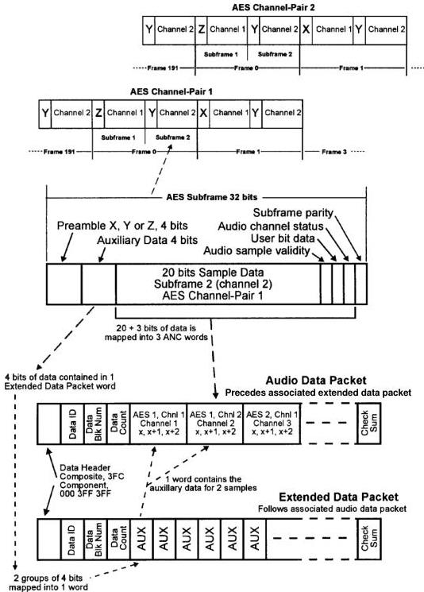
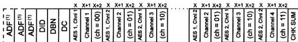
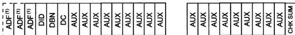
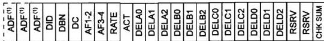

# ANSI/SMPTE 272M-1994 — Formatting AES/EBU Audio and Auxiliary Data into Digital Video Ancillary Data Space

**SMPTE Standard for Television**

## 1 Scope

1.1 This standard defines the mapping of AES digital audio data, AES auxiliary data, and associated control information into the ancillary data space of serial digital video conforming to ANSI/SMPTE 259M. The audio data and auxiliary data are derived from ANSI S4.40, hereafter referred to as AES audio.

1.2 Audio sampled at 48 kHz and clock locked (synchronous) to video is the preferred implementation for intrastudio applications. As an option, this standard supports AES audio at synchronous or asynchronous sampling rates from 32 kHz to 48 kHz.

1.3 The minimum, or default, operation of this standard supports 20 bits of audio data as defined in 3.5. As an option, this standard supports 24-bit audio or four bits of AES auxiliary data as defined in 3.10.

1.4 This standard provides a minimum of two audio channels and a maximum of 16 audio channels based on available ancillary data space in a given format (four channels maximum for composite digital). Audio channels are transmitted in pairs combined, where appropriate, into groups of four. Each group is identified by a unique ancillary data ID.

1.5 Several modes of operation are defined and letter suffixes are applied to the nomenclature for this standard to facilitate convenient identification of interoperation between equipment with various capabilities. The default form of operation is 48-kHz synchronous audio sampling carrying 20 bits of AES audio data

and defined in a manner to ensure reception by all equipment conforming to this standard.

## 2 Normative references

The following standards contain provisions which, through reference in this text, constitute provisions of this standard. At the time of publication, the editions indicated were valid. All standards are subject to revision, and parties to agreements based on this standard are encouraged to investigate the possibility of applying the most recent edition of the standards indicated below.

ANSI S4.40-1992, Recommended Practice for Digital Audio Engineering — Serial Transmission Format for Two-Channel Linearly Represented Digital Audio Data (AES 3)

ANSI/SMPTE 125M-1992, Television — Component Video Signal 4:2:2 — Bit-Parallel Digital Interface

ANSI/SMPTE 259M-1993, Television — 10-Bit 4:2:2 Component and 4fsc NTSC Composite Digital Signals — Serial Digital Interface

SMPTE RP 165-1994, Error Detection Checkwords and Status Flags for Use in Bit-Serial Digital Interfaces for Television

SMPTE RP 168-1993, Definition of Vertical Interval Switching Point for Synchronous Video Switching

## 3 Definition of terms

3.1 AES audio: All the data, audio and auxiliary, associated with one AES digital stream as defined in ANSI S4.40.

CAUTION NOTICE: This Standard may be revised or withdrawn at any time. The procedures of the Standard Developer require that action be taken to reaffirm, revise, or withdraw this standard no later than five years from the date of publication. Purchasers of standards may receive current information on all standards by calling or writing the Standard Developer.

Printed in USA.

Copyright © 1994 by THE SOCIETY OF
MOTION PICTURE AND TELEVISION ENGINEERS
595 W. Hartsdale Ave., White Plains, NY 10607
(914) 761-1100

American National Standard

Approved
October 19, 1994

**3.2 AES frame:** Two AES subframes, one with audio data for channel 1 followed by one with audio data for channel 2.

**3.3 AES subframe:** All data associated with one AES audio sample for one channel in a channel pair.

**3.4 audio control packet:** An ancillary data packet occurring once a field and containing data used in the operation of optional features of this standard.

**3.5 audio data:** 23 bits: 20 bits of AES audio associated with one audio sample, not including AES auxiliary data, plus the following 3 bits: sample validity (V bit), channel status (C bit), and user data (U bit).

**3.6 audio data packet:** An ancillary data packet containing audio data for 1 or 2 channel pairs (2 or 4 channels). An audio data packet may contain audio data for one or more samples associated with each channel.

**3.7 audio frame number:** A number, starting at 1, for each frame within the audio frame sequence. For the example in 3.8, the frame numbers would be 1, 2, 3, 4, 5.

**3.8 audio frame sequence:** The number of video frames required for an integer number of audio samples in synchronous operation. As an example: the audio frame sequence for synchronous 48-kHz sampling in an NTSC (29.97 fr/s) system is 5 frames.

**3.9 audio group:** Consists of one or two channel pairs which are contained in one ancillary data packet. Each audio group has a unique ID as defined in 12.1. Audio groups are numbered 1 through 4.

**3.10 auxiliary data:** Four bits of AES audio associated with one sample defined as auxiliary data by ANSI S4.40. The four bits may be used to extend the resolution of audio sample.

**3.11 channel pair:** Two digital audio channels, generally derived from the same AES audio source.

**3.12 data ID:** A word in the ancillary data packet which identifies the use of the data therein (see ANSI/SMPTE 259M).

**3.13 extended data packet:** An ancillary data packet containing auxiliary data corresponding to, and immediately following, the associated audio data packet.

**3.14 sample pair:** Two samples of AES audio as defined in 3.1.

**3.15 synchronous audio:** Audio is defined as being clock synchronous with video if the sampling rate of audio is such that the number of audio samples occurring within an integer number of video frames is itself a constant integer number, as in the following examples:

|  Audio sampling rate | Samples/frame, 29.97 fr/s video | Samples/frame, 25 fr/s video  |
| --- | --- | --- |
|  48.0 kHz | 8008/5 | 1920/1  |
|  44.1 kHz | 147147/100 | 1764/1  |
|  32.0 kHz | 16016/15 | 1280/1  |

NOTE – The video and audio clocks must be derived from the same source since simple frequency synchronization could eventually result in a missing or extra sample within the audio frame sequence.

## 4 Overview and levels of operation

**4.1** Audio data derived from one or more AES frames and one or two channel pairs are configured in an audio data packet as shown in figure 1. Generally, both channels of a channel pair will be derived from the same AES audio source; however, this is not required. The number of samples per channel used for one audio data packet will depend on the distribution of the data in a video field. As an example, the ancillary data space in some television lines may carry three samples, some may carry four samples. Other values are possible. Ancillary data space carrying no samples will not have an audio data packet.

NOTE – Receiver designers should recognize that some existing transmission equipment may transmit other sample counts, including zero. Receivers should handle correctly sample counts from zero to the limits of ancillary data space and receive buffer space.

**4.2** Three types of ancillary data packets to carry AES audio information are defined and formatted per ANSI/SMPTE 259M and ANSI/SMPTE 125M.

The audio data packet carries all the information in the AES bit stream excluding the auxiliary data defined by ANSI S4.40. The audio data packet is located in the ancillary data space of the digital video on most of the television lines in a field. An audio control packet is transmitted once per field, is optional for the default case of 48-kHz synchronous audio (20 or 24 bits), and is required for all other modes of operation. Auxiliary data are carried in an extended data packet corresponding to and immediately following the associated audio data packet.

**4.3** Data IDs (see 12.1, 13.1, and 14.1) are defined for four separate packets of each packet type. This allows for up to eight channel pairs in component video; however, there is ancillary data space for only two channel pairs (of 20 or 24 bit, 48-kHz audio) in composite video. In this standard, the audio groups are numbered 1 through 4 and the channels are numbered 1 through 16. Channels 1 through 4 are in group 1, channels 5 through 8 are in group 2, and so on.

**4.4** If extended data packets are used, they are included on the same video line as the audio data packet which contains data from the same sample pair. The extended data packet follows the audio data packet and contains two 4-bit groups of auxiliary data per ancillary data word as shown in figure 1.

**4.5** To define the level of support in this standard by a particular equipment, a suffix letter is added to the standard number. The default compliance is defined as level A and implements synchronous audio sampled at 48 kHz and carrying only the (20-bit) audio data packets. Distribution of samples on the television lines for level A specifically follows the uniform sample distribution as required by 9.1 in order to ensure interoperation with receivers limited to level A operation (see annex A for distribution analysis).

**4.6** Levels of operation indicate support as listed:

A) Synchronous audio at 48 kHz, 20-bit audio data packets (allows receiver operation with a buffer size less than the 64 samples required by 9.2);

B) Synchronous audio at 48 kHz, for use with composite digital video signals, sample distribution to

allow extended data packets, but not utilizing those packets (requires receiver operation with a buffer size of 64 samples per 9.2);

C) Synchronous audio at 48 kHz, audio and extended data packets;

D) Asynchronous audio (48 kHz implied, other frequencies if so indicated);

E) 44.1-kHz audio;

F) 32-kHz audio;

G) 32 kHz to 48 kHz continuous sampling rate range;

H) Audio frame sequence (see 14.2);

I) Time delay tracking;

J) Noncoincident Z bits in a channel pair.

**4.7** Examples of compliance nomenclature:

A transmitter that supports only 20-bit 48-kHz synchronous audio would be said to conform to SMPTE 272M-A. (Transmitted sample distribution is expected to conform to clause 9.)

A transmitter that supports 20-bit and 24-bit 48-kHz synchronous audio would be said to conform to SMPTE 272M-ABC. (In the case of level A operation, the transmitted sample distribution is expected to conform to clause 9, although a different sample distribution may be used when it is in operation conforming to levels B or C.)

A receiver which can only accept 20-bit 48-kHz synchronous audio and requiring level A sample distribution would be said to conform to SMPTE 272M-A.

A receiver which only utilizes the 20-bit data but can accept the level B sample distribution would be said to conform to SMPTE 272M-AB since it will handle either sample distribution.

A receiver which accepts and utilizes the 24-bit data would be said to conform to SMPTE 272M-C.

Equipment that supports only asynchronous audio and only at 32 kHz, 44.1 kHz, and 48 kHz would be said to conform to SMPTE 272M-DEF.

*Figure 1 – Relation between AES data and audio extended data packets*

NOTE – See clause 15 for ancillary data packet formatting.

## 5 Use of ancillary data space

**5.1** For component video, audio and extended data are located in the data space between EAV and SAV (HANC) and may be on any line allowed by this standard.

**5.2** For composite video, audio and extended data packets may be located in any ancillary data space, except that audio data should not be present during equalizing pulses.

**5.3** Audio and extended data are not transmitted during the horizontal ancillary data space following the normal video switching point; that is, the first horizontal interval subsequent to the switched line.

**5.4** Audio and extended data are not transmitted during the portion of the horizontal ancillary data space designated for error detection check-words defined in SMPTE RP 165.

NOTE – Receiver designers should recognize that some existing transmission equipment may not conform to the restrictions of 5.2 through 5.4. Receivers should receive audio data transmitted in any ancillary data space.

**5.5** Audio and extended data should be inserted immediately after the digital synchronization data (EAV or TRS-ID) in the available ancillary data space. For composite video, in the special case of the second vertical sync pulse in a television line, audio data should be inserted at the earliest sample designated as ancillary data space (word 340 for NTSC, word 404 for PAL).

## 6 Audio data packet formatting

**6.1** The four audio channels from audio group 1 are ordered such that channels 1 and 2 make one channel pair and channels 3 and 4 make another. Audio group 2 contains channels 5 and 6 as one channel pair, and so on.

**6.2** Where the audio data are derived from a single AES data stream, the data shall be ordered such that data from a subframe 1 is always transmitted before the data from a subframe 2 in the same channel pair. This means that data from subframe 1 would be placed in channel 1 (or 3, 5, ...) and data from subframe 2 would be placed in channel 2 (or 4, 6, ...).

**6.3** The order that the channel pairs are transmitted within a group is not defined. As an example, the channel pair containing channels 3 and 4 could precede the channel pair containing channels 1 and 2.

**6.4** When only one channel of a channel pair is active, both channels must still be transmitted. If the audio signal is not derived from a single AES audio signal, then the accompanying inactive channel's audio sample bits must be set to all zeros with the V bit, C bit, and U bit set to appropriate values.

**6.5** Audio channels within the same channel pair must have the same sampling rate and are considered to have the same synchronous or nonsynchronous status.

**6.6** Channel pairs may be mixed with respect to their sampling rate and synchronous or nonsynchronous status. Each video frame will contain the appropriate number of AES audio samples for the rate used.

**6.7** The audio packet length is variable. To meet the requirements of 8.1, the length must be short enough to allow room in the remaining ancillary data space for the extended data packet if auxiliary data are present.

## 7 Audio control packet

**7.1** The optional audio control packet will be transmitted in the second horizontal ancillary data space after the video switching point. The control packet shall be transmitted prior to any audio packets within this ancillary data space.

**7.2** If the audio control packet is not transmitted, a default operating condition of 48-kHz synchronous audio is assumed. This could include any number of channel pairs up to the maximum of eight. All other audio control parameters are undefined.

## 8 Extended data packet formatting

**8.1** Auxiliary data, if present, must be transmitted as part of an extended data packet in the same ancillary data space (e.g., sync tip for composite video) as its corresponding audio

data. When used, one extended data word will be transmitted for each corresponding sample pair.

**8.2** Audio data packets are transmitted before their corresponding extended data packets.

**8.3** With respect to the data which will be transmitted within a particular ancillary data space, all of the audio and auxiliary data from one audio group shall be transmitted together before data from another group is transmitted.

**8.4** When a channel pair is operating in asynchronous mode, its corresponding AFn-n word in the audio control packet is not used (see 14.2 and 14.3).

## 9 Audio data packet distribution

**9.1** The transmitted data should be distributed as evenly as possible throughout the video field considering the restrictions of clauses 5 through 8.

**9.2** Data packet distribution is further constrained by defining a minimum receiver buffer size as explained in annex A. The minimum receiver buffer size is 64 samples per active channel.

NOTE – Some existing equipment uses a receiver buffer size of 48 samples per active channel. Such receivers may not be capable of receiving all data distributions permitted by this standard. They are capable of receiving level A transmissions.

## 10 Audio data structure

The AES subframe, less the four bits of auxiliary data, is mapped into three contiguous ancillary data words (X, X+1, X+2) as follows:

|  Bit address | X | X+1 | X+2  |
| --- | --- | --- | --- |
|  b9 | not b8 | not b8 | not b8  |
|  b8 | aud 5 | aud 14 | P  |
|  b7 | aud 4 | aud 13 | C  |
|  b6 | aud 3 | aud 12 | U  |
|  b5 | aud 2 | aud 11 | V  |
|  b4 | aud 1 | aud 10 | aud 19 (MSB)  |
|  b3 | aud 0 | aud 9 | aud 18  |
|  b2 | ch 1 | aud 8 | aud 17  |
|  b1 | ch 0 | aud 7 | aud 16  |
|  b0 | Z | aud 6 | aud 15  |

**10.1** Z: The preferred implementation is set to both Z-bits of a channel pair to 1 at the same sample, coincident with the beginning of a new AES channel status block (which only occurs on frame 0), otherwise set to 0. This is the required form when a channel pair is derived from a single AES data stream.

Optionally, the Z bits may independently be set to 0 allowing embedding audio from two AES sources whose Z preambles (channel status blocks) are not coincident. This constitutes operation at level J (see 4.6).

NOTE – Designers should recognize that some receiving equipment may not accept Z bits set to 1 at different locations for a given channel pair. This is not a problem when the transmitted channel pair is derived from the same AES source. If separate sources are used to develop a channel pair, the transmitter must either reformat the channel status blocks for coincidence, if they are not already synchronized at the block level, or recognize that the signal may cause problems with some receiver equipment.

**10.2** ch(0-1): Identifies the audio channel within an audio group. ch = 00 would be channel 1 (or 5, 9, 13), ch = 01 would be channel 2 (or 6, 10, 14), ...

**10.3** aud(0-19): Twos complement linearly represented audio data.

**10.4** V: AES sample validity bit.

**10.5** U: AES user bit.

**10.6** C: AES audio channel status bit.

**10.7** P: Even parity for the 26 previous bits in the subframe sample (excludes b9 in the first and second words). NOTE - The P bit is not the same as the AES parity bit.

## 11 Extended data structure

The extended data are ordered such that the four AES auxiliary bits from each of the two associated subframes of one AES frame are combined into a single ancillary data word. Where more than four channels are transmitted, the relationship of audio and extended data packets per 8.3 ensures auxiliary data will be correctly associated with its audio sample data.

|  Bit address | ANC data word  |
| --- | --- |
|  b9 | not b8  |
|  b8 | a  |
|  b7 | y3 (MSB)  |
|  b6 | y2  |
|  b5 | y1  |
|  b4 | y0 (LSB)  |
|  b3 | x3 (MSB)  |
|  b2 | x2  |
|  b1 | x1  |
|  b0 | x0 (LSB)  |

**11.1** x(0-3): Auxiliary data from subframe 1.

**11.2** y(0-3): Auxiliary data from subframe 2.

**11.3** a: Address pointer. 0 for channels 1 and 2, and 1 for channels 3 and 4.

**11.4** b9: not b8.

## 12 Audio data packet structure

The 20-bit audio samples as defined in clause 10 are combined and arranged in ancillary data packets. Shown in figure 2 is an example of four channels of audio (two channel pairs). The sample pairs may be transmitted in any order and do not need to be transmitted in the order shown. Furthermore, if the sampling rates are different for AES1 and AES2, there may be a different number of sample pairs for AES1 and AES2. (See ANSI/SMPTE 125M and ANSI/SMPTE 259M for the formatting of ancillary data packets.)

**12.1** The ancillary data flag, ADF, is one word in composite systems, while component systems use three words as indicated by the broken lines in figures 2, 3, and 4.

**12.2** The audio packet data ID (DID) words for audio groups 1-4 are 2FF$_{h}$, 1FD$_{h}$, 1FB$_{h}$, and 2F9$_{h}$, respectively.

## 13 Extended data packet structure

If AES auxiliary data are present, the extended data words containing AES auxiliary data as defined in clause 11 are combined and arranged in ancillary data packets which immediately follow the corresponding 20-bit audio packets. The packet structure is shown in figure 3.

**13.1** The extended packet data ID words (DID) for audio groups 1-4 are 1FE$_{h}$, 2FC$_{h}$, 2FA$_{h}$, and 1F8$_{h}$, respectively.

## 14 Audio control packet structure and data

The audio control packet is transmitted once per field, at a fixed position defined in 7.1. The control packet is optional for the default case of 48-kHz synchronous audio. It must be transmitted for all other modes. Structure of the audio control packet is shown in figure 4.

**14.1** There is a separate audio control packet for each audio group, thereby accounting for 16 possible audio channels. The audio control packet data ID (DID) words for audio groups 1-4 are 1EF$_{h}$, 2EE$_{h}$, 2ED$_{h}$, and 1EC$_{h}$, respectively.

**14.2** Audio frame numbers (AFn-n) provide a sequential ordering of video frames to indicate where they fall in the progression of noninteger number of samples per video frame (audio frame sequence) inherent in 29.97 frame/s video systems. The first number in the sequence is always 1 and the final number is equal to the length of the audio frame sequence (see 3.7, 3.8, and 3.15). A value of all zeros indicates no frame numbering is available.

AF1-2: Audio frame number for channels 1 and 2 in a given audio group;

AF3-4: Audio frame number for channels 3 and 4 in a given audio group.

**14.3** For correct use of the audio frame number, the audio frame sequence must be defined. Three synchronous sampling rates are defined in this standard (see 3.15). Requests for revisions to add further sampling rates should be directed to the SMPTE Engineering Department.

All audio frame sequences are based on two integer numbers of samples per frame (m and m+1) with audio frame numbers starting at 1 and proceeding to the end of the sequence. Odd-numbered frames (1, 3, 5, ...) have the larger integer number of samples and even-numbered frames (2, 4, 6, ...) have the smaller integer number of samples with the exceptions tabulated in table 1.

*Figure 2 – Audio data packet structure (Example of 4 audio channels, 1 audio group)*

*Figure 3 – Extended data packet structure*

*Figure 4 – Audio control packet structure*

### NOTES

1 The ancillary data flag, ADF, is one word in composite systems (ANSI/SMPTE 259M) and three words in component systems (ANSI/SMPTE 125M).
2 See clause 15 for ancillary data packet formatting.

Table 1 – Exceptions to audio frame sequences

|  Sample rate (kHz) | Frame sequence | Basic numbering systems |   | Exceptions  |   |
| --- | --- | --- | --- | --- | --- |
|   |   |  Samples per odd frame (m) | Samples per even frame (m+1) | Frame number | Number of samples  |
|  48.0 | 5 | 1602 | 1601 | none |   |
|  44.1 | 100 | 1472 | 1471 | 23 | 1471  |
|   |   |   |   |  47 | 1471  |
|   |   |   |   |  71 | 1471  |
|  32.0 | 15 | 1068 | 1067 | 4 | 1068  |
|   |   |   |   |  8 | 1068  |
|   |   |   |   |  12 | 1068  |

**14.4** Bit address definition for the audio frame words AF1-2 and AF3-4:

|  Bit address | Audio frame number  |
| --- | --- |
|  b9 | not b8  |
|  b8 | f8 (MSB)  |
|  b7 | f7 :  |
|  b6 | f6 :  |
|  b5 | f5 AFn-n  |
|  b4 | f4 :  |
|  b3 | f3 :  |
|  b2 | f2 :  |
|  b1 | f1 :  |
|  b0 | f0 (LSB)  |

When a channel pair is operating in asynchronous mode, its corresponding AFn-n word in the audio control packet is not used. Bits (0-8) should be set to zero to avoid the excluded value 000h.

As an option, the most significant bits of the audio frame number that are not used as the audio frame sequence counter may be used as a counter to facilitate detection of a vertical interval switch. As an example, if the audio frame sequence is 5, bits 3 through 8 may be used to make a 6-bit counter which the receiver could follow to determine if the sequence 0-63, 0-63, ... were broken. Used in conjunction with the data block number of the ancillary data packet 0-255, 0-255, ..., an appropriately designed receiver could, with a high probability, detect a vertical interval switch and process the audio samples to eliminate any undesired transient effects.

**14.5** The sampling frequency for each channel pair is given by the word (RATE). The sync mode bits asx and asy, when set to one, indicate that the respective channel pair is operating asynchronously.

|  Bit address | Rate word  |
| --- | --- |
|  b9 | not b8  |
|  b8 | reserved (set to zero)  |
|  b7 | y2 (MSB)  |
|  b6 | y1 RATE CODE channels 3 and 4 in a given audio group  |
|  b5 | y0 (LSB)  |
|  b4 | asy  |
|  b3 | x2 (MSB)  |
|  b2 | x1 RATE CODE channels 1 and 2 in a given audio group  |
|  b1 | x0 (LSB)  |
|  b0 | asx  |

The sample rates currently defined for x(0-2) and y(0-2):

|  Rate code | Sample rate  |
| --- | --- |
|  000 | 48 kHz  |
|  001 | 44.1 kHz  |
|  010 | 32 kHz  |
|  011 – 110 | (reserved)  |
|  111 | undefined (free running)  |

**14.6** The word ACT indicates the active channels; a(1-4) are set to one for each active channel in a given audio group; p is even parity for b(0-7).

|  Bit address | Active channel word  |
| --- | --- |
|  b9 | not b8  |
|  b8 | p  |
|  b7 | reserved (set to zero)  |
|  b6 | reserved (set to zero)  |
|  b5 | reserved (set to zero)  |
|  b4 | reserved (set to zero)  |
|  b3 | a4  |
|  b2 | a3  |
|  b1 | a2  |
|  b0 | a1  |

**14.7** The words DELx(0-2) indicate the amount of accumulated audio processing delay relative to video, measured in audio sample intervals, for each of the channels. Since the channels are generally used as channel pairs, the words for a given audio group are ordered as follows:

|  DELAn | Delay for channel 1 | if DELCn e=1  |
| --- | --- | --- |
|  DELAn | Delay for channel 1 and channel 2 | if DELCn e=0  |
|  DELBn | Delay for channel 3 | if DELDn e=1  |
|  DELBn | Delay for channel 3 and channel 4 | if DELDn e=0  |
|  DELCn | Delay for channel 2 | if DELCn e=1  |
|  DELCn | Invalid audio delay data | if DELCn e=0  |
|  DELDn | Delay for channel 4 | if DELDn e=1  |
|  DELDn | Invalid audio delay data | if DELDn e=0  |

When only two channels are used, the e-bits in DELCn and DELDn must be set to 0 to indicate invalid while maintaining a constant size for the audio control packet.

The format for the audio delay data is 26-bit twos complement:

|  Bit address | DELx0 | DELx1 | DELx2  |
| --- | --- | --- | --- |
|  b9 | not b8 | not b8 | not b8  |
|  b8 | d7 | d16 | d25 (sign)  |
|  b7 | d6 | d15 | d24 (MSB)  |
|  b6 | d5 | d14 | d23  |
|  b5 | d4 | d13 | d22  |
|  b4 | d3 | d12 | d21  |
|  b3 | d2 | d11 | d20  |
|  b2 | d1 | d10 | d19  |
|  b1 | d0 (LSB) | d9 | d18  |
|  b0 | e | d8 | d17  |

The e bit is set to one to indicate valid audio delay data. The delay words are referenced to the point where the AES/EBU data are input to the formatter. The delay words represent the average delay value, inherent in the formatting process, over a period no less than the length of the audio frame sequence (see 3.15) plus any preexisting audio delay. Positive values indicate that the video leads the audio.

**14.8** The words RSRV are reserved and should be set to zero, except for bit 9 which is the complement of bit 8.

## 15 Ancillary data formatting

### 15.1 Data block number

Following each data ID, a data block number shall be inserted. The data block number, if active, shall increment (by 1) when consecutive data blocks within a common data ID exist, or when data blocks within a common data ID are to be linked.

The data block number is defined as:

b7 through b0 incremented data if active,  
(MBS) (LSB) all zeros if inactive  
b8 is even parity for b7 through b0  
b9 = not b8

### 15.2 Data count

The data count represents the number of user data words to follow, up to a maximum of 255 words. The data count word is positioned as data block number + 1.

The data count is defined as:

b7 through b0 number of user data words  
(MBS) (LSB)  
b8 is even parity for b7 through b0  
b9 = not b8

### 15.3 Checksum

The checksum word shall consist of nine bits. The checksum word is used to determine the validity of the words data ID through user data. It is the sum of the nine least significant bits of the words data ID through user data:

b8 through b0 checksum value  
(MBS) (LSB)  
b9 = not b8

## Annex A (informative)

### A.1 Minimum buffer size calculations

Since there is not an integer number of samples per horizontal line, and because some lines are excluded in the distribution of samples, a buffer is required in the receiver. Significantly larger buffers are required for composite operation because of the audio ancillary data exclusion in equalizing pulses and the limited sync tip space available when considering level B operation.

This annex is not intended to present detailed and exact calculations of buffer sizes. The calculations shown below will provide designers with guidelines for determining required buffer sizes for four-channel, level A and B operation.

Considering that as many as 1602 samples are required per video frame, the average number of samples per line is $1602/525 = 3.0514$. Table A.1 shows the calculation for minimum buffer size for a typical 20-bit sample distribution in a composite signal. Values shown in the column labeled buffer are the number of samples in the buffer at the end of the line, after the average 3.0514 samples have been removed. This example would require a smart receiver buffer that would know to have exactly 24 samples available at the end of line 525. A similar analysis can be made for 625-line systems.

Table A.2 shows the best sample distribution for 24-bit audio (again by way of demonstration only, the audio control data packet is not included). Because of the limited amount of available space for ancillary data in sync tips for composite video, there is only room for three samples of a four-channel signal per line. Maximum smart buffer size would be 40 samples as seen by the number of samples at the end of line 269. In this case, smart means having exactly 11 samples at the end of line 525 or 0 samples at the end of line 266.

### A.2 Smart buffers

There are two common types of buffers that are equivalent for the purpose of understanding requirements to meet this standard. One is the FIFO (first in first out) buffer and the other is a circular buffer. Smart buffers will have the following synchronized load abilities:

FIFO buffer -- Hold off 'reads' until a specific number of samples are in the buffer (requires a counter) and neither read nor write until a specified time (requires vertical sync);

Circular buffer -- Set the read address to be a certain number of samples after the write address at a specified time (requires vertical sync).

Although other sample distributions are possible, the two described in A.1 are sufficient to demonstrate both the principle and operation at levels A, B, or C of this standard. The minimum buffer size requirement is set by examining the relative requirements of the 24-bit case in conjunction with the 20-bit case. A 64-sample buffer, correctly implemented, should meet the requirements of clause 9.

#### A.2.1 Synchronization at vertical sync (line 4)

The circular buffer is most easily understood and commonly used in practice. Consider that data are being input as available so the buffer is full and writes/reads are determined by addresses. In the 20-bit case, make the read address follow the write address by 17 samples at the start of line 4 or 267 (vertical sync). This means that by line 12 or 275, the write address will still be ahead of the read address and the sequence given in table A.1 will be followed. The buffer size needs to be at least 24 samples to take care of lines 1-3 (264-266). The reason for the 17 is that the buffer will run out of samples before arriving at line 12.

In the 24-bit sample case, there is no 17-sample offset requirement since it could start with a zero offset at the start of line 266 and quickly build up enough samples to last to line 4. However, the buffer would have to hold about 40 samples.

Combining these two cases for general automatic operation, there is a 17-sample offset plus a 40-sample growth (during the field 2 broad pulses) indicating that this smart buffer will handle all cases with a 57-sample buffer size.

#### A.2.2 Synchronization at vertical switch point (lines 10 and 273)

Again considering a circular buffer, for the 24-bit sample case an address offset of 27 is required at the start of line 273 so that there will be sufficient samples left at lines 2 and 266. The address offset will increase to 40 at line 269 which would be the maximum buffer size considering only the 24-bit case.

Including the requirements for the 20-bit case, if the offset is 27 samples at line 273, then it will increase to 47 at line 525 which then sets the minimum buffer size at 47.

#### A.2.3 Other buffer design considerations

Synchronization of the buffer address offset should use some hysteresis and additional buffer capacity is required since the exact number of samples required for each frame will vary slightly. Hard resetting of the address offset should only occur if the hysteresis range is exceeded indicating a resynchronization is required.

### A.3 Not-so-smart buffers

If the circular buffer does not know where vertical sync is located, then the read and write address must be far enough apart to handle either a build-up of 40 samples or a depletion of 40 samples. This means the buffer size must be 80 samples for 24-bit audio and 34 samples for 20-bit audio distributed as shown in the tables. For automatic operation, the larger 80-sample buffer is required.

A smart buffer is required in order to meet the 64-sample criteria of 9.1 when using a sample distribution allowing for 24-bit samples (operation levels B and C).

### A.4 Relative channel-to-channel delay

Because of the use of buffers in both the multiplexing and demultiplexing of audio in the video data stream, equipment designers must ensure that all channels are subjected to identical delays, where appropriate. (It may not be appropriate

ate where different audio sampling frequencies are used.) Failure to do so may result in incorrect channel phasing for stereo or other time-related audio signals. It is also good practice to keep the relative delays to a minimum in order to maintain accurate lip sync.

**Table A.1 – Typical 20-bit sample distribution**

|  Line | No. of samples | Buffer | Line | No. of samples | Buffer | Comment  |
| --- | --- | --- | --- | --- | --- | --- |
|   |  | 24.0 |  |  | 22.5 | F-1 arbitrary value  |
|  1 | 0 | 20.9 | 264 | 0 | 19.4 | Equalizing pulse  |
|  2 | 0 | 17.9 | 265 | 0 | 16.4 | Equalizing pulse  |
|  3 | 0 | 14.8 | 266 | 0 | 13.3 | Equalizing pulse  |
|  4 | 4 | 15.8 | 267 | 4 | 14.3 |   |
|  5 | 4 | 16.7 | 268 | 4 | 15.2 |   |
|  6 | 4 | 17.7 | 269 | 4 | 16.2 |   |
|  7 | 0 | 14.6 | 270 | 0 | 13.1 | Equalizing pulse  |
|  8 | 0 | 11.6 | 271 | 0 | 10.1 | Equalizing pulse  |
|  9 | 0 | 8.5 | 272 | 0 | 7.0 | Equalizing pulse  |
|  10 | 0 | 5.5 | 273 | 0 | 4.0 | Switching line  |
|  11 | 0 | 2.4 | 274 | 0 | 0.9 | Line after switch  |
|  12 |  |  | 275 |  |  |   |
|  : |  |  | : |  |  | 3s and 4s even distribution  |
|  263 | 789 | 22.5 | 525 | 789 | 24.0 |   |
|  Total | 801 |  |  | 801 |  | 1602 samples per frame  |

**Table A.2 – Best 24-bit sample distribution**

|  Line | No. of samples | Buffer | Line | No. of samples | Buffer | Comment  |
| --- | --- | --- | --- | --- | --- | --- |
|   |  | 11.0 |  |  | 9.5 | F-1 arbitrary value  |
|  1 | 0 | 7.9 | 264 | 0 | 6.4 | Equalizing pulse  |
|  2 | 0 | 4.9 | 265 | 0 | 3.4 | Equalizing pulse  |
|  3 | 0 | 1.8 | 266 | 0 | 0.3 | Equalizing pulse  |
|  4 | 15 | 13.8 | 267 | 16 | 13.3 |   |
|  5 | 15 | 25.7 | 268 | 16 | 26.2 |   |
|  6 | 15 | 37.7 | 269 | 16 | 39.2 |   |
|  7 | 0 | 34.6 | 270 | 0 | 36.1 | Equalizing pulse  |
|  8 | 0 | 31.6 | 271 | 0 | 33.1 | Equalizing pulse  |
|  9 | 0 | 28.5 | 272 | 0 | 30.0 | Equalizing pulse  |
|  10 | 0 | 25.5 | 273 | 0 | 27.0 | Switching line  |
|  11 | 0 | 22.4 | 274 | 0 | 23.9 | Line after switch  |
|  12 |  |  | 275 |  |  |   |
|  : |  |  | : |  |  | All 3s  |
|  263 | 756 | 9.5 | 525 | 753 | 11.0 |   |
|  Total | 801 |  |  | 801 |  | 1602 samples per frame  |

